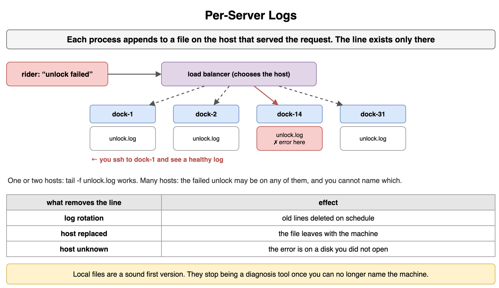
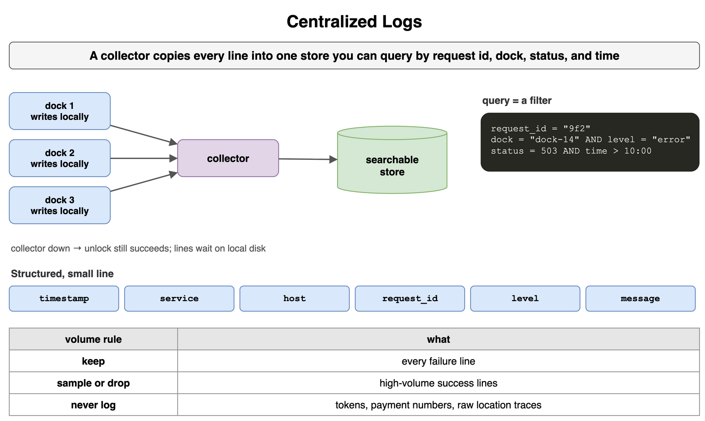
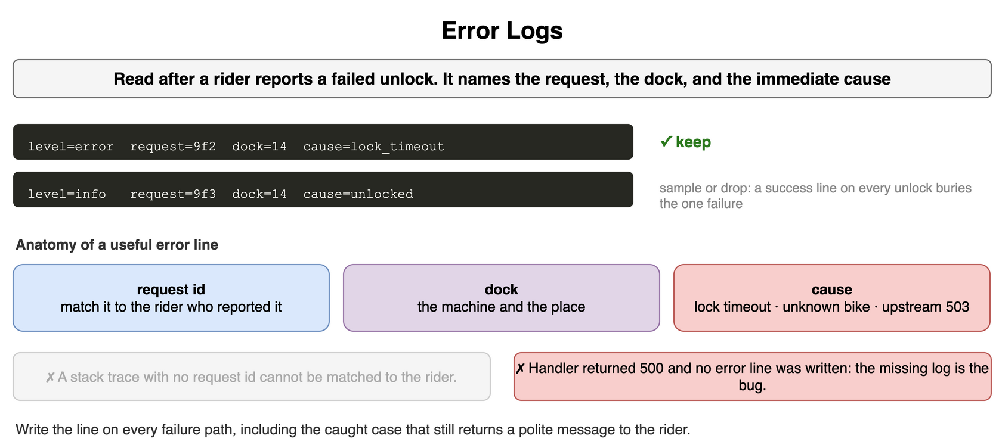
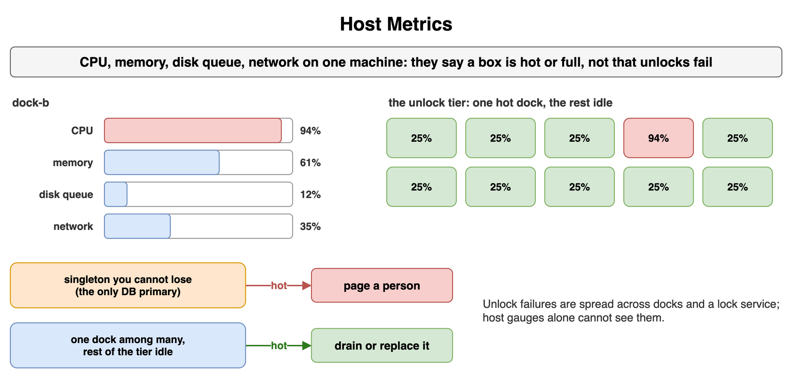
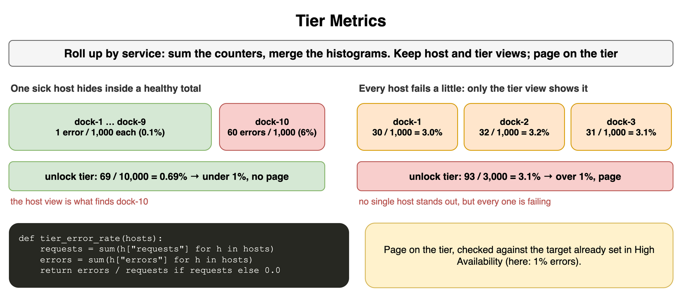
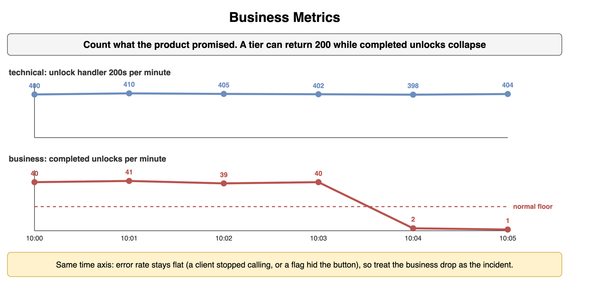
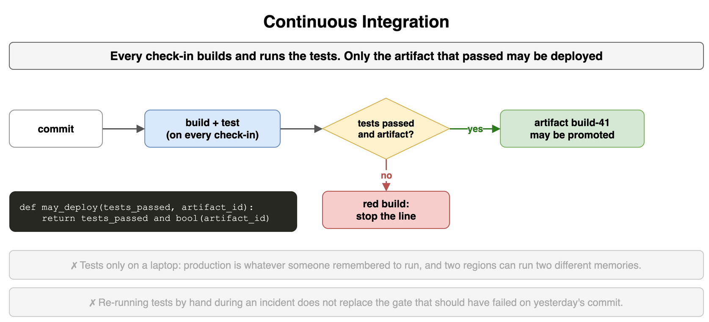
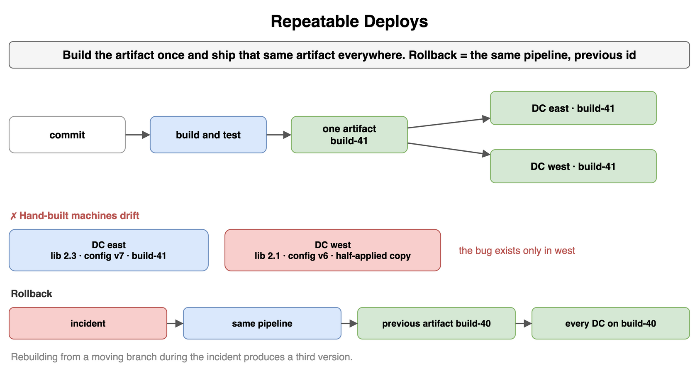
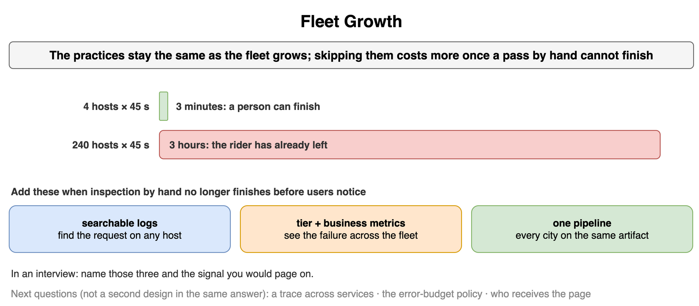

## Per-Server Logs

Each process appends lines to a file on the machine that handled the request. With one or two hosts you open that file. The line exists only there: rotation deletes it, and a replaced host takes the file with it.

A load balancer chooses the host. When a rider reports a failed unlock, the line may be on dock-14, dock-31 or dock-2, and if you cannot search every host, the error is on a disk you did not open. Local files are a sound first version. They stop being a diagnosis tool once you can no longer name the machine.

```text
one host:    ssh dock-1 && tail -f unlock.log
many hosts:  the failed unlock may be on dock-14, dock-31, or dock-2
lost:        rotation, or a replaced host
```



*Source: [`diagrams/observability.drawio`](/content/09_System_Design_Interview/25_Observability/diagrams/observability.drawio), page 1.*

## Centralized Logs

A collector copies each line to one store you can query by request id, dock id, status and time. The process still writes locally, so a collector outage does not stall the unlock. Diagnosis happens in the store.

Keep the line structured and small: timestamp, service, host, request id, level and message. A query is then a filter over fields instead of a grep across hosts. Sample or drop high-volume success lines, and keep the failures. Leave tokens, payment numbers and raw location traces out of the line.

```text
ts=09:14:02 service=unlock host=dock-14 request=9f2 level=error msg=lock_timeout
query:      request=9f2, or dock=14 and level=error in the last hour
keep:       failures      sample: successes      never: tokens, card numbers, traces
```



*Source: [`diagrams/observability.drawio`](/content/09_System_Design_Interview/25_Observability/diagrams/observability.drawio), page 2.*

## Error Logs

An error log is what you read after a rider reports a failed unlock. It names the request, the dock and the immediate cause: lock timeout, unknown bike, upstream 503. A stack trace with no request id cannot be matched to that rider. A success line on every unlock buries the one failure.

If the handler returned 500 and no error line was written, the bug is the missing log. Write the line on the failure path, including the caught case that still returns a polite message to the rider.

```text
keep:   level=error request=9f2 dock=14 cause=lock_timeout
drop:   level=info  request=9f3 dock=14 cause=unlocked
bug:    a 500 with no error line
```



*Source: [`diagrams/observability.drawio`](/content/09_System_Design_Interview/25_Observability/diagrams/observability.drawio), page 3.*

## Host Metrics

Host metrics are CPU, memory, disk queue and network on one machine. They say that a box is hot or full. They do not say that unlocks are failing, because that failure is spread across docks and a lock service.

Page a person for one host's CPU only when that host is a singleton you cannot lose, such as the only database primary. One dock at 90% CPU with the rest of the tier idle is a machine to drain or replace, not a fleet incident.

```text
measures     CPU, memory, disk queue, network on one box
says         this box is hot or full
page         only for a singleton, such as the database primary
otherwise    drain or replace the hot host
```



*Source: [`diagrams/observability.drawio`](/content/09_System_Design_Interview/25_Observability/diagrams/observability.drawio), page 4.*

## Tier Metrics

Roll the same measurement up by service: request rate, error rate and latency percentiles for the unlock tier, not for dock-14. Sum the counters and merge the histograms. The tier error rate is the summed errors over the summed requests across every host, not an average of each host's rate.

One sick host hides inside a healthy total, and a calm host average hides a tier that is failing on every host, so keep both views. The page belongs on the tier, checked against the target already set in High Availability.

```text
rate         sum of requests across hosts
errors       sum of errors / sum of requests
latency      merged histograms, then percentiles
page         on the tier, against the availability target
```



*Source: [`diagrams/observability.drawio`](/content/09_System_Design_Interview/25_Observability/diagrams/observability.drawio), page 5.*

## Business Metrics

Business metrics count what the product promised: unlocks completed, trips paid, bikes reported stuck. A tier can return HTTP 200 while completed unlocks fall, because a client stopped calling or a flag hid the button. Error rate does not see that.

Put the business counter on the same time axis as the technical one so a quiet failure is visible. When the handler's 200s stay flat and completed unlocks drop from about 40 a minute to 1, the business drop is the incident.

```text
technical:  unlock handler 200s stay flat
business:   completed unlocks drop from about 40/min to 1/min
action:     treat the business drop as the incident
```



*Source: [`diagrams/observability.drawio`](/content/09_System_Design_Interview/25_Observability/diagrams/observability.drawio), page 6.*

## Continuous Integration

Every check-in builds and runs the tests, and the artifact that passes is the only one you may deploy. Tests that run only on a laptop mean production is whatever someone remembered to run, and two regions can be running two different memories.

The gate sits on the commit, before the artifact is promoted. A red build stops the line. Re-running tests by hand during an incident does not replace the gate that should have failed on yesterday's commit.

```text
check-in   build + tests
deploy     only an artifact id whose tests passed
red build  stops the line
incident   a manual rerun does not replace the gate
```



*Source: [`diagrams/observability.drawio`](/content/09_System_Design_Interview/25_Observability/diagrams/observability.drawio), page 7.*

## Repeatable Deploys

Build the artifact once and deploy that same artifact to every host and every data center. Hand-built machines drift: one region has a library, a config file or a half-applied copy the other region does not, and the bug exists only there.

A rollback is the same pipeline pointed at the previous artifact id. Rebuilding from a moving branch during the incident produces a third version. One pipeline keeps every data center on the same artifact, and it keeps a small group shipping after the host count passes what one person can touch by hand.

```text
build      once
deploy     the same artifact everywhere
rollback   the same pipeline, the previous artifact id
avoid      hand-built hosts, rebuilding from a moving branch
```



*Source: [`diagrams/observability.drawio`](/content/09_System_Design_Interview/25_Observability/diagrams/observability.drawio), page 8.*

## Fleet Growth

With four docks you can open a shell, read a local file and copy a binary. With two hundred docks in two cities, the failed request is on an unknown host, a CPU average hides one hot tier, and a manual copy in one city leaves the other city on the old version. The practices stay the same as the fleet grows. Skipping them costs more once a person cannot finish a pass before the rider leaves: four hosts at 45 seconds each is 3 minutes, and 240 hosts is 3 hours.

Add searchable logs, tier and business metrics, and one pipeline when inspection by hand no longer finishes before users notice. In an interview, name those three and the signal you would page on. A trace across services, the error-budget policy and who receives the page are the next questions, not a second design in the same answer.

```text
4 hosts   × 45 s to inspect = 3 minutes. A person can finish this.
240 hosts × 45 s to inspect = 3 hours. The rider has already left.
add       searchable logs, tier + business metrics, one pipeline
```



*Source: [`diagrams/observability.drawio`](/content/09_System_Design_Interview/25_Observability/diagrams/observability.drawio), page 9.*
