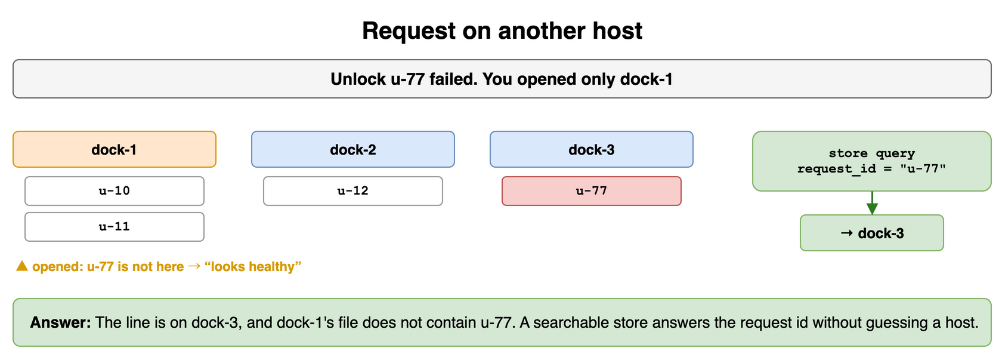
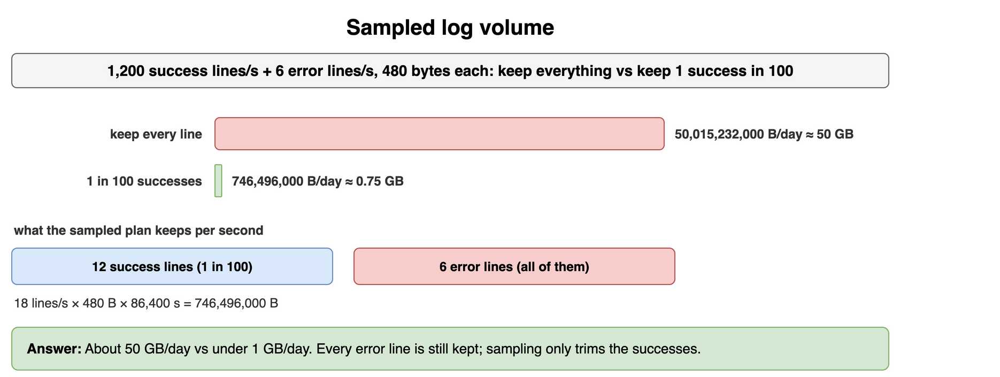
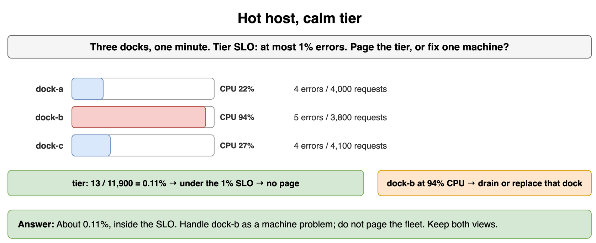
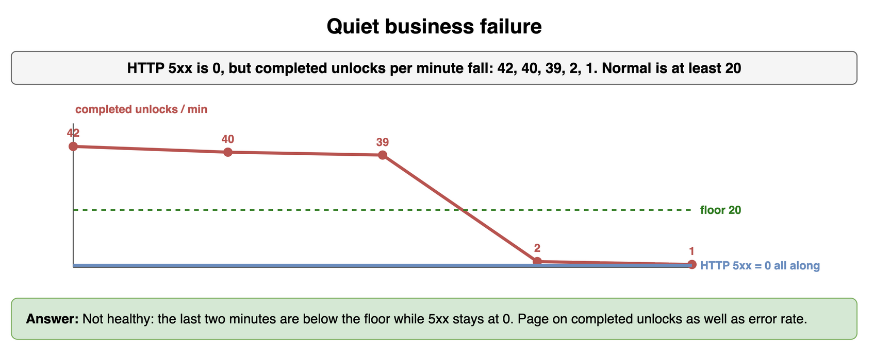
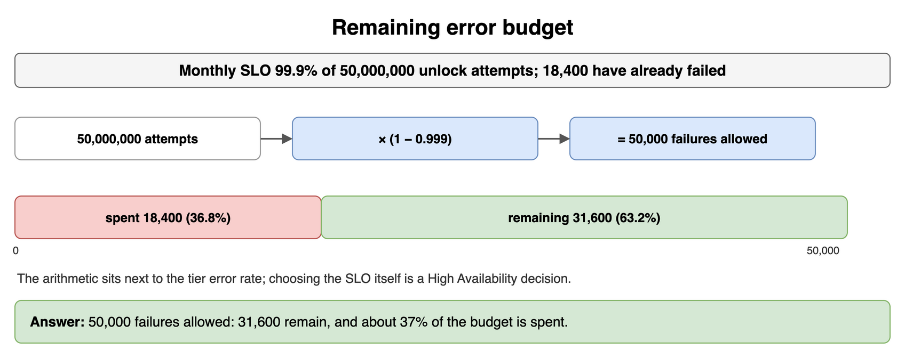
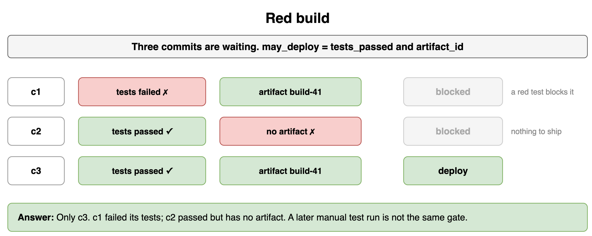
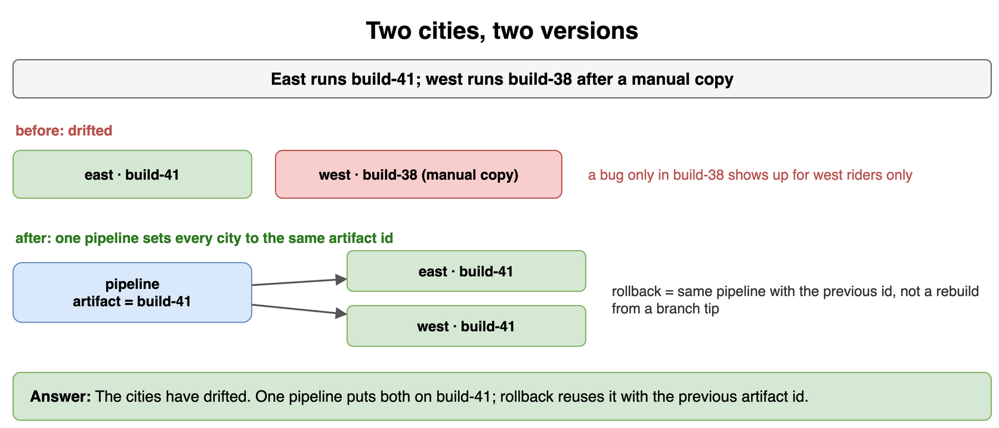
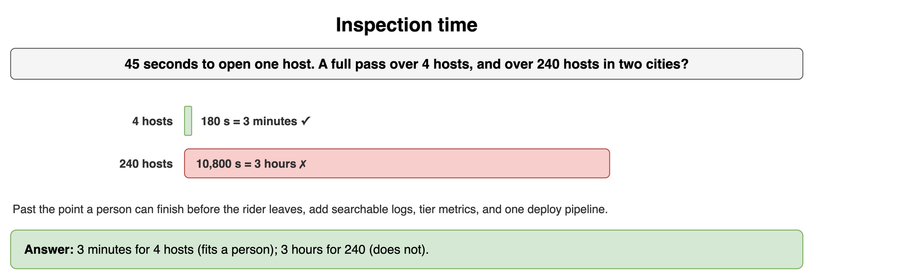

# Observability — Drills

Original practice for logs, metrics, and repeatable deploys. Each card is one exercise: commit to an answer, then check it. The numbers are invented for a bike-share unlock service. Tracing, paging policy, and a full collector design stay out of these cards.

## Request on another host

Unlock `u-77` failed. You opened only dock-1. Which host has the line, and did dock-1's file contain it?

```python
local_logs = {
    "dock-1": ["u-10", "u-11"],
    "dock-2": ["u-12"],
    "dock-3": ["u-77"],
}
```

**Answer:** The line is on dock-3. Dock-1's file does not contain `u-77`, so a shell on the host you guessed shows a healthy log and the wrong conclusion. A searchable store answers the request id without a guess. Local files are still useful as the collector's source.

```python
local_logs = {
    "dock-1": ["u-10", "u-11"],
    "dock-2": ["u-12"],
    "dock-3": ["u-77"],
}


def host_for(logs: dict[str, list[str]], request_id: str) -> str | None:
    found = [host for host, ids in logs.items() if request_id in ids]
    if len(found) != 1:
        return None
    return found[0]


print(host_for(local_logs, "u-77"), "u-77" in local_logs["dock-1"])
# dock-3 False
```



*Source: [`diagrams/observability-drills.drawio`](/content/09_System_Design_Interview/25_Observability/diagrams/observability-drills.drawio), page 1.*

## Sampled log volume

Success traffic is 1,200 lines/s and errors are 6 lines/s. Each line is 480 bytes. One plan keeps every line. Another keeps 1 success in 100 and every error. How many bytes/day does each plan write?

```python
SUCCESS_QPS = 1_200
ERROR_QPS = 6
LINE_BYTES = 480
SAMPLE_DEN = 100
```

**Answer:** Keeping every line writes 50,015,232,000 bytes/day, about 50 GB. Keeping 1 success in 100 and every error writes 746,496,000 bytes/day, under 1 GB. The error lines are still all present. Sampling is a volume control on the successes, not a reason to drop the failures you need for diagnosis.

```python
SUCCESS_QPS = 1_200
ERROR_QPS = 6
LINE_BYTES = 480
DAY_SECONDS = 86_400


def kept_bytes_per_day(sample_den: int) -> int:
    """Keep 1/sample_den of successes and every error."""
    kept_per_sec_num = SUCCESS_QPS + ERROR_QPS * sample_den
    return kept_per_sec_num * LINE_BYTES * DAY_SECONDS // sample_den


print(kept_bytes_per_day(1), kept_bytes_per_day(100))
# 50015232000 746496000
```



*Source: [`diagrams/observability-drills.drawio`](/content/09_System_Design_Interview/25_Observability/diagrams/observability-drills.drawio), page 2.*

## Hot host, calm tier

Three docks report the minute below. The tier SLO allows a 1% error rate. What is the tier error rate, and do you page the tier or deal with one machine?

```python
hosts = [
    {"host": "dock-a", "cpu": 22, "errors": 4, "requests": 4_000},
    {"host": "dock-b", "cpu": 94, "errors": 5, "requests": 3_800},
    {"host": "dock-c", "cpu": 27, "errors": 4, "requests": 4_100},
]
ERROR_SLO = 0.01
```

**Answer:** 13 errors out of 11,900 requests is about 0.11%, under the 1% SLO. Dock-b's CPU is the outlier. Drain or replace that dock. Do not page the fleet for a tier that is inside its error target. Host CPU and tier error rate answer different questions, so keep both.

```python
hosts = [
    {"host": "dock-a", "cpu": 22, "errors": 4, "requests": 4_000},
    {"host": "dock-b", "cpu": 94, "errors": 5, "requests": 3_800},
    {"host": "dock-c", "cpu": 27, "errors": 4, "requests": 4_100},
]
ERROR_SLO = 0.01

errors = sum(host["errors"] for host in hosts)
requests = sum(host["requests"] for host in hosts)
rate = errors / requests
hottest = max(hosts, key=lambda host: host["cpu"])
page_tier = rate > ERROR_SLO
print(errors, requests, round(rate, 5), hottest["host"], page_tier)
# 13 11900 0.00109 dock-b False
```



*Source: [`diagrams/observability-drills.drawio`](/content/09_System_Design_Interview/25_Observability/diagrams/observability-drills.drawio), page 3.*

## Quiet business failure

HTTP 5xx for the unlock handler is 0. Completed unlocks per minute are below. A normal minute stays at or above 20. Is the tier healthy?

```python
HTTP_5XX = 0
UNLOCKS_PER_MIN = [42, 40, 39, 2, 1]
NORMAL_FLOOR = 20
```

**Answer:** The handler is not returning 5xx, and the product has still stopped. The last two minutes are under the floor of 20, so this is a quiet failure: clients may have stopped calling, or a flag hid the button. Page on completed unlocks as well as on error rate. A flat 200 chart does not show that the business count collapsed.

```python
HTTP_5XX = 0
UNLOCKS_PER_MIN = [42, 40, 39, 2, 1]
NORMAL_FLOOR = 20

quiet_failure = HTTP_5XX == 0 and min(UNLOCKS_PER_MIN) < NORMAL_FLOOR
print(min(UNLOCKS_PER_MIN), quiet_failure)
# 1 True
```



*Source: [`diagrams/observability-drills.drawio`](/content/09_System_Design_Interview/25_Observability/diagrams/observability-drills.drawio), page 4.*

## Remaining error budget

The monthly SLO is 99.9% of unlock attempts. The window expects 50,000,000 attempts, and 18,400 have already failed. How many failures are still allowed, and what fraction of the budget is already spent?

```python
ATTEMPTS = 50_000_000
FAILURES = 18_400
```

**Answer:** A 99.9% target allows 1 failure per 1,000 attempts, so 50,000 failures in this window. 18,400 are spent and 31,600 remain, about 37% of the budget. The arithmetic belongs next to the tier error rate. Choosing the SLO itself stays in High Availability.

```python
ATTEMPTS = 50_000_000
FAILURES = 18_400

allowed = ATTEMPTS // 1_000
remaining = allowed - FAILURES
spent_ratio = FAILURES / allowed
print(allowed, remaining, round(spent_ratio, 3))
# 50000 31600 0.368
```



*Source: [`diagrams/observability-drills.drawio`](/content/09_System_Design_Interview/25_Observability/diagrams/observability-drills.drawio), page 5.*

## Red build

Three commits are waiting. Which ones may be deployed?

```python
commits = [
    {"id": "c1", "tests_passed": False, "artifact_id": "build-41"},
    {"id": "c2", "tests_passed": True, "artifact_id": None},
    {"id": "c3", "tests_passed": True, "artifact_id": "build-41"},
]
```

**Answer:** Only `c3`. A failed test blocks `c1` even though an artifact id exists. `c2` passed tests and has nothing to ship. The check-in gate is what keeps an untested change out of both data centers. A later manual test run is not the same gate.

```python
commits = [
    {"id": "c1", "tests_passed": False, "artifact_id": "build-41"},
    {"id": "c2", "tests_passed": True, "artifact_id": None},
    {"id": "c3", "tests_passed": True, "artifact_id": "build-41"},
]


def may_deploy(tests_passed: bool, artifact_id: str | None) -> bool:
    return tests_passed and bool(artifact_id)


print([(item["id"], may_deploy(item["tests_passed"], item["artifact_id"])) for item in commits])
# [('c1', False), ('c2', False), ('c3', True)]
```



*Source: [`diagrams/observability-drills.drawio`](/content/09_System_Design_Interview/25_Observability/diagrams/observability-drills.drawio), page 6.*

## Two cities, two versions

East is running `build-41` and west is running `build-38` after a manual copy. What is wrong, and what does one pipeline do with the artifact id?

```python
versions = {"east": "build-41", "west": "build-38"}
ARTIFACT = "build-41"
```

**Answer:** The cities are drifted. A bug that exists only on `build-38` shows up for west riders and not for east, which wastes the afternoon. One pipeline sets every city to the same artifact id. Rollback uses that same path with the previous id. It does not rebuild from a branch tip during the incident.

```python
versions = {"east": "build-41", "west": "build-38"}
ARTIFACT = "build-41"

drifted = len(set(versions.values())) > 1
aligned = {city: ARTIFACT for city in versions}
print(drifted, len(set(aligned.values())) == 1, aligned)
# True True {'east': 'build-41', 'west': 'build-41'}
```



*Source: [`diagrams/observability-drills.drawio`](/content/09_System_Design_Interview/25_Observability/diagrams/observability-drills.drawio), page 7.*

## Inspection time

Opening one host takes 45 seconds. How long is a full pass at 4 hosts, and at 240 hosts in two cities? Which pass still fits a person?

```python
SECONDS_EACH = 45
SMALL_FLEET = 4
LARGE_FLEET = 240
```

**Answer:** 180 seconds for 4 hosts, which is 3 minutes. 10,800 seconds for 240 hosts, which is 3 hours. The small fleet can still be inspected by hand. The large fleet cannot: the rider leaves before you finish the shells. That is the point where searchable logs, tier metrics, and one deploy pipeline stop being optional.

```python
SECONDS_EACH = 45
SMALL_FLEET = 4
LARGE_FLEET = 240

small_s = SMALL_FLEET * SECONDS_EACH
large_s = LARGE_FLEET * SECONDS_EACH
print(small_s, large_s, large_s // 3600)
# 180 10800 3
```



*Source: [`diagrams/observability-drills.drawio`](/content/09_System_Design_Interview/25_Observability/diagrams/observability-drills.drawio), page 8.*
