## AI engineering

AI engineering is building a product on a foundation model that someone else already trained. The daily decisions are which task to give the model, how to adapt it, how to judge the output, and how to keep the feature reliable after launch.

A small number of general models now draft, code, summarize, classify messy text, extract fields, and choose tools to call, which used to take a separate trained model each. A team calling the OpenAI, Anthropic, or Google APIs can ship Copilot-style suggestions, a Gmail summary, or a support draft without owning a training cluster. Training a base model from scratch stays a research and infrastructure project that most teams never run.

The leverage is the application around the call: the context you assemble, the interface the output lands in, the checks you run, and the fallback when the model is wrong. The price is a permanent evaluation and operations job. The same model that writes a good summary sometimes writes a fluent false one, the bill moves with every token, and the provider can change the model under you. Put training from scratch on the table only when a hosted model misses privacy, quality, latency, or unit cost and you have the data and budget to do better.

```text
Application (yours):  context, interface, checks, fallback
Foundation model:     bought as an API (OpenAI, Anthropic, Google)
Training from scratch: only when the API cannot meet the bar
```

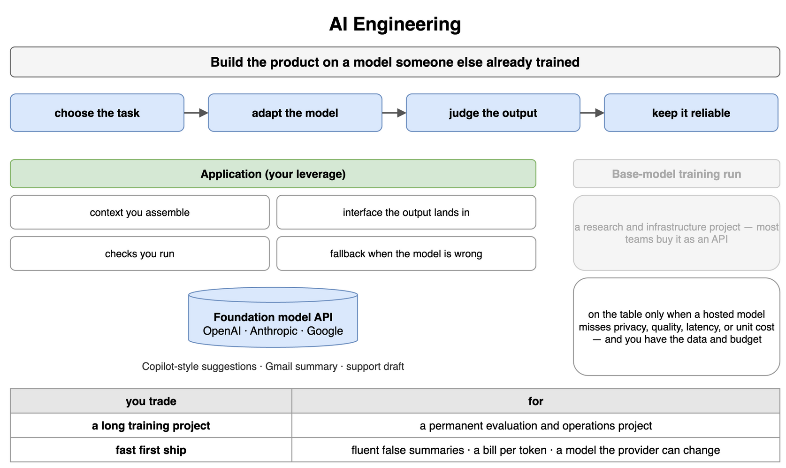

*Source: [`diagrams/ai-engineering-intro.drawio`](/content/10_AI_Engineering/01_Introduction_to_Building_AI_Applications_with_Foundation_Models/diagrams/ai-engineering-intro.drawio), page 1.*

## Language models in product terms

A language model scores possible continuations of text. In a product it shows up as a completion: you send a prompt, and the model appends one likely piece, then another, until it stops.

Many tasks are that loop with a different prompt. "Summarize this thread," "is this reply angry," and "finish this function" are all "continue the text the way the instruction describes." ChatGPT, Claude, and Gemini are the loop behind a chat UI. The output is a sample, so a finished-sounding answer can still be wrong.

Two shapes are worth keeping apart. A masked model, like BERT, fills a hidden span using words on both sides, which suits classification, tagging, and embedding search. An autoregressive model, like GPT and today's chat models, predicts the next piece from what came before, and that one-direction loop is what lets a product keep writing email, code, and answers. [Understanding Foundation Models](../02_Understanding_Foundation_Models/) covers the architecture.

The model reads tokens, not words. Common English words are often one token; long identifiers, rare words, and poorly covered scripts become several. About four characters per token is a planning estimate for English prose. Context limits, latency, and the bill are all counted in tokens, and output tokens usually cost more than input. Pasting a whole repository into Copilot Chat pays for mostly irrelevant code; the open file plus the error is smaller and better.

```text
Instruction: name the tone in a few words, then stop.
Email: "The package never arrived and I need it today."
Tone:            -> "frustrated, time-sensitive"
```

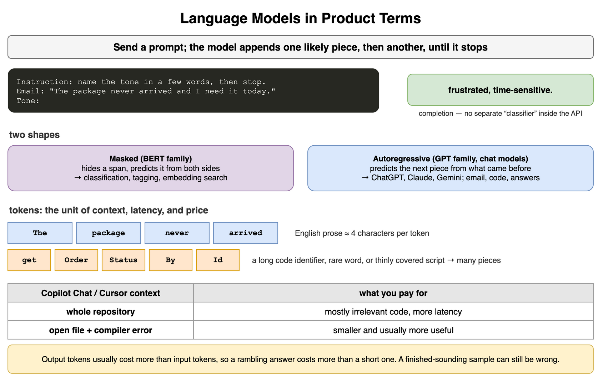

*Source: [`diagrams/ai-engineering-intro.drawio`](/content/10_AI_Engineering/01_Introduction_to_Building_AI_Applications_with_Foundation_Models/diagrams/ai-engineering-intro.drawio), page 2.*

## Self-supervision

Self-supervision trains a model on labels the data already contains. For an autoregressive language model, the label for a prefix of a document is the next piece of that same document.

That is why language models could grow to web scale. A spam classifier needs people to mark mail. Next-token training uses books, code, documentation, and articles with no new human label per row, so the bottlenecks moved to which data you keep, how much compute you spend, and how you filter junk. Following instructions reliably is a later step, post-training, covered in [Understanding Foundation Models](../02_Understanding_Foundation_Models/). Application teams start from a model that has had both.

A free label says nothing about whether the data was licensed, representative, or safe to repeat, and more data copies the web's mistakes, secrets, and skewed coverage into the weights. It also does not guarantee the model learned your task: a model can sound like the web and still be weak on your refund policy. The application still supplies the task, the private facts, and the check on the answer.

```text
The document supplies the target.
"...refunds over 50 dollars need a"
next piece to predict: "manager"
```

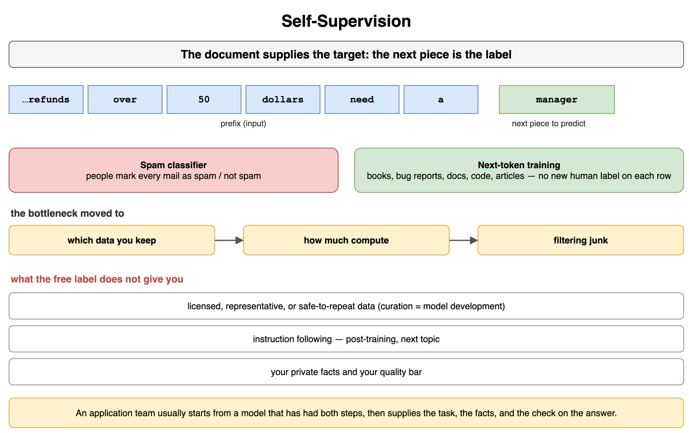

*Source: [`diagrams/ai-engineering-intro.drawio`](/content/10_AI_Engineering/01_Introduction_to_Building_AI_Applications_with_Foundation_Models/diagrams/ai-engineering-intro.drawio), page 3.*

## Foundation models

A foundation model is a large model trained on broad data, usually self-supervised, then adapted to many downstream tasks. A large language model is the text case; the term is wider than text.

Midjourney, Adobe Firefly, and Stable Diffusion are foundation models for pictures. GPT-4o, Gemini, and Claude take images alongside text, so a user can paste a screenshot of a failing UI or a photo of a receipt. Runway and Sora extend the idea to video. The shift for a product team is from "train one model per task" to "start from a strong base and adapt it." Tasks can share a base model; they should not share a product design, because input, cost, and review differ.

Multimodal input earns its place when the user's artifact is not text. Output modality is a separate choice: a caption is cheap to review, a minute of video is expensive to render and to watch. The training idea that made image-text models practical is CLIP (Radford et al., 2021): the caption already beside a picture is the label, and the loss pulls the image's embedding toward its caption and away from the others. CLIP returns a similarity, not a paragraph; [RAG and Agents](../06_RAG_and_Agents/) uses it to retrieve page images.

```text
Input  -> base model     -> output
text      LLM               text
image+text multimodal       text (caption cheap to review)
text      video model       clip (expensive to render and watch)
```

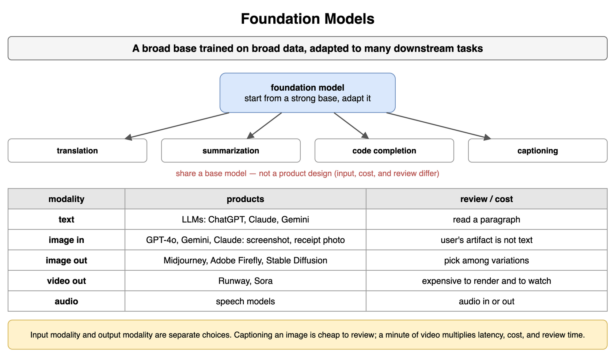

*Source: [`diagrams/ai-engineering-intro.drawio`](/content/10_AI_Engineering/01_Introduction_to_Building_AI_Applications_with_Foundation_Models/diagrams/ai-engineering-intro.drawio), page 4.*

## Why AI engineering became practical

AI engineering became a normal software job when three things arrived together: models useful on open-ended tasks, access to them as an API, and the investment that visible products attracted.

ChatGPT, at the end of 2022, made the capability obvious outside research labs, and GitHub Copilot had already shown it for code. Hosted APIs let a small team put a model behind a button without a GPU cluster. A strong model you cannot call stays a paper; an easy API in front of a weak model misses the bar. The work moved to the task, the prompt and retrieved context, the interface, the eval set, and the operating plan, and away from feature pipelines and training loops.

Why a given team builds picks the project. A productivity case is a measured saving, such as tickets closed faster or completions accepted often enough to beat the token bill. A competitive case is a capability users would leave for. Fear of missing out justifies a time-boxed demo, not a platform. A productivity win on a public task is usually a hosted API; a win that depends on a private corpus is retrieval and evaluation you own on someone else's base. Hosting makes the first version fast and makes you a tenant of their price, latency, rate limits, and updates. Self-hosting an open model trades that for a GPU fleet and a serving stack.

```text
capability + API access + investment  -> ordinary engineering
productivity / competitive            -> buy vs build decision
fear of missing out                   -> a time-boxed demo
```

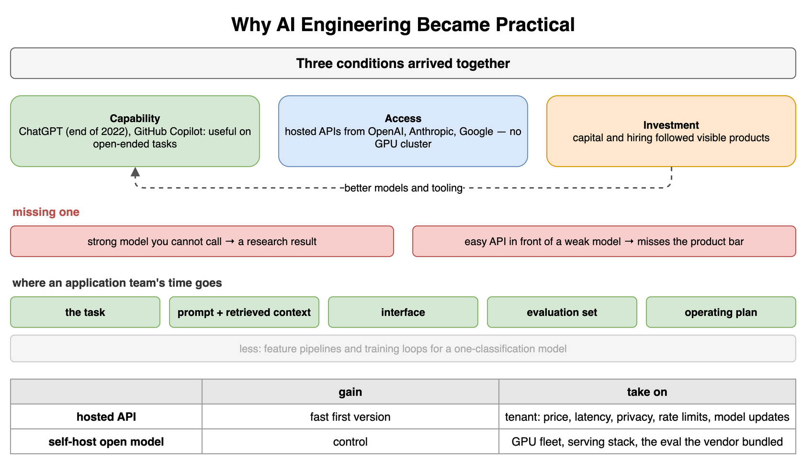

*Source: [`diagrams/ai-engineering-intro.drawio`](/content/10_AI_Engineering/01_Introduction_to_Building_AI_Applications_with_Foundation_Models/diagrams/ai-engineering-intro.drawio), page 5.*

## Prompting, RAG, and finetuning

Prompting, retrieval-augmented generation, and finetuning are the three ways to make a foundation model behave like your application. Prompting changes the instructions in the request, retrieval changes which facts go into it, and finetuning changes the weights.

Start with the prompt. It is how a Gmail summary or "answer in five bullets" works, you can change it in an afternoon, and you see the effect on the next call. It cannot supply a fact that is absent from the request and from training. Add retrieval when the facts live elsewhere and change: a Notion Q&A, a Zendesk bot over the help center, NotebookLM over uploaded papers. An edited page shows up on the next search; a missed page makes the model abstain or invent. Finetune when a behavior will not stick through prompting and you have good examples, such as a house style or a JSON shape the model keeps breaking. Finetuning freezes knowledge, so it does not replace retrieval for a wiki that edits daily.

The levers stack: keep the prompt when you add the others, and measure the prompt before paying for a training job. Do not collapse the training words. Pretraining built the base, post-training taught it to follow instructions, finetuning is continued training you run, and prompting changes no weight at all. [Prompt Engineering](../05_Prompt_Engineering/), [RAG and Agents](../06_RAG_and_Agents/), and [Finetuning](../07_Finetuning/) cover the mechanics.

| Situation | Lever to add | What goes wrong if you skip it |
| --- | --- | --- |
| The task and text are both in the request (a Gmail thread). | Prompt only. | A heavier lever adds delay and a model to maintain. |
| Facts are private or change (a Notion wiki). | Retrieval, plus the prompt. | The model answers from memory and the wiki has moved on. |
| A behavior will not stick, and you have good examples. | Finetuning, plus the prompt. | The prompt drifts; an index cannot store a style. |

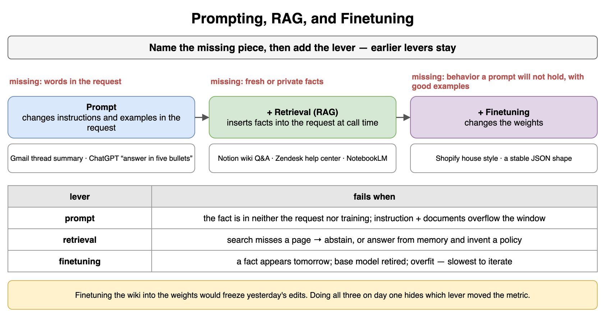

*Source: [`diagrams/ai-engineering-intro.drawio`](/content/10_AI_Engineering/01_Introduction_to_Building_AI_Applications_with_Foundation_Models/diagrams/ai-engineering-intro.drawio), page 6.*

## Coding and writing

Coding and writing assistants are generation features: the model drafts, and a person decides what ships. Copilot and Cursor suggest code in the editor; Notion AI, Gemini in Gmail, and Grammarly draft and rewrite prose the user already has open.

Code suggestions fit boilerplate, a test for a function you can specify, and explaining a stack trace. They are weak when the change depends on a private API absent from the prompt. The compiler and tests reject much of the bad output automatically, so the dangerous suggestion is the one that compiles and is still wrong. Writing suggestions fit when the facts are already in the document: shorten this, sound calmer, turn bullets into a paragraph. They are weak when the draft needs a number or a promise the source never made, and there is rarely a compiler for a paragraph.

A draft helps only when editing it beats writing it. Low-precision ghost text interrupts typing and trains people to ignore it; a draft the user asked for can be rougher because they still press Send. Before reaching for a custom code model, put the relevant file and error in the prompt. The person who merges the diff or sends the email owns the claim.

```text
           emits     automatic check     owner
code       a diff    compiler + tests     whoever merges
prose      a draft   usually none         whoever sends
```

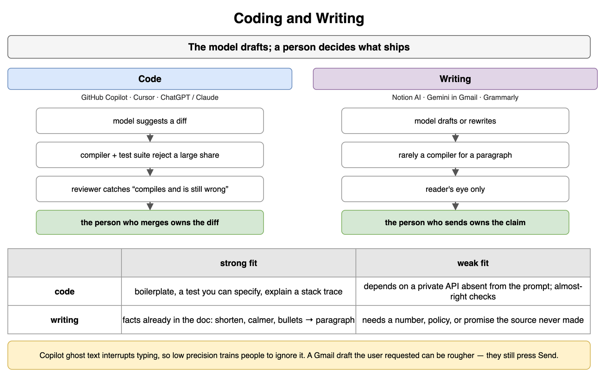

*Source: [`diagrams/ai-engineering-intro.drawio`](/content/10_AI_Engineering/01_Introduction_to_Building_AI_Applications_with_Foundation_Models/diagrams/ai-engineering-intro.drawio), page 7.*

## Image, video, and tutoring

Image generation, video generation, and tutoring are foundation-model products whose review step differs in each case.

Midjourney, Adobe Firefly, and ChatGPT's image tools produce stills, and design teams generate many variations and pick one. Concept art and mood boards fit; exact words inside the picture, precise layouts, and a look that stays on-brand across a campaign are the weak spots. Firefly matters because it lives inside the tools where the file has to land. Runway and Sora produce video, which costs more per generation and must be watched before publishing; a mistake in the last second wastes the render. A reviewed previz fits; a shot that must match a storyboard frame for frame often does not.

Duolingo's conversation practice and Khan Academy's Khanmigo are the tutoring shape. A practice dialogue fits because one wrong hint is cheap and the next turn can correct it. A grade or an answer key needs a known-correct source beside the model, and a teacher stays responsible. The split is "options a person selects" versus "an artifact the user trusts." Putting the curriculum, brand references, or storyboard in the context keeps the model on the user's actual material.

```text
image    many variations, a person picks       cheap to review
video    render cost, watch before publishing  expensive to review
tutor    practice turns OK; grades need a source of truth
```

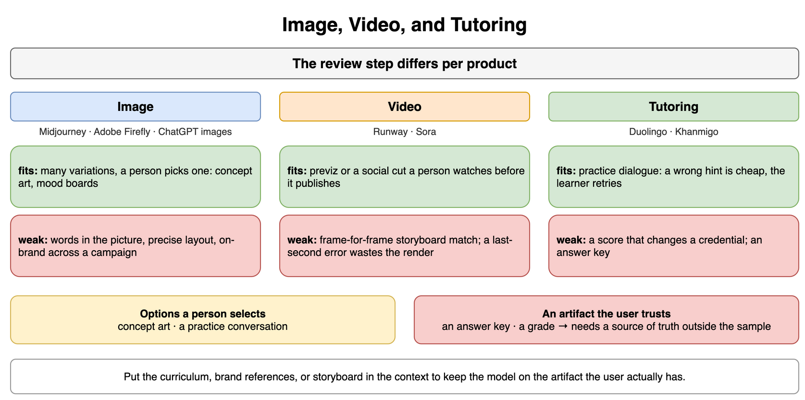

*Source: [`diagrams/ai-engineering-intro.drawio`](/content/10_AI_Engineering/01_Introduction_to_Building_AI_Applications_with_Foundation_Models/diagrams/ai-engineering-intro.drawio), page 8.*

## Bots and information aggregation

A conversational bot talks with a person; an information product compresses sources into something the person can check. Both fail when a fluent paragraph is treated as the source.

ChatGPT and Claude are bots that are the whole product: when the model is down, the page is empty. Intercom Fin and Zendesk's AI agents sit on a help desk that already has articles, a queue, and human agents. A support bot should answer from the published help center, refuse when retrieval finds nothing, and hand off when the user disputes the answer or asks for something policy reserves for a person. The failure that matters is a confident reply that contradicts the refund rule.

Perplexity and NotebookLM aggregate sources and show them; Gmail summarizes a thread the user can still open; Google's AI Overviews sit above results. Each sentence should be checkable against a source in one step. For support, an extra escalation is the affordable error; for a notebook over the user's own sources, a missing citation is the expensive one. "We will add a chatbot" is not a design. Naming the corpus, the abstain rule, and the handoff is.

```text
corpus:   latest help-center articles
abstain:  refuse on an empty retrieval
handoff:  money, disputes, anything policy reserves for a person
```

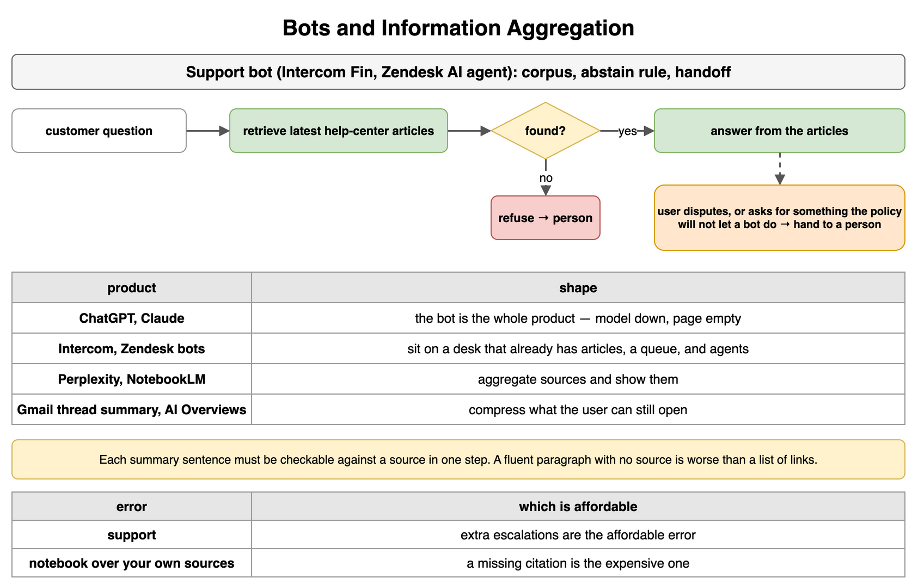

*Source: [`diagrams/ai-engineering-intro.drawio`](/content/10_AI_Engineering/01_Introduction_to_Building_AI_Applications_with_Foundation_Models/diagrams/ai-engineering-intro.drawio), page 9.*

## Extraction and workflow automation

Extraction turns an unstructured document into fields; workflow automation lets the model choose an action in a system that can change something. The first wants a schema and a validator. The second wants a short tool list and a rule for side effects.

Expensify reading a receipt, or accounts payable reading an invoice into vendor, date, total, and line items, is extraction. The model fills a schema, ordinary code checks that the lines sum to the total and the vendor exists, and a clerk compares the fields to the original before paying. A free-text summary of the invoice is worse, because a paragraph cannot fail a reconciliation check, and a validator still will not catch a vendor that looks legitimate and is wrong.

Zapier-style agents are the action case: tag a ticket, draft a reply, create a calendar hold, or call Stripe's refund API. Tagging is reversible, email is hard to unsend, and a refund moves money. Expose a small tool list, require a person for irreversible tools, and log every call with its arguments so a bad day can be replayed. More tools make a demo look like an employee and multiply the side effects. The model proposes; the system decides whether the action may run.

```text
read-only     search, look up order             run freely
reversible    tag ticket, draft reply           run, log
irreversible  send email, refund via Stripe     person confirms
```

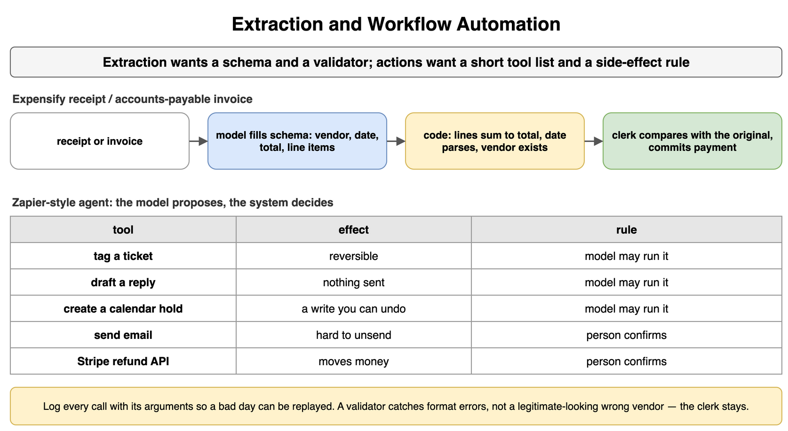

*Source: [`diagrams/ai-engineering-intro.drawio`](/content/10_AI_Engineering/01_Introduction_to_Building_AI_Applications_with_Foundation_Models/diagrams/ai-engineering-intro.drawio), page 10.*

## Task-level use case fit

Use-case fit belongs to a task, not a job title. A foundation model is a candidate when the input is mostly language or other unstructured data, a draft is acceptable, someone can check it, and a mistake is cheap or reversible.

"GPTs are GPTs" (Eloundou, Manning, Mishkin, and Rock, 2023) calls a task exposed when a model, or software built on one, could cut its time by at least half at the same quality. On their measures, about 80 percent of the U.S. workforce is in an occupation where at least a tenth of tasks are exposed, and about 19 percent in one where more than half are. Writing and programming line up with higher exposure; manufacturing, agriculture, and mining sit lower. Those are time claims about tasks, and an exposed occupation can keep a person on the parts a model does badly.

Judge one task at a time: its input, output, check, and the cost of a wrong answer. Summarizing a Gmail thread or suggesting a Copilot completion is a strong fit. Payroll totals in Gusto, a Google Maps route, and a brake input are not: the first two already have a deterministic system that is right, and the third has no tolerance for a sample. An internal assistant over company documents, with a person accountable, is a sound enterprise start because advisory output can be imperfect.

| Signal | What you should see | Familiar case |
| --- | --- | --- |
| Strong fit | Messy input, a draft is enough, someone can review, feedback is quick. | Copilot, Gmail summarize, a help-center draft. |
| Weak fit | Exactness, an irreversible effect, or a solved algorithm. | Payroll totals, a card charge, Google Maps routing. |
| Fit with a boundary | The draft is useful and a person commits the side effect. | Invoice fields a clerk approves, a refund a person confirms. |

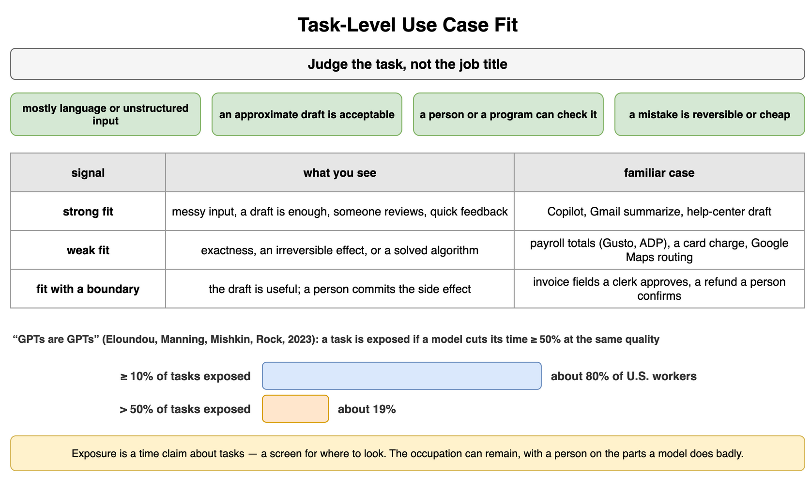

*Source: [`diagrams/ai-engineering-intro.drawio`](/content/10_AI_Engineering/01_Introduction_to_Building_AI_Applications_with_Foundation_Models/diagrams/ai-engineering-intro.drawio), page 11.*

## Critical, reactive, and human roles

An AI feature has four independent choices: whether the product works without the model, whether the user asked for the output, whether behavior changes per user, and what the human still decides.

Critical means the product's promise depends on the model: ChatGPT, Midjourney, and Perplexity are empty when it is down. Complementary means the product still works, like Gmail with Smart Compose off, so you can ship a kill switch. Reactive means the user asked, by sending a message or clicking Summarize, and a weak answer is a turn they can retry. Proactive means the system spoke first, like ghost text, so a wrong suggestion interrupts and the precision bar is higher. Static means everyone gets the same behavior until you ship a new prompt; dynamic means memory or per-user ranking, which you evaluate by cohort because one screenshot no longer describes the product.

The human role is the automation boundary: a person edits the draft, a bot answers easy questions and routes the rest, or the model acts alone only on a slice whose failure rate you have measured. Crawl, walk, and run name the sequence. Crawl is a suggestion the person can ignore, walk is an artifact a person still commits, and run is action on a measured slice with sampling and a kill switch. The corner to avoid first is critical, proactive, and dynamic together. A refund stays off run even after the easy replies have earned it.

| Axis | One end | The other end |
| --- | --- | --- |
| Dependency | Complementary: Gmail still sends. | Critical: ChatGPT has nothing else to show. |
| Invocation | Reactive: the user clicked Summarize. | Proactive: ghost text while they type. |
| Change over time | Static: one prompt until the next release. | Dynamic: memory or per-user ranking. |
| Human | Edits a draft, or handles the hard cases. | The model acts, and people audit samples. |

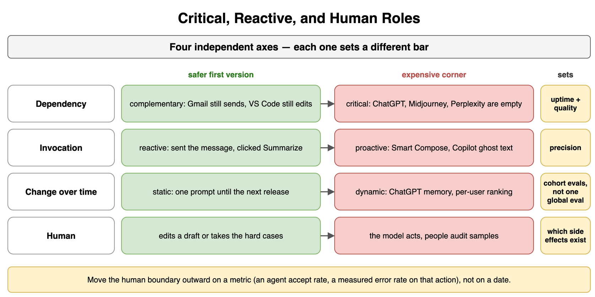

*Source: [`diagrams/ai-engineering-intro.drawio`](/content/10_AI_Engineering/01_Introduction_to_Building_AI_Applications_with_Foundation_Models/diagrams/ai-engineering-intro.drawio), page 12.*

## Expectations, thresholds, and metrics

A usefulness threshold is the quality below which people turn the feature off, and it depends on the alternative the user already has. Latency and unit cost have thresholds too, and a feature must clear all three.

Quality is relative. A rough Notion draft beats a blank page; a wrong query wastes the afternoon of an analyst who could have written it. Copilot suggestions must be accepted often enough to beat typing; a support draft must be faster to edit than to write. "80 percent" is not a threshold by itself: 80 percent "usable with light edits" can be a win on drafts and a daily pile of wrong promises on policy replies. A box that looks like ChatGPT is judged like ChatGPT.

Latency follows the interaction. Copilot suggestions must arrive before the user has typed the line, a fraction of a second; a chat turn can take several seconds; an invoice batch can take minutes. Cost is counted per successful task, including rejected suggestions and retries, so a cheap model run three times can lose to a pricier one trusted once. Raising quality usually costs latency or money, and optimizing the average hides the tail you get paged for. Write the bars down before the demo, or the demo becomes the bar. [Evaluation Methodology](../03_Evaluation_Methodology/) goes deeper on metrics.

```text
quality   beats the user's alternative (acceptance, edits, policy violations)
latency   Copilot: before the line is typed; chat: seconds; batch: minutes
cost      dollars per successful task, retries included
```

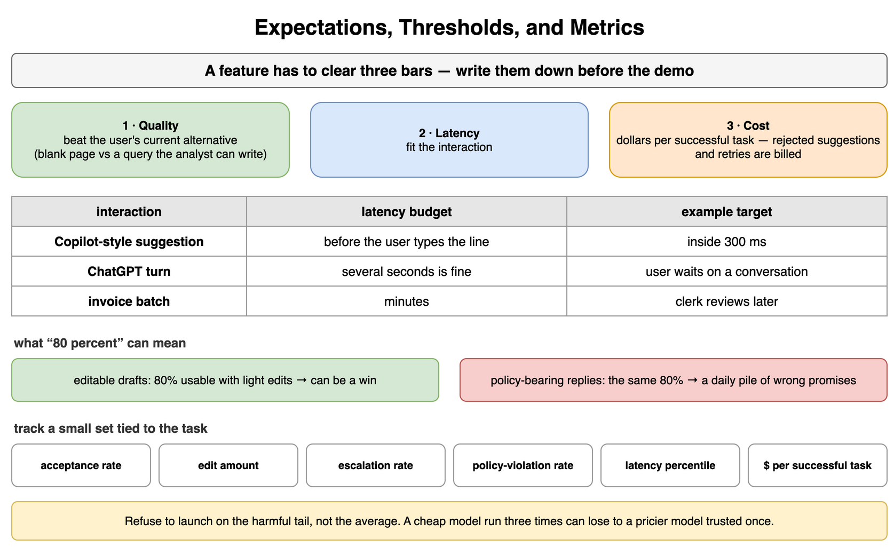

*Source: [`diagrams/ai-engineering-intro.drawio`](/content/10_AI_Engineering/01_Introduction_to_Building_AI_Applications_with_Foundation_Models/diagrams/ai-engineering-intro.drawio), page 13.*

## Milestones from demo to production

A milestone plan is the sequence of evidence between a curated demo and a feature customers can trust. The gap in the middle is the last mile: real traffic, the tail, latency, cost, guardrails, and noticing when the model changes.

A demo is easy. Twenty hand-picked help-center tickets answered live in a meeting feel like a product, but the meeting only shows the model can sometimes do the task. It does not say how often, on which tickets, how fast, or at what cost. Shipping from the meeting is how an 80 percent slide becomes an incident.

Each later milestone adds evidence. The eval set scores a few hundred real tickets, boring and hostile ones included, with tone and policy errors counted separately. Shadow mode shows the draft to agents only and produces the first honest edit rate. A limited send releases only intents under the policy bar, behind a kill switch. The same sequence fits Copilot ("suggestion shown, acceptance logged, nothing merges by itself") and an invoice extractor ("fields filled, the clerk still pays"). If the only evidence is that the room liked it, the team is still on the demo, whatever the roadmap says.

| Milestone | What is true when it is done |
| --- | --- |
| Demo | A few hand-picked tickets produce answers people in the room like. |
| Eval set | A few hundred real tickets are scored with a written rubric; tone and policy errors are separate numbers. |
| Shadow | Agents see the draft and customers do not; you learn the edit rate without the harm. |
| Limited send | Only intents under the policy bar are sent, the rest go to a person, and a kill switch exists. |
| Production | A pinned model, a regression set, a latency and cost watch, and an on-call path. |

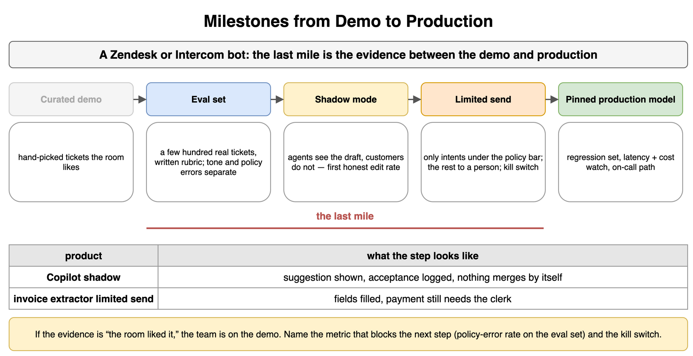

*Source: [`diagrams/ai-engineering-intro.drawio`](/content/10_AI_Engineering/01_Introduction_to_Building_AI_Applications_with_Foundation_Models/diagrams/ai-engineering-intro.drawio), page 14.*

## Maintenance under a moving model

Maintenance keeps a shipped feature inside its quality, latency, and cost bars after the model, prompt, prices, and users move. A foundation-model feature changes on days you do not deploy.

Providers replace weights behind names, deprecate model ids, and change prices. A prompt tuned on one snapshot can regress on the next with identical code, and a finetune usually has to be rebuilt when its base model is retired. Users drift too: a bot launched on billing questions starts getting screenshots and legal threats. Input prices often fall while the bill rises, because a new snapshot writes longer answers, people retry weak ones, or more context is sent on every call. A floating "latest" alias makes all of this automatic, bad days included.

Treat the model as a dependency you do not control. Pin a model id, run the regression set from the milestone plan on every model and prompt change, watch faithfulness or acceptance, a latency percentile, and dollars per successful task, and roll back when a new id misses the bar. Recompute the bill from the real mix of input and output tokens, not the headline price cut. A cheaper snapshot that fails faithfulness stays unused. [AI Engineering Architecture and User Feedback](../10_AI_Engineering_Architecture_and_User_Feedback/) covers monitoring.

```text
pin          a dated model id, not "latest"
regress      eval set on every model or prompt change
watch        quality, p95 latency, $ per successful task
roll back    to the pinned id when a bar is missed
```

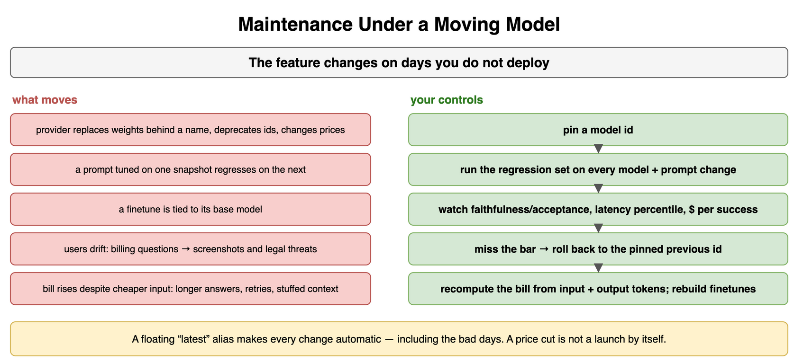

*Source: [`diagrams/ai-engineering-intro.drawio`](/content/10_AI_Engineering/01_Introduction_to_Building_AI_Applications_with_Foundation_Models/diagrams/ai-engineering-intro.drawio), page 15.*

## The three-layer AI stack

The AI stack has three layers. Application development decides what the product does with a model, model development changes the model, and infrastructure runs compute, storage, and serving.

Application development is prompts, retrieved context, tool use, the interface, and the product eval: Perplexity's citation list, Copilot's ghost text, Notion's Summarize button, and the choice to put three help-center passages in the prompt. Most AI engineering time goes here, because teams share base models and the product difference is the application. Model development changes weights or the artifact: training, finetuning, the datasets those jobs need, distillation, and quantization, plus evaluation of the checkpoint itself. Infrastructure is GPUs, orchestration, storage, request logs, autoscaling, and the latency and spend metrics. vLLM is serving infrastructure; the quantization that made the model fit the GPU is model development; the process holding an embedding index is infrastructure, while which passages to fetch is application.

Start at the top and move down when a measurement forces you: a quality bar missed after prompting and retrieval, a unit cost that fails at API prices, or a privacy rule that keeps data on your network. A hosted API means someone else runs the lower two layers, which is the right architecture until then. Owning infrastructure is a poor use of a team without an eval set.

| Work | Layer | Example |
| --- | --- | --- |
| Which passages enter the prompt, and what the UI shows. | Application | Perplexity's sources list, a Gmail summary button. |
| A finetune, a dataset, a quantized checkpoint. | Model | A support-model finetune, a smaller code model. |
| The fleet, the logs, the dollars-per-query dashboard. | Infrastructure | GPU autoscaling, request tracing. |

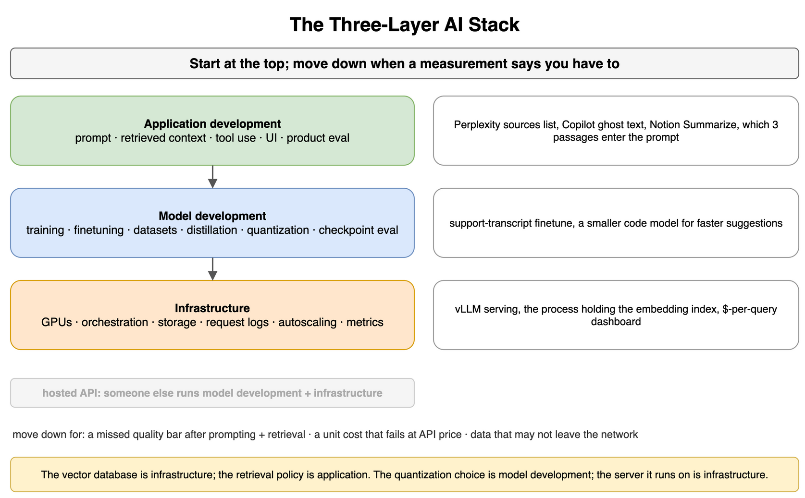

*Source: [`diagrams/ai-engineering-intro.drawio`](/content/10_AI_Engineering/01_Introduction_to_Building_AI_Applications_with_Foundation_Models/diagrams/ai-engineering-intro.drawio), page 16.*

## AI engineering versus ML engineering

AI engineering and ML engineering both put learned models in products, with a different default center. ML engineering trains and operates a model for a task you defined. AI engineering adapts a general model and evaluates open-ended behavior.

An ML engineer building a spam filter or fraud score collects labels, designs features, and trains a model whose output is a class or a number, measured by precision and recall. The model is yours, a call is often sub-millisecond and nearly free, and a held-out set says whether you improved. An AI engineer building a support draft starts from a hosted model, writes a prompt, maybe retrieves articles, and judges paragraphs with no single correct string. A rubric, an accept rate, and a policy-violation count replace the accuracy chart. A call takes hundreds of milliseconds to seconds, the token bill is visible, and the base model changes on a vendor's schedule.

The artifacts moved with the work. Feature engineering became dataset engineering: deduplication, tokenizer choice, and quality control ([Dataset Engineering](../08_Dataset_Engineering/)). Inference optimization arrives on day one, because a chat token sits on the request path ([Inference Optimization](../09_Inference_Optimization/)). The boundary is porous. Finetuning, a retrieval reranker, and a careful eval set are ML work inside an AI product, so staff for the unsolved problem: prompt, corpus, and rubric, or a model that prompting cannot steer.

```text
              ML engineering            AI engineering
start         labels, your model        hosted foundation model
output        class or number           open-ended paragraph
metric        precision / recall        rubric, accept rate, violations
one call      sub-ms, nearly free       100s of ms to s, billed per token
```

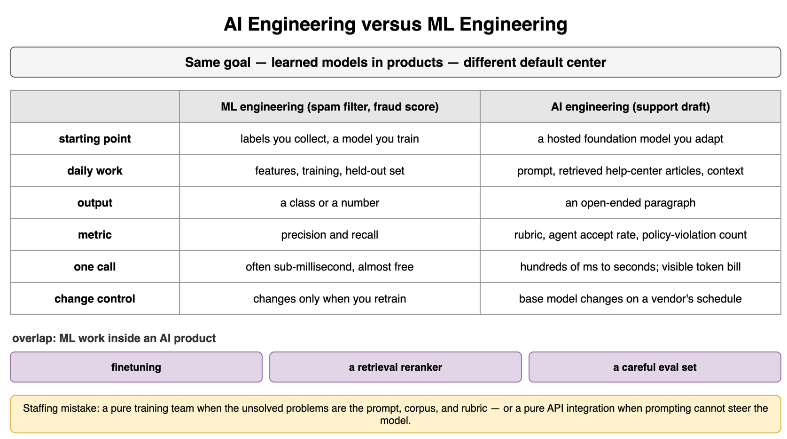

*Source: [`diagrams/ai-engineering-intro.drawio`](/content/10_AI_Engineering/01_Introduction_to_Building_AI_Applications_with_Foundation_Models/diagrams/ai-engineering-intro.drawio), page 17.*

## AI engineering versus full-stack engineering

Full-stack engineering is the interface, API, data, auth, and deploy. An AI feature needs all of it, plus a component that is slow, billed per token, and willing to return the wrong answer with a 200 status.

The ChatGPT UI, Copilot's editor surface, NotebookLM's document store, and a Zendesk bot's ticket queue are ordinary product engineering, and accounts, rate limits, and transcript storage stay mandatory. The model call is the extra dependency, with a latency budget, a cost budget, and a failure unit tests cannot see: a grammatical paragraph that invents a refund. A test can check that a tool call matches its schema; it cannot check that a summary is faithful. That needs an eval set plus production sampling.

The prompt, retrieval policy, and tool list change behavior as much as the code around them, so they go in version control and review. Fallbacks are product decisions: show the source email under a Gmail summary, send the ticket to a person when retrieval is empty, and keep tax, routes, and payment totals on deterministic paths. Build the product first. A support draft starts as a button, a prompt, and shadow mode, and the transcripts worth finetuning are the ones that button produced. The product's failures decide the data, and the data decides whether the model changes.

```text
unit tests   auth, schema, tool permissions
eval set     faithfulness, policy, acceptance
fallback     source shown, person on empty retrieval, deterministic math
```

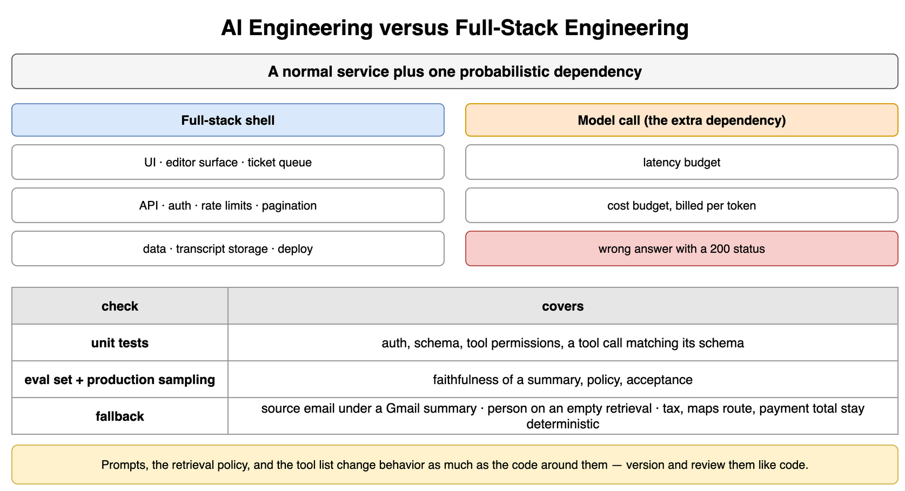

*Source: [`diagrams/ai-engineering-intro.drawio`](/content/10_AI_Engineering/01_Introduction_to_Building_AI_Applications_with_Foundation_Models/diagrams/ai-engineering-intro.drawio), page 18.*

## AI product defensibility

AI product defensibility is what still distinguishes the product after a competitor can call the same foundation model.

Three advantages survive that, and the weights count only when you trained a model others cannot match. A technology advantage is a method a competitor cannot rent by the token, such as a serving stack, a router, or an eval harness that holds a higher bar. Most products on the public APIs lack one. A data advantage is usage you may legally learn from and they cannot see: Copilot's repository context, or a help desk's years of resolved tickets. It compounds through the data flywheel in [AI Engineering Architecture and User Feedback](../10_AI_Engineering_Architecture_and_User_Feedback/), where real traffic becomes the next prompt or finetune and a frozen eval decides whether it ships. A distribution advantage is being where the person already works: Copilot in the editor, Notion AI in the document, the Gmail summary in the thread.

The failure mode is becoming a feature of a larger product. A thin chatbot on a hosted model is a button the provider or a suite the user already pays for can add, the way search, mail, and IDE summaries arrived. Perplexity is a retrieval and citation loop; Firefly matters inside designers' tools; BloombergGPT was a finance-specific technology and data bet, and [Understanding Foundation Models](../02_Understanding_Foundation_Models/) explains why a domain pretrain is not automatically ahead of a stronger general model. "We call the API with a careful prompt" is a feature, not a moat.

```text
technology    a method competitors cannot buy per token
data          usage you may learn from, via a flywheel with a frozen eval
distribution  already inside the editor, inbox, document, or queue
none          a prompt on a rented model -> a feature a platform absorbs
```

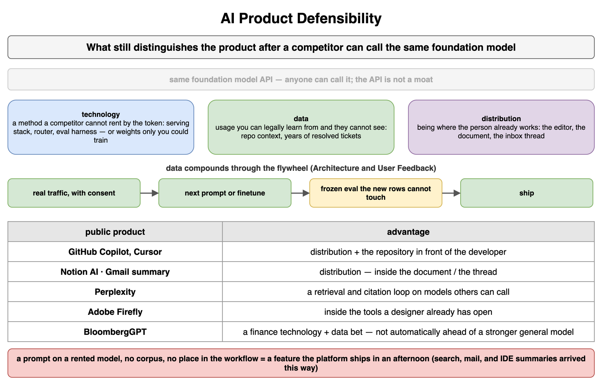

*Source: [`diagrams/ai-engineering-intro.drawio`](/content/10_AI_Engineering/01_Introduction_to_Building_AI_Applications_with_Foundation_Models/diagrams/ai-engineering-intro.drawio), page 19.*
