## Training data

Training data is the text a base model learns to continue, token by token, before any finetune teaches it to follow instructions. The mix is as much the product as the network.

Llama, Mistral, and GPT-3 are all transformers trained with a next-token loss. They differ because their corpora differ: how much web text, code, long-form prose, and which languages, and what was thrown out. Common Crawl is the usual raw material. C4, RefinedWeb, FineWeb, Dolma, RedPajama, and The Pile are published filters that turn a crawl into a training set, each with its own definition of a usable page. Wikipedia, books, papers, and public code are added because raw crawl is full of boilerplate, spam, and duplicates.

Building the set is a pipeline. Deduplication stops the run spending FLOPs memorizing one viral page, a quality filter (rules, a classifier, or a perplexity cutoff) drops junk, PII and secrets are removed where visible, and benchmark decontamination removes eval copies so a later score measures generalization. Llama 2 trained on 2 trillion tokens; the Llama 3 report describes about 15 trillion, with a final mix of roughly 50% general knowledge, 25% math and reasoning, 17% code, and 8% multilingual text. A base model is strong where that mix was dense, like English prose and popular Python libraries, and thin on your runbook, yesterday's prices, and private APIs. That gap is why retrieval sits beside the model. Inheriting the mix through an API still leaves its failures: the model can repeat training text (a privacy and copyright risk), and a leaked benchmark flatters the model before it disappoints on your tickets. [Dataset Engineering](../08_Dataset_Engineering/) covers building your own corpus.

```text
crawl -> dedup -> quality filter -> PII removal -> decontaminate -> sample ratios
Llama 3 mix: 50% general, 25% math/reasoning, 17% code, 8% multilingual
```

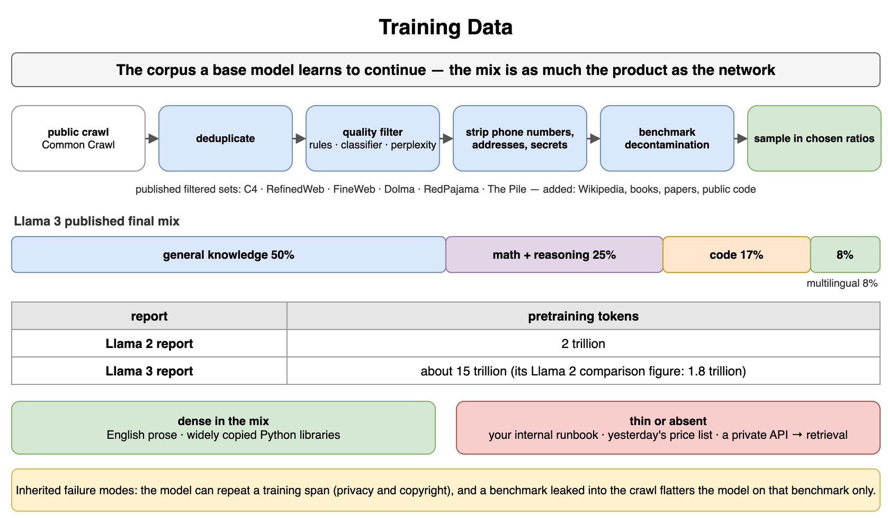

*Source: [`diagrams/foundation-models.drawio`](/content/10_AI_Engineering/02_Understanding_Foundation_Models/diagrams/foundation-models.drawio), page 1.*

## Multilingual models

A multilingual model is one set of weights trained on many languages, so one serving stack answers more than English.

Sharing weights saves operations and lets a language with little data borrow patterns from one with more. GPT-4o, Claude, and Gemini are served as multilingual checkpoints. Llama 3 (8B, 70B, 405B) pretrained on multilingual data but the 8B and 70B were still aimed at English. BLOOM and Cohere's Aya made a wide language list the point.

The compromise shows first in the tokenizer, which was fit on a mostly English mix. Llama 2's vocabulary has 32,000 pieces; Llama 3's has 128,256 (about 100K from tiktoken plus 28K added for non-English text), and compression on Meta's English sample rose from 3.17 to 3.94 characters per token. Fewer characters per token means a higher bill, more latency, and a smaller effective context. Quality is also unequal: English dominates web crawls (C4 is English by construction), so an English help-center eval can look solved while other languages get more refusals and invented policy. Translating to English and back is a real fallback that mangles names and code. Measure tokens per request, latency, and task quality on an eval written in each language you ship.

```text
600-character paragraph, exercise rates (replace with your tokenizer's counts):
English        4.0 chars/token -> 150 tokens -> $75  per million at $0.50/M
Other language 1.5 chars/token -> 400 tokens -> $200 per million
```

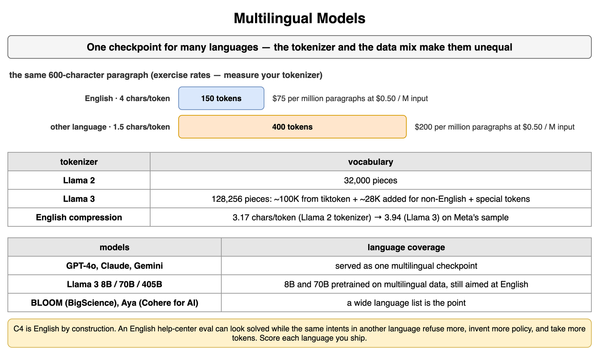

*Source: [`diagrams/foundation-models.drawio`](/content/10_AI_Engineering/02_Understanding_Foundation_Models/diagrams/foundation-models.drawio), page 2.*

## Domain-specific models

A domain-specific model is a foundation model trained or continued on text from one field, so its next-token distribution matches that field.

A general model spends capacity on the whole mix; a rare domain is a small fraction of it, and the loss barely notices. Code, finance, and medicine are large and stylized enough that a specialist can beat a general model of similar size. Early Copilot ran on OpenAI's Codex; Code Llama and StarCoder are public code models, chosen partly because inline suggestions have a latency budget a frontier model may miss. BloombergGPT was pretrained from scratch at 50.6B parameters on 569B tokens drawn from 363B financial and 345B general tokens. Med-PaLM instead adapts a general model to medical QA. Gururangan et al.'s "Don't Stop Pretraining" measured continued pretraining on a domain.

The bet is wrong when the gap is something else. A policy that changed Monday is retrieval; a broken JSON shape is decoding or finetuning; and a frontier model given the relevant filing in the prompt often beats a smaller domain model. A specialist also goes stale and hallucinates in the field's dialect, so a fabricated citation or dose is harder for a non-specialist to catch. Each specialist is another checkpoint to serve, evaluate, and retire. Measure a general model plus a good prompt first, then score the specialist on your tasks, including cases it has never seen. The [Finetuning](../07_Finetuning/) topic makes the same point from the base-model side.

```text
the gap                       the lever
jargon, stable public corpus  continued pretraining / specialist
facts that change weekly      retrieval
a format the grammar enforces constrained decoding
```

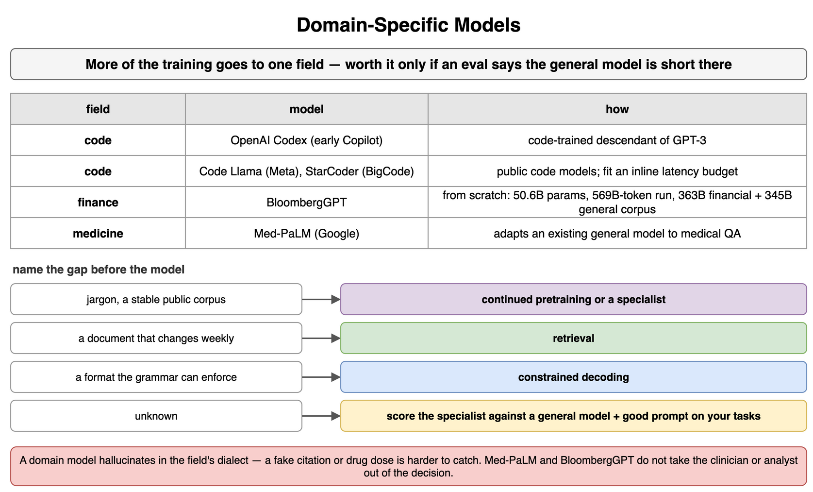

*Source: [`diagrams/foundation-models.drawio`](/content/10_AI_Engineering/02_Understanding_Foundation_Models/diagrams/foundation-models.drawio), page 3.*

## The transformer

A transformer builds each token's representation by looking at other tokens in the sequence, instead of folding the past into one recurrent state.

Vaswani et al.'s 2017 "Attention Is All You Need" introduced it as an encoder-decoder for translation: the encoder reads the source bidirectionally, the decoder writes one token at a time. T5 keeps both halves. BERT keeps the encoder, which suits classification and embeddings. Chat and completion products keep the decoder: GPT-3, Llama, Mistral, and Mixtral are decoder-only, and Gemini 1.0 is a Transformer decoder. Llama 3 stayed dense for stability; Gemini 1.5 Pro and Mixtral are sparse mixture-of-experts transformers. An application can rely on the left-to-right loop and documented sampling knobs, not on unpublished layer counts.

A decoder layer does two things, each added back through a residual connection: attention reads earlier tokens, and a feed-forward block (SwiGLU in Llama-style models) mixes the result. A causal mask limits attention to the current and earlier tokens, which is why generation appends one piece at a time and cannot peek ahead. Position comes from sinusoidal signals in the 2017 paper and rotary embeddings (RoPE) in Llama and Mistral, so a longer context than the model trained on is a training or interpolation project, not a config flag. The architecture won because training runs over the whole sequence in parallel and any token can read any earlier one directly. The price is attention scores that grow with the square of the sequence length.

```text
encoder-decoder  T5, the 2017 original   translation
encoder only     BERT                    classification, embeddings
decoder only     GPT-3, Llama, Mistral   chat, completion (causal mask)
```

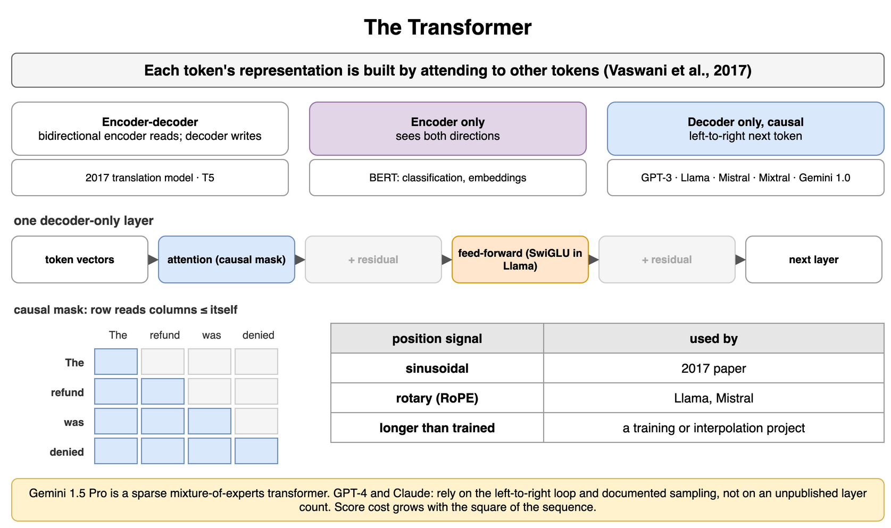

*Source: [`diagrams/foundation-models.drawio`](/content/10_AI_Engineering/02_Understanding_Foundation_Models/diagrams/foundation-models.drawio), page 4.*

## Attention, the KV cache, and context

Attention is the lookup inside a transformer: each token scores earlier tokens and takes a weighted mix of their values. The KV cache stores keys and values already computed so the next token can reuse them, and the context length is how many tokens fit in the lookup.

The current token's query is dotted with each visible key and divided by the square root of the head dimension. A softmax with future positions masked turns the scores into weights, and the output is the weighted sum of values. Multi-head attention runs several lookups in parallel. Grouped-query attention lets query heads share key-value heads: Llama 2 70B has 64 query heads and 8 KV heads, and Llama 3 and Mistral 7B use 8 KV heads. Serving splits into prefill, which reads the prompt and writes the cache, and decode, which emits one token at a time and reads the whole cache. FlashAttention (Dao et al.) speeds prefill by not materializing the score matrix; it does not shrink the cache.

The cache is arithmetic. On the Llama 2/3 70B shape (80 layers, 8 KV heads, head dim 128, BF16, full attention), each token adds `2 × 80 × 8 × 128 × 2 = 327,680` bytes. Full multi-head attention with 64 KV heads would be 8× that. Mistral 7B's 4,096-token sliding window bounds per-layer attention and gives a rolling cache about half the full size at 8,192 tokens. Published limits move: Gemini 1.5 around a million tokens, Claude at 100k and 200k, GPT-4o at 128k, and Claude API models at a million as checked 12 Nov 2026. Bill and latency-test against the model card you call. Four concurrent 131,072-token requests are 160 GiB of cache before weights, which is why servers page, quantize, and cap long requests ([Inference Optimization](../09_Inference_Optimization/)).

```text
scores = query · keys / sqrt(head dimension)
weights = softmax(scores)   # future positions masked out
output = weights · values

70B shape, BF16, 8 KV heads:  320 KiB per token
  4,096 tokens  -> 1.25 GiB    (Llama 2 context)
  8,192 tokens  -> 2.5 GiB     (Llama 3 context)
131,072 tokens  -> 40 GiB      (Llama 3.1 "128k")
```

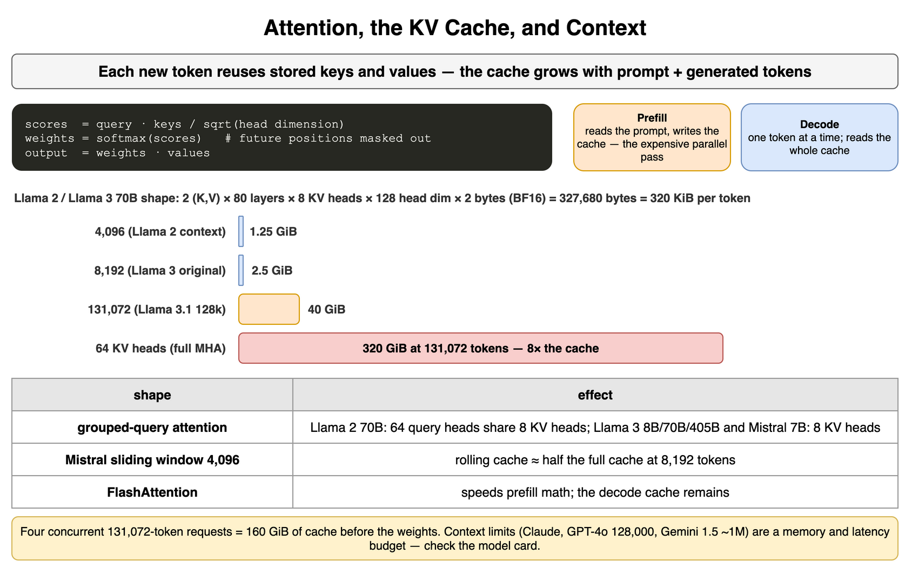

*Source: [`diagrams/foundation-models.drawio`](/content/10_AI_Engineering/02_Understanding_Foundation_Models/diagrams/foundation-models.drawio), page 5.*

## Other architectures

Other architectures are sequence models that do not use full attention at every layer. The ones you meet next to transformers are state-space models such as Mamba and parallel-trainable recurrent models such as RWKV.

They exist because attention's scores grow quadratically and its KV cache grows with length and stays resident during decode. A classic recurrent network keeps a fixed-size state but struggles to train on long dependencies. Mamba (Gu and Dao) updates a selective state at every token using a scan, so training still runs in parallel; RWKV trains a recurrent formulation the same way. Both aim at a decode cost per token that stays roughly flat as the prompt grows.

The price is exact lookup. Attention can jump back to a specific token and copy it; a fixed state has to have kept it, compressed, among everything else. Asking for clause 14 of a pasted contract is easy for a transformer and hard for a pure state model. Hybrids exist because of that split: AI21's Jamba interleaves transformer and Mamba layers and is also a mixture of experts. Mixtral is still a transformer, because MoE changes how many parameters are active, not the sequence model. Most product calls still go to a transformer. Reach for these when the cache or quadratic prefill is the measured constraint, and test with a needle-in-a-haystack check before relying on one.

```text
              memory with length     exact recall of an earlier token
transformer   KV cache grows         direct lookup
Mamba / RWKV  fixed state            must survive compression
Jamba         hybrid                 attention layers keep lookup
```

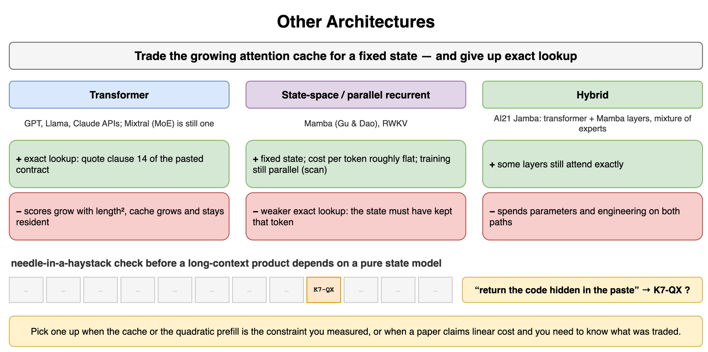

*Source: [`diagrams/foundation-models.drawio`](/content/10_AI_Engineering/02_Understanding_Foundation_Models/diagrams/foundation-models.drawio), page 6.*

## Parameters, tokens, and FLOPs

A parameter is one learned number, a token is one piece of text the model trains on or is billed for, and a FLOP is one floating-point operation, the unit for counting a run's arithmetic.

Parameter count is the headline: GPT-3 is 175B, Llama ships 8B and 70B. The released Llama 3 70B config (hidden 8,192, vocabulary 128,256, separate input and output embeddings of 1,050,673,152 each, 80 SwiGLU layers) totals 70,553,706,496 parameters. Serving memory is count × bytes. A round `70 × 10^9` in BF16 is 130.4 GiB (131.4 GiB for the real config), INT8 is 65.2 / 65.7 GiB, and 4-bit is about 32.6 / 32.9 GiB. An "80 GB" A100 or H100 reports 81,920 MiB, an 80 GiB device: BF16 misses it, and INT8 fits with 14.8 / 14.3 GiB spare for runtime and KV cache. Name the unit you use. Training memory with mixed-precision AdamW is 16 bytes per parameter (BF16 weight and gradient, FP32 master, two FP32 moments), or 18 bytes with an FP32 gradient. Neither fits a 640 GiB 8-GPU node for a full 70B finetune, which is why parameter-efficient methods exist.

Dense training compute is about `6 × N × D` (2 FLOPs forward, 4 backward per parameter per token, ignoring attention). On Llama 3 405B's 15.6T tokens that gives `3.79 × 10^25`, matching the published `3.8 × 10^25`. A FLOP is a count; TFLOPS on a datasheet is a rate. An H100 SXM5's dense BF16 peak is 989.4 TFLOPS (the ~1,979 figure is 2:4 sparse). Divide by real utilization before turning hours into dollars. Mixture-of-experts splits the numbers: Mixtral 8x7B stores ~47B parameters (memory) and uses ~13B per token (FLOPs).

| Accounting | Tensors | `70 × 10^9` | Llama 3 70B configuration |
| --- | --- | --- | --- |
| Mixed-precision AdamW, 16 bytes | BF16 weight, BF16 gradient, FP32 master, two FP32 moments | 1,043.1 GiB | 1,051.3 GiB |
| FP32-gradient variant, 18 bytes | BF16 weight, FP32 gradient, FP32 master, two FP32 moments | 1,173.5 GiB | 1,182.7 GiB |

A Chinchilla-sized run (70B parameters, 1.4T tokens) at H100 peak and at a 40% planning utilization, priced at an exercise $2 per GPU-hour (about 8.6 days on 2,000 GPUs at 40%):

```python
FLOPS = 6 * 70 * 10**9 * 1.4 * 10**12
PEAK_PER_S = 989.4 * 10**12
UTIL = 0.40
PRICE = 2.0
hours_peak = FLOPS / PEAK_PER_S / 3600
print(f"{FLOPS:.2e}")
print(f"{hours_peak:.0f} {hours_peak / UTIL:.0f}")
print(f"{hours_peak * PRICE:.0f} {hours_peak / UTIL * PRICE:.0f}")
# 5.88e+23
# 165083 412708
# 330166 825416
```

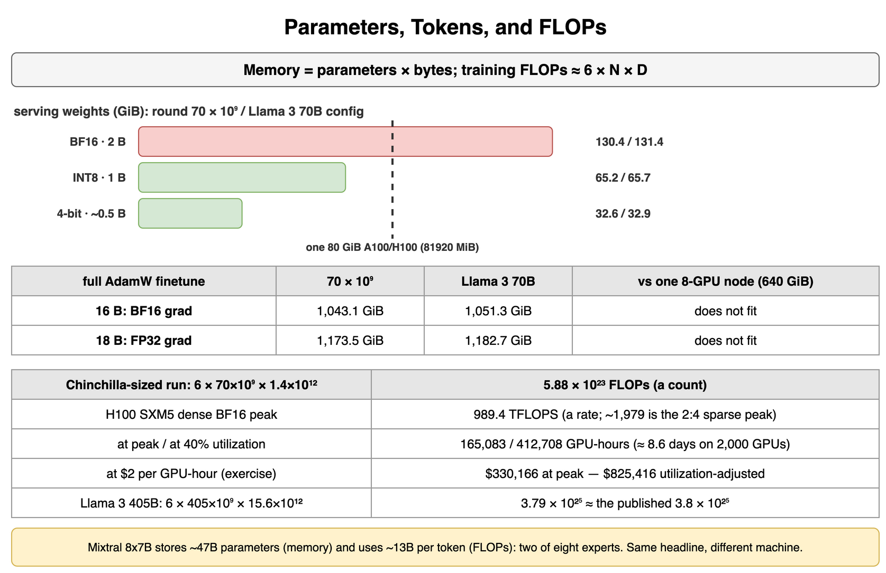

*Source: [`diagrams/foundation-models.drawio`](/content/10_AI_Engineering/02_Understanding_Foundation_Models/diagrams/foundation-models.drawio), page 7.*

## Compute-optimal scaling

Compute-optimal training picks parameter count and token count together so a fixed training-FLOP budget buys the lowest loss.

Kaplan et al. (2020) fit loss against model size, data, and compute and put most new compute into parameters. Hoffmann et al.'s 2022 Chinchilla paper reran the study and found those models undertrained: for a fixed `6ND` budget, tokens should grow roughly with parameters, about 20 tokens per parameter. Chinchilla (70B on 1.4T tokens) beat the larger, undertrained Gopher (280B). GPT-3 (175B on ~300B tokens) sits under 2 tokens per parameter.

The rule optimizes training loss, but a product also pays inference on every request. A smaller model trained far past 20:1 can be the better thing to serve. Llama 3's 405B is near compute-optimal at 15.6T tokens (about 39 per parameter). Its 8B and 70B were trained on about 15T tokens: 1,875 per parameter for the 8B (Meta put its Chinchilla-optimal count near 200B tokens, not the round rule's 160B) and about 214 for the 70B. That overshoot is a serving decision. Repeating data inflates the token count with diminishing returns.

The ratio is a sanity check, not a constant. Parameters are learned; hyperparameters (width, depth, batch size, learning rate, data mix) are chosen before training, and a frontier run is often one shot. Hyperparameter transfer such as μP (Yang et al.) tunes the learning rate on a small model so it still applies when the model is wider. Sweep where runs are cheap.

```text
plan                      tokens/param   verdict
70B on 50B tokens         < 1            buy a smaller model with more data
70B on 1.4T (Chinchilla)  20             compute-optimal
8B on 15T (Llama 3)       1,875          overtrained on purpose for cheap serving
```

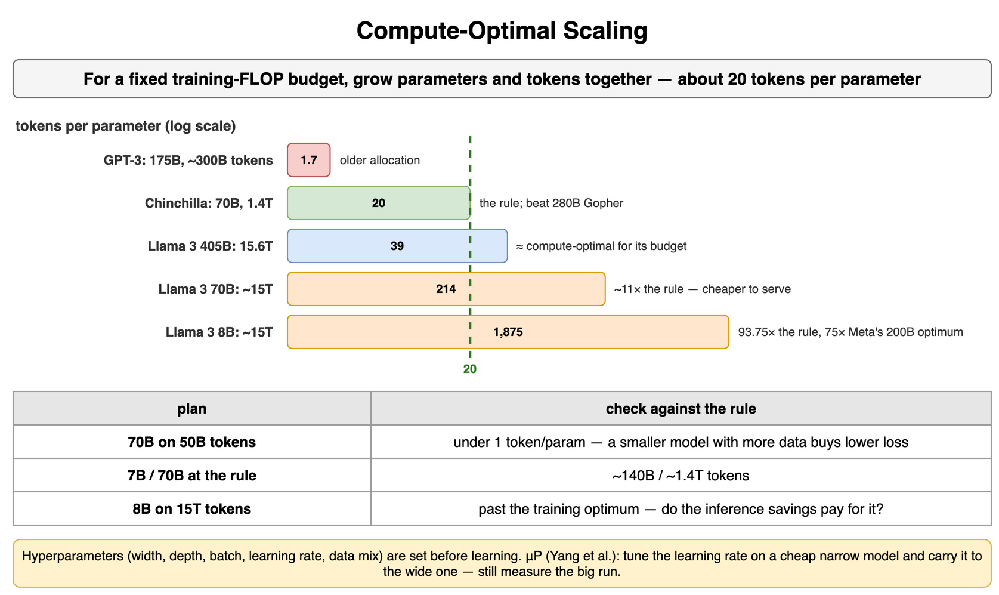

*Source: [`diagrams/foundation-models.drawio`](/content/10_AI_Engineering/02_Understanding_Foundation_Models/diagrams/foundation-models.drawio), page 8.*

## Scaling extrapolation

Scaling extrapolation uses loss curves from smaller runs to predict a larger run you have not paid for.

You train a grid of small models, fit a power law for loss against N, D, and compute, and read off the next size. Kaplan and Chinchilla are used this way, and Llama 3 sized its 405B run from such a fit. The fit only holds in the regime it measured: the same architecture, a similar data mix, and a stable recipe. It knows nothing of a numerical failure that appears only at large width, a data-quality cliff, or a product metric that stopped moving. Llama 3's report names the limits itself: the fits predict next-token loss rather than benchmarks, and small-budget fits are noisy.

Loss and what users feel are different curves. Loss can keep falling while a benchmark saturates or while invented citations stay a small share of tokens and a large share of complaints. Schaeffer et al.'s 2023 "Are Emergent Abilities a Mirage?" argues many sudden jumps come from all-or-nothing metrics, such as exact match or hard-threshold multiple choice, that hide smooth probability gains. Some tasks get worse with scale. The Inverse Scaling Prize (McKenzie et al., 2023) collected them; usually a bigger model follows a misleading cue more faithfully. Some later turned U-shaped with more scale or instruction tuning. So do not assume the next size fixes or worsens a systematic failure: score the task at the size you will serve.

```text
smooth:    next-token loss on the small-run grid -> extrapolate
jagged:    exact-match / threshold metrics -> can look "emergent"
must test: the product metric, at the size you serve
```

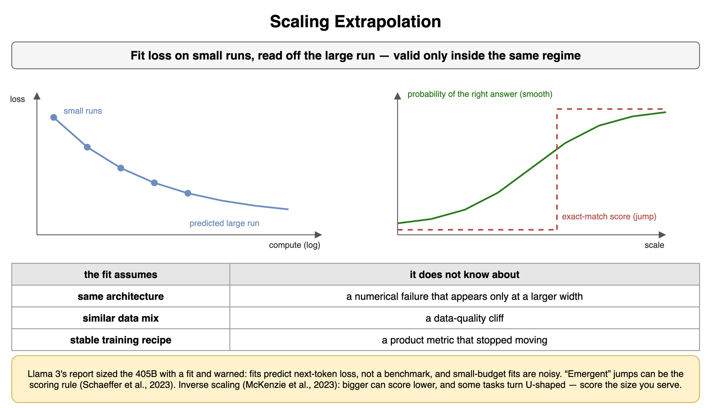

*Source: [`diagrams/foundation-models.drawio`](/content/10_AI_Engineering/02_Understanding_Foundation_Models/diagrams/foundation-models.drawio), page 9.*

## Scaling bottlenecks

A scaling bottleneck is a limit the loss curve does not contain: the stock of usable data, power and chips, and a product metric that stopped moving while loss still falls.

Public human-written text is a finite stock (Epoch frames high-quality language data this way), and quality filters shrink it further. Past a point, more compute means more epochs over the same pages. Synthetic data can fill the gap when it is filtered: Llama 3's post-training generates code dialogs and keeps those that pass a parser and unit tests. Copied uncritically from a teacher model, it repeats the teacher's mistakes and narrows the distribution.

Power is a facilities number, not a term in `6ND`. Llama 3 405B used up to 16,384 H100s at a 700 W TDP, about 11.5 MW of accelerator nameplate before CPUs, network, and cooling. TDP is a cap, not average draw. That run's `3.8 × 10^25` FLOPs is about 65 times the Chinchilla-sized `5.88 × 10^23`, so "four times the FLOPs" is a facilities, interconnect, and chip-supply project. Inside a fixed power cap, the best model is the best one that fits.

The product metric is the bottleneck an application team hits first. A help-desk bot can sit at the same error rate while each new base model's pretraining loss improves. The next dollar then goes to the retrieved article, the abstention rule, or the eval set, not a bigger pretraining run.

```text
data      finite stock; synthetic data only if filtered
power     16,384 H100 x 700 W = 11.5 MW nameplate, before cooling
metric    flat product error while loss keeps falling
```

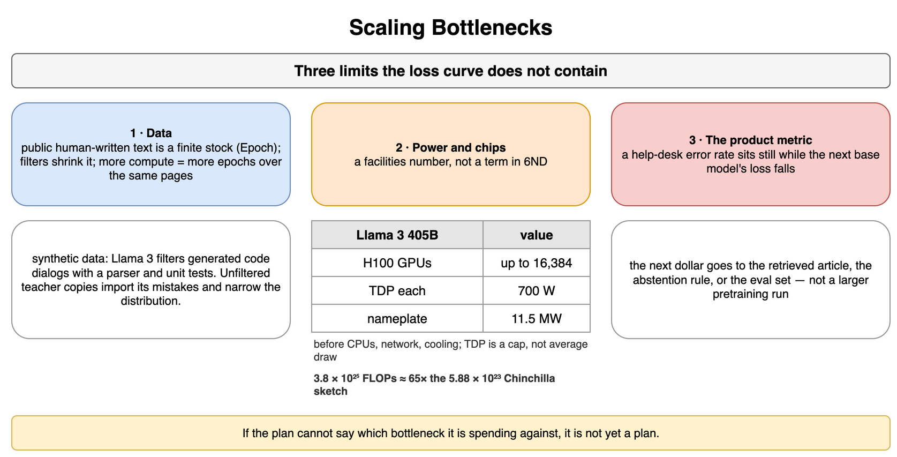

*Source: [`diagrams/foundation-models.drawio`](/content/10_AI_Engineering/02_Understanding_Foundation_Models/diagrams/foundation-models.drawio), page 10.*

## Supervised finetuning

Supervised finetuning is continued next-token training on examples of the behavior you want, each a prompt paired with a target answer.

A base model continues text: give raw Llama "Classify this ticket:" and it writes another ticket. ChatGPT, Claude, Gemini, and the Instruct/Chat variants of Llama and Mistral went through post-training so the prefix becomes a request, and SFT is the first step in the InstructGPT recipe. You train on prompts and the answers a person or stronger model wrote, with the loss masked to the answer tokens. Training on the prompt wastes capacity copying the user; training on the answer teaches the reply's shape: a label, a paragraph, a JSON object, a refusal.

The demonstrations are the ceiling, because the model imitates their mistakes, length, and tone. Alpaca's roughly fifty thousand examples made a base model follow simple instructions, not reliably. A few hundred hand-checked support replies move a house style faster than a million sloppy ones, and model-written demos you never checked teach fluent average answers. Training too long on a narrow set erodes general behavior; mixing in broader data or keeping the update small limits that. SFT does not rank two acceptable-looking answers (that is preference finetuning, next) and does not absorb tomorrow's facts (that is the prompt or retrieval). [Finetuning](../07_Finetuning/) covers the mechanics.

```text
prompt:  "Classify this ticket: card charged twice"   (loss masked)
target:  "billing"                                     (loss here)
SFT when the model cannot do the behavior; preferences when it ranks wrong; retrieval for facts
```

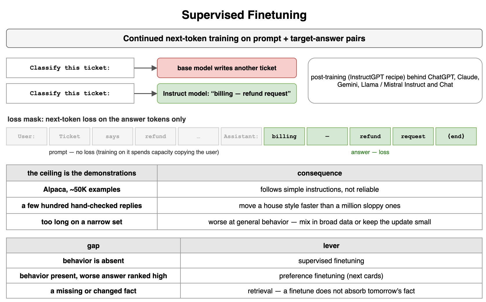

*Source: [`diagrams/foundation-models.drawio`](/content/10_AI_Engineering/02_Understanding_Foundation_Models/diagrams/foundation-models.drawio), page 11.*

## Reward models

A reward model is a scorer trained on preferences. Given a prompt and two answers, it learns to score the preferred one higher.

The signal is a comparison, not a demonstration. InstructGPT trained on human comparisons. Anthropic's Constitutional AI has a model critique and revise drafts against written principles, and RLAIF (Google Research) is the general name for model-written preference labels. The scorer usually starts from the SFT model with the vocabulary projection replaced by one scalar. The standard Bradley-Terry loss makes P(A beats B) a logistic function of the score difference. It grades replies a policy wrote; it does not write them.

It is used in two places: as the target in preference finetuning, and at serving time for best-of-N, where you draw several replies and return the top-scored one without changing weights. Both uses inherit its mistakes. If longer answers won the comparisons, length scores high and an optimized policy learns to pad; flattery and confident tone are the same failure. Fix it in the comparisons: length-matched pairs, a length-normalized score, and a person reading what high-scoring answers actually say. Human comparisons are slow and closest to users, while model-written ones scale and copy the judge's bias. Never use the same scorer to train the policy and to declare it improved.

```text
scores: better = 2.0, worse = 0.5   difference 1.5
P(better wins) = 1 / (1 + e^(-1.5)) ≈ 0.818
```

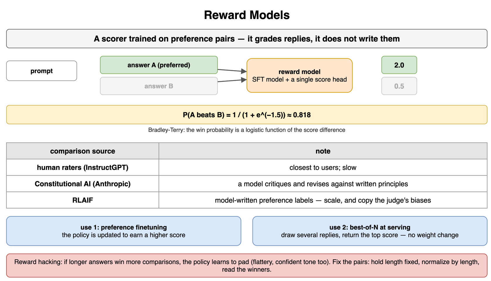

*Source: [`diagrams/foundation-models.drawio`](/content/10_AI_Engineering/02_Understanding_Foundation_Models/diagrams/foundation-models.drawio), page 12.*

## RLHF and direct preference optimization

RLHF updates a model with a reward model's scores and a reinforcement-learning step. Direct preference optimization (DPO) trains on the same preference pairs with a classification loss and skips both the reward model and the RL loop.

InstructGPT's recipe has three stages: SFT, a reward model, then PPO. PPO samples answers, scores them, and steps toward higher reward, with a KL penalty to the SFT checkpoint so the policy cannot drift into high-scoring gibberish, and a value model to reduce noise. The KL weight is the main brake on reward hacking, not proof it is gone. Rejection sampling is the smaller cousin: draw several answers, keep the top-ranked, and SFT on the winners. It can only select what the model already writes. Llama 2-Chat used rejection sampling and PPO; Llama 3 used SFT, rejection sampling, and DPO, dropping PPO as less stable to scale.

DPO (Rafailov et al., 2023) solves the same KL-constrained objective in closed form, giving a loss that raises the preferred answer's probability relative to a reference model (usually SFT), with β in the KL role. `β log π(y|x) − β log π_ref(y|x)` is an implicit reward, comparable only between answers to the same prompt. IPO, KTO, and ORPO are relatives. PPO scores fresh on-policy text but is many moving parts. DPO is a reproducible job whose pairs go stale as the model moves (iterative DPO rebuilds them), and it struggles when the preferred answer is far from the reference, so SFT first. Watch the chosen answer's own probability, because the loss can improve while it falls. Read generations. Neither method puts this week's help center in the weights.

```text
RLHF (PPO)   SFT -> reward model -> PPO + KL      on-policy, fragile, keeps a scorer
rejection    sample N -> keep best -> SFT          only selects existing behavior
DPO          pairs -> closed-form loss (β)         offline, simple, pairs go stale
```

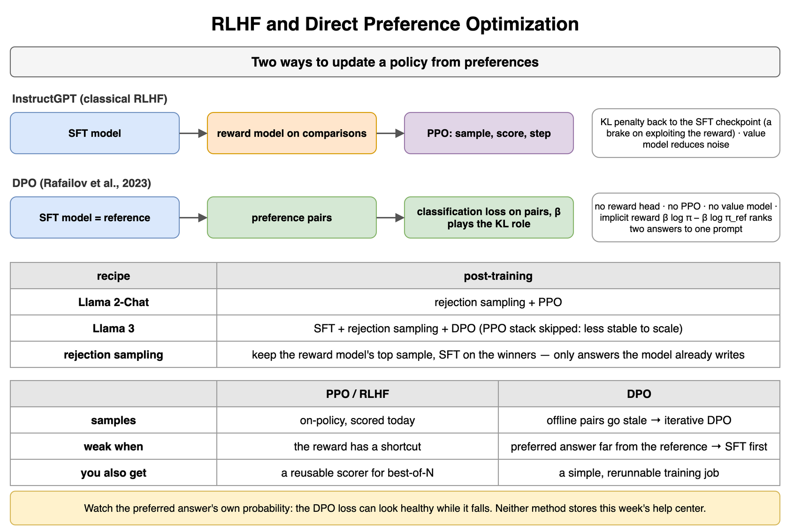

*Source: [`diagrams/foundation-models.drawio`](/content/10_AI_Engineering/02_Understanding_Foundation_Models/diagrams/foundation-models.drawio), page 13.*

## Sampling from logits

Sampling turns the model's raw scores into the next token. The scores are logits, one per vocabulary entry. A softmax turns them into probabilities, and a draw picks the token to append.

For logit `z_i` and temperature `T`, probability is proportional to `e^(z_i / T)`, normalized to sum to one. Implementations subtract the largest logit first so exponentials do not overflow, which does not change the result. Temperature changes the gaps but never which token leads. Low temperature makes you draw the leader more often, which suits an invoice total. High temperature flattens the distribution, which suits a brainstorm. Temperature 0 is implemented as greedy argmax: more repeatable but not more correct, because the mode can be the false total, and floating-point kernels and batching can flip near ties across servers. Some APIs take a seed and still disclaim bitwise reproducibility.

ChatGPT, Claude, and Gemini repeat this draw until a stop rule fires, which is why a finished paragraph is a sample. Where an API exposes log probabilities (OpenAI's chat API does), use them to find near ties and unstable fields, not as proof a field is true. Sampling and hallucination relate exactly this way: temperature changes how often you draw the leader. It does not replace a false leader.

```python
import math


def softmax(temperature: float) -> str:
    scaled = [logit / temperature for logit in (2.0, 1.0, 0.0)]
    largest = max(scaled)
    weights = [math.exp(item - largest) for item in scaled]
    total = sum(weights)
    return " ".join(f"{item / total:.4f}" for item in weights)


print(softmax(1.0))
print(softmax(0.5))
# 0.6652 0.2447 0.0900
# 0.8668 0.1173 0.0159
```

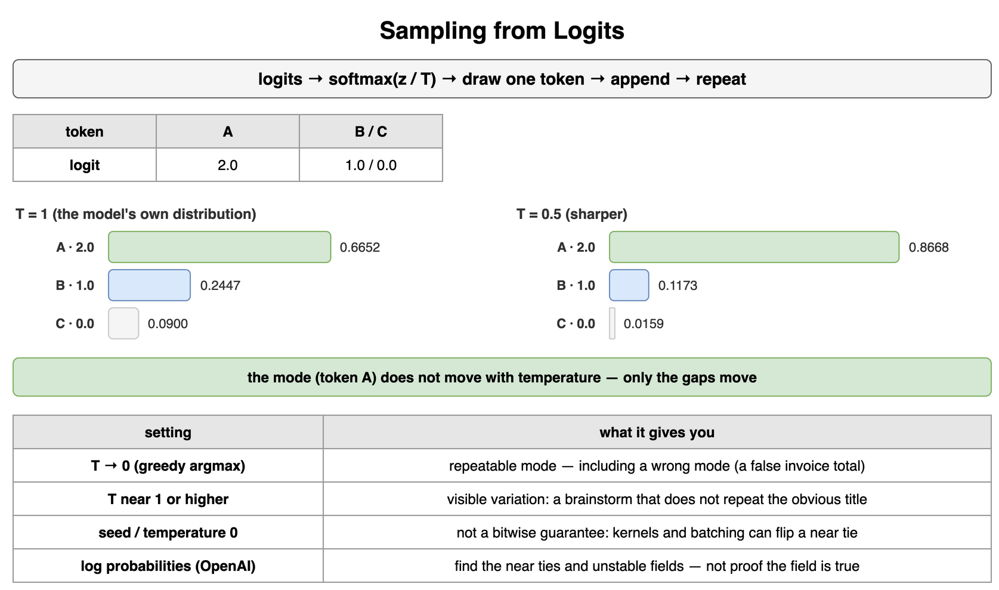

*Source: [`diagrams/foundation-models.drawio`](/content/10_AI_Engineering/02_Understanding_Foundation_Models/diagrams/foundation-models.drawio), page 14.*

## Temperature, top-k, top-p, and stopping

Temperature, top-k, and top-p decide which tokens can be drawn and how peaked their probabilities are. A stopping condition decides when the loop ends.

Temperature divides the logits before the softmax. Top-k keeps the k largest logits and renormalizes (k = 1 is greedy). Top-p, or nucleus sampling (Holtzman et al., 2020), keeps the smallest set whose probabilities reach p, so it adapts: a peaked step keeps one or two tokens, a flat one keeps many. On the previous card's temperature-1 distribution (0.6652, 0.2447, 0.0900), p = 0.9 keeps two tokens (0.9099), renormalized to 0.731 and 0.269. At temperature 0.5 the leader already holds 0.8668, so p = 0.8 collapses to greedy. That is why OpenAI recommends moving temperature or top_p, not both. Min-p (Nguyen et al., ICLR 2025) drops tokens below base × the leader's probability, so the cutoff rises when the model is confident; its practical base is about 0.05–0.1, and stacking it on top-p double-truncates. APIs differ: OpenAI exposes temperature, top_p, stop, and max tokens; Anthropic and Gemini also expose top_k; some reasoning models fix temperature. Frequency and presence penalties are repetition controls that can change the leader.

Stopping is three different events: the model's end-of-turn token, a stop string you named, or the max-token cap. A `}` stop ends JSON at the first brace even inside a string, and a newline stop ends pretty-printed JSON on line one. Choose stop strings that cannot appear in a valid answer, and treat a max-token finish as an error when the consumer needs a complete object.

| Knob | What changes | A setting that matches a real product |
| --- | --- | --- |
| Temperature | Divides logits before the softmax. The leader stays the leader. | Near 0 for an extracted total or ghost text; near 1 for a brainstorm. |
| Top-k | Keeps the k largest logits, then renormalizes. | Anthropic and Gemini expose it; k = 1 is greedy. |
| Top-p | Keeps the smallest set summing to at least p. | About 0.9 for a brainstorm; OpenAI exposes top_p. |
| Min-p | Drops tokens below `base ×` the leader's probability. | Base 0.05–0.1; base 0.2 (above the band) leaves 0.7311 and 0.2689 here. |
| Stopping | End-of-turn token, stop string, or token cap. | Cap chat replies; never stop on a string valid JSON can contain. |

```python
import math


def softmax(temperature: float) -> tuple[float, ...]:
    scaled = [logit / temperature for logit in (2.0, 1.0, 0.0)]
    largest = max(scaled)
    weights = [math.exp(item - largest) for item in scaled]
    total = sum(weights)
    return tuple(item / total for item in weights)


def min_p_pool(probs: tuple[float, ...], base: float) -> tuple[float, ...]:
    threshold = base * max(probs)
    kept = [item for item in probs if item >= threshold]
    mass = sum(kept)
    return tuple(item / mass for item in kept)


print(" ".join(f"{item:.4f}" for item in min_p_pool(softmax(1.0), 0.2)))
print(" ".join(f"{item:.4f}" for item in min_p_pool(softmax(0.5), 0.1)))
# 0.7311 0.2689
# 0.8808 0.1192
```

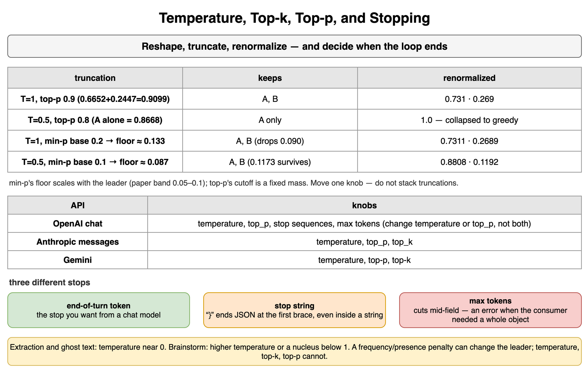

*Source: [`diagrams/foundation-models.drawio`](/content/10_AI_Engineering/02_Understanding_Foundation_Models/diagrams/foundation-models.drawio), page 15.*

## Test-time compute

Test-time compute is extra work spent answering one request, after the weights are frozen, to raise the chance the answer is right.

Some errors are search errors: the model gives a correct answer real probability, and one sample misses it. Chain-of-thought (Wei et al.) spends extra tokens on intermediate reasoning. Self-consistency (Wang et al.) draws several chains and takes a majority vote, which helps for short canonical answers and makes a shared mistake more confident. Best-of-N keeps the sample a verifier ranks first: a reward model, a unit-test suite, or a schema check. Without a verifier, log-probability is a common stand-in, and the aggregation matters. The sum favors shorter samples because every token adds a negative number; the length-averaged log-probability compares answers of different lengths. Neither proves truth.

Code is the clean case because tests are an independent judge. If one sample passes 40% of the time and failures are independent, eight samples contain a pass with probability `1 − 0.6^8 ≈ 0.983`. Real bugs correlate, so that is a ceiling; measure pass@8 on your repository. Reasoning models such as OpenAI's o1 and DeepSeek-R1 spend the compute inside one long trace. Cost and latency scale with the effort, so match it to the product: Copilot ghost text gets one short decode, a pull-request agent can spend N samples and the tests, and a hard chat question can wait for a trace. [Evaluation Methodology](../03_Evaluation_Methodology/) covers when a model judge can be the verifier.

```python
long = (-0.2, -0.2, -0.2, -0.2)
short = (-0.5,)
print(f"{sum(long):.1f} {sum(short):.1f}")
print(f"{sum(long) / len(long):.1f} {sum(short) / len(short):.1f}")
# -0.8 -0.5
# -0.2 -0.5
```

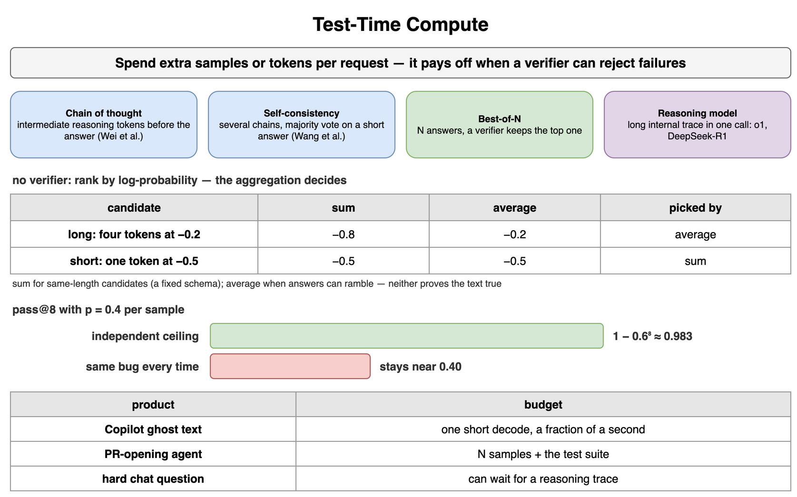

*Source: [`diagrams/foundation-models.drawio`](/content/10_AI_Engineering/02_Understanding_Foundation_Models/diagrams/foundation-models.drawio), page 16.*

## Structured outputs

Structured output is a generation the program can parse, usually a JSON object or a tool call matching a schema. Prompting, post-processing, constrained sampling, and finetuning are the four ways to get one, and you stack the cheap ones.

A receipt reader that returns a paragraph has not finished the job; the next system needs a vendor, date, and total it can type-check. Three API contracts get conflated. JSON mode (OpenAI) makes the string parse as JSON but does not enforce your schema, and a length cutoff can still truncate it. Schema-constrained decoding, such as OpenAI strict structured outputs or Outlines, masks every vocabulary token that would leave the declared schema; Anthropic and Gemini accept response or tool schemas. The mask is an automaton over the tokenizer, not a brace check after the fact. A tool call returns a function name and arguments your code may refuse to run: a schema-valid Stripe refund can still name the wrong charge.

The order follows a concrete failure: a preamble, a fence, and `{"total": 12.50,}`. A stricter prompt removes most of it. A slice-and-strip repair parses that string but drops a second object. Constrained decoding removes the syntax class entirely. A parser still checks types, ranges, and agreement with the source, because `{"total": 999.0}` is valid JSON. Finetune when the JSON is valid but the values are systematically wrong, the schema is stable, and you have examples. For a small closed label set, such as a Zendesk intent or a priority, a frozen body with a trained classifier head emits a class id that cannot be malformed. [Prompt Engineering](../05_Prompt_Engineering/) and [Finetuning](../07_Finetuning/) cover the two sides.

| Method | What you change | What can still be wrong |
| --- | --- | --- |
| Prompting | The instruction and examples ask for only this shape. | A markdown fence, a trailing comma, or an extra sentence. |
| Post-processing | Code strips fences, repairs small errors, and parses. | Truncated or doubled objects; some repairs guess. |
| Constrained sampling | Tokens that leave the grammar or schema are masked. | Wrong values; it can force an empty object when the model wanted to refuse. |
| Finetuning | The weights see many correctly filled examples. | More likely, not guaranteed; a schema change needs new data. |

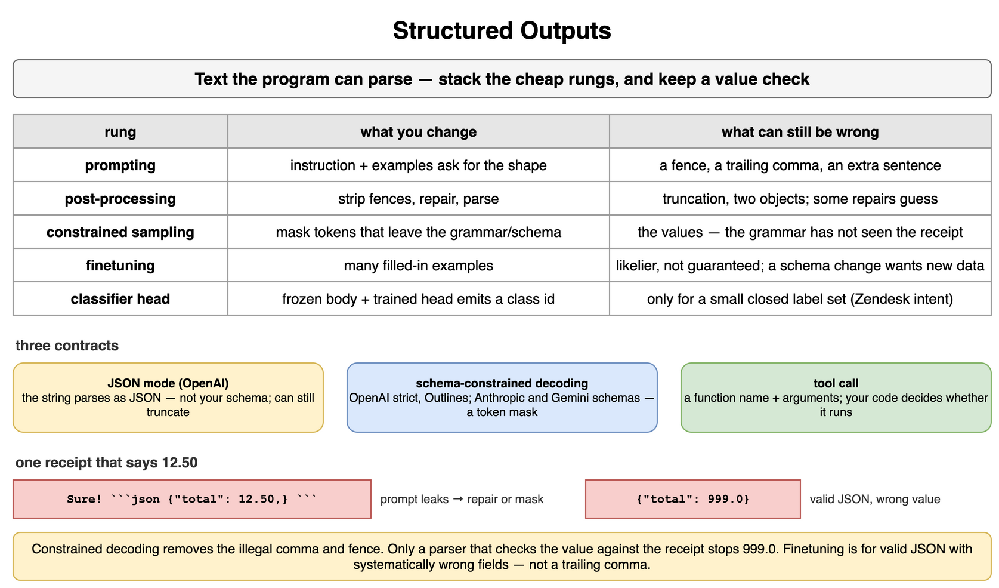

*Source: [`diagrams/foundation-models.drawio`](/content/10_AI_Engineering/02_Understanding_Foundation_Models/diagrams/foundation-models.drawio), page 17.*

## Inconsistency

Inconsistency is the model giving different answers when the underlying fact has not changed, across two samples of one prompt or two phrasings of one question.

The first kind is by design: a chat UI at temperature 1 (the usual OpenAI and Anthropic default) draws a new sample on each click. The second is prompt sensitivity: "Is the window 30 days? yes or no" and "How long is the window?" pull different continuations because the distribution depends on the prefix. An eval that rewords prompts every run mixes that sensitivity into the score, so freeze prompts to measure the model and vary them on purpose to measure the sensitivity.

Agreement and support are separate axes: samples can disagree and all be faithful, or agree and all be false. Temperature, top-p, and seeds reduce sample variance; they repeat a wrong mode. A seed makes tests less flaky but is not bitwise identity across hardware. Unit-test a constrained field by parsing it and comparing to the source; do not string-match a paragraph. Robustness is the same table under ordinary nudges such as a typo, paraphrase, blank line, or reordered section. Count how often a fixed perturbation set flips a label or tool call. An exercise result of 0.96 on frozen wording versus 0.70 on paraphrases is a classifier fit to one phrasing. Report both numbers.

| What you observed | What it is | What you change |
| --- | --- | --- |
| Samples agree and match the article. | A stable answer. | Spend the next dollar on a different failure. |
| Samples disagree, each matches the article. | Phrasing inconsistency; the fact survived. | Score the fact, or constrain a field. |
| Samples disagree, one contradicts the article. | Sampling failure plus a hallucination. | Lower temperature or vote if the mode is right; check the source. |
| Samples agree and contradict the article. | A consistent hallucination; the mode is wrong. | Change context, abstention, or model, not sampling knobs. |

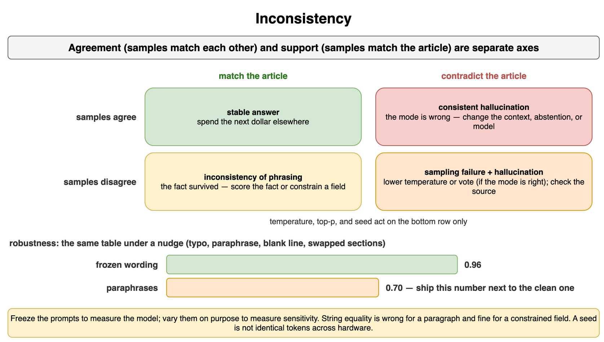

*Source: [`diagrams/foundation-models.drawio`](/content/10_AI_Engineering/02_Understanding_Foundation_Models/diagrams/foundation-models.drawio), page 18.*

## Hallucination

A hallucination is a fluent output that the provided source or the world does not support, delivered as though it were.

Summarization research splits it in two. An intrinsic hallucination contradicts the source, such as a summary saying the customer accepted a refund the thread declined. An extrinsic one adds a claim the source never made, such as a 60-day window when the article says 30. The extrinsic kind is the common product bug: the source ran out and the model kept being helpful. A stiff but supported sentence is a writing problem, not a hallucination, and lumping the two into one accuracy number hides the failure users forward to a lawyer.

The fix depends on the cause, and only one cause is a sampling knob. A wrong mode, where low-temperature samples agree on the false window, gets no help from temperature. Best-of-N and reasoning traces help only with a verifier that does not share the blind spot. A citation the reader can open in one step, as in Perplexity or NotebookLM, makes a bad sentence checkable, provided the cited identifier actually resolves. Two cheap prompt lines help: "say you do not know if the text does not support an answer" and "answer briefly." Count their failures too, meaning false refusals on answerable questions and concise wrong answers. Neither inserts the missing page; that is retrieval ([RAG and Agents](../06_RAG_and_Agents/)). [Evaluation Methodology](../03_Evaluation_Methodology/) defines the faithfulness metric.

| Cause | How it shows up | What changes it |
| --- | --- | --- |
| Next-token training rewards plausible text, with no truth label. | A real-sounding paper, API method, or court case. | A lookup tool, or a retrieved passage the model must quote. |
| The fact was rare or absent in training. | Confident answers about private APIs or yesterday's prices. | Retrieval, and abstention when retrieval is empty. |
| Later tokens condition on the model's own earlier sentence. | One invented date, then a paragraph built on it. | Shorter answers, separate schema fields, checks between steps. |
| Preference training rewarded complete, agreeable answers. | A guess where "I do not know" was faithful. | Demonstrations and preferences that reward abstention; count guesses. |
| Decoding left the mode. | At high temperature, one sample wild and one faithful. | Lower temperature or a tighter nucleus (the only row knobs fix). |

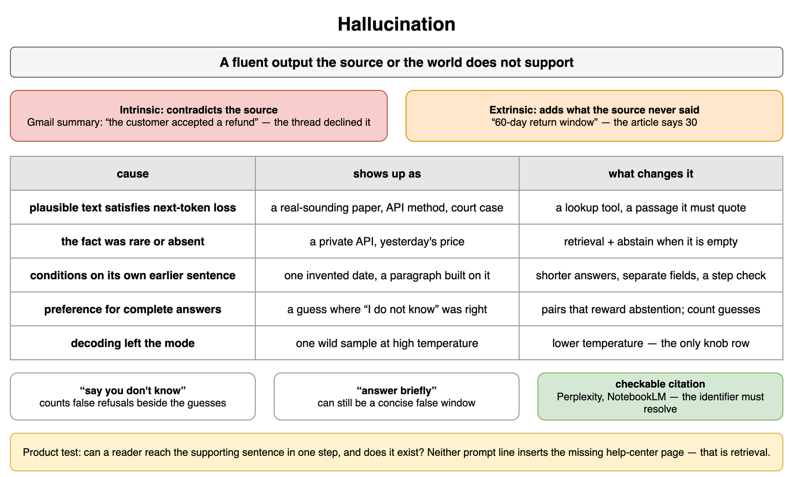

*Source: [`diagrams/foundation-models.drawio`](/content/10_AI_Engineering/02_Understanding_Foundation_Models/diagrams/foundation-models.drawio), page 19.*
