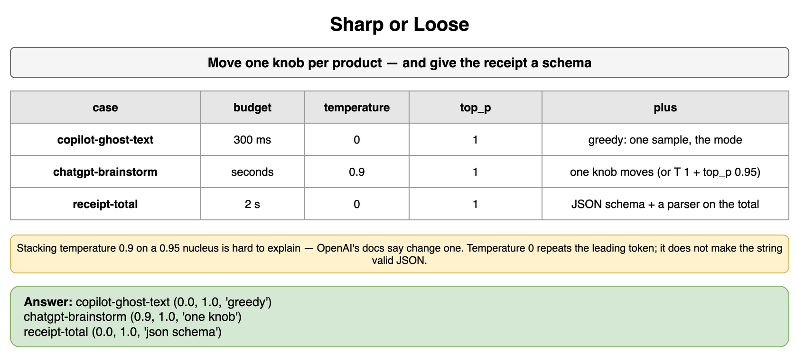
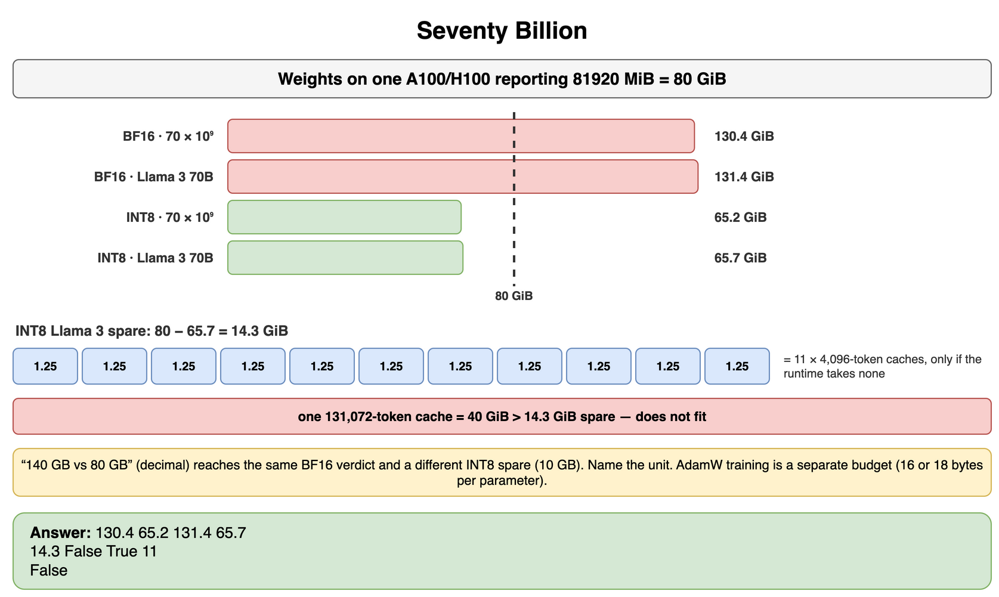
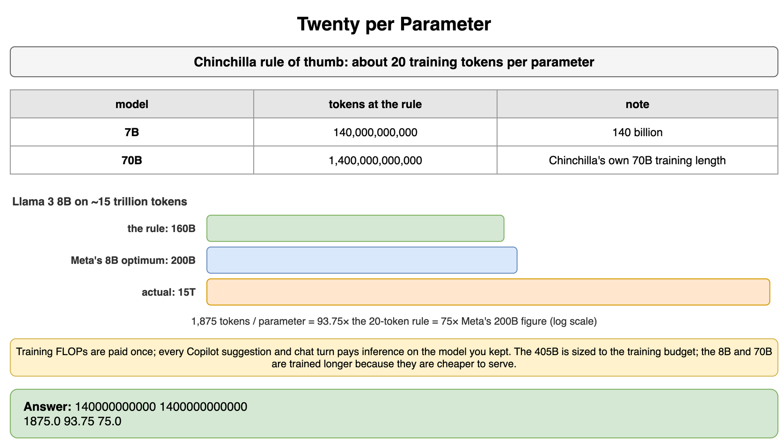
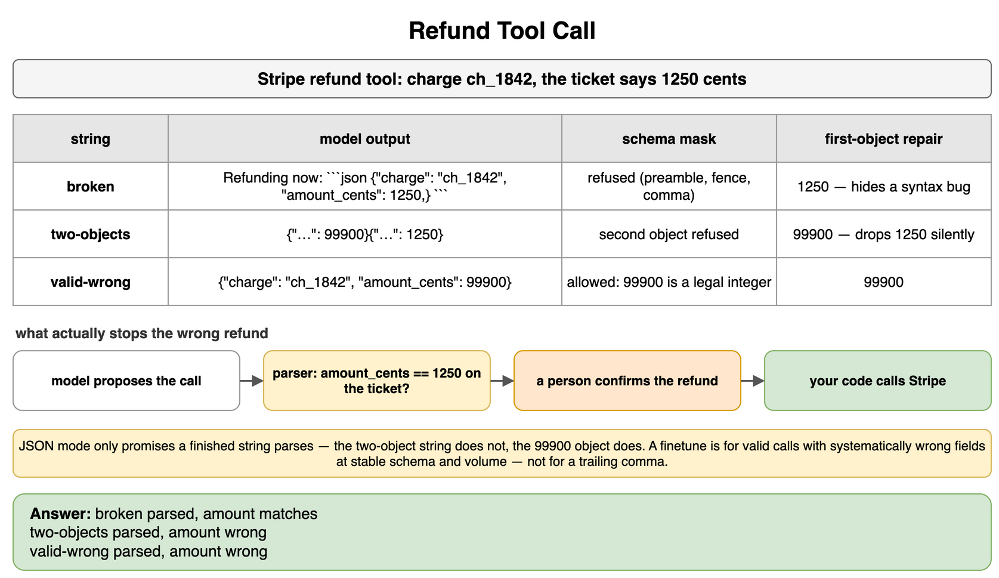
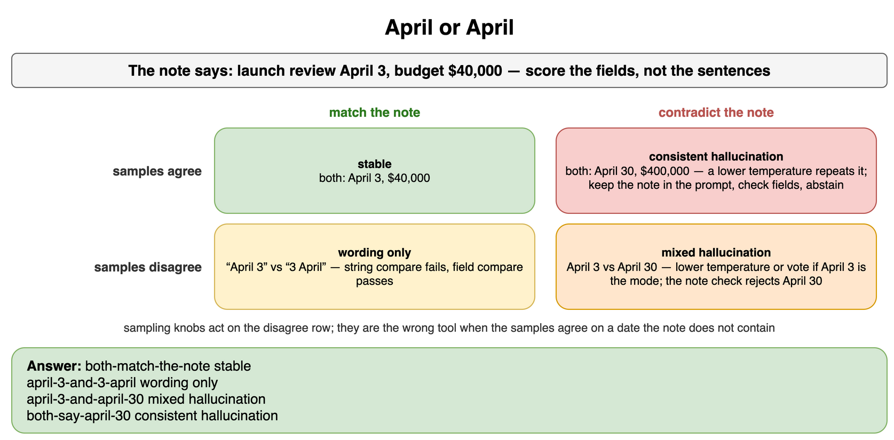
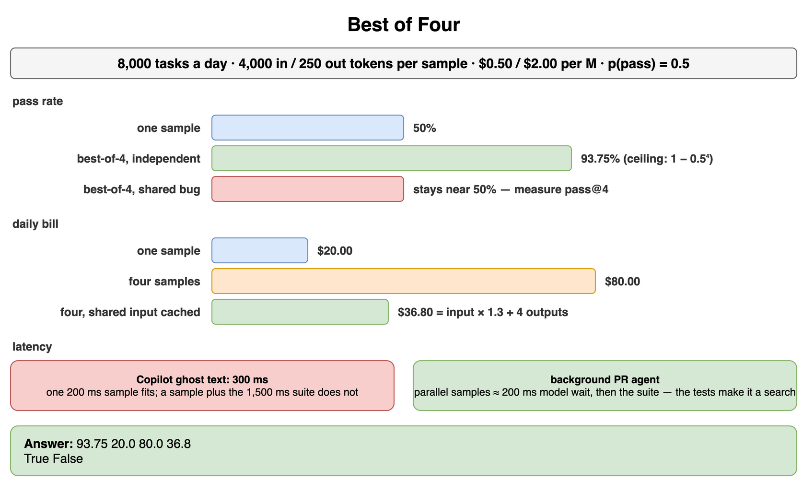
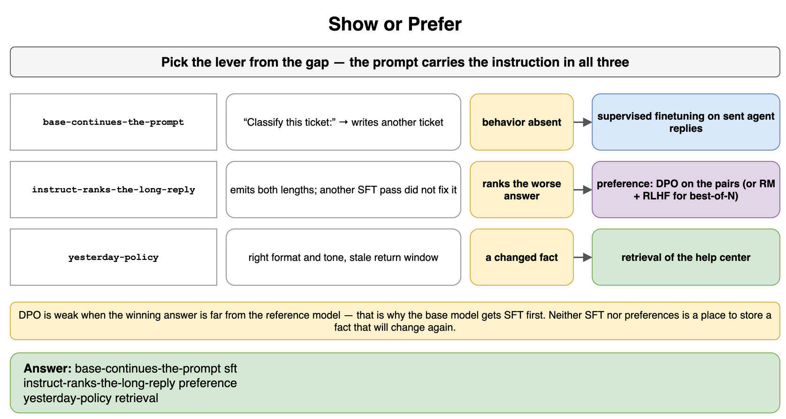
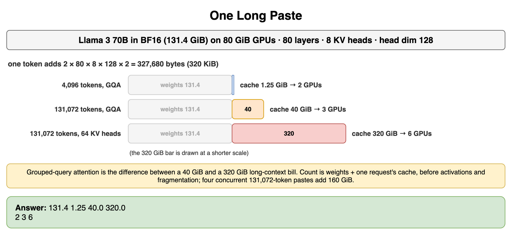

# Understanding Foundation Models — Drills

Practice for the model decisions in this chapter. Each card is one exercise: commit to an answer, then check it. The products are real. Token prices, pass rates, latencies, and GPU peaks are assumptions for the arithmetic. A launch uses the current rate card, a measured tokenizer, and the GPU you actually have.

## Sharp or Loose

GitHub Copilot shows ghost text while someone types. The exercise budget is 300 milliseconds, and a surprising token is inserted into the file. A ChatGPT or Claude brainstorm was asked for ten titles, and the user can wait a few seconds. An Expensify-style receipt reader must return a total the rest of the program can parse.

What temperature and top_p do you set on each, and what does the receipt need besides a low temperature?

```python
CASES = {
    "copilot-ghost-text": {"latency_ms": 300, "wants_variety": False, "must_parse": False},
    "chatgpt-brainstorm": {"latency_ms": 5000, "wants_variety": True, "must_parse": False},
    "receipt-total": {"latency_ms": 2000, "wants_variety": False, "must_parse": True},
}
```

**Answer:** Ghost text gets temperature 0 and top_p 1. The suggestion has to be the mode, because the user did not ask for a surprise, and 300 milliseconds leaves no room for a second sample. The brainstorm gets temperature 0.9 and top_p left at 1, so only one knob moves. A nucleus of 0.95 at temperature 1 is the other coherent choice. Stacking 0.9 on top of 0.95 makes the sample hard to explain, which is why OpenAI's temperature documentation says to change one of the two. The receipt gets temperature 0, top_p 1, and a JSON schema. Temperature 0 repeats the leading token. It does not make the string valid JSON. The schema mask does that, and a parser still checks the total against the receipt.

```python
CASES = {
    "copilot-ghost-text": {"latency_ms": 300, "wants_variety": False, "must_parse": False},
    "chatgpt-brainstorm": {"latency_ms": 5000, "wants_variety": True, "must_parse": False},
    "receipt-total": {"latency_ms": 2000, "wants_variety": False, "must_parse": True},
}


def settings(latency_ms: int, wants_variety: bool, must_parse: bool) -> tuple[float, float, str]:
    extra = "greedy"
    temperature = 0.0
    if must_parse:
        extra = "json schema"
    elif wants_variety and latency_ms >= 1000:
        temperature = 0.9
        extra = "one knob"
    return (temperature, 1.0, extra)


for name, case in CASES.items():
    print(name, settings(**case))
# copilot-ghost-text (0.0, 1.0, 'greedy')
# chatgpt-brainstorm (0.9, 1.0, 'one knob')
# receipt-total (0.0, 1.0, 'json schema')
```



*Source: [`diagrams/foundation-models-drills.drawio`](/content/10_AI_Engineering/02_Understanding_Foundation_Models/diagrams/foundation-models-drills.drawio), page 1.*

## Seventy Billion

You are placing weights on an A100 or H100 that reports 81920 MiB, which is 80 GiB. Use two counts. A whiteboard model is `70 × 10^9` parameters. The released Llama 3 70B configuration sums to 70,553,706,496 parameters, because the 128,256 vocabulary is stored twice and the 80 layers are SwiGLU. BF16 and FP16 store 2 bytes per parameter. INT8 stores 1 byte. A 4,096-token KV cache on the Llama 70B attention shape, computed in the attention card, is 1.25 GiB. A 131,072-token cache on that shape is 40 GiB.

How much memory do the weights take in each precision, for each count? What fits on one GPU, and how many 4,096-token caches fit in the Llama 3 INT8 spare if that spare were entirely cache?

```python
ROUND_PARAMS = 70_000_000_000
LLAMA3_70B = 70_553_706_496
GPU_GIB = 80
CACHE_4K_GIB = 1.25
CACHE_128K_GIB = 40.0
GIB = 1024**3
```

**Answer:** At `70 × 10^9`, BF16 or FP16 weights are 130.4 GiB and INT8 weights are 65.2 GiB, with 14.8 GiB spare. The Llama 3 70B configuration is 131.4 GiB in BF16 and 65.7 GiB in INT8, with 14.3 GiB spare. Neither BF16 figure fits on one 80 GiB GPU. Both INT8 figures fit. The 14.3 GiB spare holds eleven 1.25 GiB caches only if the runtime takes none of it, so "about ten short contexts" is the planning sentence, and a single 40 GiB long-context cache does not fit beside the INT8 weights on that GPU. The round count's spare holds the same eleven caches. A whiteboard that says "140 GB versus 80 GB" reaches the same conclusion for BF16, because 70 billion times 2 bytes is 140 decimal GB. It reaches a different spare at INT8, 10 decimal GB rather than 14.3 GiB. Name the unit. Quantization scales add a little on top of the 1-byte estimate. Training with AdamW is a different budget. The Parameters, tokens, and FLOPs card labels 16 bytes per parameter when the gradient is BF16 and 18 bytes when the gradient is FP32. This drill is the serving question.

```python
ROUND_PARAMS = 70_000_000_000
LLAMA3_70B = 70_553_706_496
GPU_GIB = 80
CACHE_4K_GIB = 1.25
CACHE_128K_GIB = 40.0
GIB = 1024**3


def weight_gib(params: int, bytes_per_param: int) -> float:
    return params * bytes_per_param / GIB


round_bf16 = weight_gib(ROUND_PARAMS, 2)
round_int8 = weight_gib(ROUND_PARAMS, 1)
llama_bf16 = weight_gib(LLAMA3_70B, 2)
llama_int8 = weight_gib(LLAMA3_70B, 1)
spare_gib = GPU_GIB - llama_int8
short_caches = int(spare_gib // CACHE_4K_GIB)
print(round(round_bf16, 1), round(round_int8, 1), round(llama_bf16, 1), round(llama_int8, 1))
print(round(spare_gib, 1), llama_bf16 <= GPU_GIB, llama_int8 <= GPU_GIB, short_caches)
print(spare_gib >= CACHE_128K_GIB)
# 130.4 65.2 131.4 65.7
# 14.3 False True 11
# False
```



*Source: [`diagrams/foundation-models-drills.drawio`](/content/10_AI_Engineering/02_Understanding_Foundation_Models/diagrams/foundation-models-drills.drawio), page 2.*

## Twenty per Parameter

A pretraining plan has to pick a token count. Use the Chinchilla rule of thumb of about 20 tokens per parameter, which is the training-compute split, not a law about the best model to serve. Separately, treat 15 trillion tokens as the exercise stand-in for the scale Meta reported for Llama 3 pretraining.

How many tokens does the rule suggest for a 7-billion-parameter model and for a 70-billion-parameter model? If an 8-billion-parameter model trains on those 15 trillion tokens, how many tokens per parameter is that? Meta's Llama 3 blog puts the Chinchilla-optimal count for that 8B model at about 200 billion tokens. Why would a team train past either figure on purpose?

```python
TOKENS_PER_PARAM = 20
SEVEN_B = 7_000_000_000
SEVENTY_B = 70_000_000_000
EIGHT_B = 8_000_000_000
LLAMA3_TOKENS = 15_000_000_000_000
META_8B_OPTIMUM = 200_000_000_000
```

**Answer:** The rule suggests 140 billion tokens for the 7B model and 1.4 trillion tokens for the 70B model. The 1.4 trillion figure is Chinchilla's own training length for a 70B model. Fifteen trillion tokens on an 8B model is 1,875 tokens per parameter, which is 93.75 times the 20-token rule. Meta's Llama 3 blog puts the Chinchilla-optimal count for that 8B model at about 200 billion tokens, and 15 trillion is 75 times that estimate. Either comparison says the run is far past the training-compute optimum. The reason to pass that optimum is inference. The training FLOPs are paid once. Every Copilot suggestion and every chat turn pays the inference cost of the model you kept. A smaller model that has seen more tokens can be the better checkpoint to serve. Llama 3's report makes that split explicit: the 405B model is sized to the training budget, and the 8B and 70B are trained longer because they are cheaper to serve. The ratio is still the check on the opposite mistake: a 70B model trained on a few tens of billions of tokens is the undertrained shape Chinchilla was written to retire.

```python
TOKENS_PER_PARAM = 20
SEVEN_B = 7_000_000_000
SEVENTY_B = 70_000_000_000
EIGHT_B = 8_000_000_000
LLAMA3_TOKENS = 15_000_000_000_000
META_8B_OPTIMUM = 200_000_000_000


def per_parameter(tokens: int, params: int) -> float:
    return tokens / params


seen = per_parameter(LLAMA3_TOKENS, EIGHT_B)
print(TOKENS_PER_PARAM * SEVEN_B, TOKENS_PER_PARAM * SEVENTY_B)
print(seen, seen / TOKENS_PER_PARAM, LLAMA3_TOKENS / META_8B_OPTIMUM)
# 140000000000 1400000000000
# 1875.0 93.75 75.0
```



*Source: [`diagrams/foundation-models-drills.drawio`](/content/10_AI_Engineering/02_Understanding_Foundation_Models/diagrams/foundation-models-drills.drawio), page 3.*

## Refund Tool Call

A Zendesk bot may call Stripe's refund API. The tool schema takes a charge id and an amount in cents. In this exercise the ticket's charge is `ch_1842`, an obvious stand-in rather than a live Stripe id, and the amount to refund is 1250 cents. The model returns three strings. One is a preamble, a markdown fence, and a trailing comma. One is two JSON objects, and the wrong amount is first. One is a single schema-valid object for 99900 cents.

Which strings does a schema mask refuse to sample, which does a first-object repair silently accept, and why is a finetune the wrong first purchase? Your code still has to decide whether to call Stripe.

```python
import json
import re

FENCE = "`" * 3
BROKEN = "Refunding now:\n" + FENCE + "json\n" + '{"charge": "ch_1842", "amount_cents": 1250,}\n' + FENCE
TWO = '{"charge": "ch_1842", "amount_cents": 99900}{"charge": "ch_1842", "amount_cents": 1250}'
VALID_WRONG = '{"charge": "ch_1842", "amount_cents": 99900}'
RIGHT_CENTS = 1250
```

**Answer:** A schema mask for one object refuses the preamble, the fence, the trailing comma, and the second object, because those tokens leave the grammar. JSON mode would only promise that a finished string parses as JSON, which the two-object string does not, and which `{"amount_cents": 99900}` does. The first-object repair parses the broken string to 1250 cents, so post-processing can hide a syntax bug. On the two-object string it keeps 99900 and drops 1250 without saying a second object existed. On the schema-valid string it also returns 99900. Constrained decoding does not remove that last failure, because 99900 is a legal integer. The parser, and the rule that a person confirms a refund, are what stop Stripe from moving the wrong amount. Finetuning is the purchase you make when valid calls keep holding the wrong fields, the schema is stable, the volume is high, and you have examples. It is an expensive way to forbid a trailing comma.

```python
import json
import re

FENCE = "`" * 3
BROKEN = "Refunding now:\n" + FENCE + "json\n" + '{"charge": "ch_1842", "amount_cents": 1250,}\n' + FENCE
TWO = '{"charge": "ch_1842", "amount_cents": 99900}{"charge": "ch_1842", "amount_cents": 1250}'
VALID_WRONG = '{"charge": "ch_1842", "amount_cents": 99900}'
RIGHT_CENTS = 1250


def first_object(raw: str) -> dict[str, object]:
    match = re.search(r"\{.*?\}", raw, flags=re.DOTALL)
    if match is None:
        raise ValueError("no object")
    body = re.sub(r",\s*}", "}", match.group(0))
    parsed = json.loads(body)
    return {key: value for key, value in parsed.items()}


def verdict(parsed: dict[str, object]) -> str:
    if parsed.get("amount_cents") != RIGHT_CENTS:
        return "parsed, amount wrong"
    return "parsed, amount matches"


for name, raw in (("broken", BROKEN), ("two-objects", TWO), ("valid-wrong", VALID_WRONG)):
    print(name, verdict(first_object(raw)))
# broken parsed, amount matches
# two-objects parsed, amount wrong
# valid-wrong parsed, amount wrong
```



*Source: [`diagrams/foundation-models-drills.drawio`](/content/10_AI_Engineering/02_Understanding_Foundation_Models/diagrams/foundation-models-drills.drawio), page 4.*

## April or April

Notion AI summarizes a meeting note the user pasted. The note says the launch review is April 3 and the budget is 40,000 dollars. You draw two samples at the temperature the feature is actually using, and you score the date and the budget, not whether the sentences match.

Four outcomes show up in the logs. Both samples say April 3 and 40,000 dollars. Both samples have those two facts, and one writes "April 3" while the other writes "3 April." One sample says April 3 and the other says April 30, with the budget right in both. Both samples say April 30 and 400,000 dollars.

Which outcomes are inconsistency, which are hallucination, and which knob can fix which outcome?

```python
CASES = (
    ("both-match-the-note", True, True),
    ("april-3-and-3-april", False, True),
    ("april-3-and-april-30", False, False),
    ("both-say-april-30", True, False),
)
```

**Answer:** Both samples matching the note is a stable, supported summary. "April 3" and "3 April" are inconsistency of phrasing: a string compare fails, and a field compare of the date and the budget passes. One sample on April 3 and one on April 30 is inconsistency and a hallucination together, because April 30 is not in the note. Lowering the temperature, or taking a vote, helps this cell when April 3 is the mode, and the note check still has to reject April 30 when it slips through. Both samples saying April 30 and 400,000 dollars is a consistent hallucination. The mode is wrong, so a lower temperature repeats it more reliably. That one wants the note left in the prompt, a field checked against the note, or an abstention when the draft disagrees with it. Sampling knobs are for the cell where the samples disagree. They are the wrong tool for the cell where the samples agree on a date the note does not contain.

```python
CASES = (
    ("both-match-the-note", True, True),
    ("april-3-and-3-april", False, True),
    ("april-3-and-april-30", False, False),
    ("both-say-april-30", True, False),
)


def diagnose(agree: bool, supported: bool) -> str:
    if supported and agree:
        return "stable"
    if supported:
        return "wording only"
    if agree:
        return "consistent hallucination"
    return "mixed hallucination"


for name, agree, supported in CASES:
    print(name, diagnose(agree, supported))
# both-match-the-note stable
# april-3-and-3-april wording only
# april-3-and-april-30 mixed hallucination
# both-say-april-30 consistent hallucination
```



*Source: [`diagrams/foundation-models-drills.drawio`](/content/10_AI_Engineering/02_Understanding_Foundation_Models/diagrams/foundation-models-drills.drawio), page 5.*

## Best of Four

A background coding agent, the kind that opens a GitHub pull request, may draw several patches and keep one that passes the unit tests. One sample passes those tests 50 percent of the time. The exercise prices are $0.50 per million input tokens and $2.00 per million output tokens. Each sample sends 4,000 input tokens and writes 250 output tokens. The team runs 8,000 tasks a day. One sample takes 200 milliseconds of model time, and the test suite takes 1,500 milliseconds after the samples return. Copilot-style ghost text in this exercise has a 300 millisecond budget and no test suite in the loop. A prompt-cache read, in this exercise, costs 10 percent of the input price. That discount is the shape of a published cache-read rate. It is not a bill for zero, and a launch uses the provider's current rate.

What does best-of-4 do to the pass rate and to the bill, and which product can spend it?

```python
TASKS = 8_000
N = 4
P_PASS = 0.5
SAMPLE_MS = 200
TEST_MS = 1_500
INLINE_BUDGET_MS = 300
INPUT_TOKENS = 4_000
OUTPUT_TOKENS = 250
INPUT_USD_PER_MILLION = 0.50
OUTPUT_USD_PER_MILLION = 2.00
CACHE_READ_FRACTION = 0.10
```

**Answer:** Under an independence assumption, the chance that at least one of four samples passes is 93.75 percent, because `1 − 0.5^4 = 0.9375`. Shared bugs break that assumption, so four copies of the same mistake stay near 50 percent. Measure pass@4 on the repository. The formula is a ceiling. One sample costs $20 for the day. Four uncached samples cost $80. If the 4,000 input tokens are shared and the three extra reads are billed at 10 percent, the day is $36.80, because the input factor is `1 + 3 × 0.10 = 1.3` and the four generations are still billed in full. Ghost text cannot spend this. One sample fits in 300 milliseconds, and a sample plus the suite does not. The background agent can. Parallel samples keep the model wait near 200 milliseconds and still pay for four outputs. The suite, not the sampling temperature, is what makes the extra samples a search.

```python
TASKS = 8_000
N = 4
P_PASS = 0.5
SAMPLE_MS = 200
TEST_MS = 1_500
INLINE_BUDGET_MS = 300
INPUT_TOKENS = 4_000
OUTPUT_TOKENS = 250
INPUT_USD_PER_MILLION = 0.50
OUTPUT_USD_PER_MILLION = 2.00
CACHE_READ_FRACTION = 0.10


def day_usd(input_factor: float, output_bills: int) -> float:
    input_cost = TASKS * input_factor * INPUT_TOKENS / 1_000_000 * INPUT_USD_PER_MILLION
    output_cost = TASKS * output_bills * OUTPUT_TOKENS / 1_000_000 * OUTPUT_USD_PER_MILLION
    return input_cost + output_cost


ceiling = 1 - (1 - P_PASS) ** N
cached_factor = 1 + (N - 1) * CACHE_READ_FRACTION
one_fits = SAMPLE_MS <= INLINE_BUDGET_MS
with_tests_fits = SAMPLE_MS + TEST_MS <= INLINE_BUDGET_MS
print(round(100 * ceiling, 2), day_usd(1, 1), day_usd(N, N), day_usd(cached_factor, N))
print(one_fits, with_tests_fits)
# 93.75 20.0 80.0 36.8
# True False
```



*Source: [`diagrams/foundation-models-drills.drawio`](/content/10_AI_Engineering/02_Understanding_Foundation_Models/diagrams/foundation-models-drills.drawio), page 6.*

## Show or Prefer

Three checkpoints are on the table, and each one has a different gap.

A raw Llama base model is given "Classify this ticket:" and writes another ticket. You have several thousand replies that agents actually sent. A Llama 3 Instruct checkpoint already produces both a two-sentence reply and a long one. Another supervised pass on the short replies did not stop the long ones, and you have preference pairs. A third Instruct checkpoint has the format and the tone the raters prefer, and it still quotes a return window the help center changed yesterday.

Which lever do you pull?

```python
CASES = {
    "base-continues-the-prompt": {
        "emits_behavior": False,
        "pairs_still_needed": False,
        "facts_changed": False,
    },
    "instruct-ranks-the-long-reply": {
        "emits_behavior": True,
        "pairs_still_needed": True,
        "facts_changed": False,
    },
    "yesterday-policy": {
        "emits_behavior": True,
        "pairs_still_needed": False,
        "facts_changed": True,
    },
}
```

**Answer:** The base model gets supervised finetuning. The preferred behavior is absent, so a preference loss has nothing nearby to reinforce. DPO in particular is weak when the winning answer is far from the reference model. The Instruct model that already emits both lengths, and that a further supervised pass did not fix, gets preference finetuning: DPO on the pairs, or a reward model and RLHF if you also want that scorer for best-of-N. The stale window gets retrieval. The policy changed after training, and neither supervised finetuning nor a preference update is a place to store a fact that will change again. The prompt still carries the instruction in all three cases.

```python
CASES = {
    "base-continues-the-prompt": {
        "emits_behavior": False,
        "pairs_still_needed": False,
        "facts_changed": False,
    },
    "instruct-ranks-the-long-reply": {
        "emits_behavior": True,
        "pairs_still_needed": True,
        "facts_changed": False,
    },
    "yesterday-policy": {
        "emits_behavior": True,
        "pairs_still_needed": False,
        "facts_changed": True,
    },
}


def lever(emits_behavior: bool, pairs_still_needed: bool, facts_changed: bool) -> str:
    if facts_changed:
        return "retrieval"
    if not emits_behavior:
        return "sft"
    if pairs_still_needed:
        return "preference"
    return "prompt"


for name, case in CASES.items():
    print(name, lever(**case))
# base-continues-the-prompt sft
# instruct-ranks-the-long-reply preference
# yesterday-policy retrieval
```



*Source: [`diagrams/foundation-models-drills.drawio`](/content/10_AI_Engineering/02_Understanding_Foundation_Models/diagrams/foundation-models-drills.drawio), page 7.*

## One Long Paste

A service holds the released Llama 3 70B configuration in BF16. That configuration is 70,553,706,496 parameters, 131.4 GiB of weights, across 80 GiB GPUs. The attention shape is the public Llama 2 70B and Llama 3 70B configuration: 80 layers, 8 key-value heads, head dimension 128, keys and values in BF16, full attention, one request. The length is the prompt plus tokens generated so far. A user pastes 131,072 tokens and the decode has not started. Another request is only 4,096 tokens. Full multi-head attention on this model would be 64 key-value heads.

How big is the KV cache for one request at each length, how many GPUs hold the weights plus that cache, and what did grouped-query attention change?

```python
import math

LAYERS = 80
KV_HEADS = 8
FULL_HEADS = 64
HEAD_DIM = 128
BYTES = 2
LLAMA3_70B = 70_553_706_496
GPU_GIB = 80
SHORT = 4_096
LONG = 131_072
```

**Answer:** One token adds 327,680 bytes. A 4,096-token request is 1.25 GiB of cache. A 131,072-token request is 40 GiB. The weights are 131.4 GiB. Weights plus the short cache are 132.7 GiB, so two 80 GiB GPUs hold them as a sum of memory. Weights plus the long cache are 171.4 GiB, so two GPUs miss and three are the minimum. With 64 key-value heads the long cache is 320 GiB, and the weights plus that cache need six GPUs. Grouped-query attention is the difference between those two long-context bills. The round `70 × 10^9` figure of 130.4 GiB lands in the same GPU bins, 2, 3, and 6. The count is weights plus one request's cache, before activations, fragmentation, and a second concurrent paste. Four concurrent 131,072-token requests would be 160 GiB of cache on top of the 131.4 GiB of weights.

```python
import math

LAYERS = 80
KV_HEADS = 8
FULL_HEADS = 64
HEAD_DIM = 128
BYTES = 2
LLAMA3_70B = 70_553_706_496
GPU_GIB = 80
SHORT = 4_096
LONG = 131_072
WEIGHT_GIB = round(LLAMA3_70B * BYTES / 1024**3, 1)


def cache_gib(tokens: int, kv_heads: int) -> float:
    byte_count = 2 * LAYERS * kv_heads * HEAD_DIM * BYTES * tokens
    return byte_count / 1024**3


def gpus(cache: float) -> int:
    return math.ceil((WEIGHT_GIB + cache) / GPU_GIB)


short = cache_gib(SHORT, KV_HEADS)
long = cache_gib(LONG, KV_HEADS)
full = cache_gib(LONG, FULL_HEADS)
print(WEIGHT_GIB, short, long, full)
print(gpus(short), gpus(long), gpus(full))
# 131.4 1.25 40.0 320.0
# 2 3 6
```



*Source: [`diagrams/foundation-models-drills.drawio`](/content/10_AI_Engineering/02_Understanding_Foundation_Models/diagrams/foundation-models-drills.drawio), page 8.*
