## Why evaluation is hard

Evaluating a foundation model means deciding whether a sample is good enough to ship, when more than one sample can be acceptable and the next call can draw a different one.

A classifier on fixed labels has one test: does the label match. ChatGPT, Claude, Copilot, and a Zendesk draft are one family of models doing many jobs, and a summary, a code suggestion, and a refund reply fail in different ways, so one public rank cannot gate all three. Each output is a sample: two calls can differ in wording or in the fact, so a stored golden sentence rejects a faithful paraphrase and can accept a lucky draw you will not serve tomorrow.

Public benchmarks add two failures. They leak into training crawls; HumanEval was handwritten because code models had already seen public solutions, and a leaked test measures recall, not generalization. They also saturate: once every frontier model aces a benchmark, it stops separating the systems you are choosing, and it was never your support queue. Metrics that all sound like "quality" answer different questions and can move in opposite directions. Next-token fit can worsen after post-training makes a chat model useful, and word overlap can prefer a fluent answer that states the wrong policy. So match the metric to the failure a user would notice, keep a program wherever one can mark the output wrong, and treat a judgment as a measurement you calibrate.

```text
failure                      tool
a wrong amount or behavior   exact check / execution
a paraphrase                 similarity, not string equality
open quality                 a calibrated judge
which of five variants       pairwise comparison
```

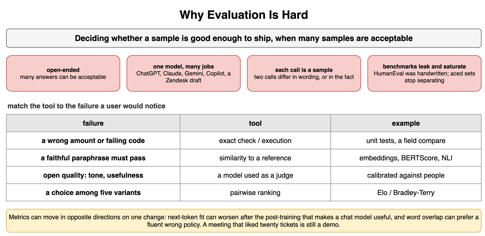

*Source: [`diagrams/evaluation-methodology.drawio`](/content/10_AI_Engineering/03_Evaluation_Methodology/diagrams/evaluation-methodology.drawio), page 1.*

## Entropy

Entropy is the average surprise in a probability distribution, in bits when the logarithm is base 2. It is the lower bound on the average bits needed to encode draws from that distribution, and the floor under every language-model loss in this topic.

`H = -Σ p log p`, skipping zero-probability outcomes. A certain outcome has entropy 0, a fair coin 1 bit, and a 0.9/0.1 coin about 0.469 bits because the likely face is easy to guess. For a language model the sum runs over the vocabulary at each context, so entropy changes position by position, and it depends on the tokenizer because different pieces define a different random variable. Entropy belongs to the data. Training does not minimize it; training minimizes the model's extra surprise on top of it, which is cross entropy.

Shannon's 1951 experiments put printed English on the order of one bit per character, a historical yardstick rather than a score for Llama or GPT-4. On text the model did not train on, the expected loss cannot fall below the text's entropy; a much lower number on training text is a memorization smell. A low-entropy task like a three-reply support macro can still be failed by a model betting on a fourth string, and a high-entropy open conversation has a high floor even for a perfect model.

```python
import math


def entropy_bits(probabilities: tuple[float, ...]) -> float:
    total = 0.0
    for probability in probabilities:
        if probability > 0.0:
            total -= probability * math.log(probability, 2)
    return total


fair = entropy_bits((0.5, 0.5))
biased = entropy_bits((0.9, 0.1))
print(f"{fair:.4f} {biased:.4f}")
# 1.0000 0.4690
```

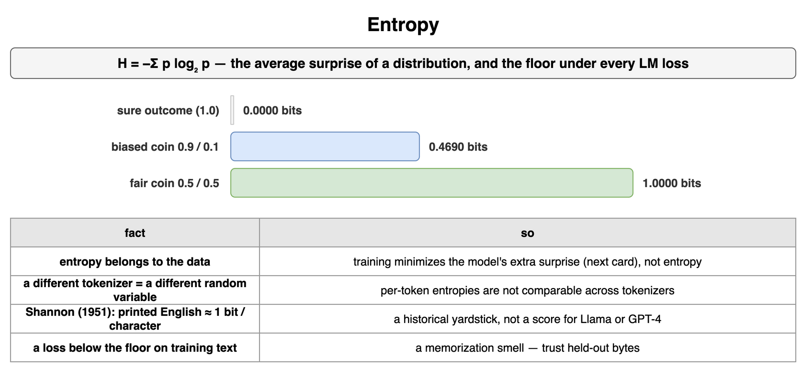

*Source: [`diagrams/evaluation-methodology.drawio`](/content/10_AI_Engineering/03_Evaluation_Methodology/diagrams/evaluation-methodology.drawio), page 2.*

## Cross entropy

Cross entropy is the average surprise of a model distribution `q` when events actually come from a data distribution `p`. It is the language-model training loss and the quantity perplexity is computed from.

`H(p, q) = -Σ p(x) log q(x) = H(p) + KL(p ‖ q)`: the data's entropy plus a penalty for the model being wrong, zero only when `q = p`. (This KL is data versus model, not the RLHF penalty between a policy and its SFT checkpoint.) Probability 0 on an outcome the data produces would cost infinitely, which is why a softmax over finite logits keeps every token nonzero. You never observe `p` for language, so the training loss averages `-log q(next token | context)` over a corpus as an estimate. PyTorch and Hugging Face report it in nats; divide by `ln(2)` for bits.

On a true distribution 0.7 / 0.2 / 0.1 and a model saying 0.5 / 0.3 / 0.2, the matched model would score the entropy, 1.1568 bits; the mismatch pays 1.2796 bits, a 0.1228-bit KL gap, or 0.8869 nats. That says the model was surprised, not that it is a good chatbot. Cross entropy punishes probability spent on an acceptable paraphrase, compares checkpoints that share a tokenizer and test corpus, and cannot compare across tokenizers. Do not rank a preference-tuned chat model by it.

```python
import math


def cross_entropy(truth: tuple[float, ...], model: tuple[float, ...], base: float) -> float:
    return -sum(p * math.log(q, base) for p, q in zip(truth, model))


def entropy(probabilities: tuple[float, ...], base: float) -> float:
    return -sum(p * math.log(p, base) for p in probabilities if p > 0.0)


truth = (0.7, 0.2, 0.1)
model = (0.5, 0.3, 0.2)
h_bits = entropy(truth, 2.0)
ce_bits = cross_entropy(truth, model, 2.0)
kl_bits = ce_bits - h_bits
ce_nats = cross_entropy(truth, model, math.e)
matched = cross_entropy(truth, truth, 2.0)
print(f"{h_bits:.4f} {ce_bits:.4f} {kl_bits:.4f} {ce_nats:.4f}")
print(f"{matched:.4f}")
# 1.1568 1.2796 0.1228 0.8869
# 1.1568
```

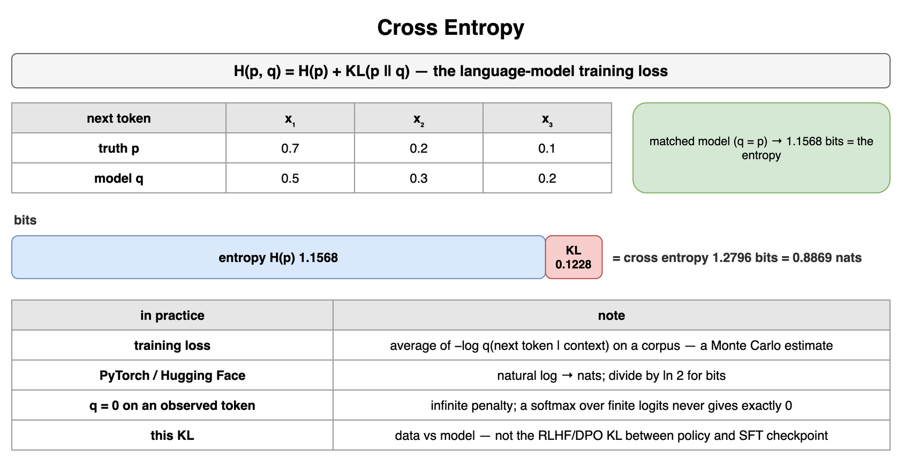

*Source: [`diagrams/evaluation-methodology.drawio`](/content/10_AI_Engineering/03_Evaluation_Methodology/diagrams/evaluation-methodology.drawio), page 3.*

## Bits per character and bits per byte

Bits per character and bits per byte divide a model's total cross entropy by the length of the original text, so models with different tokenizers can be compared.

Per-token loss rewards a tokenizer that makes many easy predictions over one that makes fewer, harder ones, regardless of how likely the model finds the string. The string's own quantity is the total negative log likelihood: mean nats per token × token count, divided by `ln(2)` for bits. Divide by characters for bits per character, or by UTF-8 bytes for bits per byte. On ASCII they match. Elsewhere, "character" depends on code points versus grapheme clusters and NFC versus NFD, while bytes are just the file, so bits per byte is the safe comparison across tokenizers and languages.

The same 1,000 ASCII bytes, scored by two exercise tokenizers, reverse the ranking. The second has lower perplexity (4.0552 versus 7.3891) because each of its 400 tokens was easier, but it spent 560 nats against 500, so the first model is the better encoding at 0.7213 versus 0.8079 bits per byte. A byte-vocabulary causal model's loss in bits already is bits per byte; ByT5 is byte-level but trained on span corruption, so its loss is not that number. Both metrics still measure only next-token fit on the bytes scored, not instruction following, and only held-out files count.

```python
import math

BYTES = 1000
LN2 = math.log(2)


def bits_per_byte(loss_nats: float, tokens: int) -> float:
    return loss_nats * tokens / (BYTES * LN2)


first = bits_per_byte(2.0, 250)
second = bits_per_byte(1.4, 400)
print(f"{first:.4f} {math.exp(2.0):.4f}")
print(f"{second:.4f} {math.exp(1.4):.4f}")
# 0.7213 7.3891
# 0.8079 4.0552
```

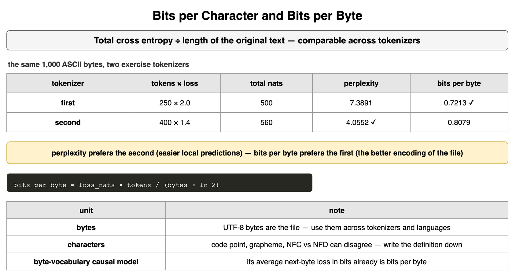

*Source: [`diagrams/evaluation-methodology.drawio`](/content/10_AI_Engineering/03_Evaluation_Methodology/diagrams/evaluation-methodology.drawio), page 4.*

## Perplexity

Perplexity is the exponential of the average next-token cross entropy: the loss restated as an effective number of equally likely choices per token.

With the loss in nats, perplexity is `e^loss`; in bits, `2^loss`; the two agree when bits = nats / `ln(2)`. A model that gives every observed token probability 1 has perplexity 1, and one that gives each probability `1/k` has perplexity `k`. So 7.39 means "as uncertain as a uniform guess among about 7.39 tokens" on this corpus. Lower is a tighter fit to the measured text; it is not an accuracy and not comparable to HumanEval or a win rate.

The base is part of the definition. A trainer that prints "loss 2.0" usually means nats (perplexity 7.3891); reading those same 2.0 as bits gives 4, a different model. The three-outcome example from the cross-entropy card, 0.8869 nats, is perplexity 2.4277, small only because it had three outcomes; a real vocabulary has tens or hundreds of thousands of pieces, so a perplexity in the tens can be strong. Perplexity charts also stretch the high end. 20→10 and 4→2 are the same factor-of-two improvement and the same `ln(2)` ≈ 0.693-nat loss gap, yet one looks like ten points and the other two. Quote it only with the tokenizer and corpus.

```python
import math

loss_printed = 2.0
as_nats = math.exp(loss_printed)
as_bits = 2 ** (loss_printed / math.log(2))
if_already_bits = 2**loss_printed
print(f"{as_nats:.4f} {as_bits:.4f} {if_already_bits:.4f}")
# 7.3891 7.3891 4.0000
```

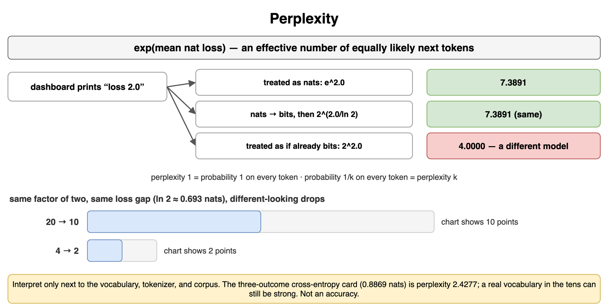

*Source: [`diagrams/evaluation-methodology.drawio`](/content/10_AI_Engineering/03_Evaluation_Methodology/diagrams/evaluation-methodology.drawio), page 5.*

## How to read perplexity

Reading perplexity means deciding what a change in the number is evidence of: next-token fit on one corpus under one tokenizer, and nothing broader.

Valid uses share a tokenizer and corpus. Within one pretraining run, falling held-out perplexity means the run is still fitting that slice, which is the loss curve the scaling cards extrapolate. As a domain probe, much higher perplexity on your Zendesk exports than on Wikipedia shows a domain gap, not that the model will be a bad support bot once policy is retrieved. As a corpus filter, very high scores flag junk or unfamiliar languages and very low scores on training text flag memorized duplicates. As a contamination smell, compare a benchmark item's perplexity against a matched control of similar unseen text, since easy text is also low; a membership test averaging the least-likely tokens is stricter but still needs the control, and neither replaces a fresh handwritten set.

The measurement moves before any model improves. Formulaic or templated text scores lower, so a corpus that got "cleaner" by becoming repetitive looks like a better model. A larger vocabulary scores higher, since uniform over V is perplexity V. Longer context scores lower, so compare at one context length. Never rank tokenizers by perplexity: on the bits-per-byte card, 7.3891 → 4.0552 was the worse encoding. Never reject a post-trained chat model for higher web perplexity, because SFT and preference training change the objective. InstructGPT called regressions on SQuAD, DROP, HellaSwag, and WMT 2015 Fr→En an "alignment tax"; mixing pretraining updates into PPO (PPO-ptx) reduced but did not erase them. That is a reason to measure those tasks, not to revert. Perplexity cannot see a locally probable wrong fact, a failed test, or a preference between two fluent answers.

```text
defend:  one run's checkpoints, domains under one tokenizer, corpus filtering,
         contamination vs a matched control
refuse:  ranking tokenizers, reverting a chat model on web perplexity,
         "low score = leaked" without a control
```

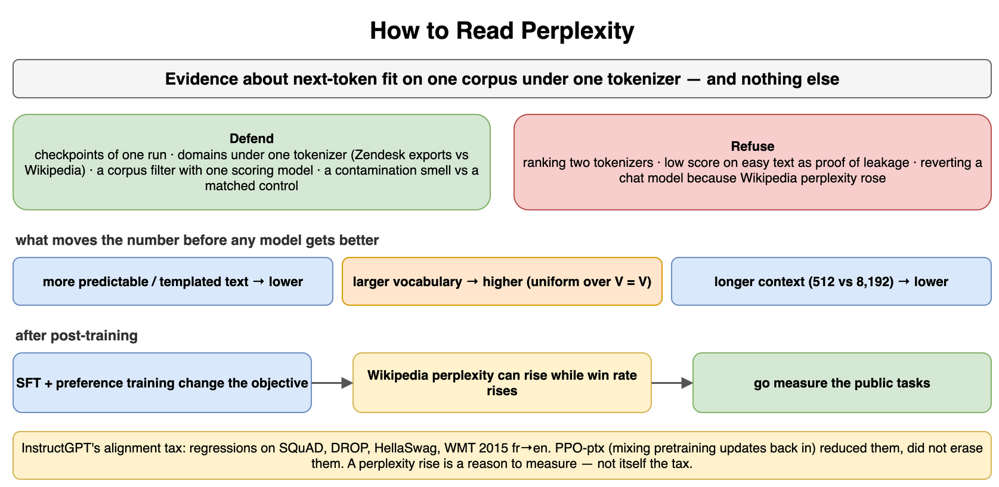

*Source: [`diagrams/evaluation-methodology.drawio`](/content/10_AI_Engineering/03_Evaluation_Methodology/diagrams/evaluation-methodology.drawio), page 6.*

## Exact and subjective evaluation

Exact evaluation marks an output right or wrong with a program. Subjective evaluation marks quality with a judgment, because more than one output is acceptable and no program has the rule.

Unit tests, a multiple-choice key, a normalized label, and a SQL result set are exact; the program can be harsh and still right because the product needs that value. "Was this helpful," "is this summary fair," and "does this sound like our desk" are subjective, so the metric includes the rubric and the rater. Most features are mixed: a Notion AI meeting summary has a decision and date that match the note or do not, plus phrasing that can go several ways. Check the date exactly, then judge the prose only if the facts passed. A JSON schema is exact about syntax and silent about whether the total is right.

The common failure is crossing the streams. String-matching a Gmail summary treats a phrasing as a label, and asking a model "is this SQL right" turns an executable question into an opinion when the database is right there. Facts with a correct value or a source, such as a dose, a refund window, or a medical claim, should not be settled by preference; forcing a rater to pick the better of two wrong answers records taste. Offer a both-bad tie. Comparative evaluation (which answer a person preferred) and an A/B test (random live assignment, product metric) answer different questions: a model can win the pairwise read and lose the A/B test, or vice versa. Compare to choose a candidate, run the experiment ([AI Engineering Architecture and User Feedback](../10_AI_Engineering_Architecture_and_User_Feedback/)) to see if it changed the product.

```text
exact:       facts, amounts, labels, code behavior, query results
subjective:  tone, usefulness, which of two faithful replies
test:        if no program could mark it wrong, you owe a rubric
```

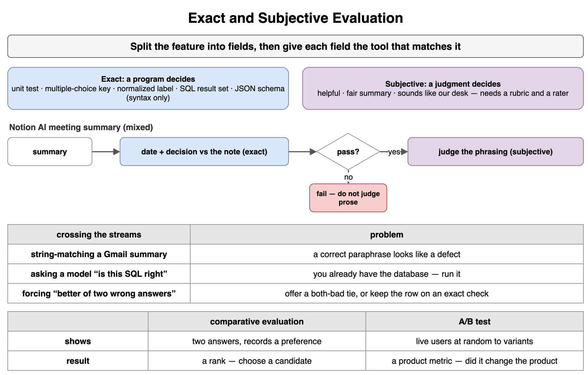

*Source: [`diagrams/evaluation-methodology.drawio`](/content/10_AI_Engineering/03_Evaluation_Methodology/diagrams/evaluation-methodology.drawio), page 7.*

## Functional correctness

Functional correctness means the output does the job when a program runs it: the tests pass, the query returns the right rows, or the patch builds and the suite goes green.

HumanEval (Chen et al., the Codex paper) is 164 handwritten Python problems averaging 7.7 unit tests; a sample is correct when they pass. The headline metric, pass@k, is the probability that at least one of k samples passes. Drawing exactly k samples per problem is unbiased but noisy, so the paper draws n ≥ k (n = 200, k up to 100), counts c passes, and uses `1 − C(n − c, k) / C(n, k)`, or 1 when fewer than k samples failed, averaged over problems. Plugging `p̂ = c/n` into `1 − (1 − p)^k`, the independence ceiling from the test-time compute card, is biased low: on 3 passes in 10, unbiased pass@5 is 0.9167 versus 0.8319.

pass@1 and pass@10 are different products. Copilot ghost text gets one try; a pull-request agent can spend several plus the test suite. SWE-bench counts a patch resolved when every fail-to-pass test now passes and every pass-to-pass test still passes. Run untrusted code in a sandbox with a timeout. For text-to-SQL, Spider's original metric matched SQL components as sets; execution accuracy came later, and BIRD runs queries and compares result sets. Strings can differ yet return the same rows, and identical-looking queries can differ on another database. A product checker runs one read-only statement with a timeout and row cap and compares a multiset, or ordered rows if order was asked, alongside an authorization check. A green suite is evidence about those tests; thin tests pass wrong code.

```python
import math


def pass_at_k(n: int, c: int, k: int) -> float:
    if n - c < k:
        return 1.0
    return 1.0 - math.comb(n - c, k) / math.comb(n, k)


def pass_at_k_product(n: int, c: int, k: int) -> float:
    if n - c < k:
        return 1.0
    failed = 1.0
    for index in range(n - c + 1, n + 1):
        failed *= 1.0 - k / index
    return 1.0 - failed


print(f"{pass_at_k(10, 3, 1):.4f} {pass_at_k(10, 3, 5):.4f}")
print(f"{pass_at_k_product(10, 3, 5):.4f}")
print(f"{1 - (1 - 3 / 10) ** 5:.4f}")
print(f"{pass_at_k(10, 6, 5):.4f} {pass_at_k(10, 0, 5):.4f}")
# 0.3000 0.9167
# 0.9167
# 0.8319
# 1.0000 0.0000
```

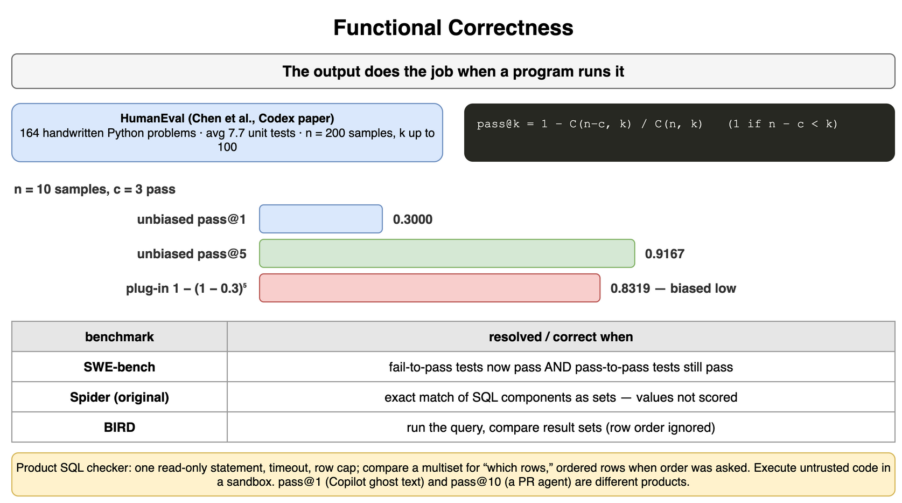

*Source: [`diagrams/evaluation-methodology.drawio`](/content/10_AI_Engineering/03_Evaluation_Methodology/diagrams/evaluation-methodology.drawio), page 8.*

## Exact match

Exact match scores an output right when it equals the reference after a normalization you wrote down before you looked at the score.

The normalization is the metric: case, whitespace, punctuation, and articles are decisions that change the number. SQuAD's published normalization lowercases, strips punctuation, drops "a," "an," and "the," and collapses whitespace. It reports exact match plus a token-level F1 on the same normalization for partial credit. Closed labels, multiple-choice letters, and normalized entities are where exact match is the whole evaluation, because the legal answers are enumerated and a near miss is a miss.

It breaks once a fluent system wraps the answer in a sentence or a second phrasing is also right. "New York" fails against "New York City." A Zendesk draft with the right window in other words fails. A Copilot line that behaves identically fails exact match and passes the tests. When a correct span sits inside a helpful sentence, extract the field and match that. More references raise the hit rate but never cover the space of good answers. That is what similarity, embeddings, and judges are for, not a reason to fuzzy-match a true label. A loose normalization raises the score and can hide a different number, and token F1 can score a longer answer as mostly right when the extra words change the claim. Publish the normalization with the score.

```text
want it:      closed label, multiple choice, normalized entity
avoid it:     summaries, paraphrases, code with tests available
ask first:    what does the normalization do with "NYC" vs "New York City"?
```

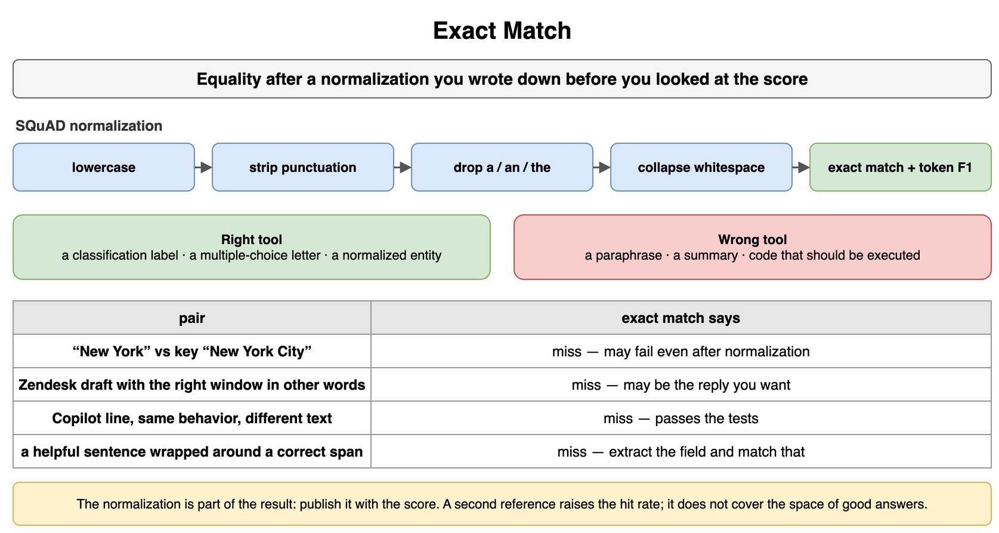

*Source: [`diagrams/evaluation-methodology.drawio`](/content/10_AI_Engineering/03_Evaluation_Methodology/diagrams/evaluation-methodology.drawio), page 9.*

## Lexical similarity

Lexical similarity scores how much surface form two strings share: overlapping words and n-grams, or a short edit script from one to the other.

Levenshtein distance counts the insertions, deletions, and substitutions between two strings. It suits a short string with a typo and is a bad proxy for meaning: "$12.50" and "$125.0" are distance 2 while the amount grows tenfold. N-gram overlap has a precision side (the candidate's chunks found in the reference) and a recall side. In "the refund was issued today" versus "…yesterday," five of six tokens match and the one that differs is the fact.

BLEU (Papineni et al., 2002) is n-gram precision up to 4-grams times a brevity penalty, built for translation at corpus level; the penalty stops short outputs from gaming precision. ROUGE (Lin, 2004) is the recall-oriented summarization cousin, and ROUGE-L uses the longest common subsequence. METEOR (Banerjee and Lavie, 2005) works at sentence level, where unsmoothed BLEU often collapses to 0. It aligns unigrams by exact match, stem, then WordNet synonym, weights recall over precision, and penalizes fragmented matches. It tracks human translation judgments better and still does not know 30 days from 60. sacreBLEU exists because tokenization and smoothing choices made published BLEU numbers incomparable. All of these work better in aggregate than on the one reply you are about to send, punish correct paraphrases, and forgive wrong facts in familiar words. For a support reply, check the facts exactly and judge the wording with a calibrated rater.

The brevity penalty is 1 when the candidate is at least as long as the reference, else `e^(1 − ref_len / cand_len)`; a 5-token candidate against a 10-token reference is multiplied by about 0.3679.

```python
import math

print(f"{math.exp(1 - 10 / 5):.4f}")
# 0.3679
```

```python
def levenshtein(left: str, right: str) -> int:
    previous = list(range(len(right) + 1))
    for i, left_char in enumerate(left, start=1):
        current = [i]
        for j, right_char in enumerate(right, start=1):
            insert_cost = current[-1] + 1
            delete_cost = previous[j] + 1
            replace_cost = previous[j - 1] + (left_char != right_char)
            current.append(min(insert_cost, delete_cost, replace_cost))
        previous = current
    return previous[-1]


print(levenshtein("$12.50", "$125.0"))
# 2
```

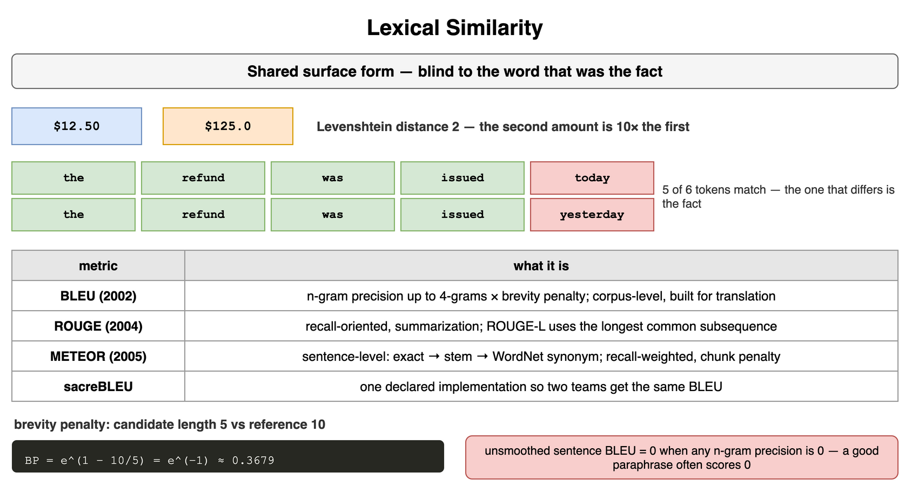

*Source: [`diagrams/evaluation-methodology.drawio`](/content/10_AI_Engineering/03_Evaluation_Methodology/diagrams/evaluation-methodology.drawio), page 10.*

## Semantic similarity

Semantic similarity scores whether two texts mean the same thing, even when they share few words.

"We sent the money back" and "The refund was issued" are the same support event with near-zero BLEU. Three tools try to score such pairs with a model of meaning. A sentence embedding compares one vector per text by cosine (next card). BERTScore (Zhang et al.) greedily matches candidate tokens to reference tokens by cosine of contextual vectors from BERT or RoBERTa, yielding precision, recall, and F1, with optional IDF weights so "the" counts less than "refund." A natural-language-inference model, such as a DeBERTa-v3 checkpoint finetuned on MNLI, asks whether the source entails, contradicts, or is neutral to the candidate. That is the faithfulness check for one summary sentence against one sentence of the thread, which a cosine is not.

All three still miss what products care about. A negated policy, a swapped number, or a similar name can sit close in meaning space because the topic matches. BERTScore barely moves when one span among many is "30 days" versus "60 days." NLI catches some contradictions, misses others, and can flag a paraphrase. It was trained on sentence pairs, so split a long thread first. Measure these failures on pairs from your own desk. Tuning a cosine threshold on one embedding model and reusing it on another silently changes the metric. Semantic scores rank and filter open wording; amounts, dates, and query results stay on exact checks.

```text
embedding cosine   one vector per text      retrieval, coarse filtering
BERTScore          token-level matching     paraphrase-tolerant overlap
NLI entailment     source -> claim          faithfulness, sentence by sentence
all three          miss negation / swapped numbers often enough to need exact checks
```

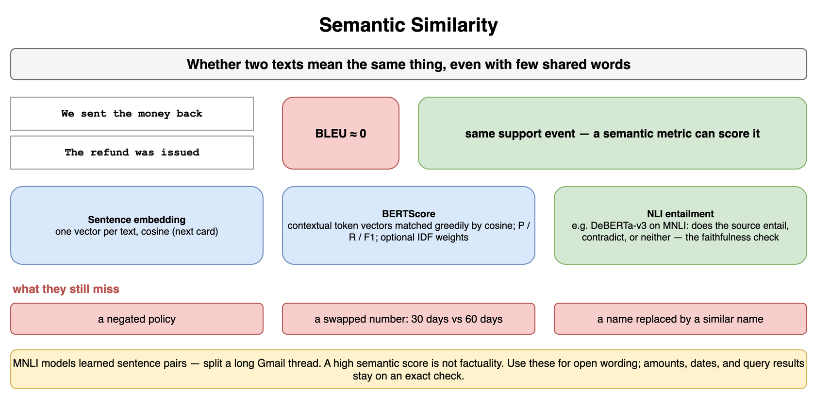

*Source: [`diagrams/evaluation-methodology.drawio`](/content/10_AI_Engineering/03_Evaluation_Methodology/diagrams/evaluation-methodology.drawio), page 11.*

## Embeddings

An embedding is a vector that stands in for a piece of text, trained so texts people treat as similar point in nearby directions. Cosine similarity scores that closeness.

The vectors come from a model trained for similarity or retrieval, not a chat model's raw hidden state. Sentence-BERT (Reimers and Gurevych) trains a BERT encoder so sentence cosine tracks labeled similarity. E5, BGE, Cohere Embed, and OpenAI's text-embedding-3 are the same idea at other sizes and mixes. MTEB compares them, and its leaders move. A raw BERT CLS vector was not trained for this cosine. Dimension, normalization, input length, and price live on the model card you call.

Cosine is the dot product divided by both lengths: 1 for the same direction, 0 for orthogonal, −1 for opposite, and unchanged by rescaling. A raw dot product rewards longer vectors for no semantic reason. On (1, 2, 2) and (2, 1, 2) the cosine is 8/9 ≈ 0.8889 and stays there if the second vector is scaled by 10. Scores are not probabilities and not comparable across models; 0.8 is not an 80% match. Embeddings power retrieval ([RAG and Agents](../06_RAG_and_Agents/)), near-duplicate detection, and coarse semantic filters. "Do not issue the refund" and "issue the refund" share a topic and often sit close, so measure the "same meaning" threshold on your pairs with the model you deploy. Changing models invalidates every stored vector and threshold.

```python
import math


def cosine(left: tuple[float, ...], right: tuple[float, ...]) -> float:
    dot = sum(a * b for a, b in zip(left, right))
    left_norm = math.sqrt(sum(a * a for a in left))
    right_norm = math.sqrt(sum(b * b for b in right))
    return dot / (left_norm * right_norm)


pair = cosine((1.0, 2.0, 2.0), (2.0, 1.0, 2.0))
scaled = cosine((1.0, 2.0, 2.0), (20.0, 10.0, 20.0))
orthogonal = cosine((1.0, 0.0), (0.0, 1.0))
opposite = cosine((1.0, 0.0), (-1.0, 0.0))
print(f"{pair:.4f} {scaled:.4f}")
print(f"{orthogonal:.4f} {opposite:.4f}")
# 0.8889 0.8889
# 0.0000 -1.0000
```

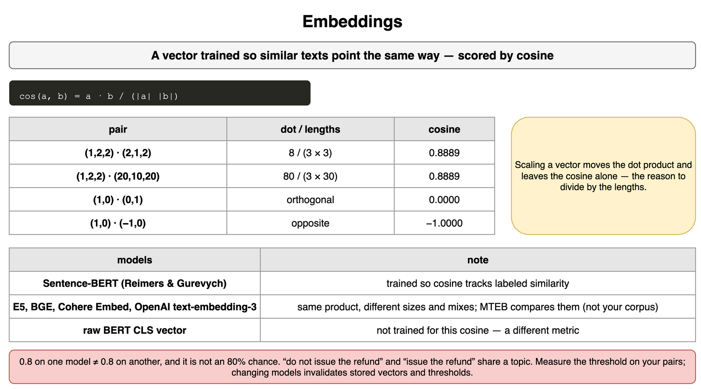

*Source: [`diagrams/evaluation-methodology.drawio`](/content/10_AI_Engineering/03_Evaluation_Methodology/diagrams/evaluation-methodology.drawio), page 12.*

## Why use an AI judge

An AI judge is a model asked to grade another model's output. It exists because open-ended text has no unit test and people cannot relabel every row each time the prompt, retriever, or model changes.

Zheng et al.'s 2023 MT-Bench and Chatbot Arena paper measured how close GPT-4 comes to human judgment, and the answer depends on how ties are counted. With ties and order-flipping verdicts removed, GPT-4 agreed with experts on 85% of first-turn MT-Bench judgments, while two experts agreed on 81%; counting ties and flips as ties, the figures are 66% and 63%. The second turn was 85% vs 82% and 66% vs 67%. On crowdsourced arena votes, GPT-4 matched humans 87% non-tie and 64% with ties; the abstract's "over 80%" is the non-tie figure. Agreement was higher when one answer was clearly better. None of this is a property of an arbitrary judge or a result on your Zendesk rubric until you measure it there.

A judge is cheaper than a trained rater on every row of a nightly regression and costlier than a unit test or cosine. It belongs on the residue those checks cannot see: whether a summary is acceptable, a refusal appropriate, a draft on-policy. Teams also use judges to label preference pairs for reward models and DPO, and to pick among samples, and both inherit the judge's systematic errors into weights or gates. The workable split is a program on every field a program can check, a pinned judge on the bulk, and people double-labeling a stratified slice that shows when the judge drifts.

```text
MT-Bench, GPT-4 vs experts (turn 1):  85% non-tie (experts 81%) | 66% with ties (experts 63%)
program -> every checkable field; judge -> open residue; people -> calibration slice
```

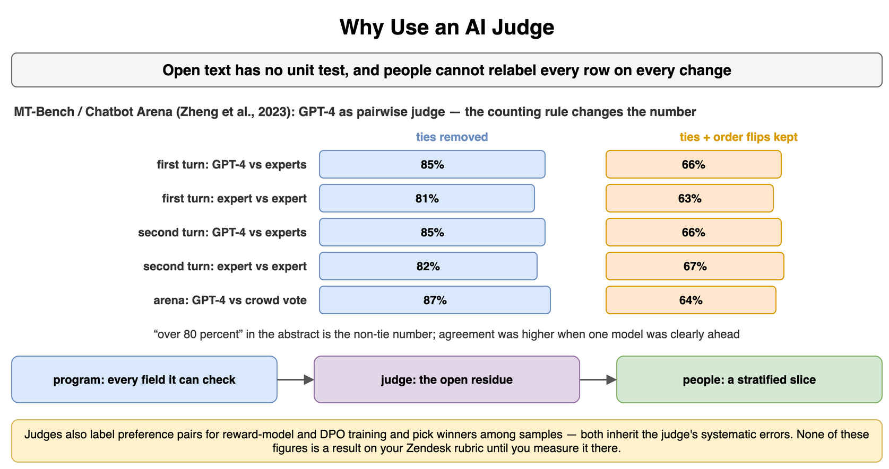

*Source: [`diagrams/evaluation-methodology.drawio`](/content/10_AI_Engineering/03_Evaluation_Methodology/diagrams/evaluation-methodology.drawio), page 13.*

## How to use an AI judge

Using an AI judge means choosing what you show it, what verdict you ask for, and how you will know the verdict matches a person.

The prompt is part of the metric, like the normalization in exact match. Ask for a structured verdict (a label plus the rubric line it relied on) so it can be audited, include one graded example per level, hide model names, and pin the judge's model id and temperature to the settings you calibrated. Low temperature reduces noise, not bias. On math or reasoning, have the judge commit to its own answer, or show a separately produced reference, before it sees the candidates. A program that can check a number still goes first.

Calibration is a small human set, not a feeling. Double-label a slice with the rubric you will keep, and report chance-corrected agreement such as Cohen's kappa. Percent agreement looks great when nearly everything passes. Read every disagreement before changing the model, because the disagreements are the spec: a vague level, a missing check, or a judge that cannot see the failure. Self-critique, where a model reviews and revises its own draft, is a cheap revision step that shares the draft's blind spots. It is not a score to ship on, and a model grading itself is the worst place to skip calibration. Asking for reasoning before the label gives an audit trail that may be a story fitted to a verdict already reached, so read a sample of reasons.

| Setup | What you ask | What you can conclude |
| --- | --- | --- |
| Pointwise score | One answer, a number on the rubric. | Useful with anchored levels; it drifts, so compare within one pinned judge and rubric. |
| Pairwise | Two answers, which is better, ties allowed. | The stabler ranking signal; a win does not mean fit to ship. |
| Reference-based | The source or gold answer beside the candidate. | Faithfulness to that source; a thin gold set punishes other good answers. |
| Anchored rubric | Each level written as a check, with an example. | What keeps a pointwise score meaningful across weeks. |

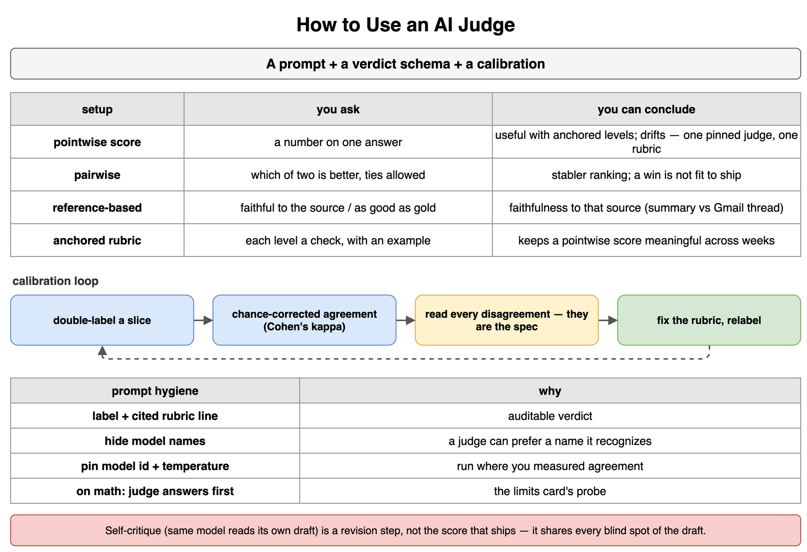

*Source: [`diagrams/evaluation-methodology.drawio`](/content/10_AI_Engineering/03_Evaluation_Methodology/diagrams/evaluation-methodology.drawio), page 14.*

## Limits of an AI judge

The limits of an AI judge are the ways a verdict fails before any stable bias: the call is a sample, the rubric is vague, the second model is expensive, and the judge can be talked out of a math answer it could solve alone.

Inconsistency: close answers flip with a changed space, a renamed "Assistant A," or a new judge build. Temperature 0 reduces flips but does not make the verdict a property of the answers. Treat a one-level gap on a 1–5 scale as a tie unless a second judgment agrees, take a small majority on pairs near a launch boundary, and pin the judge id, re-running the human slice when it changes. Ambiguity: words like "helpful" or "natural" get filled in with a taste for fluent, agreeable prose, the same shortcut a reward model learns. Replace them with anchored checks such as "the draft's window equals the article's." If two careful people cannot apply a level consistently, the judge cannot either.

Cost and latency make the frontier judge an offline tool. Its prompt carries the rubric, the source, and one or two answers, often more tokens than the draft itself. That is fine for a nightly regression or labeling batch, and wrong for Copilot ghost text or Smart Compose. A reward model distilled from judge labels is the cheap online stand-in, and it carries the judge's mistakes. Recompute the bill from current prices and measured tokens. Limited reasoning: Zheng et al. graded LLaMA-13B versus Vicuna-13B in both orders on 10 math questions, 20 judgments. GPT-4's default prompt called a wrong answer correct 14 times, reasoning first cut it to 6, and an independently produced reference cut it to 3. Ten questions is a probe, not a rate, but the pattern holds: a number, a test, or an independent reference goes before the prose verdict.

```text
inconsistency   pin the model, low temperature, a tie band
ambiguity       anchored checks people can reapply
cost            frontier judge offline; distilled reward model online
reasoning       program or independent reference first (14/20 -> 3/20 on the probe)
```

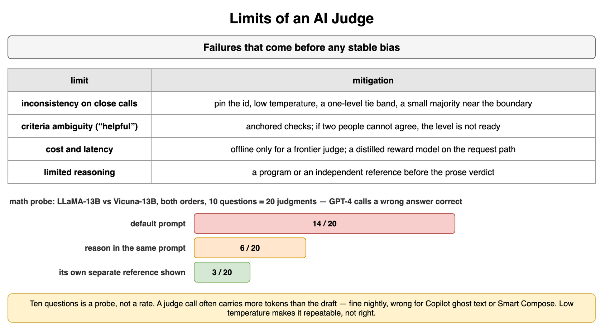

*Source: [`diagrams/evaluation-methodology.drawio`](/content/10_AI_Engineering/03_Evaluation_Methodology/diagrams/evaluation-methodology.drawio), page 15.*

## Biases of an AI judge

Biases of an AI judge are systematic preferences that survive a stable prompt. The MT-Bench study measured position and verbosity directly and could not establish self-enhancement.

Position bias is a preference for a slot. The hard case was two similar GPT-3.5 answers per first-turn question, sampled at temperature 0.7, which people sometimes cannot tell apart. GPT-4 gave the same verdict after a swap on 65.0% of pairs and favored the first slot on 30.0%. Claude-v1 was consistent on 23.8% and favored first on 75.0%. GPT-3.5 was consistent on 46.2% and favored first on 50.0%. Renaming the assistants moved Claude off the first slot, so the direction comes from the prompt. A few-shot prompt raised GPT-4's consistency to 77.5% at about 4× the cost, and the authors kept zero-shot because consistent is not automatically accurate. The fix is the swap: keep a win only if the same answer wins both orders, and score a flip as a tie.

Verbosity bias is a preference for longer answers. On 23 MT-Bench answers whose numbered list was duplicated with rephrased copies (5 items becoming 10, no new information), Claude-v1 and GPT-3.5 preferred the padded answer 91.3% of the time and GPT-4 8.7%. All three returned a tie for identical answers, so the failure is the padding. Hold length roughly fixed for factual comparisons, tell the rubric that length is not a reason to prefer, and measure whether that instruction stuck. Arena's later style control regresses length and markdown out of the rating, which controls the score but does not stop voters liking long answers. Self-enhancement: GPT-4 and Claude-v1 showed higher self win rates (10% and 25%) and GPT-3.5 did not, but the authors could not separate style from quality, so the bias was not established. Treat it as a test to run, and use a different model family or people on the rows that decide a launch.

```text
position   GPT-4 swap-consistent 65.0% (others 23.8-46.2%)   -> swap and agree
verbosity  padded lists preferred: GPT-4 8.7%, others 91.3%   -> hold length fixed
self       not established                                    -> another family on launch rows
```

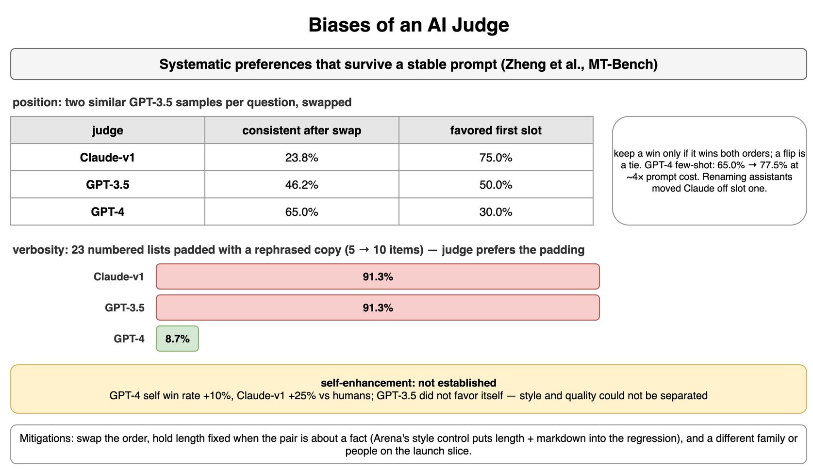

*Source: [`diagrams/evaluation-methodology.drawio`](/content/10_AI_Engineering/03_Evaluation_Methodology/diagrams/evaluation-methodology.drawio), page 16.*

## Which models can judge

Which model judges is a choice among a stronger model, the same model, a weaker model, and a specialized scorer. The right one is the weakest judge that still sees the failures you care about, after you measure that it does.

A stronger model judging a weaker one is the default for open-ended quality and is the MT-Bench setup; "frontier" moves, so name the model id you measured. The same model can tell you which of two prompts it prefers, but it shares the generator's blind spots and taste, so it cannot vouch for an answer's truth. A weaker judge is a cost decision that must be earned with calibration. If its disagreements with people are exactly the severe failures, the savings are fake. Do not spend any model on format, which a parser checks exactly and cheaply.

Specialized scorers differ by input. A reward model maps one completion to a scalar, as used in best-of-N. A reference-based judge such as Prometheus takes one answer plus a rubric and reference. Preference models such as PandaLM and JudgeLM take two completions and predict the winner. NLI models check entailment and policy classifiers check one harm. MT-Bench's preliminary Vicuna-13B judge was trained on arena votes, and any fine-tuned judge inherits the biases of its training votes, such as length in a reward model. When a verdict gates a launch, the judge and generator should not be the same training run. Pin both ids: a changed generator makes the old calibration a hypothesis, and a changed judge is a new metric.

| Judge | The job it can hold | The check you still owe |
| --- | --- | --- |
| A stronger model | Open quality of a weaker generator; preference labels. | A human slice; position, verbosity, and measured self-preference. |
| The same model | Which of two prompts this model prefers. | Someone else, or a checker, before calling it correct. |
| A weaker model | A narrow criterion with measured agreement, cheaply. | The severe rows; easy-pass agreement is not enough. |
| A specialized scorer | Reward model, Prometheus (rubric + reference), PandaLM/JudgeLM (pairs), NLI, policy classifier. | Its training input and learned shortcut; length for reward models. |

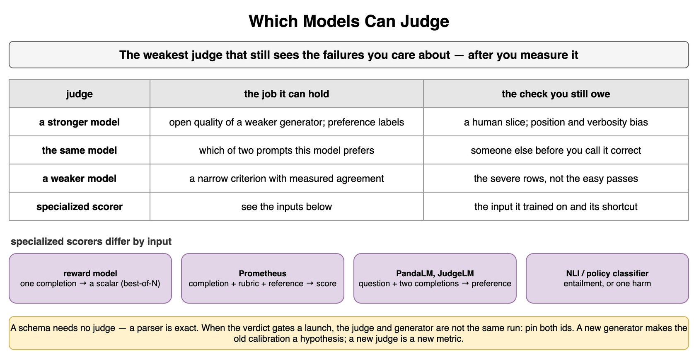

*Source: [`diagrams/evaluation-methodology.drawio`](/content/10_AI_Engineering/03_Evaluation_Methodology/diagrams/evaluation-methodology.drawio), page 17.*

## Ranking from pairwise votes

Comparative evaluation ranks models from pairwise preferences: each vote says which of two answers a person or judge preferred, and a rating system turns votes into a strength per model.

A raw win rate lies when the schedule is uneven, since a model that played weaker opponents can lead. Elo updates ratings after each game: expected score `1 / (1 + 10^((R_B − R_A)/400))`, update `R + K(score − expected)`, with a tie worth 1/2. At K = 32, two 1500 players move to 1516 and 1484 after one win, and a 400-point gap means 10-to-1 odds (expected 0.9091). Online Elo depends on game order and K. Bradley-Terry fits all votes at once, with P(i beats j) the logistic of the strength gap. It is the same model as the reward-model loss and does not depend on order. Both put every model on one line, which assumes transitivity. Real preferences can cycle (careful > short > witty > careful), so for close models report the pairwise matrix and do not treat an unshown pair as decided.

Chatbot Arena (LMSYS, later LMArena, now Arena) has people chat with two anonymous models and vote. It launched in May 2023 on online Elo, explained a switch to Bradley-Terry in December 2023 (recorded in the January 2024 dataset), and treats each pinned checkpoint as a fixed player, which is why GPT-4-0314 and GPT-4-0613 are listed separately. Its fit scales coefficients so a 400-point gap is still 10-to-1; a codebase multiplying natural-log coefficients by 400 makes 400 points only e:1. Ties count as half a win each, with both-bad ties recorded separately. Style control, default on text and vision boards in 2025, regresses out length and markdown. Bootstrap intervals on Bradley-Terry replaced the too-wide online-Elo intervals. If two models' intervals overlap, do not treat the sort order as the decision. Hide model names while voting, or the vote becomes a brand preference. Cite any public rank with its method, date, and style setting.

```python
def expected(left: float, right: float) -> float:
    return 1 / (1 + 10 ** ((right - left) / 400))


def update(left: float, right: float, left_score: float, k: float = 32) -> tuple[float, float]:
    left_expected = expected(left, right)
    right_expected = 1.0 - left_expected
    return (
        left + k * (left_score - left_expected),
        right + k * ((1.0 - left_score) - right_expected),
    )


print(update(1500, 1500, 1))
print(f"{expected(1900, 1500):.4f}")
# (1516.0, 1484.0)
# 0.9091
```

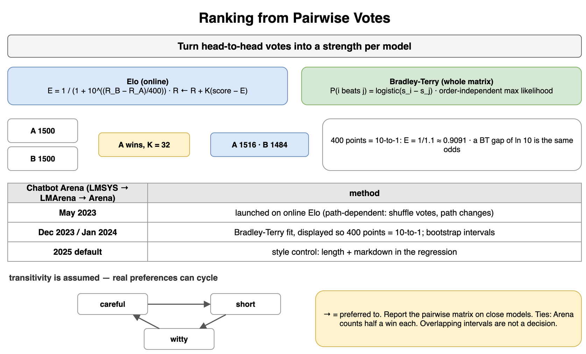

*Source: [`diagrams/evaluation-methodology.drawio`](/content/10_AI_Engineering/03_Evaluation_Methodology/diagrams/evaluation-methodology.drawio), page 18.*

## Challenges of comparative evaluation

The challenges of collecting a comparative evaluation are the quadratic number of pairs and the quality of the votes.

Pairs grow quadratically: 5 models are 10 pairs and 20 are 190, so 50 votes per pair is 9,500 judgments, and each new model reopens the problem. Sample pairs instead. Uniform pairing wastes votes on lopsided matchups; pairing a candidate with the current production model spends them on your real decision; active pairing spends the next vote where it could change the ranking. Arena uses a non-uniform schedule. A raw win count, or a fit that assumes every pair was equally likely, is then the wrong estimator unless the likelihood accounts for the sampling rule, and an active rule that secretly favors a hoped-for model bakes that into the rating. An AI-judge arena scales but brings every judge bias with it.

Vote quality needs survey discipline. Arena's prompts are whatever people type; Chiang et al. (2024) report diverse prompts and crowd votes that agreed with experts in their study, which supports the public board as a board, not as a measurement of your returns queue. Untrained internal votes with no guideline or gold pairs are a different measurement: a rater who likes long, friendly answers crowns a verbose model, and one who stops reading votes for the first slot. The controls are a written guideline, gold pairs with known winners to drop or retrain failing raters, a prompt mix matched to production traffic and languages, hidden model names, a declared tie rule including both-bad ties, and published inter-rater agreement. Copying the arena interface without these copies only the form.

```text
models   pairs   x 50 votes
5        10      500
20       190     9,500
controls: guideline, gold pairs, hidden names, tie rule, traffic-matched prompts, agreement
```

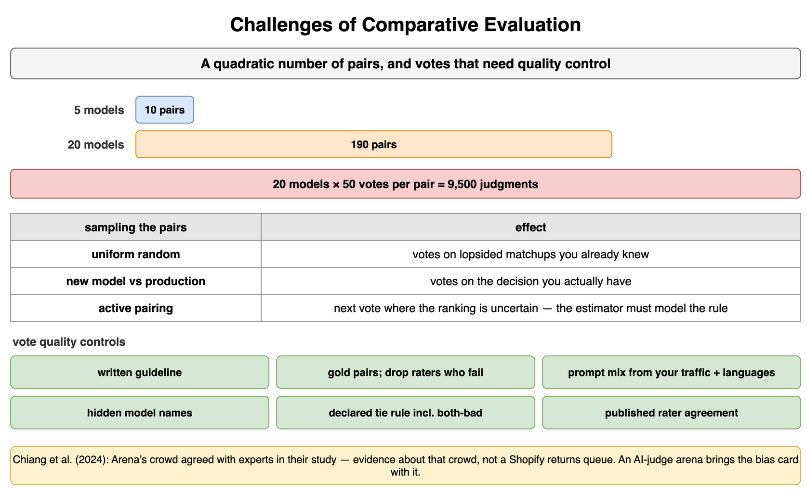

*Source: [`diagrams/evaluation-methodology.drawio`](/content/10_AI_Engineering/03_Evaluation_Methodology/diagrams/evaluation-methodology.drawio), page 19.*

## From a ranking to a pass

A ranking says who won among the models you entered. It does not say the winner is good enough to ship, because Elo and Bradley-Terry have no unit for "correct."

A gap of a few dozen points is not an accuracy, and overlapping bootstrap intervals are not a decision. Style control removes length and markdown, but the residual is still a preference, and a preference for a fluent wrong return window is still a win. The best of five internal drafts can fail a fail-to-pass test, or lose to production on the slice that pays the bills while beating it on a general chat vote. A pool of weak models will happily rank itself.

So keep the two questions separate. Use the ranking to choose which variant earns the expensive absolute evaluation, because people give stable pairwise preferences and unstable 1–5 scores. Use execution, exact field checks, and a rubric with a pass line to decide what ships. Report the style-controlled rank and the raw rank together: style control alone hides the case where users truly prefer the longer answer, and the raw rank alone crowns length.

```text
ranking    -> which candidate earns the absolute eval
tests, exact checks, rubric pass line -> whether anything ships
```

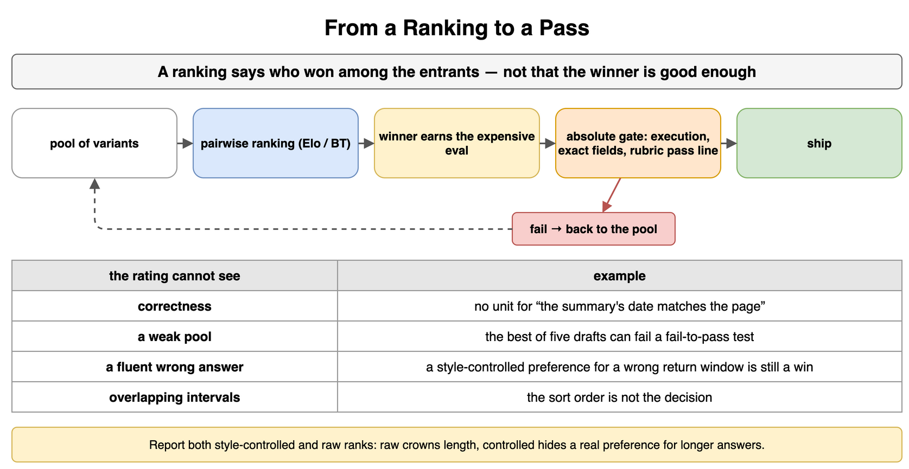

*Source: [`diagrams/evaluation-methodology.drawio`](/content/10_AI_Engineering/03_Evaluation_Methodology/diagrams/evaluation-methodology.drawio), page 20.*

## Where comparative evaluation is going

The useful direction is a standing system a team actually runs: pairwise ranking for model choice, exact checks wherever a program can decide, a calibrated judge for the open residue, and people on a sample that keeps the judge honest.

The public board already did the statistical half. It moved from online Elo to Bradley-Terry, publishes bootstrap intervals, splits category boards so coding is ranked separately from chat, and fits style features so length is not the whole score. A product team still has to build the private half. Prompts come from production traffic and stay out of training crawls; contamination is why HumanEval was handwritten, and a private set pasted into a finetune meets the same fate. Every programmatically checkable field is checked before a judge sees the residue. Reward models are the training-time form of the pairwise signal (judge labels pairs, scorer distills them, policy updates), which makes an unaudited judge more expensive because its mistakes land in the weights.

What this does not become is one automatic number. A comparative win stays relative, an AI judge stays biased and needs a human slice, and perplexity stays a next-token statistic. Report method, date, and style setting next to any public rank, and rebuild the human slice when the judge id changes. A standing eval costs a permanent labeling and judging budget and catches regressions the week they ship. A one-time leaderboard read is free and stale. [Evaluate AI Systems](../04_Evaluate_AI_Systems/) turns these tools into a launch pipeline.

```text
pairwise votes (BT fit, interval, style setting)  -> choose the variant
execution + exact checks                          -> gate checkable fields
pinned judge + refreshed human slice              -> score the open residue
private prompts from production, kept out of training -> the internal source of truth
```

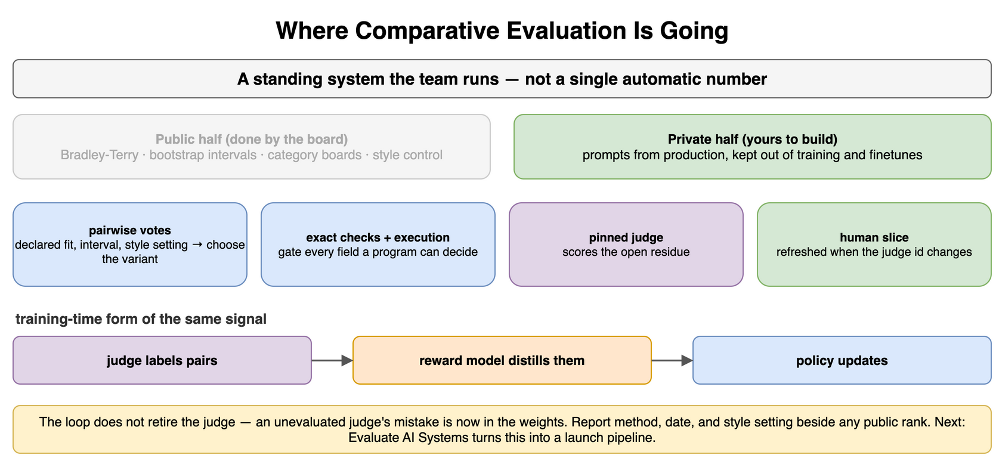

*Source: [`diagrams/evaluation-methodology.drawio`](/content/10_AI_Engineering/03_Evaluation_Methodology/diagrams/evaluation-methodology.drawio), page 21.*
