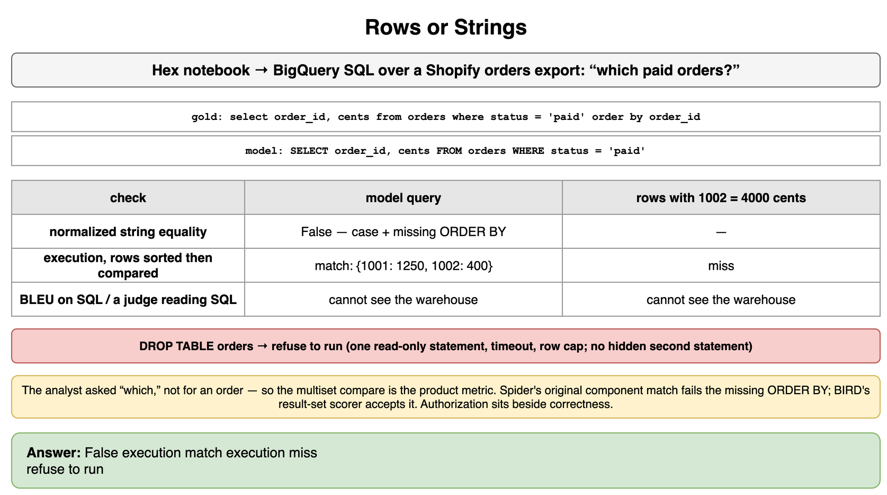
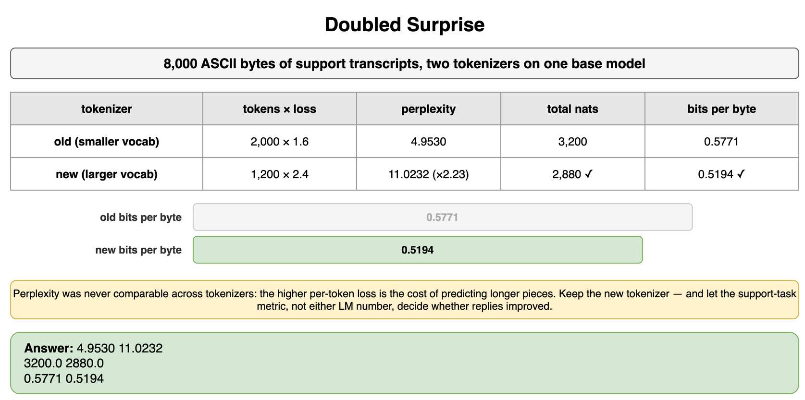
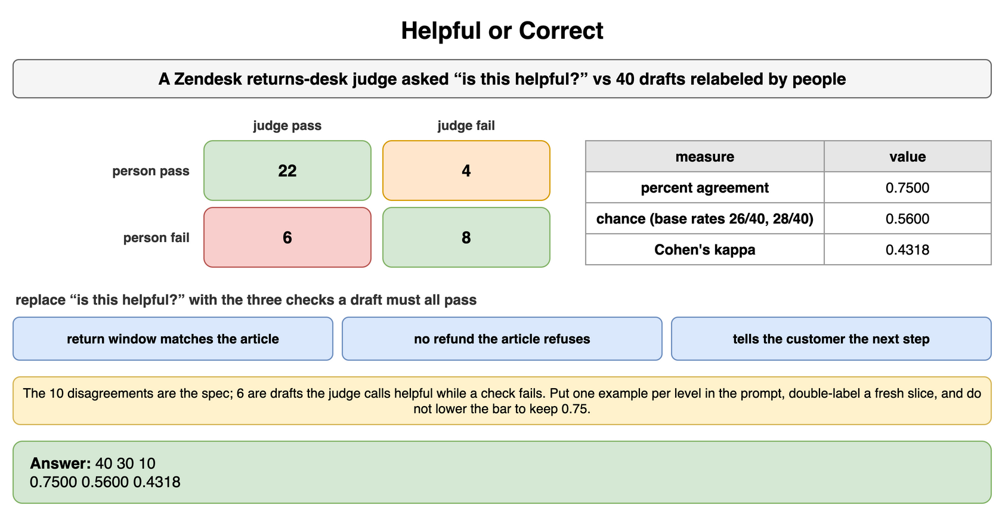
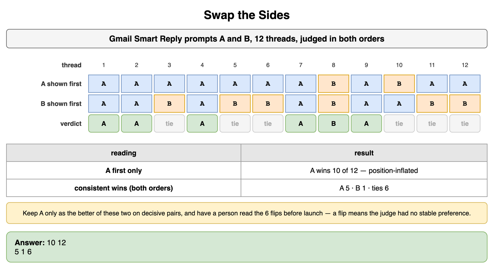
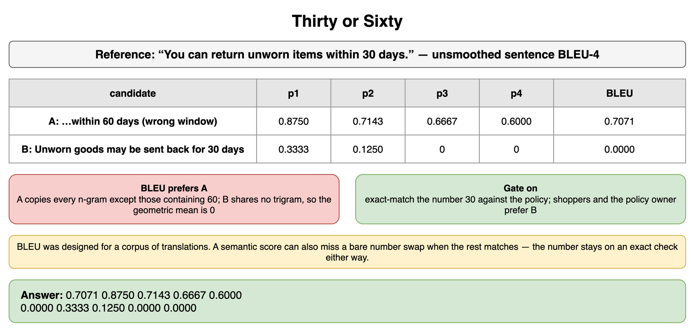
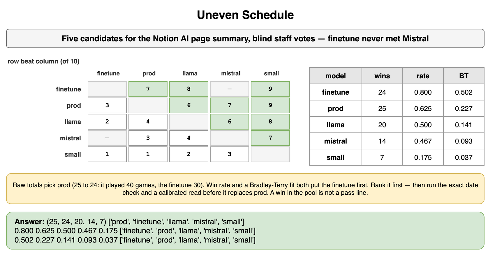
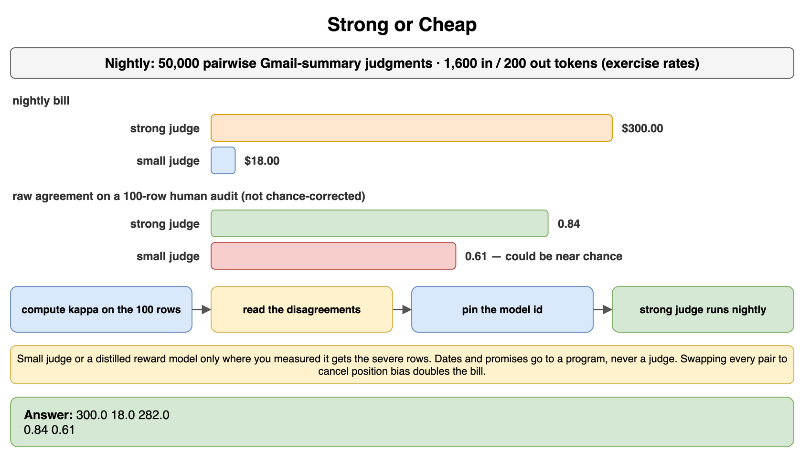
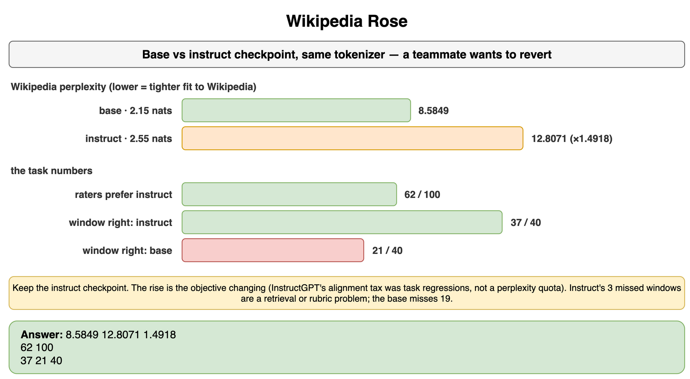

# Evaluation Methodology — Drills

Practice for the measurement decisions in this chapter. Each card is one exercise: commit to an answer, then check it. The products are real. Token prices, losses, vote counts, and audit tallies are assumptions for the arithmetic. A launch uses the provider's current rate card, a measured tokenizer, and labels from your own queue.

## Rows or Strings

A Hex notebook has a natural-language box that writes BigQuery SQL over a Shopify orders export. The analyst asks which paid orders to look at. The gold query and the model's query are below. You also have the rows each query returned, and one destructive string the model emitted on a different attempt. The gold result is orders 1001 and 1002.

Which metric accepts the model's query, which metric rejects it, and what do you do with the destructive string?

```python
GOLD_SQL = "select order_id, cents from orders where status = 'paid' order by order_id"
MODEL_SQL = "SELECT order_id, cents FROM orders WHERE status = 'paid'"
DROP_SQL = "DROP TABLE orders"
GOLD_ROWS = (("1001", 1250), ("1002", 400))
MODEL_ROWS = (("1002", 400), ("1001", 1250))
WRONG_ROWS = (("1001", 1250), ("1002", 4000))
```

**Answer:** Normalized string equality rejects the model's query. The capitalization differs and the gold query has an `ORDER BY` the model omitted, while the result multiset is the same two orders. The analyst asked which paid orders, not for a sequence, so an execution check that sorts rows before comparing accepts `MODEL_ROWS` and rejects `WRONG_ROWS`, where order 1002 was returned as 4000 cents. If the question had required that order, the sorted comparison would be the wrong product metric and you would compare the tuples in order. BLEU on the SQL text sits with the string metric: it rewards shared clauses and cannot see the warehouse. A judge that only reads the SQL has the same blind spot, and it can approve either string. `DROP TABLE` never runs, and neither does a second statement hiding after a select. The checker allows one read-only statement, with a timeout and a row cap. Spider's original score is an exact match of SQL components, so a missing `ORDER BY` fails it even when the row set matches. BIRD's headline score runs the query and its common scorer compares result sets, which would accept `MODEL_ROWS`. The product follows that result set here, and the authorization check sits next to it so a correct-looking result cannot come from a table the analyst may not read.

```python
GOLD_SQL = "select order_id, cents from orders where status = 'paid' order by order_id"
MODEL_SQL = "SELECT order_id, cents FROM orders WHERE status = 'paid'"
DROP_SQL = "DROP TABLE orders"
GOLD_ROWS = (("1001", 1250), ("1002", 400))
MODEL_ROWS = (("1002", 400), ("1001", 1250))
WRONG_ROWS = (("1001", 1250), ("1002", 4000))


def normalize_sql(sql: str) -> str:
    return " ".join(sql.lower().split())


def same_rows(left: tuple[tuple[str, int], ...], right: tuple[tuple[str, int], ...]) -> bool:
    return sorted(left) == sorted(right)


def is_single_select(sql: str) -> bool:
    statement = sql.strip().rstrip(";").strip()
    if ";" in statement or not statement.lower().startswith("select "):
        return False
    padded = f" {statement.lower()} "
    banned = (" drop ", " delete ", " insert ", " update ", " alter ", " create ", " truncate ")
    return not any(word in padded for word in banned)


def verdict(sql: str, rows: tuple[tuple[str, int], ...] | None) -> str:
    if not is_single_select(sql):
        return "refuse to run"
    if rows is not None and same_rows(GOLD_ROWS, rows):
        return "execution match"
    return "execution miss"


string_match = normalize_sql(GOLD_SQL) == normalize_sql(MODEL_SQL)
print(string_match, verdict(MODEL_SQL, MODEL_ROWS), verdict(MODEL_SQL, WRONG_ROWS))
print(verdict(DROP_SQL, None))
# False execution match execution miss
# refuse to run
```



*Source: [`diagrams/evaluation-methodology-drills.drawio`](/content/10_AI_Engineering/03_Evaluation_Methodology/diagrams/evaluation-methodology-drills.drawio), page 1.*

## Doubled Surprise

You replaced the tokenizer on a base model. The new vocabulary is larger, in the direction of the Llama 2 vocabulary of 32,000 pieces toward the Llama 3 vocabulary of 128,256, and these losses are an exercise, not Meta's measurements. On 8,000 bytes of ASCII support transcripts, the old tokenizer produces 2,000 tokens at a mean loss of 1.6 nats. The new tokenizer produces 1,200 tokens at a mean loss of 2.4 nats. A teammate wants to revert because perplexity more than doubled.

What did perplexity do, what did bits per byte do, and do you revert?

```python
import math

BYTES = 8_000
OLD_TOKENS = 2_000
NEW_TOKENS = 1_200
OLD_LOSS = 1.6
NEW_LOSS = 2.4
```

**Answer:** Perplexity went from 4.9530 to 11.0232, a factor of about 2.23, which is the jump the teammate saw. Total negative log likelihood went from 3,200 nats to 2,880 nats. Bits per byte went from 0.5771 to 0.5194. The new tokenizer is the better encoding of these bytes, and the higher per-token loss is the cost of predicting longer pieces. Reverting because perplexity rose throws away a better likelihood. Perplexity was never comparable across the two tokenizers. The ship question is still open: bits per byte says the new model fits this file better, and the support-task metric, not either language-model number, decides whether the replies got better.

```python
import math

BYTES = 8_000
OLD_TOKENS = 2_000
NEW_TOKENS = 1_200
OLD_LOSS = 1.6
NEW_LOSS = 2.4
LN2 = math.log(2)


def perplexity(loss_nats: float) -> float:
    return math.exp(loss_nats)


def bits_per_byte(loss_nats: float, tokens: int) -> float:
    return loss_nats * tokens / (BYTES * LN2)


old_nats = OLD_LOSS * OLD_TOKENS
new_nats = NEW_LOSS * NEW_TOKENS
print(f"{perplexity(OLD_LOSS):.4f} {perplexity(NEW_LOSS):.4f}")
print(old_nats, new_nats)
print(f"{bits_per_byte(OLD_LOSS, OLD_TOKENS):.4f} {bits_per_byte(NEW_LOSS, NEW_TOKENS):.4f}")
# 4.9530 11.0232
# 3200.0 2880.0
# 0.5771 0.5194
```



*Source: [`diagrams/evaluation-methodology-drills.drawio`](/content/10_AI_Engineering/03_Evaluation_Methodology/diagrams/evaluation-methodology-drills.drawio), page 2.*

## Helpful or Correct

A Zendesk draft bot for a Shopify returns desk is graded by a judge prompted with "is this helpful?" People relabel the same 40 drafts with three checks: the return window matches the article, the draft does not promise a refund the article refuses, and the draft tells the customer the next step. A draft passes only when all three hold. The confusion matrix against the judge is 22 drafts both call a pass, 4 the person passes and the judge fails, 6 the person fails and the judge passes, and 8 both call a fail.

Is 75 percent agreement good enough to gate the bot, and what do you change?

```python
BOTH_PASS = 22
PERSON_ONLY = 4
JUDGE_ONLY = 6
BOTH_FAIL = 8
```

**Answer:** Percent agreement is 0.75. The person passes 26 of 40 drafts and the judge passes 28 of 40, so a judge that only matched those base rates would already agree about 56 percent of the time. Cohen's kappa is 0.4318. That is not a launch gate. The 10 disagreements are the spec. Four of them are drafts the rubric accepts and the judge rejects, and six are drafts the judge calls helpful while a window, a refund promise, or a missing next step fails. Replace "is this helpful?" with the three checks, put one example of each level in the prompt, and double-label a fresh slice. Do not lower the bar to keep the 0.75. The judge you have is scoring a different product than the one the desk ships.

```python
BOTH_PASS = 22
PERSON_ONLY = 4
JUDGE_ONLY = 6
BOTH_FAIL = 8

labeled = BOTH_PASS + PERSON_ONLY + JUDGE_ONLY + BOTH_FAIL
agreements = BOTH_PASS + BOTH_FAIL
person_pass = (BOTH_PASS + PERSON_ONLY) / labeled
judge_pass = (BOTH_PASS + JUDGE_ONLY) / labeled
chance = person_pass * judge_pass + (1 - person_pass) * (1 - judge_pass)
kappa = (agreements / labeled - chance) / (1 - chance)
print(labeled, agreements, PERSON_ONLY + JUDGE_ONLY)
print(f"{agreements / labeled:.4f} {chance:.4f} {kappa:.4f}")
# 40 30 10
# 0.7500 0.5600 0.4318
```



*Source: [`diagrams/evaluation-methodology-drills.drawio`](/content/10_AI_Engineering/03_Evaluation_Methodology/diagrams/evaluation-methodology-drills.drawio), page 3.*

## Swap the Sides

You are choosing between two prompt variants for Gmail's Smart Reply, call them answer A and answer B, with a judge. On 12 real threads the judge sees A first and picks A 10 times. You were about to ship A. The same 12 threads, with the order swapped, are the second row. The letter is the answer, not the slot.

How many of those 10 wins survive a swap, and which variant do you keep?

```python
A_FIRST = ("A", "A", "A", "A", "A", "A", "A", "B", "A", "B", "A", "A")
B_FIRST = ("A", "A", "B", "A", "B", "B", "A", "B", "A", "A", "B", "B")
```

**Answer:** With A shown first, A wins 10 of 12. That is position-inflated. After the swap, 6 of the 12 pairs flip, so they are ties under a consistent-win rule. A wins both orders on 5 pairs. B wins both orders on 1 pair. A still leads, and the lead is 5 to 1 on the pairs the judge can defend, not 10 to 2. You do not ship from the first-position pass. You keep A only as the better of these two prompts on the decisive pairs, and you still want a human read of the 6 flips before a launch, because a flip means the judge had no stable preference. The MT-Bench position result was measured on two similar answers sampled from the same model, which is a harder case than a typical pair. These 12 threads are an exercise count for one judge on one feature, and the procedure is the same: swap, drop the flips, then decide.

```python
A_FIRST = ("A", "A", "A", "A", "A", "A", "A", "B", "A", "B", "A", "A")
B_FIRST = ("A", "A", "B", "A", "B", "B", "A", "B", "A", "A", "B", "B")


def consistent(first: str, second: str) -> str:
    if first == second:
        return first
    return "flip"


kept = [consistent(first, second) for first, second in zip(A_FIRST, B_FIRST)]
print(A_FIRST.count("A"), len(A_FIRST))
print(kept.count("A"), kept.count("B"), kept.count("flip"))
# 10 12
# 5 1 6
```



*Source: [`diagrams/evaluation-methodology-drills.drawio`](/content/10_AI_Engineering/03_Evaluation_Methodology/diagrams/evaluation-methodology-drills.drawio), page 4.*

## Thirty or Sixty

A help-center sentence is being localized for a Shopify returns policy. The reference is "You can return unworn items within 30 days." Candidate A copies the sentence and changes the window to 60 days. Candidate B says "Unworn goods may be sent back for 30 days." Shoppers and the policy owner prefer B. A teammate wants to pick A because a BLEU gate scored it higher. Score casefolded tokens with the trailing period stripped. Use unsmoothed sentence BLEU with n-grams up to 4 and the standard brevity penalty.

Why does BLEU prefer A, and what do you gate on?

```python
REFERENCE = "You can return unworn items within 30 days."
COPIED_WRONG = "You can return unworn items within 60 days."
PARAPHRASE = "Unworn goods may be sent back for 30 days."
```

**Answer:** Unsmoothed sentence BLEU gives the wrong window about 0.7071 and the paraphrase 0. The wrong window shares every n-gram except the ones that contain 60, so its precisions are 0.875, 0.7143, 0.6667, and 0.6, and the brevity penalty is 1 because the lengths match. The paraphrase shares "unworn," "30," and "days," a unigram precision of about 0.3333, and it shares no trigram, so the geometric mean is 0. That is the metric as specified. Papineni designed BLEU for a corpus of translations, and a single sentence with no smoothing punishes a correct paraphrase this hard. The product fact is the window. Exact-match the number 30 against the policy, and do not let sentence BLEU choose a fluent doubling of the return period. A semantic score can also miss a bare number swap when the rest of the sentence matches, so the number stays on an exact check either way.

```python
import math
from collections import Counter

REFERENCE = "You can return unworn items within 30 days."
COPIED_WRONG = "You can return unworn items within 60 days."
PARAPHRASE = "Unworn goods may be sent back for 30 days."


def tokens(text: str) -> list[str]:
    return [piece.strip(".").lower() for piece in text.split()]


def ngrams(pieces: list[str], size: int) -> Counter[tuple[str, ...]]:
    return Counter(tuple(pieces[index : index + size]) for index in range(len(pieces) - size + 1))


def sentence_bleu(candidate: str, reference: str, max_n: int = 4) -> tuple[float, list[float]]:
    hypothesis = tokens(candidate)
    gold = tokens(reference)
    precisions = []
    for size in range(1, max_n + 1):
        hypothesis_counts = ngrams(hypothesis, size)
        gold_counts = ngrams(gold, size)
        overlap = sum(min(count, gold_counts[gram]) for gram, count in hypothesis_counts.items())
        total = max(sum(hypothesis_counts.values()), 1)
        precisions.append(overlap / total)
    if min(precisions) == 0.0:
        geo_mean = 0.0
    else:
        geo_mean = math.exp(sum(math.log(precision) for precision in precisions) / max_n)
    if len(hypothesis) >= len(gold):
        brevity = 1.0
    else:
        brevity = math.exp(1 - len(gold) / len(hypothesis))
    return geo_mean * brevity, precisions


wrong = sentence_bleu(COPIED_WRONG, REFERENCE)
paraphrase = sentence_bleu(PARAPHRASE, REFERENCE)
print(f"{wrong[0]:.4f} " + " ".join(f"{precision:.4f}" for precision in wrong[1]))
print(f"{paraphrase[0]:.4f} " + " ".join(f"{precision:.4f}" for precision in paraphrase[1]))
# 0.7071 0.8750 0.7143 0.6667 0.6000
# 0.0000 0.3333 0.1250 0.0000 0.0000
```



*Source: [`diagrams/evaluation-methodology-drills.drawio`](/content/10_AI_Engineering/03_Evaluation_Methodology/diagrams/evaluation-methodology-drills.drawio), page 5.*

## Uneven Schedule

Five draft models are candidates to replace the model behind a Notion AI page summary. Staff voted blind, ten votes on most pairs. The finetune never met Mistral. Wins are listed as winner, then loser, then how many of the ten votes. Rank them. Say whether the winner ships.

```python
GAMES = (
    ("finetune", "prod", 7),
    ("prod", "finetune", 3),
    ("finetune", "llama", 8),
    ("llama", "finetune", 2),
    ("finetune", "small", 9),
    ("small", "finetune", 1),
    ("prod", "llama", 6),
    ("llama", "prod", 4),
    ("prod", "mistral", 7),
    ("mistral", "prod", 3),
    ("prod", "small", 9),
    ("small", "prod", 1),
    ("llama", "mistral", 6),
    ("mistral", "llama", 4),
    ("llama", "small", 8),
    ("small", "llama", 2),
    ("mistral", "small", 7),
    ("small", "mistral", 3),
)
```

**Answer:** Raw win totals pick prod, 25 wins to the finetune's 24, because prod played 40 games and the finetune played 30. The finetune never faced Mistral. Win rate reverses that: the finetune won 0.800 of its games, prod 0.625, Llama 0.500, Mistral about 0.467, and the small model 0.175. A Bradley-Terry fit on the observed games agrees with the win rate and disagrees with the raw totals. Strengths land about 0.502, 0.227, 0.141, 0.093, and 0.037 for finetune, prod, Llama, Mistral, and small. Head-to-head, the finetune beat prod 7 to 3. You rank the finetune first among these five. You do not ship it on the ranking. The rating has no unit for "the summary's date matches the page." Run that exact check, and a calibrated read of the prose, on the finetune before it replaces prod. A win inside this pool is not a pass line.

```python
GAMES = (
    ("finetune", "prod", 7),
    ("prod", "finetune", 3),
    ("finetune", "llama", 8),
    ("llama", "finetune", 2),
    ("finetune", "small", 9),
    ("small", "finetune", 1),
    ("prod", "llama", 6),
    ("llama", "prod", 4),
    ("prod", "mistral", 7),
    ("mistral", "prod", 3),
    ("prod", "small", 9),
    ("small", "prod", 1),
    ("llama", "mistral", 6),
    ("mistral", "llama", 4),
    ("llama", "small", 8),
    ("small", "llama", 2),
    ("mistral", "small", 7),
    ("small", "mistral", 3),
)
MODELS = ("prod", "llama", "mistral", "finetune", "small")


def bradley_terry(iterations: int = 10_000) -> dict[str, float]:
    strength = {name: 1.0 for name in MODELS}
    for _ in range(iterations):
        updated = {}
        for name in MODELS:
            wins = sum(count for winner, _, count in GAMES if winner == name)
            denominator = 0.0
            for other in MODELS:
                if other == name:
                    continue
                games = sum(
                    count for left, right, count in GAMES if {left, right} == {name, other}
                )
                if games:
                    denominator += games / (strength[name] + strength[other])
            updated[name] = wins / denominator
        total = sum(updated.values())
        strength = {name: value / total for name, value in updated.items()}
    return strength


wins = {name: sum(count for winner, _, count in GAMES if winner == name) for name in MODELS}
played = {
    name: sum(count for left, right, count in GAMES if name in (left, right)) for name in MODELS
}
rated = bradley_terry()
by_wins = sorted(MODELS, key=lambda name: wins[name], reverse=True)
by_rate = sorted(MODELS, key=lambda name: wins[name] / played[name], reverse=True)
by_strength = sorted(MODELS, key=lambda name: rated[name], reverse=True)
print(tuple(wins[name] for name in by_wins), by_wins)
print(" ".join(f"{wins[name] / played[name]:.3f}" for name in by_rate), by_rate)
print(" ".join(f"{rated[name]:.3f}" for name in by_strength), by_strength)
# (25, 24, 20, 14, 7) ['prod', 'finetune', 'llama', 'mistral', 'small']
# 0.800 0.625 0.500 0.467 0.175 ['finetune', 'prod', 'llama', 'mistral', 'small']
# 0.502 0.227 0.141 0.093 0.037 ['finetune', 'prod', 'llama', 'mistral', 'small']
```



*Source: [`diagrams/evaluation-methodology-drills.drawio`](/content/10_AI_Engineering/03_Evaluation_Methodology/diagrams/evaluation-methodology-drills.drawio), page 6.*

## Strong or Cheap

A nightly regression judges 50,000 pairwise Gmail thread summaries. Each judgment sends 1,600 input tokens, the rubric plus both summaries, and receives 200 output tokens. Exercise rates, not a rate card: the strong judge is $2.50 per million input tokens and $10 per million output tokens. The small judge is $0.15 and $0.60 on the same units. On a 100-row human audit the strong judge agrees on 84 rows and the small judge agrees on 61.

Which judge gates the launch, and what is the nightly bill for each?

```python
PAIRS = 50_000
INPUT_TOKENS = 1_600
OUTPUT_TOKENS = 200
STRONG_IN = 2.50
STRONG_OUT = 10.00
SMALL_IN = 0.15
SMALL_OUT = 0.60
AUDIT = 100
STRONG_AGREE = 84
SMALL_AGREE = 61
```

**Answer:** The strong judge costs $300 a night and the small judge costs $18, a gap of $282. The audit is raw agreement, 0.84 against 0.61, and raw agreement is not the gate. The helpfulness drill is why: without the base rate, 0.61 can be chance, and 0.84 can still hide the severe misses. The small judge does not become the launch gate. A cheap judge that misses the rows a person failed is not a savings. The strong judge does not block tonight's launch on 0.84 alone either. Compute chance-corrected agreement on the 100 rows, read the disagreements, and pin the model id. Use the strong judge for the nightly run once that slice says the misses are ones you can tolerate. Use the small judge, or a reward model distilled from the strong judge, only on a criterion where you have measured that the severe rows are the ones it gets right. A date or a promise that must match the Gmail thread never goes to either judge. A program checks it. Recompute the $300 from the current rate card before it enters a budget. Swapping every pair to cancel position bias doubles the bill.

```python
PAIRS = 50_000
INPUT_TOKENS = 1_600
OUTPUT_TOKENS = 200
STRONG_IN = 2.50
STRONG_OUT = 10.00
SMALL_IN = 0.15
SMALL_OUT = 0.60
AUDIT = 100
STRONG_AGREE = 84
SMALL_AGREE = 61


def night_usd(input_rate: float, output_rate: float) -> float:
    input_cost = PAIRS * INPUT_TOKENS / 1_000_000 * input_rate
    output_cost = PAIRS * OUTPUT_TOKENS / 1_000_000 * output_rate
    return input_cost + output_cost


strong = night_usd(STRONG_IN, STRONG_OUT)
small = night_usd(SMALL_IN, SMALL_OUT)
print(strong, small, strong - small)
print(f"{STRONG_AGREE / AUDIT:.2f} {SMALL_AGREE / AUDIT:.2f}")
# 300.0 18.0 282.0
# 0.84 0.61
```



*Source: [`diagrams/evaluation-methodology-drills.drawio`](/content/10_AI_Engineering/03_Evaluation_Methodology/diagrams/evaluation-methodology-drills.drawio), page 7.*

## Wikipedia Rose

A Llama-style base model and the instruct checkpoint trained from it share a tokenizer. On a held-out Wikipedia slice the exercise losses are 2.15 nats for the base model and 2.55 nats for the instruct model. These are not published Llama losses. On 100 Intercom replies, raters prefer the instruct draft 62 times. On 40 held-out tickets where the policy window is checkable, the instruct draft states it correctly 37 times and the base draft states it correctly 21 times. A teammate wants to revert to the base model because Wikipedia perplexity rose by half.

What happened to perplexity, and which checkpoint do you keep?

```python
import math

BASE_LOSS = 2.15
INSTRUCT_LOSS = 2.55
PREFER_INSTRUCT = 62
PREFER_OUT_OF = 100
WINDOW_TICKETS = 40
INSTRUCT_WINDOW = 37
BASE_WINDOW = 21
```

**Answer:** Perplexity on the Wikipedia slice went from 8.5849 to 12.8071, a factor of 1.4918, which is the rise of about half the teammate saw. The comparison is legal, because the tokenizer did not change, and it is evidence about the wrong text. InstructGPT's alignment tax was a drop on public tasks the preference step was not optimizing, including SQuAD and translation, not a perplexity quota. A rise on an encyclopedia article is that same objective change showing up as next-token fit. It is a reason to look at the task numbers, not a reason to revert. The task numbers favor the instruct checkpoint: raters prefer it on 62 of 100 replies, and it states the window correctly on 37 of 40 tickets against 21 of 40 for the base model. Keep the instruct checkpoint. The three missed windows are the next exact-check failure. The base model misses 19 of 40. That is a retrieval or a rubric problem on the instruct side, not a reason to restore a base model that is wrong on those 19. Wikipedia perplexity stays on the pretraining chart.

```python
import math

BASE_LOSS = 2.15
INSTRUCT_LOSS = 2.55
PREFER_INSTRUCT = 62
PREFER_OUT_OF = 100
WINDOW_TICKETS = 40
INSTRUCT_WINDOW = 37
BASE_WINDOW = 21

base_ppl = math.exp(BASE_LOSS)
instruct_ppl = math.exp(INSTRUCT_LOSS)
print(f"{base_ppl:.4f} {instruct_ppl:.4f} {instruct_ppl / base_ppl:.4f}")
print(PREFER_INSTRUCT, PREFER_OUT_OF)
print(INSTRUCT_WINDOW, BASE_WINDOW, WINDOW_TICKETS)
# 8.5849 12.8071 1.4918
# 62 100
# 37 21 40
```



*Source: [`diagrams/evaluation-methodology-drills.drawio`](/content/10_AI_Engineering/03_Evaluation_Methodology/diagrams/evaluation-methodology-drills.drawio), page 8.*
