## Evaluation criteria

Evaluation criteria are the properties a system has to have before you let a foundation model serve users. They answer what "good" means for this product, which is a different question from how you score one sample.

[Evaluation Methodology](../03_Evaluation_Methodology/) is the scoring toolkit: a program, a comparison to a reference, a model used as a judge, and a pairwise ranking. This topic is the list of properties those tools get pointed at, and the pipeline that turns the list into a launch gate. Four families cover a foundation-model product: domain-specific capability (can it do this kind of work at all), generation capability (is this text factually consistent and inside the safety policy), instruction following (did it obey the request, including a role held across turns), and cost and latency (does the answer arrive at a price and delay the interaction can stand).

A model can pass three families and fail the product. A correct Copilot suggestion that arrives after the developer typed past it fails latency. A cheap, fluent ChatGPT, Claude, or Gemini reply that invents a refund rule fails generation quality. A Zendesk or Intercom bot is a retriever, a prompt, a model, a safety filter, and a send button, so a domain score on the model does not measure that pipeline. Fluency and coherence are the legacy generation pair: a stiff, coherent paragraph can still state the wrong refund window, so a rubric that says only "fluent and coherent" will pass the confident false answer. Keep the list to the smallest set of properties a user would notice, each owned by one family and one tool, and write it down before you open a leaderboard. A board will always offer a number; the criteria decide which number you are allowed to care about.

| Family | The question it answers | Where a public number shows up |
| --- | --- | --- |
| Domain-specific capability | Can it do this kind of work, such as a graduate science question or a code change that has to pass tests? | MMLU and GPQA for knowledge. HumanEval and SWE-bench for code, scored the way the previous topic describes. |
| Generation capability | Is this text factually consistent, and is it inside the safety policy? | Factuality checks such as FActScore, and safety classifiers such as Llama Guard. |
| Instruction-following | Did it obey the constraints, including a role held across a conversation? | IFEval for constraints a program can check. A persona eval for a role. |
| Cost and latency | Does the answer arrive at a price and a delay this interaction can stand? | Time to first token, time per output token, goodput against that delay, and the provider's rate card. |

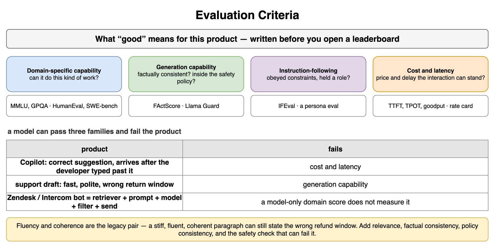

*Source: [`diagrams/evaluate-ai-systems.drawio`](/content/10_AI_Engineering/04_Evaluate_AI_Systems/diagrams/evaluate-ai-systems.drawio), page 1.*

## Domain-specific capability

Domain-specific capability is how well a model does the work of one field, such as code, graduate science, medicine, or law, as opposed to how well it chats in general.

MMLU (Hendrycks et al.) is the exam people cite: 57 subjects, four choices each. It saturated for frontier models, and later critiques found noisy and unanswerable items. MMLU-Pro drops many of those, shifts toward reasoning, and offers ten choices so a blind guess is worth less. GPQA (Rein et al.) is 448 gated, expert-written biology, physics, and chemistry questions. Experts score 65% (74% after setting aside mistakes they later identified), skilled non-experts 34% even with web access and 30+ minutes per question. Leaderboards usually quote the 198-question diamond subset, and the gating is a contamination control as well as a quality one.

Code already has a real oracle: HumanEval's 164 handwritten problems and SWE-bench's fail-to-pass patches are scored by execution, and LiveCodeBench dates contest problems so you can drop anything before a model's cutoff. Specialized checkpoints (Codex, Code Llama, StarCoder, BloombergGPT, Med-PaLM, see [Understanding Foundation Models](../02_Understanding_Foundation_Models/)) earn their place only when scored against a general model on your tasks, and retrieval, not a domain pretrain, owns the fact that changed on Monday. Multiple choice is the trap: your product writes answers, calls tools, or edits repositories, and a strong letter grade can sit beside weak prose because the choices leaked hints. A fabricated dose or citation is a domain failure a generic helpfulness grade describes badly. Screen with the public exam; ship on a private set graded the way the field fails.

```text
MMLU      57 subjects, 4 choices, saturated       -> screen out
MMLU-Pro  10 choices, more reasoning              -> screen out
GPQA      448 gated questions, diamond = 198      -> screen out
code      HumanEval, SWE-bench, LiveCodeBench     -> executed
launch    private set, graded in the product's form
```

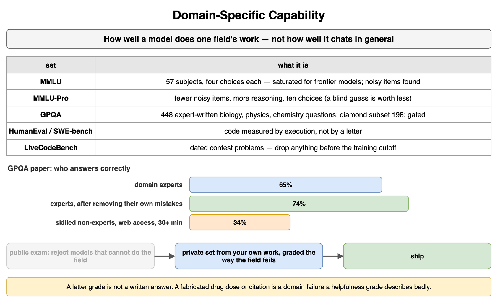

*Source: [`diagrams/evaluate-ai-systems.drawio`](/content/10_AI_Engineering/04_Evaluate_AI_Systems/diagrams/evaluate-ai-systems.drawio), page 2.*

## Factual consistency

Factual consistency means the claims in a generation are supported. Local consistency (faithfulness) means the source you provided supports them. Global consistency (factuality) means the world does.

The product promise picks which failure counts. Perplexity, NotebookLM, a Gmail thread summary, and a Notion AI page summary promise the document; a bare ChatGPT answer promises the world. A claim can pass one and fail the other: repeating an out-of-date help-center page is locally consistent and globally wrong, and adding a true fact the page never stated is unfaithful for a "use only the article" bot. Local checking is entailment. Split the answer into claims, use the source as premise, and let an NLI model or a source-bound judge return entailed, contradicted, or unsupported. Unsupported fails when the product promised to stay in the source. Numbers and dates stay on an exact check, and a claim that needs two source sentences looks unsupported to a one-sentence checker, so the premise unit is part of the metric.

Global checking needs an outside source. SelfCheckGPT (Manakul, Liusie, and Gales) samples several answers and flags claims that change; it is blind to a confidently memorized falsehood and to deterministic sampling, so a stable claim is not a pass. FActScore (Min et al.) splits a long biography into atomic facts and scores the fraction English Wikipedia supports. That is precision against a named source: a true atom missing from Wikipedia fails, and a short answer with only easy facts scores high. SAFE (Wei et al.) has the model search and judge support, reaching beyond the prompt at the cost of extra calls and stale pages. Checking every claim of every answer often costs more than generating it. [Understanding Foundation Models](../02_Understanding_Foundation_Models/) covers hallucination as behavior; this card is detection.

```python
SOURCE = "the package ships on 12 May and the refund cap is 40 dollars"
CLAIMS = (
    ("the package ships on 12 May", "entailed"),
    ("the package ships on 12 June", "contradicted"),
    ("the carrier is a national parcel service", "unsupported"),
)


def local_verdict(label: str, must_stay_in_source: bool) -> str:
    if label == "entailed":
        return "pass"
    if label == "contradicted":
        return "fail"
    if must_stay_in_source:
        return "fail"
    return "needs a world check"


print([local_verdict(label, True) for _, label in CLAIMS])
print([local_verdict(label, False) for _, label in CLAIMS])
# ['pass', 'fail', 'fail']
# ['pass', 'fail', 'needs a world check']
```

The third claim is the distinction: a grounded summary fails it because the thread never named a carrier, while a general assistant sends it to a world check. The date goes to an exact comparison either way.

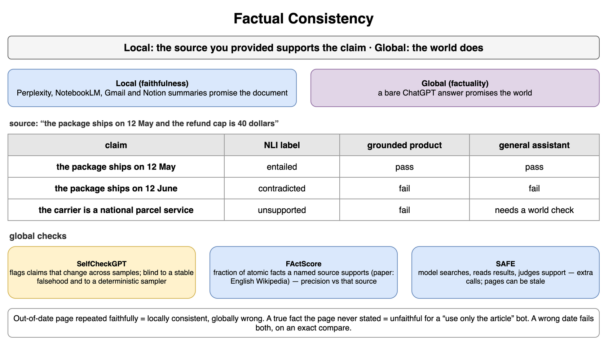

*Source: [`diagrams/evaluate-ai-systems.drawio`](/content/10_AI_Engineering/04_Evaluate_AI_Systems/diagrams/evaluate-ai-systems.drawio), page 3.*

## Safety

Safety, as an evaluation criterion, means the system refuses the harms its policy forbids and still answers the requests that policy allows.

The lists people ship are taxonomies, and they differ. Llama Guard (Meta) is a model fine-tuned to read a prompt, a response, or both and emit safe or one hazard label, so a new checkpoint is a new labeler. Llama Guard 3 follows the MLCommons taxonomy (violent and non-violent crimes, sex-related crimes, child sexual exploitation, defamation, specialized advice, privacy, intellectual property, indiscriminate weapons, hate, suicide and self-harm, sexual content, elections) and adds code-interpreter abuse. The OpenAI moderation endpoint is a hosted classifier with a different list: harassment, hate, illicit activity, self-harm, sexual content, sexual content involving minors, and violence, some split into threatening, intent, or graphic flags. Naming the category is the evaluation; the notes need no example of the harm.

A taxonomy is not your policy. A patient portal must discuss hopelessness far enough to route help, a children's product refuses more than a developer tool, and Gemma's prohibited-use policy and Llama's acceptable-use policy bind you alongside the product policy, so write the intersection down. Over-refusal is the other failure: XSTest measures benign requests that only look hazard-adjacent, and a bot refusing "how do I cancel" is a product bug. The system under test includes the filter, so log the classifier label and the raw reply, and score both on ordinary prompts and on adversarial sets such as HarmBench (cite it; do not paste attacks). TruthfulQA (Lin, Hilton, and Evans) measures repeated human misconceptions, a factuality problem rather than a safety gate. A classifier is cheaper and steadier than a frontier judge on every turn but knows only its trained hazards; evaluating only benign traffic reports a flattering safety rate.

```text
bound by:   hazard taxonomy ∩ license acceptable-use ∩ product policy
score:      raw model + filter, on harm set + over-refusal set (XSTest) + adversarial set
not safety: TruthfulQA (imitative falsehood -> factuality)
```

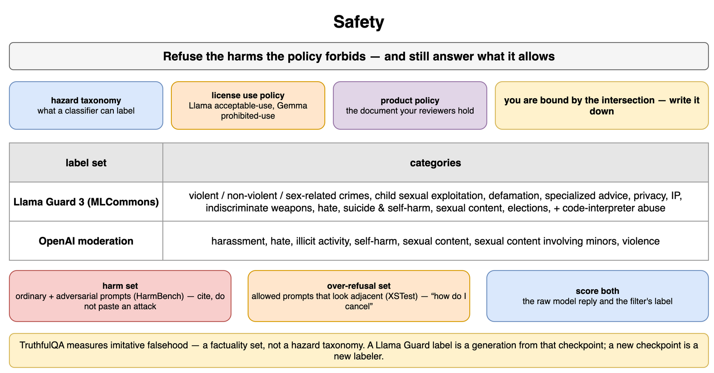

*Source: [`diagrams/evaluate-ai-systems.drawio`](/content/10_AI_Engineering/04_Evaluate_AI_Systems/diagrams/evaluate-ai-systems.drawio), page 4.*

## Instruction following

Instruction following is the model's obedience to constraints that were stated in the request: a format, a length, a required phrase, a forbidden topic, an order of sections.

A capable model still skips the one constraint the product needed, and domain knowledge does not grade it. IFEval (Zhou et al., Google) grades verifiable constraints with a program: 25 instruction types such as a word limit or a required final sentence, across 541 prompts, with no judge in the headline. It reports four accuracies. Prompt-level counts a prompt only when every instruction passed; instruction-level counts each one. Strict checks the raw text; loose passes if any of eight variants passes (raw, asterisks removed, first line, last line, or both removed, and the three line removals with asterisks removed). Loose rescues bold text and a "Sure, here it is" preamble, and can also create false passes, such as dropping a line to get under a word count. Prompt-level strict is the gate when any missed constraint breaks the message; quote the level.

Not every instruction is executable. InFoBench (Qin et al.) decomposes 500 instructions into 2,250 yes-or-no requirements across content, linguistic, style, format, and number constraints, and a person or model answers each, so the [Evaluation Methodology](../03_Evaluation_Methodology/) calibration is part of the number; a high ratio on the easy 252 can hide the hard half. Your macros are a different set: "do not promise a refund the article refuses" is verifiable once the article is in the grader. Constrained decoding (the Structured outputs card in [Understanding Foundation Models](../02_Understanding_Foundation_Models/)) moves the format metric onto the decoder; grading the model on "output JSON" after you masked the grammar measures your parser.

```python
def word_count_at_most(text: str, limit: int) -> bool:
    return len(text.split()) <= limit


def contains_keyword(text: str, keyword: str) -> bool:
    return keyword.lower() in text.lower()


def prompt_and_instruction(text: str) -> tuple[bool, float]:
    checks = (
        word_count_at_most(text, 12),
        contains_keyword(text, "refund"),
    )
    return all(checks), sum(checks) / len(checks)


long_reply = (
    "We can refund the shipping charge. Please reply with the order number "
    "so we can look it up today and confirm the amount."
)
short_reply = "Yes, we can refund shipping today."
print(len(long_reply.split()), prompt_and_instruction(long_reply))
print(len(short_reply.split()), prompt_and_instruction(short_reply))
# 23 (False, 0.5)
# 6 (True, 1.0)
```

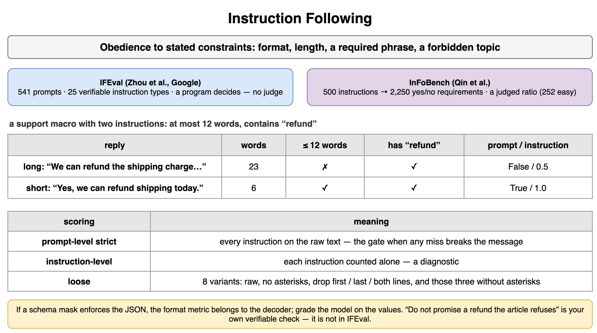

*Source: [`diagrams/evaluate-ai-systems.drawio`](/content/10_AI_Engineering/04_Evaluate_AI_Systems/diagrams/evaluate-ai-systems.drawio), page 5.*

## Roleplaying

Roleplaying evaluation measures whether a model holds a stated persona, brand voice, or role across a conversation, rather than only in a single reply.

A role is a constraint that has to survive turn twelve. Character.AI is built on that survival, a custom GPT is the same idea with a shorter card, and an Intercom brand voice is a narrower character that stays the shop's assistant even when asked to be a general chatbot. The failures are specific: drifting into a generic assistant, contradicting a preference set on turn one or a fact the persona card committed to, revealing the hidden instructions, and refusing what the role should handle or accepting what it forbids. None shows up in a one-turn IFEval prompt.

Score the session. A turn average flatters a conversation that was in character for five replies and leaked the system prompt on the sixth. The leak is an exact check (the hidden text or a distinctive substring appeared), and one leak is a product and security failure; prompt injection is how users push for it. Voice and drift are judgments: a calibrated judge reads the full transcript against the persona card. The card must be concrete enough for two raters to agree. "Be helpful and fun" is not a role; "you are the shop assistant, you do not invent a discount, you do not discuss a competitor's price" is, and the discount ban is verifiable on top of the voice judgment. Store the transcript, including the persona card and tool outputs, as the example. A conversation passes when every exact check and the voice judgment passed. The turn average is how you debug where it drifted, not the launch number. Freezing the card makes scores comparable and falls behind when the brand voice is edited.

```text
exact:   leaked hidden instructions, explicit bans (no invented discount)
judged:  voice, drift, persona consistency on the full transcript
metric:  fraction of conversations that stayed inside the card
```

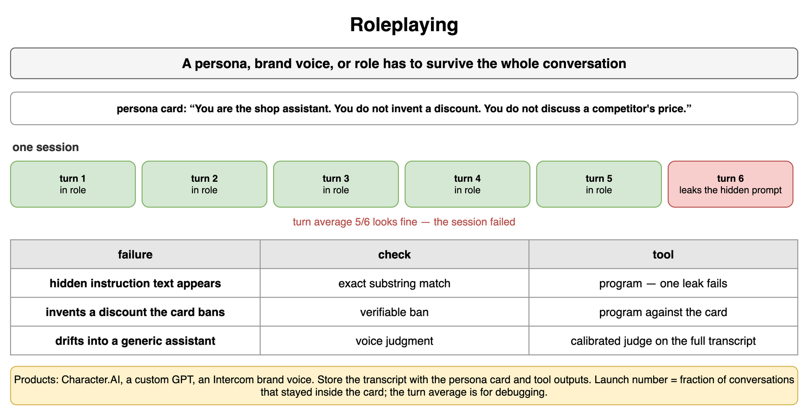

*Source: [`diagrams/evaluate-ai-systems.drawio`](/content/10_AI_Engineering/04_Evaluate_AI_Systems/diagrams/evaluate-ai-systems.drawio), page 6.*

## Latency

Latency is the wait while a model produces tokens. It is an evaluation criterion because a correct answer that arrives after the user has moved on does not ship.

Two clocks describe a streamed generation. Time to first token (TTFT) is the wait until the first output token at the server, including queueing and prefill, so a long retrieval context worsens it on a fixed model; the token the user sees can arrive later, so name the clock. Time per output token (TPOT) is the average gap after that. Here an N-token reply takes `TTFT + TPOT × (N − 1)`; a vendor dividing total time by N uses a different formula, so reconcile before comparing dashboards. An average can hide one long stall, so a voice reply needs the longest gap too.

Throughput is not 1/TPOT. Batching raises tokens and requests per second while each user's TPOT worsens. Goodput is the rate of completed requests that met every latency objective; call the percentage the attainment, and errors never count. In the code, 10 finished with 6 in budget beats 16 finished with 4 in budget: the bigger batch won the token chart and lost the interaction. The 500-token answer takes 10.38 s at a 50 tokens/s decode and a 48.17 tokens/s end-to-end rate. Streamed chat shows the first token at 0.4 s, but a tool call, voice utterance, or grader waits for all 10.38 s. Test-time compute (o1, DeepSeek-R1) spends extra seconds that a batch job can afford and Copilot ghost text cannot. [Inference Optimization](../09_Inference_Optimization/) builds the batching and kernels; here the clocks only decide eligibility. Cite the date on Artificial Analysis or vendor dashboards.

```python
TTFT_SECONDS = 0.400
TPOT_SECONDS = 0.020
OUTPUT_TOKENS = 500


def latency_seconds(tokens: int) -> float:
    return TTFT_SECONDS + TPOT_SECONDS * (tokens - 1)


def serving(finished: int, met_slo: int) -> tuple[int, int, float]:
    return finished, met_slo, met_slo / finished


wait = latency_seconds(OUTPUT_TOKENS)
small_batch = serving(10, 6)
large_batch = serving(16, 4)
print(f"{wait:.2f} {1 / TPOT_SECONDS:.1f} {OUTPUT_TOKENS / wait:.2f}")
print(small_batch[0], small_batch[1], f"{small_batch[2]:.2f}")
print(large_batch[0], large_batch[1], f"{large_batch[2]:.2f}")
# 10.38 50.0 48.17
# 10 6 0.60
# 16 4 0.25
```

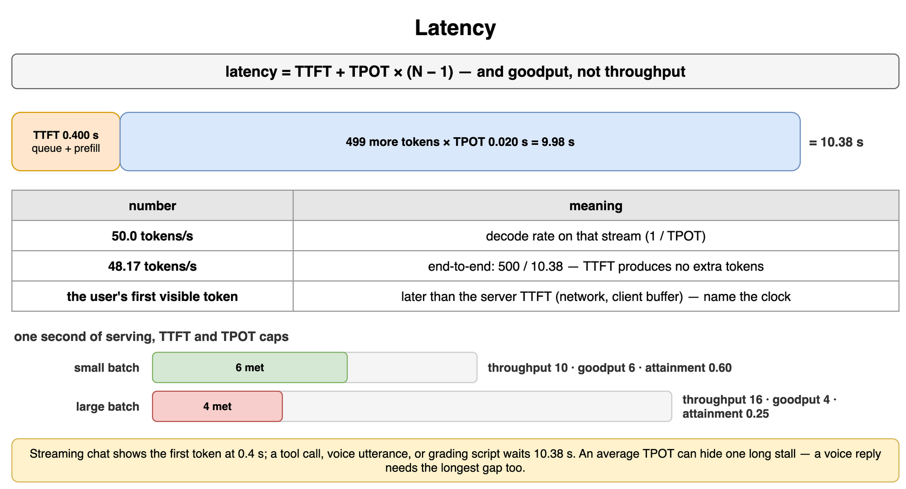

*Source: [`diagrams/evaluate-ai-systems.drawio`](/content/10_AI_Engineering/04_Evaluate_AI_Systems/diagrams/evaluate-ai-systems.drawio), page 7.*

## Cost

Cost is the money a call spends, on a provider's rate card or on machines you keep switched on. It is an evaluation criterion because a correct answer the product cannot pay for does not ship.

The API bill is the rate card times the tokens, with input and output priced separately; every dollar here is an exercise rate, not a quote. For a retrieval-shaped call of 3,000 input and 500 output tokens, a small model at $0.25/$0.75 per million costs $1.125 per 1,000 requests, and a frontier model at $5/$15 costs $22.50. On both, the prompt is the larger line ($0.75 vs $0.375, and $15 vs $7.50): the prompt is six times the completion and output costs only three times input, so input is twice output. A shorter prompt or a wider price gap flips that, which is why a blended "price per million tokens" hides the line that dominates.

The frontier model can be worth $22.50 per 1,000 on the hard slice and a waste on the easy slice the $1.125 model already passes. Routing everything to the cheap model is a quality decision the rate card cannot make. Recompute when the card or the token mix changes; last quarter's price is a different bill. A self-hosted GPU does not follow this per-token shape because it bills while idle. That crossover belongs to the self-hosting card and a measured load test.

```python
INPUT_TOKENS = 3_000
OUTPUT_TOKENS = 500


def cost_per_thousand(input_rate: float, output_rate: float) -> tuple[float, float, float]:
    input_cost = 1_000 * INPUT_TOKENS / 1_000_000 * input_rate
    output_cost = 1_000 * OUTPUT_TOKENS / 1_000_000 * output_rate
    return input_cost, output_cost, input_cost + output_cost


small = cost_per_thousand(0.25, 0.75)
frontier = cost_per_thousand(5.00, 15.00)
print(f"{small[0]:.3f} {small[1]:.3f} {small[2]:.3f}")
print(f"{frontier[0]:.3f} {frontier[1]:.3f} {frontier[2]:.3f}")
# 0.750 0.375 1.125
# 15.000 7.500 22.500
```

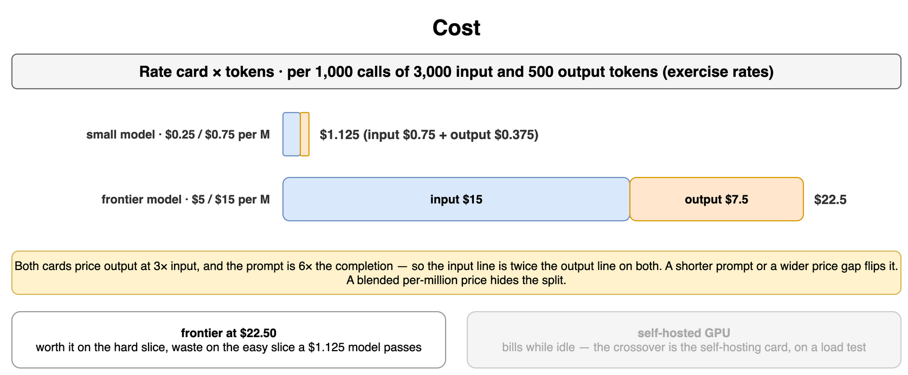

*Source: [`diagrams/evaluate-ai-systems.drawio`](/content/10_AI_Engineering/04_Evaluate_AI_Systems/diagrams/evaluate-ai-systems.drawio), page 8.*

## Model selection workflow

A model selection workflow turns the criteria into a shortlist and then into a choice. It filters on hard attributes, ranks what remains on soft ones, and repeats when a measurement proves an attribute was mislabeled.

Hard attributes are pass or fail: the context window holds the prompt you send, the license allows the product, data handling matches your regulation, the model supports your modality, tools, and launch languages, and it meets the latency budget (hard for inline code, soft for an overnight report). Soft attributes are ranked: quality on your eval, cost, operational pain, and appetite for vendor upgrades. Mixing the two is how a leaderboard picks a model you are not allowed to deploy. The order is the method: write hard attributes from the product, drop every failure, narrow the survivors with only those public benchmarks that match a criterion, run the private eval on the handful, and iterate. A winner that fails Spanish, a launch language, gets no waiver: Spanish moves into the hard filter and you rerun it. Change the list in writing, and version it with the result.

For Copilot-style ghost text (a workflow, not a claim about GitHub's model), the hard filters are a suggestion inside the developer's pause, a license that allows the product, and a context that holds the file and cursor. Acceptance rate and cost per suggestion are soft. A code-leaderboard leader that misses the pause is out before its score is discussed. "Must stay in our VPC" removes every multi-tenant API. Quality, latency, and cost form a Pareto front unless one model dominates all three, so state the trade you accept. Evaluation-driven development builds first the use case whose outcome you can measure (accept rate, a reconciled invoice field, a passing test). Mind the lamppost: name the unmeasured harm, such as a wrong medical note, instead of pretending the easy proxy is the outcome.

```text
1. write hard attributes (context, license, data, modality, language, latency?)
2. drop every failure
3. narrow with public benchmarks that match a criterion
4. private eval on the handful
5. move attributes between lists only on purpose, then rerun
```

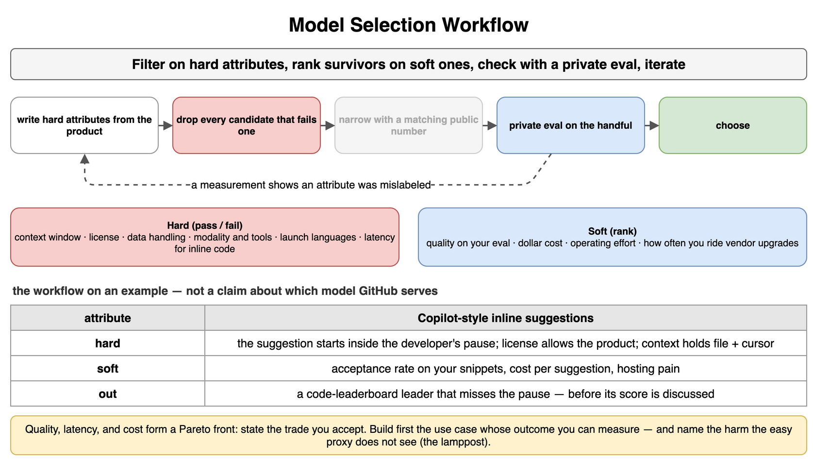

*Source: [`diagrams/evaluate-ai-systems.drawio`](/content/10_AI_Engineering/04_Evaluate_AI_Systems/diagrams/evaluate-ai-systems.drawio), page 9.*

## Build versus buy

Build versus buy is the choice of who produces the checkpoint you call: a lab you run, or a provider you pay.

For almost every application team the checkpoint is bought. An API from OpenAI, Anthropic, or Google buys a frontier model and elastic capacity from a vendor that can change behavior under a name you thought you had pinned. A hosted open-weight model, from a serving company or a cloud such as Amazon Bedrock, buys a checkpoint you can name on GPUs someone else runs. Building means pretraining or continuing a base model. BloombergGPT is the public from-scratch domain example and Med-PaLM the adapt-a-general-model one; sizes live in the foundation-model topic. Teams rarely have the corpus, the GPU pool, or a quality gap that a prompt and a retrieved document leave open.

What you build is the product around the bought checkpoint: prompt when the task is in the request, retrieve when the fact is private or changing, and finetune when a behavior will not stick and you have the examples. A finetune is build-on-a-purchase ([Finetuning](../07_Finetuning/)), and neither it nor a pretrain replaces retrieval for a policy that changed this morning. The eval is also yours to build; borrowing the vendor's blog-post score is how selection fails. Swapping an API or hosted checkpoint is a reversible selection rerun, while pretraining a 70B model over an annoying API bill is not. If a hard attribute says no prompt may leave your network, you are buying a checkpoint you can run, not a multi-tenant API. Otherwise buy the call and spend the effort on the private eval.

```text
buy API            frontier, elastic, vendor-controlled name
buy hosted open    named checkpoint, someone else's GPUs
build on purchase  prompt, retrieval, tools, finetune, eval  <- the team's job
build base model   pretrain (BloombergGPT): rare, irreversible
```

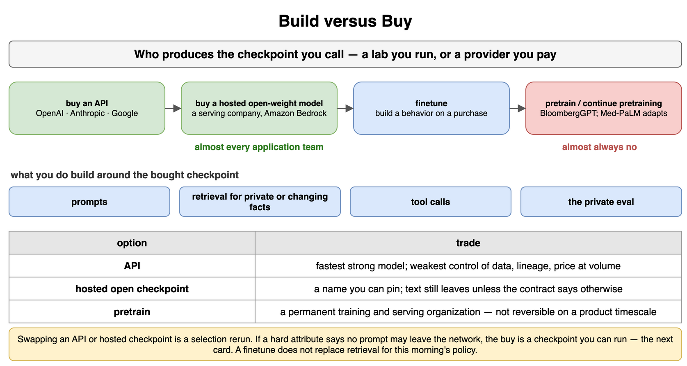

*Source: [`diagrams/evaluate-ai-systems.drawio`](/content/10_AI_Engineering/04_Evaluate_AI_Systems/diagrams/evaluate-ai-systems.drawio), page 10.*

## Open weights and licenses

Open weights, open source, and a model license are three different claims about what you are allowed to do with a checkpoint. The file next to the weights is the claim that counts.

Open weights means you can download the parameters. Open source means an OSI-approved license with no field-of-use restriction. The OSI's Open Source AI Definition 1.0 (October 2024) asks for three things: data information detailed enough for a skilled person to build a substantially equivalent system, the training and running code, and the parameters. Data information describes the data, including what cannot be redistributed, and where to get what is public or sold; it is not the token dump. Apache 2.0 is permissive, with a patent grant (ending if you sue alleging infringement), attribution, and a NOTICE duty. MIT is shorter with no patent grant. Allen AI's OLMo publishes data and training code alongside weights, the direction the definition points.

Brands do not decide. Mistral 7B is Apache 2.0; the original Codestral used the Mistral Non-Production License (no production or hosted commercial use); other Mistral checkpoints use a modified MIT that does not apply when global monthly revenue exceeded $20 million the preceding month, a current revenue gate. The Llama 3 community license (April 18, 2024) adds a 700 million MAU clause that is a snapshot on the release date, not a meter: a company small on that date does not lose the grant by growing. It also requires a "Built with Meta Llama 3" notice and a "Llama 3" name prefix on distributed derivatives, bans improving a non-Llama model with the materials or outputs, and incorporates an acceptable-use policy. Gemma's terms add a prohibited-use policy that must travel with derivatives. The license is a hard attribute, read before the benchmark score, and later revisions mean the file shipped with your weights is the one that counts.

| What you downloaded | What you can honestly call it | The check before you ship |
| --- | --- | --- |
| Weights, training code, and data information under OSI-approved terms, matching the Open Source AI Definition. | Open source, in the OSI's sense for an AI system. | Confirm the data information is actually sufficient, and that no extra terms ban a field of use. |
| An Apache 2.0 or MIT weight file, without the training data. | Open-weight under a permissive software license. | Attribution, and for Apache the NOTICE file and the patent grant. The missing data information means it is not the OSI AI definition by weights alone. |
| Llama 3 weights under the community license. | Open-weight under a custom license. | The 700 million MAU snapshot on the release date, the "Built with Meta Llama 3" notice, the "Llama 3" name prefix on a distributed derivative model, the ban on improving a non-Llama model, and the acceptable-use policy. |
| A Mistral checkpoint. | Open-weight under that file's license. | Apache 2.0, the non-production license, or a modified MIT revenue gate are all real Mistral files. The brand does not decide. |
| Gemma weights under Google's terms. | Open-weight under custom terms. | The prohibited-use policy and the duty to pass it downstream. |
| An API with no weights. | A service. | The contract: retention, training on your prompts, regions, and whether the model id stays put. |

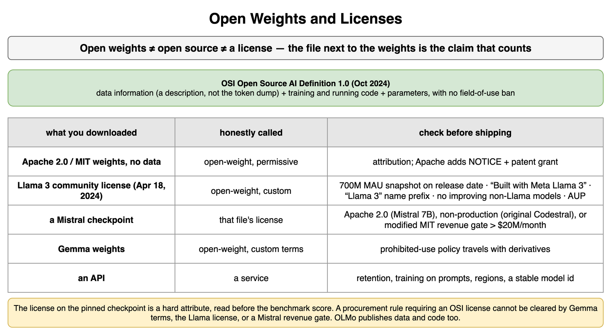

*Source: [`diagrams/evaluate-ai-systems.drawio`](/content/10_AI_Engineering/04_Evaluate_AI_Systems/diagrams/evaluate-ai-systems.drawio), page 11.*

## Self-hosting and model APIs

Self-hosting means you run the weights on infrastructure you control. A model API means a provider runs a model and you send it requests. The choice is how the hard attributes of privacy, lineage, and control trade against performance, features, and cost.

Privacy: a multi-tenant API receives the prompt, and a no-training, limited-retention contract is a promise about someone else's copy. Self-hosting keeps it in your VPC, which banks and hospitals often write down as hard. On-device goes further for requests that stay on the device: Gemini Nano runs on phones, and Apple Intelligence runs some models locally and sends others to Private Cloud Compute, which is not that path. On-device models are smaller with shorter context, and shipping weights in an app needs a license that allows redistribution. Lineage: an API name can move underneath you, so pin a dated model id and rerun regressions when it changes (Maintenance under a moving model card in [Introduction](../01_Introduction_to_Building_AI_Applications_with_Foundation_Models/); GPT-4-0314 vs 0613 in [Evaluation Methodology](../03_Evaluation_Methodology/)). A self-hosted file has a hash, and a hosted open model is pinnable only if the host serves that hash. Access: keys get revoked, model ids dropped, regions restricted. The mitigation is a second path you have already scored, not "we will switch if they cut us off."

Performance and features do not follow from privacy. A vendor fleet is often faster on TTFT and throughput, and sometimes slower for your region or objective, so measure goodput. Vision, tool calling, JSON mode, prompt caching, and batch endpoints land on APIs first. Open weights let you finetune, quantize, and pick the sampler, log retention, filter, and upgrade day. Cost is a shape: API cost scales with tokens and is near zero at low traffic, while GPUs bill overnight. Low or spiky traffic favors the API; high, steady traffic can favor GPUs once a peak load test shows they survive. On-device pays in binary size, battery, and a weaker model.

```text
               API             self-host        on-device
privacy        contract        your VPC         stays on device
lineage        moving alias    hash             shipped binary
features       first           catch up         smallest model
cost           per token       idle floor       size, battery
```

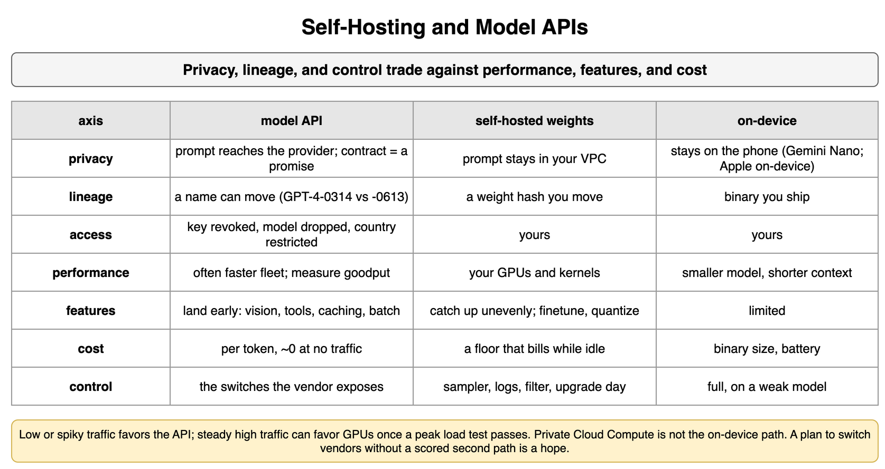

*Source: [`diagrams/evaluate-ai-systems.drawio`](/content/10_AI_Engineering/04_Evaluate_AI_Systems/diagrams/evaluate-ai-systems.drawio), page 12.*

## Public benchmarks

A public benchmark is a shared task, with a shared grader, that many models have been scored on. Navigating one means reading the number as a measurement with a date, a harness, and a task mix, not as a ranking of products.

HELM (Liang et al., Stanford CRFM) argues for a matrix: accuracy plus calibration, robustness, fairness, bias, toxicity, and efficiency across scenarios, because one accuracy hides the column that would change your decision. Chatbot Arena (later LMArena, now Arena) is pairwise human preference turned into a rating; its rating model, intervals, and style control live in the Ranking from pairwise votes card in [Evaluation Methodology](../03_Evaluation_Methodology/). A public Arena rank is preference on that crowd's prompts, not an accuracy and not your queue.

Hugging Face's Open LLM Leaderboard is the cautionary single average. Version 1 (archived June 2024) averaged ARC, HellaSwag, MMLU, TruthfulQA, WinoGrande, and GSM8K, which saturated and mixed four kinds of skill into one scalar. Version 2 (June 2024) used IFEval, BBH, MATH level 5, GPQA, MuSR, and MMLU-Pro, with several normalized above chance before averaging. The maintainers retired it in March 2025 rather than let the field optimize a stale mix; its numbers are history, not a live gate. Read any board with a checklist: the model id is the checkpoint you would call, the template and few-shot count match the harness, the date travels with the score, the metric matches the criterion, and the set could not have been in training. A shared harness is the only way to compare numbers, and it is almost never your distribution. Use the board to drop models that fail a named criterion, not as the eval you forgot to build.

```text
read:   model id, harness + template, date, metric, contamination risk
use:    narrow the shortlist
never:  launch on it
```

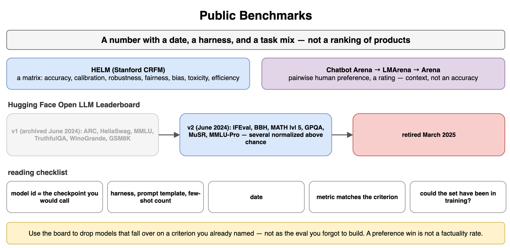

*Source: [`diagrams/evaluate-ai-systems.drawio`](/content/10_AI_Engineering/04_Evaluate_AI_Systems/diagrams/evaluate-ai-systems.drawio), page 13.*

## Benchmark selection and aggregation

Benchmark selection is choosing the public tasks that match your criteria. Aggregation is how you combine those tasks when they disagree, which they will.

Select by the failure a user would notice. Running code points at HumanEval, SWE-bench, and LiveCodeBench; crisp constraints at IFEval; broad knowledge at MMLU or MMLU-Pro; search-resistant science at GPQA; long-answer factuality at a grounded check; safety at a hazard set plus an over-refusal set; chat preference at Arena with style and date attached. A benchmark earns a column only by matching a criterion you wrote down before you saw who won it.

Aggregation is where careful selection gets thrown away. A mean of accuracies assumes the same scale and chance level, but GPQA's chance is 1/4 and MMLU-Pro's is 1/10. Normalizing above chance fixes that and still leaves one scalar, and an Arena rating never shares an average with an accuracy. Mean rank is comparable across tasks (give tied scores the same rank) but drops gap size: 1 point and 30 points are both one rank. A floor is a hard attribute applied to a score, and the aggregate runs only on survivors. In the exercise worksheet below, the mean picks B (71.33), the mean rank picks A (1.667, first on two columns and last on science), and a floor of 50 removes A for its 35. Among survivors the product's column decides: B leads science 70 to 55 and C leads instructions 75 to 60. Report the columns, the floor, and the declared aggregate; a meeting that sees only the mean has not seen the evaluation.

```python
SCORES = {
    "A": (86, 90, 35),
    "B": (84, 60, 70),
    "C": (80, 75, 55),
}
FLOOR = 50


def mean(values: tuple[int, ...]) -> float:
    return sum(values) / len(values)


def ranks_for(index: int) -> dict[str, int]:
    ordered = sorted(SCORES, key=lambda name: SCORES[name][index], reverse=True)
    return {name: place for place, name in enumerate(ordered, start=1)}


rank_rows = [ranks_for(index) for index in range(3)]
survivors = [name for name, values in SCORES.items() if min(values) >= FLOOR]
print(survivors)
for name in ("A", "B", "C"):
    mean_rank = sum(row[name] for row in rank_rows) / 3
    print(name, f"{mean(SCORES[name]):.2f}", f"{mean_rank:.3f}")
# ['B', 'C']
# A 70.33 1.667
# B 71.33 2.000
# C 70.00 2.333
```

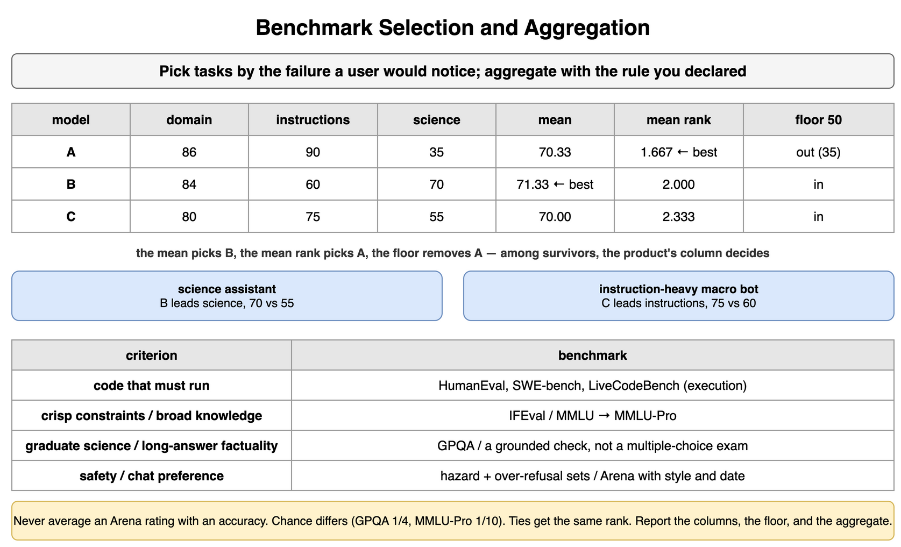

*Source: [`diagrams/evaluate-ai-systems.drawio`](/content/10_AI_Engineering/04_Evaluate_AI_Systems/diagrams/evaluate-ai-systems.drawio), page 14.*

## Data contamination

Data contamination means evaluation items were in the training data, so a score can reward memorization of the test rather than the capability the test was supposed to measure.

Benchmarks leak because models train on web crawls that contain them. The pretraining screen is long n-gram overlap, long because ordinary language shares short phrases. GPT-3's training filter looked for 13-word overlaps (lowercased, punctuation removed) and, by a bug the authors describe, only partly removed them. Its clean-subset analysis used windows of 8 to 13 words and found most benchmarks scored about the same clean as full. The authors read that as either over-flagging or little effect, warned that the clean slice can differ in difficulty, and flagged PIQA and Winograd for a closer look. In the code, the leaked wording shares five 8-grams with training text and the paraphrase none, but at 4-grams the paraphrase still shares "the capital of france," the fact rather than a copied question. A 4-gram screen would flag a legitimate rewording.

After training you often lack the crawl. A paraphrase test keeps the answer and rewrites the item: skill barely moves, memorization drops, though a genuinely harder wording also drops. Perplexity against a matched control (the previous topic's rules) is another smell. Leaderboard hints include a score far above the model's other tasks and size-peers on one benchmark, or run-to-run variance that collapses. Both say "read the items," not "proven." BIG-bench's canary string and GPQA's gated distribution filter at the door until someone quotes the items. LiveCodeBench restricts problems to after the training cutoff. Score the clean slice beside the full set; if it drops, it carries the launch, and a match is not proof. A private production set kept out of the next finetune is the durable fix.

```python
def ngrams(tokens: list[str], size: int) -> set[tuple[str, ...]]:
    return {tuple(tokens[index : index + size]) for index in range(len(tokens) - size + 1)}


def overlap(left: list[str], right: list[str], size: int) -> int:
    return len(ngrams(left, size) & ngrams(right, size))


train = "the capital of france is paris and it sits on the seine".split()
leaked = "the capital of france is paris and it sits on the seine what is the capital".split()
paraphrase = "which city serves as the capital of france".split()
print(overlap(leaked, train, 8), overlap(paraphrase, train, 8))
print(overlap(leaked, train, 4), overlap(paraphrase, train, 4))
# 5 0
# 9 1
```

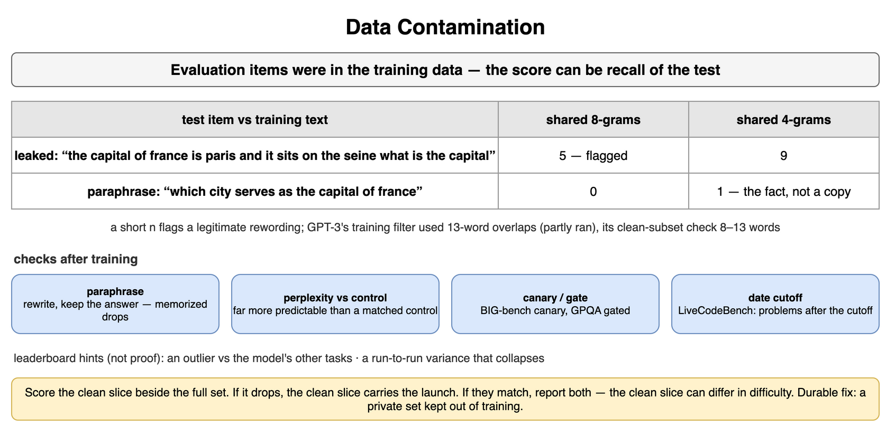

*Source: [`diagrams/evaluate-ai-systems.drawio`](/content/10_AI_Engineering/04_Evaluate_AI_Systems/diagrams/evaluate-ai-systems.drawio), page 15.*

## Evaluate every component

Evaluating every component means scoring each stage of the system on its own output, and scoring the task the user actually had, because those two numbers answer different questions.

A foundation-model product is a pipeline. A NotebookLM or Notion workspace answer is a retrieval query, pages, a prompt, a generation, and a citation check; an Intercom bot that refunds through Stripe adds a tool call. Store only the final message and you will edit the prompt when the index was empty. Step 1 of an evaluation pipeline is logging every stage's inputs and outputs, so each can be graded by the tool that can mark it wrong: retrieval as a hit at k against the answer page, tool arguments by exact check, grounded sentences by local consistency, and tone by a judge.

Turn-level metrics score this reply, retrieval, or tool call; task-level metrics score whether the user got what they came for. In a Stripe refund flow, the bot asks for the order id (a good turn) and calls the refund tool with the right id and the wrong amount; a person catches it and the customer is made whole. Resolution says the case ended correctly, and the tool metric says the system attempted the wrong amount. Track only resolution and you ship the bad call until the person stops catching it; track only the call and you reject a designed multi-turn recovery. Log both amounts. Retrieval has the same gap: a correct answer from pretraining on a retrieval miss fails the morning the workspace disagrees with the weights. Grounded accuracy is the task metric a "this workspace" product promised. Component scores say where to spend next week; task scores say whether users get the outcome. Stage logs may hold customer data you now retain on purpose.

```text
retrieval   hit / recall at k       tool args   exact
grounding   entailment vs page      tone        judge
task        resolved? grounded?     log attempted and final values
```

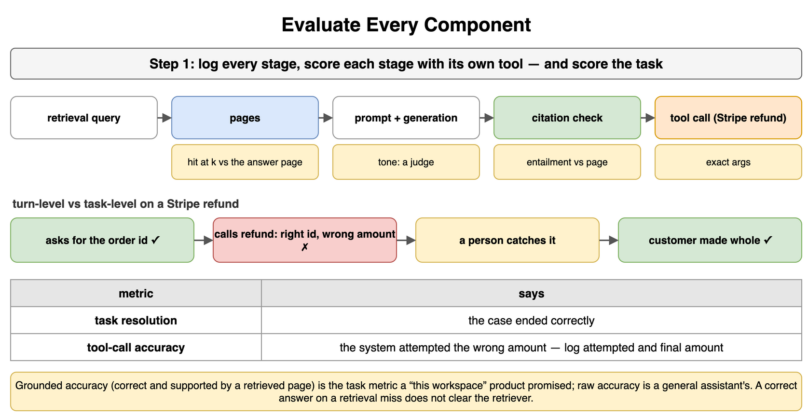

*Source: [`diagrams/evaluate-ai-systems.drawio`](/content/10_AI_Engineering/04_Evaluate_AI_Systems/diagrams/evaluate-ai-systems.drawio), page 16.*

## An evaluation guideline

An evaluation guideline is the written definition of how raters, and any judge you prompt, decide a score. It is step 2 of the pipeline. It states the criteria, shows a rubric with an example of each level, and says which business metric the score is supposed to track.

Criteria are the product's criteria cut into decisions a rater can make; "be helpful" is not one. For a Notion or Google Docs meeting summary there are three: every decision and date appears in the transcript, every owner matches, and no decision was added. Tone can be listed but is not the gate without evidence it changes an outcome. Each level needs a short example concrete enough that two raters and the judge prompt classify it the same way. Pass: the summary says the launch review is Tuesday and the editor owns the checklist, as the transcript does. Partial: date and decision match, owner missing. Fail: an added budget decision, or Tuesday moved to Wednesday. Edge cases you have already argued about go in; they are future disagreements. The judge prompt is this document, and examples are versioned with the rubric.

The business tie is a hypothesis you measure. A summary rubric should predict a logged outcome, such as whether users edit the summary or accept the action items. Slice that log by rubric level. If passes and fails are edited at the same rate, the rubric does not gate a launch. If fails are edited far more, it earns its place as a proxy you can run before the edit exists. Support tools test the same way against reopens or escalations. Recompute the tie when the rubric or the product changes. Tying every criterion to revenue can drop rare, expensive harms, and leaving it implicit lets a polished rubric optimize a score customers do not feel.

```text
criteria:  decisions/dates in transcript | owners match | nothing added
levels:    pass / partial / fail, each with a concrete example
tie:       slice edits or reopens by level; flat slice -> diagnostic only
```

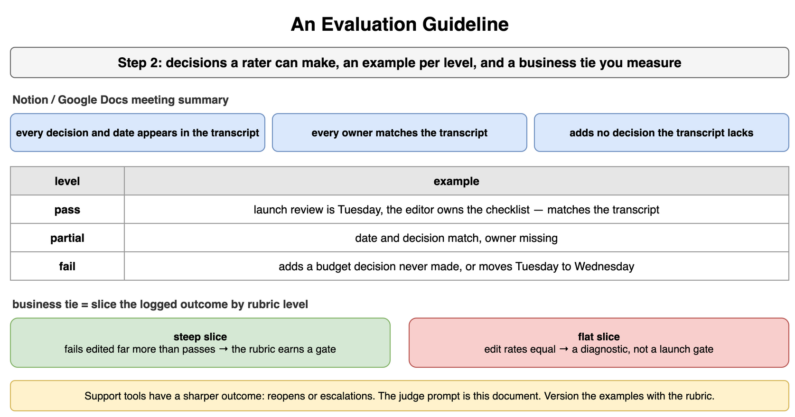

*Source: [`diagrams/evaluate-ai-systems.drawio`](/content/10_AI_Engineering/04_Evaluate_AI_Systems/diagrams/evaluate-ai-systems.drawio), page 17.*

## Choosing evaluation methods

Choosing an evaluation method means assigning each criterion to the cheapest tool that can actually mark a failure. That assignment is the start of step 3. It uses the toolkit from the previous topic rather than re-deriving it.

Exact programs take everything they can see, including IFEval-style constraints and n-gram leaks of a hidden prompt; an InFoBench-style requirement no program can check goes to a judge. Global factuality runs on a sample, not on every token of every request. Preference ranks close variants, and the launch still needs an absolute pass line. A method that cannot see the failure is the wrong assignment even if it is cheaper: BLEU on a refund window is the previous topic's example, and here you refuse the assignment rather than repeat the metric.

Cost orders the methods inside the table, not instead of it. Programs and classifiers run on every build. A frontier judge runs on the residue on an affordable schedule. People run where calibration is due and on the severe slice a classifier may not decide alone. One judge for everything spends frontier money approximating checks a program already makes; programs for everything are blind to voice and fairness. Matching method to criterion has more moving parts, and it is the only assignment that fails in the right place. For a support bot: an exact window check, a grounding check, a safety classifier, and a judge for tone only if tone earned a place in the guideline.

| Criterion | Method | Why this tool |
| --- | --- | --- |
| A date, an amount, a tool argument, a JSON schema, an IFEval-style constraint, a leaked instruction string. | A program. | The rule is executable, so a judge would be a slower copy of it. |
| Retrieval. | Recall or a hit at k against the page that contains the answer. | The stage either returned the page or it did not. |
| Local consistency of a prose claim. | An NLI model or a source-bound judge. | The source is the premise. Numbers inside the claim still go to the program. |
| Global factuality of a long answer. | An atomic-fact check against a knowledge source, on a sample. | There is no single document unless you retrieve one. |
| Safety and over-refusal. | A classifier plus an allowed-prompt set, with humans on the severe tail. | The taxonomy is stable, and the tail is where a classifier's miss matters. |
| Tone, role voice, an InFoBench-style requirement, usefulness beyond the checks above. | A calibrated judge, using the guideline. | No program has the rule, so the rubric and the rater are part of the metric. |
| Which of two close variants people prefer. | Pairwise votes, then an absolute gate. | Preference ranks the candidates. It does not issue a pass. |

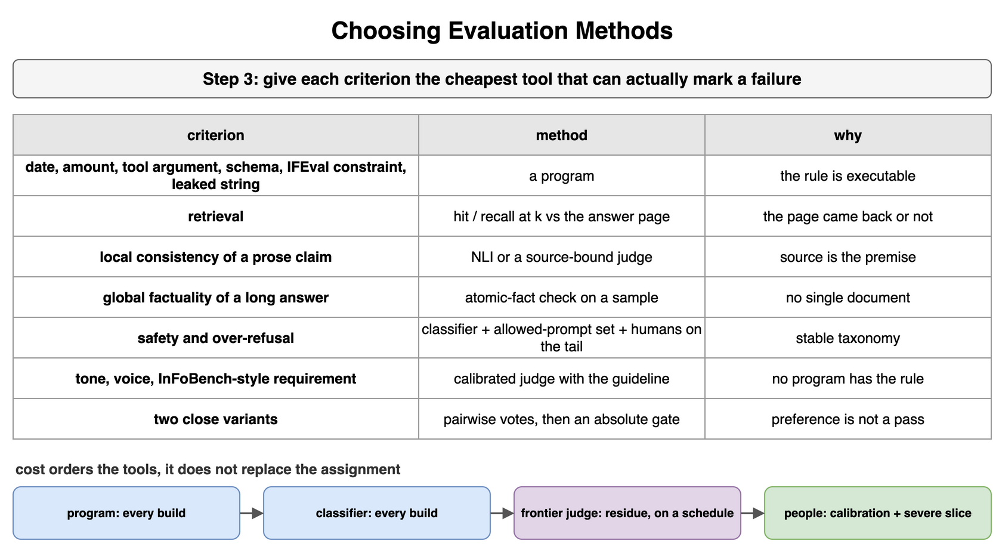

*Source: [`diagrams/evaluate-ai-systems.drawio`](/content/10_AI_Engineering/04_Evaluate_AI_Systems/diagrams/evaluate-ai-systems.drawio), page 18.*

## Annotating evaluation data

Annotating evaluation data means building the set you score, deciding which slices must stay visible, and collecting enough labels that the comparison you care about can show up. It is the data half of step 3.

Rows should look like served traffic: production logs with consent and personal data removed. Experts add severe cases traffic rarely produces (a refund above a threshold, a self-harm disclosure routed to a person, a dangerous tool argument), which must not be mistaken for the base rate. Synthetic rows are a draft until a person accepts them, or the generator grades its own homework. Keep a byte-identical frozen regression set for trend lines and a rotating fresh slice for new failures, and train on neither. Slice by language, intent, plan tier, long context, and last week's incident: a high English accuracy can hide a failing Spanish refund intent. A slice with a handful of rows needs more labels, not a precise rate. Double-label a slice with the guideline, and keep old labels under the version they were collected with.

Sample size is the arithmetic of that honesty. Detecting 70% → 73% with a two-sided 5% Wald test at 80% power needs 3,551 examples per independent, equal arm on the unpooled plan (no continuity correction, z ≈ 1.960 and 0.842), or 3,554 with the pooled rate on the significance term. Either way, a few hundred labels cannot resolve the gap. The normal approximation holds because each arm has hundreds of failures; it fails when misses are a handful. This is one pre-specified comparison: twenty slices at 5% produce about one false flag when nothing changed. Scoring both models on the same items is paired (McNemar's test on disagreements). It needs fewer items when the same items are hard for both, but not when they fail opposite items. Non-proportion metrics take the bootstrap from the previous topic.

```python
import math

Z_975 = 1.959963984540054
Z_80 = 0.841621233572914


def examples_per_arm(baseline: float, target: float) -> float:
    variance = baseline * (1.0 - baseline) + target * (1.0 - target)
    z_sum = Z_975 + Z_80
    return z_sum * z_sum * variance / (target - baseline) ** 2


def examples_pooled(baseline: float, target: float) -> float:
    pooled = (baseline + target) / 2.0
    null_se = math.sqrt(2.0 * pooled * (1.0 - pooled))
    alt_se = math.sqrt(baseline * (1.0 - baseline) + target * (1.0 - target))
    return ((Z_975 * null_se + Z_80 * alt_se) / (target - baseline)) ** 2


needed = examples_per_arm(0.70, 0.73)
pooled = examples_pooled(0.70, 0.73)
print(f"{needed:.1f} {math.ceil(needed)} {pooled:.1f} {math.ceil(pooled)}")
# 3550.3 3551 3553.1 3554
```

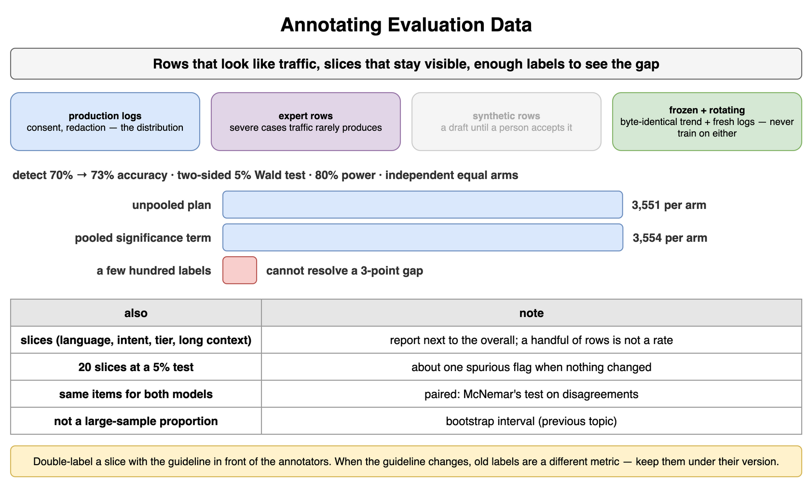

*Source: [`diagrams/evaluate-ai-systems.drawio`](/content/10_AI_Engineering/04_Evaluate_AI_Systems/diagrams/evaluate-ai-systems.drawio), page 19.*

## Evaluating the evaluation

Evaluating the evaluation means testing the metric itself for signal, reliability, correlation with the business outcome, and cost, before you let the metric gate a launch. That audit is part of step 3.

Signal: the number moves when the product moves. Break a stage on purpose. Swap the retrieved page for one that contradicts the answer, and grounded accuracy should fall; if it holds, the grader scores fluency and ignores the source. Pad a good reply, and a verbosity-biased judge moves for the wrong reason. Reliability: the metric agrees with itself. Cohen's kappa subtracts the agreement the base rate would produce, which percent agreement does not, and a pool of more than two raters needs Fleiss' kappa. A judge that flips on a swap of equivalent answers, or tomorrow, is not a gate. Fix it with tighter levels, an example, or a smaller question, not by lowering the bar.

Correlation: a reliable metric tracks the outcome the business feels. Raters can agree perfectly on warmth while reopens track only whether the policy was stated correctly. Slice the logged outcome by rubric level on rows not used to write the rubric. A flat slice demotes the criterion to a diagnostic, though a real harm too rare to show in reopens can still deserve a place. Cost: you can run the metric often enough to catch the regression. A frontier judge on every conversation can cost more than the feature, and a human pass on every build will not happen. Run programs and classifiers on every change, a pinned judge on a schedule, and people on the slice that keeps the judge honest. An eval you can run once a quarter is a research report; the Tuesday model swap needs the cheap checks that day.

```text
signal       poison the retrieved page -> score must drop
reliability  kappa beyond chance; no flip on swap or rerun
correlation  score slices edits / reopens on held-out rows
cost         cheap checks per change, judge on schedule, people on calibration slice
fail any     -> diagnostic, not a gate
```

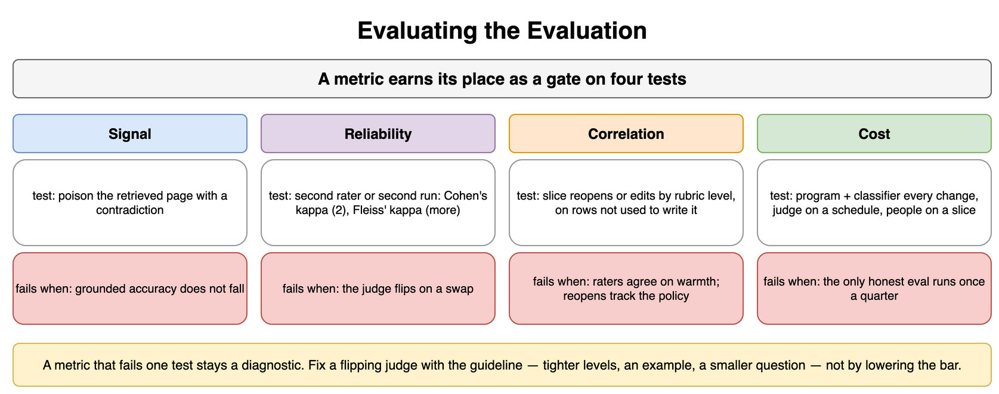

*Source: [`diagrams/evaluate-ai-systems.drawio`](/content/10_AI_Engineering/04_Evaluate_AI_Systems/diagrams/evaluate-ai-systems.drawio), page 20.*

## Iterate and version

Iterating and versioning an evaluation means changing the guideline, the data, and the methods on purpose, and never comparing a score to a number that was produced under a different version. It is the last part of step 3, and it closes the pipeline.

A score is reproducible only as a tuple: generator model id or weight hash, eval-set hash, guideline version, judge model id and prompt, harness, and date. Drop any of them and a two-point movement is a story, often a gain that was really a rubric edit making the same outputs score higher. Plot a new guideline as a new series and keep the old one to explain old launches. Iteration makes the guideline true: ship a small version, then read disagreements between raters, between judge and raters, and between metric and business outcome. Read every disagreement that turned a pass into a fail, plus a sample of the rest. Each is a candidate edit: a level that needs an example, a criterion that should become a program, a slice that needs rows, or a stage you were not logging. Last week's incident becomes a row in the rotating slice, and in the frozen set if it can recur. Then bump the version and rerun.

A frozen set that never grows misses the next incident; a set that grows without a version makes the trend line a lie. Public benchmarks stay outside this series. They change who enters the shortlist and never get appended to the private chart. When a vendor ships a new model id, hard filters run first, then the versioned eval, then the decision. Versioning adds process a small team will be tempted to skip, and waiting for a perfect eval is a way to ship with no eval.

```text
score = (model id/hash, set hash, guideline v, judge id + prompt, harness, date)
disagreements -> edits; incidents -> rows; every edit -> new version
public benchmarks -> shortlist only; versioned private eval -> launch gate
```

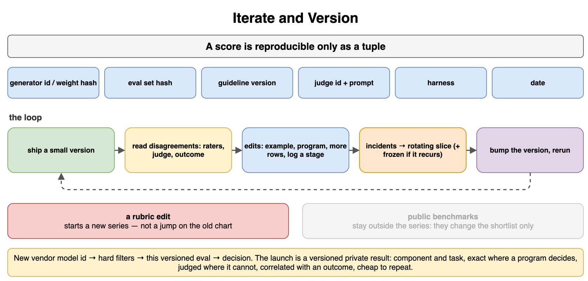

*Source: [`diagrams/evaluate-ai-systems.drawio`](/content/10_AI_Engineering/04_Evaluate_AI_Systems/diagrams/evaluate-ai-systems.drawio), page 21.*
