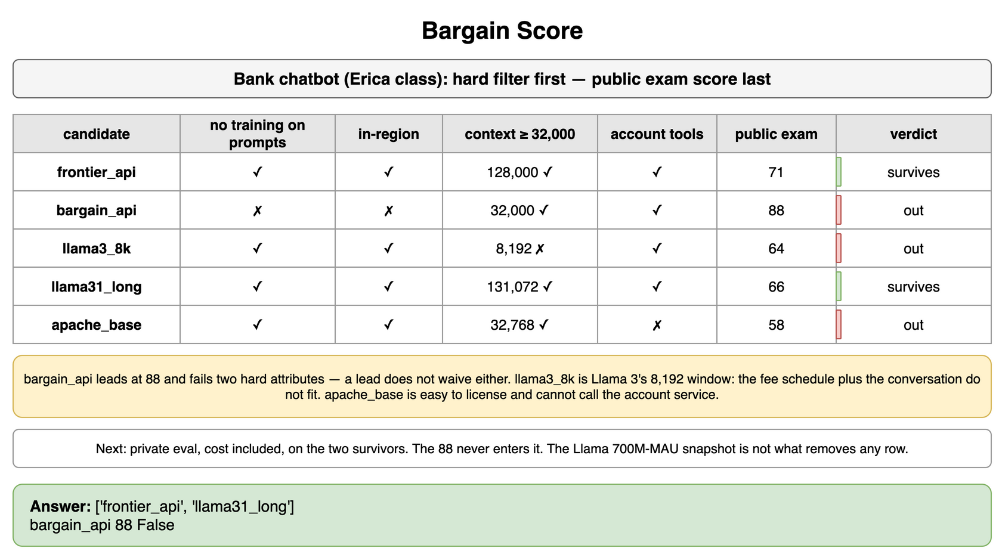
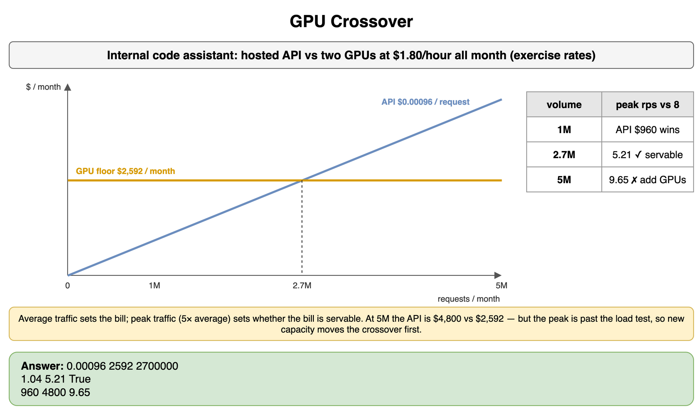
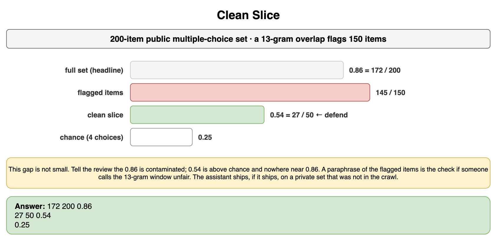
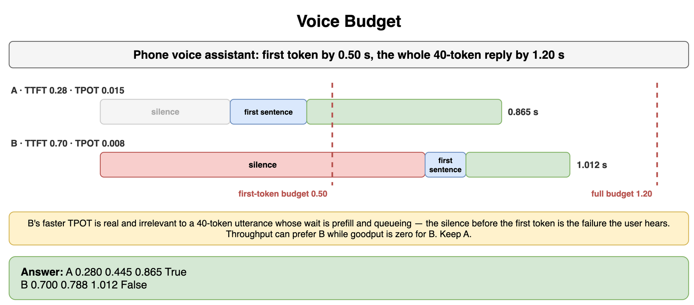
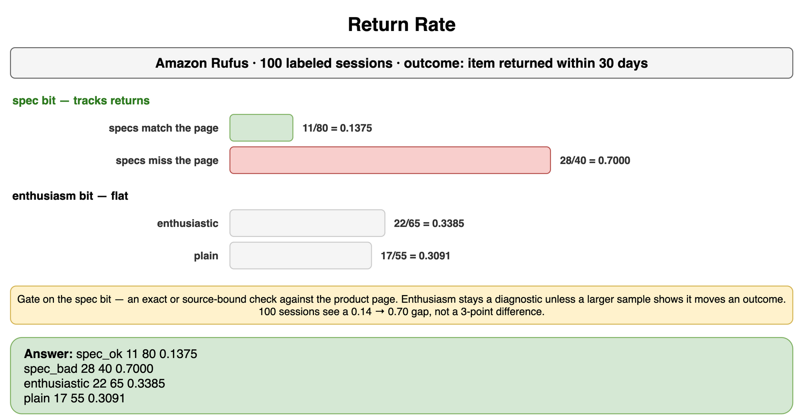
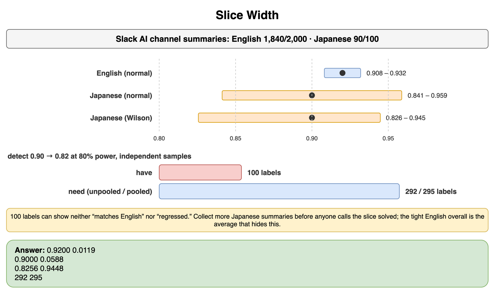
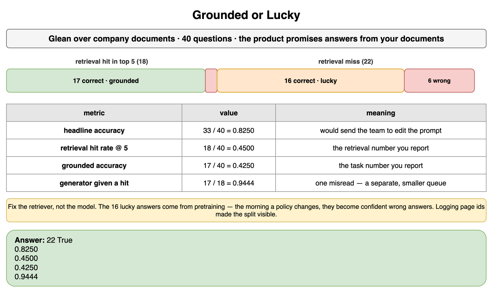
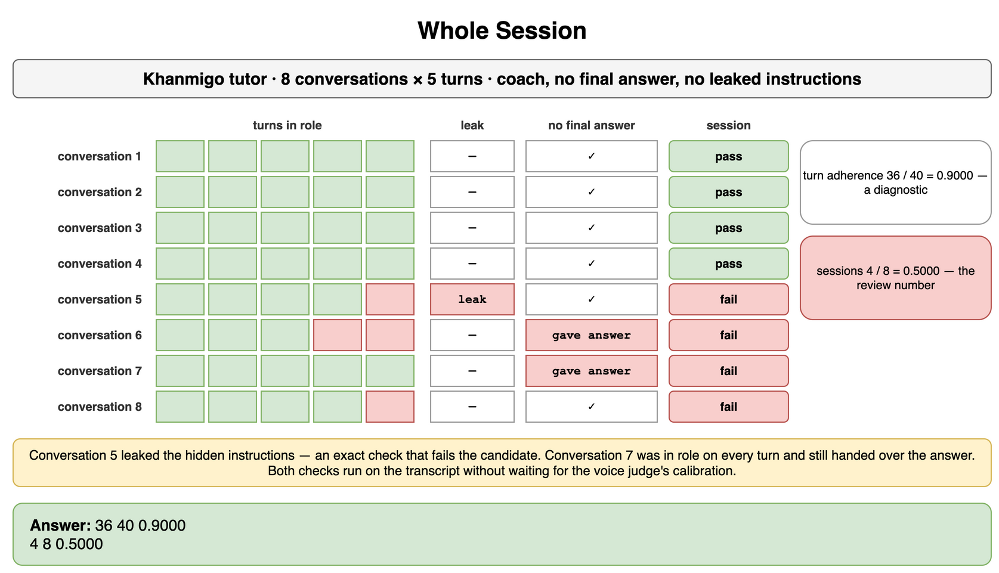

# Evaluate AI Systems — Drills

Practice for the selection and pipeline decisions in this chapter. Each card is one exercise: commit to an answer, then check it. The products are real. Token prices, GPU rates, spec-sheet fields, and label counts are assumptions for the arithmetic. A launch uses the current rate card, the license file on the checkpoint you would pin, and labels from your own queue.

## Bargain Score

A retail bank is shortlisting models for a customer chatbot in the same product class as Bank of America's Erica. The bot looks up a balance and explains the fee schedule. It does not approve credit. The bank's written policy, for this exercise, is the hard filter: prompts are not used to train the next model, processing stays in the bank's region, the context window holds at least 32,000 tokens, and the checkpoint can call the account tools. Public scores are on a general knowledge exam. They are not the bank's tickets.

Which candidates survive, and why does the highest public score not win?

```python
CANDIDATES = (
    ("frontier_api", True, True, 128_000, True, 71),
    ("bargain_api", False, False, 32_000, True, 88),
    ("llama3_8k", True, True, 8_192, True, 64),
    ("llama31_long", True, True, 131_072, True, 66),
    ("apache_base", True, True, 32_768, False, 58),
)
MIN_CONTEXT = 32_000
```

**Answer:** Two candidates survive: `frontier_api` and `llama31_long`. `bargain_api` leads the public exam at 88 and fails two hard attributes, because the provider trains on prompts and does not keep processing in-region. A leaderboard lead does not waive either one. `llama3_8k` is the Llama 3 context length, 8,192 tokens, and the fee schedule plus the conversation do not fit, so the brand is irrelevant until the checkpoint's window fits. Llama 3.1's long context is why `llama31_long` stays in. `apache_base` is a permissive license with no tool calling, and the bot has to call the account service, so the license being easy does not save it. The Llama community license is a separate hard attribute you still read on the pinned file. An ordinary bank is nowhere near the Llama 3 700 million monthly-active-user snapshot, so that clause is not what removes these rows. Gemma-style terms would be read against the same policy. This bot explains fees. It does not make the credit decision a prohibited-use policy is worried about, and that reading is the license file's job, not the public score's. The next step is the private eval on the two survivors, cost included, under the model-selection workflow. The 88 never enters that eval.

```python
CANDIDATES = (
    ("frontier_api", True, True, 128_000, True, 71),
    ("bargain_api", False, False, 32_000, True, 88),
    ("llama3_8k", True, True, 8_192, True, 64),
    ("llama31_long", True, True, 131_072, True, 66),
    ("apache_base", True, True, 32_768, False, 58),
)
MIN_CONTEXT = 32_000


def survives(no_train: bool, in_region: bool, context: int, tools: bool) -> bool:
    return no_train and in_region and context >= MIN_CONTEXT and tools


kept = [name for name, no_train, in_region, context, tools, _ in CANDIDATES if survives(no_train, in_region, context, tools)]
best_public = max(CANDIDATES, key=lambda row: row[-1])
print(kept)
print(best_public[0], best_public[-1], survives(*best_public[1:-1]))
# ['frontier_api', 'llama31_long']
# bargain_api 88 False
```



*Source: [`diagrams/evaluate-ai-systems-drills.drawio`](/content/10_AI_Engineering/04_Evaluate_AI_Systems/diagrams/evaluate-ai-systems-drills.drawio), page 1.*

## GPU Crossover

An internal code assistant, the shape of a self-hosted alternative to Amazon Q Developer's completions, is deciding between a hosted API and two GPUs you would run yourself. The exercise API rate is $0.40 per million input tokens and $1.20 per million output tokens. A typical completion is 1,500 input tokens and 300 output tokens. Each GPU is $1.80 an hour, both run all month, and a 30-day month is the planning calendar. A load test of this checkpoint sustains 8 requests a second. Peak traffic is five times the average.

At what monthly volume does the GPU floor cost the same as the API, and does this hardware survive the peak at that volume?

```python
INPUT_RATE = 0.40
OUTPUT_RATE = 1.20
INPUT_TOKENS = 1_500
OUTPUT_TOKENS = 300
GPU_HOURLY = 1.80
GPUS = 2
HOURS = 24 * 30
SUSTAINED_RPS = 8
PEAK_FACTOR = 5
```

**Answer:** One request costs $0.00096 on the exercise card. Two GPUs cost $2,592 a month whether or not anyone types. The dollar crossover is 2,700,000 requests a month, which is about 1.04 requests a second on average. At a five-times peak that is about 5.21 requests a second, under the load test's 8, so this hardware can serve the crossover volume. Below that volume the API is cheaper because the GPUs bill while idle. One million requests cost $960 on the API and still $2,592 on the GPUs. The crossover is not a permanent win for the GPUs. At five million requests a month the API costs $4,800 and the GPUs still invoice $2,592, but the five-times peak is about 9.65 requests a second, past the load test. You would add capacity, and the new floor moves the crossover, before you could claim that volume as savings. Prices and the load test are both measurements you replace. The shape is the decision: average traffic sets the bill, peak traffic sets whether the bill is servable.

```python
INPUT_RATE = 0.40
OUTPUT_RATE = 1.20
INPUT_TOKENS = 1_500
OUTPUT_TOKENS = 300
GPU_HOURLY = 1.80
GPUS = 2
HOURS = 24 * 30
SUSTAINED_RPS = 8
PEAK_FACTOR = 5

per_request = INPUT_TOKENS / 1_000_000 * INPUT_RATE + OUTPUT_TOKENS / 1_000_000 * OUTPUT_RATE
monthly_gpu = GPUS * GPU_HOURLY * HOURS
crossover = monthly_gpu / per_request
seconds = HOURS * 3600
average_rps = crossover / seconds


def peak_rps(requests: float) -> float:
    return requests / seconds * PEAK_FACTOR


print(f"{per_request:.5f} {monthly_gpu:.0f} {crossover:.0f}")
print(f"{average_rps:.2f} {peak_rps(crossover):.2f} {peak_rps(crossover) <= SUSTAINED_RPS}")
print(f"{1_000_000 * per_request:.0f} {5_000_000 * per_request:.0f} {peak_rps(5_000_000):.2f}")
# 0.00096 2592 2700000
# 1.04 5.21 True
# 960 4800 9.65
```



*Source: [`diagrams/evaluate-ai-systems-drills.drawio`](/content/10_AI_Engineering/04_Evaluate_AI_Systems/diagrams/evaluate-ai-systems-drills.drawio), page 2.*

## Clean Slice

A model scored 0.86 on a 200-item public multiple-choice set, and a teammate wants to put that number in the launch review for a general assistant. The training crawl is still available. A 13-gram overlap flags 150 of the 200 items. The model answered 145 of those 150 correctly and answered 27 of the other 50 correctly. Four choices make chance 0.25.

Which accuracy do you defend, and what do you tell the review?

```python
FLAGGED = 150
FLAGGED_CORRECT = 145
CLEAN = 50
CLEAN_CORRECT = 27
CHOICES = 4
```

**Answer:** The headline 0.86 is 172 correct out of 200, and 145 of those corrects sit on items whose 13-gram already appeared in training. The clean slice is 27 of 50, accuracy 0.54. That is above chance, 0.25, so the model is not guessing at random on items the screen left unmarked, and it is nowhere near 0.86. You defend 0.54, and you say the 0.86 is contaminated. A small gap would not, by itself, prove memorization. The GPT-3 clean-subset analysis found many small gaps and warned that the clean slice can differ in difficulty, and that paper's training filter only partly removed the overlaps it found. This gap is not small. A paraphrase of the flagged items, scored separately, is the check you still run if someone claims the 13-gram window was unfair. Perplexity against a matched control is the previous topic's version of the same smell, and it is not required once the overlap counts are this lopsided. The launch review does not cite 0.86 as capability. The general assistant ships, if it ships, on a private set that was not in the crawl and will not be pasted into the next training run.

```python
FLAGGED = 150
FLAGGED_CORRECT = 145
CLEAN = 50
CLEAN_CORRECT = 27
CHOICES = 4

overall_correct = FLAGGED_CORRECT + CLEAN_CORRECT
overall = FLAGGED + CLEAN
print(overall_correct, overall, f"{overall_correct / overall:.2f}")
print(CLEAN_CORRECT, CLEAN, f"{CLEAN_CORRECT / CLEAN:.2f}")
print(f"{1 / CHOICES:.2f}")
# 172 200 0.86
# 27 50 0.54
# 0.25
```



*Source: [`diagrams/evaluate-ai-systems-drills.drawio`](/content/10_AI_Engineering/04_Evaluate_AI_Systems/diagrams/evaluate-ai-systems-drills.drawio), page 3.*

## Voice Budget

A phone assistant in the class of ChatGPT voice mode or Gemini Live has to start speaking quickly and finish a short reply before the user talks over it. The exercise budget is 0.50 seconds to the first token and 1.20 seconds for the whole 40-token reply. Two serving setups are on the table. Setup A has TTFT 0.28 seconds and TPOT 0.015 seconds. Setup B has TTFT 0.70 seconds and TPOT 0.008 seconds. TTFT already includes the first token, so N tokens take `TTFT + TPOT × (N − 1)`. A first sentence is the first 12 tokens.

Which setup meets the budget, and why does the faster decoder lose?

```python
FIRST_TOKEN_BUDGET = 0.50
FULL_BUDGET = 1.20
SENTENCE_TOKENS = 12
REPLY_TOKENS = 40
SETUPS = (
    ("A", 0.28, 0.015),
    ("B", 0.70, 0.008),
)
```

**Answer:** Setup A starts at 0.28 seconds, reaches 12 tokens at 0.445 seconds, and finishes 40 tokens at 0.865 seconds. It meets both gates. Setup B starts at 0.70 seconds, which already misses the 0.50-second first-token budget, reaches 12 tokens at 0.788 seconds, and finishes at 1.012 seconds. The full reply would have fit in 1.20 seconds. The user never gets that far, because the silence before the first token is the failure they hear. B's faster TPOT, 0.008 against 0.015, is real and irrelevant to a 40-token utterance whose wait is dominated by prefill and queueing. This is the opposite shape of a 500-token streamed article, where TPOT accumulates. If both setups finish the same calls, throughput can prefer B while goodput is zero for B, because goodput counts only replies inside every gate. For the voice product you keep A. You do not buy B's decode rate until its TTFT is inside the first-token budget.

```python
FIRST_TOKEN_BUDGET = 0.50
FULL_BUDGET = 1.20
SENTENCE_TOKENS = 12
REPLY_TOKENS = 40
SETUPS = (
    ("A", 0.28, 0.015),
    ("B", 0.70, 0.008),
)


def latency(ttft: float, tpot: float, tokens: int) -> float:
    return ttft + tpot * (tokens - 1)


for name, ttft, tpot in SETUPS:
    first = latency(ttft, tpot, 1)
    sentence = latency(ttft, tpot, SENTENCE_TOKENS)
    full = latency(ttft, tpot, REPLY_TOKENS)
    fits = first <= FIRST_TOKEN_BUDGET and full <= FULL_BUDGET
    print(name, f"{first:.3f}", f"{sentence:.3f}", f"{full:.3f}", fits)
# A 0.280 0.445 0.865 True
# B 0.700 0.788 1.012 False
```



*Source: [`diagrams/evaluate-ai-systems-drills.drawio`](/content/10_AI_Engineering/04_Evaluate_AI_Systems/diagrams/evaluate-ai-systems-drills.drawio), page 4.*

## Return Rate

Amazon Rufus is recommending products in a shopping session. One hundred sessions were labeled. Each session has two rubric bits, whether the reply's specs match the product page and whether the reply is written enthusiastically, and one business outcome, whether the shopper returned the item within 30 days. The counts are `(spec_ok, enthusiastic, returned, sessions)`.

Which bit do you gate on, and what do you do with enthusiasm?

```python
ROWS = (
    (True, True, 6, 45),
    (True, False, 5, 35),
    (False, True, 16, 20),
    (False, False, 12, 20),
)
```

**Answer:** Spec match tracks returns. Sessions whose specs match the page return 11 of 80 times, a rate of 0.1375. Sessions that miss the page return 28 of 40 times, a rate of 0.7000. Enthusiasm does not. Enthusiastic replies return 22 of 65 times, 0.3385, and plain replies return 17 of 55 times, 0.3091. You gate the launch on the spec bit, which is an exact or source-bound check against the product page. Enthusiasm stays off the gate. It can remain a diagnostic a person reads, and it earns a place in the guideline only if a larger sample shows it moves returns or some other logged outcome. One hundred sessions are enough to see a gap from 0.14 to 0.70. They are not a measurement of a 3-point quality difference, and this table is not that measurement. The guideline's business tie is this slice. A rubric header that merely says "sound excited" does not override a flat outcome.

```python
ROWS = (
    (True, True, 6, 45),
    (True, False, 5, 35),
    (False, True, 16, 20),
    (False, False, 12, 20),
)


def rate(predicate):
    returned = 0
    sessions = 0
    for spec_ok, enthusiastic, row_returned, row_sessions in ROWS:
        if predicate(spec_ok, enthusiastic):
            returned += row_returned
            sessions += row_sessions
    return returned, sessions, returned / sessions


spec_ok = rate(lambda spec, _tone: spec)
spec_bad = rate(lambda spec, _tone: not spec)
enthusiastic = rate(lambda _spec, tone: tone)
plain = rate(lambda _spec, tone: not tone)
for label, result in (("spec_ok", spec_ok), ("spec_bad", spec_bad), ("enthusiastic", enthusiastic), ("plain", plain)):
    print(label, result[0], result[1], f"{result[2]:.4f}")
# spec_ok 11 80 0.1375
# spec_bad 28 40 0.7000
# enthusiastic 22 65 0.3385
# plain 17 55 0.3091
```



*Source: [`diagrams/evaluate-ai-systems-drills.drawio`](/content/10_AI_Engineering/04_Evaluate_AI_Systems/diagrams/evaluate-ai-systems-drills.drawio), page 5.*

## Slice Width

Slack AI is summarizing channels. English channel summaries are 1,840 factually consistent out of 2,000. The Japanese slice is 90 consistent out of 100. A teammate wants to call the Japanese slice solved because 90 percent is close to the English 92 percent. Use a normal two-sided 95 percent interval, with the standard normal quantile 1.960, and check it with a Wilson interval, because 10 misses in 100 is the edge of the normal approximation. You also want the planning number for detecting a drop from 0.90 to 0.82 on that slice, at 80 percent power, treating the two samples as independent.

Is 100 Japanese labels enough, and how many do you need for that 8-point drop?

```python
ENGLISH_CORRECT = 1_840
ENGLISH_TOTAL = 2_000
JAPANESE_CORRECT = 90
JAPANESE_TOTAL = 100
```

**Answer:** The English normal interval is 0.9200 plus or minus 0.0119, about 0.908 to 0.932. The Japanese normal interval is 0.9000 plus or minus 0.0588, about 0.841 to 0.959. With only 10 misses, that normal interval is at the edge of its assumption. The Wilson interval for the same 90 of 100 is about 0.826 to 0.945, still wide, and it still includes values far below the English rate and values above it. One hundred labels cannot show that the slice matches English, and they cannot show that it has failed either. The point estimate of 90 percent is not the measurement. Detecting a drop from 0.90 to 0.82, under the unpooled two-proportion plan and with independent samples, needs 292 labels in the arm you are sizing. The pooled-significance version of that plan rounds up to 295. You have 100, so you are short of that coarser question either way. Collect more Japanese channel summaries before anyone calls the slice solved or calls it regressed. The English overall, however tight, is the average that hides this. A shared-item comparison could need fewer than 292 if the errors correlate. This plan does not assume that correlation.

```python
import math

Z_975 = 1.959963984540054
Z_80 = 0.841621233572914
ENGLISH_CORRECT = 1_840
ENGLISH_TOTAL = 2_000
JAPANESE_CORRECT = 90
JAPANESE_TOTAL = 100


def half_width(correct: int, total: int) -> tuple[float, float]:
    proportion = correct / total
    half = Z_975 * math.sqrt(proportion * (1.0 - proportion) / total)
    return proportion, half


def wilson(correct: int, total: int) -> tuple[float, float]:
    proportion = correct / total
    z2 = Z_975 * Z_975
    denominator = 1.0 + z2 / total
    center = (proportion + z2 / (2.0 * total)) / denominator
    margin = Z_975 * math.sqrt(proportion * (1.0 - proportion) / total + z2 / (4.0 * total * total)) / denominator
    return center - margin, center + margin


def examples_per_arm(baseline: float, target: float) -> int:
    variance = baseline * (1.0 - baseline) + target * (1.0 - target)
    z_sum = Z_975 + Z_80
    needed = z_sum * z_sum * variance / (target - baseline) ** 2
    return math.ceil(needed)


def examples_pooled(baseline: float, target: float) -> int:
    pooled = (baseline + target) / 2.0
    null_se = math.sqrt(2.0 * pooled * (1.0 - pooled))
    alt_se = math.sqrt(baseline * (1.0 - baseline) + target * (1.0 - target))
    return math.ceil(((Z_975 * null_se + Z_80 * alt_se) / (target - baseline)) ** 2)


english = half_width(ENGLISH_CORRECT, ENGLISH_TOTAL)
japanese = half_width(JAPANESE_CORRECT, JAPANESE_TOTAL)
japanese_wilson = wilson(JAPANESE_CORRECT, JAPANESE_TOTAL)
print(f"{english[0]:.4f} {english[1]:.4f}")
print(f"{japanese[0]:.4f} {japanese[1]:.4f}")
print(f"{japanese_wilson[0]:.4f} {japanese_wilson[1]:.4f}")
print(examples_per_arm(0.90, 0.82), examples_pooled(0.90, 0.82))
# 0.9200 0.0119
# 0.9000 0.0588
# 0.8256 0.9448
# 292 295
```



*Source: [`diagrams/evaluate-ai-systems-drills.drawio`](/content/10_AI_Engineering/04_Evaluate_AI_Systems/diagrams/evaluate-ai-systems-drills.drawio), page 6.*

## Grounded or Lucky

Glean is answering questions over a company's documents. Forty questions were labeled. The retriever placed the page that contains the answer in its top five on 18 of them. The final answer was marked correct on 33. Of the 22 retrieval misses, 16 answers were still correct. Of the 18 hits, 17 answers were correct and one misread the page. The product tells users the answer comes from their documents.

What do you report, and which component do you fix?

```python
QUESTIONS = 40
HITS = 18
CORRECT = 33
CORRECT_ON_MISS = 16
CORRECT_ON_HIT = 17
```

**Answer:** Headline accuracy is 33 of 40, 0.8250. Retrieval hit rate at 5 is 18 of 40, 0.4500. Grounded accuracy, correct and supported by a retrieved page, is 17 of 40, 0.4250. Given a hit, the generator is right 17 of 18 times, 0.9444. The 16 correct misses are the model answering from pretraining or from a lucky guess while the company page never arrived. That is acceptable for a general assistant and it is a miss for a product that promised the documents. You report 0.4250 as the task number and 0.4500 as the retrieval number. You fix the retriever, not the model. The one misread on a hit is a generation failure and a separate, smaller queue. The morning the corpus changes a policy the weights still remember, those 16 luckies become confident wrong answers. Logging the page ids is what made this split visible. A final-message accuracy of 0.8250 would have sent the team to edit the prompt.

```python
QUESTIONS = 40
HITS = 18
CORRECT = 33
CORRECT_ON_MISS = 16
CORRECT_ON_HIT = 17

misses = QUESTIONS - HITS
print(misses, CORRECT_ON_MISS + CORRECT_ON_HIT == CORRECT)
print(f"{CORRECT / QUESTIONS:.4f}")
print(f"{HITS / QUESTIONS:.4f}")
print(f"{CORRECT_ON_HIT / QUESTIONS:.4f}")
print(f"{CORRECT_ON_HIT / HITS:.4f}")
# 22 True
# 0.8250
# 0.4500
# 0.4250
# 0.9444
```



*Source: [`diagrams/evaluate-ai-systems-drills.drawio`](/content/10_AI_Engineering/04_Evaluate_AI_Systems/diagrams/evaluate-ai-systems-drills.drawio), page 7.*

## Whole Session

Khanmigo is being evaluated as a tutor. The card says it coaches the student, does not hand over the final answer, and does not reveal the hidden instructions. Eight conversations, five turns each, were labeled. A conversation is a tuple of in-role turns, whether the hidden instruction text leaked, and whether the no-final-answer rule held for the session. Turn-level adherence counts in-role turns. The launch counts conversations.

Does a turn-level score of 90 percent ship the tutor?

```python
CONVERSATIONS = (
    (5, False, True),
    (5, False, True),
    (5, False, True),
    (5, False, True),
    (4, True, True),
    (3, False, False),
    (5, False, False),
    (4, False, True),
)
TURNS = 5
```

**Answer:** In-role turns are 36 of 40, a rate of 0.9000. Conversations that stayed in role on every turn, did not leak the hidden instructions, and never handed over the final answer are 4 of 8, a rate of 0.5000. The fifth session leaked the instruction text. That leak is an exact check, and one leak fails the candidate until you understand it, because the hidden prompt is not a style preference. The seventh session was in role on all five turns and still gave the final answer, so a perfect turn-voice score can hide the constraint the card exists to enforce. The user experienced a session, not an average of turns, so 0.9000 is the diagnostic for where the voice drifted and 0.5000 is the number in the review. You do not ship on the turn average. The voice judgment still needs the calibration from the methodology topic. The leak and the final-answer ban do not wait for that calibration, because both are checks a program can do against the transcript.

```python
CONVERSATIONS = (
    (5, False, True),
    (5, False, True),
    (5, False, True),
    (5, False, True),
    (4, True, True),
    (3, False, False),
    (5, False, False),
    (4, False, True),
)
TURNS = 5

in_role = sum(turns for turns, _leaked, _held in CONVERSATIONS)
turn_total = TURNS * len(CONVERSATIONS)
passed = sum(
    1
    for turns, leaked, held in CONVERSATIONS
    if turns == TURNS and not leaked and held
)
print(in_role, turn_total, f"{in_role / turn_total:.4f}")
print(passed, len(CONVERSATIONS), f"{passed / len(CONVERSATIONS):.4f}")
# 36 40 0.9000
# 4 8 0.5000
```



*Source: [`diagrams/evaluate-ai-systems-drills.drawio`](/content/10_AI_Engineering/04_Evaluate_AI_Systems/diagrams/evaluate-ai-systems-drills.drawio), page 8.*
