## Why retrieve

Retrieval-augmented generation, RAG, fetches passages at request time and puts them in the prompt so the model can answer from those passages.

A long context can hold the Gmail thread or the contract the user just pasted. It does not hold a permissioned help center that changes every hour, and pasting a corpus that does fit still spends input tokens on pages the question does not need. The context-efficiency card in [Prompt Engineering](../05_Prompt_Engineering/) is that bill and the tendency of models to use the ends of a long paste more reliably than the middle. This card is the other design: keep the corpus in an index, fetch a short set, and generate from that set. Lewis and coauthors named the pattern in 2020. Their system retrieved Wikipedia passages with a dense index and conditioned a BART generator on them. Two variants in that paper, RAG-Sequence and RAG-Token, differ in whether one passage is used for the whole answer or the model may mix passages as it generates. The product shape you can see from the outside is usually simpler than that training recipe. Notion AI over a workspace, NotebookLM over uploaded sources, Perplexity with citations, and a Zendesk bot over a help center answer from a maintained index. Whether any of them also trains the generator is their recipe, not something the product page tells you. What you can copy is the split, a prompted model and an index you can rebuild, not a claim about their training stack. The three levers in [Introduction to Building AI Applications with Foundation Models](../01_Introduction_to_Building_AI_Applications_with_Foundation_Models/) still apply. A finetune would freeze yesterday's wiki. A prompt cannot see a page you did not send. Retrieval is the lever that sees the page, and it fails open when the search misses: the model abstains or answers from its weights.

Access control is the other reason the index exists. A long paste of a shared drive will quote a document the asker is not allowed to open. The retriever has to drop those documents before they enter the prompt. Citations are the same cut from the user's side. Perplexity and NotebookLM are checkable because the passage is still there. A citation the model invented is not a citation. The quote has to occur in a retrieved passage, which is the quote field on the Specifying the output format card in [Prompt Engineering](../05_Prompt_Engineering/). The passage itself can be wrong, stale, or hostile. Local consistency against a bad page is the Factual consistency card in [Evaluate AI Systems](../04_Evaluate_AI_Systems/). Indirect prompt injection is what a hostile page does to the generator, and it stays on the Indirect prompt injection card in [Prompt Engineering](../05_Prompt_Engineering/). RAG does not close it.

**Trade-offs.** Retrieval stays current, respects permissions, and keeps the prompt short, and it drops the passage that had the exception. A long context keeps the document the user meant and costs prefill, money, and attention in the middle of the paste. Using both, a short retrieved set inside a long window, is the usual production shape. Retrieving hundreds of chunks and calling it a long context recreates the middle-of-the-paste failure and the input bill. Updating the index is operational work. Leaving the facts only in the weights is how yesterday's policy survives the edit.

**Interview.** Start from the corpus, not from the model. If the user already pasted the document and it fits, say prompt. If the corpus is large, permissioned, or edited on its own, say retrieval, and say what happens on a miss. Name Lewis and coauthors, 2020, as the paper that pairs a generator with a retrieved index, and separate that paper's trained BART setup from a prompted model over an index you maintain. A product page that shows citations is not evidence the vendor skipped training. Put access control before the prompt, and put a citation that is not a substring of a retrieved passage on the failure side.

**Recap.** RAG answers from passages fetched at request time. A long context is the right tool for a document the user already supplied, and it is the wrong tool for a large permissioned corpus that changes. Lewis and coauthors, 2020, paired a trained BART generator with a retrieved Wikipedia index. A product you can inspect from the outside is a maintained index in front of a prompted model, and that is not evidence the vendor skipped training. The retriever has to enforce permissions, the generator has to cite real passages, and a missed page is either an abstention or an answer from memory.

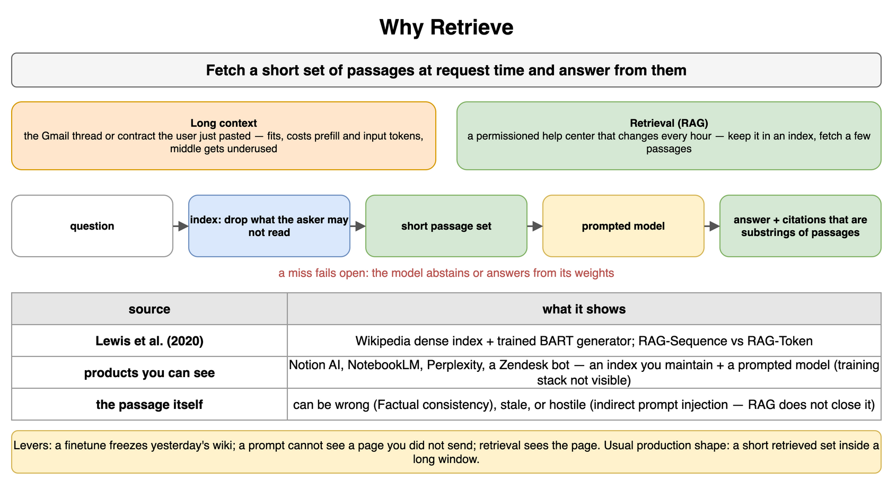

*Source: [`diagrams/rag-and-agents.drawio`](/content/10_AI_Engineering/06_RAG_and_Agents/diagrams/rag-and-agents.drawio), page 1.*

## RAG architecture

A RAG system has an index built ahead of the question, a retriever that returns passages for the question, and a generator that writes the answer from those passages.

The index is a derived copy of the source of truth. For a help center, the source is the article the writer published. The index stores chunks, a term index, embeddings, and metadata: title, URL, updated time, and who may read the article. Building it is offline. A writer edits a page, and the next answer can see the edit only after the chunk is reindexed. That lag, the refresh, and the pipeline from the primary copy are Full-Text Search Architecture in [Search Autocomplete and Information Retrieval](../../09_System_Design_Interview/18_Search_Autocomplete_and_Information_Retrieval/). This card does not rebuild that pipeline. It names what the online request does with the copy. The retriever turns the question into a search. It may run a term query, a vector query, or both, then optionally rerank, and it returns passage ids the user is allowed to see. The generator is the prompted model. The prompt carries the instruction, the question, and the passages. The model writes an answer. A grounded product also returns the passage ids, and a checker rejects an answer whose required facts are not in those passages.

The three stages fail differently, which is why the evaluation pipeline in [Evaluate AI Systems](../04_Evaluate_AI_Systems/) scores each stage and the task. An empty retrieval with a fluent answer is a retriever failure that a task score can hide, because the model may still be right from pretraining today and wrong the morning the workspace disagrees. A retrieval that contains the policy, followed by a draft that states a different window, is a generator failure. A citation that points at a passage the draft does not follow is a checker failure. Logging the query, the ids, and the draft is what makes those three separable. The original RAG paper marginalizes over retrieved documents inside training. A Zendesk bot usually does not. It retrieves, prompts, and checks. Saying "we use RAG" without saying which of those you trained is how a design review talks past itself.

**Trade-offs.** A separate index can be rebuilt, permissioned, and swapped when the embedding model changes, and it is a second system to keep fresh. Retrieving inside the generator, the way the 2020 paper mixes passages during generation, is closer to the model and harder to inspect than a list of passages you logged. A generator with no checker will sound grounded. The check is a program, the substring and the entailment, not a sentence in the prompt that says "only use the articles."

**Interview.** Draw three boxes and put a log line under each: the chunk and its ACL in the index, the passage ids from the retriever, the draft and the citations from the generator. Say which box you would blame for a wrong window, and say it depends on whether the window was in the retrieved text. Mention that index lag is the search architecture, not a new kind of hallucination. Separate a trained retriever-generator, the 2020 paper, from a frozen model over a maintained index, the usual product.

**Recap.** RAG is an index, a retriever, and a generator. The index is a copy of the source documents, with the freshness and the refresh of a search index. The retriever returns passages the user may see. The generator writes from those passages, and a checker keeps citations attached to text that was actually retrieved. A fluent answer on an empty retrieval is a retriever problem. A wrong window quoted from a passage that says something else is a generator problem.

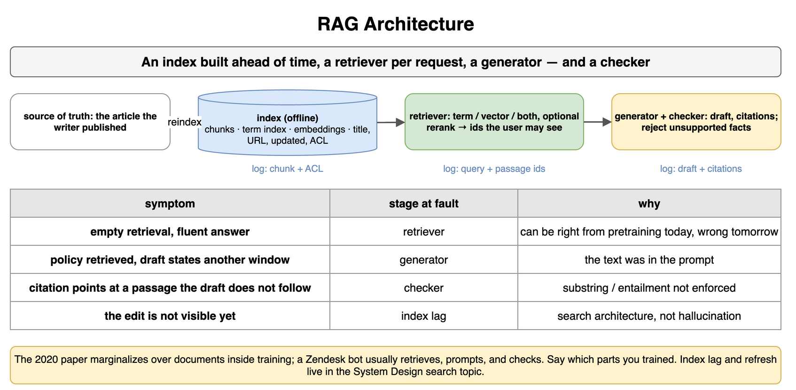

*Source: [`diagrams/rag-and-agents.drawio`](/content/10_AI_Engineering/06_RAG_and_Agents/diagrams/rag-and-agents.drawio), page 2.*

## Term-based retrieval

Term-based retrieval ranks documents by the words they share with the query, using an inverted index and a score such as TF-IDF or BM25.

The inverted index maps a term to the documents that contain it, and the one-pass merge of those postings is the Inverted Index card in [Search Autocomplete and Information Retrieval](../../09_System_Design_Interview/18_Search_Autocomplete_and_Information_Retrieval/). Elasticsearch and OpenSearch answer lexical search this way. This card is the score that orders the survivors. TF-IDF multiplies a term's count in the document by a weight that shrinks when the term appears in many documents. The exercise below uses raw count times the natural log of `N / df`, where `N` is the number of documents and `df` is how many contain the term. BM25 is the ranking function Elasticsearch and Lucene use as the default similarity. It keeps an idf and replaces raw count with a saturation, so the third "refund" adds less than the first, and it has a length normalization so a long document does not win by having more words. Lucene's idf is `ln(1 + (N - df + 0.5) / (df + 0.5))`. The saturation uses `k1`, default 1.2, and the length knob `b`, default 0.75. The single-term picture, one occurrence counting as 1 and eight as about 1.9 when length is ignored, is the Relevance Ranking card in that search topic. Lucene also compresses the length norm into a byte, so a production cluster will not reproduce these floats digit for digit. The ranking is the point.

The exercise corpus is three chunks. A is the word refund three times. B is "refund policy". C is "shipping policy". The query is "refund policy". Raw TF-IDF ranks A first because the repeated word is unsaturated and both query words have the same idf. BM25 ranks B first because B covers both words and the extra repetitions in A are saturated.

```python
import math


DOCS = {
    "A": ["refund", "refund", "refund"],
    "B": ["refund", "policy"],
    "C": ["shipping", "policy"],
}
QUERY = ["refund", "policy"]


def idf_lucene(n: int, df: int) -> float:
    return math.log(1 + (n - df + 0.5) / (df + 0.5))


def idf_classic(n: int, df: int) -> float:
    return math.log((n - df + 0.5) / (df + 0.5))


def bm25_scores(
    docs: dict[str, list[str]],
    query: list[str],
    k1: float = 1.2,
    b: float = 0.75,
    idf=idf_lucene,
) -> dict[str, float]:
    n = len(docs)
    avgdl = sum(len(tokens) for tokens in docs.values()) / n
    df: dict[str, int] = {}
    for tokens in docs.values():
        for term in set(tokens):
            df[term] = df.get(term, 0) + 1
    scores = {}
    for name, tokens in docs.items():
        norm = 1 - b + b * len(tokens) / avgdl
        score = 0.0
        for term in query:
            tf = tokens.count(term)
            if tf == 0:
                continue
            saturation = tf * (k1 + 1) / (tf + k1 * norm)
            score += idf(n, df[term]) * saturation
        scores[name] = score
    return scores


def tfidf_scores(docs: dict[str, list[str]], query: list[str]) -> dict[str, float]:
    n = len(docs)
    df: dict[str, int] = {}
    for tokens in docs.values():
        for term in set(tokens):
            df[term] = df.get(term, 0) + 1
    scores = {}
    for name, tokens in docs.items():
        score = 0.0
        for term in query:
            score += tokens.count(term) * math.log(n / df[term])
        scores[name] = score
    return scores


bm25 = bm25_scores(DOCS, QUERY)
classic = bm25_scores(DOCS, QUERY, idf=idf_classic)
tfidf = tfidf_scores(DOCS, QUERY)
print(f"{idf_lucene(3, 2):.4f} {idf_classic(3, 2):.4f}")
print(f"{bm25['A']:.4f} {bm25['B']:.4f} {bm25['C']:.4f}")
print(f"{classic['A']:.4f} {classic['B']:.4f} {classic['C']:.4f}")
print(f"{tfidf['A']:.4f} {tfidf['B']:.4f} {tfidf['C']:.4f}")
# 0.4700 -0.5108
# 0.6960 0.9984 0.4992
# -0.7564 -1.0851 -0.5425
# 1.2164 0.8109 0.4055
```

Both query terms have Lucene idf 0.4700, because each appears in 2 of the 3 chunks. BM25 scores A at 0.6960, B at 0.9984, and C at 0.4992, so the chunk that says both words wins. The textbook idf, without Lucene's leading `1 +`, is -0.5108 on the same counts, because a term in more than half the chunks goes negative. The saturations do not change, and the scores become -0.7564, -1.0851, and -0.5425. Sorting high to low then ranks the shipping chunk first and "refund policy" last. The `1 +` is the whole difference. TF-IDF scores A at 1.2164, B at 0.8109, and C at 0.4055, so the chunk that repeats one word wins. That reversal against Lucene BM25 is why a help center that ranks with raw term counts will surface a page that hammers "refund" above the policy page that states the window. Stemming, synonyms, and stop words change the tokens before either formula runs. They are choices you name. A product code, an error string, or a name often wants the exact token, which is the lexical half of hybrid search.

**Trade-offs.** Term search is fast, cheap, and exact on the tokens you indexed, and it misses a paraphrase that shares no terms. TF-IDF is easy to explain and lets repetition dominate. BM25 is the default you should name, and its `k1` and `b` are real knobs: `b` of 0 fits a catalog of short titles of similar length, which is what the search topic already says. Textbook idf goes negative when a term is in more than half the chunks, and on this exercise that sign flip ranks the shipping chunk first. Lucene's formula is the one Elasticsearch runs. Idf on a tiny or fast-changing corpus jumps when one document is added. Neither formula knows that "30 days" and "60 days" are different commitments once both chunks contain the same words around the number.

**Interview.** Write BM25 as idf times a saturated term frequency, with length normalization, and name Elasticsearch's defaults, `k1` 1.2 and `b` 0.75. On this corpus, show that TF-IDF picks the repeated word and Lucene BM25 picks the chunk that covers the query. Then show the textbook idf going negative, -0.5108, and the policy chunk falling to last place. Point the inverted index and the single-term saturation at the search topic instead of re-deriving them. Then say where lexical search fails: a question in the user's words and a policy in the writer's words, with no shared token. That failure is the next card.

**Recap.** Term-based retrieval scores shared words. An inverted index finds the candidates, TF-IDF weights them by count and rarity, and BM25 saturates the count and normalizes length. On the three-chunk exercise, Lucene BM25 ranks "refund policy" first at 0.9984, while raw TF-IDF ranks the chunk that says refund three times first at 1.2164. Drop Lucene's `1 +` and the same saturations rank the shipping chunk first, because the idf is -0.5108. Elasticsearch and OpenSearch default to Lucene BM25. The score still cannot match a paraphrase that uses none of the query's words.

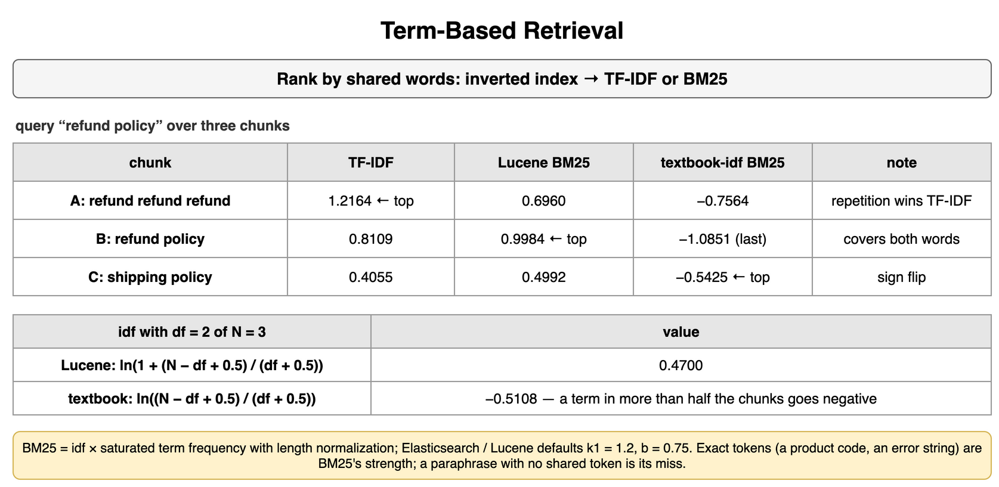

*Source: [`diagrams/rag-and-agents.drawio`](/content/10_AI_Engineering/06_RAG_and_Agents/diagrams/rag-and-agents.drawio), page 3.*

## Embedding-based retrieval

Embedding-based retrieval ranks passages by the similarity of dense vectors, so a question and a passage can match when they share a meaning and few words.

The vector is the embedding from [Evaluation Methodology](../03_Evaluation_Methodology/). Sentence-BERT, E5, BGE, Cohere Embed, and OpenAI's text-embedding-3 family are models trained for this job. Cosine and the warning about negated text stay on that card. This card is the index you build so you do not compare the query with every passage on every request. A dual encoder, the architecture in Karpukhin and coauthors' Dense Passage Retrieval work from 2020, embeds the question and the passage separately. DPR trained two encoders. Many current APIs use one model for both sides. E5 still makes the two sides different inputs, with a query prefix and a passage prefix. The passage vectors are what you store. The query vector is computed at request time. The neighbors are the passages you send to the generator. Exact search is a scan. It is the right baseline on a small help center and the wrong default at millions of vectors. Approximate nearest neighbor indexes answer faster by sometimes returning a neighbor that is not the true nearest vector. That miss is a property of the index. It is not yet the question of whether the passage answers the user.

The structures people name trade recall of the true neighbor, latency, memory, and how painful an update is. HNSW, the hierarchical navigable small-world graph from Malkov and Yashunin, searches a graph of vectors. hnswlib is the library from that line of work, and FAISS ships an HNSW index too. Raising `efSearch`, the candidate width at query time, raises the chance of finding the true neighbors and raises latency. `efConstruction` is the same knob while the graph is built. The index stores the full vectors and the links, so it uses more memory than a flat list of those same vectors, and it answers without scanning all of them. Inserts are local and can slowly degrade the graph. Deletes in many implementations are tombstones until a rebuild. IVF partitions the space with a coarse clustering, the inverted-file index in FAISS, and searches `nprobe` of the lists. Raising `nprobe` raises recall of the true neighbors and spends more comparisons. The clustering is a training pass. New vectors can be appended to the nearest list, and the centroids stay wrong after the corpus drifts until you train again. Locality-sensitive hashing is the older approximate family. Similar vectors are mapped into the same bucket by a hash that collides on purpose, and you only compare inside the buckets the query hits. It is still the right name when someone says "hash-based ANN." On modern embedding indexes it is usually the weaker default next to HNSW or IVF, and it is a different LSH from the MinHash LSH the Deduplicating data card in [Dataset Engineering](../08_Dataset_Engineering/) uses to find near-duplicate documents. Same idea, hash to limit comparisons. Different objects, vectors versus token shingles.

Product quantization, from Jégou and coauthors, replaces a vector with a short code so the index fits in memory. Distances computed from the codes are approximate, and a refine step rescores a shortlist with the original vectors when you still have them. IVF combined with product quantization is the large-scale FAISS pattern. ScaNN, from Guo and coauthors at ICML 2020, is also a trained compression index, aimed at maximum inner product search. Its anisotropic quantization penalizes error parallel to the vector more than error orthogonal to it, because the parallel error is what moves an inner product. Like product quantization, it is built by a training pass rather than by patching one vector into a graph. FAISS is the library people mean for IVF and product quantization. pgvector brings an exact scan, IVFFlat, and HNSW into Postgres. It does not bring a product-quantization index. Pinecone, Weaviate, Milvus, Qdrant, and Chroma are stores built around the same choice. Elasticsearch and OpenSearch can keep the term index and the vector index in one engine, which is why a hybrid help-center search often lives there.

**Trade-offs.** Dense retrieval finds paraphrases and misses exact tokens a BM25 index would have hit, including product codes and error strings. HNSW spends memory on full vectors plus links and buys query latency. IVF spends a training pass and a probe-width knob, and the centroids go stale when the corpus drifts. Product quantization and ScaNN shrink the index and distort distances. ScaNN's distortion is aimed at inner products. Exact scan is simpler, uses less memory than HNSW on the same vectors, and becomes the latency problem as the corpus grows. Changing the embedding model invalidates every stored vector, every graph built on those vectors, and every threshold. An approximate index can drop the true nearest passage before the generator runs, so a bad answer needs a log of whether the passage was missing from the index result or missing from the corpus.

**Interview.** Separate the embedding, which the evaluation topic owns, from the index. Name DPR as the 2020 dual-encoder result. Give the trade: HNSW for latency at the cost of memory and a graph you sometimes rebuild, IVF for a trained partition and `nprobe`, product quantization and ScaNN for size, exact scan for a small corpus and as the correctness check. Say ScaNN's quantization penalizes the parallel error because that is the error that moves an inner product. Say index recall, whether the true vector neighbor came back, is not task recall, whether the passage that answers the question came back. A high cosine on a negated policy is still the failure from the embeddings card.

**Recap.** Embedding retrieval ranks passages by dense similarity, which catches paraphrases lexical search misses. DPR trains separate question and passage encoders. Current APIs often use one model, and E5 still distinguishes the two sides with a prefix. The vectors live in an exact scan or in an approximate index: HNSW, IVF, product quantization, ScaNN, or a combination, in FAISS, hnswlib, pgvector, a vector database, or the kNN side of Elasticsearch and OpenSearch. HNSW spends memory to avoid a scan. IVF, product quantization, and ScaNN spend a training pass. Swapping the embedding model means rebuilding the index.

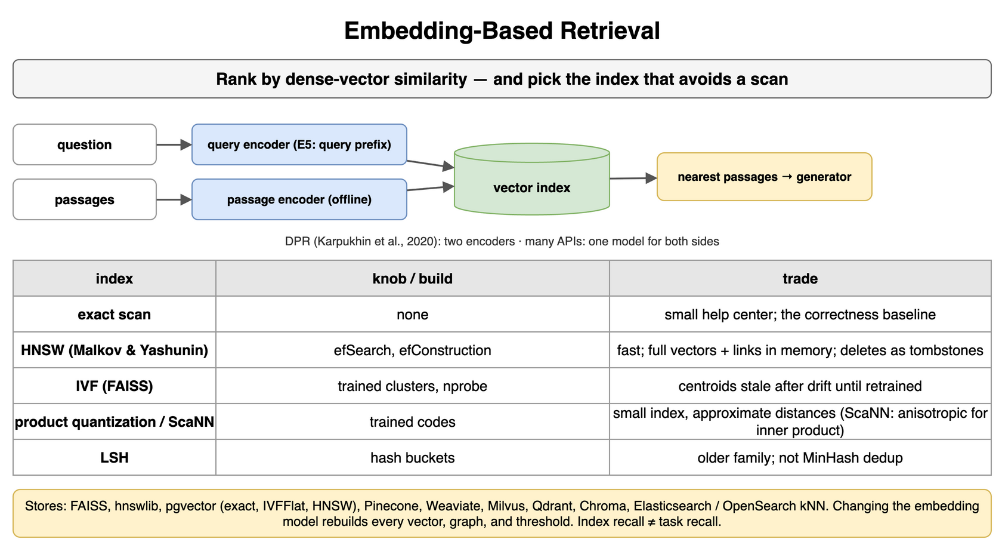

*Source: [`diagrams/rag-and-agents.drawio`](/content/10_AI_Engineering/06_RAG_and_Agents/diagrams/rag-and-agents.drawio), page 4.*

## Comparing retrieval algorithms

Comparing retrievers means scoring whether the right passages came back, and at what latency, cost, and update pain, before you look at the generated answer.

Task recall at k is the fraction of the relevant passages that appear in the top k. Precision at k is the fraction of those k passages that are relevant. Mean reciprocal rank, MRR, averages `1 / rank` of the first relevant passage, and a question with no relevant passage in the list contributes 0. Normalized discounted cumulative gain, NDCG, rewards higher relevance higher in the list. This exercise uses linear gain: the relevance divided by log base 2 of rank plus one, so rank 1 is divided by 1. The other common gain is two to the relevance, minus one. Name which one you computed. NDCG divides by the score of the ideal order, so the best list scores 1. None of these is a generation metric. The component pipeline in [Evaluate AI Systems](../04_Evaluate_AI_Systems/) is why you log the ids and score them against the passage that contains the answer, separately from whether the draft was right.

Three questions in the exercise each have one gold chunk, at ranks 1, 4, and 8. The cutoff is 5. A second list, with graded relevances 3, 0, and 1, shows NDCG.

```python
import math


RANKS = (1, 4, 8)
K = 5


def mean(values: tuple[float, ...]) -> float:
    return sum(values) / len(values)


recall = tuple(1.0 if rank <= K else 0.0 for rank in RANKS)
precision = tuple((1 / K) if rank <= K else 0.0 for rank in RANKS)
reciprocal = tuple(1 / rank for rank in RANKS)


def dcg(gains: tuple[int, ...]) -> float:
    return sum(gain / math.log2(rank + 1) for rank, gain in enumerate(gains, start=1))


gains = (3, 0, 1)
ideal = tuple(sorted(gains, reverse=True))
got = dcg(gains)
best = dcg(ideal)
print(f"{mean(recall):.4f} {mean(precision):.4f} {mean(reciprocal):.4f}")
print(f"{got:.4f} {best:.4f} {got / best:.4f}")
# 0.6667 0.1333 0.4583
# 3.5000 3.6309 0.9639
```

Mean recall at 5 is 0.6667, because the chunk at rank 8 is outside the cutoff. Mean precision at 5 is 0.1333. With one gold chunk, a perfect top 5 still has precision 1/5, so precision at 5 looks harsh on question answering even when the gold chunk was present. MRR is 0.4583. This exercise uses each gold chunk's rank in the full ordering, so rank 8 contributes 1/8. If the retriever had returned only five passages and the gold chunk was absent, that question would contribute 0, because the true rank would be unknown. Say which list you scored. NDCG on the graded list is 0.9639, from a gain of 3.5000 against an ideal 3.6309. The ideal order puts the relevance-1 item second, ahead of the zero. These are exercise ranks, not a leaderboard.

Latency, cost, and updates decide whether a higher recall is shippable. BM25 on an inverted index is a cheap CPU query, and the search topic owns that architecture. An exact vector scan is linear in the number of chunks. The 2,000-chunk exercise index on the chunking card is still a scan you can do exactly. A few million chunks is where HNSW or IVF is the latency plan, and the approximate index then has its own recall: did the true vector neighbor come back. That number can be high while task recall is low, when the nearest vector is the wrong passage. Cost sits in two places. Query cost is the embedding call plus the index plus, if you add one, the reranker. Index cost is embedding the corpus, and it dominates the day you change models, because every chunk is re-embedded and the old vectors are not comparable. A text edit re-embeds that chunk and patches one postings list. BM25 statistics move as the corpus grows, so a score is not a stable threshold across index updates. A cosine against an unchanged model and an unchanged chunk is stable, and it is still not a probability.

ANN benchmarks report an index on four axes: recall of the true neighbors, queries per second, index build time, and index size. A method that wins queries per second and loses recall is a different product from a method that builds slowly and then answers accurately. ann-benchmarks is the public comparison people mean. Read the axes for the dataset size you have, not the winner on a plot of a different corpus. RAGAS prints two related names that are not the precision at k and recall at k on this card. Context precision asks whether chunks a reference answer makes relevant were ranked above the chunks it does not, an average of precision down the list. Context recall asks what fraction of the claims in a reference answer the retrieved chunks support. Both need that reference. Neither one is a labeled passage id at a cutoff. Use the RAGAS names when a harness prints them, and say which definition you mean. A context precision of 1 on a 20-chunk prompt is a different claim from precision at 5.

A retrieval system is chosen with a checklist, not with the highest cosine. Name the mechanisms, keyword, vector, or both, and the corpus scale. Name how long the index takes to build and to refresh after an edit, the query latency at the concurrency you will have, and the price per query and per stored vector. Name who may see a passage, and whether that check runs before the prompt. A vendor that wins recall and cannot express the permission is not a candidate. The Why retrieve card's rule still holds. Permissions are applied before the passage enters the prompt.

**Trade-offs.** Recall at k matches "did we fetch the page" and ignores whether the page was first or fifth. MRR and NDCG care about order and need judgments. A cutoff you do not log makes the metric unreproducible. Optimizing task recall and ignoring index latency ships a retriever the chat cannot wait for. Optimizing latency and ignoring updates ships an index that is fast on yesterday's corpus. Exact vector search keeps the evaluation honest and does not stay the production path after the corpus grows.

**Interview.** Define recall at k, precision at k, MRR, and NDCG, and compute this exercise: recall at 5 is 0.6667, precision at 5 is 0.1333, MRR is 0.4583, and linear-gain NDCG is 0.9639. Explain why precision looks low when only one passage is relevant. Separate index recall from task recall. Then give the update story: a changed embedding model rebuilds every vector, a changed sentence rebuilds one, and BM25's idf moves when the corpus does. Point the generation score at the component pipeline, not at this card.

**Recap.** Retrievers are compared on whether the right passages came back, how high, how fast, and how expensive the index is to maintain. On the exercise, mean recall at 5 is 0.6667, mean precision at 5 is 0.1333, and MRR is 0.4583, with linear-gain NDCG of 0.9639 on a separate graded list. BM25 is the cheap lexical baseline. Exact vector scan is the small-corpus baseline. Approximate indexes add a second recall number, and changing the embedding model rewrites the index.

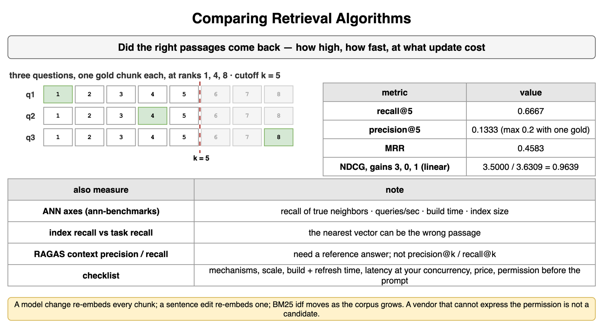

*Source: [`diagrams/rag-and-agents.drawio`](/content/10_AI_Engineering/06_RAG_and_Agents/diagrams/rag-and-agents.drawio), page 5.*

## Combining retrieval algorithms

Combining retrieval algorithms uses more than one ranker so a query that needs an exact token and a query that needs a paraphrase can both succeed.

Adding a BM25 score to a cosine is the combination that looks obvious and misleads. The two numbers are not on one scale. Cosine similarity of two vectors lies in [-1, 1]. Elasticsearch's dense cosine similarity is often stored as one plus that value, so the engine's score sits in [0, 2]. A BM25 score depends on idf and on the corpus and has no such bound. The larger scale wins the sum, which means you did not combine anything. You attended to one system.

Reciprocal rank fusion, from Cormack, Clarke, and Buettcher at SIGIR 2009, ignores the scores and uses the ranks. A document's fused score is the sum, over the lists it appears in, of `1 / (k + rank)`, with rank starting at 1. The paper's setting, and the default constant in Elasticsearch's rank fusion, is `k` of 60. A wild score cannot dominate, because scores are ignored. Appearing in both lists is not an automatic win. With `k` at 60, a document at rank 62 in both lists ties a document at rank 1 in only one list, because `2 / 122` equals `1 / 61`, and a document at rank 63 in both lists loses to that lone rank 1. On the short lists people actually fuse, a hit in both lists still separates itself from a hit in only one.

The exercise fuses a BM25 order of C, A, D with a vector order of A, B, C.

```python
def rrf(lists: tuple[tuple[str, ...], ...], k: int = 60) -> dict[str, float]:
    scores: dict[str, float] = {}
    for ranking in lists:
        for rank, doc in enumerate(ranking, start=1):
            scores[doc] = scores.get(doc, 0.0) + 1 / (k + rank)
    return scores


fused = rrf((("C", "A", "D"), ("A", "B", "C")))
order = sorted(fused, key=fused.get, reverse=True)
print(" ".join(order))
print(" ".join(f"{fused[doc]:.6f}" for doc in order))
# A C B D
# 0.032522 0.032266 0.016129 0.015873
```

A is rank 2 in BM25 and rank 1 in the vector list, so its score is `1/62 + 1/61`, which is 0.032522. C is first and third, 0.032266. B and D appear once, at 0.016129 and 0.015873. The fused order is A, C, B, D. With `k` at 60 and lists this short, the two shared hits are close to each other and both clearly beat a hit from only one list. That is the constant on a short list, not a theorem about every rank. A smaller `k` would exaggerate rank 1. If you change it, say so, and do not compare the score with a run that used 60.

Sequential combination is the other shape. A cheap retriever builds a candidate pool, and a more expensive ranker orders that pool. BM25 can require the product code to be present, and a vector ranker or a cross-encoder then orders the survivors. That second stage is the reranking card. It is not fusion: a passage the first stage dropped cannot be saved by the second. Fusion can only save a passage that one of the lists actually returned. Elasticsearch implements the fusion as reciprocal rank fusion, with `rank_constant` defaulting to 60. The Elasticsearch 8.19 guide also defaults `rank_window_size` to 10, so a passage at rank 11 in both child result sets never enters the fusion. OpenSearch can run a lexical query and a vector query in the same engine. Either way the term index and the vector index both have to be updated, and fusion can only save a passage one of the returned lists actually contains.

**Trade-offs.** Fusion recovers a passage one retriever buried, and it cannot recover a passage both retrievers missed. RRF is robust to score scales and indifferent to how bad the gap between rank 1 and rank 2 was. A normalized sum can use the gap and silently breaks when one model's score distribution shifts. Sequential combination spends the expensive ranker on a short list and inherits the first stage's misses. Running two indexes costs memory, update paths, and a fusion bug you have to log. If the query is always a product code, the vector index is overhead. If the query is always a paraphrase, BM25 is overhead. A search box that receives both is the case for paying for both.

**Interview.** Refuse to add a BM25 score to a cosine, and say why the scales differ: cosine in [-1, 1], an Elasticsearch cosine score often in [0, 2], BM25 unbounded. Write the RRF formula, fuse C, A, D with A, B, C at `k` of 60, and get A, C, B, D. Say Elasticsearch's default constant is 60, that the 8.19 guide's rank window defaults to 10, and that two copies of rank 62 tie one copy of rank 1. Then distinguish fusion from a sequential candidate pool. Give a product-code query and a paraphrase query as the pair that justifies two lists, and say you would measure each list's recall before you pay for the second index.

**Recap.** Hybrid retrieval exists because exact tokens and paraphrases fail in different lists. Adding the raw scores lets one scale win. Reciprocal rank fusion sums `1 / (60 + rank)` and, on the exercise, orders the fused lists A, C, B, D. Two copies of rank 62 tie one copy of rank 1, and two copies of a worse rank lose to that lone rank 1. A rank window can drop a passage before fusion sees it. A sequential pipeline lets a cheap retriever drop candidates before an expensive ranker sees them. Two indexes are worth maintaining when the query mix actually contains both kinds of question.

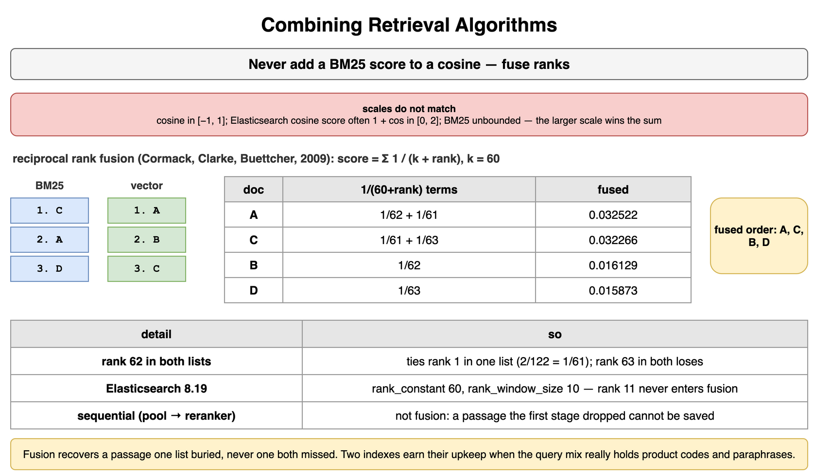

*Source: [`diagrams/rag-and-agents.drawio`](/content/10_AI_Engineering/06_RAG_and_Agents/diagrams/rag-and-agents.drawio), page 6.*

## Chunking strategy

Chunking strategy is how you split a document before it is indexed, so each unit is large enough to mean something and small enough to retrieve and to fit in the prompt.

A fixed window is the baseline. You cut every few hundred tokens and overlap the edges so a sentence on the boundary survives in at least one chunk. Structure is the better cut when you have it. A help-center article splits on headings. A markdown spec splits on sections. Code splits on functions, because a function cut in half embeds as two pieces that are each the wrong unit to edit. Parent-child indexing, sometimes called small-to-big, retrieves a short span and passes the surrounding section to the generator, so the match can be precise and the prompt can still contain the exception that sat next to it. Semantic splitting, cutting where a model says the topic changed, is another pass at index time. It is a model in the pipeline, with its own failures, not a reason to skip headings you already have.

The failure that makes this a design choice, rather than a preprocessing detail, is an answer whose facts landed in different chunks. The window that contains "headphones are electronics" and the window that contains "electronics are 14 days" do not each answer "how long do I have to return headphones." Overlap repairs a cut through one sentence. It does not reattach two facts that share no tokens. Raising the number of retrieved chunks can paper over the split and recreates the long-context problem. The repair is to index the section that holds the rule and the case it applies to, or to retrieve the child and send the parent. The whole help center pasted into the prompt is the context-efficiency card, not a chunking strategy.

The exercise sizes a help center: 400 articles, 1,200 tokens each, windows of 300 tokens with an overlap of 50, so the stride is 250. Embeddings are 1,536 floats, the default width of OpenAI's text-embedding-3-small, stored as float32.

```python
import math


ARTICLES = 400
TOKENS = 1_200
CHUNK = 300
STRIDE = 250
DIM = 1_536


def chunk_starts(n_tokens: int, chunk: int, stride: int) -> list[int]:
    starts = []
    start = 0
    while start < n_tokens:
        starts.append(start)
        if start + chunk >= n_tokens:
            break
        start += stride
    return starts


starts = chunk_starts(TOKENS, CHUNK, STRIDE)
lengths = [min(CHUNK, TOKENS - start) for start in starts]
chunks = ARTICLES * len(starts)
vector_bytes = chunks * DIM * 4
stored_tokens = ARTICLES * sum(lengths)
link_bytes = chunks * 32 * 4
print(starts, lengths)
print(chunks, vector_bytes, f"{vector_bytes / 1024 / 1024:.5f}")
print(stored_tokens, ARTICLES * TOKENS, stored_tokens * 4, link_bytes)
# [0, 250, 500, 750, 1000] [300, 300, 300, 300, 200]
# 2000 12288000 11.71875
# 560000 480000 2240000 256000
```

Each article yields five chunks, the last one 200 tokens, and the corpus yields 2,000 chunks. The float32 vectors are 12,288,000 bytes, 11.71875 MiB. Because of the overlap, the index stores 560,000 tokens of text against 480,000 tokens of source. At an exercise assumption of 4 characters per token, that is 2,240,000 characters of chunk text, before metadata. An exercise graph of 32 integer links per chunk is 2,000 times 32 times 4 bytes, which is 256,000 bytes, beside those 12,288,000 bytes of vectors. The vectors dominate. The 32 is an assumed degree, not a library default you should quote as fact. Storing float16 would halve the vector bytes, and the index has to actually store float16. This corpus is small enough that an exact scan is still a sane baseline. The same window on a corpus a thousand times larger is a memory and an approximate-index decision, not a different chunking rule. Swapping the embedding model rewrites the 12,288,000 bytes. It does not rewrite the chunk text if the windows stayed put.

**Trade-offs.** Short chunks match a precise question and split the rule from its exception. Long chunks keep the section together and waste the prompt on irrelevant paragraphs, and a long chunk is a worse embedding of any single fact inside it. Overlap costs index size, here 560,000 stored tokens against 480,000 source tokens, and saves boundary sentences. Heading splits follow the document the writer made and fail on a page with no headings. Parent-child retrieval adds a join you have to log. One global window size is easy to ship and wrong for both API references and policy articles. The right size is the one your recall at k moves on, measured on questions whose answers you marked.

**Interview.** Give the failure, two facts that answer the question only together, and the repairs: overlap for a broken sentence, a section chunk or a parent for a split rule, and not "paste the help center." Then do the arithmetic. Windows of 300 with stride 250 on 400 articles of 1,200 tokens make 2,000 chunks and 11.71875 MiB of float32 vectors at 1,536 dimensions. Say the overlap is why stored tokens exceed source tokens. Say a model change re-embeds every chunk and a heading change re-chunks the article.

**Recap.** Chunking decides the unit you can retrieve. Fixed windows are the baseline, headings and functions are better cuts when they exist, and parent-child retrieval can match a short span and generate from the section. On the exercise, 400 articles become 2,000 chunks and 11.71875 MiB of 1,536-dimensional float32 vectors, with 560,000 stored tokens against 480,000 source tokens because of a 50-token overlap. A split answer is a chunking bug. Pasting the corpus is a context bug.

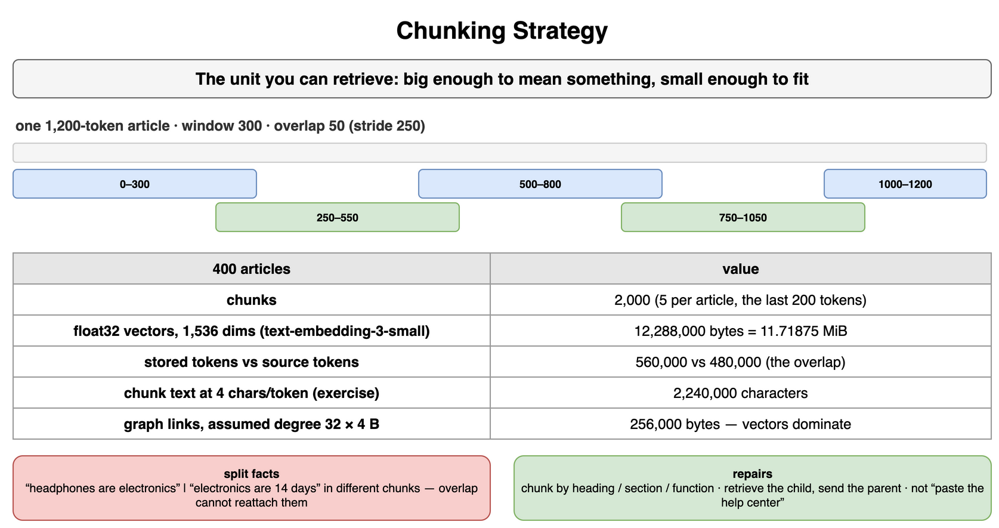

*Source: [`diagrams/rag-and-agents.drawio`](/content/10_AI_Engineering/06_RAG_and_Agents/diagrams/rag-and-agents.drawio), page 7.*

## Reranking

Reranking takes a short list of retrieved passages and orders that list with a model that reads the query and the passage together.

The first stage is a bi-encoder or BM25. A bi-encoder embeds each side alone, which is why it can be indexed, and it never sees the query tokens next to the passage tokens. A cross-encoder scores the pair in one forward pass. It can notice that the passage is about a different product, or that the number next to "days" is the number the question asked for. It cannot be run over the whole corpus on the request path. The pattern is retrieve a few dozen candidates, rerank, keep the few you will put in the prompt. Cohere Rerank is a hosted reranker used this way. Open cross-encoders for the same job include MS MARCO models such as the MiniLM rerankers and BAAI's bge-reranker models. The score orders the candidates. It is not a calibrated probability that the passage supports the answer unless you calibrated it on your own pairs.

Late interaction sits between those two. ColBERT, from Khattab and Zaharia in 2020, encodes the query and the passage separately into a vector per token, then scores the pair by MaxSim. Each query token takes its best matching passage token, and the similarities add. The passage token vectors can be stored ahead of time, which a cross-encoder cannot do, and the index is much larger than one vector per passage. ColBERT can be the first stage or the reranker. It is a text retriever. The multimodal card is where the same MaxSim sum is applied to image patches of a page.

Reranking does not create recall the first stage never had. A gold chunk that BM25 and the vector index both missed is absent from the cross-encoder's input. What reranking changes is precision at the small k you actually prompt with. That matters because of the context window. Five good chunks beat fifty chunks of which the gold one is buried, both for the bill and for the lost-in-the-middle tendency on the context-efficiency card. The entailment check that the draft is supported by the chunk is still the Factual consistency card. A reranker can prefer a fluent chunk that contradicts the question. The rank is not the grounding check.

**Trade-offs.** A cross-encoder raises the quality of a short prompt and adds latency and money on every candidate it scores. Batching the candidates cuts that latency and does not make a million-chunk cross-encode reasonable. A larger candidate pool gives the reranker more chances to find the gold chunk and spends more of the latency budget. A reranker trained on MS MARCO is a general ranker until you measure it on help-center questions. Hosted rerankers are an API dependency and a place customer text goes. Skipping reranking is the right call when the first stage already puts the gold chunk in the top few and the budget is gone.

**Interview.** Draw two stages and say the cross-encoder only sees the first stage's survivors. Name a real reranker, Cohere Rerank or a bge-reranker, and say the score is an order, not a grounding judgment. Place ColBERT as late interaction: stored token vectors, MaxSim, heavier than one vector per passage, cheaper than a cross-encoder over the whole corpus. Explain why you rerank fifty and prompt with five: the window, the bill, and the middle of a long paste. If the gold chunk is missing from the fifty, say you would fix retrieval or chunking, not the reranker.

**Recap.** A reranker orders a short candidate list with a model that reads the query and the passage together. Cross-encoders such as the MS MARCO MiniLM rerankers and bge-reranker do this in one forward pass, and Cohere Rerank is a hosted reranker used the same way. ColBERT keeps a vector per token and adds each query token's best passage-token match. None of them can recover a passage the first stage dropped. They exist so the prompt contains a few strong passages rather than a long list. The rank is not proof the passage supports the draft.

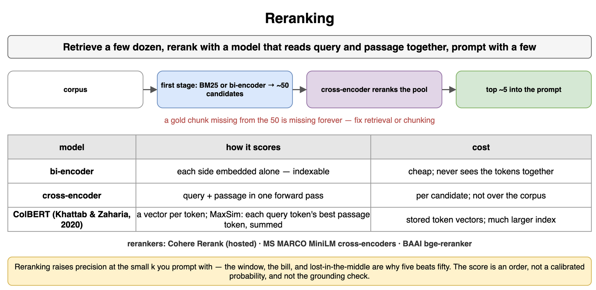

*Source: [`diagrams/rag-and-agents.drawio`](/content/10_AI_Engineering/06_RAG_and_Agents/diagrams/rag-and-agents.drawio), page 8.*

## Query rewriting

Query rewriting changes the user's question into a search query, or into several, before retrieval runs.

People do not type the words the index contains. A follow-up in a Notion thread, "what about returns?", is not a query until you resolve "returns" against the product the previous turn was about. A question with two parts, the window and the exception for electronics, retrieves better as two queries whose passages are both shown to the generator. A lexical index also benefits from a rewrite that adds the term the user did not know, and it is harmed by a rewrite that adds a term the user did not mean. The rewrite is a query. It is not a source. If the model answers from the rewritten text and never reads a passage, you skipped RAG and called it RAG.

HyDE, hypothetical document embeddings, from Gao and coauthors in 2022, is a dense-retrieval version of the same idea. The model writes a passage that might answer the question, you embed that passage, and you search with it, on the hope that a hypothetical answer sits closer to the real answer than the question does. It helps when the question is vague and the corpus is written in answers. It hurts when the hypothetical invents a policy. The invented "30 days" then retrieves the 30-day page, and the electronics exception never gets a chance. The hypothetical is discarded after retrieval. The passage that came back is what the generator may use. Treating the hypothetical as the context is how a wrong guess confirms itself.

**Trade-offs.** A rewrite recovers a follow-up the index cannot read and can drift away from what the user asked. Multi-query retrieval raises recall and costs extra index reads and extra chunks in the prompt. HyDE can align a vague question with answer-shaped documents and can launder a hallucinated policy into a retrieved one. Rewriting with a model call adds latency before search has started. A hand-built resolver for "what about returns?" is easier to test. Logging the original question and the query you actually ran is the only way to debug a miss.

**Interview.** Give the follow-up "what about returns?" and say you rewrite it with the product from the previous turn, then retrieve, then answer from the passages. Describe HyDE as embedding a hypothetical answer, cite Gao and coauthors, 2022, and give the failure: the hypothetical names the wrong window and the index obediently finds that window. Say the rewrite is never a citation. Ask to see the logged query when a retrieval bug is being blamed on the generator.

**Recap.** Query rewriting turns a conversational or vague question into the search you run. Follow-ups need their references resolved, compound questions may become several queries, and HyDE searches with an embedding of a hypothetical answer. The hypothetical can retrieve a policy it just invented. The passage that comes back is the source. The rewrite is only a query.

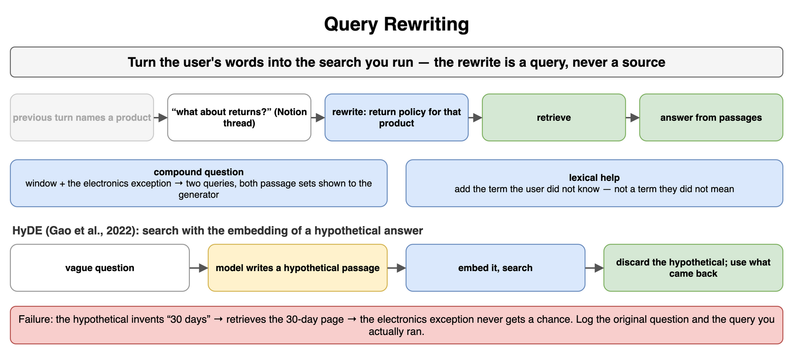

*Source: [`diagrams/rag-and-agents.drawio`](/content/10_AI_Engineering/06_RAG_and_Agents/diagrams/rag-and-agents.drawio), page 9.*

## Contextual retrieval

Contextual retrieval prepends a short note that says where a chunk sits in its document, then indexes that combined text with embeddings and with BM25.

A chunk that says "the limit is 14 days" is the wrong unit. It does not say 14 days of what. The heading, the product, and the document title were in the article and were cut off by the window. Anthropic's contextual retrieval, published on 19 September 2024, asks a model to write a short situating note from the whole document and the chunk. They describe that note as usually 50 to 100 tokens, and they prepend it before the chunk is embedded and before it is added to the BM25 index. The note is generated at index time. It is not a query rewrite. They define the top-20 failure rate as one minus recall at 20. Averaged across the domains in that write-up, on the embedding configuration they highlight, the rate moved from 5.7 percent to 3.7 percent with contextual embeddings, a 35 percent reduction, and from 5.7 percent to 2.9 percent when contextual BM25 was added, a 49 percent reduction. Reranked contextual embeddings plus contextual BM25, using the Cohere reranker in that write-up, moved it from 5.7 percent to 1.9 percent, a 67 percent reduction. The rerank step retrieved a wide candidate list and kept 20. Those figures are that setup. They are not a promise for a Zendesk help center. The direction is the part to copy: a chunk should carry the words a search will actually use.

The exercise is term overlap, not a BM25 score. The term-based card owns the score.

```python
def shared(query: str, text: str) -> list[str]:
    return sorted(set(query.split()) & set(text.split()))


bare = "the limit is 14 days"
contextual = "headphone return rule for this section. the limit is 14 days"
print(shared("headphone return", bare))
print(shared("headphone return", contextual))
# []
# ['headphone', 'return']
```

The bare chunk shares no query term with "headphone return". The same chunk with a situating note shares both. A vector index has the same hole, because the bare chunk never mentioned headphones, so its neighborhood is every "14 days" in the corpus. The note is only as good as the model that wrote it. A note that attaches the chunk to the wrong product poisons BM25 and the embedding together. Regenerating the note is part of reindexing when the article changes. Leaving yesterday's note on today's article is a stale index with extra confidence.

**Trade-offs.** Contextual notes repair chunks that were true and unretrievable, and they cost a model call per chunk at index time. A bad note is worse than no note, because both retrievers will trust it. The Anthropic reductions are one average, on the embedding setup they highlight, and the 67 percent figure includes contextual BM25 and the Cohere reranker, not a reranker alone. Your recall at 20 has to be measured again. Prepending 100 tokens also makes every chunk longer, which changes chunk counts, vector counts, and how much of the chunk is the note rather than the policy. A heading you already have in the HTML is cheaper than a generated note and should be used first.

**Interview.** Explain why "the limit is 14 days" cannot answer a headphones question, and show that a situating note adds the missing terms. Cite Anthropic, 19 September 2024, for the method and for the failure rates 5.7 percent to 3.7, 2.9, and 1.9 percent, which they report as 35, 49, and 67 percent reductions. The last of those is contextual embeddings, contextual BM25, and their Cohere rerank step together. Refuse to treat those rates as your help center. Say the note is generated, so it can name the wrong product, and that it has to be rebuilt when the article changes. Put real headings ahead of a generated note when the document has them.

**Recap.** Contextual retrieval indexes a chunk together with a short note about where that chunk sits in the document, for both embeddings and BM25. Anthropic's 19 September 2024 write-up reported top-20 failure rates, defined as one minus recall at 20, of 5.7 percent, then 3.7 percent with contextual embeddings, 2.9 percent with contextual BM25 added, and 1.9 percent with those two plus their Cohere reranker. A bare "14 days" shares no term with "headphone return" until the note adds those words. The note is a generated prefix. A wrong prefix sends both retrievers to the wrong place.

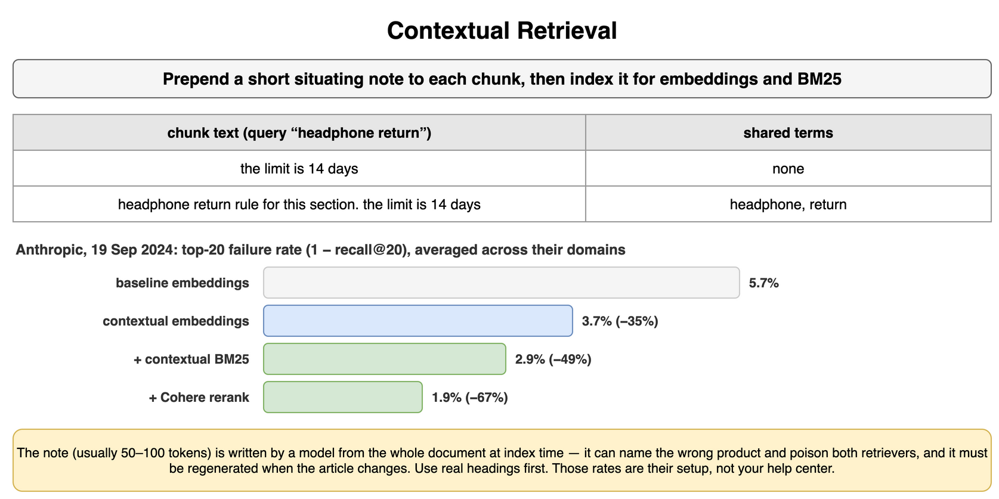

*Source: [`diagrams/rag-and-agents.drawio`](/content/10_AI_Engineering/06_RAG_and_Agents/diagrams/rag-and-agents.drawio), page 10.*

## Multimodal RAG

Multimodal RAG retrieves images, or pages that are images, along with text, so the generator can use a figure, a screenshot, or a scan.

Three pipelines show up in products, and they lose different information. The first captions the image, or runs OCR, and indexes the text. A Shopify product photo becomes "blue wool socks". A chart in an earnings PDF becomes "a chart of revenue" if the captioner does not read the axis, and the number the user asked for is gone. OCR keeps the number when the page is clean and loses it when the table is a picture of a table. The second pipeline embeds the image and the text in one space. CLIP, from Radford and coauthors in 2021, trains that shared space with a contrastive loss, one vector for the image and one for the caption. It is the right tool for "a photo of wool socks" and a weak tool for a page of small type, because one vector has to stand for the whole image. The third pipeline embeds the page image itself as many vectors. ColPali, from Faysse and coauthors in 2024, runs a vision-language model, PaliGemma in the original paper, over the page image and scores the query with late interaction. That is the MaxSim sum from ColBERT, the text retriever on the reranking card: each query token takes its best matching patch, and the scores add. The page is retrieved without an OCR layout pipeline. The index is heavier, because a page is many patch vectors rather than one string. ViDoRe is their benchmark. A score on it is not a score on your documents.

The generator still has to see the thing you retrieved. If you retrieved a page image, the model that writes the answer has to be able to read images, or you have retrieved a file the generator cannot use. If you retrieved a caption, a text model is enough and the caption's omissions are already baked in. A Notion page that mixes a paragraph and a screenshot wants both: the paragraph in the term and text-embedding index, the screenshot on the path that preserves what it shows. Permissions do not change because the file is an image. A scan of a contract is still a contract.

**Trade-offs.** Captions are cheap to index and drop numbers, axes, and stamps. CLIP is one vector per image, which is easy to store and coarse on dense pages. ColPali keeps the page and costs a multi-vector index and a vision model at query time. OCR plus text RAG is the right path for a clean digital PDF and the wrong path for a photographed packing slip. Sending every image to a vision model at answer time, with no retrieval, is the long-context version of this problem and hits the same bill. A retrieved image the generator is not allowed to see is a pipeline that cannot answer.

**Interview.** Pick a Shopify photo, a text policy, and a scanned table, and assign each a pipeline: CLIP or a caption for the photo, ordinary RAG for the policy, OCR or ColPali for the table. Cite CLIP as Radford and coauthors, 2021, and ColPali as Faysse and coauthors, 2024, with ColBERT-style late interaction and one vector per patch rather than one per page. Say a caption that dropped the number cannot be saved by the generator. Say the answer model has to be able to read whatever you retrieved.

**Recap.** Multimodal RAG retrieves pictures and page images, not only strings. Captions and OCR are cheap and lose what they fail to read. CLIP puts a whole image in one vector. ColPali embeds page patches and matches them to query tokens with late interaction, at a heavier index. The generator has to be able to use the thing the retriever returned, and an image is still subject to the same permissions as a document.

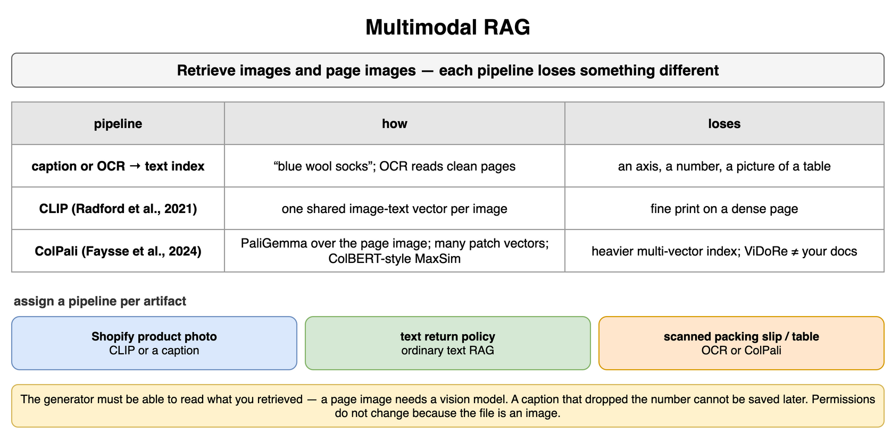

*Source: [`diagrams/rag-and-agents.drawio`](/content/10_AI_Engineering/06_RAG_and_Agents/diagrams/rag-and-agents.drawio), page 11.*

## RAG with tabular data

RAG over tables either retrieves the table as text or asks a query the warehouse runs, and the warehouse result is the source.

A small table in a help article, a list of shipping rates, a price grid with a handful of rows, can be a chunk. BM25 and an embedding will find it, and the generator can quote a cell that is actually in the chunk. A sales warehouse is the other kind of table. Shopify orders, refunds, and taxes do not belong in a vector index as dumped rows. The question "how many orders were refunded last week" is a query, with a filter, a date column, and an aggregation. Text-to-SQL is that path. You retrieve the relevant schema, not every table in the account. You put those table cards, the question, and a few labeled examples in the prompt. The model writes one statement. Your program checks that it is a single read, that every column exists, and that the caller's permissions allow those tables. The warehouse runs it with a timeout and a row cap. The answer is narrated from the result, or the result is shown. Execution accuracy, Spider's component match, and BIRD's result-set score are the functional-correctness card in [Evaluation Methodology](../03_Evaluation_Methodology/). This card is the system around that metric.

The failures are specific. The model names a column that was never in the schema. The model filters the order's created date when the event lives on the refund. The model counts refund rows when the question asked for orders. An empty result is indistinguishable from "zero" if you do not trust the statement, so a grounded bot says the query and the count, and a checker compares the count with the rows. A statement that updates, deletes, or defines a table does not run, however helpful it sounds. The model's prose is not a second source that can override the warehouse. A write tool against the warehouse is an agent with a side effect, which is a later card, not a retrieval technique.

**Trade-offs.** Chunking a small table keeps one stack, search plus prompt, and collapses as soon as the question needs a sum, a join, or a date the chunker split across rows. Text-to-SQL answers those questions and requires a schema catalog, a read-only guard, and an executor. Retrieving every table into the prompt blows the context and still misses the row values, because the values are not in the schema. Giving the model a live connection without the guard is how a question becomes a mutation. A semantic layer of approved metrics is slower to build and stops the model inventing a definition of "refunded" that finance does not use.

**Interview.** Split a shipping-rate table, which can be a chunk, from a sales warehouse, which is text-to-SQL. Walk the guard: one read-only statement, known columns, the caller's permissions, a timeout, a row cap. Say you score the result the user asked for, and point Spider and BIRD at the functional-correctness card instead of re-deriving them. Give two failures: a column that does not exist, and a count of rows when the question asked for distinct orders. An empty result is not an answer until the statement is the statement you meant to run.

**Recap.** Small tables can be chunks. A warehouse question is text-to-SQL: retrieve the schema, generate one read-only statement, execute it under a timeout and a permission check, and answer from the rows. The functional-correctness card owns how that result is scored. A missing column, the wrong date, and a count of the wrong entity are the bugs. The warehouse is the source. The model's sentence is not.

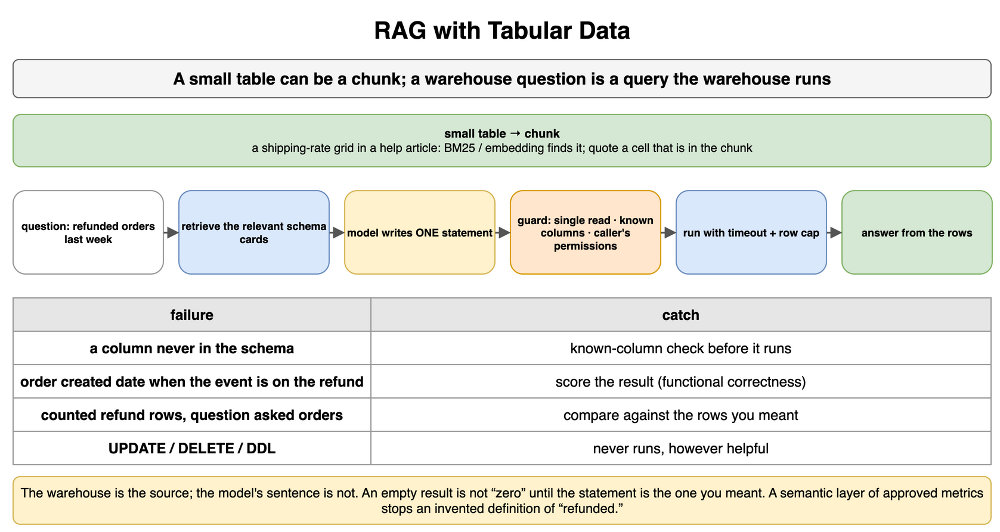

*Source: [`diagrams/rag-and-agents.drawio`](/content/10_AI_Engineering/06_RAG_and_Agents/diagrams/rag-and-agents.drawio), page 12.*

## What an agent is

An agent is a model in a loop that observes an environment, chooses a tool, and uses the tool's result to decide what to do next, until the task stops.

The environment is the part of the world the loop can see and change: a GitHub repository and its tests, a browser, a travel API, a help center plus the ticket. The tools are the only actions. The planner decides the next action. The planner is usually the model, sometimes a program that calls the model and then overrides it. A single RAG answer is not yet an agent. It retrieves once and generates once. It becomes an agent when the model can decide to search again, call a different tool, or stop. ChatGPT with a browser tool, a GitHub Copilot coding agent that reads a repository and runs tests, and a support bot that can look up an order and then draft a reply are agents of increasing side effect. The side effect is the whole safety question. A planner that can only retrieve is a multi-step RAG system. A planner that can charge a card is a system that moves money, and the System-level defenses card in [Prompt Engineering](../05_Prompt_Engineering/) is the boundary. This topic says what the loop is made of. That card says what the loop is not allowed to do on its own.

An agent is not a smarter prompt. The prompt still conditions one sample. The loop is the program around the samples: append the observation, call the model again, stop on a condition your code enforces. The model can propose "stop." The step cap and the tool allow-list have to be able to stop when the model never does. Otherwise a sample that never proposes stop runs until the budget does.

**Trade-offs.** A loop can recover from a bad search by searching again, and it can also repeat itself, drift off the task, and spend a stack of calls on a question one retrieval would have answered. More tools make more tasks possible and make the wrong action possible. A fixed pipeline, retrieve then draft, is easier to test and cannot handle a task whose second step depends on the first result. Calling every chatbot an agent makes the word useless in a design review. The word should mean there is a loop and a tool choice.

**Interview.** Define the environment, the tools, and the planner, and give one product for each piece: the repository, the test runner, the model that decides to run the tests. Say a one-shot RAG answer is not an agent and a model with a refund tool is. Put the stop condition in your code, not only in the prompt. Point the permission to move money at the system-level defenses rather than inventing a new safety story.

**Recap.** An agent is a planner in a loop over an environment it can affect only through tools. The environment might be a repository, a browser, or a ticket. The loop is a program that feeds observations back to the model. One retrieval and one draft is RAG. A model that chooses the next tool is an agent. The program has to be able to stop the loop when the model never proposes a stop.

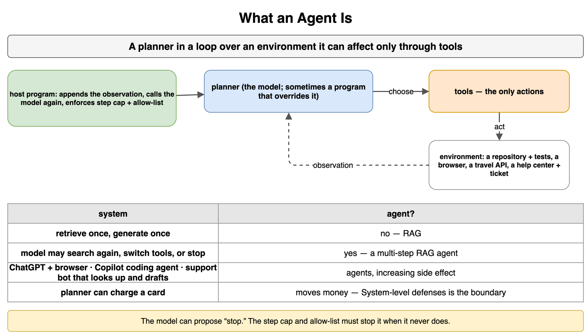

*Source: [`diagrams/rag-and-agents.drawio`](/content/10_AI_Engineering/06_RAG_and_Agents/diagrams/rag-and-agents.drawio), page 13.*

## Knowledge tools

A knowledge tool returns text the model did not have in the prompt. Search over a Notion workspace, a web search, and the help-center retriever from the first half of this topic are knowledge tools.

The result is untrusted context, not a fact and not an instruction. A page, a search snippet, or a tool payload can tell the model to ignore the policy. That is indirect prompt injection in [Prompt Engineering](../05_Prompt_Engineering/). The retriever does not make the text true or safe. It makes the text present. Permissions are applied before the passage enters the prompt, the same cut as the first card. A knowledge tool that can see a document the caller cannot see has already failed, even if the draft never quotes it. The passage can also be stale. The lag between the article and the index is Full-Text Search Architecture in [Search Autocomplete and Information Retrieval](../../09_System_Design_Interview/18_Search_Autocomplete_and_Information_Retrieval/). Calling search again does not refresh a stale index. Reindexing does. Capability tools and write tools are the next two cards. A tool that both searches the wiki and sends mail has already skipped that split.

**Trade-offs.** Knowledge tools keep answers on a corpus that changes, and they open an injection path and a permission path. A tool that returns a whole page spends the context window. A tool that returns a snippet can drop the exception. Logging the query and the ids is what makes a wrong draft separable from a missed page. One tool that both reads and sends is no longer only a knowledge tool.

**Interview.** Classify the tool before you discuss the planner. A Notion search is knowledge. Say the payload is untrusted, the access check happens before the prompt, and a second search is not a refresh of the index. Point injection at Prompt Engineering and index lag at the search topic. Ask what the log contains when the draft is wrong: the query, the ids, and whether the page that had the answer was among them.

**Recap.** Knowledge tools fetch text. Search over Notion, the web, or a help center is this class. The text is untrusted and has to be permissioned, and it can be stale. The tool makes the text present. It does not make the text true, and it does not make an instruction inside the text something the agent should follow.

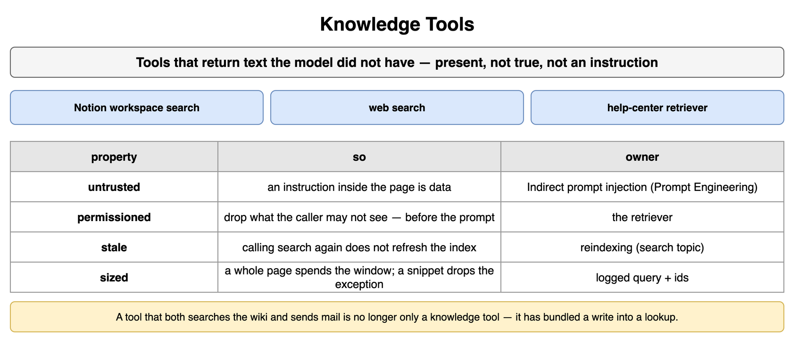

*Source: [`diagrams/rag-and-agents.drawio`](/content/10_AI_Engineering/06_RAG_and_Agents/diagrams/rag-and-agents.drawio), page 14.*

## Capability tools

A capability tool does work the model should not fake. A calculator returns the product of the numbers. A code interpreter runs a repository's tests. A clock returns the date a refund window is counted from.

The model can write a plausible test summary without running the tests. The tool exists so the observation is the run, not the summary. The sandbox is the control on the System-level defenses card in [Prompt Engineering](../05_Prompt_Engineering/): no production credentials, a network policy, a timeout, and a filesystem that is not the customer's data. A prompt that says "run the tests" is not that sandbox. GitHub-hosted runners and a locked-down CI job are the same idea at different sizes. The process output is still untrusted if the code under test, or a dependency, can print an instruction. You append the exit code and the assertion you trust, not an unfiltered log. A calculator is the small version of the same rule. The arithmetic in the draft has to match the tool's number, or you do not show the draft.

**Trade-offs.** Capability tools stop invented arithmetic and invented test results, and a sandbox that can reach the network or a cloud credential is not a sandbox. They add latency and a runtime you have to patch. Refusing a capability tool means the model does the work in tokens, which is the right call for a one-line rewrite and the wrong call for a test suite. A general "run this shell" tool is a capability and a write bundled together, because the shell can edit the repository. That bundle belongs on the Write tools card.

**Interview.** Name the work the model should not invent: the test result, the total, the current date. Put the sandbox next to the interpreter, and say a sentence in the prompt is not the sandbox. Say the observation you append is the exit code and the assertion, not every line the process printed. A calculator that the draft is allowed to override is not a tool. It is a decoration.

**Recap.** Capability tools perform a computation or a run the model cannot be trusted to do in its head. A calculator and a test interpreter are the usual examples. The sandbox, the timeout, and the network policy are code. The number or the exit code in the observation is the source. The model's sentence about that run is not.

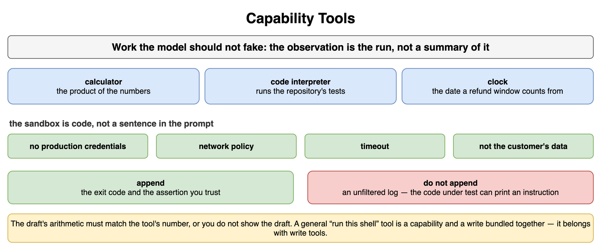

*Source: [`diagrams/rag-and-agents.drawio`](/content/10_AI_Engineering/06_RAG_and_Agents/diagrams/rag-and-agents.drawio), page 15.*

## Write tools

A write tool changes a system outside the conversation. A Stripe refund, outbound mail, and a merge to a protected branch are write tools. The model's JSON is a proposal. The program decides whether the call happens.

The checks are specific. Recompute the amount from the order, or check it against the amount the person saw. Reject a tool name that is not on the allow-list. Require a person for an irreversible action, and the person has to confirm the arguments your program computed, not the arguments the model echoed. A chat message that says "yes, refund me" is not that confirmation. The introduction topic already puts a person on money movement, and the System-level defenses card in [Prompt Engineering](../05_Prompt_Engineering/) says why the prompt cannot waive that person. A retried refund needs an idempotency key so the loop does not refund twice. That key is the attempt key on the Idempotency in Payments card in [Payment and Financial Systems](../../09_System_Design_Interview/23_Payment_and_Financial_Systems/). Partial failure is the other half. The refund can succeed and the confirmation email can fail. Retrying the whole plan applies the money movement again unless the key and the recorded outcome say it already happened. A tool that both reads the inbox and sends mail has skipped least privilege. Split them.

**Trade-offs.** Write tools are the product, the refund, the reply, the merge, and they are the incident when the wrong one fires. A human on every irreversible write is the right gate for a refund and for a merge to a protected branch, and it is the wrong gate for a read of a public help page, which is why reads are not on this card. An expiring hold that cannot capture funds is closer to a capability than to a charge. A hold that turns into a charge if nobody cancels it is a write. Least privilege, an idempotency key, and a person on the irreversible step are three different controls. A refund usually needs all three.

**Interview.** Put the model's arguments on the proposal side. Walk a Stripe refund: recompute the cents, require a confirmation that shows those cents, send an idempotency key, and do not retry the refund because the email failed. Give a merge to a protected branch as the case you would not automate. Say a tool that can both read and send has already bundled a write into a lookup.

**Recap.** Write tools change a system of record. The model can ask for a refund, a sent message, or a merge. The program recomputes the arguments, requires a person for the irreversible ones, and uses an idempotency key so a retry does not apply the change twice. A successful write followed by a failed notification is not a reason to perform the write again.

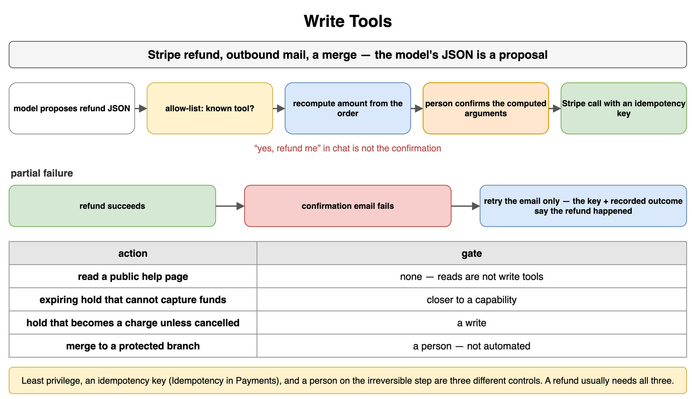

*Source: [`diagrams/rag-and-agents.drawio`](/content/10_AI_Engineering/06_RAG_and_Agents/diagrams/rag-and-agents.drawio), page 16.*

## Planning, then checking, then acting

Planning, then checking, then acting means the agent produces a plan, your program validates it, and only then does a tool run.

A loop that acts on every sample has no place to reject a bad step except after it has happened. Decoupling the three moments gives you that place. The planner proposes "look up the order, read the return policy, draft the reply" or, wrongly, "charge the card, then look up the order." The checker rejects a plan that names a tool you did not offer, that skips a precondition, or that puts a write tool before the read that would justify it. The executor runs the steps that passed, and it still checks each write at the moment it runs, because the world may have changed since the plan was written. The order can be refunded by then. ReWOO, from Xu and coauthors in 2023, is a published version of the split: the plan and the tool placeholders are written before observations come back, so the planner is not rewritten by every tool result. That also means the planner does not see a tool error unless you explicitly replan. A frozen plan is cheaper and blind. A replan after every observation is ReAct, on the reflection card, and it can loop.

Plan-and-execute is the name of that broader pattern: write the steps, then act. ReWOO is a published version of it, not a different idea. The check is code. An allow-list, a schema for the arguments, a permission check, and a human gate on writes are the check. Asking the model whether its own plan is safe is another sample, and it is not a check. The dual-LLM and capability checks on the system-level defense card are for when untrusted text is trying to choose the action. The plan checker is for when the planner itself proposed something you do not allow.

**Trade-offs.** A validated plan catches an illegal step before it runs and adds a rigid stage the model may fight by hiding the step inside a vague tool. Replanning after each observation uses new evidence and spends calls, and it lets a hostile observation steer the next plan, which is the injection path. A fully frozen plan is easy to review and breaks on the first tool error. Checking only the first step and then free-running is the decoupling with the lock left off.

**Interview.** Separate propose, validate, and execute, and give a plan you would reject: a charge before the order is read, or a tool that is not on the list. Name plan-and-execute as the pattern, and cite ReWOO as a plan written before observations. Say the cost is blindness to tool errors unless a replan exists. Put the validator in code. A model's opinion of its own plan is not the validator.

**Recap.** A plan is a proposal, a check accepts or rejects it, and execution is a separate step that can still refuse a write. Plan-and-execute writes the steps before it acts. ReWOO is a published version that writes the plan, with placeholders, before tool results return. A frozen plan is reviewable and blind to errors. A replan sees the errors and can be steered by them. The allow-list and the human gate are the check. The model's blessing of its own plan is not.

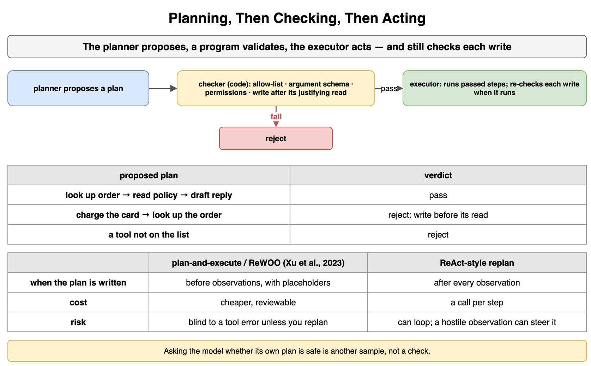

*Source: [`diagrams/rag-and-agents.drawio`](/content/10_AI_Engineering/06_RAG_and_Agents/diagrams/rag-and-agents.drawio), page 17.*

## Foundation models as planners

A foundation model used as a planner proposes the next steps in language. It is not a classical planner that searches a declared model of the actions and proves the plan.

The useful half is real. Given a ticket, a schema, and a tool list, a model will draft an ordered set of steps that often looks like the notes an engineer would write. Coding agents do this when they say which file to read before which test to run. Travel agents do it when they search before they book. The weak half is also real. The model does not expand a state space. It samples a continuation. It invents a tool that is not on the list, skips a precondition, and states a step as done because the done step was the likely continuation. A classical planner with an explicit action model can refuse an illegal action. It is only as good as the model of the world you wrote down, which is a poor fit for "figure out what this customer wants." The split that holds up in practice is the one from the previous card. The model proposes. A program with an allow-list disposes.

```python
OFFERED = {"lookup_order", "read_policy", "draft_reply"}
plan = ["lookup_order", "read_policy", "issue_refund"]
unknown = [step for step in plan if step not in OFFERED]
print(unknown)
# ['issue_refund']
```

The plan looks reasonable and names `issue_refund`, which you did not offer. A classical planner cannot emit an action that is absent from its action model. A language model can, because the action is just tokens. The debate about models as planners is mostly a debate about which half you are buying. If you want a fluent decomposition of a messy request, a model is the proposer to beat. If you want a guarantee that the steps are legal, you want a checker, a simulator, or a classical planner on the pieces that have a formal model, such as a workflow engine around the charge. "The model planned it" is not a root-cause analysis after the wrong tool runs.

Planning, in the classical sense, is search. You expand a step, score it against the goal, and backtrack when the score is bad. An autoregressive model does not do that. It commits to the next token and cannot unsay it. The practical repair is to give the model tools that make search and undo real: a test command, a revert of an uncommitted edit, a browser that can go back, a transaction that rolls back. Without an undo, "try the other approach" is another forward sample, and the bad edit is still in the repository. The compounding-error card is why that matters. A wrong early step is multiplied by every step after it, unless something can return to the last good state.

A foundation-model planner and a reinforcement-learning agent are different learners. The model plans in language from the context you just handed it. It can be pointed at a new tool list with a prompt, and it has not practiced your ticket queue. An RL agent learns a policy from reward over many episodes in an environment. It can become reliable on that environment, and it needs those episodes. It does not read a new refund policy on Tuesday and change the policy the same day. Use the model when the goal is in messy text and the tools change. Use a learned policy, or ordinary code, when the same action repeats and you can score it. Most products use the model as the proposer and code as the part that has actually been tested.

**Trade-offs.** Model planners handle vague goals and messy text, and they fail quietly by inventing actions. Classical planners are sound relative to an action model and useless on a goal you cannot formalize. Using the model for both the proposal and the proof feels like one system and is one point of failure. Replanning at every step corrects some inventions after a tool errors and creates the loop and injection problems. A long plan drafted in one shot drifts, because nothing has been observed yet. Shorter plans, replanned at boundaries you chose, fail in smaller pieces.

**Interview.** Say what the model is good for, a proposed decomposition, and what it is not, a search that respects preconditions. Show a plan that names a tool you did not offer, and say the allow-list rejects it. Contrast a PDDL-style planner, sound relative to a model you must write, with a ticket whose goal is in the customer's words. Put the guarantee in the checker. Decline "the model planned it" as the reason a charge was legal.

**Recap.** Foundation models draft plausible plans and do not search an action model. They invent tools, skip preconditions, and describe wished-for steps as completed. A classical planner is sound only for the formal model you give it. The practical split is a model that proposes and a program that accepts. A plan that names `issue_refund` when that tool was not offered is already illegal, before any argument is checked.

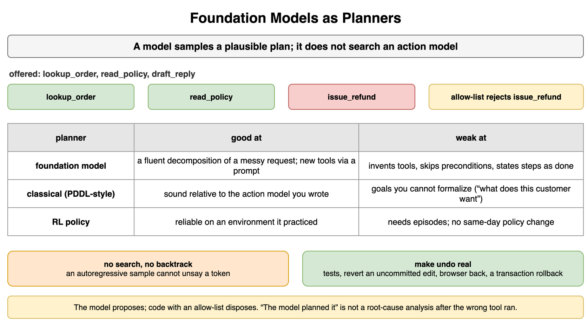

*Source: [`diagrams/rag-and-agents.drawio`](/content/10_AI_Engineering/06_RAG_and_Agents/diagrams/rag-and-agents.drawio), page 18.*

## Plan generation and control flow

Plan generation is how a model emits the next action as a structure your program can run, and control flow is where sequence, parallelism, branches, and loops live.

Function calling, which OpenAI shipped in its API in June 2023 and which Anthropic tool use and Gemini function calling also implement, is the emission format. You send tool names, descriptions, and argument schemas. The model returns a name and arguments, or a final answer. Your code validates the arguments and runs the function, or refuses to. The structured-output machinery in [Understanding Foundation Models](../02_Understanding_Foundation_Models/) is what keeps the call on the schema when the API offers a mask or a strict mode. This card is the loop around that call. Toolformer, from Schick and coauthors in 2023, is the training route to the same kind of emission. They finetuned a model to insert a tool call where the call reduced the perplexity of the following tokens. The tools in that paper were a calculator, a calendar, Wikipedia, a translator, and a question-answering system. The habit of calling lives in the weights. Today's help center does not. The emitted call is still a proposal, and training it belongs to the finetuning topic. A hosted function-calling API and a Toolformer-style checkpoint can both name a tool you did not mean to run.

The Model Context Protocol, which Anthropic introduced in November 2024, is one level up from either route. An MCP server advertises tools, and a host forwards the model's call to that server. Function calling is still how the model asks. MCP is how a tool packaged once is discovered by more than one app. Connecting a server is a trust decision. The protocol does not make the server's tools safe. A write tool on a server you just added is still a write tool.

Granularity is a product choice. One tool per business action, `lookup_order` and `draft_reply`, gives the checker something to allow. One tool called `run_sql` with the warehouse credentials is a capability and a write bundled together. One tool per trivial string function fills the prompt with definitions and crowds the choice, which is the tool-selection card. The host owns control flow. Independent reads run together. A draft waits for both. A branch chooses a refusal or a next step from a result your code computed. A loop paginates or retries, with a cap.

The plan's granularity is a second choice, and it decides whether you need a translator. A plan whose steps are exact function calls, `lookup_order(order_id="1001")`, can be validated and run. A plan in natural language, "look up the order, then check the window," needs a later step that maps the sentence onto the tool list. That translator is another model call, and it breaks when the tool inventory changes: the sentence still says "check the window" after you renamed the tool. If the plan is the call itself, a tool change is a schema change you can see in the allow-list. If the plan is prose, a tool change is a silent miss until you rewrite the translator or finetune it again on the new names. Prefer the call when a program will execute the plan. Prefer the sentence when a person will read it and a program will not. Do not finetune a translator against a tool list you expect to edit next week. The Toolformer habit, above, is a finetune of calls, and it still has to be redone when the functions change.

```python
STEPS = {
    "lookup_order": set(),
    "read_policy": set(),
    "draft_reply": {"lookup_order", "read_policy"},
}


def ready(done: set[str]) -> list[str]:
    return sorted(name for name, deps in STEPS.items() if name not in done and deps <= done)


print(ready(set()))
print(ready({"lookup_order", "read_policy"}))
# ['lookup_order', 'read_policy']
# ['draft_reply']
```

With nothing done, the order lookup and the policy read are both ready, so they can run in parallel. The draft becomes ready only after both. The model may propose the draft first. The host waits. A retry loop around a timed-out lookup is the same host, with a maximum number of attempts. The model does not get to be the only component that can break the loop.

**Trade-offs.** Structured tool calls are inspectable and only as constrained as the schema. A free-form plan in prose is easy for a person to read and easy for the executor to misread. Parallel reads cut latency and race when the calls were not actually independent. A loop with a cap spends bounded money. A loop whose only stop is the model spends whatever the sample wants. MCP shares tools across apps and widens the set of servers that must be trusted. Strict schemas cut malformed arguments and do nothing for an argument that is well typed and wrong, such as the right shape of order id for the wrong order.

**Interview.** Walk a request from tool list, to a function call, to your code, to an observation appended for the next turn. Name function calling as the model API since June 2023, Toolformer as a 2023 finetune that inserts calls in the weights, and MCP, November 2024, as a protocol for separate tool servers. Show two independent reads that may run together and a draft that waits. Put the step cap in the host. Say a schema check does not make the order id the right order, and that neither a finetune nor MCP makes a write tool safe.

**Recap.** The model proposes a tool call in a structured form, the pattern of function-calling APIs since June 2023. Toolformer finetunes that habit into the weights and still does not know today's wiki. MCP, from November 2024, lets a separate server advertise those tools and does not by itself make them safe. Sequence, parallelism, branches, and loops belong to the host. Independent lookups can run together. A draft waits on their results. A retry has a cap.

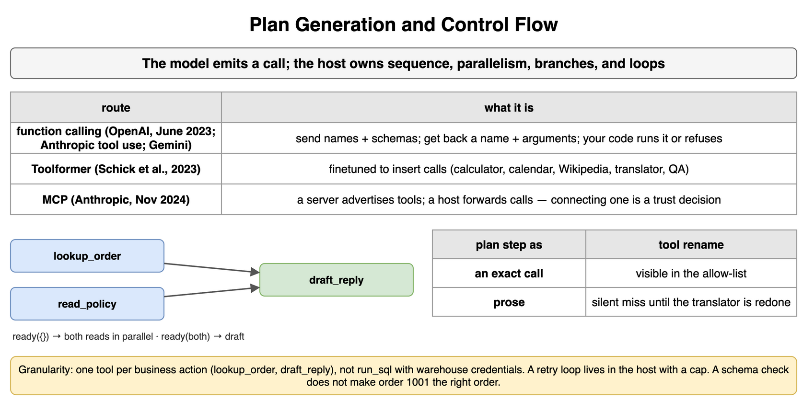

*Source: [`diagrams/rag-and-agents.drawio`](/content/10_AI_Engineering/06_RAG_and_Agents/diagrams/rag-and-agents.drawio), page 19.*

## Reflection and error correction

Reflection is the agent looking at a failed step and changing the next step. Error correction is the program giving the failure back in a form the model can use, once, rather than hoping the next sample guesses better.

ReAct, from Yao and coauthors, the 2022 preprint published at ICLR 2023, interleaves a thought, an action, and an observation. The thought is the model saying what it is about to do. The action is a tool call. The observation is the tool's real result, appended for the next turn. The pattern works when the observation can change the plan: the order id in the subject was wrong, the lookup failed, the next call uses the id from the body. It fails when the "observation" is another thought pretending the tool succeeded, or when the same action is emitted again because the model did not read the error. The trace you log has to contain the tool result, not only the thoughts. Reflexion, from Shinn and coauthors in 2023, adds a note after a failed attempt. The agent writes what went wrong, stores that note, and tries again. The note is language, not a weight update. It can be wrong, and a wrong reflection steers every later attempt. Cap the attempts. A test suite is a better critic than a note when the task is code, which is why a coding agent should run the tests rather than reflect on whether the tests would have passed.

The program's job is to make the error specific and to refuse a repeat. A schema failure comes back as the parser error. A missing order comes back as the lookup's message. A timeout is not a reason to send the identical call in a tight loop. One retry with backoff is a tool policy. The fifth identical call is a stuck agent.

```python
def classify(previous: tuple[str, str], proposed: tuple[str, str]) -> str:
    if proposed == previous:
        return "repeat"
    if proposed[0] == previous[0]:
        return "repair"
    return "new tool"


print(classify(("lookup_order", "1001"), ("lookup_order", "1002")))
print(classify(("lookup_order", "1002"), ("lookup_order", "1002")))
# repair
# repeat
```

Changing the order id after a failed lookup is a repair. Issuing the same call again is a repeat, and the host stops it. The reflection the model writes can explain the repair. It does not get to override the stop.

**Trade-offs.** ReAct uses real observations and spends a model call per step. Reflexion can avoid repeating a known mistake and can canonize a wrong theory of the mistake. Feeding the raw tool error back is cheap and can itself be an injection if the tool returned attacker text, so the error you append should be the code and the message you trust, not an unfiltered upstream body. Unlimited retries turn a missing order into a bill. A hard stop with no repair path turns a typo in an id into a failed task the model could have fixed.

**Interview.** Walk a ReAct turn as thought, action, observation, and say the observation has to be the tool's result. Cite ReAct as Yao and coauthors, ICLR 2023, and Reflexion as Shinn and coauthors, 2023, a stored note rather than a weight update. Classify a changed argument as a repair and an identical call as a repeat the host blocks. Say a coding agent should run the tests, because a reflection is not an execution. Cap the attempts.

**Recap.** Reflection changes the next step after a failure. ReAct feeds the tool's real observation back into the next decision. Reflexion stores a verbal note and tries again, and the note can be wrong. A changed argument is a repair. An identical call is a repeat the host should stop. Errors given back to the model should be the messages you trust, and the number of tries should be capped.

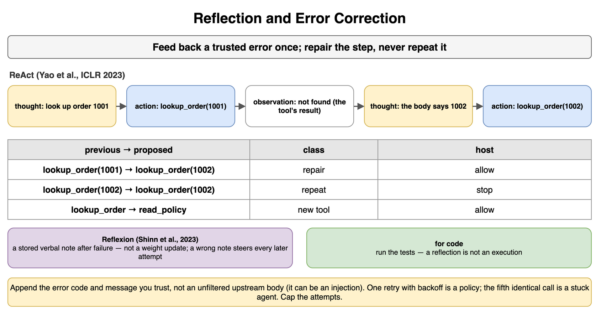

*Source: [`diagrams/rag-and-agents.drawio`](/content/10_AI_Engineering/06_RAG_and_Agents/diagrams/rag-and-agents.drawio), page 20.*

## Tool selection

Tool selection is the model's choice of which offered tool to call. The choice is only as good as the set you offered and the descriptions you wrote.

A description is a prompt. "Helps the user" matches every question, which means it matches none of them in a useful way. "Use when the customer asks where a package is. Do not use this to refund an order." is a description a second engineer can grade against a ticket. The negative sentence matters on a surface where two tools could both sound relevant, tracking and refunding, because the model has seen a lot of text in which a dissatisfied customer gets a refund. The schema matters too. An argument named `id` will be filled with whatever id is lying around. An argument named `order_id`, described as the id from the order system and not from the user's sentence, is a smaller hole. The tool list itself is context. It costs tokens on every call, and a long list is a long menu. Overlapping descriptions give the model two plausible names for one ticket. Whether a longer menu actually selects worse is an ablation on your list, not a law. The repair, when the ablation says so, is fewer tools on a given entry point. The tracking page offers tracking. The refund flow offers the refund tool, behind the checks on the Write tools card. Ablation tells you whether you needed the tool: remove it and see whether task success drops on the tasks it was supposed to handle. If it does not drop, the tool was a way to be wrong. If it drops, write a better description before you add three neighbors.

Choosing tools with embeddings of their descriptions is a reasonable router when the list is long, and it is another retriever, with the same paraphrase and exact-token issues. A router that runs before the agent is a program. It should be scored as a component, the way retrieval is scored, rather than folded into a vague claim that the agent failed.

Two published systems treat the choice as more than one independent pick. Chameleon, from Lu and coauthors, still plans with a language model. It emits a sequence of modules, and the paper then plots which module followed which module on the test set. That transition graph is a measurement of the plans. It is not a separate model that picks the next tool. A calculator after a table lookup and a calculator after a greeting show up as different edges in the plot, which is how you notice a repeated sequence. Voyager, from Wang and coauthors, stores programs that succeeded as skills and retrieves a skill instead of inventing the procedure again. The skill library is agent memory of procedures. The What an agent remembers card covers memory of facts. A retrieved skill can be stale the day the tool changes, which is the same inventory problem as a finetuned translator. Read the graph once you have traces. Do not invent the edges before that, and do not replace the planner with the picture. Ablation still decides whether storing skills beat a short tool list.

**Trade-offs.** A small tool list is easier to describe, and it cannot do the task you refused to offer. A large list looks like a platform and behaves like a noisy prompt when the descriptions overlap. Descriptions with negative examples take work to maintain and go stale when the tool's behavior changes. Ablation is an eval cost and the only evidence that a tool earns its place. A router model in front of the tools adds a call and a new place to mis-route, and it can be the right split when one agent with forty tools has already failed the selection eval.

**Interview.** Ask to read the tool description before you blame the model. Rewrite "helps the user" into when to use it and when not to. Say you would rather offer four tools on a tracking page than twenty-four on a general agent, and that ablation, not intuition, decides whether a tool stays. Point overlapping descriptions at mis-routes you can count. A tool the router never selects is either badly described or does not belong on that surface.

**Recap.** The model selects a tool from the list and the descriptions you sent. Vague descriptions match everything. A description names when to use the tool and when not to. Fewer tools on a specific entry point beat a catalog of overlapping ones. Ablation, removing the tool and rerunning the task, is how you tell a necessary tool from a way to pick wrong.

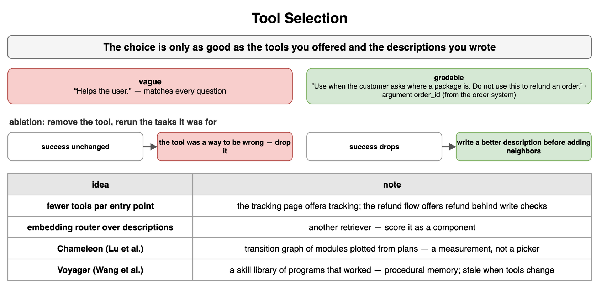

*Source: [`diagrams/rag-and-agents.drawio`](/content/10_AI_Engineering/06_RAG_and_Agents/diagrams/rag-and-agents.drawio), page 21.*

## Planning failures

A planning failure is a step that is illegal, aimed at the wrong goal, or never ends. The tool does not have to run for the failure to be real. The plan already contains it.

The model names `force_push` when that tool was not offered. The GitHub issue says to fix the retry bug, and the plan opens by renaming the package. The thought says the tests passed, and the log has no test observation. The loop keeps proposing steps until the budget dies because the model never proposes stop. These are different shapes of one gap. The model samples a plausible continuation, and a plausible continuation is not a legal plan. The allow-list rejects the unknown tool. The plan checker, on the planning card, rejects a write sequenced before the read that would justify it. The step cap stops the loop that never proposes stop. A thought without an observation is not a success. The host records the stop reason, so a later eval can tell an illegal plan from a tool that timed out.

**Trade-offs.** A tight allow-list and a short cap stop illegal plans and also stop a long task you did not anticipate. Checking the plan in code catches a bad step before it runs. Asking the model whether the plan is safe is another sample. A frozen plan is reviewable and blind to the first tool error, so a legal plan can still become a tool failure on the next card. Editing the prompt because a plan was illegal can be the right fix. Editing the prompt because the tool timed out is the wrong fix, which is why the stop reason has to name the class.

**Interview.** Classify the failure before you name a fix. An invented tool, a goal the user did not ask for, a success claimed with no observation, and a loop that does not stop are planning failures. The fixes are the allow-list, the plan checker, and the step cap. A wrong id on a tool you did offer is not in this class. That is a tool failure. Say you would log the proposed step and the reason it was rejected.

**Recap.** Planning failures are illegal steps, steps aimed at the wrong goal, and loops that do not stop. The tool does not have to run for the plan to be wrong. An allow-list, a plan checker, and a step cap are the fixes, and a model's approval of its own plan is not one of them. A thought that claims success without a tool observation is a planning failure in the log.

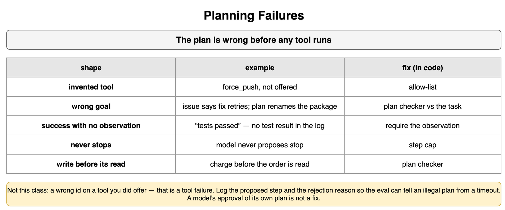

*Source: [`diagrams/rag-and-agents.drawio`](/content/10_AI_Engineering/06_RAG_and_Agents/diagrams/rag-and-agents.drawio), page 22.*

## Tool failures

A tool failure is a call that was allowed and is still wrong. The tool exists, the arguments match the schema, and the outcome is not the outcome the task needed.

The host offered `comment_on_issue`. The model comments on GitHub issue 10 while the person is looking at issue 11. The schema is satisfied. The issue is wrong. A tracking lookup times out, and the draft fills in a delivery date from the weights. The help-center index is a day behind the article the writer just published, which is the lag in the search topic, not a new kind of hallucination. The lookup returns a customer note that says to ignore the refund policy, and the next step follows the note. That is indirect prompt injection carried in a tool result, which stays on the Indirect prompt injection card in [Prompt Engineering](../05_Prompt_Engineering/). A refund that is allowed, and then retried after a failed email, is the idempotency failure on the Write tools card. The fixes match the mechanism. Check or recompute the arguments. Put a timeout on the call. Refresh the index when the source changes. Append an error you trust, not an unfiltered upstream body. Do not treat a retry of a write as free.

**Trade-offs.** Schema validation catches a missing field and misses a well-typed wrong id. A timeout keeps one stuck call from consuming the step budget and turns a slow dependency into a failed step you have to handle. Retrying a read can be right. Retrying a write without a key can apply it twice. Showing the raw tool body to the model helps debugging and hands the next turn to whoever wrote the body. A planning cap will not catch a single legal call that names the wrong issue.

**Interview.** Separate this class from planning. The tool was offered and the call was well typed. Give the wrong issue id, the timeout, the stale index, and the instruction inside the tool result as four mechanisms with four fixes. Point injection at Prompt Engineering and the idempotency key at the payment topic. Say a green schema check is not evidence you touched the right record.

**Recap.** Tool failures are allowed calls that still do the wrong thing. The arguments can name the wrong record, the call can time out, the index can be stale, and the result can contain an instruction. A schema check is necessary and not sufficient. Recompute the arguments that matter, bound the call, and do not feed an untrusted body back as if it were an observation you wrote.

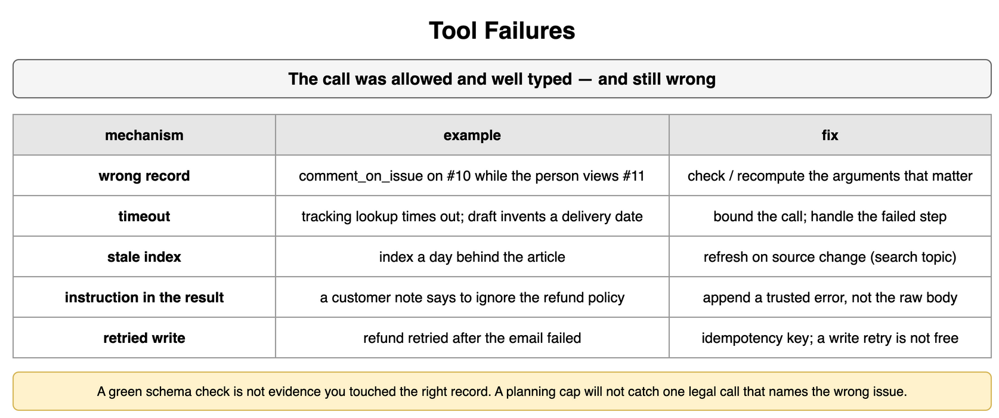

*Source: [`diagrams/rag-and-agents.drawio`](/content/10_AI_Engineering/06_RAG_and_Agents/diagrams/rag-and-agents.drawio), page 23.*

## Efficiency failures

An efficiency failure is a plan that is legal and still too expensive. The task can succeed. The bill, the latency, or both are what failed.

The same lookup can be proposed on several steps. Independent reads can run one model call apart when they could have shared a step. The context grows by the whole history on every step, so the sixth call pays for the first five. The exercise prices are the ones used across this series, $0.50 per million input tokens and $2.00 per million output tokens, not a rate card. A six-step loop starts from an 800-token prefix of instructions, tool schemas, and the user request. Each step emits 120 output tokens and appends a 280-token observation, so the next input grows by 400. A one-shot retrieve-then-answer call, a different design, is 2,000 input tokens and 200 output tokens.

```python
INPUT_PER_M = 0.50
OUTPUT_PER_M = 2.00
CALLS = 100_000
PREFIX = 800
GROWTH = 400
OUTPUT = 120
STEPS = 6


def bill(calls: int, input_tokens: int, output_tokens: int) -> float:
    input_cost = calls * input_tokens / 1_000_000 * INPUT_PER_M
    output_cost = calls * output_tokens / 1_000_000 * OUTPUT_PER_M
    return input_cost + output_cost


inputs = [PREFIX + step * GROWTH for step in range(STEPS)]
agent = bill(CALLS, sum(inputs), OUTPUT * STEPS)
once = bill(CALLS, 2_000, 200)
print(inputs, sum(inputs), OUTPUT * STEPS)
print(f"{agent / CALLS:.5f} {agent:.2f} {once:.2f}")
# [800, 1200, 1600, 2000, 2400, 2800] 10800 720
# 0.00684 684.00 140.00
```

The six inputs sum to 10,800 tokens and the six outputs sum to 720. Per task that is $0.00684 at the exercise prices. Per 100,000 tasks it is $684.00. The one-shot call is $140.00 on the same 100,000 tasks. The gap is not "six times one call." The 120-token reply is billed as output once. That reply and the 280-token observation are both billed again as input on every later step, which is why the inputs are 800, then 1,200, then 1,600, and so on. Parallel tool calls shrink this sum only when they remove a model call. Two lookups returned from one step are one output plus one later input, not two. If the model is still called six times, running the tools side by side changes latency and not this token sum. A step cap is an efficiency control and a planning control at the same time. The reflection card's repeat check is what stops an identical call before the cap is the only thing left.

**Trade-offs.** A tight step cap stops a loop and cuts tasks that legitimately need another lookup. Logging only the final message makes planning, tool, and cost failures look the same, so you edit the prompt when the tool timed out. An efficiency project that deletes a necessary verification to save the $684 has optimized the wrong failure. Prices move. The shape, a growing context over several model calls, is what you recompute on the current card.

**Interview.** Classify a failure before you propose a fix. An invented tool is a planning failure. A wrong id on a real tool is a tool failure. A legal loop whose context grows every step is efficiency. Compute the six-step exercise, $684.00 per 100,000 tasks against $140.00 for one retrieve-then-answer call, and explain why the earlier reply and the observation are paid again as input. Say parallel tools cut the bill only when they cut model calls. Say you would log the tool name, the arguments, the observation, and the stop reason.

**Recap.** Efficiency failures are legal plans that cost too much. At the exercise prices, the six-step loop is $684.00 per 100,000 tasks, against $140.00 for a single retrieve-then-answer call. Each earlier reply is paid as output and then, with the tool observation, as input on later steps. Fewer model calls shrink that bill. A step cap bounds it and does not by itself notice that a repeated call added no information.

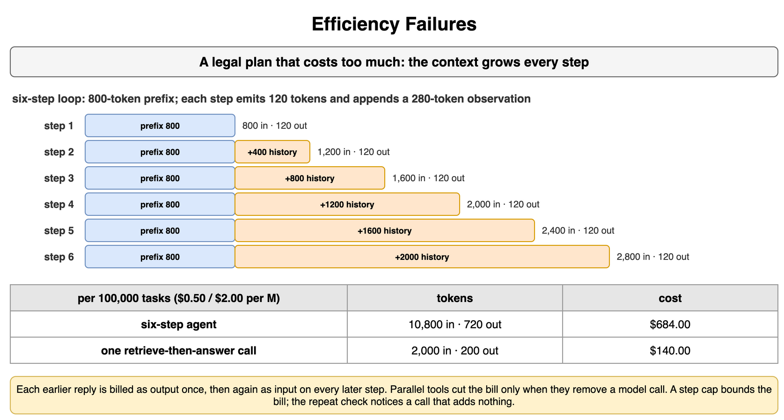

*Source: [`diagrams/rag-and-agents.drawio`](/content/10_AI_Engineering/06_RAG_and_Agents/diagrams/rag-and-agents.drawio), page 24.*

## Compounding error in agents

Compounding error is the drop in end-to-end success when each step has to be right and a later step does not repair an earlier miss. Per-step accuracy multiplies.

If each of ten steps is correct with probability 0.95 given that the earlier steps were correct, and a wrong step is not repaired, the task succeeds with probability `0.95^10`, about 0.599. A model that looks strong on a single tool call succeeds about six times in ten on a ten-step refund or a ten-step coding task. The same arithmetic is why a one-point gain in per-step accuracy matters more as the plan gets longer, and why an agent wants a stronger model than a one-shot summary of the same domain. Ten steps at 0.99 still succeed only about 0.904 of the time. Ten steps at 0.90 succeed about 0.349 of the time. That product is the no-repair case, not a floor under it. A checker that sends the agent back, in the next paragraphs, is how a task does better than 0.599. A cascade does not push the rate lower than the product. The product is the cascade: a miss is final. What does miss the product is using a 0.95 measured on a clean single call as if it were the conditional rate inside a long trace, where the model is continuing from its own earlier text. Measure that conditional rate on prefixes the model produced. The pass^k number on the Agent evaluation card is a different product: the chance that every repeated trial of a whole task succeeds. pass@k, on the Functional correctness card in [Evaluation Methodology](../03_Evaluation_Methodology/), is the chance that at least one trial succeeds, and there an independence formula is a ceiling, because correlated bugs are not fresh draws. This card is the product along the steps of one trial.

```python
print(f"{0.95 ** 10:.3f}")
print(f"{0.99 ** 10:.3f} {0.90 ** 10:.3f}")
# 0.599
# 0.904 0.349
```

That is why agents need stronger models and fewer steps. A stronger model is a higher per-step rate, which is the only base the exponent has. Fewer steps is a smaller exponent. A fixed pipeline of two calls, retrieve then draft, does not pay `0.95^10`. The Efficiency failures card prices the token bill of six steps. This card prices the success rate. Both push the same direction. Collapse a plan that does not need a loop. The step cap on the Planning failures card is an accuracy control as well as a cost control, because step eleven multiplies another factor below 1 and another chance to drift.

Stakes rise when a step is a write. A wrong lookup can be repaired by the next call on the Reflection and error correction card. A wrong refund, a sent email, or a merge cannot be multiplied back into correctness. The Write tools card is the gate. Verification, a checkpoint, human approval, and reflection are the mitigations, and they break the product in different places. Verification is a checker that does not share the failure: tests for code, a recomputed amount for a refund, a schema for a tool call. A checkpoint is a commit, a draft, or a held payment you can return to, so a bad later step does not destroy a prefix that was right. The Foundation models as planners card is why the checkpoint has to be real. An autoregressive sample cannot unsay a token, and a tool that can revert is what makes backtracking more than another forward guess. Human approval cuts the chain at the write, which is why the introduction topic keeps a person on money movement. Reflection, the ReAct loop, repairs a read that returned an error. It does not repair a write that already succeeded, and a wrong reflection is itself another step in the product.

**Trade-offs.** Fewer steps raise end-to-end accuracy and cannot handle a task whose second action depends on the first result. A stronger model raises the base rate and the price of every step, which the Efficiency failures card shows on the bill. Verification adds a check and is cheaper than a silent wrong write. Checkpoints add product complexity and are what make a long task survivable. Human approval serializes the write and is the correct cost for a refund. Reflection spends steps, which multiplies the error again when the reflection is wrong, so the attempt cap stays.

**Interview.** Compute `0.95^10` and say the result is about 0.599 when each later step stays at 0.95 after a correct prefix and a miss is not repaired. Then say what you would change: a stronger model, fewer model calls, a verifier that is not the same sample, a checkpoint, and a person on the write. Distinguish a failed read, which reflection can repair, from a failed write, which approval should have stopped. If someone quotes a 95 percent tool-call demo as the agent's reliability, multiply, and say the demo was not the conditional rate inside the trace. A repair is what beats the product. The product is already the case where a miss is final.

**Recap.** Per-step accuracy compounds. Ten steps at 0.95 succeed about 0.599 of the time when each later step stays at that rate and a miss is not repaired, ten at 0.99 about 0.904, and ten at 0.90 about 0.349. Agents need a stronger model and a shorter plan than a one-shot call, and a write makes a wrong step expensive rather than retryable. Verification, checkpoints, human approval, and reflection on failed reads are how a task beats that product. A 95 percent demo on one clean call is not the reliability of the loop.

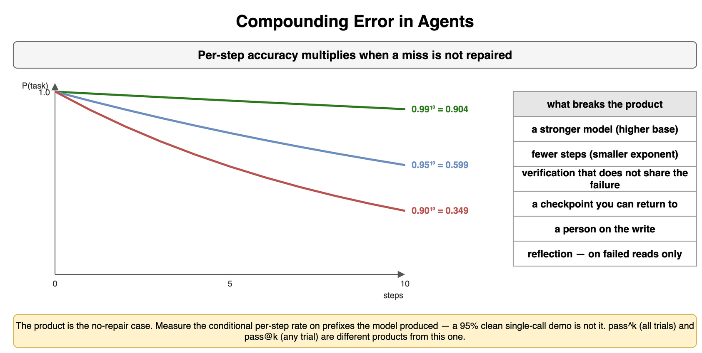

*Source: [`diagrams/rag-and-agents.drawio`](/content/10_AI_Engineering/06_RAG_and_Agents/diagrams/rag-and-agents.drawio), page 25.*

## Agent evaluation

Agent evaluation scores the steps and the outcome, on tasks where a program can tell that the world ended in the right state.

The component pipeline in [Evaluate AI Systems](../04_Evaluate_AI_Systems/) already says to log every stage. For an agent the stages are the retrievals, the tool name and arguments, the observations, the plan, and the final state. A grounded help-center answer with an empty retrieval is a component failure even if the sentence happens to be true. A coding agent that edits the right file and never runs the tests is a component failure even if a later human makes the tests pass. Task success is the outcome: the tests pass, the booking matches the request, the database row is the row the policy allows. Turn scores and task scores disagree often enough that you report both. Public benchmarks are the place this disagreement was made crisp, and they are not your ticket queue.

SWE-bench scores a generated patch on a real repository. The functional-correctness card defines the outcome: the tests that failed before the gold fix now pass, and the tests that passed still pass. SWE-bench Verified, released by OpenAI with the benchmark authors in August 2024, is a 500-instance subset that human annotators filtered because items in the full set had underspecified issues or unfair tests. The outcome rule does not change. A leaderboard percentage on either set is that scaffold on that date. WebArena, from Zhou and coauthors in 2023, puts the agent in self-hosted websites, including a shop, the shop's admin site, a forum, a GitLab-style development site, a wiki, and a map, and scores the resulting state of the site rather than the agent's last sentence. τ-bench, from Yao and coauthors in 2024, is a conversation with a simulated user, domain tools, and a written policy, in retail and airline settings. Success is the database state at the end. The paper's reliability metric is pass^k, the chance that all k independent trials of a task succeed. That is the opposite emphasis from pass@k in the functional-correctness card, which is the chance that at least one of k trials succeeds. The paper's own results section reports gpt-4o function calling at about 61 percent pass^1 on retail and about 35 percent on airline, with retail pass^8 falling to about 25 percent. The abstract compresses those experiments to under half the tasks and to pass^8 under 25 percent in retail. Quote the domain if you quote a rate. Those are that paper's 2024 agents. A user simulator is not your customers, and a later leaderboard is a different measurement. GAIA, from Mialon and coauthors in 2023, is 466 questions with short answers, sorted into three levels and scored by whether the answer matches. In that paper, human respondents scored 92 percent and GPT-4 with plugins scored 15 percent. That gap is the paper's. It is not a current ranking. The exercise below is only the estimator, on counts that are not a published model score. With 5 successes in 8 trials, the unbiased pass^3 is `C(5, 3) / C(8, 3)` and the unbiased pass@3 is `1 - C(3, 3) / C(8, 3)`. The paper writes the same two estimators.

```python
from math import comb


n, c, k = 8, 5, 3
pass_hat = comb(c, k) / comb(n, k)
pass_at = 1 - comb(n - c, k) / comb(n, k)
print(f"{pass_hat:.4f} {pass_at:.4f}")
# 0.1786 0.9821
```

Pass^3 is 0.1786 and pass@3 is 0.9821. A leaderboard that quotes the second number is describing a system you are willing to sample from three times and keep a success. A booking flow that must work every time the same customer asks is the first number. Report the one that matches the product, and report it next to the component scores so a pretty outcome rate cannot hide a tool call that a person is quietly fixing.

**Trade-offs.** Final-state checks are resistant to eloquent nonsense and blind to a dangerous step that happened to be undone. Component checks catch the dangerous step and can fail a recovery you designed. pass^k gets harsher as k grows and will reject a model that is right most of the time and inconsistent. pass@k does the opposite and flatters extra samples the product will not take. Public web and tool benchmarks drift, saturate, and use simulators. A private set of your own tasks, with the policy and the database fixture, is the launch number. It costs more to build than quoting a paper.

**Interview.** Split step score from outcome score and attach a benchmark to the outcome: SWE-bench, or the 500-instance Verified subset from August 2024, for a patch and its tests; WebArena for website state; τ-bench for a database state under a policy; GAIA for a short answer. Define pass^k as all k trials succeeding, compute 0.1786 against pass@3 of 0.9821 on 5 successes out of 8, and say which product each number is for. If you cite τ-bench, give the domain: about 61 percent pass^1 on retail and about 35 percent on airline for gpt-4o function calling in that paper, with retail pass^8 near 25 percent. A simulator score does not replace the private set.

**Recap.** Agents are evaluated on their steps and on the state they leave behind. SWE-bench uses repository tests, and SWE-bench Verified is the 500-instance human-filtered subset. WebArena uses website state. τ-bench uses the database after a policy-bound conversation. GAIA uses a short answer. pass^k requires every trial to succeed, unlike pass@k. On an exercise of 5 successes in 8 trials, pass^3 is 0.1786 and pass@3 is 0.9821. The τ-bench paper's gpt-4o agent was near 61 percent once on retail, near 35 percent once on airline, and near 25 percent across eight retail repeats. Your launch number is still your tasks.

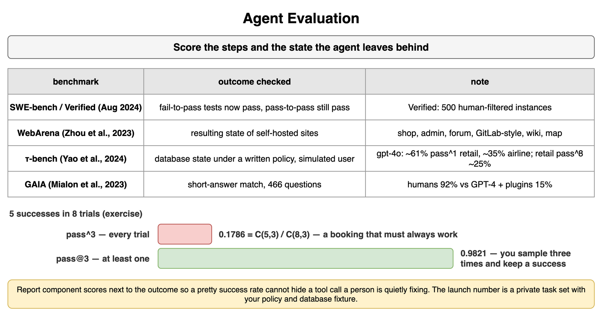

*Source: [`diagrams/rag-and-agents.drawio`](/content/10_AI_Engineering/06_RAG_and_Agents/diagrams/rag-and-agents.drawio), page 26.*

## What an agent remembers

Agent memory is state that survives a step. Some of it is in the weights, some of it is in the current context, and some of it is in a store outside the model.

Internal knowledge is the weights. It is what the model can say with an empty prompt, and it changes when the model is trained or replaced, not when a help-center page is edited. That is why a changing wiki stays on the retrieval lever from the introduction topic. Short-term memory is the context window: the conversation, the plan, the tool results, and a summary you may have inserted. It is exactly as long as the model will read on this call, it costs the input bill, and it dies when the session ends unless you write it somewhere. The KV cache in [Understanding Foundation Models](../02_Understanding_Foundation_Models/) is why that window has a memory cost during the call. The lost-in-the-middle result on the context-efficiency card is why a fact stuffed into the center of a long thread is the fact the model skips. Long-term memory is external. A vector index of past tickets, a profile row in the CRM, and a store the agent pages in with a tool call are this layer. ChatGPT memory, which OpenAI shipped in 2024, keeps facts across chats. Some are saved because the person asked. Some are saved because the model decided to save them. The person can review and delete them. A saved sentence is not a permission to act. MemGPT, from Packer and coauthors in 2023, treats the window as a scarce resource and lets the model page information in and out of external storage with tool calls, on the analogy of virtual memory. The same line of work continued as Letta. Paging is still a tool call. It can retrieve the wrong page, and the page it writes can be wrong.

Memory is there for two jobs that a longer prompt does not reliably do. It keeps the agent consistent with a commitment it already made, so a later turn does not contradict the return window it quoted. And it preserves structured facts exactly, an order id, an allergy, a date, which a summary will paraphrase and then get wrong. The Managing agent memory card is the mechanism: those fields stay in records, and the prose summary is not allowed to be the source a write tool reads. A memory system that only stores embeddings of past chats will boost a vibe of consistency and drop the id. Store the id as the id.

**Trade-offs.** Weights are always available and stale relative to a wiki that changed this morning. The context window is exact about what was said this session and expensive, and it forgets the session when the session ends. An external store remembers across sessions and becomes a second source of truth that conflicts with the person, with the CRM, and with itself. A memory the person cannot see or delete is a support incident as soon as it is wrong. Putting every past ticket into the window is the long-context bill. Putting them in a store and retrieving is RAG again, with the same miss modes.

**Interview.** Name the three stores and the operation that updates each: a training run for the weights, the next request for the window, and a write to the store for long-term memory. Give ChatGPT memory and a MemGPT-style page store as the external examples, and say Letta is the continuation of MemGPT. A fact in the weights does not update when the article does. A fact in the window does not survive the session. A fact in the store can be wrong, and the person has to be able to see it and delete it.

**Recap.** Memory is weights, the context window, or an external store. Weights lag the wiki. The window is the session, it costs input tokens, and then it is gone. ChatGPT memory and MemGPT-style paging, continued as Letta, persist facts across sessions and can persist the wrong ones. A stored memory is not by itself a permission. What stays in the budget, what gets compressed, and what happens when two facts disagree is the next card.

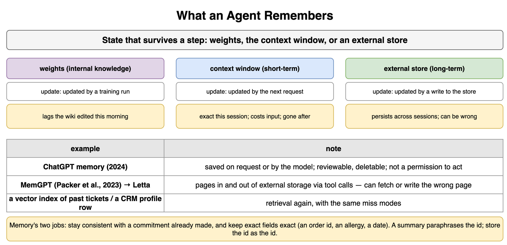

*Source: [`diagrams/rag-and-agents.drawio`](/content/10_AI_Engineering/06_RAG_and_Agents/diagrams/rag-and-agents.drawio), page 27.*

## Managing agent memory

Memory management is how you decide what stays in the budget, what gets compressed, and what happens when two stored facts disagree.

Summarization compresses older turns so the thread fits. A summary is a generation. It can drop the order id or invent one, so fields you will act on stay in structured records, and the summary is for prose. Eviction drops something when the budget is full. Dropping the oldest item is simple and will forget a constraint in favor of a recent note if you let it. Conflicts are two records that cannot both be acted on. The user said they were vegetarian, and a later note says they eat chicken. Those records need timestamps and a question before a reservation tool runs. Silently keeping the newest is a policy for a suggestion, not an authorization.

```python
BUDGET = 800
ITEMS = (("allergy", 200), ("smalltalk", 250), ("trip", 500))
PINNED = {"allergy"}


def evict_oldest(items: tuple[tuple[str, int], ...], budget: int) -> list[str]:
    kept = list(items)
    while sum(size for _, size in kept) > budget and kept:
        kept.pop(0)
    return [name for name, _ in kept]


def evict_unpinned(items: tuple[tuple[str, int], ...], budget: int, pinned: set[str]) -> list[str]:
    kept = list(items)
    while sum(size for _, size in kept) > budget:
        index = next((i for i, (name, _) in enumerate(kept) if name not in pinned), None)
        if index is None:
            break
        kept.pop(index)
    return [name for name, _ in kept]


print(sum(size for _, size in ITEMS))
print(evict_oldest(ITEMS, BUDGET))
print(evict_unpinned(ITEMS, BUDGET, PINNED))
print(evict_unpinned(ITEMS, BUDGET, {"allergy", "smalltalk", "trip"}))
# 950
# ['smalltalk', 'trip']
# ['allergy', 'trip']
# ['allergy', 'smalltalk', 'trip']
```

The three memories use 950 tokens against a budget of 800. Evicting the oldest keeps small talk and the trip, and drops the allergy. Evicting an unpinned item first keeps the allergy and the trip, and drops the small talk. If every remaining item is pinned, the function keeps all three and the prompt stays at 950, over the budget on purpose. Dropping the allergy to satisfy the number would be the bug the pin exists to prevent. A travel note can be rebuilt from the itinerary. An allergy in the prompt is how a dinner booking stays safe. ChatGPT memory and a MemGPT-style store have the same bug if they save sentences and never mark which sentences are constraints.

**Trade-offs.** Summaries save tokens and lose fields. Eviction keeps the budget and encodes a priority, whether you wrote the priority down or not. A pin that itself exceeds the budget has to win, or the constraint was never a pin. Asking the user to confirm every memory is safe and exhausting. Confirming before a write tool uses the memory is the narrower ask. Newest-wins is a reasonable way to display a suggestion and a bad way to authorize a booking.

**Interview.** Give summarization, eviction, and conflicts as the three management problems. On the 800-token exercise, say oldest-first eviction drops the allergy, a pin keeps it, and pinning everything leaves the prompt over budget at 950 rather than dropping the constraint. A conflict between two diet notes is resolved by asking before a booking, not by averaging the sentences. Structured fields outrank a summary when the tool will act on the value.

**Recap.** Managing memory is compression, eviction, and conflicts. A summary can drop the field a tool will act on, so that field stays structured. On an 800-token budget, evicting the oldest item drops a 200-token allergy and keeps small talk and a trip. A pin keeps the allergy. If the pins themselves exceed the budget, they stay and the budget is exceeded. Two conflicting values are asked about before a write tool uses them.

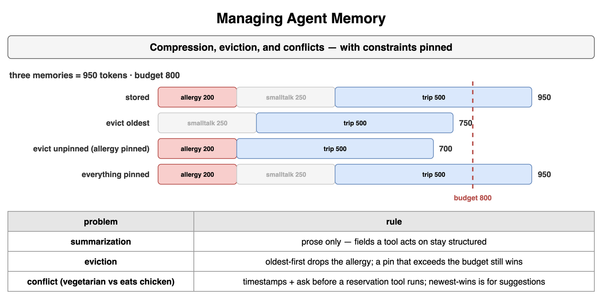

*Source: [`diagrams/rag-and-agents.drawio`](/content/10_AI_Engineering/06_RAG_and_Agents/diagrams/rag-and-agents.drawio), page 28.*
