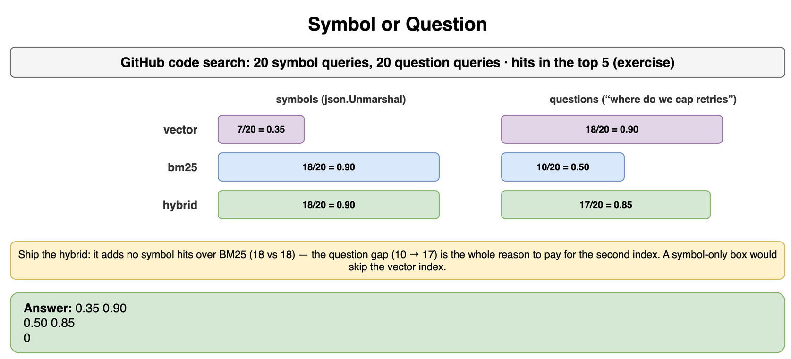
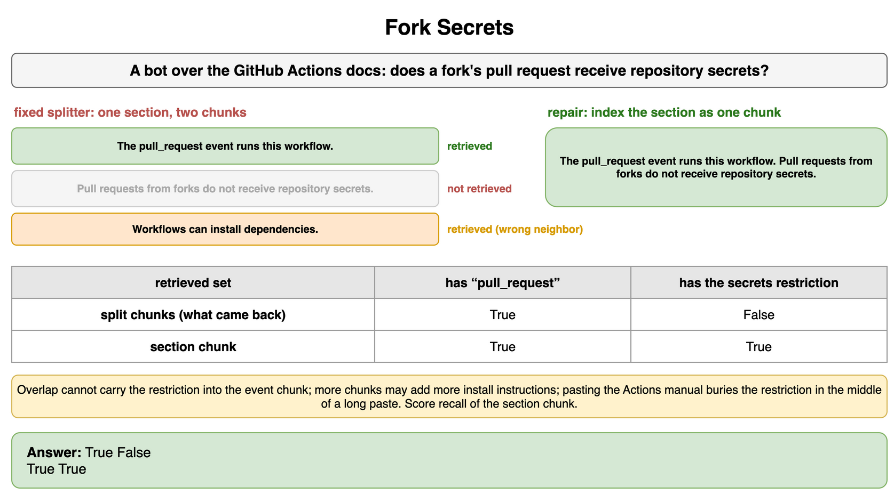
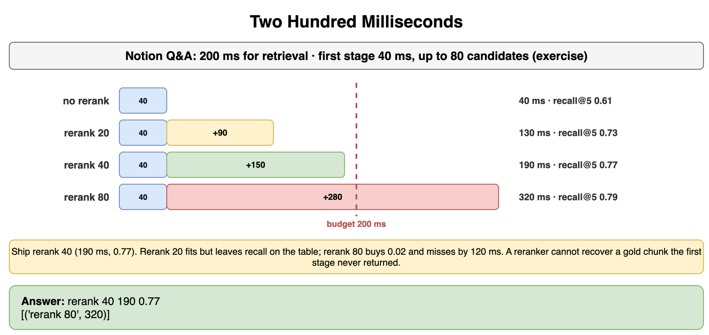
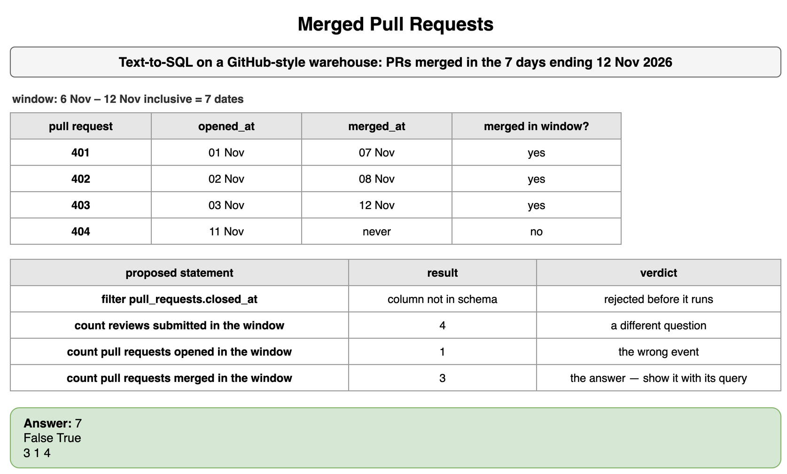
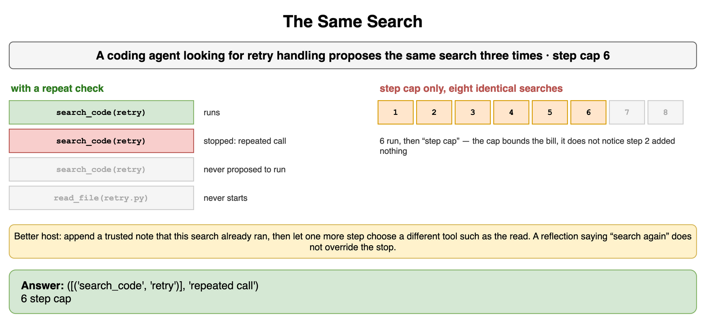
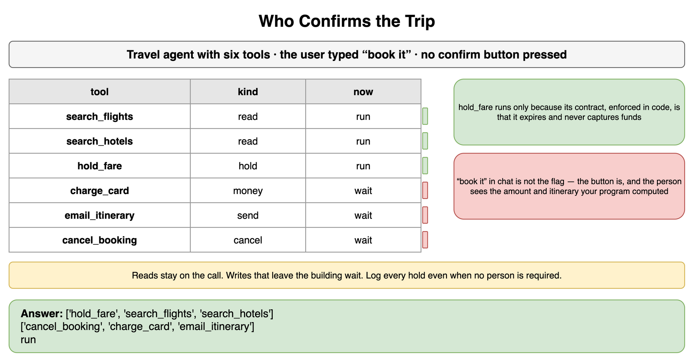
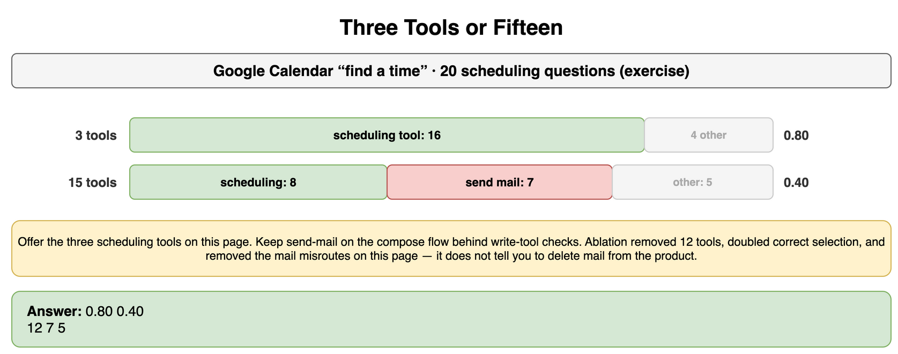
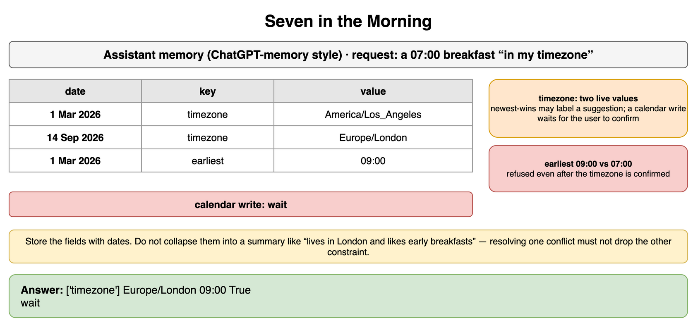

# RAG and Agents — Drills

Practice for the retrieval and agent decisions in this chapter. Each card is one exercise: commit to an answer, then check it. The products are real. Ranks, prices, latencies, token counts, and scores are assumptions for the arithmetic. A launch uses a measured index, the current rate card, and the eval you actually run.

## Symbol or Question

GitHub code search receives two kinds of queries. Some are symbols, such as `json.Unmarshal`. Some are questions, such as "where do we cap retries." On an exercise set of 20 symbol queries and 20 question queries, which is not a published GitHub metric, the number of queries whose intended file appears in the top 5 is below. Pure vector search, pure BM25, and a hybrid of the two are the three systems.

Which system do you ship for a box that receives both kinds of query, and when would you skip the vector index?

```python
SYMBOLS = 20
QUESTIONS = 20
# Exercise top-5 hits, not a GitHub metric.
HITS = {
    "vector": {"symbol": 7, "question": 18},
    "bm25": {"symbol": 18, "question": 10},
    "hybrid": {"symbol": 18, "question": 17},
}
```

**Answer:** Ship the hybrid. On symbols it hits 18 of 20, recall 0.90, the same as BM25, and well above the vector index's 7 of 20, recall 0.35. On questions it hits 17 of 20, recall 0.85, against BM25's 10 of 20, recall 0.50. Pure vector search is the wrong system for `json.Unmarshal`, because nearby prose outranks the exact token. Pure BM25 is the weaker system for "where do we cap retries," because the file that implements the cap may not share those words. The hybrid adds no symbol hits over BM25. The question gap is the whole reason to pay for the second index. If the box received only symbols, BM25 at 18 of 20 would match the hybrid and the vector index would be an update path you could skip. This box receives both. These counts are not the rank fusion on the concept card, and they are not a GitHub dashboard. Recompute them on your own queries before you buy the second index.

```python
SYMBOLS = 20
QUESTIONS = 20
HITS = {
    "vector": {"symbol": 7, "question": 18},
    "bm25": {"symbol": 18, "question": 10},
    "hybrid": {"symbol": 18, "question": 17},
}


def recall(system: str, kind: str, n: int) -> float:
    return HITS[system][kind] / n


print(f"{recall('vector', 'symbol', SYMBOLS):.2f} {recall('hybrid', 'symbol', SYMBOLS):.2f}")
print(f"{recall('bm25', 'question', QUESTIONS):.2f} {recall('hybrid', 'question', QUESTIONS):.2f}")
print(HITS["hybrid"]["symbol"] - HITS["bm25"]["symbol"])
# 0.35 0.90
# 0.50 0.85
# 0
```



*Source: [`diagrams/rag-and-agents-drills.drawio`](/content/10_AI_Engineering/06_RAG_and_Agents/diagrams/rag-and-agents-drills.drawio), page 1.*

## Fork Secrets

A bot over GitHub's Actions documentation is asked whether a pull request from a fork receives repository secrets. The relevant section is two sentences that a fixed splitter put in different chunks. The retriever returned the event sentence and an unrelated sentence about installing dependencies. It did not return the secrets sentence. The draft says the workflow runs and does not mention the secrets restriction.

What do you change in the index, and why is pasting the Actions manual into the prompt the wrong repair?

```python
EVENT = "The pull_request event runs this workflow."
SECRETS = "Pull requests from forks do not receive repository secrets."
SECTION = EVENT + " " + SECRETS
RETRIEVED = (EVENT, "Workflows can install dependencies.")


def contains(chunks: tuple[str, ...] | list[str], fact: str) -> bool:
    return any(fact in chunk for chunk in chunks)
```

**Answer:** Index the section as one chunk, so a single hit contains both the event and the restriction. The retrieved set supports "pull_request" and does not support "do not receive repository secrets," which is why the draft can sound confident and still be incomplete. Overlap of a few tokens does not repair this cut. The two sentences share no token that would carry the restriction into the event chunk. Raising the number of retrieved chunks might have included the secrets sentence, and it also might have included more install instructions. The log shows the second hit was already the wrong neighbor. A parent-section fetch, match the sentence and generate from the section, is the same repair. Pasting the Actions manual spends the context window and puts the restriction in the middle of a long paste, which is the context-efficiency problem in Prompt Engineering. The section is short. It belongs in one chunk. Score recall of that chunk. A fluent draft that never saw the secrets sentence is not a retrieval success.

```python
EVENT = "The pull_request event runs this workflow."
SECRETS = "Pull requests from forks do not receive repository secrets."
SECTION = EVENT + " " + SECRETS
RETRIEVED = (EVENT, "Workflows can install dependencies.")


def contains(chunks: tuple[str, ...] | list[str], fact: str) -> bool:
    return any(fact in chunk for chunk in chunks)


print(contains(RETRIEVED, "pull_request"), contains(RETRIEVED, "do not receive repository secrets"))
print(contains([SECTION], "pull_request"), contains([SECTION], "do not receive repository secrets"))
# True False
# True True
```



*Source: [`diagrams/rag-and-agents-drills.drawio`](/content/10_AI_Engineering/06_RAG_and_Agents/diagrams/rag-and-agents-drills.drawio), page 2.*

## Two Hundred Milliseconds

Notion Q&A has an exercise budget of 200 milliseconds for retrieval before the model starts generating. The first-stage search takes 40 milliseconds and returns up to 80 candidates. A cross-encoder then reranks a prefix of that list. The times and the recall-at-5 figures below are exercise measurements, not a published Notion benchmark.

Which option do you ship?

```python
BUDGET_MS = 200
RETRIEVE_MS = 40
# Exercise latency and recall@5, not a Notion benchmark.
OPTIONS = (
    ("no rerank", 0, 0.61),
    ("rerank 20", 90, 0.73),
    ("rerank 40", 150, 0.77),
    ("rerank 80", 280, 0.79),
)
```

**Answer:** Ship the rerank of 40 candidates. It finishes in 190 milliseconds and has exercise recall at 5 of 0.77. The rerank of 20 also fits, at 130 milliseconds and 0.73, and it leaves recall on the table inside the budget. The rerank of 80 reaches 0.79 and takes 320 milliseconds, which misses the budget by 120. No rerank fits and scores 0.61. The step from 40 to 80 buys 0.02 recall and breaks the wait the user actually has. If the budget were 100 milliseconds, only the list with no rerank would fit, and you would ship that and argue for a faster reranker rather than silently exceeding 100. A reranker still cannot recover a gold chunk the first stage never returned. These recalls are not Cohere's and not Notion's. Time your own candidate counts.

```python
BUDGET_MS = 200
RETRIEVE_MS = 40
OPTIONS = (
    ("no rerank", 0, 0.61),
    ("rerank 20", 90, 0.73),
    ("rerank 40", 150, 0.77),
    ("rerank 80", 280, 0.79),
)


def fits(extra_ms: int) -> tuple[int, bool]:
    total = RETRIEVE_MS + extra_ms
    return total, total <= BUDGET_MS


legal = [(name, *fits(extra), recall) for name, extra, recall in OPTIONS if fits(extra)[1]]
best = max(legal, key=lambda row: row[3])
miss = [(name, fits(extra)[0]) for name, extra, _ in OPTIONS if not fits(extra)[1]]
print(best[0], best[1], f"{best[3]:.2f}")
print(miss)
# rerank 40 190 0.77
# [('rerank 80', 320)]
```



*Source: [`diagrams/rag-and-agents-drills.drawio`](/content/10_AI_Engineering/06_RAG_and_Agents/diagrams/rag-and-agents-drills.drawio), page 3.*

## Merged Pull Requests

A text-to-SQL assistant sits on a GitHub-style warehouse. The question, asked on 12 November 2026, is how many pull requests were merged in the seven days ending that day. Seven days ending 12 November, counted inclusively, is 6 November through 12 November. The model proposes two statements. The first filters `pull_requests.closed_at`. The second counts `reviews` submitted in that window. The schema and the fixture below are an exercise, not a GitHub export.

What do you run, what do you answer, and which statement never reaches the warehouse?

```python
from datetime import date

AS_OF = date(2026, 11, 12)
START = date(2026, 11, 6)
SCHEMA = {
    "pull_requests": {"id", "opened_at", "merged_at", "author"},
    "reviews": {"id", "pull_request_id", "submitted_at"},
}
PULLS = (
    {"id": 401, "opened_at": date(2026, 11, 1), "merged_at": date(2026, 11, 7)},
    {"id": 402, "opened_at": date(2026, 11, 2), "merged_at": date(2026, 11, 8)},
    {"id": 403, "opened_at": date(2026, 11, 3), "merged_at": date(2026, 11, 12)},
    {"id": 404, "opened_at": date(2026, 11, 11), "merged_at": None},
)
REVIEWS = (
    {"id": 1, "pull_request_id": 401, "submitted_at": date(2026, 11, 8)},
    {"id": 2, "pull_request_id": 402, "submitted_at": date(2026, 11, 9)},
    {"id": 3, "pull_request_id": 403, "submitted_at": date(2026, 11, 10)},
    {"id": 4, "pull_request_id": 404, "submitted_at": date(2026, 11, 11)},
)
```

**Answer:** `pull_requests.closed_at` is not in the schema, so that statement is rejected before it runs. Counting reviews is legal SQL and answers a different question: 4 reviews were submitted in the window. Counting pull requests by `opened_at` is also the wrong event: only 404 was opened in the window, so that count is 1. The question asked for merges. Pull requests 401, 402, and 403 have `merged_at` inside 6 November through 12 November, and 404 was never merged. The answer is 3. The window is seven dates, not eight: 12 November minus 6 November is 6 days apart, and both ends count. Execution on the fixture is what separates 3 from 4 and from 1. A string match against one gold query would also reject another statement that counts the same merged rows with a different alias. The functional-correctness card is why the result, not the spelling, is the score, and why the statement still has to be one read. Show the 3 with the query that produced it. Do not let the model say "one pull request" because it filtered the day the pull request was opened.

```python
from datetime import date

AS_OF = date(2026, 11, 12)
START = date(2026, 11, 6)
SCHEMA = {
    "pull_requests": {"id", "opened_at", "merged_at", "author"},
    "reviews": {"id", "pull_request_id", "submitted_at"},
}
PULLS = (
    {"id": 401, "opened_at": date(2026, 11, 1), "merged_at": date(2026, 11, 7)},
    {"id": 402, "opened_at": date(2026, 11, 2), "merged_at": date(2026, 11, 8)},
    {"id": 403, "opened_at": date(2026, 11, 3), "merged_at": date(2026, 11, 12)},
    {"id": 404, "opened_at": date(2026, 11, 11), "merged_at": None},
)
REVIEWS = (
    {"id": 1, "pull_request_id": 401, "submitted_at": date(2026, 11, 8)},
    {"id": 2, "pull_request_id": 402, "submitted_at": date(2026, 11, 9)},
    {"id": 3, "pull_request_id": 403, "submitted_at": date(2026, 11, 10)},
    {"id": 4, "pull_request_id": 404, "submitted_at": date(2026, 11, 11)},
)


def known(table: str, column: str) -> bool:
    return column in SCHEMA.get(table, set())


def in_window(day: date | None) -> bool:
    return day is not None and START <= day <= AS_OF


def merged_count() -> int:
    return sum(1 for row in PULLS if in_window(row["merged_at"]))


def opened_count() -> int:
    return sum(1 for row in PULLS if in_window(row["opened_at"]))


def review_count() -> int:
    return sum(1 for row in REVIEWS if in_window(row["submitted_at"]))


print((AS_OF - START).days + 1)
print(known("pull_requests", "closed_at"), known("pull_requests", "merged_at"))
print(merged_count(), opened_count(), review_count())
# 7
# False True
# 3 1 4
```



*Source: [`diagrams/rag-and-agents-drills.drawio`](/content/10_AI_Engineering/06_RAG_and_Agents/diagrams/rag-and-agents-drills.drawio), page 4.*

## The Same Search

A coding agent on a GitHub repository is trying to find retry handling. The trace proposes `search_code` with the query `retry` on three steps in a row. Each observation is the same three paths. A later step would have read `retry.py`. The host's step cap is 6. The observations did not change between the calls.

Which calls should have run, and what does the step cap fail to stop?

```python
TRACE = (
    ("search_code", "retry"),
    ("search_code", "retry"),
    ("search_code", "retry"),
    ("read_file", "retry.py"),
)
REPEATS = (("search_code", "retry"),) * 8
CAP = 6
```

**Answer:** Run the search once. The second proposal is the same tool and the same argument, and the observation is unchanged, so it does not run. The read of `retry.py` never starts, because the loop is already stopped and the model has not been given a turn to choose a different tool. The host should append a trusted note that this search already ran, then let one more step choose something else, such as the read. A trace of eight identical searches, with only the step cap and no repeat check, runs six of them and then stops. The cap bounds the bill. It does not notice that step 2 cannot add information. This is a different stop from the repair on the reflection card, where the argument changed after an error. Here the argument did not change. Stopping is the host's job. A reflection that says "I should search again" does not override it.

```python
TRACE = (
    ("search_code", "retry"),
    ("search_code", "retry"),
    ("search_code", "retry"),
    ("read_file", "retry.py"),
)
REPEATS = (("search_code", "retry"),) * 8
CAP = 6


def run(trace: tuple[tuple[str, str], ...], cap: int, stop_repeats: bool) -> tuple[list[tuple[str, str]], str]:
    seen: set[tuple[str, str]] = set()
    executed: list[tuple[str, str]] = []
    for call in trace:
        if len(executed) >= cap:
            return executed, "step cap"
        if stop_repeats and call in seen:
            return executed, "repeated call"
        seen.add(call)
        executed.append(call)
    return executed, "finished"


print(run(TRACE, CAP, True))
print(len(run(REPEATS, CAP, False)[0]), run(REPEATS, CAP, False)[1])
# ([('search_code', 'retry')], 'repeated call')
# 6 step cap
```



*Source: [`diagrams/rag-and-agents-drills.drawio`](/content/10_AI_Engineering/06_RAG_and_Agents/diagrams/rag-and-agents-drills.drawio), page 5.*

## Who Confirms the Trip

A travel-booking agent has six tools: search flights, search hotels, hold a fare, charge the card, email the itinerary, and cancel the booking. In this exercise the hold expires on its own and does not charge. The charge, the email, and the cancellation do not expire into safety. The user typed "book it" in the chat. Nobody has pressed a confirm button.

Which tools may run now, and which wait?

```python
TOOLS = {
    "search_flights": "read",
    "search_hotels": "read",
    "hold_fare": "hold",
    "charge_card": "money",
    "email_itinerary": "send",
    "cancel_booking": "cancel",
}
NEEDS_PERSON = {"money", "send", "cancel"}
```

**Answer:** Search and the expiring hold may run. The charge, the email, and the cancellation wait for a person. "Book it" in the chat does not set that confirmation. The button does, and the person who presses it has to see the amount and the itinerary your program computed, not the amount the model echoed. The hold is allowed only because its contract, enforced in code, is that it expires and does not capture funds. A hold that turns into a charge if you forget to cancel is a money tool and waits with the others. Reads stay on the call. Writes that leave the building wait. This is the system-level gate from Prompt Engineering applied to a booking, and it is a different product from the refund-window drill in that chapter. Log every hold even when no person is required.

```python
TOOLS = {
    "search_flights": "read",
    "search_hotels": "read",
    "hold_fare": "hold",
    "charge_card": "money",
    "email_itinerary": "send",
    "cancel_booking": "cancel",
}
NEEDS_PERSON = {"money", "send", "cancel"}


def gate(name: str, person_confirmed: bool) -> str:
    if TOOLS[name] in NEEDS_PERSON and not person_confirmed:
        return "wait"
    return "run"


# "Book it" in the chat is not this flag. The flag is a recorded confirmation.
person_confirmed = False
decisions = {name: gate(name, person_confirmed) for name in TOOLS}
print(sorted(name for name, choice in decisions.items() if choice == "run"))
print(sorted(name for name, choice in decisions.items() if choice == "wait"))
print(gate("charge_card", True))
# ['hold_fare', 'search_flights', 'search_hotels']
# ['cancel_booking', 'charge_card', 'email_itinerary']
# run
```



*Source: [`diagrams/rag-and-agents-drills.drawio`](/content/10_AI_Engineering/06_RAG_and_Agents/diagrams/rag-and-agents-drills.drawio), page 6.*

## Three Tools or Fifteen

Google Calendar's "find a time" page can be given 3 tools or 15. On an exercise set of 20 scheduling questions, which is not a Google metric, the 3-tool list calls the scheduling tool on 16 questions. The 15-tool list calls it on 8. Of the 12 misses, 7 call the tool that sends mail. Sending mail is a real action on a different surface. It is not how this page finds a time.

What do you offer on the find-a-time page, and what do you do with the mail tool?

```python
QUESTIONS = 20
# Exercise tool-selection hits, not a Google metric.
HITS = {"three": 16, "fifteen": 8}
MAIL_MISROUTES = 7
```

**Answer:** Offer the three scheduling tools on this page. Exact tool match is 0.80 against 0.40. Seven of the twelve misses send mail, which means the extra tools are not a harmless menu. They are a way to email someone from a page that was only supposed to propose a time. Keep send-mail on the compose flow, behind the write-tool checks, and off this list. Ablation is this comparison: removing the other twelve tools raised scheduling selection from 8 to 16 and removed the mail misroutes on this page. It does not tell you to delete mail from the product. On a general assistant where both tools must be available, the descriptions have to say when not to use each one, and you measure the misroutes again. These counts are exercise counts. A different model can mis-route a different tool. Run the ablation on the model you serve.

```python
QUESTIONS = 20
HITS = {"three": 16, "fifteen": 8}
MAIL_MISROUTES = 7


def rate(hits: int) -> float:
    return hits / QUESTIONS


misses = QUESTIONS - HITS["fifteen"]
print(f"{rate(HITS['three']):.2f} {rate(HITS['fifteen']):.2f}")
print(misses, MAIL_MISROUTES, misses - MAIL_MISROUTES)
# 0.80 0.40
# 12 7 5
```



*Source: [`diagrams/rag-and-agents-drills.drawio`](/content/10_AI_Engineering/06_RAG_and_Agents/diagrams/rag-and-agents-drills.drawio), page 7.*

## Seven in the Morning

A personal assistant in the style of ChatGPT memory has three saved notes. On 1 March 2026 the timezone was `America/Los_Angeles` and the earliest meeting was `09:00` local. On 14 September 2026 a note says the timezone is now `Europe/London`. Nothing has updated the earliest time. The user asks the assistant to book a `07:00` breakfast "in my timezone."

What may the assistant assume, what must it still avoid, and which tool waits?

```python
from datetime import date

MEMORIES = (
    (date(2026, 3, 1), "timezone", "America/Los_Angeles"),
    (date(2026, 9, 14), "timezone", "Europe/London"),
    (date(2026, 3, 1), "earliest", "09:00"),
)
REQUESTED = "07:00"
```

**Answer:** The timezone key conflicts. The latest value is `Europe/London`, dated 14 September, and the earlier value is `America/Los_Angeles`, dated 1 March. A suggestion can show both dates. A calendar write does not run until the user confirms the timezone. Newest-wins is not an authorization to book. The earliest key has one value, `09:00`, and `07:00` is before it, so the breakfast is refused even after the timezone is confirmed. Resolving the timezone must not drop that constraint. The eviction exercise on the managing-memory card was about which fact to delete under a token budget. This exercise is about two live values of one key, plus a second key that blocks the requested time. Store the fields with dates. Do not collapse them into a summary that says "lives in London and likes early breakfasts."

```python
from datetime import date

MEMORIES = (
    (date(2026, 3, 1), "timezone", "America/Los_Angeles"),
    (date(2026, 9, 14), "timezone", "Europe/London"),
    (date(2026, 3, 1), "earliest", "09:00"),
)
REQUESTED = "07:00"


def resolve(memories: tuple[tuple[date, str, str], ...]) -> tuple[dict[str, tuple[date, str]], list[str]]:
    latest: dict[str, tuple[date, str]] = {}
    conflicts: list[str] = []
    for when, key, value in sorted(memories):
        if key in latest and latest[key][1] != value:
            conflicts.append(key)
        latest[key] = (when, value)
    return latest, conflicts


latest, conflicts = resolve(MEMORIES)
too_early = REQUESTED < latest["earliest"][1]
print(conflicts, latest["timezone"][1], latest["earliest"][1], too_early)
print("book" if not conflicts and not too_early else "wait")
# ['timezone'] Europe/London 09:00 True
# wait
```



*Source: [`diagrams/rag-and-agents-drills.drawio`](/content/10_AI_Engineering/06_RAG_and_Agents/diagrams/rag-and-agents-drills.drawio), page 8.*
