## What finetuning is

Finetuning is continued training of a model that already has weights, so those weights pick up a behavior you have examples of. It is the form of transfer learning used on a foundation model: the pretraining run is the transferred start, and the new run moves it.

A base Llama checkpoint continues text. Llama 2-Chat, the Instruct variants, and a classifier head on the last token are later training runs on top of it. The idea predates transformers. An ImageNet ResNet retrained on a smaller labeled set is transfer learning. Freezing the backbone and training only a new head is feature extraction, the cheap version, and updating every weight is full finetuning, as when BERT is finetuned on a GLUE task. A foundation-model finetune makes the same choice on a much larger checkpoint: move every weight, move a new head, or move a small added piece and freeze the rest. Parameter-efficient methods, later in this topic, exist because a full update of a 7B model does not fit the way a BERT update did.

Transfer is only as good as the start and the examples. Pretraining paid for a representation of language; finetuning spends a much smaller run aiming it at your replies, labels, or domain text. It copies the examples, mistakes included, which is the ceiling on the supervised-finetuning card in [Understanding Foundation Models](../02_Understanding_Foundation_Models/). A weak checkpoint or unread examples transfer their weakness, and replacing the base means redoing and re-evaluating the finetune. [Introduction to Building AI Applications with Foundation Models](../01_Introduction_to_Building_AI_Applications_with_Foundation_Models/) places finetuning as the third lever, after prompting and retrieval, and it does not absorb a document that changes tomorrow. This topic is the mechanics of that lever.

```text
new head        frozen body, cheapest, limited to what a head can read
adapter (PEFT)  small trainable piece, frozen base
full update     every weight gets a gradient and optimizer state
```

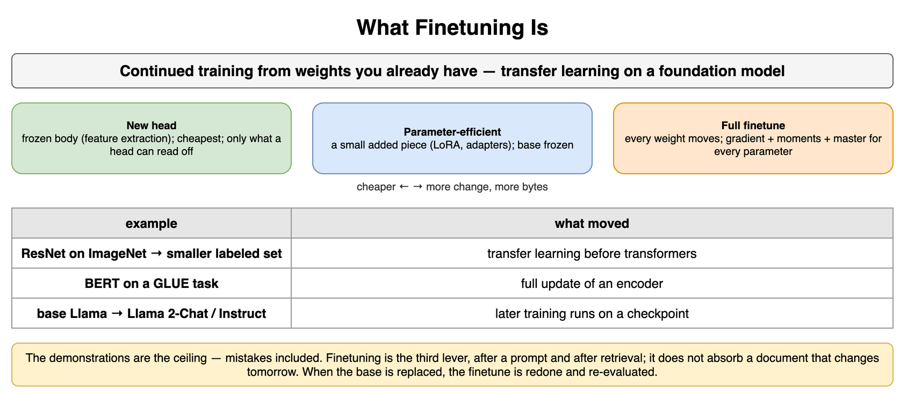

*Source: [`diagrams/finetuning.drawio`](/content/10_AI_Engineering/07_Finetuning/diagrams/finetuning.drawio), page 1.*

## Finetuning objectives

A finetuning objective is which loss you keep training. The three objectives product teams actually choose are continued pretraining, supervised finetuning, and a preference loss.

Continued pretraining keeps the next-token loss and changes the data. Code Llama started from Llama 2 and kept training on code. Gururangan et al.'s 2020 "Don't Stop Pretraining" measured the idea on smaller models. Domain text moves the distribution, but it does not teach the model to treat a prefix as a question: a base model continued on your wiki still continues the wiki. Supervised finetuning (SFT) is the instruction step, with prompt and target pairs and the loss on answer tokens. That loss and its ceiling live on the supervised-finetuning card in [Understanding Foundation Models](../02_Understanding_Foundation_Models/). This topic adds which parameters get the gradient, how tensors fit, and which trainer runs the job. A correctly filled JSON schema, a support tone, and a label set are supervised objectives. Demonstrations written by a stronger model make it distillation.

Preference finetuning ranks answers the model can already produce. It can be a reward model plus PPO (InstructGPT, Llama 2-Chat) or a direct loss such as DPO (Llama 3's published post-training); the Bradley-Terry loss, KL penalty, and β live on the Reward models and RLHF/DPO cards. Preference data assumes a model that already answers, so if the preferred reply is something the reference model almost never says, SFT must move it there first. A preference run still stores gradients for whatever is trainable, and it still does not insert this week's help center. The order follows the gap. Use continued pretraining when domain language is missing, SFT when the reply shape is wrong, a preference loss when the model replies but ranks the worse reply higher, and retrieval when the missing piece is a fact. Running all three because a stack diagram shows them hides which loss the eval needed.

```text
continued pretraining   next-token loss, new corpus      (Code Llama on Llama 2)
SFT                     prompt -> answer, loss on answer  (format, label, tone)
preference              rank answers it already gives     (PPO or DPO)
```

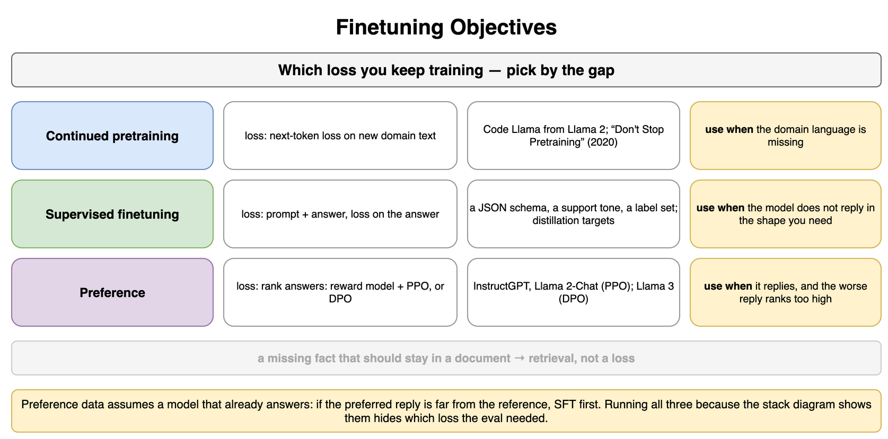

*Source: [`diagrams/finetuning.drawio`](/content/10_AI_Engineering/07_Finetuning/diagrams/finetuning.drawio), page 2.*

## Reasons to finetune

A reason to finetune is a behavior you have examples of, that a serious prompt does not hold, and that you want on every request without pasting those examples again.

Name the behavior before the job: a house style for Shopify product text, a Zendesk label set, a tool argument landing in the wrong field, or a refusal policy. The Structured outputs card in [Understanding Foundation Models](../02_Understanding_Foundation_Models/) already buys a finetune when JSON is valid, values are wrong, the schema is stable, and volume is high; a schema changing every sprint is a reason to wait. Volume is the second reason. Few-shot examples ride every request (priced on the zero-shot and few-shot card in [Prompt Engineering](../05_Prompt_Engineering/)), while a finetune moves the pattern into weights so the request carries only the ticket and a short instruction. Keep it when a held-out eval ([Evaluate AI Systems](../04_Evaluate_AI_Systems/)) beats the prompt enough to pay for training and a model you now version. A smaller finetuned model can serve more cheaply than a frontier model re-reading eight examples, but only if it clears the same bar.

The third reason is a teacher you cannot afford on the request path. A strong model writes demonstrations offline and a smaller student trains on them, which is distillation as SFT; the base-model card picks the student. A 7B labeler trained on your taxonomy can outscore a frontier model re-reading it in the prompt, at lower serve cost. The Domain-specific models caveat travels, though: BloombergGPT was pretrained on finance, yet a stronger general model with the filing in the prompt is often the better product, so score both. Bias is a reason only when measured, with a held-out slice that moves before and after. Training can also trade one bias for another or erase a general skill, and "we finetuned for fairness" without that slice is a slogan. Prompt caching ([Inference Optimization](../09_Inference_Optimization/)) weakens the cost reason for a stable few-shot prefix but not the behavior reason, so recompute the bill with the cache first. You should already have tried the prompt. A finetune freezes the behavior you trained, and shipping the checkpoint with the lowest training loss and no held-out eval is how an overfit labeler reaches production.

```text
changing fact      -> retrieval
trailing comma     -> schema mask
tone / label / field filled wrong, stable schema, measured prompt gap -> finetune
can't serve the teacher -> distill into a student
```

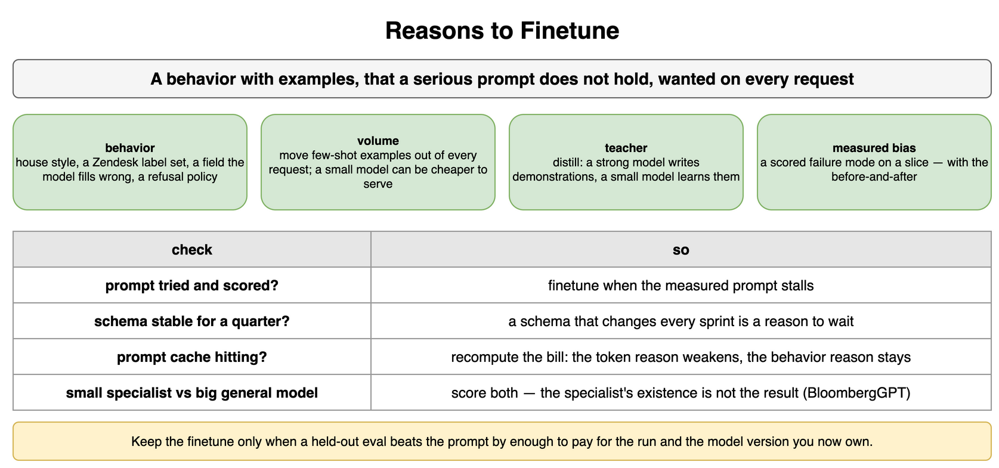

*Source: [`diagrams/finetuning.drawio`](/content/10_AI_Engineering/07_Finetuning/diagrams/finetuning.drawio), page 3.*

## Reasons not to finetune

A reason not to finetune is a gap a cheaper lever still owns, or a constraint the weights cannot meet.

Fresh or private facts are the usual mismatch. A Notion wiki, a Zendesk help center, or a contract edited this morning belongs in an index ([RAG and Agents](../06_RAG_and_Agents/)). A finetune of yesterday's pages serves yesterday, and weights are hard to delete from: a later request can echo a sentence you no longer have a document for, while retrieval simply drops the page. Other gaps have better tools than a gradient. Illegal JSON is a schema mask and parser (Structured outputs in [Understanding Foundation Models](../02_Understanding_Foundation_Models/)), and an unscored prompt is still an afternoon in [Prompt Engineering](../05_Prompt_Engineering/). A few dozen noisy demonstrations will be memorized, and a label set or policy that changes weekly is stale when the job ends. A license forbidding the derivative or use ends the plan before the GPU does (Open weights and licenses in [Evaluate AI Systems](../04_Evaluate_AI_Systems/)).

The last reason is operational. A finetune is a model you version, reload, and re-score when the base changes (the iterate-and-version card in [Evaluate AI Systems](../04_Evaluate_AI_Systems/)). Without a held-out set you cannot tell the new base plus old data from a regression, so training produces a checkpoint nobody can promote. The expensive mistake is a finetune that seemed to work because training loss fell, on data that was the eval set, for a policy that changed Monday. None of these forbid a finetune later; they forbid it as the first spend and as a store for facts you must update or forget. Even a finetune scored on its new task can be a regression elsewhere, which is the next card.

```text
apply in order:
1. license allows the derivative?
2. fact or behavior?          (fact -> index)
3. prompt scored?
4. target still true when the job ends?
5. held-out set exists?
```

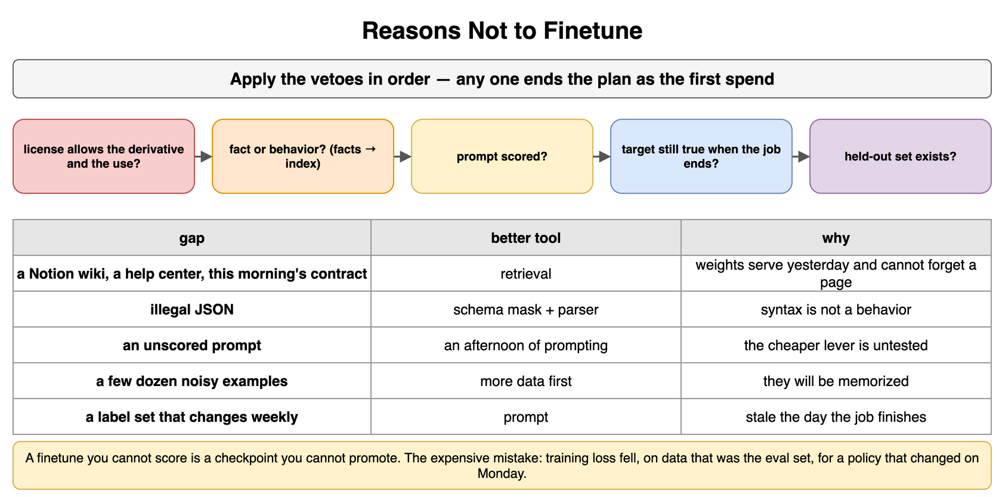

*Source: [`diagrams/finetuning.drawio`](/content/10_AI_Engineering/07_Finetuning/diagrams/finetuning.drawio), page 4.*

## Catastrophic forgetting and task interference

Catastrophic forgetting is a finetune that learns the new task and loses capabilities the base model had. Task interference is the same collision when two tasks pull one set of weights in different directions.

McCloskey and Cohen described catastrophic interference in 1989: a network trained on a second task overwrites weights the first needed. A full update on refund labels moves every weight its gradient touches, and a held-out general set (instruction following, a coding slice, skills the product still needs) falls while refund accuracy rises. Sequential multi-task training is the sharp form. Train A, then B, and B's gradient walks away from A's solution while B's loss does exactly what you asked. Detection is a held-out general-capability eval, run before and after on items not in the finetune file, scored like a stage you did not mean to change (Evaluate every component in [Evaluate AI Systems](../04_Evaluate_AI_Systems/)). Rising refund accuracy beside an unmeasured general drop is not a launch.

The mitigations limit movement or keep the old skill in the gradient. LoRA and other parameter-efficient updates freeze the base and train a small update, so general behavior has less room to leave, though a high-rank update on every linear layer can still move it. Replay, or data mixing, puts general or previous-task rows in the same job; the mixture ratio decides which tokens win, and you must be allowed to train on that data. A lower learning rate takes smaller steps, at the risk of underfitting. Merging interpolates back toward the base, as a model soup or small task-arithmetic coefficient does (Summing weights card), giving back some new skill. Separate adapters per task overwrite nothing because the base file never changed, at the cost of a router (Serving many adapters card). Simultaneous training shows every task in one run. Sequential training is the schedule that forgets, so refuse it unless the general eval still passes. The Multi-task finetuning and merging card chooses among joint training, a merge, and separate adapters.

```text
detect:    held-out general eval, before and after, not the training file
mitigate:  LoRA/PEFT -> replay -> lower LR -> merge toward base -> separate adapters
refuse:    sequential training on shared weights without that eval
```

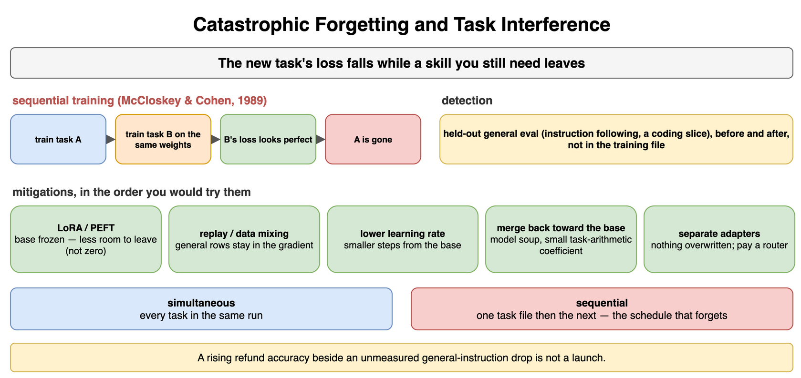

*Source: [`diagrams/finetuning.drawio`](/content/10_AI_Engineering/07_Finetuning/diagrams/finetuning.drawio), page 5.*

## Finetuning and RAG

Finetuning and retrieval answer different gaps. Retrieval puts information in the request. Finetuning changes how the model behaves when it reads a request.

This is the three levers from [Introduction to Building AI Applications with Foundation Models](../01_Introduction_to_Building_AI_Applications_with_Foundation_Models/) one level down. A changed return window belongs in the article, and the article in the index from [RAG and Agents](../06_RAG_and_Agents/). Tone, a label taxonomy, quoting the passage, and abstaining when the passage is silent are behaviors an index cannot store. A prompt can ask for them, and at volume a finetune makes them the default so the prompt stays short. The combination is the usual production shape: the index returns the passage, and the model is finetuned to use it by quoting, abstaining, filling the schema, and keeping the tone. The demonstrations must contain the passage and the answer that followed from it. Otherwise the gradient teaches the model that context is decoration. A missed page is still a retrieval failure, so score retrieval and behavior separately (factual consistency in [Evaluate AI Systems](../04_Evaluate_AI_Systems/)). A fluent label on the wrong article is a retriever problem; a right article quoted with the wrong policy is a generator problem.

Ovadia, Brief, Mishaeli, and Elisha (EMNLP 2024) compared the levers for knowledge injection. Unsupervised finetuning on new text improved over the base on most tasks but did not reliably teach new facts. Retrieval beat that finetune for facts the model had seen and for current events it had not. On current events, retrieval plus the finetune did worse than retrieval alone; elsewhere the combination was sometimes better, not consistently. The matching slogan is finetuning for form, retrieval for facts. The paper covers unsupervised continued training on documents, not every supervised format finetune, but it is the result to cite when someone proposes baking the help center into the weights so the index can go away. A finetune that bakes in the windows will be confidently wrong the morning the policy changes, and the log will look like a model failure rather than a stale weight.

| Gap | Where it lives | What you change |
| --- | --- | --- |
| The policy text changed, or the user may not see that document. | The index, with permissions applied before the prompt. | Reindex. A finetune would keep serving the old sentence. |
| The reply has the wrong shape, tone, or label, and you have examples. | The weights, plus a short instruction. | Finetune. An index has nowhere to put a style. |
| The model answers without using the passage you retrieved. | The demonstrations and the prompt. | Train on examples that contain the passage and the answer that follows from it. |

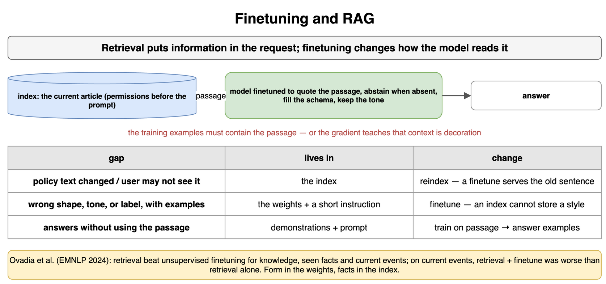

*Source: [`diagrams/finetuning.drawio`](/content/10_AI_Engineering/07_Finetuning/diagrams/finetuning.drawio), page 6.*

## Backpropagation and trainable parameters

Backpropagation is the backward pass that gives every trainable parameter a gradient. It is why a training step stores much more than the weights a forward pass needs.

The forward pass computes the loss; the backward pass applies the chain rule to every weight allowed to change, producing a gradient matrix of the same shape. AdamW, the optimizer nearly every finetune runs, adds same-shaped first and second moments; its decoupled weight decay adds no tensor. The ZeRO-paper accounting this topic uses is 16 bytes per trainable parameter: BF16/FP16 weight (2), gradient in that type (2), FP32 master copy (4, because a small step rounds away in 16 bits), and two FP32 moments (4 + 4). Serving in BF16 is 2 bytes, so training is eight times the inference weight before activations. The 18-byte row on the Parameters, tokens, and FLOPs card in [Understanding Foundation Models](../02_Understanding_Foundation_Models/) stores the gradient in FP32, so name the gradient dtype before quoting a total. Plain SGD stores nothing beyond a discardable gradient, momentum SGD one velocity, and Adam two moments. Eight-bit moments shrink those tensors without turning Adam into SGD. Totals in this topic are AdamW unless stated.

A frozen parameter drops the gradient, moments, and master copy but keeps the forward weight, and freezing does not drop every activation. The backward runs from the loss to the earliest trainable parameter, so frozen layers on that path must keep or recompute activations. A frozen layer before every trainable parameter can drop its internal activations. LoRA in every block keeps the walk over the whole network, while a head on a frozen body stops it at the head, so "we froze 99% of the weights" says nothing about memory until you know where the trainable slice sits. One 4096 × 4096 matrix, Llama 2 7B's attention projection size, is 16,777,216 parameters: 32 MiB to serve in BF16, 256 MiB of 16-byte training state, and 288 MiB at 18 bytes. Apply the factor of eight to every trainable weight and the machine changes, which is the training-memory card.

```python
HIDDEN = 4096
PARAMS = HIDDEN * HIDDEN
print(PARAMS)
print(f"{PARAMS * 2 / 1024**2:.1f}")
print(f"{PARAMS * 16 / 1024**2:.1f}")
print(f"{PARAMS * 18 / 1024**2:.1f}")
print(16 / 2)
# 16777216
# 32.0
# 256.0
# 288.0
# 8.0
```

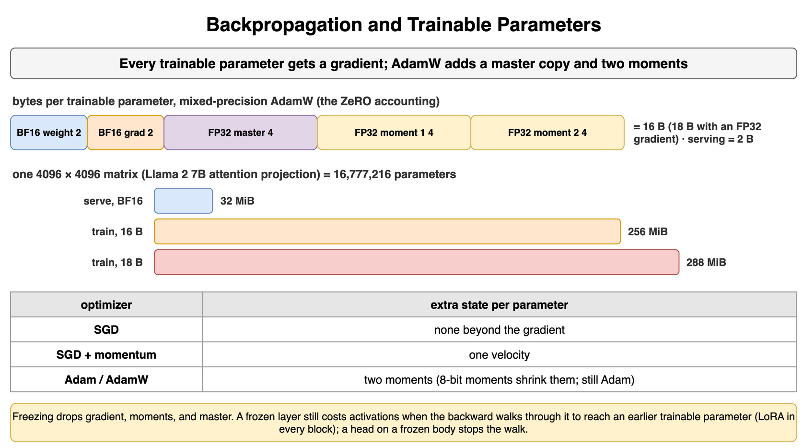

*Source: [`diagrams/finetuning.drawio`](/content/10_AI_Engineering/07_Finetuning/diagrams/finetuning.drawio), page 7.*

## Inference memory

Inference memory is the state a GPU holds to answer a request: the weights, the KV cache, and the activations of the forward pass.

The weights are the checkpoint, 2 bytes per parameter in FP16 or BF16. The untied Llama 2 7B layout (vocabulary 32,000, 32 layers, hidden 4,096, intermediate 11,008, no biases, separate input and output embeddings) is 6,738,415,616 parameters, or 12.6 GiB in BF16. A whiteboard 7 billion is 13.0 GiB. Name the count you mean, because the half gigabyte matters on a full card. The KV cache grows with the conversation: two tensors × layers × key-value heads × head dimension × bytes × tokens (the attention card in [Understanding Foundation Models](../02_Understanding_Foundation_Models/)). Llama 2 7B is multi-head, with 32 KV heads of dimension 128, so each token adds `2 × 32 × 32 × 128 × 2 = 524,288` bytes (512 KiB). At its original 4,096-token context that is exactly 2 GiB. One request is 14.6 GiB before activations, and eight are 16 GiB of cache, or 28.6 GiB with weights. Weights are paid once; cache is paid per live request.

Activations behave differently. At decode they are workspace for one token; at prefill they scale with prompt and batch and can peak near the weights. Quantizing weights shrinks only the first term. The cache shrinks with cache quantization or fewer KV heads (grouped-query attention). Eight concurrent 4,096-token requests already miss a 24 GB card before any weight is quantized. Longer contexts and more concurrency raise the cache linearly without improving a short request, and a capacity plan that counts weights and forgets the cache passes a demo and fails under load. Keeping BF16 weights at 12.6 GiB spends the card that a 4-bit checkpoint would leave free for batching. [Inference Optimization](../09_Inference_Optimization/) does the kernel and paging work once this budget binds.

```python
def llama2_params(layers: int, hidden: int, intermediate: int, vocab: int = 32_000) -> int:
    per_layer = 4 * hidden * hidden + 3 * intermediate * hidden + 2 * hidden
    return layers * per_layer + hidden + 2 * vocab * hidden


PARAMS = llama2_params(32, 4096, 11008)
PER_TOKEN = 2 * 32 * 32 * 128 * 2
CACHE = PER_TOKEN * 4096
WEIGHTS = PARAMS * 2
print(PARAMS)
print(PER_TOKEN, PER_TOKEN // 1024)
print(CACHE // 1024**3)
print(f"{WEIGHTS / 1024**3:.1f}")
print(f"{(WEIGHTS + CACHE) / 1024**3:.1f}")
print(f"{(WEIGHTS + 8 * CACHE) / 1024**3:.1f}")
# 6738415616
# 524288 512
# 2
# 12.6
# 14.6
# 28.6
```

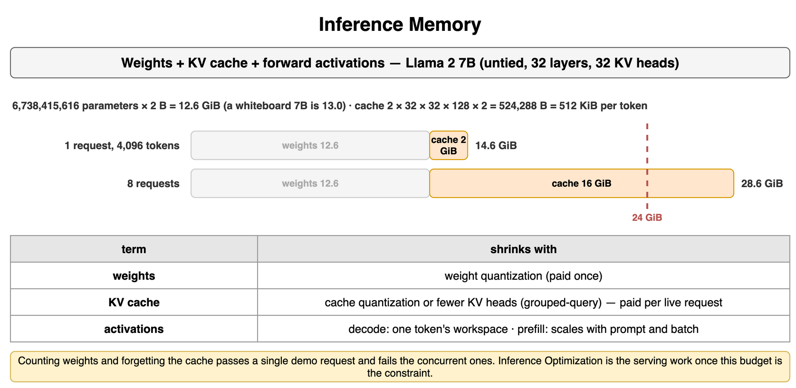

*Source: [`diagrams/finetuning.drawio`](/content/10_AI_Engineering/07_Finetuning/diagrams/finetuning.drawio), page 8.*

## Training memory

Training memory is the bytes the update adds on top of a forward pass: a gradient and optimizer state for every trainable parameter, plus the activations the backward pass will reuse or recompute.

At 16 bytes, a whiteboard 7B is 13.0 GiB of BF16 weights and 104.3 GiB of training state before activations, and the Llama 2 7B layout is 100.4 GiB. With FP32 gradients (18 bytes) those are 117.3 and 113.0 GiB. Keeping the FP32 master as the only weight copy and casting to BF16 for matmuls is also 16 bytes, so quote the split with the total. Of the 16 bytes, 4 are BF16 weight plus gradient (25.1 GiB here) and 12 are FP32 optimizer state (75.3 GiB). An 80 GB GPU holds 80 GiB, not 100.4, and plain data parallel replicates everything, so an 8 × 80 GiB node does not help until state is sharded. ZeRO (Rajbhandari et al.) shards in stages. Stage 1 shards the optimizer state, leaving about 34.5 GiB of model state per GPU on 8 GPUs, which makes this 7B finetune fit. Stage 2 also shards gradients; stage 3 also shards weights, all-gathering each layer for forward and backward. PyTorch FSDP and FSDP2 follow the stage-3 pattern, which you need when replicated weights and gradients do not fit, a 70B problem before a 7B one. Tensor and pipeline parallelism are out of scope here.

Sharding does not remove activations. Gradient checkpointing (Chen et al.) recomputes them in the backward pass. On the `6ND` split, the forward is about two of six, so the recompute costs about a third more compute as a planning figure. In the QLoRA paper's LLaMA 7B measurement at batch 1, a 26 MB adapter (about 0.2% of weights, wider than the rank-8 query/value file) had 567 MB of LoRA input gradients, cut to about 18 MB per sequence by checkpointing, beside a 5,048 MB 4-bit base. The adapter file is not the bill. bitsandbytes 8-bit Adam stores block-wise 8-bit moments with a scale, which is not sharding. LoRA and QLoRA freeze the base, so only adapters pay 16 bytes. Rank-8 query/value adapters are 4,194,304 parameters with exactly 64 MiB of state, giving 12.61 GiB on a BF16 base (12.62 at 18 bytes). QLoRA packs at 4.126953 bits per parameter. Packing everything gives 3.30 GiB. bitsandbytes quantizes only `nn.Linear`, leaving embeddings and norms in BF16, and the Hugging Face 4-bit loader also skips the output projection, which gives 3.66 GiB. Neither floor is a peak or the paper's measurement: about 6.9 GB at batch 1, sequence 512 for 7B, and about 24.7 and 45.0 GB for 33B and 65B. Use a profiler for the peak. Stacking every saving at once makes a misbehaving loss hard to debug.

```python
def llama2_params(layers: int, hidden: int, intermediate: int, vocab: int = 32_000) -> int:
    per_layer = 4 * hidden * hidden + 3 * intermediate * hidden + 2 * hidden
    return layers * per_layer + hidden + 2 * vocab * hidden


PARAMS = llama2_params(32, 4096, 11008)
ROUND = 7_000_000_000
LORA = 32 * 2 * 8 * (4096 + 4096)
BITS = 4 + 8 / 64 + 32 / (64 * 256)
BYTES = 2 + 2 + 4 + 4 + 4
EMBED = 2 * 32_000 * 4096
NORMS = 32 * 2 * 4096 + 4096
LINEARS = PARAMS - EMBED - NORMS
print(PARAMS)
print(f"{ROUND * 2 / 1024**3:.1f} {ROUND * BYTES / 1024**3:.1f}")
print(f"{PARAMS * BYTES / 1024**3:.1f} {PARAMS * (BYTES + 2) / 1024**3:.1f}")
print(f"{PARAMS * 4 / 1024**3:.1f} {PARAMS * 12 / 1024**3:.1f} {(PARAMS * 4 + PARAMS * 12 / 8) / 1024**3:.1f}")
print(f"{LORA * BYTES / 1024**2:.0f}")
print(f"{(PARAMS * 2 + LORA * BYTES) / 1024**3:.2f} {(PARAMS * 2 + LORA * (BYTES + 2)) / 1024**3:.2f}")
print(f"{(PARAMS * BITS / 8 + LORA * BYTES) / 1024**3:.2f}")
print(f"{(LINEARS * BITS / 8 + (EMBED + NORMS) * 2 + LORA * BYTES) / 1024**3:.2f}")
# 6738415616
# 13.0 104.3
# 100.4 113.0
# 25.1 75.3 34.5
# 64
# 12.61 12.62
# 3.30
# 3.66
```

| State | What you store | Llama 2 7B, before activations |
| --- | --- | --- |
| Serve in BF16 | The weights. | 12.6 GiB, plus cache. |
| Full AdamW, 16 bytes | BF16 weight, BF16 gradient, FP32 master, two FP32 moments. | 100.4 GiB. A whiteboard 7B is 104.3 GiB. FP32 gradients make this layout 113.0 GiB. |
| ZeRO stage 1, 8 GPUs | Weights and gradients replicated, optimizer sharded. | About 34.5 GiB of model state on each GPU. |
| LoRA on a BF16 base | The base at 2 bytes, and 16 bytes only on the adapters. | 12.61 GiB for query and value at rank 8. The 18-byte gradient variant is 12.62 GiB. |
| QLoRA, packed floor | Linear weights at 4.126953 bits. Embeddings and norms stay in BF16, and the Hugging Face loader also skips the output projection. Adapters pay 16 bytes. | 3.66 GiB. Packing every parameter, embeddings included, is 3.30 GiB. |

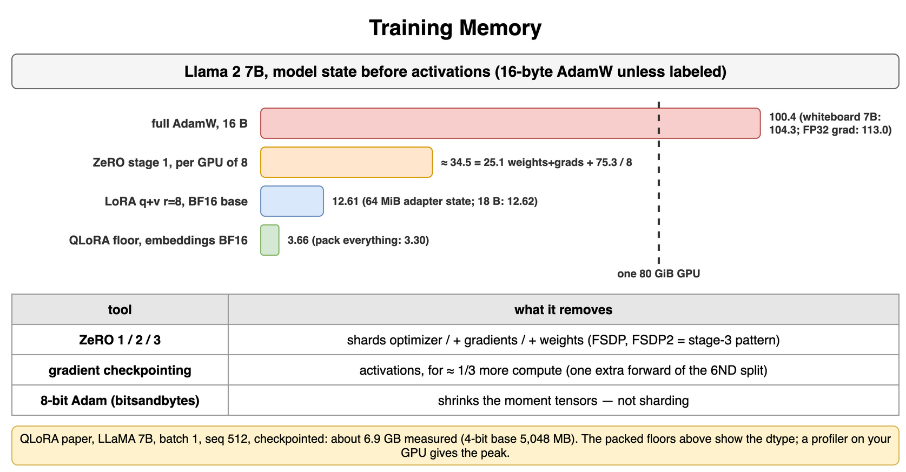

*Source: [`diagrams/finetuning.drawio`](/content/10_AI_Engineering/07_Finetuning/diagrams/finetuning.drawio), page 9.*

## Numerical representations

A numerical representation is how a weight, an activation, or a gradient is written in bits: how many bits, how they split between range and precision, and which real numbers exist at all.

Exponent bits buy range and mantissa bits buy precision. FP32 splits 8/23, FP16 5/10, and BF16 8/7: BF16 keeps FP32's exponent and gives up mantissa, while FP16 keeps more mantissa and overflows far sooner. That swap moved LLM training from FP16 on Volta to BF16 on Ampere and later (a 4090, an A100), because small updates need the range more than three extra mantissa bits. FP16's maximum is `(2 − 2^-10) × 2^15` = 65,504 and its smallest positive normal `2^-14` ≈ 6.104e-5. BF16's are about 3.390e38 and 1.175e-38, with FP32's maximum only slightly higher. A gradient of 1e-8 is normal in BF16 and below FP16's smallest subnormal (about 5.96e-8), so it flushes to zero. FP16 mixed precision therefore needs loss scaling: multiply the loss, unscale before the optimizer, and skip the step on overflow. BF16 usually skips the scale and still keeps an FP32 master, because a 7-bit mantissa accumulates badly. A pure FP32 Adam state is also 16 bytes and gives up the 16-bit matmul without removing the optimizer.

TF32 is an Ampere-and-later tensor-core compute format, not storage: FP32's range with a 10-bit mantissa, stored as FP32 and rounded entering the matmul. PyTorch's current float32 matmul default is full precision (`highest`); setting `high` enables TF32. Older releases enabled it by default, so results can move with version or setting. FP8 on Hopper comes in two NVIDIA formats from the FP8 formats paper. E4M3 (max 448, top code is NaN rather than infinity) is for weights and activations. E5M2 (max 57,344, with infinities) is for gradients, which want range. INT8 and INT4 are integer codes (256 and 16) mapped by a scale and sometimes a zero-point. NF4 (training-quantization card) places the 16 codes at normal quantiles. Choose the format to match the tensor, and say which you store, which you compute in, and which GPU generation you assume.

```python
print(f"{(2 - 2**-10) * 2**15:.0f}")
print(f"{2**-14:.3e}")
print(f"{(2 - 2**-7) * 2**127:.3e}")
print(f"{2**-126:.3e}")
# 65504
# 6.104e-05
# 3.390e+38
# 1.175e-38
```

| Format | Bits, sign plus exponent plus mantissa | Where it shows up |
| --- | --- | --- |
| FP32 | 1 + 8 + 23. Range out to about 3.4e38. | Master weights and Adam moments. |
| TF32 | 1 + 8 + 10 inside the matmul. FP32's range, FP16's mantissa width. Stored as FP32. | Ampere and later tensor cores, when float32 matmuls are allowed to use it. |
| FP16 | 1 + 5 + 10. Max finite value 65,504. Smallest positive normal about 6.1e-5. | Compute, with loss scaling in training. |
| BF16 | 1 + 8 + 7. FP32's exponent range, less precision. | The usual training and inference compute type on Ampere and later. |
| FP8 E4M3 | 1 + 4 + 3. NVIDIA max 448. The top code is NaN, not infinity. | Hopper weights and activations. |
| FP8 E5M2 | 1 + 5 + 2. NVIDIA max 57,344. Has infinities. | Hopper gradients. |
| INT8 | 256 integer codes, plus a scale. | Weight and activation quantization, and 8-bit optimizer moments. |
| INT4 | 16 integer codes, plus a scale. NF4 redistributes those 16 for normal weights. | Weight-only serving, and QLoRA's stored base weights. |

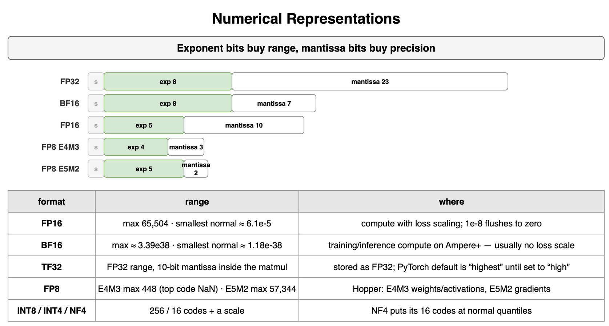

*Source: [`diagrams/finetuning.drawio`](/content/10_AI_Engineering/07_Finetuning/diagrams/finetuning.drawio), page 10.*

## Inference quantization

Inference quantization rewrites a trained model's numbers into a cheaper representation after training, so serving stores less and moves less.

Post-training quantization (PTQ) needs no training run. A calibration set of a few hundred production-like passages estimates the scales, and the result is only as relevant as that set: calibrating on Wikipedia and serving code is a different rounding. Weight-only quantization keeps activations in BF16/FP16 and stores weights in INT8 or INT4, dequantizing on the fly into a 16-bit matmul. Memory and bandwidth fall, so bandwidth-bound decode usually speeds up while compute-bound prefill may not. GPTQ (Frantar et al.) quantizes one block at a time, using a Hessian approximation so not-yet-rounded weights compensate. AWQ (Lin et al.) scales up salient weights in channels with large activations before rounding and folds in the inverse scale. Both need calibration samples but no loss or backward pass. A group of 128 weights per scale is common; smaller groups track the tensor more closely and store more scales. bitsandbytes' 4-bit path stores NF4 or FP4 and dequantizes to 16-bit for the matmul.

Weight-and-activation quantization puts both matmul sides in integers for integer tensor cores, and activations are harder because a few channels are outliers. LLM.int8() (Dettmers et al.), bitsandbytes' 8-bit path, runs most of the matmul in INT8 and keeps outlier feature dimensions (default magnitude above 6) in 16-bit. SmoothQuant (Xiao et al.) divides each activation channel by a scale and multiplies it into the matching weight input channel, leaving the product unchanged and shrinking outliers so both sides fit INT8. [Inference Optimization](../09_Inference_Optimization/) owns the kernel; this card owns the accuracy choice. That cost is not uniform. Chat can look unchanged while arithmetic, code, and rare tokens move, because INT4 has 16 codes per group. The embedding and output projection are where rounding becomes a different token, so keep them higher-precision or finer-scaled and measure. INT8 weight-only is often close to BF16 at about half the memory; INT4 saves about three quarters and is the usual serving point, with real risk on exact strings and arithmetic. Score math and extraction slices beside chat with the [Evaluate AI Systems](../04_Evaluate_AI_Systems/) pipeline, because a tutor that passed only the demo chat may not carry a digit.

```text
PTQ weight-only        GPTQ (Hessian compensation), AWQ (activation-aware scales), bnb 4-bit
PTQ weight+activation  LLM.int8() (outliers kept 16-bit), SmoothQuant (scale moved into weights)
measure                math, code, extraction slices, not just chat or perplexity
```

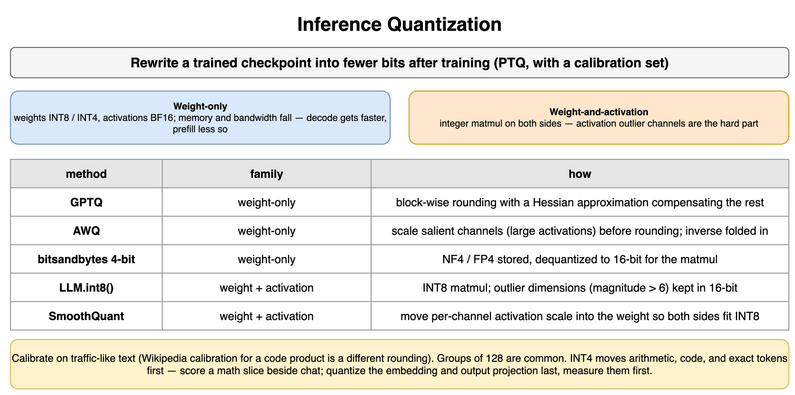

*Source: [`diagrams/finetuning.drawio`](/content/10_AI_Engineering/07_Finetuning/diagrams/finetuning.drawio), page 11.*

## Training quantization

Training quantization uses low-precision numbers inside the training step, either so the matmul is cheaper or so the finetune fits.

Mixed precision is the ordinary case, not a 4-bit method. Forward and backward run in BF16 or FP16 while master weights and AdamW moments stay FP32: 16 bytes with a BF16 gradient, or the 18-byte row with FP32 gradients (Parameters, tokens, and FLOPs card in [Understanding Foundation Models](../02_Understanding_Foundation_Models/)). BF16 usually needs no loss scale, while FP16 does. Hopper adds FP8 mixed precision (E4M3 weights/activations, E5M2 gradients), a different byte count you measure on that GPU. Quantization-aware training (QAT) inserts a fake quantizer in the forward pass so the loss sees rounded values. The backward pass uses a straight-through estimator, treating rounding's derivative as one, so weights move somewhere that survives rounding; then you export integers. You pay a training run for QAT when PTQ misses a task you cannot give up.

QLoRA (Dettmers et al.) makes a large finetune fit one GPU. The frozen base is stored in NF4 (4-bit NormalFloat), with 16 codes at normal quantiles so each bin holds equal probability mass. The paper found it more accurate than FP4 and integer 4-bit on the models measured. Weights dequantize to BF16 for the matmul, and only LoRA adapters in a 16-bit compute type get gradients. Double quantization quantizes the scales. At block 64, one FP32 scale is 0.5 bits per parameter; 8-bit scales with a second block of 256 cost 0.126953 (the paper says 0.127), saving 0.373 bits or about 3.03 GB on a round 65B, for about 4.127 bits per packed parameter. Paged optimizers use NVIDIA unified memory to page optimizer spikes, such as long-sequence checkpointing, to CPU RAM instead of crashing. The paper's checkpointed batch-1, sequence-512 bars are about 6.9, 11.3, 24.7, and 45.0 GB for 7B, 13B, 33B, and 65B. The last two barely miss 24 and 48 GB cards, which is why paging matters there. At 65B, batch 16, paging matched ordinary Adam speed and rarely fired, with no published general slowdown curve. The headline is a 65B finetune from more than 780 GB to under 48 GB. That 780 GB is 12 bytes per parameter (16-bit weights and gradients plus two FP32 moments, no separate master), not the 16-byte row, and the 3.30/3.66 GiB packed floors are storage, not this comparison. bitsandbytes implements NF4, double quantization, and paged AdamW; a Hugging Face 4-bit NF4 load with double quantization and BF16 compute is the QLoRA storage setup, with a LoRA config on top. QLoRA matched 16-bit full finetuning where that baseline ran, but its limitations section says the match was not established at 33B and 65B. A slow paged step on every batch means the sequence is too long for the card.

```python
PLAIN = 32 / 64
DOUBLE = 8 / 64 + 32 / (64 * 256)
print(f"{PLAIN:.1f}")
print(f"{DOUBLE:.6f}")
print(f"{PLAIN - DOUBLE:.3f}")
print(f"{65e9 * (PLAIN - DOUBLE) / 8 / 1e9:.2f}")
# 0.5
# 0.126953
# 0.373
# 3.03
```

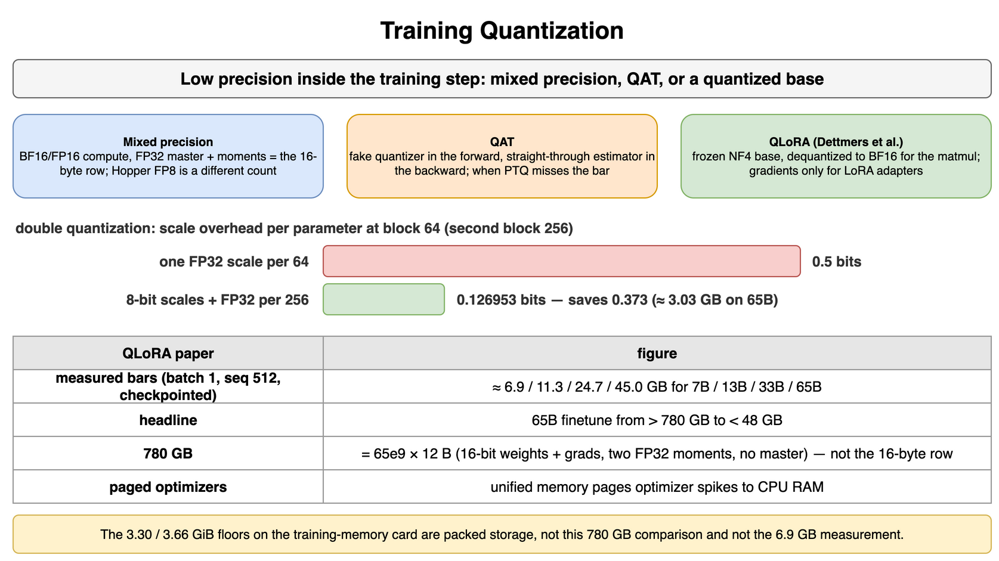

*Source: [`diagrams/finetuning.drawio`](/content/10_AI_Engineering/07_Finetuning/diagrams/finetuning.drawio), page 12.*

## Parameter-efficient finetuning

Parameter-efficient finetuning trains a small added or selected set of parameters and leaves the pretrained weights frozen.

It exists because 100.4 GiB is the 16-byte cost of making every Llama 2 7B weight trainable, while the behavior you want is often a small direction in weight space. Houlsby et al. (2019) showed on BERT that a bottleneck inserted into a frozen transformer can carry a task. Adapters, soft prompts, IA3, LoRA, and the variants in Hugging Face PEFT answer the same question: which small set of new numbers is enough, and can it be served without a second full model? PEFT wraps a transformers model, freezes the base, and trains the configured piece. TRL's supervised and preference trainers sit on top, so an SFT or DPO job can be a LoRA job. The family split matters for memory and serving: adapter-based methods add parameters inside the block (bottlenecks, low-rank matrices, rescaling vectors), while soft-prompt methods add them to the input (virtual tokens at the embedding, or key/value prefixes).

Freezing the base removes its gradient and optimizer state, not the forward pass, and not activations where the backward still flows. A method with trainable parameters in every layer pays every layer's activations; a soft prompt at the input pays a shorter backward. That, not parameter count alone, decides whether a long sequence fits. A small trainable set fits, finishes, and stores as a small file per task, but it can underfit a shift the base barely represents. Soft prompts add tokens and serve-time latency. Adapters add a branch unless they fold into the weight, which is LoRA's advantage over Houlsby. Several tasks can be several small files on one frozen base or one merged checkpoint (later cards), and neither is free quality. LoRA is the default to try first and measure, not a law.

```text
adapter family    inside the block: bottleneck, low-rank (LoRA), rescale (IA3)
soft prompts      on the input: prompt tuning, prefix tuning
still paid        forward pass; activations on the backward path
```

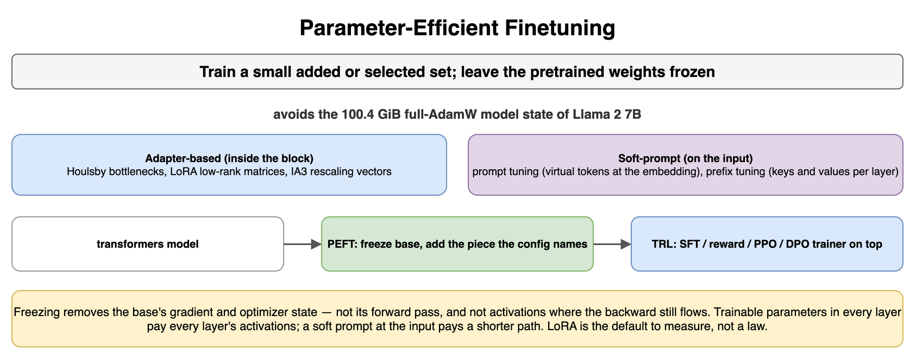

*Source: [`diagrams/finetuning.drawio`](/content/10_AI_Engineering/07_Finetuning/diagrams/finetuning.drawio), page 13.*

## Adapters, prefixes, and rescaling

Adapters, prefixes, and rescaling vectors are parameter-efficient methods that add a small trained piece beside a frozen model. They are the family LoRA was simplified from, and they do not all fold back into the original matrix.

A Houlsby adapter is a bottleneck on the residual stream after attention and after the feed-forward. The hidden state goes down to a small rank, through a nonlinearity, back up, and is added residually; the original weights do not move. With hidden size 4,096, bottleneck rank 64, and 32 layers, the two matrices in each of two bottlenecks total `32 × 2 × 2 × 4096 × 64 = 33,554,432` parameters, biases aside, about half a percent of Llama 2 7B. At serve time it remains a branch, an extra matmul per token unless fused, and it cannot be added into the weight because of the nonlinearity and separate residual path. Soft prompts leave weights alone. Prefix tuning (Li and Liang) learns vectors prepended to keys and values at every layer, with more capacity but occupying KV-cache slots on every request. Prompt tuning (Lester, Al-Rfou, and Constant) learns virtual tokens only at the input; it has far fewer parameters and became competitive with full finetuning as the frozen model grew larger.

IA3 (infused adapter by inhibiting and amplifying inner activations; Liu et al.) learns vectors that multiply keys, values, and feed-forward activations. At roughly hidden-width per target, it is among the smallest methods, but it can only rescale, not rotate, and it remains a serve-time multiply. Choose among them when LoRA fits the constraint poorly. A prefix is a learned context with the weights literally untouched, a Houlsby bottleneck is the classical adapter to name historically, and IA3 suits a tiny parameter budget. All four leave serve-time work. For a generation finetune you want to serve as a normal checkpoint, LoRA was designed to disappear into `W`.

```python
print(32 * 2 * 2 * 4096 * 64)
# 33554432
```

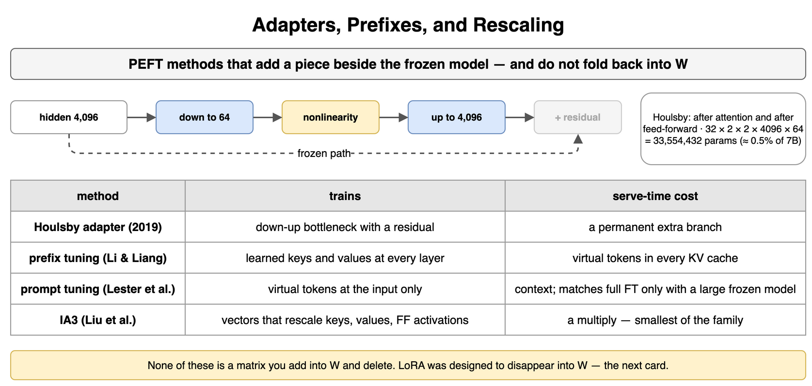

*Source: [`diagrams/finetuning.drawio`](/content/10_AI_Engineering/07_Finetuning/diagrams/finetuning.drawio), page 14.*

## LoRA

LoRA is a low-rank update added beside a frozen weight matrix. You train the update, and for a single adapter you can add it back into the matrix and serve the original architecture.

Hu et al. (2021) freeze `W` and write the change as `BA` with inner dimension `r` much smaller than the matrix. For a `d × k` weight, `B` is `d × r` and `A` is `r × k`, and the forward is the frozen matrix plus a scaled low-rank branch. `alpha / r` keeps the branch from growing with rank. Hu et al. set alpha to the first rank tried and left it fixed, so changing rank changed `alpha / r` without retuning the learning rate from scratch (first rank 8 means alpha 8 and scale 1). A common library pair, rank 8 and alpha 16, scales by 2; the QLoRA LLaMA runs used rank 64 and alpha 16, scale 0.25. Merging `BA` without `alpha / r` silently ships a different model.

```text
h = W x + (alpha / r) B A x
W_merged = W + (alpha / r) B A
```

The count is `r × (d + k)`. A 4096 × 4096 matrix at rank 8 has 65,536 trainable parameters against 16,777,216 frozen (1/256). Query and value across Llama 2 7B's 32 layers are 4,194,304 parameters: an 8 MiB BF16 file beside 12.6 GiB of base, with 64 MiB of 16-byte optimizer state. That file is not training activation memory. Which matrices you adapt matters at least as much as rank. Query and value were Hu et al.'s historical default, but in the QLoRA paper's LLaMA 7B Alpaca ablation, adapters on all linear layers matched full finetuning while query and value alone did not, even at higher rank; with every linear layer covered, rank stopped moving the score. MLP matrices are rectangular (intermediate 11,008), so rank 8 costs `8 × (11008 + 4096) = 120,832` each. Embeddings and the output projection usually stay frozen, because adapting them dominates the count and rounding there changes tokens. Higher rank can overfit a small set; ship the rank the held-out eval supports. DoRA (Liu et al., in PEFT) splits a weight into a magnitude vector and a direction and applies LoRA to the direction, a slightly larger variant to ablate. One adapter is served by merging: `W_merged` keeps the original shape and latency, and the adapter leaves the hot path. Fifty tenants cannot be merged into one `W` and remain fifty behaviors.

```python
print(f"{16 / 8:.1f} {16 / 64:.2f}")
# 2.0 0.25
```

```python
HIDDEN = 4096
RANK = 8
MATRIX = HIDDEN * HIDDEN
ADAPTER = RANK * (HIDDEN + HIDDEN)
QV = 32 * 2 * ADAPTER
print(MATRIX)
print(ADAPTER)
print(QV)
print(QV * 2 // 1024**2)
# 16777216
# 65536
# 4194304
# 8
```

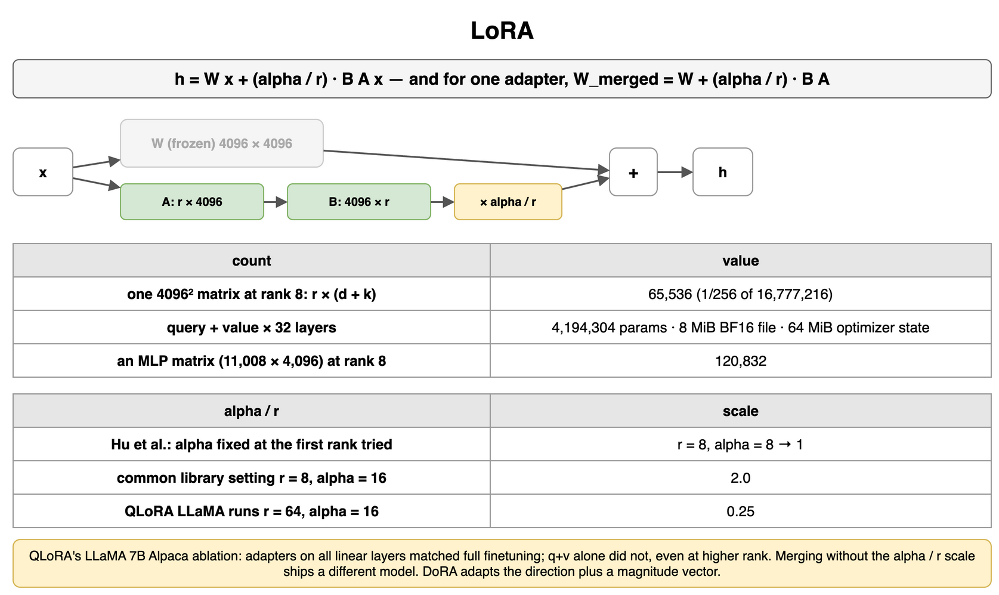

*Source: [`diagrams/finetuning.drawio`](/content/10_AI_Engineering/07_Finetuning/diagrams/finetuning.drawio), page 15.*

## Why LoRA works

LoRA works because the useful change in the weights during adaptation is low-rank. You do not need a free parameter for every entry of `W` to move the model onto a new task.

Aghajanyan et al. (2020 preprint, ACL 2021) measured the intrinsic dimension of language-model finetuning: optimize inside a random subspace and ask how small it can be while still reaching 90% of full-finetuning performance. It was far below the parameter count, and larger models after the same pretraining tended to have a lower dimension in absolute terms, not just as a smaller fraction. A bigger model is easier to steer in a small subspace. That describes the finetuning objective, not pretrained weights being rank 8; the base is full rank. Hu et al. (2021 preprint, ICLR 2022) cited this and hypothesized that the update `ΔW` also has low intrinsic rank, so they factored it as `BA`. If the needed update lives near a low-dimensional subspace, the constraint spends parameters on the directions that matter and leaves the rest frozen, which also makes forgetting milder (Catastrophic forgetting card). A rank below the intrinsic update underfits. The QLoRA ablation is the empirical echo: once every linear layer had an adapter, more rank stopped moving the score.

Low-rank pretraining has not replaced dense pretraining because pretraining builds the checkpoint over a huge token count, which is not one low-rank delta. ReLoRA (Lialin et al., ICLR 2024) merges a low-rank update and starts a fresh one, so successive low-rank steps sum to a higher-rank change. GaLore (Zhao et al., ICML 2024) projects gradients into a periodically changing low-rank subspace to cut optimizer memory in full training. Both show low-rank structure is useful in the optimizer, not that a foundation model can be pretrained as one rank-8 LoRA, and neither is the serving path for a product adapter. Full finetuning can represent a high-rank change and pays 16 bytes on every weight.

```text
Aghajanyan et al.  finetuning has low intrinsic dimension (lower for larger models)
Hu et al.          so constrain the update: ΔW = B A, rank r
pretraining        not one low-rank delta (ReLoRA stacks merges; GaLore projects gradients)
```

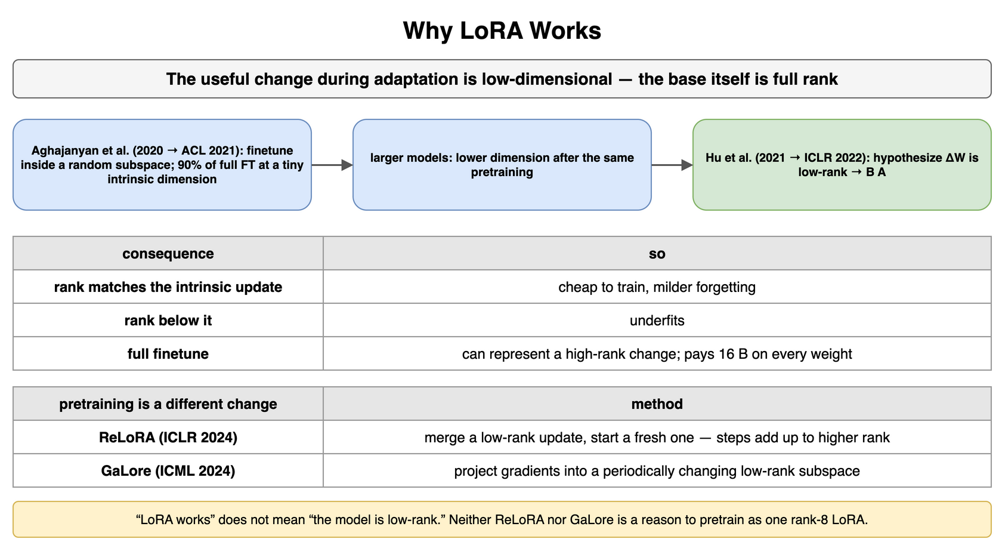

*Source: [`diagrams/finetuning.drawio`](/content/10_AI_Engineering/07_Finetuning/diagrams/finetuning.drawio), page 16.*

## Serving many adapters

Multi-adapter serving keeps one frozen base in memory and applies a different low-rank update on each request, instead of merging every tenant into one matrix.

Merging is right for one behavior and wrong when behaviors must stay distinct: one adapter per customer cannot be added into a single `W` and still answer as each customer. The base is paid once, and each request applies its tenant's small `(alpha / r) B A x`. A small adapter does not shrink the KV cache, which is still paid per token per live request (Inference memory card). Punica (Chen et al., 2023) batches requests using different adapters: each low-rank multiply is a small matrix-vector product, and its segmented gather kernel runs several in one batch. S-LoRA (Sheng et al., 2023) pages adapter weights in the same paged memory as the KV cache, so cold adapters need not stay resident, and batches the low-rank work. vLLM's multi-LoRA support is the server you actually configure. Read the pinned version's limits on which ranks share a batch, supported target modules, and loaded adapter count; an unbatchable rank is a routing problem, not a property of `BA`.

Unmerged adapters make many behaviors cheap to store and possible to route, at the cost of a low-rank matmul and the server's batching rules. Paging saves GPU memory and adds a miss when an adapter is cold. A phone holding one checkpoint is a reason to merge; a datacenter already running vLLM is usually a reason not to. If one tenant later gets a merged deploy, the merge still includes `alpha / r`.

```text
one base (paid once) + per-request (alpha/r) B A + per-request KV cache
Punica    segmented kernel batches different adapters
S-LoRA    pages adapters beside the KV cache
vLLM      read its rank / module / loaded-adapter limits
```

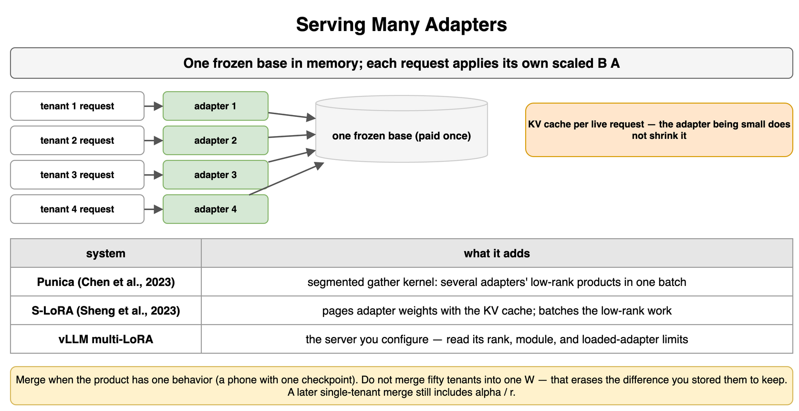

*Source: [`diagrams/finetuning.drawio`](/content/10_AI_Engineering/07_Finetuning/diagrams/finetuning.drawio), page 17.*

## Model merging

Model merging builds one checkpoint from two or more checkpoints that share an architecture, without going back to the training data.

The operation is on weights alone: a code finetune and a chat finetune of the same Llama 2 base are same-shaped files that merge into a third, with no tokens read. That is the appeal and the constraint. Different hidden sizes, layer counts, or vocabularies are not addable, and the better failure is a shape error. A LoRA merged into its own base is a legal input, while full models from unrelated initializations are much weaker inputs. Task-difference methods want a shared base so the difference is a direction. Three goals recur: multi-task (one model keeps coding and support skills without routing), on-device (a phone holds one weight file), and federated learning (clients train locally and the server averages updates without collecting raw data). FedAvg (McMahan et al.) is merging with a training round attached, under the same constraint that the data cannot or should not move.

The three operations do different things. Summing adds or averages aligned parameters and requires the same shape. Layer stacking concatenates blocks along depth and requires the same hidden size, since each block's output is the next input. Concatenation places parameters side by side for a wider model or experts, changing a dimension that must be mapped back. Only summing is a one-line tensor add. Merging is not training: if the result loses a skill, fix it with a different merge, short continued training on data you have, or separate adapters (the multi-task card). mergekit implements linear and spherical interpolation, TIES, DARE, and a passthrough mode for layer arrangements. A merge needs no data, which matters for licensed or private corpora, but it can average away the skill it meant to keep, so score every skill; a merge scored only on chat has not kept code.

```text
summing        same shape        add / average aligned weights
stacking       same hidden size  deeper model
concatenation  new dimension     wider model or experts (needs a projection or router)
```

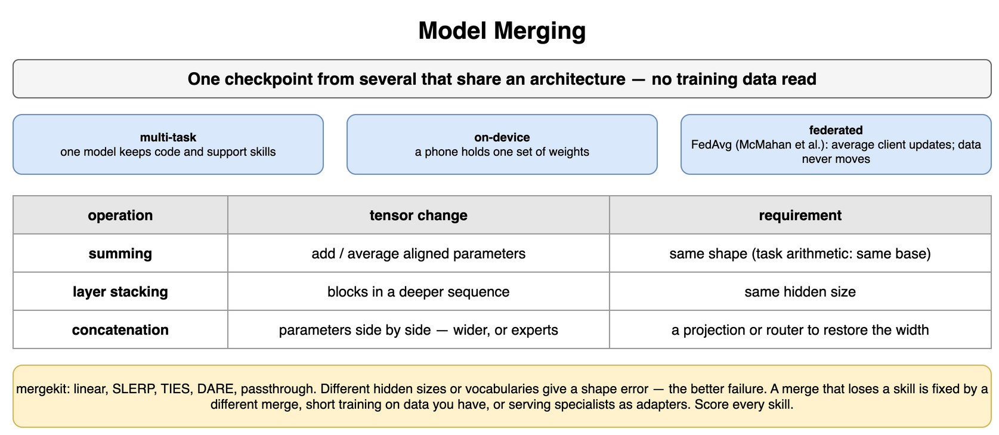

*Source: [`diagrams/finetuning.drawio`](/content/10_AI_Engineering/07_Finetuning/diagrams/finetuning.drawio), page 18.*

## Summing weights

Summing merges models by adding or averaging parameters that already have the same shape.

A model soup (Wortsman et al.) averages checkpoints finetuned from the same initialization, often several hyperparameter runs of one task, and can beat the best single run with no router. Coefficients usually sum to one so the result stays on the ingredients' scale: `θ = a θ_a + (1 − a) θ_b`. Task arithmetic (Ilharco et al.) adds differences from a shared base. The task vector is `τ = θ_finetuned − θ_base`, and a merged model is `θ_base + λ_code τ_code + λ_chat τ_chat`; negating a vector pushes a behavior down. Finetunes that changed different coordinates can both survive the sum, while opposite changes to the same coordinate compromise it, which is the interference. In the toy, a code vector moving the first coordinate by +0.4 and a chat vector by −0.4 cancel at equal weight. That shows the mechanism, not a prediction of your HumanEval score.

TIES (Yadav et al.) trims small-magnitude entries, elects one sign per coordinate by total magnitude, and averages only agreeing entries. DARE (Yu et al., the "Super Mario" paper) drops a random fraction `p` of each task vector and rescales the rest by `1 / (1 − p)`, keeping the expected update while removing many small conflicts, and is often followed by TIES's sign step. Either can drop a small update that was the whole skill. SLERP walks the arc between two checkpoints rather than the chord; it is a two-model method and does not elect signs among five tasks. mergekit implements linear, SLERP, TIES, and DARE. The base must be the base of both finetunes: adding `θ_code − θ_llama` to Mistral is a matching shape whose direction means something else. The result is one ordinary matrix with ordinary serving that cannot be unmerged per request. If both specialists must stay intact, multi-adapter serving was the closer design. Require an eval per skill.

```python
code = (0.4, 0.0)
chat = (-0.4, 0.6)
added = (code[0] + chat[0], code[1] + chat[1])
print(added)
# (0.0, 0.6)
```

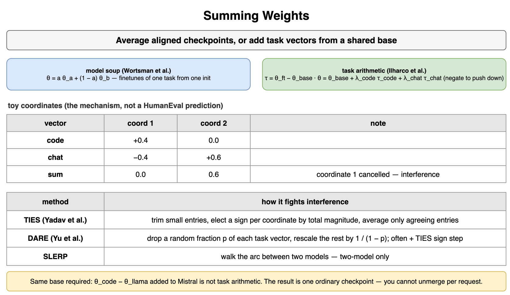

*Source: [`diagrams/finetuning.drawio`](/content/10_AI_Engineering/07_Finetuning/diagrams/finetuning.drawio), page 19.*

## Layer stacking

Layer stacking merges by depth. Blocks from one or more checkpoints are placed in a sequence, and the result is a deeper model of the same hidden size.

A transformer block reads and writes a hidden vector of the same width, so layer 20 of one model can sit where layer 12 was if width, attention layout, and vocabulary line up. A 4,096-wide block cannot stack on a 5,120-wide one, because the residual stream would change shape mid-network. Summing needs identical tensor shapes; stacking needs a matching interface and produces new depth. SOLAR 10.7B (Kim et al., Upstage) is the public depth up-scaling. It starts from a 32-layer model initialized with Mistral 7B weights, duplicates it, drops the last 8 layers of one copy and the first 8 of the other, and concatenates them into `2 × (32 − 8) = 48` layers. The method is the splice plus continued pretraining; the training is part of it, not polish.

The splice alone is a community frankenmerge, built with mergekit's passthrough mode. Without continued pretraining, the middle layers were never trained to follow the layers placed above them, and the result can be worse than the smaller donor while costing more to serve than either. The Apache 2.0 SOLAR checkpoint proves a depth splice can start a real model. It does not justify stacking two liked finetunes and shipping the stack: code and chat middle layers do not form a coherent residual stream because hidden sizes match. If you stack, follow SOLAR with more training and an eval on each donor's tasks.

```python
print(2 * (32 - 8))
# 48
```

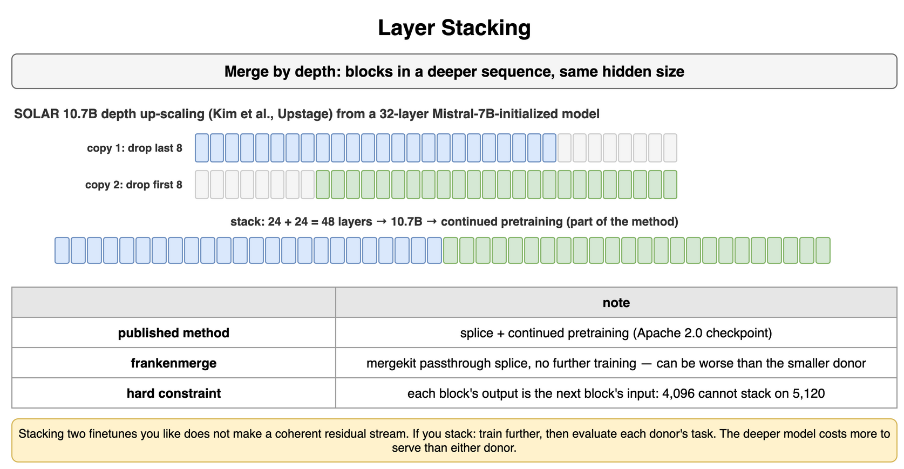

*Source: [`diagrams/finetuning.drawio`](/content/10_AI_Engineering/07_Finetuning/diagrams/finetuning.drawio), page 20.*

## Concatenation

Concatenation merges by width. Parameters are placed side by side so a layer gets wider, or so several copies of a layer become experts that a router mixes back down to the hidden size.

Stacking keeps residual width; concatenation changes a dimension inside the block, so it is not a free tensor operation. Concatenating two output projections along the output axis hands the next layer a wider vector than it was built for. A projection must map it back, or every downstream matrix must widen. Doing that to two whole checkpoints yields a new architecture, not a drop-in checkpoint. The version with a published recipe is sparse upcycling (Komatsuzaki et al.): copy a dense feed-forward into several experts, add a router that mixes them back to the hidden size, and continue training so the copies specialize. SOLAR cites it as the width-wise alternative to depth up-scaling. The copies are identical on day one and stay identical until data pulls them apart, so upcycling from a trusted dense checkpoint is a head start, not a substitute for that data.

Averaging two models' output probabilities is an ensemble, concatenation at the output rather than in the weights. It keeps both full models resident and produces no single on-device file, making it a serving decision closer to holding two LoRAs. Use concatenation when you want a wider model or a mixture of experts and have the training budget and router complexity. It is the wrong tool for combining a code and chat finetune this afternoon: that is a sum if they share a base, or two adapters if requests separate.

```text
naive concat      breaks the next layer's input shape
sparse upcycling  copy FFN -> experts, add router, keep training
output ensemble   both models resident; not a merged checkpoint
```

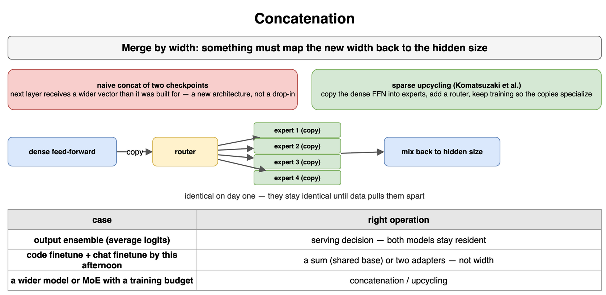

*Source: [`diagrams/finetuning.drawio`](/content/10_AI_Engineering/07_Finetuning/diagrams/finetuning.drawio), page 21.*

## Multi-task finetuning and merging

Multi-task finetuning trains one model on several tasks together. Merging and multi-adapter serving are what you do when that joint run is not the right spend.

Joint SFT concatenates demonstrations, so code and support examples share one optimizer and the model trades skills off while gradients see both. The mixture ratio decides which task's tokens dominate each step. That simultaneous schedule is the right design when the data can sit together, you can afford the run, and the product is one model with no router. Sequential training on shared weights is the schedule the Catastrophic forgetting card refuses unless the general eval passes. Joint training also needs a per-task eval: an average of code and chat scores can rise while code falls, the aggregation trap in [Evaluate AI Systems](../04_Evaluate_AI_Systems/). Joint training usually wins quality when you can run it.

Merging (Summing weights) fits when data cannot share a job because of different owners, a license forbidding mixing, or federated clients. Finetune each skill where its data lives on a shared base, then add task vectors with TIES or DARE to limit cancellation, and still score each skill. If both drop, the merge failed and the joint run is next if data can move. Continued training after a merge reintroduces the data requirement merging avoided. Multi-LoRA serving fits separable requests when one file is not required: code completion uses the code adapter, support chat uses the chat adapter, and the base is shared (Punica, S-LoRA, vLLM). Nothing is averaged, so nothing cancels; the cost is routing, batching rules, and several files to version. Subtracting a task vector to remove a skill is blunt. It can turn the behavior down on the measured eval and leave it on the unmeasured prompt. Deleting a fact is still better done by dropping the document from the index.

```text
data together, one model           -> joint finetune, scored per task
data apart, one file required      -> task arithmetic + TIES/DARE, scored per task
requests separable, adapter server -> multi-LoRA, no merge
```

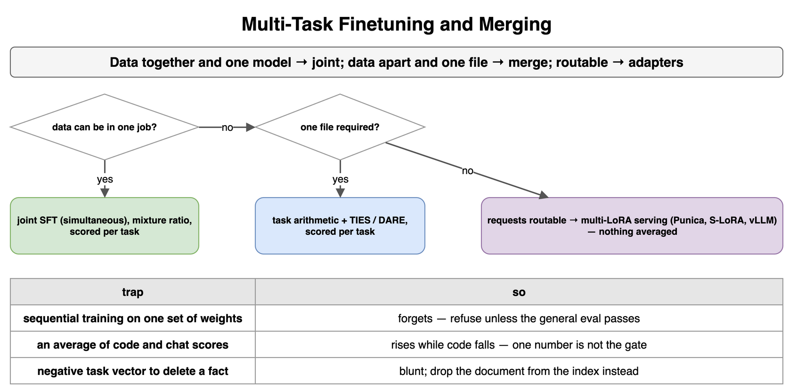

*Source: [`diagrams/finetuning.drawio`](/content/10_AI_Engineering/07_Finetuning/diagrams/finetuning.drawio), page 22.*

## Finetuning frameworks

A finetuning framework is the trainer that owns the data, the trainable parameters, the optimizer, and the checkpoint you will actually load.

Hugging Face is the usual open stack: PEFT marks adapters and freezes the base, and TRL runs SFT, reward modeling, PPO, or DPO on that adapter or a full model. Staying near the transformers definition helps with new architectures and costs glue code on a standard Llama QLoRA job. Axolotl is a reviewable YAML recipe layer for that job: base, chat template, LoRA targets, sequence length, and trainer. Unsloth replaces LoRA/QLoRA kernels to cut single-GPU memory and time, but its speed claims belong to the pinned release, and it does not cover architectures without its kernels. torchtune is PyTorch's post-training library, with full, LoRA, QLoRA, and distributed recipes outside the Hugging Face trainer; look there when FSDP is the main problem. Hosted APIs never return weights. OpenAI's fine-tuning API takes JSONL chat messages, trains on a currently allowed base, and returns a model id you pay to call. Vertex AI Gemini supervised tuning has the same shape. Eligible bases and objectives change, so current docs are the spec. You cannot load the result in vLLM, merge a LoRA into it, or inspect tensors. Choose hosted when operating GPUs is the problem you want gone and the data may leave.

The tool follows the computed constraint. One GPU, a 7B or 13B behavior, and weights needed: QLoRA through PEFT/TRL, Axolotl, or Unsloth. Many GPUs and a full update: torchtune or FSDP. The 100.4 GiB state misses one 80 GiB GPU; ZeRO stage 1 often suffices at 7B, and a 70B full update is a stage-3 problem. No GPUs and no need for the file: the hosted API. Pin the version and template. A chat-template mismatch makes every option look trained, because loss falls while the model learns the wrong wrapping. Apply the base's template (System prompt, user prompt, and chat templates in [Prompt Engineering](../05_Prompt_Engineering/)).

```text
PEFT + TRL   Hugging Face adapters + SFT/DPO/PPO
Axolotl      YAML recipe over that stack
Unsloth      fast LoRA/QLoRA kernels, supported architectures only
torchtune    PyTorch-native, distributed / FSDP
hosted API   examples in, model id out, no weights
```

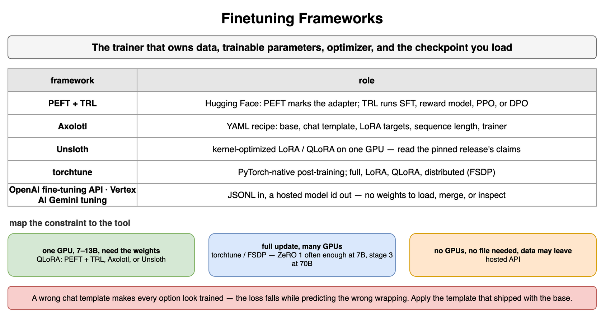

*Source: [`diagrams/finetuning.drawio`](/content/10_AI_Engineering/07_Finetuning/diagrams/finetuning.drawio), page 23.*

## Choosing a base model

Choosing a base model is deciding which checkpoint the trainer is allowed to move, at which size, and whether a smaller student should learn from a larger teacher.

The progression follows the levers in order. Prompt and score the strongest model you can call ([Prompt Engineering](../05_Prompt_Engineering/), [Evaluate AI Systems](../04_Evaluate_AI_Systems/)), add retrieval if the miss is a fact, then LoRA/QLoRA-finetune the smallest open model that might clear the bar if the miss is a behavior with demonstrations, on hardware you can serve as well as train. A 13B you can train but not serve is the wrong base. If a large model already does the task and a small one cannot, distill: run the teacher offline and supervise the student on its answers. DistilBERT (Sanh et al.) is the classic student; for a Llama-sized student it is SFT on teacher targets. The student learns the teacher only on questions you asked. Full finetuning or continued pretraining comes after a measured PEFT plateau. Continued pretraining is for missing domain language, as Code Llama did from Llama 2 (Domain-specific models card in [Understanding Foundation Models](../02_Understanding_Foundation_Models/)). BloombergGPT was pretrained from scratch, and you do not repeat that.

License and lineage come before the GPU (Open weights and licenses in [Evaluate AI Systems](../04_Evaluate_AI_Systems/)): a finetune inherits the base's terms, and SOLAR's Apache 2.0 is why others can ship from it. Instruct versus base is a task decision. An instruct start keeps chat but can fight a narrow output; a base start plus SFT is cleaner for a narrow label or a format that fights the chat template. Measure both when two QLoRA runs are cheap. Match the domain when a licensed domain checkpoint exists, such as a code model for a code labeler, but score the specialist against a stronger general model with the source in the prompt, which is often the better product. Size is serving and training together. Llama 2 7B serves at 12.6 GiB BF16 on one GPU, trains at 100.4 GiB with full AdamW, and QLoRA moves training onto one card without changing serving size unless you also quantize. Pick the size that meets latency in serving form and fits next month's GPUs in training form, then pin it, since changing the base invalidates the eval series.

```text
prompt -> retrieval (facts) -> PEFT on smallest servable base
-> distill a teacher if it already does the task
-> full finetune / continued pretraining only after a PEFT plateau
check first: license, serving size
```

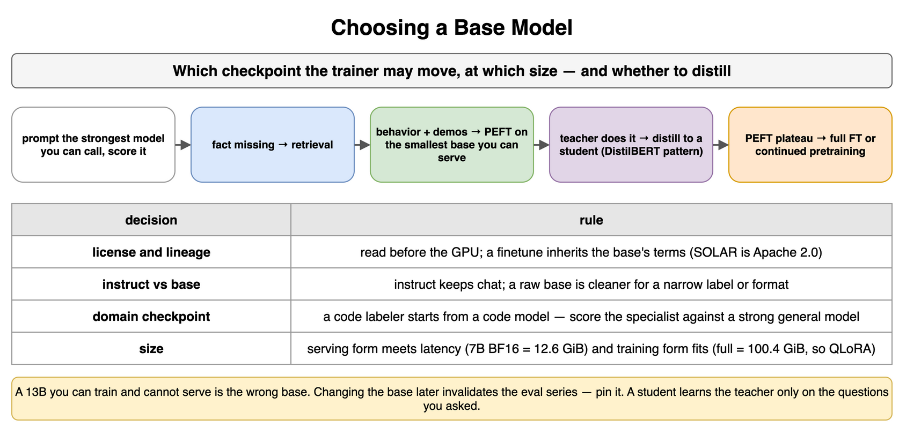

*Source: [`diagrams/finetuning.drawio`](/content/10_AI_Engineering/07_Finetuning/diagrams/finetuning.drawio), page 24.*

## Finetuning hyperparameters

Finetuning hyperparameters are the knobs that decide whether the run moves the right weights: the learning rate, the batch, the number of passes, and how much of the prompt the loss is allowed to see.

The learning rate is the step on trainable parameters. Full updates typically start sweeps around `10^-5` (the QLoRA paper's full-finetune search ran `10^-6` to `5 × 10^-5`), and LoRA around `10^-4`. These are sweep starts, not optima. QLoRA used constant schedules after trying linear and cosine, at `2 × 10^-4` for 7B/13B and `10^-4` for 33B/65B. Too high diverges or turns NaN, especially in FP16 without loss scaling; too low leaves loss flat while weights barely move. Change the rate before inventing an architecture explanation for a flat curve. The microbatch is what fits; gradient accumulation steps the optimizer every several microbatches, so effective batch is microbatch × accumulation × data-parallel GPUs. Memory follows the microbatch: 1 × 8 × 4 gives an effective batch of 32 while each GPU holds one example. The linear scaling rule was measured for large-batch pretraining; a finetune accumulating only to fit often keeps the rate, so say which you mean.

Instruction finetunes often use one to a few epochs. A small set memorized for five epochs posts beautiful training loss and a worse eval than pass one. Stop early on the held-out set from [Evaluate AI Systems](../04_Evaluate_AI_Systems/), which is neither training data nor something to peek at every tweak. If eval loss rises, keep the earlier checkpoint; if both stay high, suspect data, template, or base. The prompt loss weight sets how much prompt tokens enter the loss. Zero is the answer-only mask from the supervised-finetuning card. One also trains on the prompt: with a 100-token prompt and 20-token answer, the answer is about 0.167 of tokens, so the gradient mostly copies the user. Some trainers average over unmasked tokens, so masked and unmasked losses are not comparable. QLoRA masked to the response where datasets separated it and trained the whole thread for OASST1. Rank, alpha, and target modules belong in the same sweep and config. Longer context is an architecture change: positional embeddings like RoPE were trained at a length (transformer card in [Understanding Foundation Models](../02_Understanding_Foundation_Models/)). Raising `max_seq_len` without a positional extension truncates, errors on a fixed table, or feeds RoPE untrained angles that run but degrade quality. Extend positions, then finetune on genuinely long documents (Long-context synthesis in [Dataset Engineering](../08_Dataset_Engineering/)). Move one knob at a time on a frozen eval.

```python
MICRO = 1
ACCUM = 8
GPUS = 4
PROMPT = 100
ANSWER = 20
print(MICRO * ACCUM * GPUS)
print(f"{ANSWER / (PROMPT + ANSWER):.3f}")
# 32
# 0.167
```

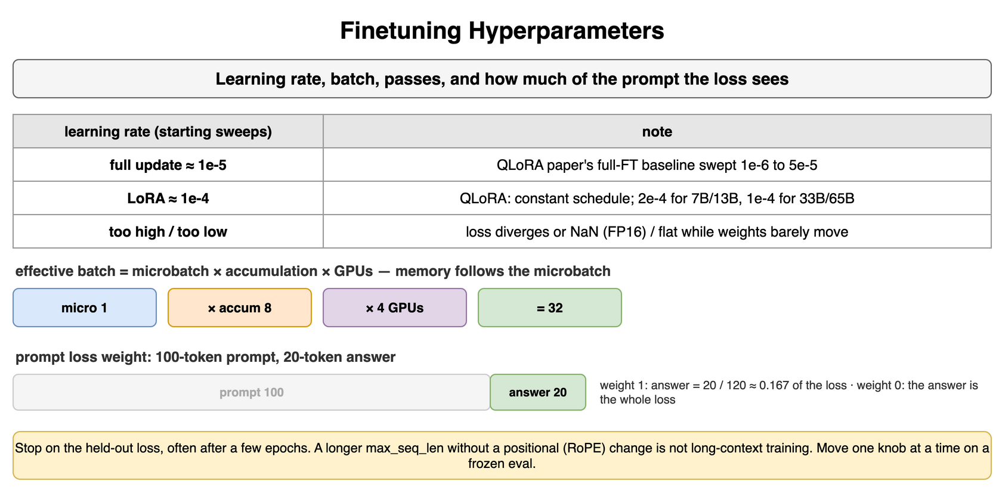

*Source: [`diagrams/finetuning.drawio`](/content/10_AI_Engineering/07_Finetuning/diagrams/finetuning.drawio), page 25.*
