## What dataset engineering is

Dataset engineering is the work of building the examples a model will learn from: which rows exist, what they are allowed to teach, and which encoding the trainer will actually see.

The architecture is often already chosen. An application team calls a hosted model or finetunes a checkpoint such as Llama, and the demonstrations set the ceiling the supervised-finetuning card in [Understanding Foundation Models](../02_Understanding_Foundation_Models/) states. Data-centric AI is the name for spending the next unit of effort on those examples rather than on a new network. Andrew Ng popularized the phrase for exactly this shift: hold the model still, and fix the labels, the coverage, and the duplicates. Pretraining corpora such as C4, RefinedWeb, and FineWeb are the same discipline at crawl scale. The training-data card in that earlier topic is the corpus a base model inherited. This topic is the set you build for a finetune, a classifier, a reward model, or a crawl of your own, and the processing that stands between a raw export and a trainer.

The order is the rest of the topic. Decide what behavior the rows should teach, and judge them on quality, coverage, and quantity. Acquire them from people, from your own product, or from a generator. Verify what a generator wrote. Then inspect, deduplicate, filter, and format. [Finetuning](../07_Finetuning/) is the run that consumes the file. [Evaluate AI Systems](../04_Evaluate_AI_Systems/) is the held-out set you do not put in the file.

**Trade-offs.** A better set can move a frozen model further than another week of architecture search, and the set is slow to specify, label, and read. Synthetic volume is cheap and copies the generator. A human set is the distribution you ship to and does not scale past the budget. Treating the download as done, because a file named `train.jsonl` exists, is how a finetune memorizes duplicates and a leaked eval.

**Interview.** Define dataset engineering as the construction of the examples, and name data-centric AI as the decision to improve those examples while the model stays put. Separate the pretraining corpus, which the training-data card owns, from the task set this topic builds. Say the finetune cannot exceed the demonstrations, and say the eval set is not a pool of extra training rows.

**Recap.** Dataset engineering builds the rows a model learns from and decides what those rows teach. Data-centric AI spends the next effort on the data while the architecture stays fixed, which is the situation an application team is in with a hosted model or a Llama finetune. Public crawls such as C4 and FineWeb are the same discipline at larger scale. The task set still has to be acquired, checked, deduplicated, and formatted, and the held-out eval stays out of it.

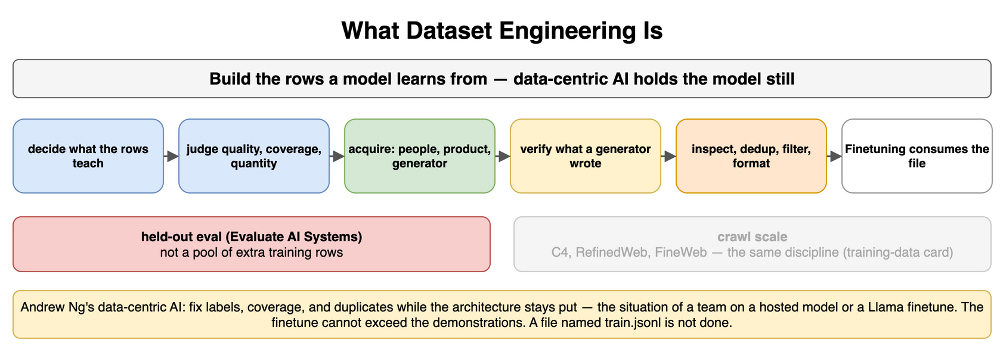

*Source: [`diagrams/dataset-engineering.drawio`](/content/10_AI_Engineering/08_Dataset_Engineering/diagrams/dataset-engineering.drawio), page 1.*

## What the data teaches

A curation goal is the behavior you want at inference, named tightly enough that you can look at a row and say whether the row teaches it.

A base model continues text. Supervised finetuning, on the card of that name, makes it answer by imitating the demonstrations. The imitation is specific. If every target is a short final answer, the model learns to emit a short final answer. Chain-of-thought has to be in the target when you want the trace. Orca, from Mukherjee and coauthors in 2023, trained smaller models on GPT-4's step-by-step explanations rather than on the final answer alone. The reasoning-trace card is the same requirement, later and at larger scale: DeepSeek-R1's published students learned from traces, so the traces had to be the training text. A tool-calling format is the same kind of target. If no row contains a tool name and arguments the parser accepts, the finetune has no example of the action the agent chapter will ask it to take. [RAG and Agents](../06_RAG_and_Agents/) is the tool. This card is the trace you would train.

Multi-turn is a behavior too. Zhou and coauthors' LIMA model, a 65B Llama finetuned on 1,000 single-turn demonstrations, had no dialogue in that set and could still conduct a multi-turn conversation. The paper reports that adding 30 hand-crafted dialogue chains improved that ability sharply. The quantity card is that 1,000. The point here is the content of the 30. A file of isolated questions does not contain a user who changes the address on the second turn. Preference data teaches a ranking rather than a demonstration. The Reward models card owns that difference. A row you add because it was easy to export, a long system prompt pasted onto an unrelated answer, teaches the paste.

**Trade-offs.** Putting the trace, the tool call, and the second turn in the target teaches those behaviors and makes every row longer and harder to check. Training on the final answer only is cheaper to label and leaves the model without the intermediate step you meant to serve. Mixing many goals in one file teaches a compromise. A separate set per behavior is more files to keep aligned with one chat template.

**Interview.** Ask what the product must do on Tuesday, then ask which field of the training row contains that behavior. Chain-of-thought, a tool call, and a second turn each have to appear in the targets if they are supposed to appear in production. Cite LIMA's 30 dialogues as the small addition that changed multi-turn, and Orca as the public case for training on the explanation rather than the final line. A row that does not contain the behavior does not teach it.

**Recap.** The rows teach the behavior that is actually written in the targets. A trace has to be in the file to get chain-of-thought, which is what Orca trained on, and a tool call has to be in the file to get tool use. Multi-turn is the same kind of gap: LIMA's 1,000 examples contained no dialogue, and 30 hand-crafted chains were what improved it. Preference pairs teach a ranking. A convenient export teaches the export.

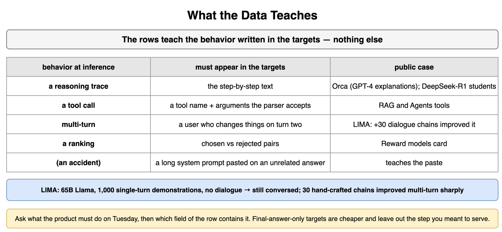

*Source: [`diagrams/dataset-engineering.drawio`](/content/10_AI_Engineering/08_Dataset_Engineering/diagrams/dataset-engineering.drawio), page 2.*

## Data quality

Data quality is the set of properties that make a row worth training on: it is about the task, the label agrees with the task, a second careful person would accept it, the format parses, the row is not a copy, and you are allowed to use it.

Those six checks fail in different places, and a single "looks fine" hides which one failed. A marketing email in a refund set is a relevance failure. A prompt that says "refuse the refund" paired with an answer that issues one is an alignment failure: the target contradicts the instruction it sits under. Two raters who call the same delay both "late" and "carrier exception" are a consistency failure, and the guideline that would have made them agree is the annotation-guidelines card, with the evaluation-guideline card in [Evaluate AI Systems](../04_Evaluate_AI_Systems/) as the pattern for writing the decision down. A missing role, or a tool call that is not JSON, is a format failure the formatting card turns into a schema. Forty pastes of one ticket are a uniqueness failure the deduplication card measures. A card number, or a corpus whose license forbids training, is a compliance failure. The license on a base model stays on the Open weights and licenses card. The license on a teacher's outputs is the distillation card.

| Check | The question the row has to answer | What a failure looks like in a support set |
| --- | --- | --- |
| Relevance | The row is about the task you will serve. | A marketing email sits in the refund file. |
| Alignment with the task | The target does the thing the prompt asked for. | The prompt says to refuse, and the answer refunds the order. |
| Consistency | A second careful person, using the guideline, would keep the same label. | One rater marks a delay "late" and another marks that same delay as a different class. |
| Format | The trainer can parse the row into the fields the loss expects. | The assistant role is missing, or the tool call is prose instead of JSON. |
| Uniqueness | The row adds a case the file does not already contain many times. | The same ticket was pasted in forty times and will dominate the gradient. |
| Compliance | You have the right to train on the text, and the text is safe to put in weights. | The row contains a card number, or the corpus license forbids the training use. |

Quality is not polish. A short, blunt, correct refund decision can be a high-quality row. A long, warm, wrong one is not. The fluent wrong answer is the failure mode the verification card and the distillation drill are about. People still have to read a sample. A classifier that scores "quality" has learned someone else's definition of the word, which is the filter card.

**Trade-offs.** Six separate checks catch six different bugs and cost six passes. One overall grade is fast and un-debuggable when the finetune fails. Rejecting every inconsistent row raises agreement and can erase the ambiguous cases the product actually receives. Keeping them without a written rule teaches both labels. Compliance discarded late, after the training run, means the private string was already in the optimizer.

**Interview.** Walk the six checks on one ticket and say which check failed. Separate a wrong label from a duplicate and from a row you are not allowed to train on. Say that fluency is not one of the six. Offer the repair that matches the failure: a guideline, a parser, a dedup pass, or a drop.

**Recap.** A row is high quality when it is relevant, the target matches the task, raters would agree, the format parses, the row is not a copy, and the license and the privacy rules allow it. Fluency is not a substitute for any of those. Each failure has a different repair, so one "quality" score is not yet a decision.

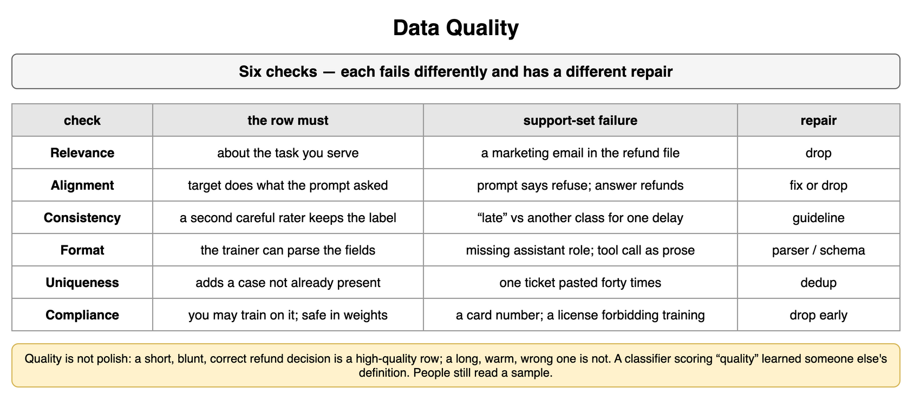

*Source: [`diagrams/dataset-engineering.drawio`](/content/10_AI_Engineering/08_Dataset_Engineering/diagrams/dataset-engineering.drawio), page 3.*

## Data coverage

Data coverage is how much of the traffic you will serve is actually represented in the training rows: the task types, the lengths, the languages, and the topics.

Margins lie. An exercise support file can be 70 percent short English billing tickets, 10 percent long English threads, 5 percent Spanish, 10 percent tool calls, and 5 percent refusals, and still contain no long Spanish thread in which the assistant calls a tool and then refuses. Each margin looks covered. The cell the product will hit on a Tuesday is empty, and the model will answer it from pretraining, which is the behavior you were trying to override. The pretraining version of this problem is the mix on the training-data card, including Llama 3's published blend of general text, math, code, and multilingual data. A finetune has a mix too. It is just small enough that you can count the empty cells yourself.

```python
ROWS = 10_000
# Exercise shares for a support finetune, not a published corpus.
MIX = {
    "english_short": 0.70,
    "english_long": 0.10,
    "spanish": 0.05,
    "tool_calls": 0.10,
    "refusals": 0.05,
}
print(f"{sum(MIX.values()):.1f}")
print(int(ROWS * MIX["spanish"]), int(ROWS * MIX["english_long"]), int(ROWS * MIX["tool_calls"]))
# 1.0
# 500 1000 1000
```

Ten thousand exercise rows at those shares give 500 Spanish rows, 1,000 long rows, and 1,000 tool-call rows. Nothing in the arithmetic builds the intersection. You have to sample it on purpose or accept that it is missing. Length is the cell teams forget because the mean looks fine, which is the inspection card. Language is the cell an English-only review misses. The multilingual card in [Understanding Foundation Models](../02_Understanding_Foundation_Models/) is why a missing language is also a tokenizer and a cost problem, not only a quality problem. Topics work the same way. A refund set that never mentions a damaged shipment has no evidence for that case. Upsampling a rare slice raises its share of the gradient and, past a point, throws away the common case the traffic is mostly made of.

**Trade-offs.** Covering the grid teaches the cells you named and multiplies the labeling bill by the number of cells. Training on the natural traffic distribution matches the average request and starves the rare one. Upsampling the rare cell protects it and can make the model act as if that cell were typical. A coverage spreadsheet that tracks margins and never the intersections will pass while the product fails in the corner.

**Interview.** Ask for the grid, not the average. Task type, length, language, and topic are the axes, and the intersection is the cell you are on the hook for. Use the 10,000-row exercise mix: 500 Spanish and 1,000 long does not mean any long Spanish. Say what you would do with an empty cell. Collect it, synthesize it and verify it, or tell the product owner the model has no evidence there. Mention the pretraining mix only to point at the earlier card.

**Recap.** Coverage is the share of real situations that appear in the file, across task types, lengths, languages, and topics. Margins can look healthy while a cell is empty. In the exercise mix, 500 Spanish rows and 1,000 long rows do not produce a long Spanish tool-calling refusal unless you built that cell. Upsampling fills a cell and changes the distribution, so the eval has to be weighted the way traffic is weighted.

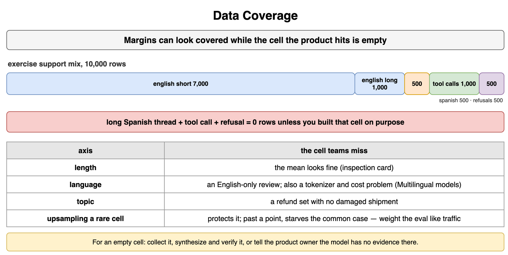

*Source: [`diagrams/dataset-engineering.drawio`](/content/10_AI_Engineering/08_Dataset_Engineering/diagrams/dataset-engineering.drawio), page 4.*

## Data quantity

Data quantity is how many rows you have. It helps when the next row is a new, correct case, and it stops helping when the next row repeats a prompt you already covered.

Four factors decide whether another thousand rows are worth buying. The task can be hard, in which case the same base model needs more cases before the rare branch shows up. The base model can be strong, in which case a small set mostly has to select a format the pretraining already made possible. The labels can be noisy, in which case more rows of the same noise do not converge to the right rule. The set can be diverse or it can be copies. A fifth factor is the finetuning technique. The Training memory card in [Finetuning](../07_Finetuning/) is where a full update and a LoRA stop sharing a byte count. A full update has a free parameter for every weight. It can memorize a small file and it can walk off the skills you did not include, so it wants far more diverse rows than a LoRA run of the same task before the new behavior is real and the old ones survive. Parameter-efficient updates have fewer degrees of freedom. They often fit a format from a smaller set, and fifty noisy copies still overfit them. Quote the technique next to the count. "We have 1,000 rows" is not a plan until you say whether those rows will move every weight. Zhou and coauthors, in the 2023 LIMA paper, finetuned a 65B Llama with ordinary supervised loss on 1,000 carefully chosen prompts and responses, about 750,000 tokens, and no preference optimization. They took 750 of the prompts from community forums such as Stack Exchange and wikiHow and wrote 250 themselves. They name the superficial alignment hypothesis: almost all of the capability was learned in pretraining, and alignment mostly teaches which response format to use. In their preference study, LIMA answers were equivalent or strictly preferred to GPT-4 in 43 percent of cases, to Bard in 58 percent, and to DaVinci003 in 65 percent. That is evidence about a strong base and a small, diverse, consistent set. It is not a law that 1,000 rows ship a support bot. Their own ablation is the part to keep: adding quantity without adding new kinds of prompts produced sharply diminishing returns. Llama 3's post-training, on the synthesis cards, uses much more than 1,000 rows, including synthetic ones, because the behaviors they wanted were not a thin format layer.

The curve below is an exercise you should run on your own task before you buy the next batch. It is not LIMA's table. The diverse curve keeps adding new prompt types. The copies curve spends the extra rows on paraphrases of the first 100.

```python
# Exercise win rates against a frozen prompt baseline, not the LIMA study.
N = (100, 250, 500, 1_000, 4_000, 16_000)
DIVERSE = (0.62, 0.71, 0.78, 0.84, 0.86, 0.87)
COPIES = (0.62, 0.64, 0.65, 0.65, 0.65, 0.65)
early = DIVERSE[3] - DIVERSE[0]
late = DIVERSE[-1] - DIVERSE[3]
print(f"{early:.2f} {N[3] - N[0]}")
print(f"{late:.2f} {N[-1] - N[3]}")
print(f"{early / (N[3] - N[0]) * 1000:.3f}")
print(f"{late / (N[-1] - N[3]) * 1000:.3f}")
print(f"{COPIES[-1] - COPIES[0]:.2f}")
# 0.22 900
# 0.03 15000
# 0.244
# 0.002
# 0.03
```

On the diverse exercise curve, the win rate rises 0.22 from 100 to 1,000 rows, which is 0.244 per thousand rows. From 1,000 to 16,000 it rises 0.03, which is 0.002 per thousand. The copies curve gains 0.03 in total and is flat after 500. The shape is the one LIMA argued for. The numbers are ones you replace with a measured slice of your tickets. A small-data experiment is that plot, drawn before the full labeling contract. If your copies curve and your diverse curve match, you are not in the LIMA regime and more careful rows are the lever. If both are flat and low, the base model does not have the skill and data quantity will not install it.

Start the plot with a pilot on the order of fifty examples. Fifty is a planning size, not a threshold from LIMA and not a guarantee. It is large enough to see whether a second fifty, of a new kind of ticket, moves a held-out number, and small enough that a person can read every row. If the second fifty does not move the number, commissioning a thousand more of the same kind will not either. Extrapolate the curve you measured. Do not extrapolate a slogan about how much data finetuning needs. Staged finetuning is how you spend the expensive rows last. Continue on unlabeled domain text before you spend supervised labels, the continued-pretraining step on the Finetuning objectives card. Train on the less relevant but plentiful rows before the rows that match production, or on synthetic rows before the real ones a person checked. Each stage is allowed to be worse data in the service of a later stage that is better. The last stage is the distribution you serve. A model that only saw the synthetic stage will sound like the teacher. The real fifty, then the real thousand, are what pull it back.

**Trade-offs.** A small clean set is cheap and easy to read, and it misses the tail. A large set covers more of the tail and will be full of duplicates and quiet label errors unless you paid for the other cards. Stopping at 1,000 because LIMA did is how a tool-use bot ships without tool-use rows. Buying 16,000 paraphrases moves the invoice and not the curve.

**Interview.** Separate count from information. State the superficial alignment hypothesis and the setup it was tested in: 1,000 rows, 750 from forums and 250 written, a 65B Llama, no preference stage. Quote the 43 percent against GPT-4 as "equivalent or preferred," including ties, not as a win rate over GPT-4. Then give the exercise curve: 0.22 over the first 900 new rows, 0.03 over the next 15,000, and a copies curve that barely moves. Say you would measure your own curve before scaling the buy, and that Llama 3's post-training is the existence proof that some behaviors need more than a format layer.

**Recap.** Quantity helps while new rows add new correct cases, and it flattens when they repeat. LIMA showed that 1,000 diverse, consistent demonstrations could align a 65B Llama, under a hypothesis that pretraining already held the capability. In the exercise curve, the first 900 diverse rows buy 0.22 and the next 15,000 buy 0.03, while a curve made of copies gains 0.03 and stalls. Run that experiment on your task before you treat 1,000, or 16,000, as the answer.

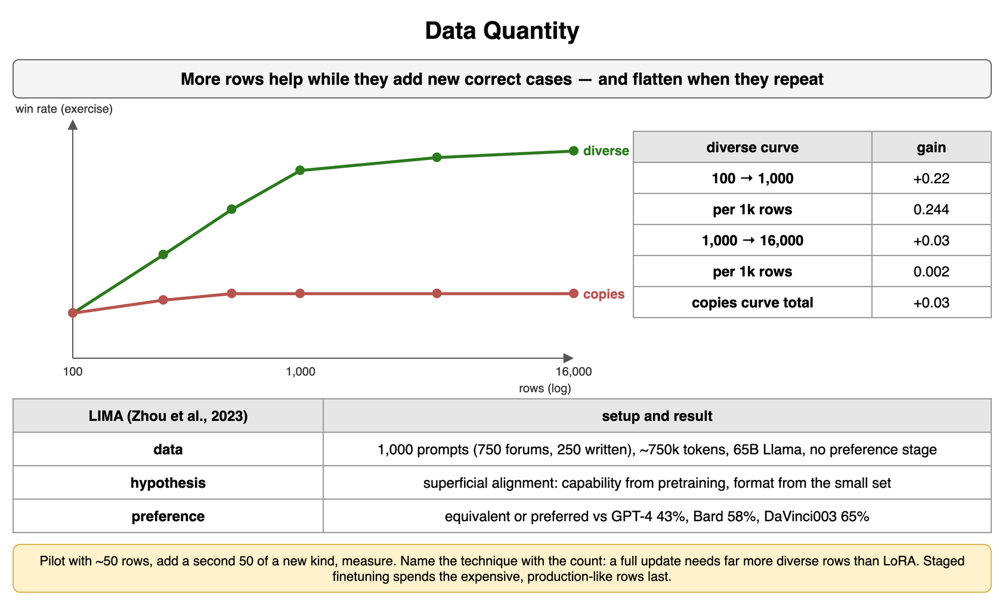

*Source: [`diagrams/dataset-engineering.drawio`](/content/10_AI_Engineering/08_Dataset_Engineering/diagrams/dataset-engineering.drawio), page 5.*

## Acquiring data

Data acquisition is where a training row comes from: a public set, your own traffic, a vendor, or a generator.

A public set on Hugging Face is usable when you have read the license and the datasheet, including a research-only clause that does not cover a product. Your own traffic is the distribution you serve, once consent and a privacy filter allow the export. The flywheel is that export used on purpose. ChatGPT's thumbs and a user's edit of a draft are the public shape of it: the edit is a preference pair when the edit is actually better, with the draft as the rejected answer and the edit as the chosen one. The people who click are not the traffic. Thumbs-down over-represents the angry failure and misses the silent wrong answer a user simply left. Training on that slice teaches you to avoid complaints, which is not the same as being right. A vendor such as Scale AI staffs raters against your guideline. Label Studio, from HumanSignal, is the open-source queue you host when the data cannot leave. The generator is the synthesis half of this topic. The eval set is none of these sources. The annotating-evaluation-data card in [Evaluate AI Systems](../04_Evaluate_AI_Systems/) builds that set and forbids training on it. The guideline those raters apply, and the agreement check on a double-labeled slice, are the next card. Cohen's kappa stays in [Evaluation Methodology](../03_Evaluation_Methodology/). This card does not recompute it.

The budget below is an exercise price, not a Scale AI rate card. Two thousand prompts need one comparison each. Fifteen percent get a second rater, and ten percent of the first pass is thrown out and redrawn because it broke the guideline.

```python
PROMPTS = 2_000
# Exercise dollars per comparison, not a vendor rate.
RATE = 1.25
second = round(PROMPTS * 0.15)
redraw = round(PROMPTS * 0.10)
labels = PROMPTS + second + redraw
print(second, redraw, labels, f"{labels * RATE:.2f}")
# 300 200 2500 3125.00
```

That is 300 second reads, 200 redraws, 2,500 labels, and $3,125.00 at the exercise rate. A senior reviewer on the disagreements costs more and changes the guideline instead of silently correcting rows. The sample-size arithmetic for detecting a small accuracy gap stays on the eval annotation card. The 3,551 figure there is about measurement power. The $3,125.00 is about buying training labels. They answer different questions.

**Trade-offs.** Traffic is representative and full of private data and selection bias. A vendor scales and imports whatever the guideline failed to say. A public dataset is finished and was finished for someone else's task. The flywheel gets cheaper every week and will train on your model's own mistakes if you do not filter it. Double-labeling a slice costs the 300 extra reads. Whether that slice says the guideline is one guideline is the next card.

**Interview.** Name the source, the consent, and the guideline before the model. Give the flywheel's bias: thumbs are not traffic. Walk the exercise budget, 2,000 prompts to 2,500 labels and $3,125.00, and say which line you would cut last. The second rater stays. The guideline and kappa are the next card. Keep the eval set out of the buy.

**Recap.** Rows come from public sets, from consented traffic, from a vendor such as Scale AI, from a queue such as Label Studio, or from a generator. A flywheel of thumbs and edits is biased toward the users who respond. At the exercise rate, 2,000 comparisons plus a 15 percent second read and a 10 percent redraw cost $3,125.00. The guideline those raters apply is the next card. The eval set is a different purchase and is not added to the file.

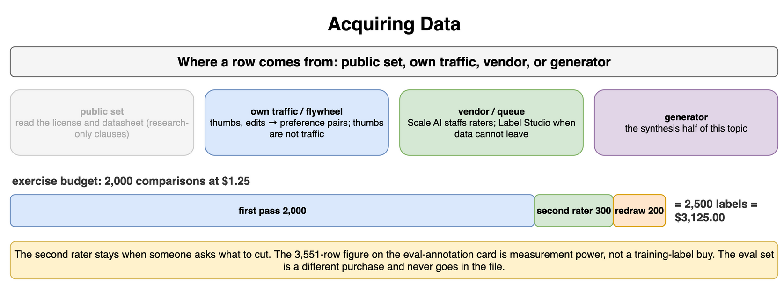

*Source: [`diagrams/dataset-engineering.drawio`](/content/10_AI_Engineering/08_Dataset_Engineering/diagrams/dataset-engineering.drawio), page 6.*

## Annotation guidelines and agreement

An annotation guideline is the written rule a rater applies. Inter-annotator agreement is the check that two careful raters, using that rule, make the same decision.

The document has the same shape as the evaluation-guideline card in [Evaluate AI Systems](../04_Evaluate_AI_Systems/): the decision, one example of each label, and the edge case you already argued about. "Refund if it feels right" is two datasets wearing one name. A written window, a worked ticket, and a rule for the photo that shows the box rather than the item are one dataset. Raters drift when the document is a slogan. They drift again when you change the document and keep the old labels under the new name, because the file then mixes two policies. A vendor such as Scale AI, or a queue you host in Label Studio, can only apply the document you gave them. The acquisition card is where the row comes from and what the slice costs. This card is the rule.

Agreement is how you know the rule is one rule. Double-label a slice. Percent agreement looks strong when almost every ticket is the common class, which is why the how-to-use-an-AI-judge card in [Evaluation Methodology](../03_Evaluation_Methodology/) subtracts chance and reports Cohen's kappa. The worked kappa in that topic is theirs. Do not recompute it here, and do not treat a high percent as the guideline passing. The counts below are an exercise slice, not that topic's 40-draft example. Sixty-four agreements out of eighty is 0.80, and the sixteen disagreements are the missing edge, a vague level, or a rater who never saw the revision. Fix the document, then relabel the rows the old wording touched. A second rater on every row buys the same information a slice already gives you, which is why the acquisition budget double-labels a fraction and keeps that fraction when someone asks what to cut.

```python
# Exercise slice, not the 40-draft kappa example in Evaluation Methodology.
LABELED = 80
AGREED = 64
print(AGREED, LABELED - AGREED, f"{AGREED / LABELED:.2f}")
# 64 16 0.80
```

**Trade-offs.** A tight guideline raises agreement and can erase the ambiguous ticket the product actually receives. Leaving that ticket in without a written rule teaches both labels. Changing the guideline and keeping the old rows is cheap and silently trains yesterday's policy. Double-labeling the whole file is the cleanest agreement number and spends the budget the quantity card was going to use on new cases.

**Interview.** Say the guideline is a decision, an example, and the edge case, and that a slogan produces two datasets. Then say you double-label a slice, you report kappa rather than percent agreement because of the base rate, and the formula stays on the evaluation-methodology card. Walk the exercise slice, 64 of 80 and sixteen disagreements, and say the disagreements rewrite the guideline. Old labels do not keep their meaning after that rewrite.

**Recap.** Annotation is a written rule plus a person. The rule needs a decision, an example of each label, and the edge you already fought about. On the exercise slice, 64 agreements out of 80 is a percent of 0.80, and that percent is not the number you ship, because kappa is what subtracts the base rate. The sixteen disagreements are the next revision. Rows labeled under the old wording do not silently become the new policy.

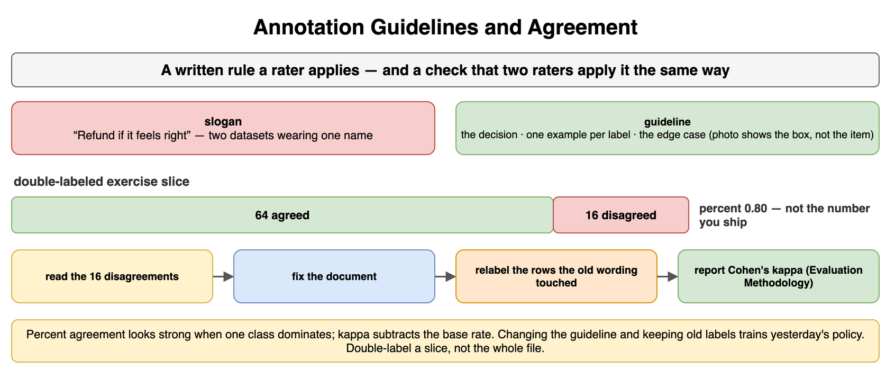

*Source: [`diagrams/dataset-engineering.drawio`](/content/10_AI_Engineering/08_Dataset_Engineering/diagrams/dataset-engineering.drawio), page 7.*

## Why synthesize data

Synthesis is the creation of training rows by a procedure, a simulator, or a model, when you cannot collect enough real rows that teach the behavior.

The reasons are quantity, coverage, quality, privacy, and distillation. Quantity is the Alpaca story. Taori and coauthors started from the 175 human-written seed tasks in Self-Instruct and had `text-davinci-003` write 52,000 instruction demonstrations. The data-generation API bill was under $500, and the Llama 7B finetune was about three hours on eight 80 GB A100s for under $100. The post's headline figure for the whole reproduction is under $600. Coverage is the empty cell from the coverage card: a language, a tool, or a long document you do not have pairs for. Quality is Phi-1, Gunasekar and coauthors' "Textbooks Are All You Need." Phi-1 is a 1.3 billion parameter code model trained on about 6 billion tokens of textbook-quality code filtered from The Stack and StackOverflow, plus GPT-3.5 synthetic data. The abstract puts that synthetic data at about 1 billion tokens of textbooks and exercises. The body splits it into textbooks under 1 billion tokens and an exercise finetune under 200 million tokens. The paper reports 50.6 percent pass@1 on HumanEval and 55.5 percent on MBPP. Its n-gram check found four HumanEval questions with a 13-gram overlap in the exercise set and judged all four false positives, then retrained after pruning exercises that were only similar. That study is the paper's argument, and it is not a waiver of the contamination check on a file you build. Privacy is the row you would rather not copy out of a real ticket. A synthetic ticket can stand in for the pattern. It is not automatically free of a private string the teacher memorized, so the filter card still runs. Distillation is the case where a stronger model already does the task and you need the behavior in a model you can afford to serve. That case has its own card, because the teacher's terms of use decide whether the row may exist.

Llama 3's report uses synthesis inside post-training rather than as a substitute for the whole corpus. For code, Llama 3 and a code expert generate supervised dialogues. The report says that generation produced over 2.7 million synthetic examples used in supervised finetuning. Rejection sampling draws on the order of 10 to 30 candidates for a prompt and keeps the one a reward model ranks first. NVIDIA's Nemotron-4 340B pipeline is the public generate-then-filter version of the same idea: the Instruct model writes, and the Reward model scores HelpSteer2 attributes, which are helpfulness, correctness, coherence, complexity, and verbosity. The reward model was trained on HelpSteer2, a CC-BY-4.0 set of about ten thousand English response pairs. The synthetic set can be large because the filter, not the generator, decides what remains.

**Trade-offs.** Synthesis fills quantity and coverage at the cost of a teacher, a filter, and a license. Real tickets are scarce, slow, and the distribution you actually serve. Textbook-style synthetic data can beat a larger pile of average web text, as Phi-1 argued, and it can also be narrow, wrong, and forbidden by the teacher's contract. Skipping synthesis leaves the empty cell empty. Trusting synthesis without the verification card fills the cell with fluent errors.

**Interview.** Give the five reasons and a public example for each you can defend. Alpaca for quantity, with the 175 seeds and the under-$500 generation bill. An empty language or tool cell for coverage. Phi-1 for quality, a 1.3B model and the reported 50.6 percent HumanEval pass@1, plus the paper's own contamination study. A stand-in ticket for privacy, with the scrub still required. A student model for distillation, and then stop, because the terms live on the distillation card. Mention Llama 3's rejection sampling, typically 10 to 30 samples, and Nemotron-4 340B's generate-then-reward-filter loop as the production shape.

**Recap.** You synthesize data to get more rows, to fill a cell you could not collect, to raise the quality of what a small model sees, to avoid copying a private ticket, or to transfer a teacher's behavior. Alpaca, Phi-1, Llama 3's rejection sampling, and Nemotron-4 340B are public versions of those bets. Every one of them still needs a filter, and the teacher's license can forbid the bet entirely.

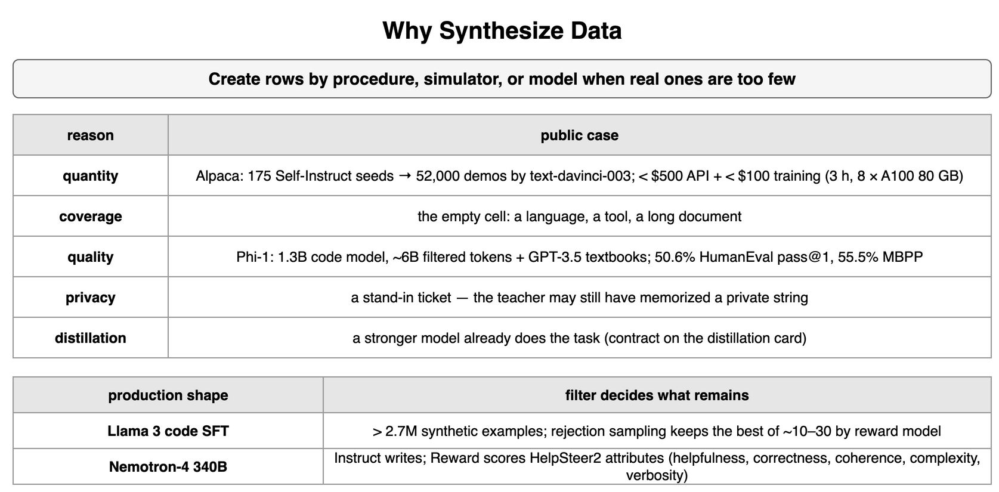

*Source: [`diagrams/dataset-engineering.drawio`](/content/10_AI_Engineering/08_Dataset_Engineering/diagrams/dataset-engineering.drawio), page 8.*

## Rule-based synthesis

Rule-based synthesis builds a row from a template or a small perturbation you can write down, without asking a model to invent the text.

A template is a sentence with holes. The holes are filled from a table you trust: a reason code, a posted window, a city you checked. The label is a function of those holes, not a string you copy from a neighboring row. A perturbation changes a row you already accepted. Wei and Zou's easy data augmentation, from 2019, is the text version people cite: synonym replacement, random insertion, random swap, and random deletion. The new row is legitimate only when the label survives the edit. Deleting a "not," or shortening a 30-day window to 14, is a different task, and the old label is then a bug you generated on purpose.

```python
def row(reason: str, window: int) -> dict[str, str]:
    label = "review" if window >= 30 else "refuse"
    prompt = f"The order {reason}. The posted window is {window} days."
    return {"prompt": prompt, "label": label}


base = [row(reason, 30) for reason in ("arrived damaged", "arrived late")]
paraphrase = row("showed up damaged", 30)
flipped = row("arrived damaged", 14)
copied = {"prompt": flipped["prompt"], "label": base[0]["label"]}
print(len(base), paraphrase["label"], flipped["label"])
print(copied["label"] == flipped["label"])
# 2 review refuse
# False
```

The paraphrase keeps the label `review`. The 14-day row is `refuse`. Copying the original label onto the shortened window produces a row the function itself rejects. That check is the whole method. Templates print a lot of rows because the table is large, and they print a narrow distribution because the table is the distribution. They are the right tool for a regular language: amounts, dates, entity swaps, code identifiers renamed without changing the program's behavior. They are a poor tool for a judgment you cannot write as a function. Once the function exists, running it is also the verification. You do not need a judge to apply a comparison you already encoded.

**Trade-offs.** Templates are cheap, auditable, and limited to the cases you enumerated. Perturbations multiply a real row and silently flip labels when the edit was not label-preserving. A purely templated set teaches the model the template, including its rhythm, and under-represents the way customers actually write. Mixing a small templated slice into real tickets adds the regular cases without replacing the distribution.

**Interview.** Define the label as a function of the fields you filled, and give the window example: a paraphrase of "damaged" stays `review`, and a window of 14 becomes `refuse`. Say that copying the old label onto the new row is the bug. Place templates where the rule is real, and send open-ended judgment to people or to a verified model. Mention that random deletion is not augmentation when the deleted word is the negation.

**Recap.** Rule-based synthesis fills a template from a trusted table or perturbs a row you already believe. The label has to be recomputed from the fields. In the example, a paraphrase of a damaged order stays a review, and shortening the window to 14 days is a refusal. The copied label fails that check. Templates cover the regular cases well and only those cases.

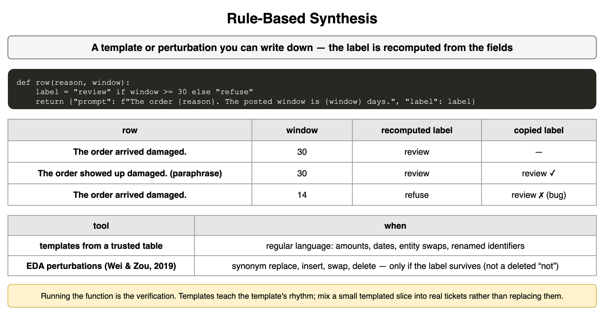

*Source: [`diagrams/dataset-engineering.drawio`](/content/10_AI_Engineering/08_Dataset_Engineering/diagrams/dataset-engineering.drawio), page 9.*

## Simulation

Simulation builds training rows by running a process whose rules you control, then keeping the trace the process actually produced.

The process differs by domain. A robot needs contact, friction, and a camera image, so teams generate those in a simulator such as NVIDIA Isaac Sim rather than breaking hardware on every policy attempt. A driving model needs rare collisions and odd weather. CARLA is a public driving simulator used for that kind of scene, and Waymo has described simulation as part of how it tests driving. The scene is data because the simulator stepped the physics, not because a model wrote a paragraph about a crash. A tool-using assistant needs a sandbox that executes the call. WebArena does this for websites. SWE-bench does it for GitHub issues, where a patch is kept when the tests pass. A refund tool is the small version of the same idea. The trace below is training data only when the sandbox ran `get_order` and `refund` and returned the `result` fields. A model-written story about a refund has no `result`. An amount the sandbox would have rejected does not become legitimate by being fluent.

```python
ALLOWED = {"get_order", "refund"}


def accept(trace: list[dict], order_total: int) -> bool:
    seen_lookup = False
    for step in trace:
        if step["tool"] not in ALLOWED or "result" not in step:
            return False
        if step["tool"] == "get_order":
            seen_lookup = True
        if step["tool"] == "refund":
            amount = step["arguments"]["amount_cents"]
            if not seen_lookup or amount != order_total:
                return False
    return True


good = [
    {"tool": "get_order", "arguments": {"order_id": "1001"}, "result": {"total_cents": 4800}},
    {"tool": "refund", "arguments": {"order_id": "1001", "amount_cents": 4800}, "result": {"ok": True}},
]
over = [
    {"tool": "get_order", "arguments": {"order_id": "1001"}, "result": {"total_cents": 4800}},
    {"tool": "refund", "arguments": {"order_id": "1001", "amount_cents": 99999}, "result": {"ok": True}},
]
story = [{"tool": "refund", "arguments": {"order_id": "1001", "amount_cents": 4800}}]
print(accept(good, 4800), accept(over, 4800), accept(story, 4800))
# True False False
```

The good trace looks up order 1001 and refunds the 4800 cents the lookup returned. The 99999-cent refund is rejected. The story is rejected because the sandbox never attached a result. This is the boundary with the verification card. Simulation is how the row is born. Verification is the gate that lets it into the file. Here they happen to be the same function, which is the nice case. A driving scene still needs a second check that the labels on the actors are the labels you think they are. Domain randomization, changing lighting and textures so a robot policy is less tied to one rendered room, widens coverage and can also train a policy that relies on a cue the real camera does not have.

**Trade-offs.** Simulation gives you rare and dangerous cases you should not collect in production, and it gives them to you with whatever is wrong in the simulator. The sim-to-real gap is that difference: a policy that is perfect in CARLA and wrong on a real road, or a tool policy that passes a stub and fails on the real Stripe error. Executed traces are slower than stories and are the ones worth training on. Stories scale and teach the model that tools succeed when the prose says so.

**Interview.** Define a simulated row as a trace an executable process produced. Name a driving simulator, a robotics simulator, and a tool sandbox such as SWE-bench or WebArena. Walk the refund trace: lookup, then the amount the lookup returned, with a result field. A missing result is a story. Say the sim-to-real gap is why a passing sandbox does not retire a production eval.

**Recap.** Simulation creates rows by running rules you control, in a robotics simulator such as Isaac Sim, a driving simulator such as CARLA, or a tool sandbox that executes the call. The trace is data because the process returned a result. In the example, a refund of the looked-up 4800 cents is kept, and both an invented amount and a story without a result are dropped. The remaining risk is that the simulator is not the world.

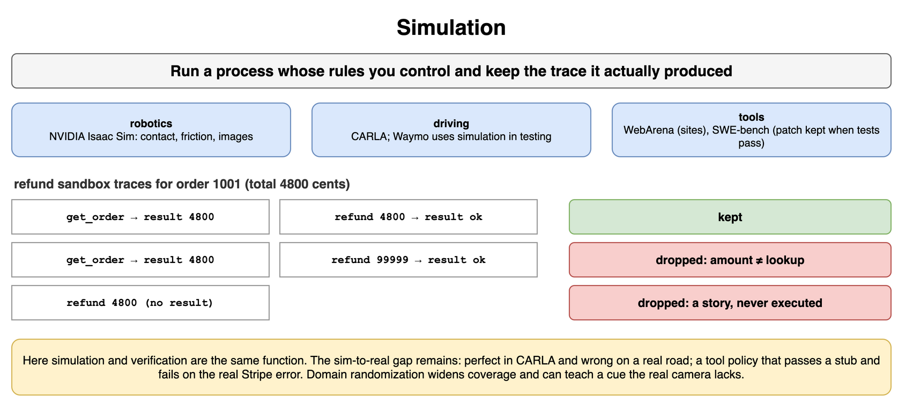

*Source: [`diagrams/dataset-engineering.drawio`](/content/10_AI_Engineering/08_Dataset_Engineering/diagrams/dataset-engineering.drawio), page 10.*

## AI-powered synthesis

AI-powered synthesis uses a model to create or rewrite training rows. The model is not, by itself, a reason to trust the row.

Four patterns cover most of what teams actually run, before the instruction-specific loop later in the topic. Self-play has the model generate both sides of an interaction. It works when something outside the model scores the result. AlphaZero's self-play has the rules of the game. A language model talking to itself has no such score unless you add a unit test, a sandbox, or a written principle. Constitutional AI, which the Reward models card in [Understanding Foundation Models](../02_Understanding_Foundation_Models/) already describes, is the public language version: the model critiques and revises a draft against a constitution, and those revisions become preference pairs that train the policy. A chat between two copies with no constitution and no checker converges on whatever both copies already say. Paraphrase asks a model to restate a row you already accept. It is useful when the restatement changes the surface and preserves the label, and it is a duplicate when it does not change the surface. The deduplication card's Jaccard check is how you tell. Back-translation is the next card, and it is not this paraphrase. Sennrich, Haddow, and Birch keep a real sentence on one side of the pair. A round trip is a different procedure.

Translation as augmentation is the coverage tool for a language you are short on, and it has the same failure. Names, order ids, and code should often not have been translated. A Spanish ticket translated to English, answered, and translated back can train a fluent answer to a question the customer did not ask. The multilingual card is why you still want real text in that language. Synthetic translation is a bridge, not the cell.

**Trade-offs.** A model can write volume and variety you will not hand-author, and every row inherits the model's mistakes and the model's contract. Self-play with an external score improves on that score and ignores anything the score does not see. Paraphrase and a translation round trip widen phrasing and collapse into near-duplicates or flipped labels without a check. The back-translation card separates that round trip from Sennrich's one-hop method. A second model as the only judge of the first model's rows is the verification card's problem, and it is circular when the two models share a failure.

**Interview.** Separate "a model wrote it" from "a check accepted it." Give self-play its missing piece, the external score, and point Constitutional AI at the Reward models card. Point back-translation at the next card: Sennrich's method is one translation onto real monolingual text, and a round trip is a different paraphrase. Say a paraphrase with a high Jaccard to the source is a duplicate, not a new row. Leave the instruction bootstraps to the instruction-synthesis card.

**Recap.** AI-powered synthesis has a model write or rewrite rows, and the row still needs a score that is not the model's own fluency. Self-play works when the rules, a sandbox, or a constitution scores the result. Paraphrase and a translation round trip add wording and can drop a negation or repeat the source. Translation fills a missing language only as a bridge, and the label is rechecked after the trip. Sennrich's back-translation is not that trip.

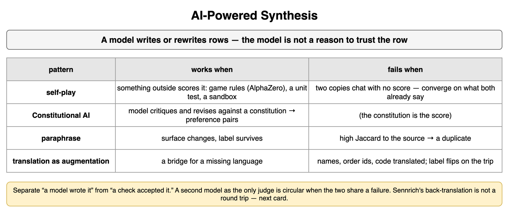

*Source: [`diagrams/dataset-engineering.drawio`](/content/10_AI_Engineering/08_Dataset_Engineering/diagrams/dataset-engineering.drawio), page 11.*

## Back-translation

Back-translation, in the machine-translation sense, creates a training pair by translating real monolingual text with a model in the reverse direction. The human sentence stays human. Only the other side is synthetic.

Sennrich, Haddow, and Birch, at ACL 2016, used it to add parallel data. A model trained to translate from the target language back into the source language turns real target sentences into synthetic source sentences. The pair is a synthetic source plus a real target. It is one translation, not a trip out and back. Instruction backtranslation, on the instruction-synthesis card, is that shape for prompts. A human document is the response, and a model writes the instruction that might have produced it. Li and coauthors describe it that way, and they cite Sennrich.

Augmentation papers use the same name for a different procedure. You translate a labeled sentence into another language and back, and you hope the result is a paraphrase. Xie and coauthors' unsupervised data augmentation, from 2020, uses that round trip as a noising step for classification. The new sentence is useful when the meaning survives. It is a corrupted label when the trip drops a negation or a condition, and it is a near-duplicate when the surface barely changes. The deduplication card's Jaccard check catches the second failure. The first failure is not a keyword search for "not," because a faithful paraphrase can refuse without that word. The label is re-decided from the guideline, or the row is dropped. Names, order ids, and code often should not have been translated at all. The multilingual card in [Understanding Foundation Models](../02_Understanding_Foundation_Models/) is why a round trip is a bridge and not a substitute for text written in the language you are short on.

```python
def keeps_refusal(text: str) -> bool:
    tokens = set(text.lower().split())
    return bool(tokens & {"not", "don't", "never"}) or "leave the charge" in text.lower()


original = "do not refund the order"
paraphrase = "leave the charge in place"
flipped = "refund the order"
print(keeps_refusal(original), keeps_refusal(paraphrase), keeps_refusal(flipped))
# True True False
```

The paraphrase preserves the refusal and does not contain "not." The flipped sentence is a different label. Copying `refuse` onto it is the same bug as copying a label onto a changed window, on the rule-based card. Here the edit was a translation, and the check is the same. Recompute the label.

For a language the model barely writes, back-translation is the synthesis path, and native generation is the one to refuse. Ask the model to author a thousand support replies in a language that was scarce in pretraining and you will get fluent-looking text with the wrong policy and the wrong morphology. Sennrich's direction keeps the scarce-language sentence human, if you have those sentences, and lets the model propose the other side. A round trip that starts from English you trust, and lands back in English as a paraphrase, is the augmentation above. A round trip whose destination is "now write the training set in the low-resource language" is the model inventing the side you cannot check. Translate with a system you can spot-check, or keep the human sentence on the side users will read. The Multilingual models card is why a tokenizer that splits that language into many pieces makes a small native set even smaller. More synthetic native text does not repair a tokenizer. It rehearses the errors.

**Trade-offs.** Sennrich's one-hop method keeps a real sentence on one side and invents the other, so the facts on the human side are facts a person wrote. A round trip can widen phrasing and can also drop the condition the label depended on. Refusing to translate names and code leaves those strings intact and leaves the surrounding sentence stilted. Treating every round trip as a new row fills the file with near-copies the MinHash pass should have collapsed.

**Interview.** Separate the two procedures. Sennrich, Haddow, and Birch, ACL 2016, is one reverse translation onto real monolingual text. A round trip, as in the 2020 unsupervised data augmentation recipe, is a paraphrase and needs a label check. Instruction backtranslation is the prompt version of Sennrich's shape, and the curation pass is the method. Say a keyword search for "not" rejects both the faithful paraphrase and the flipped refund, so it cannot tell those two rows apart. The label has to be re-decided.

**Recap.** Back-translation in machine translation pairs a synthetic sentence with a real one, in one direction. A round trip is a paraphrase generator, and the label is rechecked because the trip can drop a negation or a condition. In the example, "leave the charge in place" is still a refusal and "refund the order" is not. Instruction backtranslation writes a prompt for a human document and then curates. None of the three is a license to copy the old label onto text you have not read.

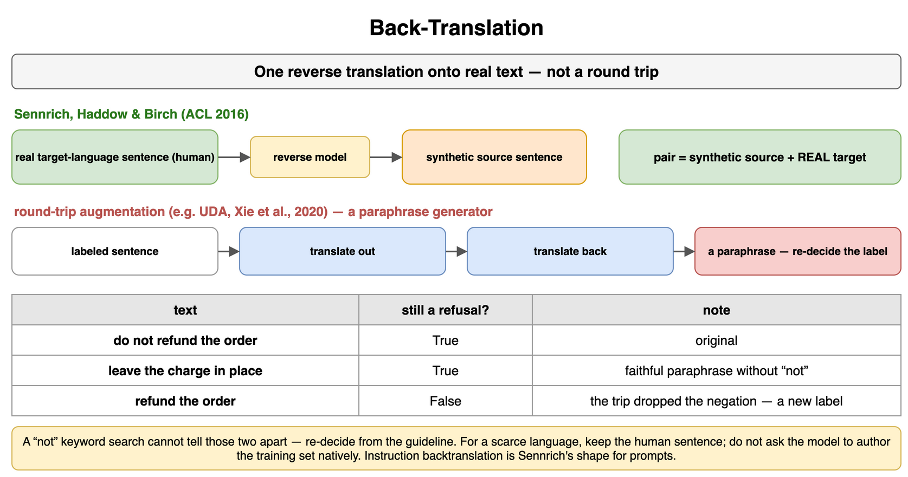

*Source: [`diagrams/dataset-engineering.drawio`](/content/10_AI_Engineering/08_Dataset_Engineering/diagrams/dataset-engineering.drawio), page 12.*

## Instruction data synthesis

Instruction data synthesis is the loop that creates the prompts and the answers for supervised finetuning, starting from a small seed or from unlabeled text.

Self-Instruct, from Wang and coauthors in 2022, is the bootstrap. They started with 175 human-written seed tasks. A language model proposed new instructions, then proposed input-output instances for those instructions. Heuristics dropped malformed and near-duplicate instructions, and the survivors went back into the pool. The published run, on GPT-3, produced 52,445 instructions and 82,439 instances. At the davinci price they cite, $0.02 per 1,000 tokens in December 2022, generating the set cost about $600. Alpaca is that idea with a stronger teacher and a simpler pipeline: the same 175 seeds, `text-davinci-003` as the writer, 52,000 demonstrations, under $500 of API spend. The student learns the teacher's instruction-following, including the teacher's habits. Evol-Instruct, the method behind WizardLM, from Xu and coauthors in 2023, starts from an instruction you have and rewrites it. In-depth evolution makes that instruction harder. The paper's five rewrites are adding constraints, deepening, making the task more concrete, adding reasoning steps, and complicating the input. In-breadth evolution asks for a new instruction that is more long-tailed, not a harder copy of the same one. An elimination pass drops evolutions that failed. The teacher then writes the answer to the evolved instruction. The difficulty goes up only if the answer is checked. An evolved instruction with a wrong answer is a harder way to teach a mistake.

Reverse instruction starts from the answer. Li and coauthors, in the 2023 instruction-backtranslation paper, take a human-written web document as the response and ask a model to write the instruction that would have produced it. Their own finding is the useful one: training on those pairs raw was poor, and a second curation pass that kept only the pairs a model scored as high quality was the method that worked. The document is real, which avoids a model inventing the facts, and the instruction can still be a question the document does not answer. Long-context synthesis is the next card: a real long source, and a question kept only when the answer checks out. UltraChat, from Ding and coauthors in 2023, is the multi-turn version of model-written dialogue: the generator plays both the user and the assistant across turns. Zephyr's published recipe trains on a filtered slice of UltraChat. A multi-turn synthetic chat teaches multi-turn only if someone checked that the second turn follows from the first.

**Trade-offs.** Bootstrapping from 175 seeds produces breadth and a recognizable teacher accent, and it plateaus when the new instructions are paraphrases the filter should have caught. Evolution raises difficulty and raises the chance the answer is wrong. Backtranslation keeps a human document and can attach a bad question to it. Long-context pairs are the next card. They are expensive to verify, and they are the synthetic pairs that can teach a long source. Unfiltered UltraChat-style turns are conversations in form and contradictions in content.

**Interview.** Walk Self-Instruct's loop: 175 seeds, generate, filter, repeat, with 52,445 instructions as the published yield. Separate Alpaca as the same loop with a stronger teacher. Describe Evol-Instruct as rewriting toward difficulty, and instruction backtranslation as labeling a human document with a generated prompt. Say the curation pass is the method, not an optional cleanup, because the backtranslation paper's unfiltered pairs were the weak version. That method has Sennrich's shape, a human document with a generated prompt, not a round trip. For long context, require a real source and a checkable answer, and leave the 0.1 percent mix to the next card. Multi-turn synthesis has to be consistent across turns or it teaches a second turn that ignores the first.

**Recap.** Instruction synthesis builds prompt and answer pairs from a seed, from a harder rewrite, or from a human document that still needs a prompt. Self-Instruct turned 175 seeds into 52,445 instructions. Evol-Instruct raises difficulty. Instruction backtranslation writes the prompt for an existing document and then has to curate, because the raw pairs were the weak version. Long-context rows are the next card. Multi-turn sets such as UltraChat teach conversation only when the turns actually follow.

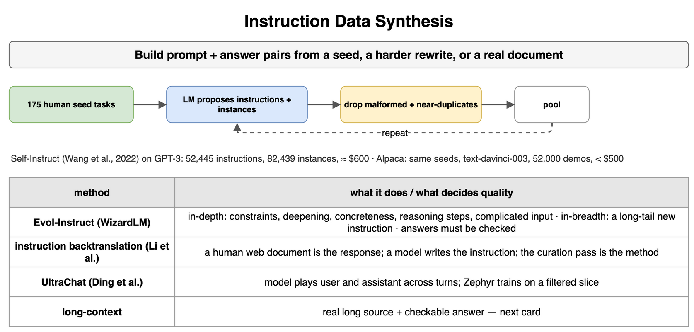

*Source: [`diagrams/dataset-engineering.drawio`](/content/10_AI_Engineering/08_Dataset_Engineering/diagrams/dataset-engineering.drawio), page 13.*

## Long-context synthesis

Long-context synthesis builds a training pair whose source is a real long document, and whose question is kept only when the answer is a span of that document or the result of a check you can run.

People will not read a long contract to write a thousand questions. Llama 3's report says the same thing about post-training. Short-context supervised data made long-context ability regress, human annotation at those lengths was impractical, and earlier Llama 3 checkpoints wrote synthetic question-answering, summarization, and repository-reasoning rows. The ablation that kept both short and long benchmarks mixed that synthetic long-context data in at 0.1 percent of the supervised set. That is one report's mixture, not a quota to copy onto a support bot. The question still has to be answerable from the source you packed. A question whose answer is not a span, and not the output of a check, teaches a fact the document does not contain. Packing two unrelated contracts and asking for a number that sits in the middle teaches the failure the Context length and context efficiency card in [Prompt Engineering](../05_Prompt_Engineering/) already measured, the one where the relevant span is buried and the model answers from the ends. A summary that adds a refund the contract does not offer is a fluent insertion. Hierarchical summarization, which that report also used, still needs a person or a check on a sample, because the summary of a summary can drop the exception.

```python
CONTRACT = "the return window is 30 days from delivery. damaged items are refunded at half the order total."


def grounded(source: str, answer: str) -> bool:
    return answer.lower() in source.lower()


print(grounded(CONTRACT, "30 days from delivery"))
print(grounded(CONTRACT, "there is no restocking fee"))
# True
# False
```

"30 days from delivery" is a span of the contract. "there is no restocking fee" is not, so the pair is dropped even if a teacher wrote it confidently. A span check misses a correct paraphrase. Those go to a person, or to the verification card, rather than being trusted because they sound like the source.

**Trade-offs.** Synthetic long-context rows are the practical way to keep a behavior humans will not label at that length, and they are only as true as the check. A small slice, such as Llama 3's 0.1 percent, can be enough to stop a regression and can also be too small for the contracts you actually serve. Requiring a literal span rejects valid paraphrases and accepts a copied sentence that answers a different question. Dropping the check and keeping every teacher question fills the middle of the context with unsupported claims.

**Interview.** Say the source has to be real and the answer has to be checkable. Give Llama 3's setting: synthetic question-answering, summarization, and repository reasoning, mixed at 0.1 percent in the ablation that kept short and long benchmarks, and say you would measure that fraction on your own task before copying it. Then the two prints. The window is in the contract. The restocking fee is not. Point the buried-span failure at the Context length and context efficiency card instead of re-deriving it.

**Recap.** Long-context pairs start from a real long source. Llama 3 generated them because people do not annotate those lengths, and one ablation used a 0.1 percent mix. A pair survives when the answer is a span or a check you can run. In the example, "30 days from delivery" stays and "there is no restocking fee" goes. A paraphrase that is true but not a literal span is a sample for a person, not an automatic keep.

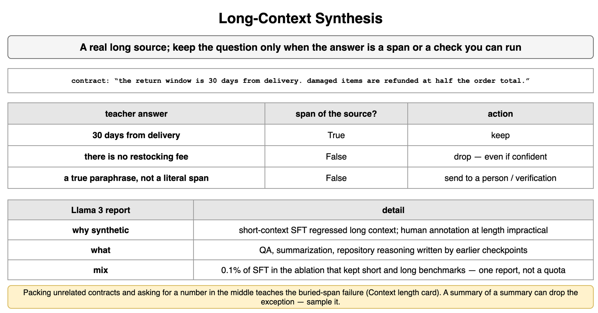

*Source: [`diagrams/dataset-engineering.drawio`](/content/10_AI_Engineering/08_Dataset_Engineering/diagrams/dataset-engineering.drawio), page 14.*

## Verifying synthetic data

Verification is the decision to keep a synthetic row. A row a model wrote is a candidate until a check that does not depend on the model's fluency accepts it.

Three checks cover the candidate, and the cheapest one that can see the failure goes first. That ordering is the choosing-evaluation-methods card in [Evaluate AI Systems](../04_Evaluate_AI_Systems/), applied to the training file. A functional check executes something. A tool call has to parse, the tool name has to be one you serve, and the arguments have to satisfy the types. Code has to run. SQL has to return the result the question asked for. A math answer has to equal the reference. The simulation card's sandbox is a functional check that happens to create the row as well. A heuristic is a cheap pattern: too short, too long, the same n-gram repeated, the wrong language, a refusal template in a set that was supposed to answer, or a high Jaccard to a row you already kept. A heuristic that the row merely looks long is not a check. An AI judge is the residue, and it is the tool the judge cards in [Evaluation Methodology](../03_Evaluation_Methodology/) already specify: a pinned model, an anchored rubric, a human slice, and a swap when the verdict is pairwise. Using the teacher as the only judge of the teacher's rows repeats the teacher's taste. Nemotron-4 340B's reward model and Llama 3's rejection sampler are judges in this role. They are useful after a functional check, not instead of one. Llama 3's report scores a row with a reward model and with a separate Llama quality score. The two disagree often, and the report keeps a row when either one marks it high quality, because the union had better recall on their internal test. That is a recall choice. It is not an average, and the rows only one score accepts are the ones to read.

```python
import json


def tool_ok(raw: str) -> bool:
    try:
        call = json.loads(raw)
    except json.JSONDecodeError:
        return False
    arguments = call.get("arguments", {})
    order_id = arguments.get("order_id")
    known = call.get("name") in {"get_order", "refund"}
    return known and isinstance(order_id, str) and order_id.isdigit()


def repeated(text: str, n: int = 4) -> bool:
    words = text.lower().split()
    span = range(len(words) - 2 * n + 1)
    return any(words[i : i + n] == words[i + n : i + 2 * n] for i in span)


good = '{"name":"get_order","arguments":{"order_id":"1001"}}'
bad_id = '{"name":"get_order","arguments":{"order_id":"abc"}}'
prose = "sure, looking now"
loop = "please wait please wait please wait please wait"
plain = "the package left the warehouse on Tuesday"
print(tool_ok(good), tool_ok(bad_id), tool_ok(prose))
print(repeated(loop), repeated(plain))
# True False False
# True False
```

The parsed call with a numeric order id is kept. The call with `abc`, and the sentence that never became JSON, are dropped. The repeated "please wait" trips the heuristic. The ordinary sentence does not. Neither check knows whether the refund was the right amount. That is a further functional rule, and a judge still does not get to overrule it. A row that passes the parser and fails a person on a sampled slice is a spec bug in the check, and the check changes before the next batch.

**Trade-offs.** Functional checks are strict and blind to tone. Heuristics are cheap and foolish in the way you wrote them, so a repetition rule will drop a poem you meant to keep and miss a paraphrase of a bad answer. Judges cover open-ended quality and import every bias on the judge cards, including a preference for the teacher's style. Running only the judge, because it is one API call, is how a wrong amount with a warm paragraph enters the file. Running every check on every row spends judge money on JSON that a parser already rejected.

**Interview.** Put the checks in order: execute what you can, then a heuristic, then a judge for the residue a person has calibrated. Give the tool-call example and the repeated-phrase example. Say the teacher does not get to be the only grader of itself. Point the judge's biases and the human slice back at the evaluation topic, and point rejection sampling at Llama 3, where a reward model picks among 10 to 30 candidates after the row exists.

**Recap.** A synthetic row is kept only when a check accepts it. Functional checks parse and execute. Heuristics catch cheap failures such as a repeated phrase. A judge grades what remains, with the calibration from the evaluation topic, and does not outvote a failed execution. The tool call with a numeric order id survives the parser. The prose and the repeated "please wait" do not.

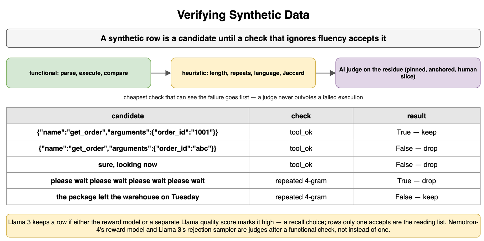

*Source: [`diagrams/dataset-engineering.drawio`](/content/10_AI_Engineering/08_Dataset_Engineering/diagrams/dataset-engineering.drawio), page 15.*

## Limits of AI-generated data

The limits of AI-generated data are the ways a large synthetic set still makes the next model worse, or makes it something you are not allowed to ship.

Quality control is the first limit, and it is the previous card. Wrong rows you do not check become demonstrations. The student is then trained to produce those errors, rather than merely sampling them at the rate the teacher happened to emit them. Superficial imitation is the second limit. The student copies the teacher's length, the stock opening, and the tone, and it copies them on the cases the teacher also gets wrong. This is a different claim from LIMA's superficial alignment hypothesis. That hypothesis says a strong pretrained model already has the capability and a small set selects the format. Superficial imitation says the synthetic targets were surface, so the student learned the surface. You tell them apart by checking the answer, not the style.

Model collapse is the third limit, and it is what happens when the surface becomes the next training distribution. Shumailov and coauthors, in Nature in 2024, show that indiscriminately training on data produced by a previous generative model causes the tails of the original distribution to disappear. They demonstrate it for Gaussian mixtures, variational autoencoders, and language models. The paper's warning is about recursive replacement: each generation trains on the previous generation's output instead of on the original human distribution. A checked synthetic slice added to human data you still hold is a different mixture. It does not earn the name collapse until the synthetic text is standing in for the tail. The practical consequence they draw is the one that matches the flywheel: human data, and data about real interactions, gets more valuable as the public web fills with model text. The training-data card's crawl is where that shows up for pretraining. This card is why you do not fine-tune today's model only on yesterday's model's answers and then repeat.

Lineage is the fourth limit, and it has its own card. A synthetic row's facts came from a teacher corpus you usually cannot list, and the record of teacher, filter, and license is what makes the row auditable. Licensing is the fifth limit. A row can be high quality and still be a contract violation, which the distillation card handles.

**Trade-offs.** Synthetic data is the only way to fill some cells, and unchecked synthetic data narrows the distribution toward what the teacher already says. Keeping human data in the mix resists collapse and limits you to the human data you can collect. Aggressive filtering of synthetic errors throws away rare cases that look weird to the heuristic. Light filtering preserves the rare cases and the mistakes. Publishing a student without a record of the teacher, the filter, and the license makes the next audit guess.

**Interview.** Name the five limits. Quality control is a check, not a hope. Superficial imitation is style without the right answer, and it is not the LIMA hypothesis. Model collapse, Shumailov and coauthors, Nature 2024, is recursive training on model output until the tails vanish. Distinguish that from one checked synthetic slice mixed into data you still hold. Lineage is the teacher's unseen corpus, including benchmarks, and the record is the lineage card. Licensing is the contract, on the distillation card, rather than something you wave through.

**Recap.** AI-generated rows can be numerous and still be wrong, stylistic, illegally reused, or the beginning of a narrower and narrower distribution. Model collapse, as Shumailov and coauthors describe it, is what recursive replacement does to the tails. One verified synthetic slice mixed with human data is a different regime. The teacher's unknown corpus and the teacher's contract remain attached to every row the teacher wrote.

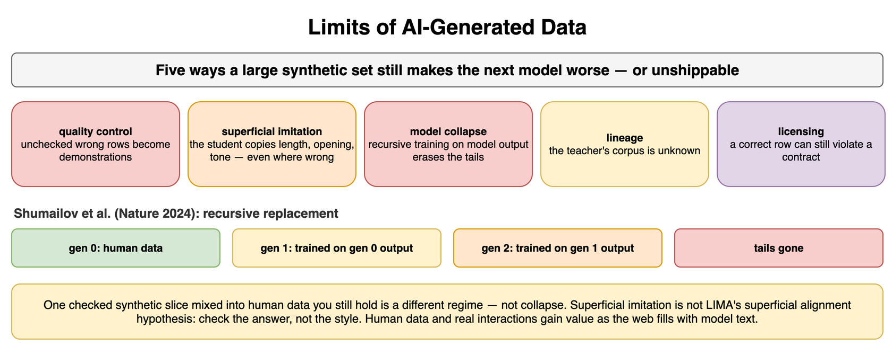

*Source: [`diagrams/dataset-engineering.drawio`](/content/10_AI_Engineering/08_Dataset_Engineering/diagrams/dataset-engineering.drawio), page 16.*

## Data lineage

Data lineage is the record of where a row came from, what produced it, and which filters let it through, so a later audit can tell a human ticket from a teacher's invention.

A raw export has a source system, a time window, and a consent note. A synthetic row has a teacher, the teacher's version, the date, the seed, the prompt, and the filter that kept the row. Without that record the next person treats the file as a measurement of customers. Phi-1's paper says it releases the model and omits some details of the synthetic data generation, for proprietary reasons. That is a real limit of the public artifact. You cannot list the teacher's inputs from the paper, so a benchmark that was in the teacher's data can ride along inside a textbook that looks new. The contamination card in [Evaluate AI Systems](../04_Evaluate_AI_Systems/) is the overlap check you still run on the student file. Datasheets, as Gebru and coauthors defined them, are the written form of the same record: source, filters, known gaps, license. The inspection card is where you compute the distributions that belong in that note. This card is why the note has to name the teacher.

The license is part of the lineage, not a footer. A row can be factually right and still be a contract violation, which is the distillation card. A row can also be a customer's message you were allowed to store and are not allowed to train on. The record is what you hand the reviewer. A file named `train.jsonl` with no note will be reused for a task it does not cover, which is the coverage card's empty cell discovered a quarter late.

**Trade-offs.** A lineage record is cheap beside a poisoned run, and it does not make the row true. Omitting the teacher's corpus, as Phi-1 does for proprietary reasons, can be a legitimate constraint, and it leaves the contamination check as your only window. Storing prompts and seeds makes the set reproducible and stores whatever private string was in the prompt, so the privacy filter runs on the record too. A datasheet that lists the model name and not the filter version cannot explain why a language cell disappeared.

**Interview.** Say what you would write down for a human row and for a synthetic row. The synthetic list is teacher, version, date, seed, prompt, filter, and license. Cite Phi-1's omission of some synthetic-generation details as the reason a public textbook is not a known-clean corpus, and say you still run the contamination screen from the earlier topic. A datasheet without those fields is a filename.

**Recap.** Lineage records where a row came from and what was allowed to touch it. Human rows need a source, a window, and consent. Synthetic rows need the teacher, the version, the seed, the filter, and the license. Phi-1 omits some of that generation detail for proprietary reasons, which is why the student file still gets a contamination check. The datasheet is that record, and a later training run is not a substitute for it.

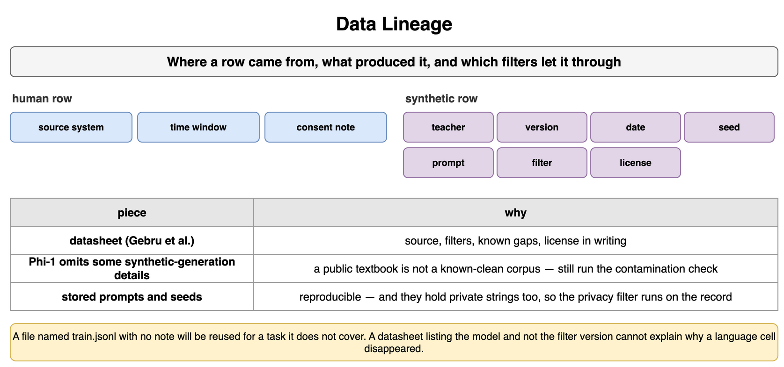

*Source: [`diagrams/dataset-engineering.drawio`](/content/10_AI_Engineering/08_Dataset_Engineering/diagrams/dataset-engineering.drawio), page 17.*

## Model distillation

Model distillation trains a student on a teacher's outputs so the student picks up behavior the teacher already has, at a cost you can serve.

Hinton, Vinyals, and Dean, in 2015, defined the version that uses the teacher's full distribution. A hard label says the answer is class A. A soft target, the teacher's probabilities, also says how much the teacher believed the wrong classes. They temperature-scale the logits before the softmax. A high temperature flattens the distribution so the smaller probabilities are visible enough to learn from. That information is what they called dark knowledge. The three logits below are an illustration of the flattening, not a result from the paper.

```python
import math


def softmax(logits: list[float], temperature: float) -> list[float]:
    scaled = [logit / temperature for logit in logits]
    peak = max(scaled)
    exponents = [math.exp(value - peak) for value in scaled]
    total = sum(exponents)
    return [value / total for value in exponents]


logits = [4.0, 2.0, 0.0]
for temperature in (1, 4):
    probs = softmax(logits, temperature)
    print(temperature, " ".join(f"{prob:.4f}" for prob in probs))
# 1 0.8668 0.1173 0.0159
# 4 0.5065 0.3072 0.1863
```

At temperature 1 the first class holds 0.8668 of the mass. At temperature 4 it holds 0.5065, and the third class has risen from 0.0159 to 0.1863. The student who only sees the argmax cannot learn that relationship. DistilBERT, from Sanh and coauthors in 2019, is the public encoder trained this way: the paper's summary is 40 percent fewer parameters than BERT-base, 60 percent faster, and 97 percent of BERT's GLUE score, from a macro score of 77.0 against BERT-base's 79.5. An API teacher usually does not return the full distribution. A short list of top-token logprobs is not the soft target Hinton used. The distillation you can actually run is sequence-level: save the teacher's text, and train the student with the ordinary supervised loss. That is Alpaca's relationship to `text-davinci-003`, and it is the "teacher you cannot afford on the request path" on the reasons-to-finetune card in [Finetuning](../07_Finetuning/). The student learns the demonstrations. It does not inherit the teacher's behavior on questions you never asked.

Reasoning-trace distillation is sequence-level distillation where the text includes the trace. The counts, the 32B comparison against reinforcement learning, and the check on a wrong step are the next card. A trace is still output, so the contract below applies to it.

The contract is independent of the loss. OpenAI's consumer Terms of Use, effective January 1, 2026, prohibit using Output to develop models that compete with OpenAI, and they prohibit automatically or programmatically extracting data or Output. The Services Agreement, also effective January 1, 2026, prohibits using Output to develop artificial intelligence models that compete with OpenAI's products and services, except a permitted exception. The May 1, 2025 business terms used the same exception and are the previous page, not the page to cite for a current account. The exception covers models primarily intended to categorize, classify, or organize data, such as embeddings or classifiers, when those models are not distributed or made commercially available to third parties, and it covers fine-tuning or customizing models provided as part of OpenAI's own fine-tuning or other services listed on the pricing page. Owning the output, which both pages assign to the customer, is not the training right. A Llama student you host and sell is the competing-model case. An internal classifier you do not distribute is the exception you still have to read against the contract on the account you are calling, because the pages move and an order form can differ. The license on the student checkpoint is a second document. The Open weights and licenses card in [Evaluate AI Systems](../04_Evaluate_AI_Systems/) is where that one lives.

**Trade-offs.** Logit distillation transfers the teacher's uncertainty and requires the logits. Sequence-level distillation needs only the text and throws away the dark knowledge. A reasoning trace teaches the trace and teaches bogus steps when you keep them, which is the next card. Distilling a teacher you are not licensed to train from produces a capable model you cannot ship. A smaller student is cheaper on every request forever and is capped by the questions you thought to ask the teacher.

**Interview.** Start from Hinton's soft targets and the temperature example: 0.8668 on the top class at temperature 1, 0.5065 at temperature 4. Name DistilBERT's published summary, 40 percent smaller, 60 percent faster, 97 percent of BERT's GLUE score. Then say an API forces sequence-level distillation, and send the reasoning-trace case to the next card rather than quoting 800,000 traces as if every sample were a trace. Close with the contract. Both public pages in front of you are effective January 1, 2026, and the two-part exception is in the Services Agreement, not in the consumer terms. Separate ownership of the text from permission to train. The account's current terms win over a memory of them.

**Recap.** Distillation trains a student on a teacher. Soft targets at a high temperature carry the teacher's uncertainty, which is how DistilBERT was trained from BERT. An API teacher usually forces you to train on the text alone. A reasoning student needs the trace in that text, which is the next card, and the 800,000-sample mix is not all traces. OpenAI's consumer terms and the January 1, 2026 Services Agreement forbid using outputs to train a competing model. The exception, in the Services Agreement, is a non-distributed classifier or OpenAI's own fine-tuning. Ownership of the output is not that permission.

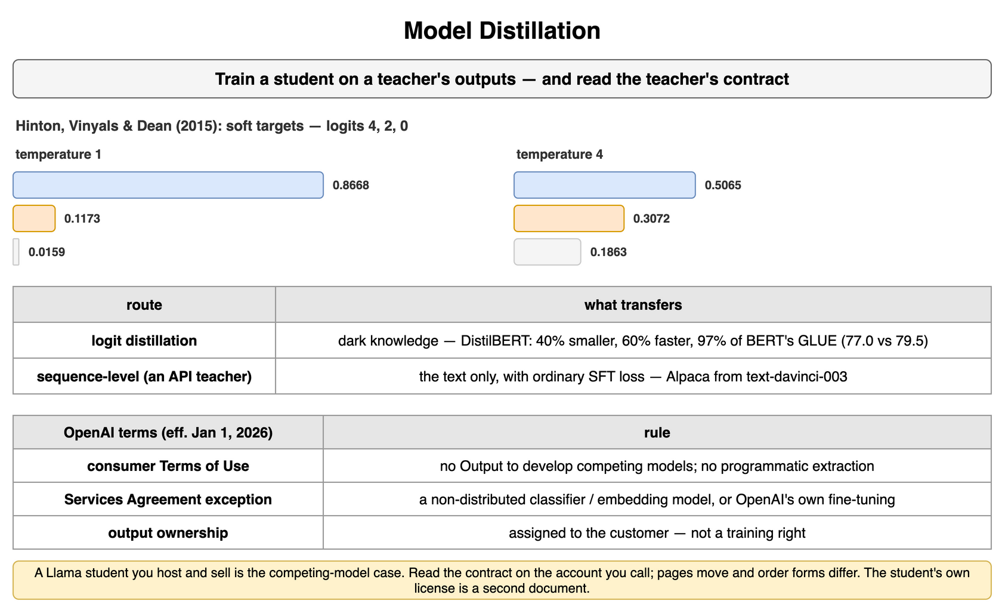

*Source: [`diagrams/dataset-engineering.drawio`](/content/10_AI_Engineering/08_Dataset_Engineering/diagrams/dataset-engineering.drawio), page 18.*

## Reasoning-trace distillation

Reasoning-trace distillation is sequence-level distillation in which the training text includes the intermediate steps, not only the final answer.

The curation-goal card is the requirement. If the trace is not in the target, the student learns to emit the final line. Orca, from Mukherjee and coauthors in 2023, is the public case that trained smaller models on GPT-4's step-by-step explanations. DeepSeek-R1's published students are the later version at a larger scale. The bases are Qwen2.5 models, including a 1.5B math model, and Llama 3 models, including Llama 3.3 70B Instruct. The report fine-tunes them with supervised loss only, on about 800,000 samples curated for DeepSeek-R1. About 600,000 of those are reasoning trajectories and about 200,000 are non-reasoning samples such as writing and translation, so calling all 800,000 "traces" overstates the mix. The published head-to-head against reinforcement learning is on a 32B Qwen base. Distillation beat the paper's large-scale reinforcement-learning run on that base. The report does not show that comparison for every size from 1.5B to 70B. It does say these students were not themselves given a reinforcement-learning stage, and that a later one can still help.

A correct final line does not make the steps true. The report notes that an explanation can be wrong while the final answer is correct, and that this showed up more often on questions where only a small fraction of samples were correct, which is why they dropped those questions rather than claiming every step had been checked. The check below is the one you still run. The bad trace multiplies 48 by 2 and writes 100.

```python
def steps_ok(steps: list[tuple[int, int, int]]) -> bool:
    return all(left * right == claimed for left, right, claimed in steps)


good = [(12, 4, 48), (48, 2, 96)]
bad = [(12, 4, 48), (48, 2, 100)]
print(steps_ok(good), steps_ok(bad))
# True False
```

A student that copies the teacher's opening and then keeps the bad product has imitated the trace's style. That is the superficial-imitation limit. The verification card's functional check is what drops the row before the student sees it. The teacher's license still applies. A reasoning trace is output, which is the distillation card's contract.

**Trade-offs.** Training on the trace teaches the trace, including bogus steps you failed to drop. Training on the final answer only is shorter and does not install the intermediate behavior you meant to serve. Distilling a strong teacher into a small base beat the paper's reinforcement-learning recipe on the 32B base they compared, and it can also copy the teacher's habits on questions you never checked. Skipping the reinforcement-learning stage keeps the experiment interpretable and leaves on the table whatever that stage would have added.

**Interview.** Define the target as the trace plus the answer. Name Orca, then DeepSeek-R1's students: Qwen and Llama bases from 1.5B to 70B, supervised on about 800,000 samples of which about 600,000 are reasoning trajectories. Quote the reinforcement-learning comparison as the 32B result, not as a result for every size. Walk the product check. Forty-eight times 2 is 96, and a trace that writes 100 is dropped. The license is the distillation card, because a trace is output.

**Recap.** A reasoning student needs the steps in the training text. Orca trained on GPT-4's explanations. DeepSeek-R1's published students are Qwen and Llama models from 1.5B to 70B, supervised on about 800,000 samples, about 600,000 of them reasoning trajectories. The report's finding that distillation beat large-scale reinforcement learning is the 32B comparison. A trace that multiplies 48 by 2 and writes 100 is dropped, even when the prose around it sounds like the teacher.

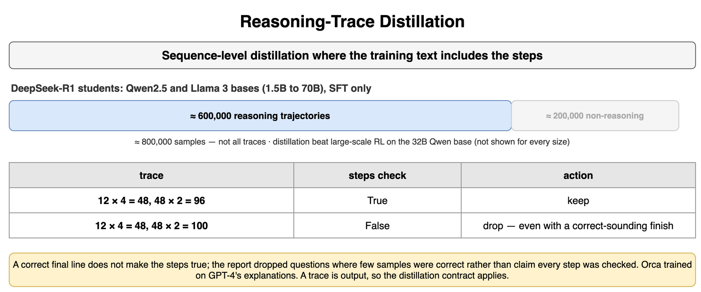

*Source: [`diagrams/dataset-engineering.drawio`](/content/10_AI_Engineering/08_Dataset_Engineering/diagrams/dataset-engineering.drawio), page 19.*

## Inspecting a dataset

Inspecting a dataset is computing the distribution of the file and reading rows until the statistics and the text tell the same story.

The statistics that change a decision are small. How many rows. The length distribution, not only the mean. The label balances. The language mix. The duplicate rate, which the next card turns into a deletion. The rate at which a parser already rejects the row. A mean length hides the two threads that will dominate a batch and the training time. The ten lengths below are an exercise sample, not a production log. They are there to show the mean and the median parting ways.

```python
lengths = [38, 41, 36, 44, 40, 39, 1200, 42, 37, 400]
ordered = sorted(lengths)
median = (ordered[4] + ordered[5]) / 2
print(f"{sum(lengths) / len(lengths):.1f} {median:.1f} {max(lengths)}")
# 191.7 40.5 1200
```

The mean is 191.7. The median is 40.5. The longest row has 1,200 tokens. A plan that reserved context for "about 200 tokens" was reading the mean, and eight of the ten rows are around 40. The two long rows are either the long-context cell you meant to cover or a paste you did not notice. You only know which by opening them. Manual reading is the inspection that statistics cannot replace. Take a random sample, a sample of the longest rows, a sample of each rare label, and a sample of rows the quality filter almost dropped. Datasheets, as Gebru and coauthors defined them, are the written result of this pass: source, filters, known gaps, license. A file without that note will be reused for a task it does not cover. The coverage card's empty cell is something you can see in a handful of group-bys and miss in a random ten.

Hygiene is part of the inspection. Run the trainer on a slice before you run it on the file, so a broken template or a label that is always the first class fails in minutes. Never modify the canonical file in place. A filter that overwrites `train.jsonl` destroys the only copy of the rows you just decided were wrong, and you cannot diff the decision. Write a new versioned artifact, and keep the previous one until the eval says the new file was the right delete. A trial run that looks at the whole file and then "cleans it up" in the same path is how a bad threshold becomes the dataset.

**Trade-offs.** A full statistical pass is cheap beside a wasted training run and says nothing about whether the answers are true. Reading scales poorly and is how you notice that every "excellent" row begins with the same sentence. Automating the read with the teacher that wrote the rows repeats the teacher's standard. Skipping inspection because the loss curve will reveal problems discovers them after the GPU bill.

**Interview.** Say you would compute length, labels, languages, duplicates, and parser failures, and then read four samples: random, longest, rare labels, and near-rejects. Give the exercise figure, a mean of 191.7 against a median of 40.5, and say which rows you would open. Mention a datasheet as the record that lets the next person know what you filtered. Refuse to treat a falling training loss as the inspection.

**Recap.** Inspection is a distribution plus a read. In the exercise sample the mean length is 191.7 and the median is 40.5, because two long rows pull the mean. The long rows, the rare labels, and the rows a filter almost dropped are the ones you open. A datasheet records the source, the filters, and the license so the file is not reused blindly.

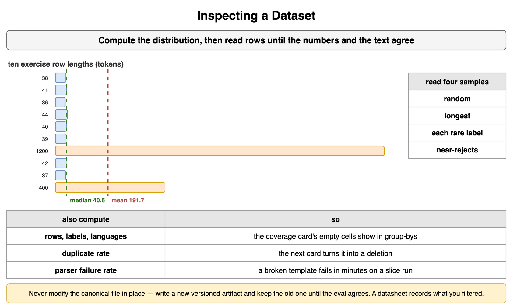

*Source: [`diagrams/dataset-engineering.drawio`](/content/10_AI_Engineering/08_Dataset_Engineering/diagrams/dataset-engineering.drawio), page 20.*

## Deduplicating data

Deduplication removes repeated training rows so the optimizer does not spend its steps memorizing one complaint. Decontamination removes training rows that would teach the eval set.

Exact dedup hashes a normalized document and keeps one copy of each hash. The normalization is part of the decision. The pass below lowercases and collapses whitespace, and it keeps punctuation, so a trailing exclamation mark is a different hash. That is a choice. A stricter normalizer would strip the mark and catch more copies, and it would also merge rows you considered different. Lee and coauthors, in 2022, go one level down from whole documents: exact substring deduplication with a suffix array, so a paragraph copied into many pages is removed even when the pages are not identical. They report less memorization after that pass. Near-duplicate detection is for the row that changed a word. Jaccard similarity of shingles is the set overlap, the size of the intersection divided by the size of the union. MinHash, from Broder in 1997, estimates that overlap without comparing the sets. Each hash function contributes the minimum hash over the shingles, and the fraction of hash functions on which two documents agree is an unbiased estimate of their Jaccard. Locality-sensitive hashing is how you avoid comparing every pair. You cut the signature into bands and only fully compare documents that share a band. The probability that a pair of similarity `s` shares at least one band, with `r` rows in a band and `b` bands, is `1 - (1 - s^r)^b`.

```python
import hashlib


def norm(text: str) -> str:
    return " ".join(text.lower().split())


def shingles(text: str, n: int = 3) -> set[tuple[str, ...]]:
    tokens = norm(text).split()
    return {tuple(tokens[i : i + n]) for i in range(len(tokens) - n + 1)}


def jaccard(left: set[tuple[str, ...]], right: set[tuple[str, ...]]) -> float:
    return len(left & right) / len(left | right)


def minhash(grams: set[tuple[str, ...]], seeds: range) -> list[int]:
    signature = []
    for seed in seeds:
        best = None
        for gram in grams:
            digest = hashlib.sha256(f"{seed}:{gram}".encode()).hexdigest()
            value = int(digest[:16], 16)
            best = value if best is None or value < best else best
        signature.append(best)
    return signature


def band_hit(similarity: float, rows: int, bands: int) -> float:
    return 1 - (1 - similarity**rows) ** bands


left = shingles("the refund window is thirty days from delivery")
right = shingles("the refund window is thirty days from shipment")
exact = jaccard(left, right)
print(len(left & right), len(left | right), f"{exact:.4f}")
estimates = []
for count in (8, 128, 512):
    a = minhash(left, range(count))
    b = minhash(right, range(count))
    estimates.append(f"{sum(x == y for x, y in zip(a, b)) / count:.4f}")
print(" ".join(estimates))
print(f"{band_hit(exact, 5, 20):.4f} {band_hit(0.1, 5, 20):.4f}")
# 5 7 0.7143
# 0.3750 0.7109 0.7012
# 0.9837 0.0002
```

The two refund sentences share 5 of 7 shingles, so the Jaccard is 0.7143. Eight hash functions estimate 0.3750 on this run. One hundred twenty-eight estimate 0.7109. Five hundred twelve estimate 0.7012. The estimate is right in expectation and noisy in one small run, which is why a production signature uses more than eight hashes, and why a single longer run is not guaranteed to land closer. With 5 rows per band and 20 bands, a pair at this Jaccard collides with probability 0.9837, and a pair at Jaccard 0.1 collides with probability 0.0002. You then confirm the candidates with the real Jaccard and drop at a threshold you picked. A threshold of 0.8 would keep these two sentences. "Delivery" and "shipment" are different facts. The threshold is a product decision.

A paraphrase that shares few shingles is invisible to this pass. That case is the semantic-deduplication card.

The eight-document reduction is computed, not a crawl statistic. Exact hash removes the three copies that differ only by case or repetition. A near-duplicate pass at Jaccard 0.65 then drops "settings screen" because its overlap with "settings page" is 2/3, and it keeps "order 1001" beside "order 1002" because that overlap is 1/2.

```python
import hashlib


def norm(text: str) -> str:
    return " ".join(text.lower().split())


def shingles(text: str, n: int = 3) -> set[tuple[str, ...]]:
    tokens = norm(text).split()
    return {tuple(tokens[i : i + n]) for i in range(len(tokens) - n + 1)}


def jaccard(left: set[tuple[str, ...]], right: set[tuple[str, ...]]) -> float:
    return len(left & right) / len(left | right)


def overlap(a: str, b: str) -> tuple[int, int]:
    left, right = shingles(a), shingles(b)
    return len(left & right), len(left | right)


docs = [
    "Reset your password from the settings page.",
    "Reset your password from the settings page.",
    "reset your password from the settings page.",
    "Reset your password from the settings screen.",
    "Where is my order 1001?",
    "Where is my order 1002?",
    "Where is my order 1001?",
    "The capital of France is Paris.",
]
seen: set[str] = set()
exact_kept = []
for doc in docs:
    digest = hashlib.sha256(norm(doc).encode()).hexdigest()
    if digest not in seen:
        seen.add(digest)
        exact_kept.append(doc)
near_kept = []
for doc in exact_kept:
    grams = shingles(doc)
    if all(jaccard(grams, shingles(kept)) < 0.65 for kept in near_kept):
        near_kept.append(doc)
print(*overlap(docs[0], docs[3]))
print(*overlap("Where is my order 1001?", "Where is my order 1002?"))
print(len(docs), len(exact_kept), len(near_kept))
# 4 6
# 2 4
# 8 5 4
```

Eight documents become five after the exact pass and four after the near pass. Half the toy file was repetition. A real crawl is a different fraction. The pass is the same two steps.

Contamination is dedup against a set you intend to measure. The contamination card in [Evaluate AI Systems](../04_Evaluate_AI_Systems/) owns the screen: long n-grams, the GPT-3 training filter that looked for 13-word overlaps and only partly removed them, and why a 4-gram flags ordinary phrasing. When you cannot retrain, that card's clean slice is the number you can defend. The action in this topic, where you own the finetune, is which file you edit. You drop the overlapping row from the training file and you keep it in the eval. The copied return policy below shares three 8-grams with the eval wording. The restatement shares none. A short gram would start to flag ordinary phrases, which is the earlier card's point, so the gram stays long and a person sees the hits.

```python
def ngrams(tokens: list[str], size: int) -> set[tuple[str, ...]]:
    return {tuple(tokens[i : i + size]) for i in range(len(tokens) - size + 1)}


def shared(a: str, b: str, size: int) -> int:
    return len(ngrams(a.split(), size) & ngrams(b.split(), size))


train = "customers may return an item within thirty days of delivery for a full refund"
leaked = "customers may return an item within thirty days of delivery if they kept the receipt"
fresh = "a shopper can send an item back for thirty days after it arrives"
print(shared(train, leaked, 8), shared(train, fresh, 8))
# 3 0
```

Three shared 8-grams is a training row that has already given away the eval item. Zero is not a proof of cleanliness. It is a restatement this gram cannot see. After you delete the training copy you retrain. A score computed on the clean slice of a model that still trained on the leak is a diagnosis, not the score of the repaired model.

**Trade-offs.** Exact hash is simple and misses a one-word edit. MinHash plus LSH makes near-dup search tractable and depends on a threshold that can merge distinct facts or keep obvious copies. Semantic dedup, the next card, catches paraphrases and can delete a topic you only had two documents about. Decontamination protects the eval and, if you delete the item from the eval instead of from the train file, produces a flattering next score. Aggressive thresholds shrink a small task set until the rare cell from the coverage card is gone.

**Interview.** Define Jaccard as intersection over union, and MinHash as the fraction of matching minimum hashes. Walk the refund pair: 5 of 7 shingles, Jaccard 0.7143, an 8-hash estimate of 0.3750 against a 128-hash estimate of 0.7109. Give the band probability, 0.9837 versus 0.0002, as the reason you only compare candidates. Then the toy reduction, 8 to 5 to 4, and the threshold as a choice: 0.65 drops "screen" versus "page" and keeps the two order ids. Close with contamination. You delete from the training file, you keep the eval row, and the 13-word GPT-3 screen stays on the earlier card. Three shared 8-grams is a leak. Zero shared 8-grams is not a clearance.

**Recap.** Exact dedup drops identical normalized documents. MinHash estimates Jaccard, and LSH limits the pairs you compare. The refund sentences have Jaccard 0.7143. Eight hashes estimate 0.3750 on this run and 128 hashes estimate 0.7109. The eight-document file falls from 8 to 5 to 4 once a 0.65 near-dup threshold drops "screen" versus "page." Contamination uses a long n-gram against the eval set, and the overlapping row leaves the training file, not the eval. Paraphrases that share no shingles are the next card.

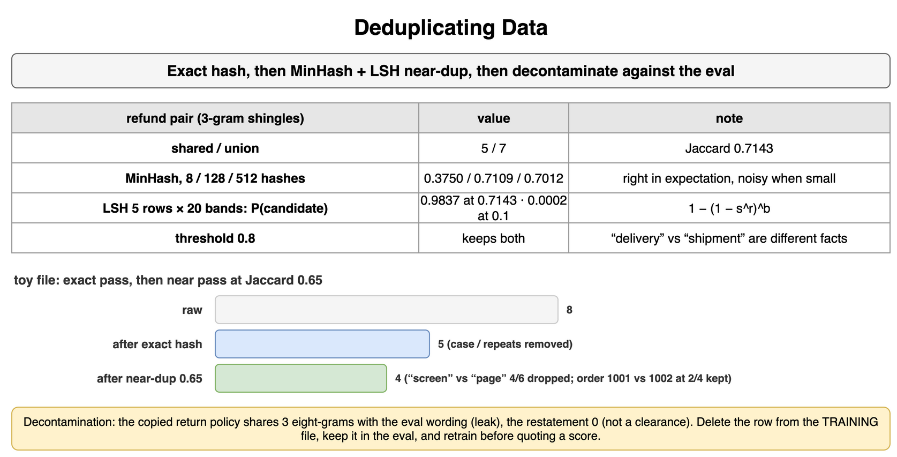

*Source: [`diagrams/dataset-engineering.drawio`](/content/10_AI_Engineering/08_Dataset_Engineering/diagrams/dataset-engineering.drawio), page 21.*

## Semantic deduplication

Semantic deduplication removes rows that mean the same thing even when they share few shingles, so a paraphrase does not survive the MinHash pass and then dominate the gradient.

MinHash, on the previous card, estimates word overlap. A restatement that shares no 3-grams is invisible to it. SemDeDup, from Abbas and coauthors in 2023, compares embeddings instead. The paper embeds each example with a pretrained model, CLIP for images and a 125 million parameter OPT model for text, clusters the embeddings with k-means, and inside a cluster drops neighbors whose cosine similarity is above a threshold, keeping one. On a LAION subset, the abstract reports that removing 50 percent of the data cost little performance. That 50 percent is a result about that image set and that threshold, not a deletion quota for tickets. Documents about the same product, or the same topic, sit near each other even when they are not duplicates. A cosine threshold that is too low deletes a topic you only had two documents about. That is the coverage card's rare cell, removed by a similarity. You read the borderline pairs.

Llama 3's post-training uses the same idea on dialogues and cites SemDeDup. They cluster with RoBERTa, sort each cluster by quality score times difficulty score, and greedily keep a dialogue whose cosine similarity to the ones already kept stays under a threshold. The score changes which copy survives. It does not decide that two different complaints are the same complaint. The vectors below are an exercise, not an encoder's output. The only thing they show is the comparison you would run after a real model.

```python
def cosine(left: tuple[float, ...], right: tuple[float, ...]) -> float:
    dot = sum(x * y for x, y in zip(left, right))
    left_norm = sum(x * x for x in left) ** 0.5
    right_norm = sum(y * y for y in right) ** 0.5
    return dot / (left_norm * right_norm)


# Exercise embeddings, not an encoder's output.
page = (1.0, 0.0)
screen = (0.96, 0.28)
order = (0.0, 1.0)
threshold = 0.9
print(f"{cosine(page, screen):.4f} {cosine(page, order):.4f}")
print(cosine(page, screen) >= threshold, cosine(page, order) >= threshold)
# 0.9600 0.0000
# True False
```

At this exercise threshold the screen vector is close enough to drop and the order vector is not. A real encoder can rank a real pair the other way. The threshold is a product decision, the same kind of decision as the Jaccard 0.65 on the previous card, made in a different space. Exact hash and MinHash stay first, because they are cheaper, and this pass is for the paraphrases those miss.

**Trade-offs.** Semantic dedup catches a restatement MinHash misses, and it can delete a rare topic that only looked redundant in the embedding. A high cosine threshold keeps more rows, including more paraphrases. A low threshold shrinks the file and the tail. Clustering makes the comparison tractable and misses a pair that k-means put in different clusters. Keeping the higher-quality copy, as Llama 3 does with quality times difficulty, beats keeping whichever row arrived first, and it trusts a quality score you have not audited.

**Interview.** Separate shingle overlap from meaning. Define SemDeDup as embed, cluster, drop neighbors above a cosine threshold, and keep one. Name Abbas and coauthors, 2023. Say the 50 percent of LAION is that paper's image result, not your deletion quota. Then Llama 3's dialogue version: RoBERTa clusters, quality times difficulty deciding the order, and a cosine threshold deciding what remains. Give the exercise vectors, 0.9600 against 0.0000, and say you would read the borderline pair before deleting a topic you only had twice.

**Recap.** Semantic dedup drops paraphrases that share a meaning and few words. SemDeDup embeds, clusters, and removes neighbors that are too close in cosine. On a LAION subset the paper removed 50 percent with little loss, which is not a quota. Llama 3 runs a version of the method on post-training dialogues. In the exercise, a cosine of 0.9600 is over a 0.9 threshold and 0.0000 is not. The threshold can merge a topic you meant to keep, so the borderline pairs are a reading list.

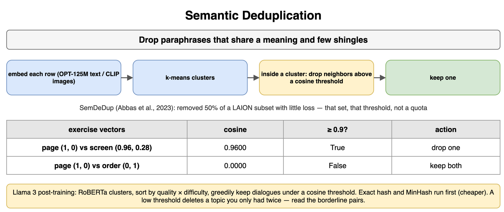

*Source: [`diagrams/dataset-engineering.drawio`](/content/10_AI_Engineering/08_Dataset_Engineering/diagrams/dataset-engineering.drawio), page 22.*

## Cleaning and filtering

Cleaning and filtering removes rows that are junk, toxic in a way you can define, private, or the wrong language, after duplicates are gone and before you spend a label on what remains.

Heuristics are the rules you can say in one line. Raffel's C4 pipeline, as Dodge and coauthors restate it, drops lines that do not end in terminal punctuation or that have fewer than three words, drops documents with fewer than five sentences or with lorem ipsum, drops a document that contains a word from a bad-word list, and keeps English only when a language detector assigns it probability at least 0.99. Separately, the C4 pipeline deduplicates any three-sentence span that occurs more than once. The Gopher paper's rules, which FineWeb later retested, are the same family: length, average word length, a symbol ratio, and whether the page contains ordinary stop words. Hugging Face's FineWeb is the public comparison of those heuristic stacks on Common Crawl. FineWeb-Edu adds a classifier trained on judgments of educational quality. A heuristic is only as good as the rule. Dodge and coauthors showed that C4's bad-word list removed more than profanity. In the documents the list excluded they found clusters of science, medicine, health, and legal text, not only sexual content. Mentions of sexual orientation were disproportionately removed, including non-offensive ones, and African American English and Hispanic-aligned English were removed at much higher rates than white-aligned English. A quality classifier is the learned version of the same gate. CCNet, from Wenzek and coauthors, identifies the language with fastText and then scores the page with a 5-gram KenLM model trained on Wikipedia. A low perplexity means the page looks like that Wikipedia, and fastText is the language tag, not the quality score. A perplexity filter, the cutoff the training-data card already names, drops text a small language model finds chaotic, which removes gibberish and also removes the technical page and the dialect the small model had not seen. Llama 3's post-training prune uses both a reward-model score and a separate Llama quality score, and keeps a row when either one marks it high quality, because the two signals disagree. The union is a recall choice. It will keep rows either scorer would have rejected alone, so the disputed band is a reading list.

Toxicity filters have the C4 failure mode even when the filter is a model. A blocklist or a toxicity score such as Jigsaw's Perspective API will treat some non-toxic uses of a word, including reclaimed terms and quoted abuse in a moderation dataset, as a reason to delete the row. If the product is a moderation classifier, deleting every toxic-looking row deletes the positive class. The safety card in [Evaluate AI Systems](../04_Evaluate_AI_Systems/) is the taxonomy you are filtering toward. The filter has to match that taxonomy. A generic "be nice" score does not.

Personal data is a different delete. Emails, phone numbers, national IDs, and payment numbers do not belong in a finetune file. Microsoft Presidio is the usual open detector, combining patterns and a named-entity model. The Llama 3 report treats personal data as part of pretraining cleanup, including dropping domains judged likely to hold a lot of it. That is a coarser pass than a regex on one ticket. A pattern catches the regular shape and misses the number someone spelled out. The two lines below are the whole lesson. The digit pattern finds `555-010-0142` and the email. It finds neither when the phone is written out. A person still reads a sample of the rows the pattern kept.

Filtering is also how you unlearn a behavior that is already in the file. If the product should stop volunteering a suggestion the user did not ask for, delete or relabel the rows that demonstrate the suggestion. Adding a sentence that says "do not suggest" next to a hundred rows that suggest is a weaker gradient than removing the demonstration. The model learns what is frequent. A policy sentence in the prompt can ask for the new behavior. The finetune will copy the old one if the old one is what the answers do. Read a sample of the rows you kept and ask whether a person would be trained by them to do the thing you are trying to stop.

```python
import re

EMAIL = re.compile(r"[A-Za-z0-9._%+-]+@[A-Za-z0-9.-]+\.[A-Za-z]{2,}")
PHONE = re.compile(r"\b\d{3}-\d{3}-\d{4}\b")
rows = (
    "Reach the customer at user@example.com or 555-010-0142.",
    "The note says five five five, zero one zero, zero one four two.",
)
for row in rows:
    print(bool(EMAIL.search(row)), bool(PHONE.search(row)))
# True True
# False False
```

Replacing a match with a placeholder such as `[PHONE]` is a training decision. You do it when the model should learn to abstain or to emit the placeholder. You drop the row when the private value is the point of the sentence and a placeholder would teach nonsense. Order ids are not this kind of secret. They are the entity the task is about, and a filter that redacts every number will erase them. Low-quality removal is the rest of the pile: SEO boilerplate, pages of keywords, and rows the parser rejects. The rows you drop should be sampled. A filter that silently removes the Spanish cell is a coverage bug with a clean mean.

**Trade-offs.** Heuristics are transparent and crude. Classifiers adapt and hide the definition of quality inside weights. A strict privacy filter protects users and removes some legitimate rows that only looked private. A loose one preserves those rows and leaks a phone number into the weights, where you cannot delete it as easily as a database row. Filtering toxicity out of a moderation set removes the label you needed. Every automatic drop deserves a sample of what it dropped.

**Interview.** Separate heuristic, classifier, toxicity, and privacy. Give C4's punctuation, length, lorem ipsum, and bad-word rules, and Dodge's finding that the bad-word list removed medicine, legal text, and some dialects along with abuse. Name FineWeb as the public retest, FineWeb-Edu as a classifier trained on educational-quality judgments, and CCNet as Wikipedia perplexity from a KenLM model rather than a fastText quality label. Then the phone example: the digit pattern catches `555-010-0142` and misses the spelled-out number. Say you would sample the drops. A moderation dataset that deletes its positive class has been filtered into a different task.

**Recap.** Filters drop junk, the wrong language, private strings, and toxicity you have defined. C4's rules are heuristics, and its bad-word list also removed medical and legal text, non-offensive identity mentions, and African American English and Hispanic-aligned English at higher rates. FineWeb-Edu learns a quality score. CCNet ranks pages by Wikipedia perplexity. Both still need a human sample. A phone regex catches `555-010-0142` and misses the same number in words. The rows you reject are part of the dataset's datasheet.

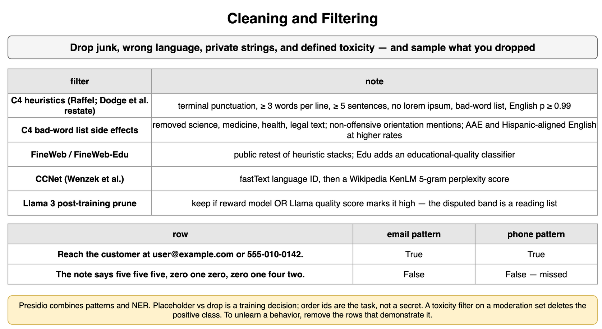

*Source: [`diagrams/dataset-engineering.drawio`](/content/10_AI_Engineering/08_Dataset_Engineering/diagrams/dataset-engineering.drawio), page 23.*

## Selecting which rows to keep

Selection decides which surviving rows earn a person or a training slot. Filtering has already removed junk. Selection spends a limited budget on the rows that will change the model.

Active learning is the version with a model in the loop. You label a seed, train or prompt a model, and send people the rows the model is unsure about, instead of a random row it would have gotten right. The cap matters. If the unsure pile is almost entirely one pattern, labeling the whole pile buys the same pattern many times, which is the copies curve on the quantity card. A random floor matters too. A batch drawn only from today's errors never shows you a failure mode the model is confidently wrong about, and it drifts the training distribution away from traffic. The counts below are an exercise budget for one round, not a measured support queue.

```python
UNLABELED = 5_000
UNSURE = 700
SAME_PATTERN = 650
CAP = 100
RANDOM_FLOOR = 150
other_unsure = UNSURE - SAME_PATTERN
to_label = CAP + other_unsure + RANDOM_FLOOR
print(UNLABELED, to_label, other_unsure, SAME_PATTERN - CAP)
# 5000 300 50 550
```

Of 5,000 unlabeled tickets, 700 are under the confidence cutoff and 650 of those are one pattern. You label 100 of that pattern, all 50 of the other unsure rows, and 150 confident rows as a floor. That is 300 labels. You deliberately leave 550 copies of the dominant pattern unlabeled. The next round retrains and asks again. Vendors and Label Studio are how those 300 get a guideline in front of a person. The acquisition card is the guideline and the price. This card is which rows enter the queue.

Distribution matching is the other selector, and it does not need the model to be uncertain. Xie and coauthors' DSIR resamples a large raw pool so that it looks more like a small target set you already trust. You use it when you have a pile of crawl text and a small corpus whose style you want more of. You use uncertainty sampling when you have a label budget and a model that already answers some of the tickets. A quality classifier that ranks every row and keeps the top quartile is a filter with a quota. Llama 3's "top quartile of the reward model, or the top mark from the Llama scorer" is that quota. It is not active learning until a person is in the loop for the next label.

**Trade-offs.** Uncertainty sampling spends people where the model is shaky and ignores the confident mistake. A random sample represents traffic and wastes labels on rows the model has already learned. Capping the dominant pattern protects the budget and can miss a real subtype you folded into the pattern. Distribution matching aims the corpus at a target and copies whatever is biased in the target. One round of selection with no second read of the labels spends the budget on a drifted guideline.

**Interview.** Separate filtering from selection. Filtering rejects junk. Selection spends the remaining budget. Walk the exercise: 5,000 unlabeled, 700 unsure, 650 of them one pattern, so you label 100 plus 50 plus a random floor of 150, which is 300, and you leave 550. Say why the random floor exists. Mention DSIR as resampling toward a trusted target, which is a different lever from uncertainty. A top-quartile quality cut is a quota, and it becomes active learning when a person labels the next round.

**Recap.** Selection spends a limited labeling or training budget on rows that still add information. In the exercise, a 5,000-row pool with 700 unsure rows yields 300 labels: 100 from the dominant pattern, 50 other unsure rows, and a random floor of 150. The other 550 copies of that pattern wait. Uncertainty sampling, a random floor, and resampling toward a trusted target answer different biases, and none of them replaces the guideline.

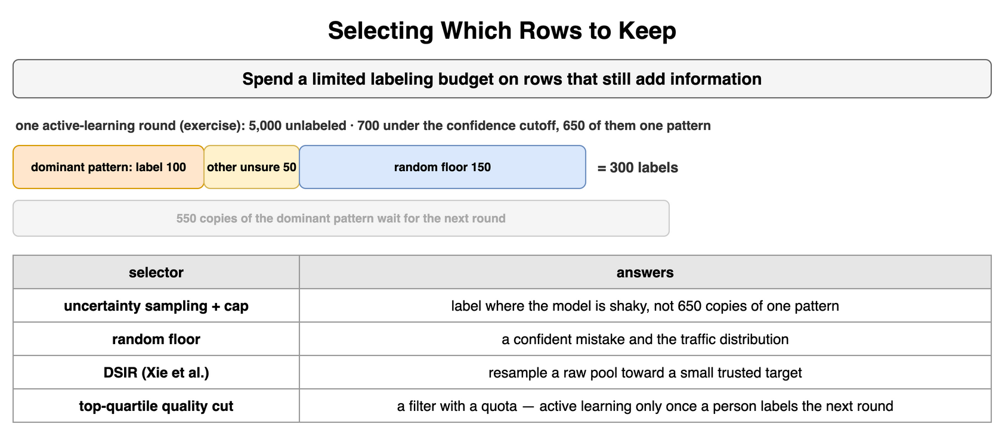

*Source: [`diagrams/dataset-engineering.drawio`](/content/10_AI_Engineering/08_Dataset_Engineering/diagrams/dataset-engineering.drawio), page 24.*

## Formatting training data

Formatting training data is encoding each example in the schema the loss expects and in the chat template the checkpoint was trained with, so the string the trainer scores is the string the server will send.

A supervised row is a conversation. The usual on-disk shape, and the shape OpenAI's fine-tuning API and Hugging Face TRL both accept, is a list of messages with roles and content. A preference row is a prompt plus a chosen response and a rejected response. The preference loss, on the RLHF and direct preference optimization card in [Understanding Foundation Models](../02_Understanding_Foundation_Models/), trains on both answers. The supervised loss trains on the assistant tokens and skips the prompt. The prompt loss weight, on the Finetuning hyperparameters card in [Finetuning](../07_Finetuning/), is that mask, including the worked 100-token prompt and 20-token answer. This card does not recompute it. What this card adds is the encoding around those tokens.

The chat template is the encoding. The System prompt, user prompt, and chat templates card in [Prompt Engineering](../05_Prompt_Engineering/) specifies Llama 3's header tokens, the blank line Meta's encoder inserts, `<|eot_id|>`, and why a different family's wrapper is a different task. The dataset obligation is to apply the template that shipped with the weights, on the trainer and on the server. A ChatML wrapping of the same messages is a different string. A missing blank line is a different string. The loss can fall on either string. It is then the loss of a task you will not serve.

The same obligation applies to the shape of the instruction, not only to the special tokens. A few-shot prompt that carries four worked tickets can be turned into four training rows, each a short instruction plus one ticket plus the answer, so the served prompt no longer pays for the examples. That conversion is the point of the finetune. It fails when you train on the bare instruction and then serve the old few-shot prompt, or the reverse. The model learned a shape. Serve that shape. If training saw "Label the ticket" and no examples, production sends "Label the ticket" and no examples. The chat template and the instruction skeleton are both part of the format. Matching one and not the other is a template mismatch you will debug as a quality drop.

```python
def llama3(messages: list[dict[str, str]], blank: str = "\n\n") -> str:
    parts = ["<|begin_of_text|>"]
    for message in messages:
        parts.append(
            "<|start_header_id|>"
            + message["role"]
            + "<|end_header_id|>"
            + blank
            + message["content"]
            + "<|eot_id|>"
        )
    return "".join(parts)


def chatml(messages: list[dict[str, str]]) -> str:
    return "".join(f"<|im_start|>{m['role']}\n{m['content']}<|im_end|>\n" for m in messages)


messages = [
    {"role": "user", "content": "What is the status of order 2048?"},
    {"role": "assistant", "content": "Order 2048 is out for delivery."},
]
official = llama3(messages)
print(official == chatml(messages), official == llama3(messages, blank="\n"))
# False False
```

Both comparisons are false. ChatML is not the Llama 3 template, and dropping the blank line is not a cosmetic edit. Special tokens have to be registered in the tokenizer as single tokens. If `<|eot_id|>` is ordinary text, the boundary the model was trained to see becomes a handful of characters. The counter below is a stand-in for that failure. It keeps a registered special token whole and otherwise emits characters. It is not the Llama 3 tokenizer. It is the size of the bug.

```python
def tokenize(text: str, specials: tuple[str, ...]) -> list[str]:
    pieces: list[str] = []
    index = 0
    ordered = tuple(sorted(specials, key=len, reverse=True))
    while index < len(text):
        match = next((token for token in ordered if text.startswith(token, index)), None)
        if match is None:
            pieces.append(text[index])
            index += 1
        else:
            pieces.append(match)
            index += len(match)
    return pieces


boundary = "Tuesday.<|eot_id|>"
print(len(tokenize(boundary, ("<|eot_id|>",))), len(tokenize(boundary, ())))
# 9 18
```

With the special token registered, `Tuesday.<|eot_id|>` is 9 pieces. Without it, the same string is 18. The end-of-turn marker has dissolved, and a fluent model is then predicting characters of a tag it does not treat as a boundary. Tool-call rows need one more agreement. The schema in the training file, the schema the parser checks, and the schema the served model is supposed to emit are one schema. A preference pair whose chosen and rejected answers were rendered with different templates trains a ranking of templates. Render both with the same function, then compute the loss.

**Trade-offs.** A strict schema rejects rows early and rejects some legitimate prose you then have to repair. A lenient loader accepts the prose and trains on a corrupted turn. Sharing one template function between training and serving is an extra dependency and is the only way the two stay aligned. Registering special tokens changes the vocabulary and the embeddings for those tokens, which is what you want, and it is a foot-gun if you register a different set from the checkpoint's. Masking the assistant tokens only teaches the reply. Training on the user text spends the update copying the customer. On the Finetuning hyperparameters card, a 100-token prompt and a 20-token answer leave the answer at 0.167 of the tokens when the prompt is in the loss, so the prompt is what the gradient mostly copies.

**Interview.** Walk a row from JSON messages to the template string to the loss mask. Say the template has to be the one shipped with the weights, and give the two false comparisons: ChatML is a different string, and a missing blank line is a different string. Then the unregistered special token, 18 pieces instead of 9. Separate a supervised messages file from a chosen-and-rejected preference file, and say which tokens each loss sees. Point the mask's arithmetic at the Finetuning hyperparameters card, where 0.167 is the answer's share and not the share spent copying the user, and point the header tokens at the System prompt, user prompt, and chat templates card.

**Recap.** Training rows are messages for supervised finetuning and chosen-plus-rejected pairs for a preference loss. The chat template that shipped with the checkpoint is part of the row. A ChatML wrapping and a missing blank line are different strings from Llama 3's template, so a loss on them is a loss on a task you will not serve. An unregistered `<|eot_id|>` splits one boundary into many pieces. In the stand-in tokenizer, `Tuesday.<|eot_id|>` is 9 pieces when the token is registered and 18 when it is not.

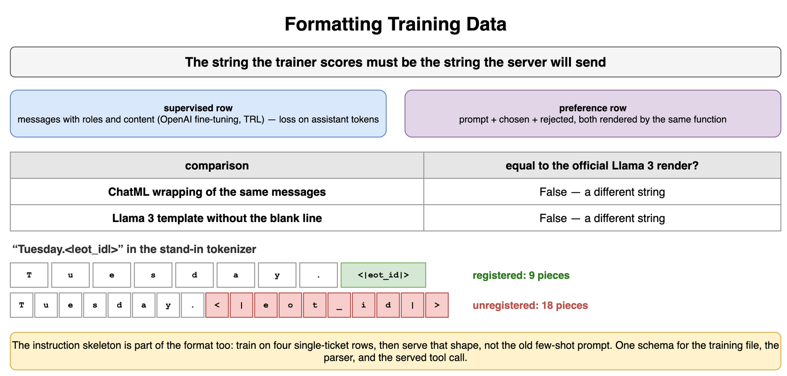

*Source: [`diagrams/dataset-engineering.drawio`](/content/10_AI_Engineering/08_Dataset_Engineering/diagrams/dataset-engineering.drawio), page 25.*
