## What inference optimization is

Inference optimization is the work of serving a trained model inside a latency, throughput, and cost budget while keeping the quality you measured.

Training pays forward and backward passes once per experiment. Serving pays a forward pass on every ChatGPT turn, Claude reply, Copilot suggestion, and nightly summary. The autoregressive loop on The transformer card in [Understanding Foundation Models](../02_Understanding_Foundation_Models/) writes one token at a time, and the KV cache (Attention, the KV cache, and context card) grows with the prompt, so a checkpoint that fit a demo can miss a product. The latency and cost criteria in [Evaluate AI Systems](../04_Evaluate_AI_Systems/) decide whether the wait and bill are acceptable; this topic is how those numbers move, by changing the checkpoint or the server around it.

The model half compresses weights, drafts extra tokens, shrinks attention state, and fuses kernels. The service half batches requests, separates prompt reading from token writing, reuses repeated prefixes, and spreads one model across accelerators. Neither licenses skipping the eval, because a faster wrong total is a regression. Accuracy and training contracts belong to the quantization cards in [Finetuning](../07_Finetuning/) and the Model distillation card in [Dataset Engineering](../08_Dataset_Engineering/); these cards own bytes, bandwidth, and schedule. Chasing tokens per second can push time to first token past a person's patience, while chasing first-token latency underfills the GPU and raises cost per request. Output-changing techniques need rescoring, and schedule-only techniques can still fail by timing out. For "make the 70B faster," first name the slow phase and the byte count, not a kernel. The budget you write down is part of the optimization; an unwritten number is the one a technique will spend.

```text
model half     weights, drafts, attention state, kernels
service half   batching, phase placement, prefix reuse, parallelism
always         remeasure the task slice, not the demo
```

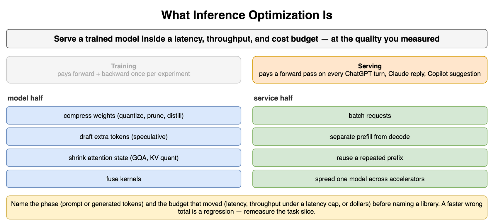

*Source: [`diagrams/inference-optimization.drawio`](/content/10_AI_Engineering/09_Inference_Optimization/diagrams/inference-optimization.drawio), page 1.*

## Prefill and decode

Prefill and decode are the two phases of one generated reply. Prefill reads the prompt and writes the KV cache. Decode appends one new token at a time and reads that cache back.

The split follows from the causal transformer. Token 40 cannot be emitted until token 39 has a key and value, so generation is a loop. Prompt tokens are already known, so the server runs those positions together in a parallel prefill. That is why a long paste in Claude or ChatGPT sits on "thinking" before the first word, then streams at a steadier pace. The Attention, the KV cache, and context card in [Understanding Foundation Models](../02_Understanding_Foundation_Models/) names both phases and their shared cache. The roofline card explains why they feel different: prefill does much arithmetic per byte, while decode moves the weights again for one token.

vLLM, TensorRT-LLM, and hosted APIs all schedule these phases. Time to first token includes queue and prefill; later gaps are decode. A long retrieved document worsens the first clock with an unchanged decode kernel, and a huge model worsens the second even with a short prompt. Short prompts and long answers are decode problems; long prompts and short answers are prefill problems. Copilot inline suggestions and a book-length summary are different phases. Optimizing the wrong phase is quantizing weights to fix a stall that was a 20,000-token prefill. Sharing a GPU also makes phases contend, since a new prefill can pause every in-flight decode (the disaggregation card); splitting removes the pause and adds a pool to size. "The GPU is at 100 percent" does not say which ceiling you hit, so the next question is arithmetic intensity.

```text
prefill   whole prompt in parallel -> writes KV cache -> drives TTFT
decode    one token at a time, reads the cache      -> drives TPOT
```

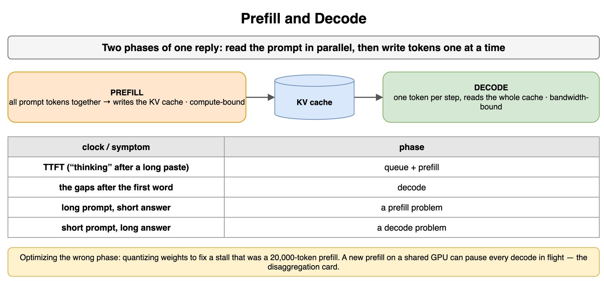

*Source: [`diagrams/inference-optimization.drawio`](/content/10_AI_Engineering/09_Inference_Optimization/diagrams/inference-optimization.drawio), page 2.*

## Arithmetic intensity and the roofline

Arithmetic intensity is the floating-point work a kernel does per byte it moves. The roofline is the pair of ceilings that intensity runs into: peak compute, and peak memory bandwidth.

Williams, Waterman, and Patterson published the model in 2009. The ridge point is peak FLOPs divided by peak bandwidth. A kernel below it is memory-bandwidth-bound and finishes when bytes arrive while arithmetic waits; one above it is compute-bound with bandwidth to spare. A faster ALU does nothing below the ridge, and faster memory nothing above it. On an H100 SXM5, the 989.4 TFLOPS dense BF16 peak ([Understanding Foundation Models](../02_Understanding_Foundation_Models/)) over the datasheet's 3.35 TB/s (`3.35 × 10^12` B/s here) gives a 295.3 FLOPs-per-byte ridge. One square BF16 projection at Llama 3 8B's 4,096 width does `2 × sequence × 4096 × 4096` FLOPs and moves input, weight, and output at 2 bytes each. At one token, intensity is 1.00 (bandwidth-bound); at 4,096 tokens, 1,365.3 (compute-bound); the crossover is about 345 tokens. The A100 80GB SXM ridge, 312 TFLOPS over 2,039 GB/s, is 153.0, so H100's compute grew faster than its bandwidth and leaves near-ridge layers more clearly bandwidth-bound. H200 SXM keeps H100's sparse BF16 line and raises bandwidth to 4.8 TB/s, lowering the dense ridge to 206.1 and making decode easier.

This counts one linear layer with no KV cache. Attention and cache bytes push real decode further toward bandwidth, while long prefills stay compute-bound. The `6ND` training estimate is a cousin: about `2N` forward FLOPs per token, ignoring attention until sequences are long. "Memory-bound" has two meanings. Bandwidth-bound means the weights fit and the step waits on bytes per second. Capacity-bound means the checkpoint, cache, or batch exceeds HBM, so the kernel spills, offloads, or never launches. Quantizing, shortening context, cutting concurrency, or adding a GPU fixes capacity. Faster HBM fixes bandwidth and does nothing for a model that does not load, such as 12.6 GiB of weights plus cache on a 24 GB card. Name the bound you measured before choosing an optimization. Raising batch raises intensity by reusing loaded weights and also lengthens the first arrival's wait. Changing chip or dtype moves the ridge; an INT8 peak with 1-byte weights is a different roofline.

```python
HIDDEN = 4096
H100_RIDGE = 989.4e12 / 3.35e12
A100_RIDGE = 312e12 / 2.039e12


def intensity(seq: int) -> float:
    flops = 2 * seq * HIDDEN * HIDDEN
    nbytes = 2 * (seq * HIDDEN + HIDDEN * HIDDEN + seq * HIDDEN)
    return flops / nbytes


crossover = H100_RIDGE * HIDDEN / (HIDDEN - 2 * H100_RIDGE)
print(f"{H100_RIDGE:.1f} {A100_RIDGE:.1f}")
print(f"{intensity(1):.2f} {intensity(4096):.1f}")
print(f"{crossover:.0f}")
print(intensity(1) < H100_RIDGE < intensity(4096))
# 295.3 153.0
# 1.00 1365.3
# 345
# True
```

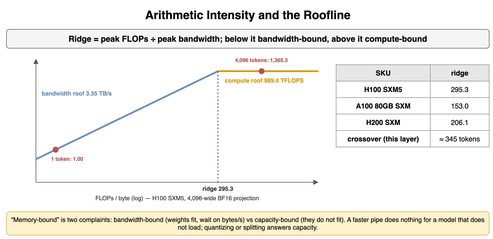

*Source: [`diagrams/inference-optimization.drawio`](/content/10_AI_Engineering/09_Inference_Optimization/diagrams/inference-optimization.drawio), page 3.*

## Online and batch inference APIs

An online inference API returns tokens inside an interactive wait. A batch inference API accepts a pile of requests and returns them later, at a lower price per token.

The online path is ChatGPT, Claude.ai, Copilot, and any call while a person or downstream tool is blocked, governed by time to first token, later-token gaps, and a timeout. The batch path is the overnight job. On docs checked 12 November 2026, OpenAI's Batch API is 50% off the synchronous APIs with `24h` as its only documented window; batches often finish sooner, and one that misses the window expires. Anthropic's Message Batches API charges 50% of standard prices, says most batches finish within an hour, returns results at completion or 24 hours, and expires unfinished requests at 24 hours. That one-hour sentence is not an SLO, and windows and discounts can move, so the signed page counts. A foundation-model batch API is not classical precompute. A recommender scores the catalog overnight and the request reads an existing row; OpenAI and Anthropic batches queue the same prompt you would send online and run it later. If every customer needs an answer before arriving, that is precompute: generate and store answers in advance, accepting staleness. A batch completion is late but about the submitted prompt.

For 100,000 documents of 6,000 input and 500 output tokens at exercise rates of $1.50 and $6.00 per million, the synchronous bill is $1,200 and batch is $600. The $600 buys a result hours later, not a chat turn: an agent viewing one ticket still needs online, while a queue digest can wait. [Evaluate AI Systems](../04_Evaluate_AI_Systems/) prices one call; this discount pays for giving the provider a deadline instead of a latency SLO. Providers can run the pile when the interactive fleet has spare hardware. Your own GPUs work the same way: a batch window permits a large throughput-oriented configuration, including parallelism too slow for chat, while the online tier protects first-token latency. Never batch anything whose caller is blocked; an urgent ticket in the batch is late. Running the whole digest online pays double for latency nobody needed. Recompute any budget that hard-codes 50% when the page changes.

```python
DOCS = 100_000
INPUT_TOKENS, OUTPUT_TOKENS = 6_000, 500
INPUT_RATE, OUTPUT_RATE = 1.50, 6.00


def bill(scale: float) -> float:
    input_cost = DOCS * INPUT_TOKENS / 1_000_000 * INPUT_RATE * scale
    output_cost = DOCS * OUTPUT_TOKENS / 1_000_000 * OUTPUT_RATE * scale
    return input_cost + output_cost


print(f"{bill(1):.0f}")
print(f"{bill(0.5):.0f}")
# 1200
# 600
```

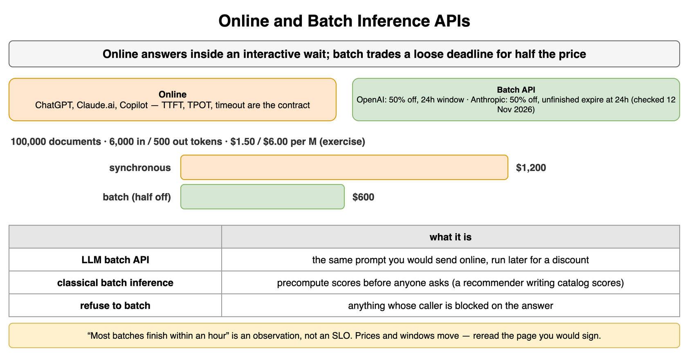

*Source: [`diagrams/inference-optimization.drawio`](/content/10_AI_Engineering/09_Inference_Optimization/diagrams/inference-optimization.drawio), page 4.*

## TTFT, TPOT, and inter-token latency

Time to first token, time per output token, and inter-token latency are three clocks on one generation.

Time to first token (TTFT) is the wait until the first output token is available at the server, including queueing and prefill. Time per output token (TPOT) is the average later gap. Inter-token latency (ITL) is one gap, and its tail is the stall a stream hit. [Evaluate AI Systems](../04_Evaluate_AI_Systems/) fixes the formula: TTFT includes the first token, so N tokens take `TTFT + TPOT × (N − 1)`. A vendor dividing total time by N uses a different TPOT, so reconcile before comparing dashboards. The token a user sees can be later after network and client buffering, so objectives must name the clock. In this worked stream, TTFT 1.20 s and TPOT 0.040 s give an 80-token reply in 4.36 s. Decode is 25 tokens/s, but end-to-end is 18.35 because the 1.20 s sits in the denominator. Gaps of 0.030, 0.035, and 0.090 average 0.052, and a TPOT near 0.040 can hide that 0.090 stall.

For a streamed document, TPOT only has to beat reading speed. As a planning figure, a few English words a second is about 10 tokens/s, so 25 tokens/s is already ahead and cutting TPOT to 0.020 s spends budget a reader cannot use. TTFT remains the wait before anything appears. Voice and captions perceive every gap; a scrolled chat transcript does not. A batch job storing the finished string cares about 4.36 s, often not even that. Set TPOT from the interaction. Sampling settings are absent from the formula but still change the clocks: a longer reasoning trace adds `TPOT × (extra tokens)`, and an early stop shortens N. The formula gives the wait after N and both clocks are known; it does not replace measuring them. Optimizing average TPOT can leave tail ITL and the user unchanged, and optimizing TTFT can leave a long answer slow after a snappy first word.

```python
TTFT = 1.20
TPOT = 0.040
OUTPUT_TOKENS = 80
GAPS = (0.030, 0.035, 0.090)
wait = TTFT + TPOT * (OUTPUT_TOKENS - 1)
print(f"{wait:.2f}")
print(f"{1 / TPOT:.1f} {OUTPUT_TOKENS / wait:.2f}")
print(f"{sum(GAPS) / len(GAPS):.3f} {max(GAPS):.3f}")
# 4.36
# 25.0 18.35
# 0.052 0.090
```

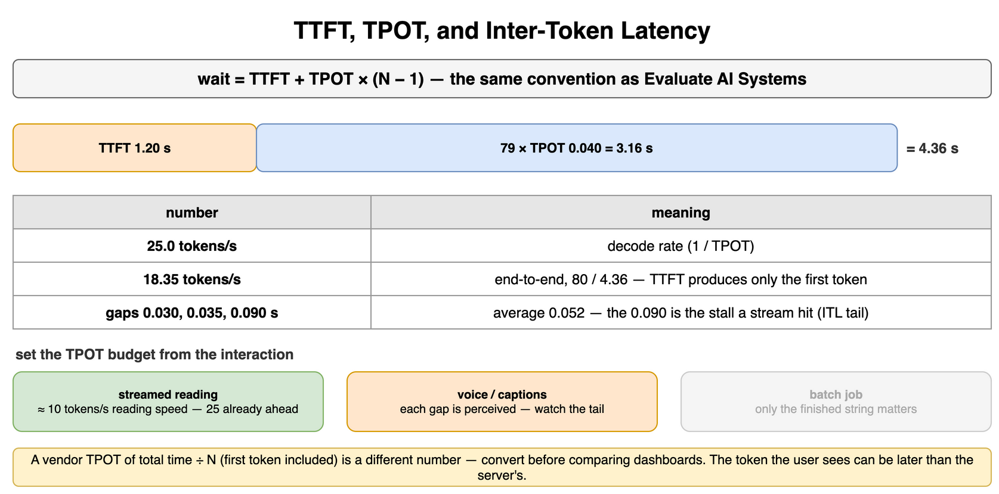

*Source: [`diagrams/inference-optimization.drawio`](/content/10_AI_Engineering/09_Inference_Optimization/diagrams/inference-optimization.drawio), page 5.*

## Throughput and goodput

Throughput counts finished requests. Goodput counts the finished requests that met every latency objective you wrote down.

[Evaluate AI Systems](../04_Evaluate_AI_Systems/) uses that definition and calls the fraction meeting objectives the attainment; some dashboards call that fraction goodput. DistServe (Zhong et al.) uses goodput for capacity: the highest request rate at which a stated percentile still meets TTFT and TPOT caps. Name which reading a dashboard uses. Both agree that finishing more requests by missing caps is not a win, and DistServe sizes a stack for the rate it holds with caps intact. Errors and timeouts do not count as goodput. Chatbots, code completion, and summarizers have different caps and therefore different goodputs.

In a worked minute (neither a DistServe table nor that topic's one-second window), finishing 1,200 with 900 inside both caps gives throughput 1,200, goodput 900, and attainment 0.75. Finishing 1,800 with 720 inside gives attainment 0.40: the larger batch won the completion chart and lost the interaction. Throughput without caps is how a colocated prefill looks good on a token counter while every in-flight decode misses its gap (the disaggregation card). Reporting throughput is cheap and rewards configurations that break the product. Goodput requires written caps, and a vague cap makes the metric vague; a tight one can force GPU purchases a looser product would not need. Attainment without request rate hides whether you met caps by refusing traffic, and rate without attainment hides whether anyone got a timely answer.

```python
def report(finished: int, met: int) -> None:
    print(finished, met, f"{met / finished:.2f}")


report(1_200, 900)
report(1_800, 720)
# 1200 900 0.75
# 1800 720 0.40
```

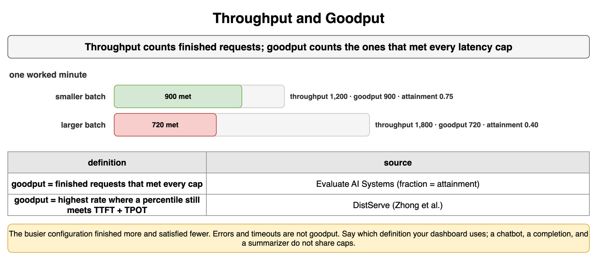

*Source: [`diagrams/inference-optimization.drawio`](/content/10_AI_Engineering/09_Inference_Optimization/diagrams/inference-optimization.drawio), page 6.*

## Model FLOPs utilization

Model FLOPs utilization, MFU, is the fraction of a chip's peak arithmetic that the model's own FLOPs actually occupied.

The PaLM paper (Chowdhery et al.) defined MFU to compare training runs across chips: analytical forward and backward FLOPs from observed tokens per second, excluding rematerialization, divided by published peak. Hardware FLOPs utilization (HFU) includes rematerialization, so the same run scores higher depending on how much you recompute. PaLM 540B on 6,144 TPU v4 chips reached 46.2% MFU with self-attention counted, 45.7% without, and 57.8% HFU, averaging 238.3 thousand tokens/s. The same table lists GPT-3 175B at 21.3% on V100, Gopher 280B at 32.5% on 4,096 TPU v3, and Megatron-Turing NLG 530B at 30.2% on 2,240 A100s. These are training numbers; the 40% in [Understanding Foundation Models](../02_Understanding_Foundation_Models/) is a planning utilization, not a measurement.

Single-GPU decode is different, and low MFU is the point. With untied Llama 3 8B's 8,030,261,248 parameters and the attention-ignoring `2N` forward approximation, moving every BF16 weight once at an H100 SXM5's 3.35 TB/s yields 208.6 tokens/s. Its FLOPs per second equal bandwidth, because both FLOPs and bytes are `2N`, so MFU against 989.4 TFLOPS is 0.339%. The matmul is fine; the step waits on HBM. Quoting 0.339% beside PaLM's 46.2% without saying "decode" versus "training" causes panic. `nvidia-smi` utilization is the fraction of sample time at least one kernel was executing, so memory-waiting decode can read 100% busy. The busy percentage asks whether work launched, MFU what fraction of peak arithmetic model FLOPs used, and MBU what fraction of the HBM pipe moved. A capacity failure appears as a failed or spilling process first. Bigger batches raise intensity and MFU until the ridge. Quantization speeds bandwidth-bound decode and raises this MFU (1.31% for the group-128 4-bit case on the quantization card), still not training-like. MFU is a good alarm for compute-bound prefill or training far below paid peak and a bad one for batch-1 decode. Its honesty depends on the FLOP formula: omitting attention undercounts long prefill, and a sparse peak understates dense utilization.

```python
PARAMS = 8_030_261_248
BANDWIDTH = 3.35e12
PEAK = 989.4e12
TOKENS_PER_SEC = BANDWIDTH / (PARAMS * 2)
ACHIEVED = TOKENS_PER_SEC * (2 * PARAMS)
print(f"{TOKENS_PER_SEC:.1f}")
print(f"{ACHIEVED:.3e}")
print(f"{100 * ACHIEVED / PEAK:.3f}")
# 208.6
# 3.350e+12
# 0.339
```

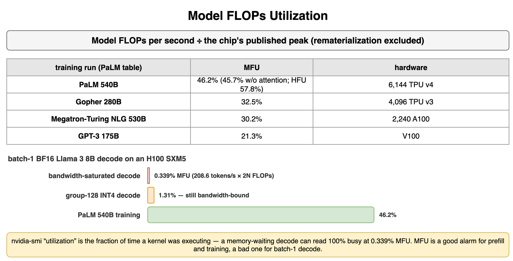

*Source: [`diagrams/inference-optimization.drawio`](/content/10_AI_Engineering/09_Inference_Optimization/diagrams/inference-optimization.drawio), page 7.*

## Model bandwidth utilization

Model bandwidth utilization, MBU, is the fraction of an accelerator's peak memory bandwidth that the model actually used.

It is MFU's bandwidth twin: bytes per step × steps per second, divided by the SKU's datasheet HBM bandwidth. For weight-only BF16 decode, MBU is measured tokens/s divided by the bandwidth-roof tokens/s. On Llama 3 8B and an H100 SXM5, that roof is 208.6 tokens/s if every weight byte moves once and nothing else does, so the roof is MBU 1 and anything lower leaves bandwidth unused. The memory card derives the roof; this card interprets the gap below it. High MBU with low MFU is the healthy batch-1 decode: HBM is full and tensor cores are not the limit. Low MBU with low MFU means the chip waits on something besides HBM, such as host-resident weights streaming over PCIe, launch overhead exceeding the kernel, a synchronous CPU step between tokens, or a non-streaming access pattern. Rising batch can hold MBU while MFU climbs until the ridge; beyond it MBU falls because arithmetic finishes first, which is not a memory bug.

Once sequences are long, KV-cache bytes belong in the count. The memory card's second ceiling, 195.5 tokens/s at 8,192 cache tokens, is the same MBU idea with more bytes per token. Using weight-only 208.6 as the denominator makes MBU look worse than the pipe is, so write down which bytes you counted. MBU says whether a bandwidth-bound step is near paid HBM, not whether the latency SLO held; a giant batch can drive MBU to 1 and miss every TTFT cap. Treating low MFU as a bad kernel when MBU is high leads to a fusion project that adds no tokens. Treating low MBU as "model too big" leads to quantization when weights were on the CPU. Check HBM residency and whether the byte formula includes the cache before rewriting a kernel.

```python
PARAMS = 8_030_261_248
WEIGHTS = PARAMS * 2
BANDWIDTH = 3.35e12
CEILING = BANDWIDTH / WEIGHTS
print(f"{CEILING:.1f}")
print(f"{CEILING * WEIGHTS / BANDWIDTH:.2f}")
# 208.6
# 1.00
```

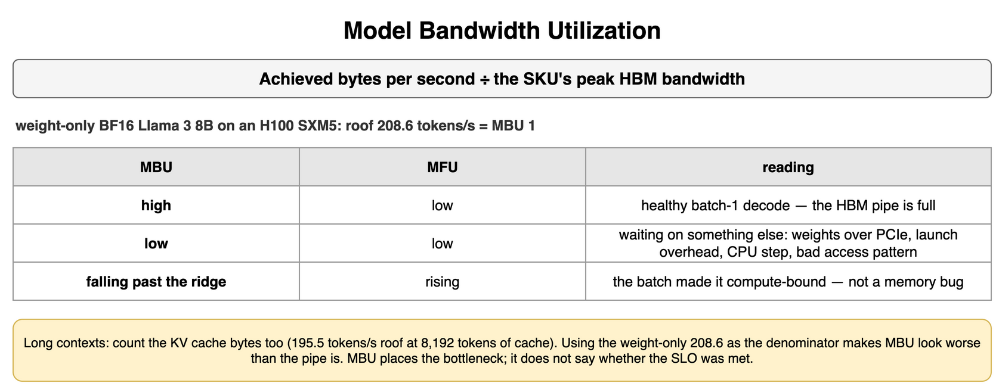

*Source: [`diagrams/inference-optimization.drawio`](/content/10_AI_Engineering/09_Inference_Optimization/diagrams/inference-optimization.drawio), page 8.*

## What an accelerator is

An accelerator is a chip built to apply the same numeric operation to a large grid of values at once, which is what a neural-network layer does.

A CPU core runs branchy programs with a little data. A GPU such as NVIDIA's H100 or A100 has thousands of lanes plus tensor cores that execute small matrix multiplies as single instructions. Google's TPU uses a systolic array: weights stay in place while activations stream past. A TPU v4 chip, per Google documentation and Jouppi et al., has two TensorCores and peaks at 275 TFLOPS BF16 or INT8; PaLM's 6,144-chip run used it. CUDA and TensorRT-LLM do not target TPUs; XLA compiles for them. The roofline still applies, and 275 TFLOPS over 1,200 GB/s is a 229 FLOPs-per-byte ridge, comparable to H100's 295.3. The practical consequence is which software and formats you may assume. A100 80GB SXM has BF16, FP16, TF32, INT8, and INT4 tensor cores but no FP8; H100 SXM5 has FP8, and H200 SXM keeps the Hopper model with different memory. A kernel for one path is not a kernel for the others. NVIDIA MIG can split one H100 into up to seven 10 GB instances for small models and traffic, but a model needing all 80 GB does not become seven large models.

Training chips favor high-precision or BF16 throughput, fast collectives, and room for optimizer state. Inference chips can spend on low precision and bandwidth, because decode is bandwidth-bound and weights are fixed. AWS splits Trainium for training and Inferentia for inference. NVIDIA L4 and L40S target inference and graphics servers where H100 interconnect is wasted. Groq's language-processing unit targets deterministic token latency, and transformer-specific chips hard-wire matmul and attention at the cost of general CUDA programs. Ask the same three questions of any chip. Can it run the model: do memory, dtype, and software load the weights and cache? How fast: TTFT, TPOT, and tokens/s at your real batch? How much: dollars per million tokens and power? A peak-FLOPs winner that fails the first question does not run, and one that misses chat reading speed or power budget is not cheap. CPUs still run tokenizers, schedulers, web servers, and small models, but not a 70B decode if you have a choice. Assuming FP8, NVLink, or CUDA graphs everywhere breaks a portable-looking config on rented hardware.

```python
print(f"{275 / 1.2:.0f}")
# 229
```

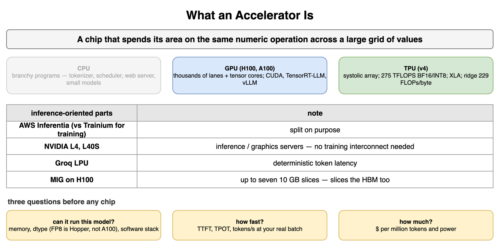

*Source: [`diagrams/inference-optimization.drawio`](/content/10_AI_Engineering/09_Inference_Optimization/diagrams/inference-optimization.drawio), page 9.*

## FLOPs and number formats

A published FLOP rate is the peak arithmetic of one number format on one SKU, and the datasheet's sparsity footnote is a different peak from the dense one.

[Finetuning](../07_Finetuning/) owns what BF16, FP16, FP8, and INT8 mean, and [Understanding Foundation Models](../02_Understanding_Foundation_Models/) owns dense versus sparse and the 989.4 TFLOPS H100 dense BF16 peak. This card is the serving table. The Hopper architecture paper lists H100 SXM5 at 989.4 TFLOPS dense BF16 and 1,978.9 with 2:4 sparsity. The "H100 SXM" datasheet row rounds sparse to 1,979 and says dense is half (989.5); this guide keeps 989.4. That row lists FP8 and INT8 at 3,958 with sparsity (1,979 dense), 80 GB HBM3 at 3.35 TB/s, and up to 700 W configurable. Starred peaks require 2:4 sparsity, two zeros in every four weights, so a dense matmul gets the dense line. H100 PCIe is a different chip: 1,513 TFLOPS sparse BF16/FP16 (756 dense in the architecture paper), 80 GB HBM2e at 2 TB/s on the shipping datasheet (an earlier non-final table showed 2,039 GB/s), and 300–350 W. Quoting SXM5's 989.4 TFLOPS or 3.35 TB/s for PCIe overstates both.

NVIDIA's H200 SXM table, still marked preliminary, reprints H100 SXM's sparse lines, including 1,979 BF16, with 141 GB HBM3e at 4.8 TB/s and up to 700 W. Arithmetic stays and memory changes: 989.5 over 4.8 TB/s is a 206.1 FLOPs-per-byte ridge, against 295.3. Do not read 141 GB as 141 GiB or assume the 131.4 GiB Llama 3 70B weights fit until the device reports its MiB. A100 80GB SXM lists 312 dense BF16 and 624 sparse, 80 GB HBM2e at 2,039 GB/s, and 400 W standard (the HGX custom-thermal SKU can reach 500 W). It has INT8 and INT4 tensor cores but no FP8. A TPU v4 chip peaks at 275 TFLOPS BF16 or INT8, not an NVIDIA sparse footnote, and is a different chip with a different compiler and memory system, not a worse H100.

| SKU | Dense BF16 tensor core | 2:4 sparse line | Memory | Bandwidth | Power |
| --- | --- | --- | --- | --- | --- |
| H100 SXM5, datasheet row "H100 SXM" | 989.4 TFLOPS | 1,979 TFLOPS on the datasheet, 1,978.9 in the architecture paper | 80 GB HBM3 | 3.35 TB/s | Up to 700 W, configurable |
| H100 PCIe | 756 TFLOPS in the architecture paper | 1,513 TFLOPS | 80 GB HBM2e | 2 TB/s on the product datasheet | 300 to 350 W, configurable |
| H200 SXM, table still marked preliminary | Half of the printed sparse line, 989.5 | 1,979 TFLOPS | 141 GB HBM3e | 4.8 TB/s | Up to 700 W, configurable |
| A100 80GB SXM | 312 TFLOPS | 624 TFLOPS | 80 GB HBM2e | 2,039 GB/s | 400 W standard |
| TPU v4 chip | 275 TFLOPS BF16 or INT8 | Not an NVIDIA sparse tensor core | 32 GiB HBM2 | 1,200 GB/s | Running mean 170 W, max 192 W. TDP is not applicable |

H100 SXM5 has 3.17× A100 80GB SXM's dense BF16 peak but 1.64× its bandwidth, so the ridge rose from 153.0 to 295.3. H100 PCIe does not inherit that: 2.42× compute and 0.98× bandwidth. H200 SXM keeps H100 SXM's sparse line with 1.43× bandwidth, lowering its ridge to 206.1. Hopper FP8 cuts weight bytes and raises the tensor-core ceiling together. Weight-only INT4 cuts bytes but still multiplies in a wider type after dequantization. FP8 also adds the scaling problem from the finetuning format card. Refuse any FLOP number without an SKU, dtype, and dense-or-sparse flag, and comparisons such as H100 SXM5 versus A100 PCIe without names. Use the sparse peak as a denominator only when weights are truly 2:4 sparse and the kernel uses sparse tensor cores.

```python
print(f"{989.4 / 312:.2f}")
print(f"{3.35e12 / 2.039e12:.2f}")
print(f"{756 / 312:.2f}")
print(f"{2e12 / 2.039e12:.2f}")
print(f"{4.8 / 3.35:.2f}")
print(f"{(1979 / 2) / 4.8:.1f}")
# 3.17
# 1.64
# 2.42
# 0.98
# 1.43
# 206.1
```

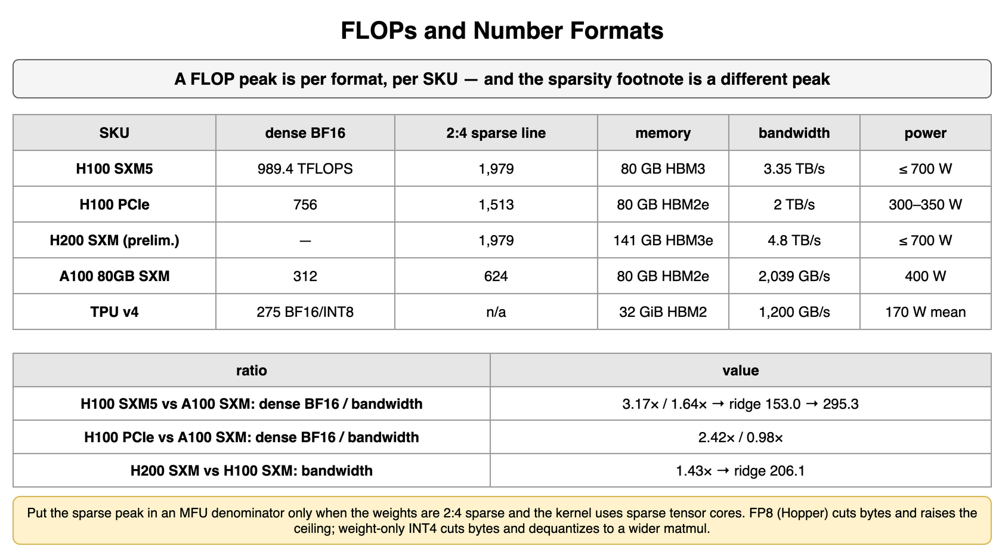

*Source: [`diagrams/inference-optimization.drawio`](/content/10_AI_Engineering/09_Inference_Optimization/diagrams/inference-optimization.drawio), page 10.*

## Memory size and bandwidth

Memory size is how much state stays on the accelerator. Memory bandwidth is how many bytes per second can move between that memory and the compute units.

From the math outward, the hierarchy is registers and shared memory, a cache, HBM, then host memory over PCIe, with NVLink for GPU-to-GPU copies. H100's 50 MB L2 holds a tile, not a model. Llama 3 8B's 14.96 GiB of BF16 weights live in HBM and are reread each decode step. H100 SXM5 HBM is 80 GB at 3.35 TB/s; as [Understanding Foundation Models](../02_Understanding_Foundation_Models/) notes, an "80 GB" device reports 81920 MiB, so capacity here is 80 GiB while bandwidth stays decimal TB/s. The weight-only decode roof is bandwidth over weight bytes: 208.6 tokens/s, or 4.79 ms per token, only if the kernel moves nothing else at full pipe. An 8,192-token KV cache on this shape is exactly 1 GiB, lowering the roof to 195.5 tokens/s. Real kernels also write activations and miss MBU 1, so measurements are lower. Use the roof to test feasibility, not as a vLLM benchmark.

The datasheet's PCIe Gen5 128 GB/s and NVLink 900 GB/s are bidirectional aggregates. A host-to-GPU weight copy is one direction: 64 GB/s before overhead, 4.0 tokens/s for these weights; treating 128 GB/s as one-way gives 8.0, about double. H100 PCIe's 2 TB/s HBM roof is 124.5 tokens/s, still not SXM5's 208.6. H200 SXM's preliminary 4.8 TB/s raises it to 298.9 if resident at full pipe. NVLink carries tensor-parallel collectives (tensor-parallelism card), and none of these links is HBM. Planning for 80 GB while forgetting 3.35 TB/s buys a card the weights fit on and misses token rate; quoting 208.6 and forgetting cache misses it on long prompts. More HBM fits longer caches and batches but costs money and power even empty. More bandwidth raises decode, not compute-bound prefill. Host offload fits an oversized model at the one-way PCIe ceiling. Quantization raises the roof only if the kernel moves packed bytes rather than first materializing BF16, so read the kernel. A measurement above the roof of the link you use is an accounting error; far below it is the MBU card.

```python
PARAMS = 8_030_261_248
WEIGHTS = PARAMS * 2
BANDWIDTH = 3.35e12
PER_TOKEN = 2 * 32 * 8 * 128 * 2
print(f"{WEIGHTS / 1024**3:.2f}")
print(f"{BANDWIDTH / WEIGHTS:.1f}")
print(f"{BANDWIDTH / (WEIGHTS + PER_TOKEN * 8192):.1f}")
print(f"{WEIGHTS / BANDWIDTH * 1e3:.2f}")
# 14.96
# 208.6
# 195.5
# 4.79
```

```python
WEIGHTS = 8_030_261_248 * 2
print(f"{128e9 / WEIGHTS:.1f}")
print(f"{64e9 / WEIGHTS:.1f}")
print(f"{2e12 / WEIGHTS:.1f}")
print(f"{4.8e12 / WEIGHTS:.1f}")
# 8.0
# 4.0
# 124.5
# 298.9
```

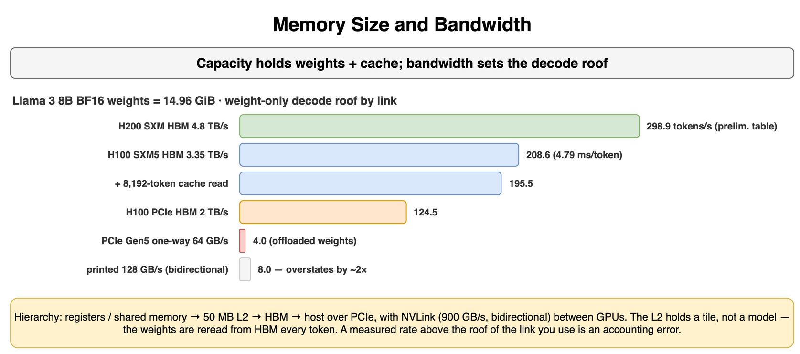

*Source: [`diagrams/inference-optimization.drawio`](/content/10_AI_Engineering/09_Inference_Optimization/diagrams/inference-optimization.drawio), page 11.*

## Power

Power is the watts an accelerator is allowed to draw, and it is the constraint that turns a FLOP peak into a facilities problem.

TDP is a cap, not a measured average, as [Understanding Foundation Models](../02_Understanding_Foundation_Models/) reads H100's 700 W. H100 SXM lists up to 700 W configurable; A100 80GB SXM standard lists 400 W (this card ignores the 500 W custom-thermal SKU). Dense BF16 peak per nameplate watt is 1.41 TFLOPS for H100 SXM5 and 0.78 for A100, a 1.81 ratio. HBM bandwidth per watt is 4.79 versus 5.10 GB/s, because bandwidth grew 1.64× while nameplate watts grew 1.75×. A bandwidth-bound decode fleet buys bytes per second first and bytes per watt second; a compute-bound prefill fleet buys the 1.81× arithmetic per watt more directly. A chip with better FLOPs per watt can be wrong for decode if HBM per watt is worse and absolute bandwidth misses the token roof.

Google Cloud's TPU v4 page lists measured power of 90 W minimum, 170 W mean, and 192 W maximum. Jouppi et al. split this into 90 W idle and 121, 170, and 192 W running minimum, mean, and maximum, with TDP not applicable. Do not divide 275 TFLOPS by 170 W and rank it against H100's TDP ratio; peak over measured mean differs from peak over nameplate cap. The training example in Understanding Foundation Models is up to 16,384 H100s at 700 W, 11.5 megawatts of accelerator nameplate before CPUs, network, and cooling; an inference fleet sums the GPUs left powered overnight. Idle watts explain why spiky products often prefer an API (self-hosting card in Evaluate AI Systems). Provisioning nameplate protects the SLO when the chip boosts and overstates the average bill. Provisioning average trips breakers or throttles clocks, reducing both FLOPs and bandwidth. Cooling and network lie outside TDP and outside 11.5 MW.

```python
print(f"{989.4 / 700:.2f} {312 / 400:.2f}")
print(f"{(989.4 / 700) / (312 / 400):.2f}")
print(f"{3.35e12 / 700 / 1e9:.2f} {2.039e12 / 400 / 1e9:.2f}")
print(f"{3.35 / 2.039:.2f} {700 / 400:.2f}")
# 1.41 0.78
# 1.81
# 4.79 5.10
# 1.64 1.75
```

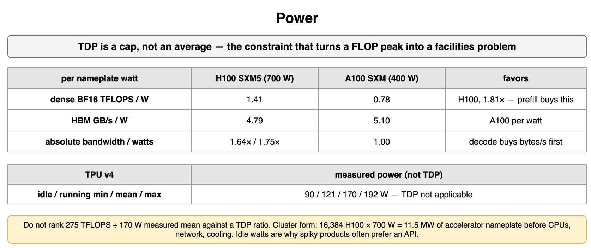

*Source: [`diagrams/inference-optimization.drawio`](/content/10_AI_Engineering/09_Inference_Optimization/diagrams/inference-optimization.drawio), page 12.*

## Quantization

Quantization stores the weights in fewer bits so a bandwidth-bound decode moves fewer bytes per token.

[Finetuning](../07_Finetuning/) owns accuracy: GPTQ and AWQ weight-only PTQ, LLM.int8() and SmoothQuant activations, group 128, and INT4's risk to arithmetic and exact tokens. This card owns serving math, with BF16 at 2 bytes. Raw 4-bit is 0.5 bytes; one FP16 scale per 128-weight group adds `2 / 128`, for 0.515625 bytes, and an assumed 2-byte zero-point makes 0.53125 (not every file stores an FP16 zero). Scale-only Llama 3 8B is 3.86 GiB versus 14.96 GiB in BF16. If decode stays bandwidth-bound and the kernel moves packed bytes, the H100 SXM5 roof rises from 208.6 to 809.1 tokens/s (3.88×); zero-point packing gives 3.76×. MFU rises from 0.339% to 1.31% because `2N` FLOPs happen more often, but decode is still bandwidth-bound. Compute-bound prefill may not speed up, and dequantization can spend the saved arithmetic. A100 has INT8 and INT4 tensor cores but not FP8, and weight-only INT4 often dequantizes to BF16, so those INT4 cores are not automatically used.

H100 FP8 is the other cut: 1-byte weights and FP8 tensor cores change both byte count and arithmetic ceiling. Weight-only INT4 changes bytes but leaves a wider matmul after dequantization. A kernel that materializes a full BF16 copy moves wide bytes and loses the roof gain, so read the kernel, not only the checkpoint dtype. Weight quantization does not quantize keys and values (the KV-cache card). Finer groups or a skipped output projection buy back accuracy at some byte cost, and FP8 needs Hopper. Stacking quantization, pruning, and distillation in one checkpoint makes failures undebuggable; change one, then score the slice that failed before.

```python
PARAMS = 8_030_261_248
BANDWIDTH = 3.35e12
PEAK = 989.4e12
SCALE = 0.5 + 2 / 128
ZERO = 0.5 + 4 / 128
bf16_tokens = BANDWIDTH / (PARAMS * 2)
int4_tokens = BANDWIDTH / (PARAMS * SCALE)
print(f"{SCALE:.6f} {ZERO:.5f}")
print(f"{PARAMS * SCALE / 1024**3:.2f}")
print(f"{bf16_tokens:.1f} {int4_tokens:.1f} {int4_tokens / bf16_tokens:.2f}")
print(f"{2 / SCALE:.2f} {2 / ZERO:.2f}")
print(f"{100 * bf16_tokens * (2 * PARAMS) / PEAK:.3f}")
print(f"{100 * int4_tokens * (2 * PARAMS) / PEAK:.2f}")
# 0.515625 0.53125
# 3.86
# 208.6 809.1 3.88
# 3.88 3.76
# 0.339
# 1.31
```

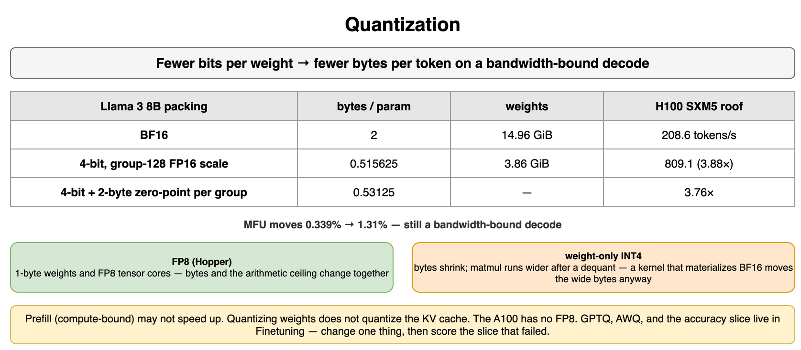

*Source: [`diagrams/inference-optimization.drawio`](/content/10_AI_Engineering/09_Inference_Optimization/diagrams/inference-optimization.drawio), page 13.*

## Pruning

Pruning deletes weights so the checkpoint contains zeros, and it speeds serving only when the kernel stops loading those zeros.

Unstructured methods such as SparseGPT (Frantar and Alistarh) and Wanda (Sun et al.) can zero many values while the kernel still loads the dense tensor and skips zeros only in the ALU. You pay BF16 traffic, and the Llama 3 8B H100 SXM5 roof stays 208.6 tokens/s. NVIDIA's 2:4 structured sparsity, two zeros in every four weights, is what the starred tensor-core peaks assume. The 1,979 TFLOPS line is 2.00× the 989.4 dense peak only when weights use that pattern and the kernel uses sparse tensor cores. A 50% sparse checkpoint in another pattern gets neither that line nor a smaller HBM read; zeros are still bytes on the bus.

That determines the MFU denominator. A dense Llama matmul on H100 SXM5 is divided by 989.4; dividing by 1,979 reports half the utilization the chip could deliver. Pruning is not quantization. Quantization narrows every stored value; pruning changes which values exist, and only a matching kernel changes moved bytes. 2:4 can use sparse tensor cores and raise arithmetic peak while constraining which weights remain. Unstructured sparsity reaches high zero counts more easily and often leaves HBM traffic unchanged. Combined with INT4, it adds two accuracy hits and two kernel requirements. If the profile still shows a dense weight read, the zeros were free in the paper, not on the GPU.

```python
print(f"{1979 / 989.4:.2f}")
# 2.00
```

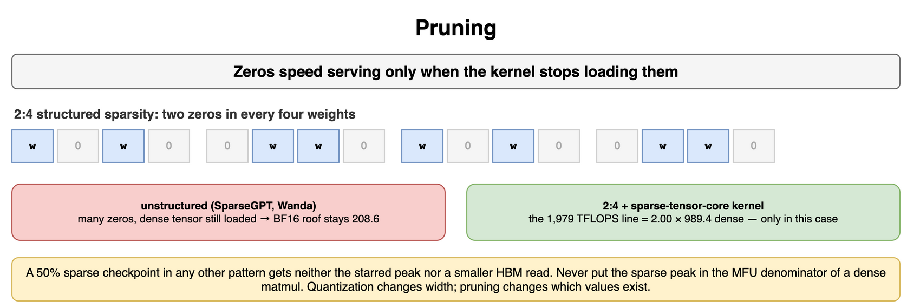

*Source: [`diagrams/inference-optimization.drawio`](/content/10_AI_Engineering/09_Inference_Optimization/diagrams/inference-optimization.drawio), page 14.*

## Distillation at serving time

Distillation, at serving time, is the decision to run a smaller student instead of the teacher, after the student has been trained on the teacher's outputs.

[Dataset Engineering](../08_Dataset_Engineering/) owns the method: Hinton's soft targets, sequence-level text from API teachers, DistilBERT's summary, and the license limit on training from provider outputs. This card owns serving bytes. Weight bytes fall with parameter count, raising a bandwidth-bound token roof proportionally. KV cache falls only if the student has fewer layers or key-value heads; a student with the teacher's attention shape and a smaller feed-forward moves almost the same cache. Llama 3 8B has 14.96 GiB of BF16 weights and 128 KiB of cache per token; Llama 3 70B in Understanding Foundation Models has 131.4 GiB and 320 KiB. Serving 8B instead of 70B cuts weights 8.78× and per-token cache 2.50×.

Distillation produces a smaller-shape checkpoint; quantization produces a different checkpoint of the same shape, and pruning keeps the shape too. They are not interchangeable, and each must be measured. A smaller student can meet a latency SLO a quantized large model misses because weights and, with a smaller attention shape, cache shrink. It is capped at the questions you asked the teacher and by the teacher's license, and a fast student you may not ship is no serving win. Choosing a student from parameter count without the cache formula is how a long-context 8B still misses an HBM plan. Score the task slice on the student you intend to serve.

```python
print(f"{131.4 / 14.96:.2f}")
print(f"{320 / 128:.2f}")
# 8.78
# 2.50
```

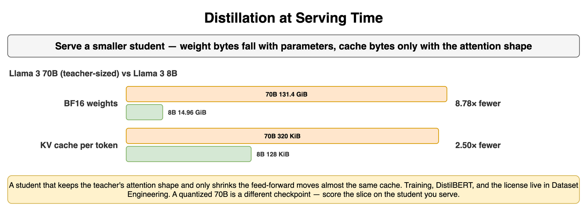

*Source: [`diagrams/inference-optimization.drawio`](/content/10_AI_Engineering/09_Inference_Optimization/diagrams/inference-optimization.drawio), page 15.*

## Speculative decoding

Speculative decoding drafts several future tokens with a cheap model and then checks them with the model you serve, so one expensive step can accept more than one token.

It exists because of the decode roof. A target as large as Llama 3 70B is bandwidth-bound at batch 1 and rereads weights for every token. A smaller draft proposes γ tokens, and the target scores them together, a short prefill rather than γ sequential decodes, keeping the longest prefix consistent with its distribution. Leviathan, Kalman, and Matias (2023) and Chen et al. (2023) give rejection rules that leave the target distribution unchanged: on rejection, sample the residual between target and draft, not the draft. Greedy decoding keeps a draft token only if it is the target's argmax, preserving the greedy string. Keeping drafts that merely "look close" does not. Draft and target need a shared tokenizer or explicit id map. vLLM and TensorRT-LLM implement the path.

Under Leviathan et al.'s i.i.d. acceptance probability α, expected tokens per target step are `(1 − α^(γ+1)) / (1 − α)`, including the bonus token after full acceptance and the one token emitted after first rejection. With c as draft forward time divided by target forward time, and assuming the target verifies γ positions plus the bonus in about one step, speedup is `(1 − α^(γ+1)) / ((1 − α)(γc + 1))`. That verification assumption fits bandwidth-bound decode, not an already compute-bound batch. Their c was always under 0.05 and often near zero. In the worked case (not their table), α 0.7 and γ 4 accept 2.77 tokens per target step: 2.77× with a free draft, 2.31× at c 0.05. A large, slow, or poorly matched draft grows the denominator faster than the numerator and makes decoding slower. Longer γ helps only while extra drafts are accepted often enough to pay for c. α belongs to the pair and task: local code patterns accept more than open-ended chat, so measure it on your traffic. Greedy verification is wrong for a sampled chat that promised a temperature setting. Speculation does not shrink a long prompt's prefill.

```python
def speedup(alpha: float, gamma: int, cost: float) -> tuple[float, float]:
    expected = (1 - alpha ** (gamma + 1)) / (1 - alpha)
    return expected, expected / (gamma * cost + 1)


free = speedup(0.7, 4, 0.0)
paid = speedup(0.7, 4, 0.05)
print(f"{free[0]:.2f} {free[1]:.2f}")
print(f"{paid[0]:.2f} {paid[1]:.2f}")
# 2.77 2.77
# 2.77 2.31
```

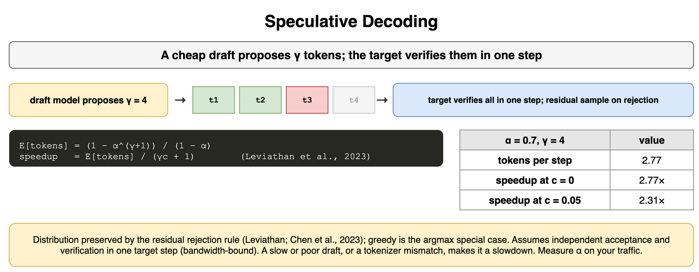

*Source: [`diagrams/inference-optimization.drawio`](/content/10_AI_Engineering/09_Inference_Optimization/diagrams/inference-optimization.drawio), page 16.*

## Medusa, lookahead, and prompt lookup

Medusa, lookahead decoding, and prompt lookup propose several future tokens without a second full language model.

They avoid loading, versioning, and tokenizer-matching a separate draft checkpoint. Medusa (Cai et al., 2024) adds small heads on the target's last hidden state, each predicting a further token, and verifies a candidate tree in one pass while sharing the target weights. Its acceptance rule determines whether samples match ordinary decoding: speculative sampling's residual draw preserves the distribution, while typical acceptance can raise acceptance and slightly shift it, so read the rule before promising identity. Lookahead decoding (Fu et al., 2024) adds no heads; it collects n-grams from the model's Jacobi-style trajectory, proposes several, and verifies them, and greedy verification keeps the greedy string. Prompt lookup trains nothing. It searches the prompt and sometimes generated text for a span ending with the current tokens, proposes what followed, and lets the target verify. Hugging Face Transformers and vLLM ship prompt-lookup or n-gram paths.

| Method | Where the proposal comes from | What you add at serve time | Distribution |
| --- | --- | --- | --- |
| Speculative decoding | A smaller model with the same tokenizer | The draft weights, and one verification step | Preserved when the residual rejection rule is used |
| Medusa | Extra heads on the target | Those heads, and a tree verification | Depends on the acceptance rule |
| Lookahead decoding | n-grams from the same model's trajectory | A small n-gram pool, no second model | Greedy verification keeps the greedy string |
| Prompt lookup | A matching span in the prompt or the output so far | A string search, no extra weights | The target still verifies the proposal |

The speculative-decoding formula still describes verification; c and α change. Prompt lookup has tiny c and terrible α when nothing repeats. It shines when the answer quotes the source, such as a RAG snippet, a code edit repeating the buffer, or a fixed template middle, and is weak for open-ended chat or brainstorming, where misses pay a verification step for one token. Medusa's c is its heads' cost, small beside a 70B target but not zero, and the heads must be trained. Lookahead depends on n-grams the trajectory actually produced. None removes prefill or shrinks the KV cache. Running two methods at once makes token provenance hard to debug.

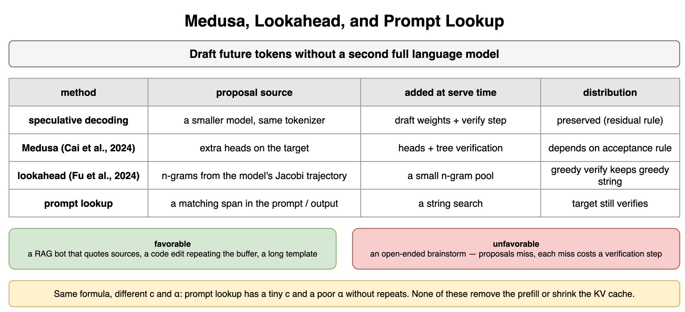

*Source: [`diagrams/inference-optimization.drawio`](/content/10_AI_Engineering/09_Inference_Optimization/diagrams/inference-optimization.drawio), page 17.*

## KV cache size

The KV cache is the stored keys and values for the tokens a request has already processed, and its size is fixed once you name the attention shape, the dtype, and the length.

The Attention, the KV cache, and context card in [Understanding Foundation Models](../02_Understanding_Foundation_Models/) gives the formula: 2 tensors × layers × key-value heads × head dimension × bytes per number × tokens, where tokens are prompt plus generated tokens so far. The Inference memory card in [Finetuning](../07_Finetuning/) applies it to Llama 2 7B (32 KV heads, 512 KiB per token). This card uses the released Llama 3 8B shape: 32 layers, hidden 4,096, intermediate 14,336, 32 query heads, 8 KV heads, head dimension 128, vocabulary 128,256, and untied embeddings. That is 8,030,261,248 parameters, 14.96 GiB in BF16. Each token adds `2 × 32 × 8 × 128 × 2 = 131,072` bytes (128 KiB), a quarter of Llama 2 7B because it has a quarter as many KV heads. Llama 3's original 8,192-token context is exactly 1 GiB; Llama 3.1's 128k context (131,072 tokens) is 16 GiB.

One 131,072-token request plus BF16 weights is 30.96 GiB, fitting an 80 GiB H100 SXM5 before activations. Four are 78.96 GiB, with almost no room for activations or fragmentation, and five are 94.96 GiB and do not fit. Weights are paid once and cache per live request. Llama 3.1 keeps this attention shape and permits longer allocations without changing per-token cost. The 70B shape (Understanding Foundation Models) is 320 KiB per token: 1.25 GiB at 4,096, 40 GiB at 131,072, and 131.4 GiB of BF16 weights that miss one 80 GiB GPU. A 1-byte cache halves these bytes before scales and adds measurable error (next card). Grouped-query attention is why 16 GiB is the planning number; 32 KV heads would be 64 GiB (the card after). Longer context scales cache linearly, and concurrency multiplies cache without multiplying weights. Paging removes reserved-length waste but does not shrink a live 16 GiB cache. Planning from 14.96 GiB alone is how one demo fits and four long sessions do not.

```python
def llama3_8b_params() -> int:
    layers, hidden, intermediate, vocab = 32, 4096, 14336, 128_256
    kv_width = 8 * 128
    per_layer = (
        hidden * hidden
        + hidden * kv_width
        + hidden * kv_width
        + hidden * hidden
        + 3 * hidden * intermediate
        + 2 * hidden
    )
    return layers * per_layer + hidden + 2 * vocab * hidden


PARAMS = llama3_8b_params()
PER_TOKEN = 2 * 32 * 8 * 128 * 2
print(PARAMS)
print(PER_TOKEN, PER_TOKEN // 1024)
print(8192, PER_TOKEN * 8192 // 1024**3)
print(131_072, PER_TOKEN * 131_072 // 1024**3)
weights = PARAMS * 2 / 1024**3
print(f"{weights:.2f}")
print(f"{weights + 16:.2f}")
print(f"{weights + 4 * 16:.2f}")
print(f"{weights + 5 * 16:.2f}")
# 8030261248
# 131072 128
# 8192 1
# 131072 16
# 14.96
# 30.96
# 78.96
# 94.96
```

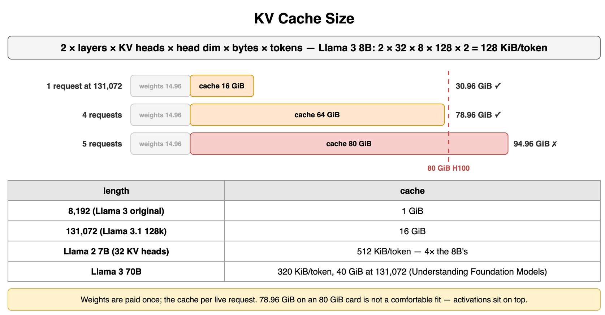

*Source: [`diagrams/inference-optimization.drawio`](/content/10_AI_Engineering/09_Inference_Optimization/diagrams/inference-optimization.drawio), page 18.*

## KV cache quantization and offloading

KV cache quantization stores keys and values in fewer bytes. KV cache offloading keeps those bytes in host memory and reads them back over the bus for each new token.

Llama 3 8B's 128 KiB per token is BF16. One-byte storage before scales is 64 KiB, so 131,072 tokens fall from 16 GiB to 8 GiB, and four such requests with BF16 weights fall from 78.96 to 46.96 GiB before activations. Per-tensor or per-channel scales add a little. vLLM and TensorRT-LLM have FP8 cache paths; KIVI is a published 2-bit method and KVQuant a published low-bit method, which is why lower-bit caches remain papers rather than default flags. Measure quality on the task slice, as Finetuning does for INT4 weights. Keys and values are not weights, so a recipe fine for the checkpoint can still move the token when applied to the cache.

Offloading keeps the cache full-width on the host and pulls live keys and values across PCIe every decode step. At the memory card's 64 GB/s one-way ceiling, an 8,192-token BF16 cache (1 GiB) takes 16.8 ms per token before weights, and a 131,072-token cache (16 GiB) takes 268.4 ms. The weight-offload roof stays 4.0 tokens/s regardless of prompt length; cache-offload cost grows with length. FlexGen (Sheng et al.) offloads weights and cache to CPU and disk, and vLLM can offload cache to CPU. Both let a non-fitting model answer, but not at interactive token rates for long caches. Quantizing and then offloading stacks error and bus cost. Keeping the cache in HBM and shortening context preserves the 4.79 ms weight roof. Paging neither shrinks a live token nor moves it to the host.

```python
PER_TOKEN_BF16 = 2 * 32 * 8 * 128 * 2
PER_TOKEN_BYTE = PER_TOKEN_BF16 // 2
ONE_WAY = 64e9
print(PER_TOKEN_BF16 // 1024, PER_TOKEN_BYTE // 1024)
print(f"{131_072 * PER_TOKEN_BF16 / 1024**3:.0f}")
print(f"{131_072 * PER_TOKEN_BYTE / 1024**3:.0f}")
print(f"{14.96 + 4 * 8:.2f}")
print(f"{PER_TOKEN_BF16 * 8192 / ONE_WAY * 1e3:.1f}")
print(f"{16 * 1024**3 / ONE_WAY * 1e3:.1f}")
# 128 64
# 16
# 8
# 46.96
# 16.8
# 268.4
```

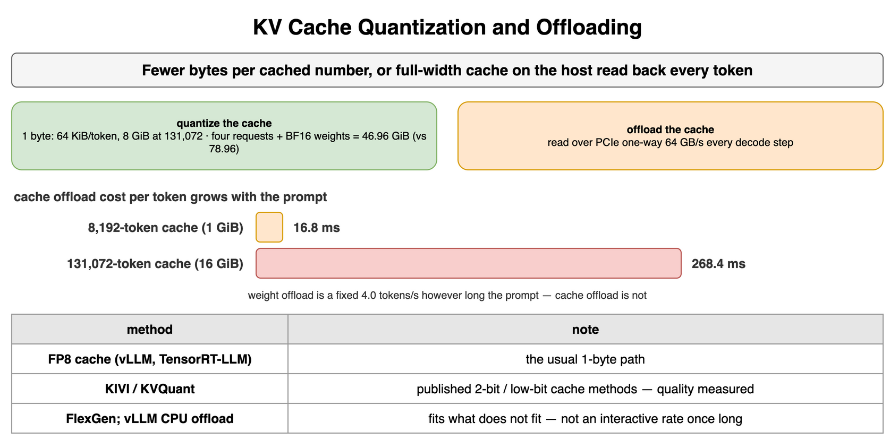

*Source: [`diagrams/inference-optimization.drawio`](/content/10_AI_Engineering/09_Inference_Optimization/diagrams/inference-optimization.drawio), page 19.*

## Multi-query, grouped-query, and sliding-window attention

Multi-query, grouped-query, and sliding-window attention shrink the keys and values a new token has to read.

Multi-head attention gives each query head its own key and value. Multi-query attention (Shazeer, 2019) shares one key-value head across all query heads. Grouped-query attention (Ainslie et al., 2023) shares one per group. PaLM used multi-query; Llama 2 uses grouped-query at 70B and multi-head at 7B and 13B; Llama 3 uses 8 KV heads at 8B, 70B, and 405B. The Attention, the KV cache, and context card in [Understanding Foundation Models](../02_Understanding_Foundation_Models/) shows 8 rather than 64 KV heads makes the 70B's 131,072-token cache 40 GiB instead of 320 GiB. On 8B, 32 KV heads would be 512 KiB per token versus 128 KiB: 64 GiB versus 16 GiB at 131,072. Fewer KV heads cut bytes and distinct key-value patterns; multi-query is the smallest cache and largest quality question, while grouped-query is Llama 3's compromise. Cross-layer attention (Brandon et al., NeurIPS 2024) instead computes key and value projections in only some layers and lets later layers in a group reuse them. CLA2 stores about half the KV cache and is orthogonal to MQA and GQA. In their 1B and 3B from-scratch training, CLA2 changed perplexity little, sometimes improved it, and beat sharing factors 3 or 4 at the same cache size. It is a training-time architecture, not a switch for a Llama checkpoint, and reused keys deny a layer its own view of tokens, so score long-context tasks after the cache math.

A sliding window changes which keys are live. Mistral 7B uses a 4,096-token window with 32 layers, 8 KV heads, and head dimension 128, the same 128 KiB per token if the whole sequence were stored. A rolling window cache is 0.5 GiB: half the 1 GiB full cache at 8,192 tokens and one-eighth the 4 GiB full cache at 32,768. Each layer attends within the window, but layers can carry summaries forward, so 32 layers reach beyond 4,096 tokens. A token outside the window still cannot be directly quoted from that layer, the failure when a long contract's clause falls out of the window. Full attention can quote it and pays 16 GiB, or 40 GiB on 70B. Quantizing an already grouped cache is a further cut requiring another measurement.

```python
FULL = 2 * 32 * 32 * 128 * 2
GROUPED = 2 * 32 * 8 * 128 * 2
print(FULL // 1024, GROUPED // 1024, FULL // GROUPED)
print(f"{131_072 * FULL / 1024**3:.0f}")
print(f"{131_072 * GROUPED / 1024**3:.0f}")
# 512 128 4
# 64
# 16
```

```python
PER_TOKEN = 128 * 1024
print(f"{4096 * PER_TOKEN / 1024**3:.1f}")
print(f"{8192 * PER_TOKEN / 1024**3:.1f}")
print(f"{32768 * PER_TOKEN / 1024**3:.1f}")
# 0.5
# 1.0
# 4.0
```

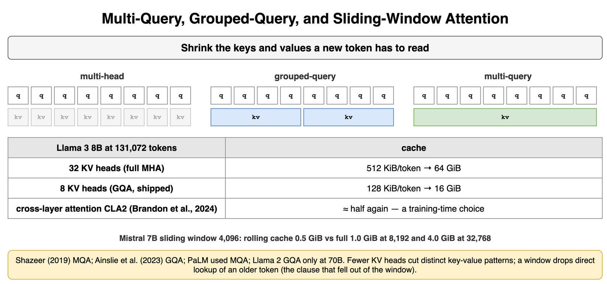

*Source: [`diagrams/inference-optimization.drawio`](/content/10_AI_Engineering/09_Inference_Optimization/diagrams/inference-optimization.drawio), page 20.*

## FlashAttention

FlashAttention is an attention kernel that computes the weighted sum in on-chip tiles and does not write the score matrix out to HBM.

Dao et al. published it in 2022, followed by Dao's FlashAttention-2 (2023) and Shah et al.'s FlashAttention-3 (2024), which targets Hopper FP8 tensor cores and asynchronous copies; FlashAttention-3's FP8 path is not an A100 flag. As the Attention, the KV cache, and context card in [Understanding Foundation Models](../02_Understanding_Foundation_Models/) says, it speeds attention up to small numerical differences without deleting the decode cache. The savings are the score matrix. One BF16 head at 8,192 tokens has `8192 × 8192 × 2` bytes of scores, 128 MiB, versus 6 MiB of Q, K, and V, or 21.3×; materializing 32 heads together would take 4 GiB. A naive kernel writes scores, rereads them for softmax, and rereads them for values. FlashAttention keeps a tile, updates softmax statistics, and never stores the matrix.

Long prefill is where the score matrix dominates. Batch-1 decode attends one query to stored keys, so the score row is short and the weight read remains the roof; FlashAttention does not move 208.6 tokens/s. The 1 GiB Llama 3 8B cache at 8,192 tokens remains allocated: FlashAttention changes prefill traffic, not decode's resident state. A memory plan that deletes 16 GiB because "we enabled FlashAttention" is wrong. PagedAttention, next, allocates that resident state and is a different paper and feature. Small numerical differences mean two prefills are not necessarily identical, so rerun a strict exact-match slice after changing kernels. General fused kernels are the kernels card; this card is the score matrix.

```python
SEQ = 8192
HEAD = 128
scores = SEQ * SEQ * 2
qkv = 3 * SEQ * HEAD * 2
print(scores // 1024**2, qkv // 1024**2)
print(f"{scores / qkv:.1f}")
print(32 * scores // 1024**3)
# 128 6
# 21.3
# 4
```

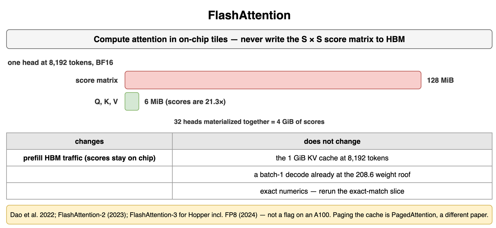

*Source: [`diagrams/inference-optimization.drawio`](/content/10_AI_Engineering/09_Inference_Optimization/diagrams/inference-optimization.drawio), page 21.*

## PagedAttention

PagedAttention is a KV-cache allocator that stores each request's keys and values in fixed-size blocks so a request does not reserve its maximum length up front.

Kwon et al. published it in 2023 as vLLM's allocator. Reserving every request's maximum context fragments HBM like giving every process its peak heap. With Llama 3 8B, ten requests reserved at 8,192 tokens but using 1,024 hold 10.00 GiB of reservations and 1.25 GiB of real tokens; the remaining 8.75 GiB is empty yet unavailable to an eleventh request. Fixed blocks, commonly 16 tokens in vLLM, make empty regions reusable. Live tokens still cost 128 KiB each in BF16, and the last partial block wastes up to 15 tokens. Paging recovers fragmentation; it is not quantization, FlashAttention, or fewer attention heads. A one-token page creates excessive bookkeeping, while a huge page brings the waste back.

FlashAttention is the prefill kernel that keeps scores on chip; PagedAttention is the allocator for many different-length decodes sharing a GPU. They stack. Neither raises datasheet HBM bandwidth, so a step at the weight roof stays there, and a live 16 GiB cache at 131,072 tokens remains 16 GiB after paging. Host cache offload is the previous quantization-and-offloading card, not a page size.

```python
PER_TOKEN = 131_072
print(f"{10 * 8192 * PER_TOKEN / 1024**3:.2f}")
print(f"{10 * 1024 * PER_TOKEN / 1024**3:.2f}")
print(f"{(10 * 8192 - 10 * 1024) * PER_TOKEN / 1024**3:.2f}")
# 10.00
# 1.25
# 8.75
```

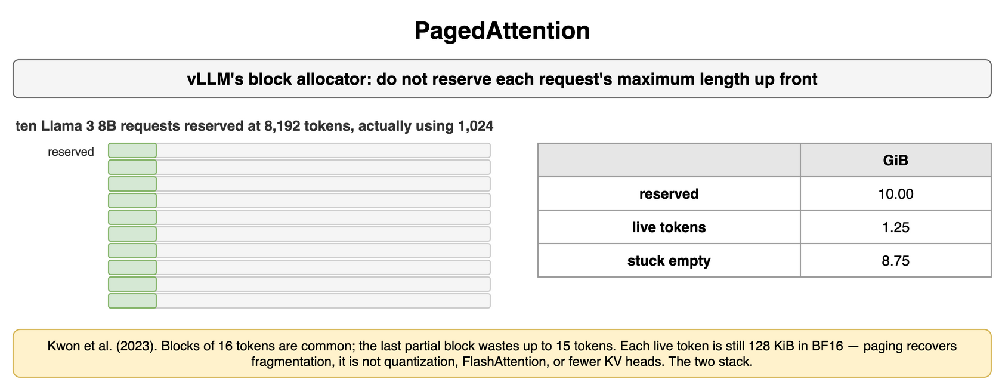

*Source: [`diagrams/inference-optimization.drawio`](/content/10_AI_Engineering/09_Inference_Optimization/diagrams/inference-optimization.drawio), page 22.*

## Kernels and compilers

A kernel is the program that runs one operation on the accelerator. A compiler chooses kernels and fuses them so intermediate values stay on chip instead of taking a trip to HBM.

Each separate kernel that writes an activation pays HBM bandwidth and a launch. A Llama-style feed-forward applies two projections and a SiLU gate. Unfused, each projection reads the 4,096-wide hidden state and writes a 14,336-wide activation, and the epilogue reads both activations and writes their product: 159,744 bytes of activation traffic. A fused kernel reads the hidden state once and writes the product: 36,864 bytes. That is 4.33× less activation traffic and 120 KiB saved, but one BF16 gate weight is 112 MiB, so batch-1 decode is still dominated by weights and the 208.6-token roof does not move. Fusion matters when launch overhead dominates a chain of tiny kernels, or when large batches make activations significant. A profile showing the GPU waiting between kernels argues for fusion; one showing HBM full of weight reads argues for a smaller checkpoint or larger batch, not another epilogue fuse or an expected 4.33× end-to-end gain.

PyTorch `torch.compile` traces the model and by default passes the graph to Inductor, which emits fused kernels, often via Triton. Triton, from OpenAI, is the language for custom tiles without raw CUDA. TensorRT-LLM is NVIDIA's serving stack of fused attention and GEMM kernels plus a runtime; CUTLASS underlies many GEMMs. vLLM ships its own CUDA and Triton kernels, including paged attention and FlashAttention. `torch.compile` is the cheapest fusion but can fail or slow down on data-dependent Python. TensorRT-LLM is fast on supported models and is another engine with its own gaps. A hand-written Triton kernel can win the measured op and be slower or wrong on untested shapes, so justify it with a profile showing a missed fusion or a layout such as paged KV blocks that a generic graph would not invent. Fusing everything makes profiles hard to attribute. Compiler changes slightly alter numerics, so rerun the exact-match task slice.

```python
HIDDEN = 4096
INTERMEDIATE = 14336
unfused = 2 * (2 * HIDDEN + 2 * INTERMEDIATE)
unfused += 2 * INTERMEDIATE + 2 * INTERMEDIATE + 2 * INTERMEDIATE
fused = 2 * HIDDEN + 2 * INTERMEDIATE
print(unfused, fused, f"{unfused / fused:.2f}")
print((unfused - fused) // 1024)
print(HIDDEN * INTERMEDIATE * 2 // 1024**2)
# 159744 36864 4.33
# 120
# 112
```

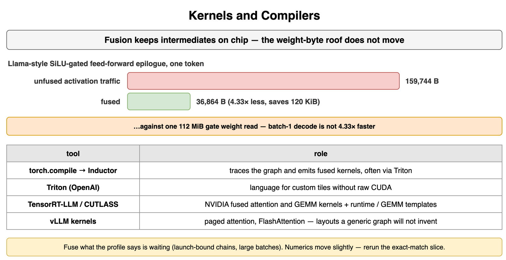

*Source: [`diagrams/inference-optimization.drawio`](/content/10_AI_Engineering/09_Inference_Optimization/diagrams/inference-optimization.drawio), page 23.*

## The cost of structured outputs

The serving cost of a structured output is the extra work that keeps each token inside a schema, on top of the ordinary prefill and decode.

[Understanding Foundation Models](../02_Understanding_Foundation_Models/) owns the four ways to get a parseable object and the three often-confused contracts. OpenAI's JSON mode promises JSON, not your schema; a schema mask refuses illegal tokens; a tool call returns a name and arguments your code may refuse. This card is the mask's time cost. Outlines, XGrammar (Dong et al., 2024), and llguidance compile a grammar or JSON schema into a tokenizer mask, which vLLM can apply during decode by rejecting forbidden ids each token. Grammar compilation is a TTFT cost, paid before or beside prefill and larger for big schemas. Per-token masking is a TPOT cost and can dominate a Llama 3 8B H100 SXM5 step whose weight roof is 4.79 ms. Speculative decoding must also obey the mask, so a grammar-rejected draft is rejected even if the target would accept it, lowering α for reasons unrelated to draft quality. XGrammar argues masks can use much less CPU than a naive vocabulary scan, but quote speedups measured on your engine.

Unless a current rate card says so, providers billing output tokens do not add a mask meter. You pay in TTFT for compilation, TPOT for slow masks, and lower speculative speedup for out-of-grammar drafts. A receipt reader returning `{"total": 12.50}` and a ChatGPT, Claude, or Gemini tool call are the same serving problem once the sampler enforces the schema. A mask removes illegal syntax and can force a valid empty object when the model meant to refuse. Turning speculation off avoids illegal drafts and loses its speedup. JSON mode without a schema is cheaper on the sampler and still needs a parser. Finetuning the shape spends training instead of a per-token mask and does not guarantee the schema after the next change. Keep the parser that checks the total against the receipt, ordinary CPU after the last token, because a schema-valid object can still be wrong. Measure the same prompt with and without the schema before blaming the model.

```text
grammar compile   -> TTFT
per-token mask    -> TPOT (vs a 4.79 ms weight roof)
rejected drafts   -> lower speculative α
token price       -> unchanged unless the rate card says otherwise
value check       -> the parser still runs
```

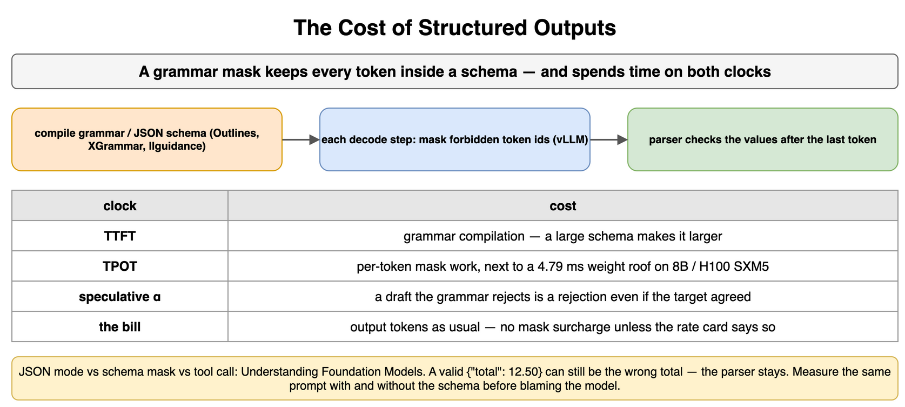

*Source: [`diagrams/inference-optimization.drawio`](/content/10_AI_Engineering/09_Inference_Optimization/diagrams/inference-optimization.drawio), page 24.*

## Static, dynamic, and continuous batching

Batching groups requests so the weights loaded for one step are reused across several of them.

A single decode moves the whole model through HBM for one token. A batch of B tokens reuses those weights, increasing aggregate tokens/s until the step becomes compute-bound, at the cost of each request waiting on others. Static batching waits for a fixed count, pads to a common length, and runs until the longest finishes. Decode lengths 40, 80, 120, and 400 occupy `400 × 4 = 1,600` slots for 640 useful tokens (0.40). Prefills of 128, 256, 1,024, and 4,096 padded to 4,096 use 5,504 of 16,384 positions (0.336). Short requests wait for the long one, which throughput graphs like and TTFT and tail ITL do not. Static batching suits overnight batch APIs, not chat, and the waste grows with length spread; padding to round numbers bills non-token positions.

Dynamic batching launches when full or when a timeout fires. Choose the timeout from the TTFT budget: too long spends the budget filling the GPU, too short returns to the one-request roof. Continuous batching, introduced as iteration-level scheduling by Orca (Yu et al., OSDI 2022), admits and retires requests between tokens. A 40-token request leaves at token 40 and its slot takes new work. vLLM and TensorRT-LLM ("in-flight batching") schedule this way, and vLLM pairs it with paged KV blocks so arrivals need no contiguous reservation. It still lets a new prefill, a long compute-bound chunk, stall every ITL in the batch; chunked prefill and disaggregation (next card) address that. A batch size chosen for MFU rather than the latency SLO is the goodput failure, so ask for TTFT and TPOT caps before praising throughput.

```python
DECODE = (40, 80, 120, 400)
PREFILL = (128, 256, 1024, 4096)
print(sum(DECODE), max(DECODE) * len(DECODE), f"{sum(DECODE) / (max(DECODE) * len(DECODE)):.2f}")
print(sum(PREFILL), max(PREFILL) * len(PREFILL), f"{sum(PREFILL) / (max(PREFILL) * len(PREFILL)):.3f}")
# 640 1600 0.40
# 5504 16384 0.336
```

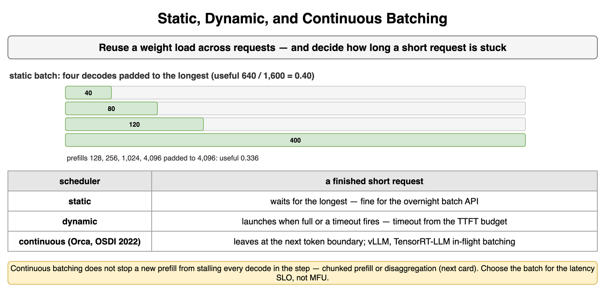

*Source: [`diagrams/inference-optimization.drawio`](/content/10_AI_Engineering/09_Inference_Optimization/diagrams/inference-optimization.drawio), page 25.*

## Disaggregated prefill and decode

Disaggregated prefill and decode run the two phases on separate accelerator pools so a long prompt does not stall token generation.

Colocation is the default: one GPU or tensor-parallel group prefills and then decodes, with continuous batching mixing steps. The phases want different machines. Prefill is compute-bound and likes high FLOP peaks; decode is bandwidth-bound and likes HBM bandwidth and many short steps. On Llama 3 8B, the `2N` forward model at H100 SXM5's 989.4 TFLOPS takes 33.2 ms to prefill 2,048 tokens, while a weight-only decode step at 3.35 TB/s takes 4.79 ms. An inline prefill gives every colocated decode a gap near the prefill time, failing a 20 ms TPOT or ITL cap even if the average over a quiet period looks fine. Real prefill is slower because MFU is not 100% and attention adds work, so 33.2 ms is already a best case above 20 ms. It is a roof for one model and length, not a DistServe speedup. Goodput notices this interference; throughput hides it.

DistServe (Zhong et al.) puts prefill and decode on separate GPUs and sizes pools for goodput under TTFT and TPOT caps. Splitwise (Patel et al.) splits the same phases and can place them on different GPU types, so compute-heavy and bandwidth-heavy work need not rent the same SKU. Chunked prefill, as in Sarathi-Serve (Agrawal et al., OSDI 2024), keeps one pool and slices prompts so decodes regain the GPU within their gap budget, trading scheduler complexity for a second pool but only shrinking the stall. Disaggregation transfers the prompt's KV cache to decode workers; on this 8B shape a 2,048-token cache is 0.25 GiB. NVLink makes that comfortable within a node; slow Ethernet can replace a prefill stall with a network stall. Separate pools also idle when the mix shifts, wasting decode GPUs in a prefill-heavy hour and vice versa.

```python
PARAMS = 8_030_261_248
PREFILL_MS = 2048 * 2 * PARAMS / 989.4e12 * 1e3
DECODE_MS = (PARAMS * 2) / 3.35e12 * 1e3
SLO_MS = 20
print(f"{PREFILL_MS:.1f}")
print(f"{DECODE_MS:.2f}")
print(PREFILL_MS > SLO_MS > DECODE_MS)
# 33.2
# 4.79
# True
```

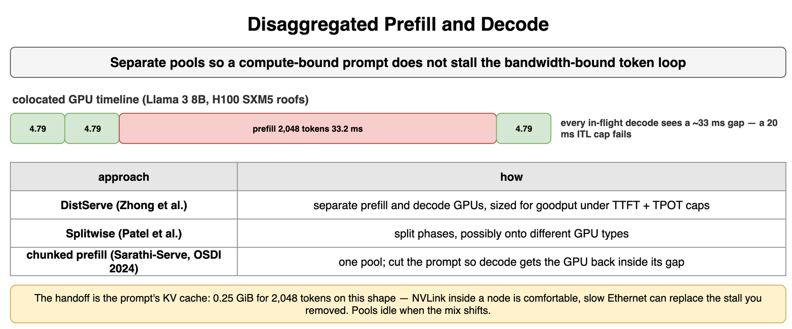

*Source: [`diagrams/inference-optimization.drawio`](/content/10_AI_Engineering/09_Inference_Optimization/diagrams/inference-optimization.drawio), page 26.*

## Prompt caching

Prompt caching stores the KV cache of a repeated prefix and reuses it on the next request that begins with that same prefix.

Prefill is the expensive read of a long system prompt, tool list, or book you ask several questions about. If the next request starts with the same tokens, their keys and values are already on the server and prefill can skip them. The product rule is on the Context length and context efficiency card in [Prompt Engineering](../05_Prompt_Engineering/): the cached part is a prefix, and editing the first token makes the rest miss. Implicit caching can apply automatically to an identical long prefix. Explicit caching writes only at a marked breakpoint, and no breakpoint writes nothing. Either shape has a minimum prefix, often around a thousand tokens, and may count cached tokens in blocks. TTLs are a short default of minutes or a paid longer retention. As checked 12 Nov 2026 (check provider docs), a typical short-lived write is about 1.25× uncached input, a longer TTL about 2–2.5×, and a typical read about 0.1×, with some models cheaper; the write rate replaces input for those tokens. The multipliers will move; the prefix rule will not.

On Llama 3 8B, a 4,096-token prefix is exactly 0.50 GiB of BF16 cache. At exercise rates of $1.25 per million input, $5.00 per million output, and a $0.125 read (one tenth of input, not a quote), one million calls with that prefix, a 512-token question, and 250 output tokens cost $7,010 uncached and $2,402 cached. The $4,608 saving is the prefix tokens times the input-read gap; the question and output are paid in full. Putting the question before the system prompt or editing its first line makes every call miss and returns to $7,010. A write priced above normal input loses money on a one-use prefix, because the provider still prefilled it and the discount comes only from later hits within the lifetime. Cache a stable tool list before a changing user message, not a prefix that changes every call. Self-hosted vLLM and TensorRT-LLM can keep prefix KV blocks resident, paying HBM for 0.50 GiB per distinct prefix instead of a provider write premium; a thousand system prompts are a thousand copies. A long TTL can keep a stale policy prompt after you thought you shipped a new one. Implicit caching can miss when middleware rewrites the first tokens, and explicit breakpoints are easy to omit from the prompt that most needed one.

```python
CALLS = 1_000_000
PREFIX, FRESH, OUTPUT = 4_096, 512, 250
INPUT_RATE, OUTPUT_RATE, READ_RATE = 1.25, 5.00, 0.125
PER_TOKEN = 2 * 32 * 8 * 128 * 2


def dollars(prefix_rate: float) -> float:
    prefix_cost = CALLS * PREFIX / 1_000_000 * prefix_rate
    fresh_cost = CALLS * FRESH / 1_000_000 * INPUT_RATE
    output_cost = CALLS * OUTPUT / 1_000_000 * OUTPUT_RATE
    return prefix_cost + fresh_cost + output_cost


print(f"{dollars(INPUT_RATE):.0f}")
print(f"{dollars(READ_RATE):.0f}")
print(f"{dollars(INPUT_RATE) - dollars(READ_RATE):.0f}")
print(f"{PREFIX * PER_TOKEN / 1024**3:.2f}")
# 7010
# 2402
# 4608
# 0.50
```

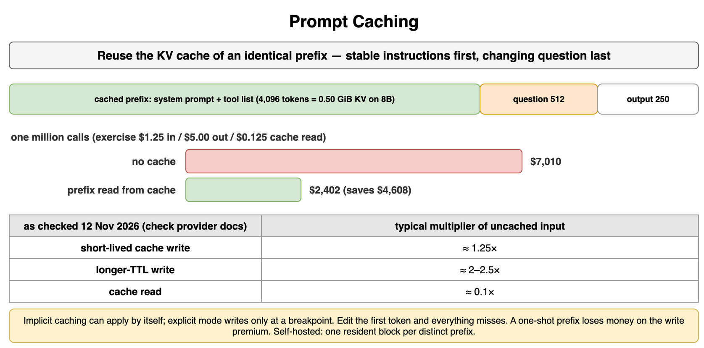

*Source: [`diagrams/inference-optimization.drawio`](/content/10_AI_Engineering/09_Inference_Optimization/diagrams/inference-optimization.drawio), page 27.*

## Replica parallelism

Replica parallelism serves several full copies of one model and sends each request to one copy.

Data-parallel training also puts a full weight copy on each GPU, then all-reduces gradients; inference replicas do not synchronize. A router in front of several vLLM or TensorRT-LLM processes, each holding Llama 3 8B, follows this pattern. Four fairly routed copies can finish about four times the requests if GPUs are not already full, but one Copilot suggestion is no faster because it still runs on one copy. Bytes per replica do not shrink: four H100 SXM5 GPUs do not let a replica hold the 131.4 GiB BF16 Llama 3 70B, which is the tensor-parallelism card's problem. Use replicas when the model fits and the queue is the bottleneck, not when one request does not fit.

Prompt caching cares where a request lands, because a prefix's KV state lives on the GPU that computed it. Random routing for the next turn misses the cache and pays prefill again while filling GPUs. Sticky routing keeps the cache and can unbalance the queue, leaving other replicas idle and still drawing power (the power card). Throughput scales with copies; single-request latency does not, and the bill includes idle copies. Quantizing a 70B to fit one GPU and then replicating combines the quantization card's trade with this one, and every replica of the 14.3 GiB INT8 spare in Understanding Foundation Models must still hold its cache.

```text
replica         full copy, no all-reduce, one request -> one copy
scales          throughput, not one request's latency, not fit
routing         sticky keeps the prefix cache; random balances the queue
```

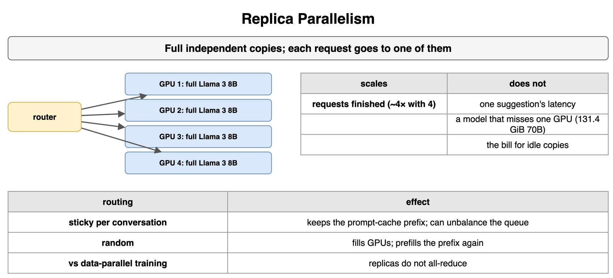

*Source: [`diagrams/inference-optimization.drawio`](/content/10_AI_Engineering/09_Inference_Optimization/diagrams/inference-optimization.drawio), page 28.*

## Tensor parallelism

Tensor parallelism splits each layer's matrices across accelerators so every token uses every GPU in the group.

This is the Megatron pattern, with a collective ending each layer. One token's collective payload is the hidden state: Llama 3 70B's 8,192-wide BF16 activation is 16,384 bytes (16 KiB). NVIDIA lists 900 GB/s of H100 SXM NVLink as a bidirectional aggregate. The bandwidth term is 0.018 µs at 900 GB/s and 0.036 µs at half, both far below collective latency, which this arithmetic omits. Across PCIe or Ethernet, latency worsens and dominates once per layer, so keep the group on NVLink inside one node. Copilot-style inline suggestions want this split when one GPU cannot hold the model or meet the token gap. The drills' four-GPU timing is an exercise tax on top, not this 0.018.

Fit comes first. From [Understanding Foundation Models](../02_Understanding_Foundation_Models/), Llama 3 70B's BF16 weights are 131.4 GiB and miss one 80 GiB GPU. Two H100 SXM5s hold 160 GiB, leaving 28.6 GiB before runtime and fragmentation. If all were KV cache at 320 KiB per token, it would hold 93,716 tokens, but one 131,072-token request needs 40 GiB and does not fit. INT8 weights at 65.7 GiB leave 14.3 GiB on one GPU, a short-context spare. Tensor parallelism gives BF16 weights a home without creating a 40 GiB cache hole; replicas would need 131.4 GiB on each GPU and do not help. It can cut single-request latency when collective latency is below the split's benefit. Pipeline parallelism avoids per-layer collectives at the cost of a bubble.

```python
payload = 8192 * 2
print(payload)
print(f"{payload / 900e9 * 1e6:.3f}")
print(f"{payload / 450e9 * 1e6:.3f}")
# 16384
# 0.018
# 0.036
```

```python
WEIGHT_GIB = 131.4
PER_TOKEN = 327_680
spare = 160 - WEIGHT_GIB
print(f"{spare:.1f}")
print(round(spare * 1024**3 / PER_TOKEN))
print(f"{131_072 * PER_TOKEN / 1024**3:.0f}")
# 28.6
# 93716
# 40
```

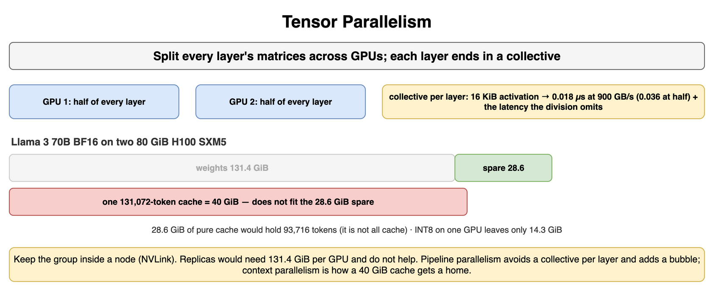

*Source: [`diagrams/inference-optimization.drawio`](/content/10_AI_Engineering/09_Inference_Optimization/diagrams/inference-optimization.drawio), page 29.*

## Pipeline parallelism

Pipeline parallelism assigns consecutive layers to different accelerators, and a token walks those stages in order.

One request has nothing to overlap: latency is the stages plus sends, and other GPUs sit idle while one stage works. With P stages and M microbatches, idle pipeline slots are `(P − 1) / (M + P − 1)`: 0.43 for four stages and four microbatches, 0.086 for four stages and 32. A chat request cannot supply 32 independent microbatches and pays the bubble; a saturated overnight batch can hide it. Copilot-style inline suggestions therefore want tensor parallelism, while full batch jobs can fill a pipeline. The stage-to-stage activation is small beside the weights; a lonely request feels the stages adding up, not the activation's width.

The same 70B can be staged instead of tensor-split, with each GPU holding some layers so weights fit when one GPU cannot. A single suggestion still waits for every stage; the drills time four H100s and do not recompute the bubble. Each layer's KV cache stays on its stage, so long context is split with layers rather than replicated, but it still must be counted. A deeper pipeline lowers weights per GPU and lengthens the bubble at small M. Microbatching hides the bubble and delays the first microbatch, a TTFT cost. Tensor parallelism pays a collective per layer and keeps one token moving on all GPUs.

```python
print(f"{(4 - 1) / (4 + 4 - 1):.2f}")
print(f"{(4 - 1) / (32 + 4 - 1):.3f}")
# 0.43
# 0.086
```

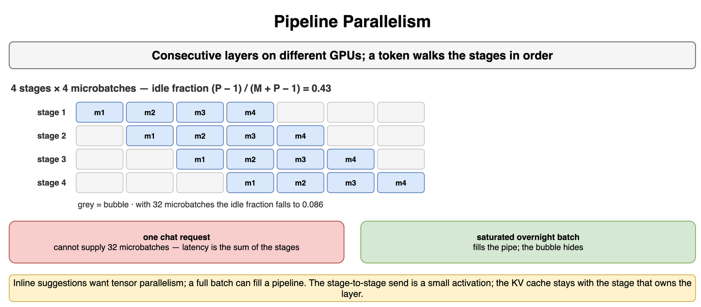

*Source: [`diagrams/inference-optimization.drawio`](/content/10_AI_Engineering/09_Inference_Optimization/diagrams/inference-optimization.drawio), page 30.*

## Context parallelism and sequence parallelism

Context parallelism and sequence parallelism both cut a sequence across GPUs, and they cut different tensors.

Context parallelism shards the sequence so attention itself is split. Ring attention (Liu, Zaharia, and Abbeel, 2023) passes key and value blocks around a ring. That gives a context longer than one GPU's cache a home, splitting the KV-cache card's 16 GiB on 8B or 40 GiB on 70B. Each GPU holds part of the keys and values and passes blocks onward; prefill can run at the cost of that pass. A short chat that already fits does not need it. It is the answer to the 40 GiB cache that missed the tensor-parallelism spare, rather than another replica.

Megatron sequence parallelism (Korthikanti et al., 2022) is different. With tensor parallelism on, it shards layer norms and dropout activations along the sequence dimension so they are not replicated on every GPU. It reduces activation memory in a tensor-parallel training or prefill step and does not by itself split attention across a long prompt. The name is the trap: "we turned on sequence parallelism" does not mean a 131,072-token cache was sharded. Confusing them either wastes a ring on a short chat or fails to fit the cache you thought you split. Replicas and tensor parallelism remain the tools when the unit of scale is requests or layers rather than sequence.

```text
context parallelism   shards the sequence's attention state (ring attention) -> fits a long cache
sequence parallelism  shards activations beside tensor parallelism (Megatron) -> saves activation memory
```

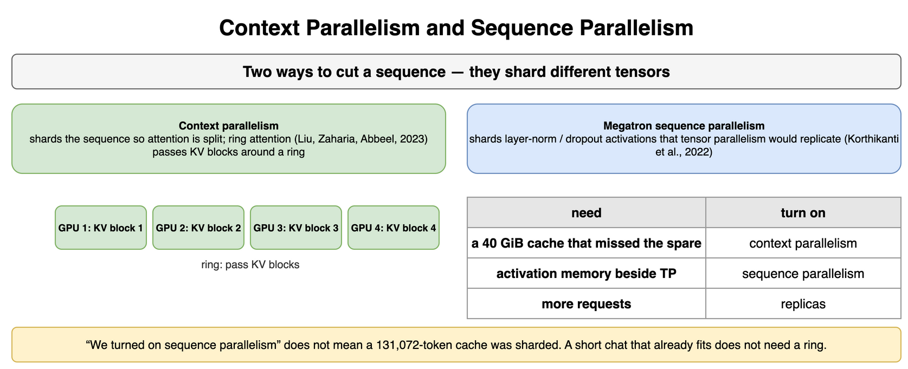

*Source: [`diagrams/inference-optimization.drawio`](/content/10_AI_Engineering/09_Inference_Optimization/diagrams/inference-optimization.drawio), page 31.*
