## The incremental architecture

The incremental architecture is the set of layers around one model call, added when a measured failure needs that layer.

A demo is a prompt and reply. A product decides what the model may see and emit, which model runs, what identical or near-identical questions can skip, which requests become tool loops, and how you notice the day answers change. Context comes first, because routing or caching cannot create a missing fact. Guardrails follow, because a fluent draft is not yet safe to show or act on. Routers and gateways arrive when one model, key, and provider are no longer enough; caches when the same work is repeatedly paid for; and an agent loop last, only for intents needing tools. Telemetry is not postponed: the first production call needs a log line, model id, and latency. It is covered after the path because it must name the path.

These layers sit in the application tier of the three-layer stack in [Introduction to Building AI Applications with Foundation Models](../01_Introduction_to_Building_AI_Applications_with_Foundation_Models/). The gateway, cache store, and trace pipeline are infrastructure the application configures. A finetune earned by feedback is the model tier, and its training file stays in [Dataset Engineering](../08_Dataset_Engineering/). KV-prefix prompt caching is a serving optimization under the call in [Inference Optimization](../09_Inference_Optimization/), not one of these boxes. Adding every layer on day one buys latency, vendors, and failure modes with no metric, while waiting until a refund reaches Stripe lets the incident write the design. A layer that cannot name the failure it removes is ceremony; a missing layer with an incident is the next change. The wrong return window with the policy in a help center is context, a card number in the log is an input guardrail, a small model on a hard ticket is the router, a second provider during an outage is the gateway, last week's policy answer is cache invalidation, and model-JSON refunds are the write gate on the Write tools card in [RAG and Agents](../06_RAG_and_Agents/).

| Layer | What it does on a request |
| --- | --- |
| Context | Retrieval, the user record, and the date put this request's facts into the prompt. |
| Guardrails | Input checks redact or block a bad request. Output checks hold a bad draft. |
| Router | The router sends an easy intent to a cheap path and a hard intent to a strong one. |
| Gateway | The gateway holds keys, limits, spend, and a provider fallback. |
| Response cache | An exact or semantic cache skips the model when a stored answer is safe to reuse. |
| Agent route | A tool loop runs only for intents that need it. A write stays a proposal. |
| Telemetry | Metrics, logs, and traces say whether the path you shipped is the path that ran. |

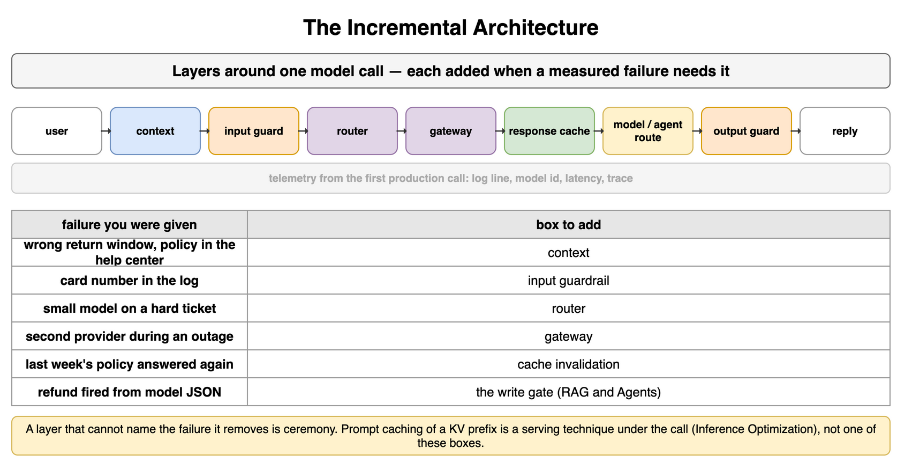

*Source: [`diagrams/ai-engineering-architecture.drawio`](/content/10_AI_Engineering/10_AI_Engineering_Architecture_and_User_Feedback/diagrams/ai-engineering-architecture.drawio), page 1.*

## Enhance context

Enhancing context means putting the facts this request depends on into the prompt the model will actually read.

The model does not see the help center, order system, or today's date unless the request contains them, which is the definition of a prompt in [Prompt Engineering](../05_Prompt_Engineering/). Most "the model is bad" support reports are a missing passage, order id, or date. This comes first because a router cannot classify a fact it was not given and a cache cannot store an answer the corpus does not support. Notion AI over a workspace, a Zendesk bot over a help center, Perplexity with citations, and a Gemini draft that sees the open Gmail thread are this step. Index, permissions, chunking, and citation checks stay in [RAG and Agents](../06_RAG_and_Agents/), and where facts must come from stays on the sufficient-context card. The architectural claim is to do that work before adding machinery around a blind call.

At the Context length and context efficiency card's $0.50 per million input tokens, a 2,400-token stable prefix costs $1,200 per million calls. A 1,200-token per-call policy page is half the tokens and $600. That buys showing the page, not proof it is right: it may be stale, permissioned for someone else, or carrying an instruction (index lag and indirect prompt injection on earlier cards). Enhancing context includes leaving out facts the caller may not see, such as another user's orders, a secret, or a page they cannot open. A short prompt is cheap and blind. Pasting the help center spends $600 several times over and recreates lost-in-the-middle, while retrieving a few passages can drop the exception. Putting the whole account in every prompt answers personal questions and leaks it into logs and possibly later caches. Unneeded context is cost, privacy surface, and distraction; needed context skipped is a wrong answer. Start from the wrong answer, name the absent fact, and retrieve it with the caller's permissions before changing models.

```python
CALLS = 1_000_000
PAGE_TOKENS = 1_200
INPUT_PER_M = 0.50
print(f"{CALLS * PAGE_TOKENS / 1_000_000 * INPUT_PER_M:.2f}")
# 600.00
```

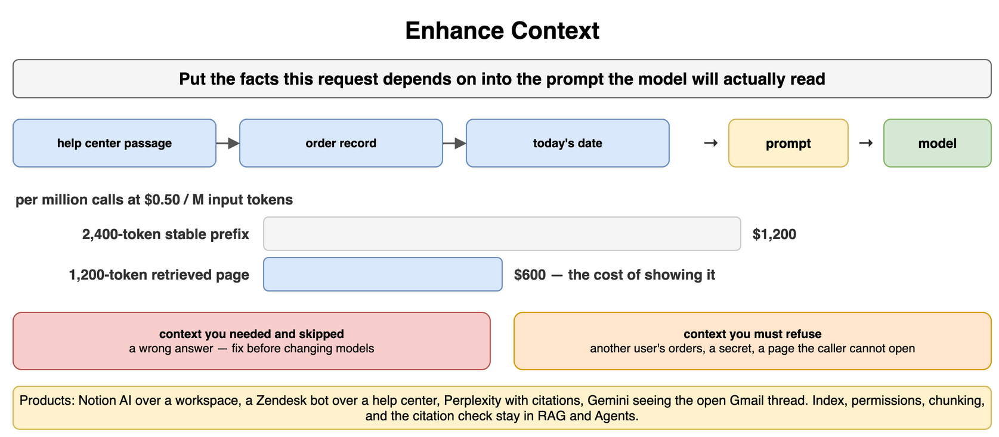

*Source: [`diagrams/ai-engineering-architecture.drawio`](/content/10_AI_Engineering/10_AI_Engineering_Architecture_and_User_Feedback/diagrams/ai-engineering-architecture.drawio), page 2.*

## Input guardrails

An input guardrail is a check on the request before the model is allowed to act on it.

Two failures get lumped together: private data you do not want in a provider request or log (email, phone, card number, national id), and an instruction you do not want followed (a jailbreak against the model's rules or prompt injection against your application prompt). Willison's split and the system-level defenses stay in [Prompt Engineering](../05_Prompt_Engineering/); this card places the checks on the request path. Microsoft Presidio is the open-source analyzer and anonymizer for private data, combining pattern and named-entity recognizers, and can replace, mask, or hash configured spans. A hand-written phone regex is the weak version, catching digits and missing spelled-out numbers (cleaning card in [Dataset Engineering](../08_Dataset_Engineering/)). Presidio misses whatever no recognizer covers, so sample what reached the model. Run the check before logging as well as before the provider; redacting the outbound prompt while tracing the raw one moves the leak into observability.

Injection and jailbreak checks are classifiers, not a system-prompt paragraph, and the safety card in [Evaluate AI Systems](../04_Evaluate_AI_Systems/) keeps category lists. Llama Guard is a generative hazard classifier for a prompt, response, or both; it is not an injection detector, and a new checkpoint is a new labeler. OpenAI's Moderation API is a hosted harm classifier, also not an injection detector. Prompt Guard is the small input classifier. Prompt Guard 2 scores benign or malicious with a published 512-token window, so long tickets must be segmented or their tails go unscored. NVIDIA NeMo Guardrails provides programmable input and output rails separate from the application prompt. Azure AI Content Safety separates harm and attack checks. Prompt Shields, formerly jailbreak risk detection, flags user-prompt attacks on instructions and document-hidden instructions, but Microsoft says it does not judge harm, accuracy, grounding, policy compliance, or task alignment. The application chooses whether a positive blocks, reviews, or passes. In the exercise (not a vendor cutoff), a support draft redacts a phone number and continues, while a tool-calling request blocks on private data or a high injection score. Clean tool calls still face the write gate. Blocking can stop buyers who paste phishing email to understand it, the safety card's over-refusal trade measured on your tickets. Redaction can remove an order id the model needed. NeMo rails or Guardrails AI validators are reviewable, while hosted shield scores move with vendor updates. Running every check on every keystroke blows the latency budget.

```python
def admit(has_pii: bool, injection_score: float, threshold: float, will_call_tool: bool) -> str:
    if will_call_tool and (has_pii or injection_score >= threshold):
        return "block"
    if has_pii:
        return "redact and continue"
    if injection_score >= threshold:
        return "block"
    return "continue"


# Exercise scores, not a vendor cutoff.
print(admit(False, 0.10, 0.80, False))
print(admit(True, 0.10, 0.80, False))
print(admit(False, 0.91, 0.80, True))
# continue
# redact and continue
# block
```

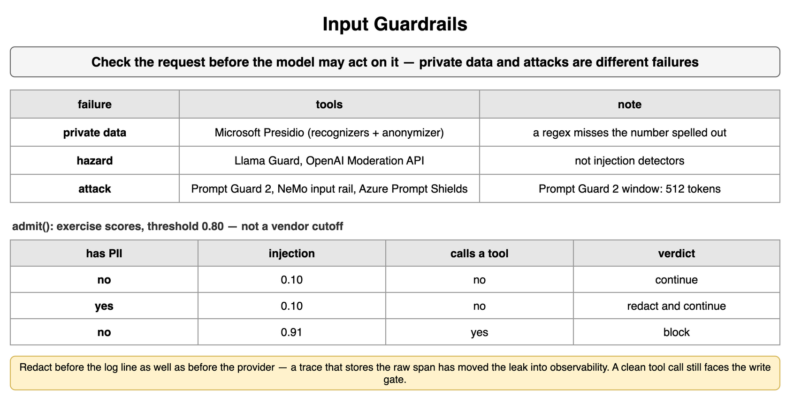

*Source: [`diagrams/ai-engineering-architecture.drawio`](/content/10_AI_Engineering/10_AI_Engineering_Architecture_and_User_Feedback/diagrams/ai-engineering-architecture.drawio), page 3.*

## Output guardrails

An output guardrail is a check on the model's text before a person sees it or a tool runs.

Four checks cover most drafts: format (does the next step parse it), factuality (does a trusted source support claims), harm (is it in a refused category), and one capped retry after failure. Harm checks include Llama Guard on a response, OpenAI's Moderation API, and Azure AI Content Safety harm scoring; the safety card keeps their categories. NeMo output rails and Guardrails AI validators can carry any check, and Guardrails AI can reask with the failed check in the prompt. A cap of one is this architecture's policy, not the library default. Format is a parser: invalid JSON, an out-of-set label, or a missing field fails without a model. Schema masks and structured-output contracts stay in [Understanding Foundation Models](../02_Understanding_Foundation_Models/), and spending a judge on a schema is the wrong tool (which-models-can-judge and output-format cards).

For a grounded product, factuality starts as a substring: the policy quote must occur in the retrieved article, the citation rule from why-retrieve in [RAG and Agents](../06_RAG_and_Agents/) and factual consistency in [Evaluate AI Systems](../04_Evaluate_AI_Systems/). An entailment model handles only what a substring cannot decide, not a missing quote. Harm is a classifier on the completion, and a hazard label and injection score are separate logged verdicts. Run parse, citation or entailment, harm, then one retry. The retry names the failed constraint; it does not paste the failed draft back as instructions, because that draft is untrusted text on the injection path. After one retry, refuse, ask a person, or show nothing. A strict schema can reject a useful answer with a trailing comma. A substring misses faithful paraphrases and present but outdated quotes. Harm classifiers block abuse and buyers quoting abuse. Retrying doubles the bill when the model insists on inventing the window. Holding every draft for a person is safe and no longer a product; showing every draft and merely logging the classifier lets bad sentences reach customers.

```python
import json


def release(text: str, article: str, harm: bool) -> str:
    try:
        payload = json.loads(text)
    except json.JSONDecodeError:
        return "retry format once"
    quote = str(payload.get("quote", ""))
    if quote not in article:
        return "retry factuality once"
    if harm:
        return "hold"
    return "show"


article = "Returns are accepted within 30 days of delivery."
good = '{"quote": "within 30 days of delivery"}'
bad = '{"quote": "within 90 days of delivery"}'
print(release(good, article, False))
print(release("not json", article, False))
print(release(bad, article, False))
print(release(good, article, True))
# show
# retry format once
# retry factuality once
# hold
```

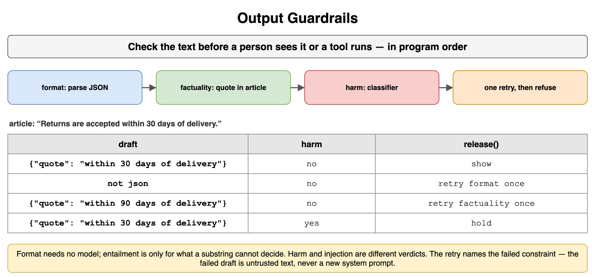

*Source: [`diagrams/ai-engineering-architecture.drawio`](/content/10_AI_Engineering/10_AI_Engineering_Architecture_and_User_Feedback/diagrams/ai-engineering-architecture.drawio), page 4.*

## Guardrail implementation

Guardrail implementation is the decision of which checks run before the first token, which checks run on the finished text, which of them block, and how much of the latency budget they may spend.

Independent checks run in parallel, so wall time is the slowest check, not the sum. Output checks cannot start until their tokens exist; whether those tokens may leave before passing is the next card. This card is the budget. The exercise is a support draft, not the inference drills' 0.80 s TTFT cap or the latency card's 500-token example. It uses [Evaluate AI Systems](../04_Evaluate_AI_Systems/)'s `TTFT + TPOT × (N − 1)` and a product budget of 0.820 s until the first visible token. Parallel input checks finish in 0.120 s and the first token is ready at 0.770, with 0.050 s spare. Sequential checks take 0.200 s and land at 0.850, missing by 0.030 and buying only simpler config. A budget that names "model latency" and ignores the 0.120 s input wall accepts a path users experience as late.

The 60-token generation takes 2.125 s. Parallel output checks add their slowest, 0.180 s, not the 0.225 s sum. The harm classifier dominates, so speeding the parser does not move the path. Buffering the whole draft until checks pass shows nothing until 2.425 s; streaming shows the first token at 0.770 but can only retract later. Buffer, or hold the flush, for a customer email that might contain a card number or slur. Copilot ghost text is not a sent message, so a local filter on available tokens fits better than 2.425 s of silence. Parallel checks spend compute to buy wall time and still wait on the slowest.

```python
BUDGET_S = 0.820
PII_S = 0.080
INJECTION_S = 0.120
TTFT_S = 0.650
TPOT_S = 0.025
OUTPUT_TOKENS = 60
FORMAT_S = 0.005
CITATION_S = 0.040
TOXICITY_S = 0.180
# Exercise seconds, not a measured Zendesk trace.

parallel_in = max(PII_S, INJECTION_S)
sequential_in = PII_S + INJECTION_S
first_parallel = parallel_in + TTFT_S
first_sequential = sequential_in + TTFT_S
generation = TTFT_S + TPOT_S * (OUTPUT_TOKENS - 1)
output_wall = max(FORMAT_S, CITATION_S, TOXICITY_S)
output_sum = FORMAT_S + CITATION_S + TOXICITY_S
buffered = parallel_in + generation + output_wall
print(f"{first_parallel:.3f} {first_sequential:.3f} {generation:.3f} {buffered:.3f}")
print(f"{BUDGET_S - first_parallel:.3f} {first_sequential - BUDGET_S:.3f} {output_wall:.3f} {output_sum:.3f}")
# 0.770 0.850 2.125 2.425
# 0.050 0.030 0.180 0.225
```

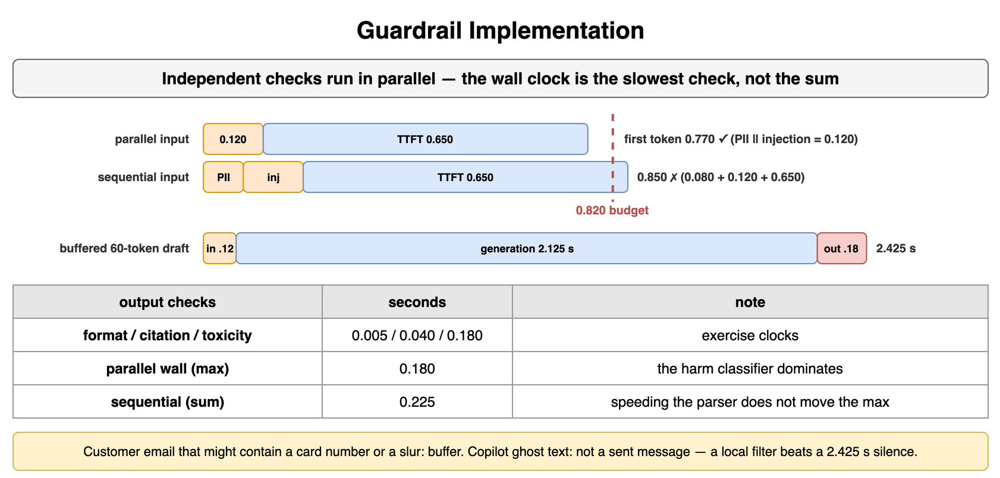

*Source: [`diagrams/ai-engineering-architecture.drawio`](/content/10_AI_Engineering/10_AI_Engineering_Architecture_and_User_Feedback/diagrams/ai-engineering-architecture.drawio), page 5.*

## Streaming and a guardrail

Streaming against a guardrail means showing a token only when every check that must cover it has already passed, or accepting that a later veto cannot unsay it.

In the previous exercise, parallel input checks leave the first token ready at 0.770 s, inside the 0.820 s budget, while holding the 60-token draft for output checks delays visibility to 2.425 s. Flushing each token meets the first-token budget but paints, speaks, or logs spans the classifier has not seen. A chat-window retract does not reach notifications, screen readers, or client logs. The drill "Already on the Screen" shows the leak with a card number at token 40, on a different clock. A check that has not seen text does not cover it, and a classifier on the finished string cannot protect a prior flush.

Real products use four repairs. Buffer until checks pass for anything sent as the company, such as a Gemini draft in Gmail or a support reply. Check a prefix and flush only what passed, shortening the leak while still unable to judge a card number arriving at token 40. Stream into a non-commitment surface, as Copilot ghost text does: it is not in the file until accepted, and the next-suggestion shortcut discards it. Retract after the fact while recording which clients keep the bad span; a spoken voice reply cannot be fixed. Buffering deliberately misses a first-token budget to protect recipients. Streaming meets it and leaks to whatever rendered. Skipping output guards because input passed ships benign prompts with harmful completions.

```text
sent as the company  buffer (2.425 s here) or stream into a hidden buffer
ghost text           may stream; acceptance is a second decision
retract              does not undo notifications, screen readers, client logs
```

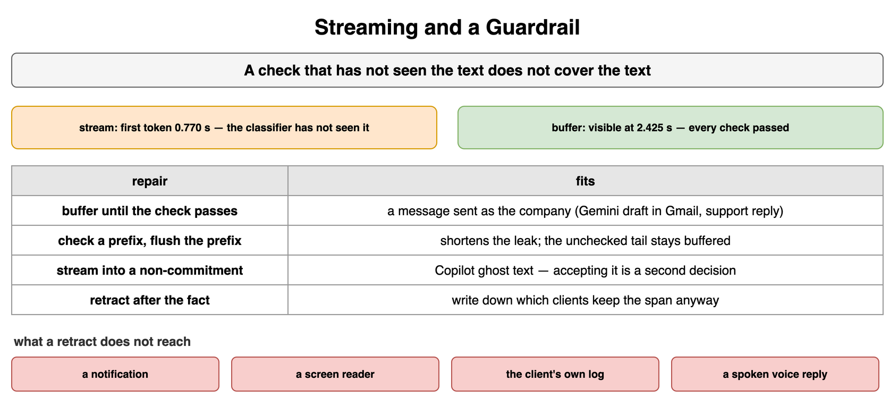

*Source: [`diagrams/ai-engineering-architecture.drawio`](/content/10_AI_Engineering/10_AI_Engineering_Architecture_and_User_Feedback/diagrams/ai-engineering-architecture.drawio), page 6.*

## One retry and one fallback

A second chance is one extra attempt after a failure. The cap is what stops a guardrail retry, a router backup, and a gateway fallback from stacking into an unbounded wait.

Products blur three second chances. A guardrail retry repeats the task on the same model after a format or citation failure. A router backup uses a different model because the first was wrong for the intent or errored. A gateway fallback calls another provider after a timeout or server error. Each can be correct, but all three on one request change the evaluated model, multiply latency, and risk a duplicate write if any can call a write tool. That last risk needs the idempotency key on the Write tools card in [RAG and Agents](../06_RAG_and_Agents/); without it a refund retry is a second refund. This card is the latency cap.

The exercise is a short routed call such as an intent label, not the 60-token draft, whose buffered 2.425 s path does not fit this 2.000 s timeout and keeps its own guardrail budget. One primary timeout, one healthy fallback, and one healthy retry take 2.900 s, under a 3.000 s cap; four timeouts take 8.000 s and do not. The policy is one provider fallback and one guardrail retry. A second fallback is a deliberate product decision with a new number, not three configs multiplying. Graphing only success after retry hides a model that fails citations half the time, and counting retries as success inflates availability. Fallbacks keep the product up while serving a model the eval may never have scored. Failing closed on the second error protects a refund flow and drops a FAQ the backup might have answered. The cap is per request, not a reason to disable a nightly index job's own backoff.

```python
TIMEOUT_S = 2.000
HEALTHY_S = 0.450
CAP_S = 3.000
# Exercise seconds for a short routed call, not the 60-token draft.
worst = TIMEOUT_S + HEALTHY_S + HEALTHY_S
uncapped = 4 * TIMEOUT_S
print(f"{worst:.3f} {uncapped:.3f} {worst <= CAP_S} {uncapped <= CAP_S}")
# 2.900 8.000 True False
```

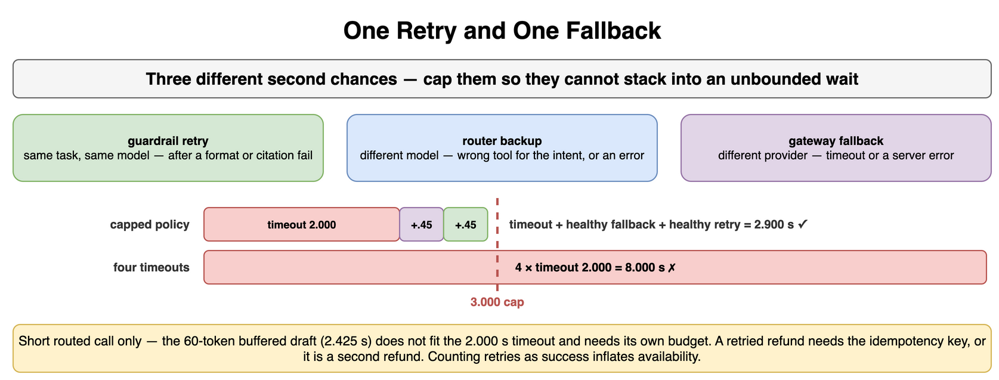

*Source: [`diagrams/ai-engineering-architecture.drawio`](/content/10_AI_Engineering/10_AI_Engineering_Architecture_and_User_Feedback/diagrams/ai-engineering-architecture.drawio), page 7.*

## The model router

A model router sends each request to a model or a pipeline chosen for that request, instead of calling one model for every task.

Two decisions are called routing. Intent routing classifies the request into a pipeline such as refund draft, shipping answer, account edit, or refusal, using a small model, finetuned encoder, or few-shot prompt ([Prompt Engineering](../05_Prompt_Engineering/)). Difficulty routing decides whether an intent is easy enough for a cheap model or needs a strong one. RouteLLM (Ong et al., 2024) trains difficulty routers on preference data, including Chatbot Arena battles. LMSYS's 1 July 2024 post describes similarity-weighted ranking, matrix factorization, BERT, and causal-LLM routers, evaluated with GPT-4 Turbo as strong and Mixtral 8x7B as weak. For its best reported routers at 95% of GPT-4 performance, the headline cost reductions versus GPT-4 only are over 85% on MT Bench, 45% on MMLU, and 35% on GSM8K. Arena data alone was not enough for MMLU, and the routers did not share one saving. The abstract says costs fell by more than 2× in certain cases without compromising quality; 45% is not 2×. These are their pairs, benchmarks, and date, not your Zendesk queue. OpenRouter is the hosted router across providers, while a self-hosted intent classifier fits classes made of your tickets.

The exercise uses 100,000 calls: 70% easy (800 input, 120 output on the small card at $0.50/$2.00 per million) and 30% hard (2,000 input, 400 output on the large card at $4.00/$16.00). These differ from Evaluate AI Systems' $0.25/$0.75 and $5/$15 and Inference Optimization's $1.25/$5.00 cache illustration. Always-large costs $1,440.00, always-small $64.00, and perfect routing $476.80, 33.11% of always-large and $963.20 less. That assumes the labeled 30% are exactly calls the large model should take; $64.00 requires the small model to pass the hard slice. A short refund-amount decision is not "easy," so forbid the router to downgrade that class. Routers must also fit prompts to the chosen model: a 128,000-token and 8,000-token window cannot share the same packed context. Trim or re-retrieve so the instruction, passages, and answer budget fit, and log the model and tokens sent. Provider truncation can drop the instruction or passage, making the router an Efficiency failures problem from [RAG and Agents](../06_RAG_and_Agents/) one level up. Misrouted intent can send a refund through the shipping prompt, and an Arena-trained difficulty router may miss a lexically simple policy exception. Escalating low-confidence cases spends some savings and still misses confident mistakes.

```python
def bill(calls: int, input_tokens: int, output_tokens: int, input_rate: float, output_rate: float) -> float:
    input_cost = calls * input_tokens / 1_000_000 * input_rate
    output_cost = calls * output_tokens / 1_000_000 * output_rate
    return input_cost + output_cost


easy = bill(70_000, 800, 120, 0.50, 2.00)
hard = bill(30_000, 2_000, 400, 4.00, 16.00)
all_large = bill(100_000, 2_000, 400, 4.00, 16.00)
all_small = bill(100_000, 800, 120, 0.50, 2.00)
routed = easy + hard
print(f"{all_large:.2f} {all_small:.2f} {routed:.2f} {all_large - routed:.2f} {100 * routed / all_large:.2f}")
# 1440.00 64.00 476.80 963.20 33.11
```

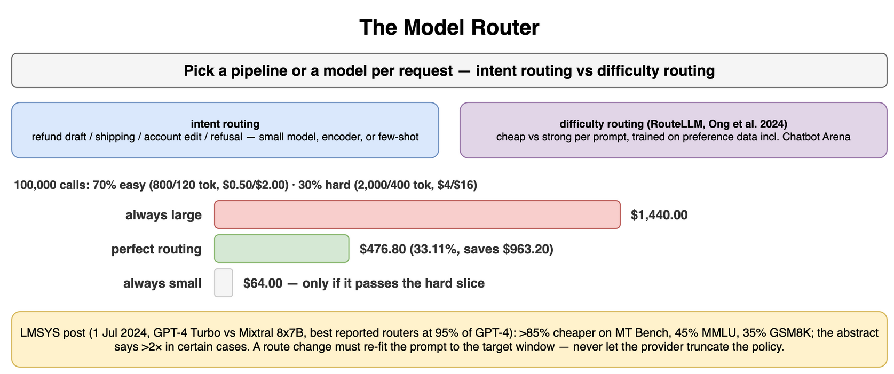

*Source: [`diagrams/ai-engineering-architecture.drawio`](/content/10_AI_Engineering/10_AI_Engineering_Architecture_and_User_Feedback/diagrams/ai-engineering-architecture.drawio), page 8.*

## The model gateway

A model gateway is the shared front door that holds provider keys, enforces limits, records spend, and presents one interface to every application.

The router decides where a request should go; the gateway gets it there, so services stop embedding provider secrets. LiteLLM's proxy and Portkey issue virtual keys, hold provider secrets, enforce per-key limits, translate one request shape to OpenAI, Anthropic, or a self-hosted server, record token counts for finance, and follow fallback lists on provider errors. Cloudflare AI Gateway runs on an edge you may already use and can log, rate-limit, cache identical requests, store credentials, and fall back on errors or configured timeouts. Kong's AI gateway applies similar policies, including response cache and rate limits, on a proxy you operate. OpenRouter is a hosted multi-provider API that combines routing and the front door into one bill. A product setting is not automatically a virtual key, router, or cache, so know which job each setting performs.

Teams usually discover limits during incidents. In the exercise (not a published provider quota), a 500 RPM provider budget is split 100, 100, 150, and 150 across four applications, so one runaway client can use at most 150. Per-app caps protect the quota and also block legitimate launch-day spikes unless someone deliberately raises them. Gateway cost tracking makes the router's planning bill real by recording input and output tokens, model id, virtual key, and fallback status; a provider monthly total cannot attribute spend to an application or prompt version. The gateway applies the configured rate card, so reconcile monthly against the provider invoice. Name the hidden jobs. Load balancing spreads one chosen model's traffic across healthy replicas or providers, while routing picks the model. A tool gateway centralizes credentials and per-application permissions for GitHub, the warehouse, and the refund API and logs calls. Secrets in the agent process let prompt injection inherit production credentials (the system-level defenses card in [Prompt Engineering](../05_Prompt_Engineering/)). One front door eases key rotation and spend visibility and becomes one outage for every assistant. A fallback succeeds on a provider the eval may not have scored, so it is a model change. Central logs store prompts unless input redaction ran first, and gateways that bundle caches and guardrails obscure which layer fired.

```python
PER_APP_RPM = (100, 100, 150, 150)
PROVIDER_RPM = 500
# Exercise limits, not a provider's published quota.
print(sum(PER_APP_RPM), max(PER_APP_RPM), sum(PER_APP_RPM) == PROVIDER_RPM)
# 500 150 True
```

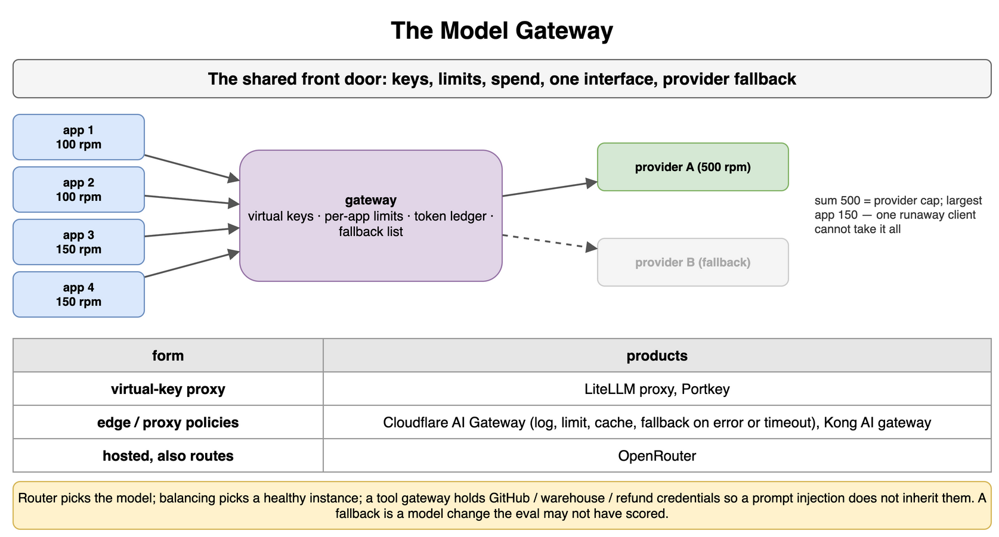

*Source: [`diagrams/ai-engineering-architecture.drawio`](/content/10_AI_Engineering/10_AI_Engineering_Architecture_and_User_Feedback/diagrams/ai-engineering-architecture.drawio), page 9.*

## Exact response caching

Exact response caching stores a finished answer and returns it when the same request arrives again.

The key hashes everything that defines the answer: model id, prompt-template version, canonical rendered prompt, decoding settings, and tenant or user whenever the answer depends on them. A key containing only the normalized question can serve one customer's order status to the next customer who types the same sentence. Temperature zero, or tasks where any correct answer is acceptable, make storage meaningful. Caching a temperature-0.7 sample pretends a sample is a function and makes the product look deterministic and stale. Redis is the usual store, and lookup should be a small fraction of the model call. This is not the KV prompt cache in [Inference Optimization](../09_Inference_Optimization/), which reuses an identical prefix and still generates; this cache skips generation (comparison card below).

At $0.50 and $2.00 per million (not the prompt-cache card's $1.25/$5.00), one million support classifications with 600 input and 20 output tokens cost $340.00 uncached. A 12% exact-duplicate rate after normalization, an exercise observation about repetitive intents rather than an open-chat expectation, gives 120,000 hits and saves $40.80. With 0.900 s model calls and 0.002 s Redis gets, average latency falls to 0.79400 s: every request pays lookup, and the 88% misses also pay the model. A low duplicate rate will not pay for the machinery. Invalidation belongs in the key. A new template version or model id creates a new key, and a retrieved page inside the hashed prompt makes page updates miss automatically. If the key is only the question and the page is fetched after lookup, yesterday's window is served until you delete the namespace. Long TTLs survive policy edits that leave question text unchanged; short TTLs discard the $40.80.

```python
CALLS = 1_000_000
HIT_RATE = 0.12
INPUT_TOKENS = 600
OUTPUT_TOKENS = 20
INPUT_RATE = 0.50
OUTPUT_RATE = 2.00
MODEL_S = 0.900
REDIS_S = 0.002


def bill(calls: float) -> float:
    input_cost = calls * INPUT_TOKENS / 1_000_000 * INPUT_RATE
    output_cost = calls * OUTPUT_TOKENS / 1_000_000 * OUTPUT_RATE
    return input_cost + output_cost


uncached = bill(CALLS)
saved = bill(CALLS * HIT_RATE)
average_s = REDIS_S + (1.0 - HIT_RATE) * MODEL_S
print(f"{uncached:.2f} {saved:.2f} {average_s:.5f}")
# 340.00 40.80 0.79400
```

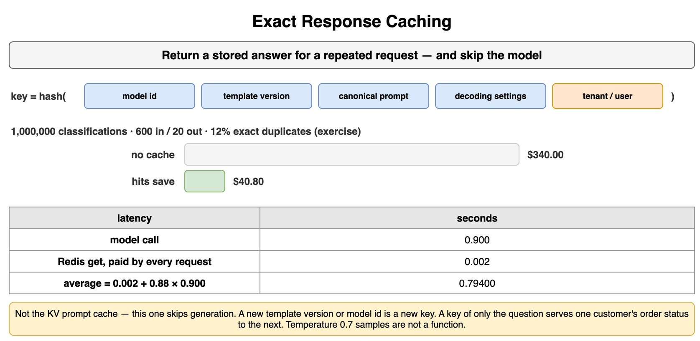

*Source: [`diagrams/ai-engineering-architecture.drawio`](/content/10_AI_Engineering/10_AI_Engineering_Architecture_and_User_Feedback/diagrams/ai-engineering-architecture.drawio), page 10.*

## Semantic caching

Semantic caching returns a stored answer when a new request is close to a cached request in embedding space, even though the text is not the same.

Zilliz's GPTCache can store exact matches or embed requests, search a vector index, and accept neighbors above a threshold, often with Redis holding payloads. The threshold is the design. For cosine, a higher threshold is stricter, giving fewer hits and fewer wrong hits. GPTCache's SearchDistanceEvaluation is not cosine: whether larger raw distance means more or less similar depends on its `positive` flag, and project docs and example tables have disagreed on which direction returns more hits. Read the evaluator's comparison rather than copying a default, and do not treat its example table as this audit.

In one million exercise queries (not a GPTCache benchmark), cosine 0.92 finds 180,000 neighbors, and an audit labels 4% false hits: close text, wrong answer. At 1,500 input and 200 output tokens on $0.50/$2.00, each call is $0.00115. Serving every 0.92 neighbor saves $207.00 gross and cuts average latency from 0.850 s to 0.7120 s (0.1380 s), because every query pays the 0.015 s embed and lookup and misses also pay the model. That still serves 7,200 wrong answers (0.72%), which cannot be subtracted online because only the audit found them. At 0.98, 60,000 candidates save $69.00 with 300 false hits (0.03%), and the hit rate falls from 18% to 6%; that is the curve you choose. Quoting $207.00 without an audit calls a 0.72% error rate a performance win. Semantic caches catch paraphrases exact caches miss and fail precisely when wording changed the fact that matters: order id, date, amount, or negation. The embedding of "what is the return window" does not change when policy moves from 30 to 14 days, so include a namespace or generation id bumped on corpus, template, or model changes, plus a TTL. Bumping too aggressively discards good hits; forgetting serves stale policy to familiar wording. Personal answers need the tenant: "where is my order" is close for every customer and not transferable, a cross-account false hit the threshold cannot understand.

```python
CALLS = 1_000_000
CANDIDATES = 180_000
FALSE_RATE = 0.04
STRICT_CANDIDATES = 60_000
STRICT_FALSE = 300
PER_CALL = 1_500 / 1_000_000 * 0.50 + 200 / 1_000_000 * 2.00
MODEL_S = 0.850
LOOKUP_S = 0.015
# Exercise audits, not a library benchmark.

false_hits = round(CANDIDATES * FALSE_RATE)
saved_all = CANDIDATES * PER_CALL
saved_strict = STRICT_CANDIDATES * PER_CALL
average_s = LOOKUP_S + (CALLS - CANDIDATES) / CALLS * MODEL_S
print(f"{PER_CALL:.5f} {false_hits} {saved_all:.2f} {average_s:.4f} {MODEL_S - average_s:.4f}")
print(f"{saved_strict:.2f} {false_hits / CALLS:.4f} {STRICT_FALSE / CALLS:.4f}")
# 0.00115 7200 207.00 0.7120 0.1380
# 69.00 0.0072 0.0003
```

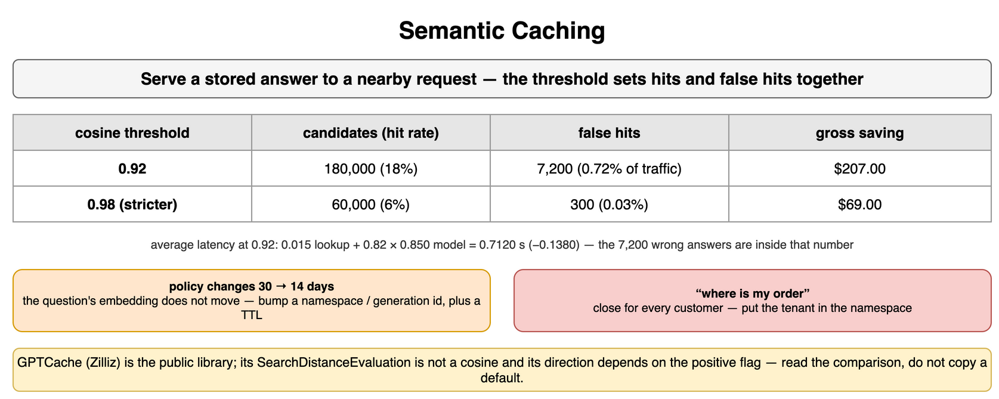

*Source: [`diagrams/ai-engineering-architecture.drawio`](/content/10_AI_Engineering/10_AI_Engineering_Architecture_and_User_Feedback/diagrams/ai-engineering-architecture.drawio), page 11.*

## Prompt cache versus response cache

A prompt cache reuses the KV state of an identical prefix and still generates the answer. A response cache returns a stored answer and skips generation.

Both are called caching and fail differently. The Prompt caching card in [Inference Optimization](../09_Inference_Optimization/) covers prefix reuse: a 4,096-token Llama 3 8B prefix is 0.50 GiB of BF16 cache, and its exercise million calls cost $7,010 uncached versus $2,402 cached, saving $4,608. The cached part must be a prefix, and the question and completion are paid every time. Its provider multipliers come from docs checked 12 November 2026 and are not mixed with this topic's $0.50/$2.00 response-cache prices. A response cache, exact or semantic, avoids prefill and decode entirely, which is why an exact hit can take $40.80 off $340.00 and why a semantic false hit is a wrong answer rather than a stale prefill. The prefix rule does not apply, but identity does: a shared system prompt's KV state is not a customer's order status, while a cached order-status response is.

| | Prompt cache | Response cache |
| --- | --- | --- |
| What is stored | The KV state of an identical prefix. | The finished answer, exact or by a neighbor. |
| What a hit skips | The prefill of that prefix. Decode still runs. | The model call. |
| What still changes | The suffix and the new completion. | Nothing, until the entry is dropped. |
| The stale failure | An old prefix that still matches byte for byte. | An answer whose world changed, or whose neighbor was a different user. |
| The bill in this guide | $7,010 versus $2,402 per million calls, on the Prompt caching card's rates. | $40.80 off $340.00 exact, or $207.00 gross semantic, on the $0.50 and $2.00 rates. |

Using both is normal: the gateway or application checks for a response hit first, and on a miss the provider may still cache the new call's prefix. A prompt cache helps every call sharing a long stable prefix, including unique answers. A response cache helps only reusable whole answers and is a privacy bug when that judgment is wrong. A one-token edit at the start of the prefix misses the KV cache; a semantic neighbor with the wrong order id hits the response cache and should not have. Attributing all savings to one mechanism makes the next capacity decision wrong, and response-cache hit rates cannot be compared with the $4,608 prefix saving because mechanisms, rates, and exercise prices differ.

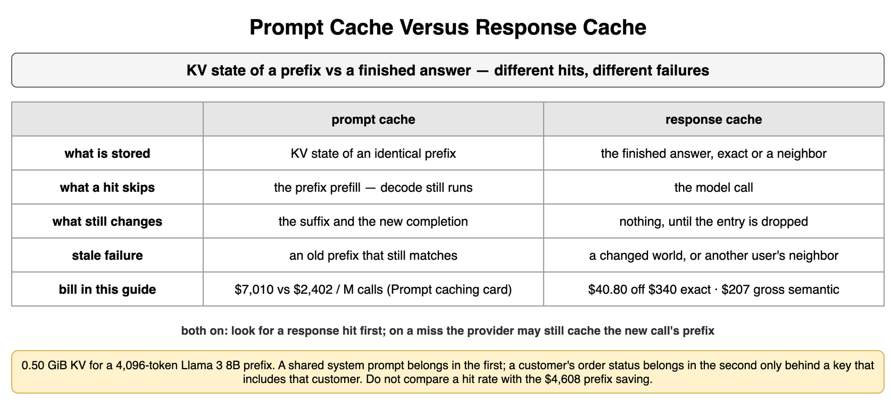

*Source: [`diagrams/ai-engineering-architecture.drawio`](/content/10_AI_Engineering/10_AI_Engineering_Architecture_and_User_Feedback/diagrams/ai-engineering-architecture.drawio), page 12.*

## Agents and write actions in the architecture

An agent in this architecture is a routed loop with tools. A write action remains a proposal the program has to accept.

The agent topic defines the loop, tool classes, planner, failure modes, and memory; this card places it on the path. The router keeps it off most requests. Repeated FAQs go to the exact cache or one grounded draft, policy questions go through retrieval and the citation guardrail, and multi-lookup requests can enter a read-only loop with the step cap from [RAG and Agents](../06_RAG_and_Agents/). Refunds, sent emails, and merges enter as proposals. The model does not hold the Stripe key (System-level defenses in [Prompt Engineering](../05_Prompt_Engineering/)); the program recomputes the amount, asks a person for irreversible writes, and sends an idempotency key, controls kept on the Write tools card to avoid a second conflicting procedure.

| Intent | The path that should run |
| --- | --- |
| A repeated question whose answer is safe to reuse | The response cache, and the model only on a miss. |
| A policy question | Retrieval, one grounded draft, and the citation check. |
| Several lookups and no side effect | The read-only agent, with a step cap. |
| A refund, a sent message, or a merge | A proposal, a recomputed argument, and a person where the action is irreversible. |

Cost is why the router exists. The Efficiency failures card prices a six-step loop at $684.00 per 100,000 tasks against $140.00 for one retrieve-then-answer call at $0.50/$2.00, so sending every ticket through the loop spends the difference. The gateway must meter each loop as several model calls under one user request, or the $476.80 router blend undercounts the agent route. Log tool names and step count, not merely "agent," or the $684.00 cannot be attributed. Tool results are untrusted text and pass an input-style check before the next step, the same warning as Azure Prompt Shields' document check and indirect prompt injection in [Prompt Engineering](../05_Prompt_Engineering/). Even a read-only loop can be injected by a retrieved page. A person on every write protects refunds and makes high-volume "mark as read" feel broken, which is why that action is a different tool with a different gate. Hiding the loop in a framework that makes tool calls invisible is the later orchestration failure.

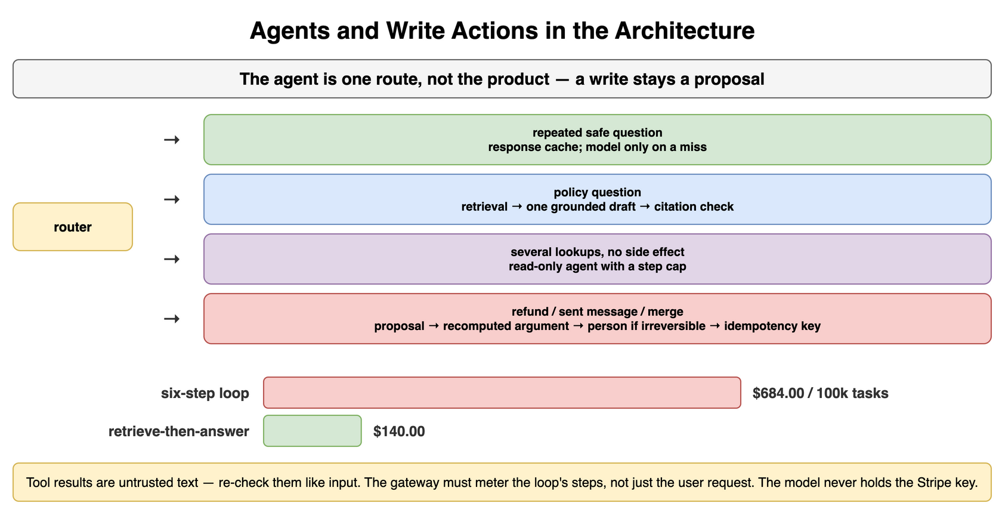

*Source: [`diagrams/ai-engineering-architecture.drawio`](/content/10_AI_Engineering/10_AI_Engineering_Architecture_and_User_Feedback/diagrams/ai-engineering-architecture.drawio), page 13.*

## Monitoring and observability

Monitoring tells you a known signal crossed a line you set. Observability is the telemetry that lets you explain a failure you did not have a line for.

A monitor on error rate, p95 latency, dollars per hour, or thumbs-down rate pages someone when a named bad thing happens; it cannot explain why a request retrieved the wrong page when "wrong page" was not predefined. Observability lets you ask that from kept data: a trace with passage ids, a log with template version, a metric you can slice by intent after the incident starts. Metrics, logs, and traces are the telemetry. A dashboard is not observability, and a warehouse of raw prompts is not a monitor. OpenTelemetry keeps them joinable by request id. Its GenAI semantic conventions were still Development in the November 2026 docs and now live in the separate semantic-conventions-genai repository. This topic relies on `gen_ai.request.model`, `gen_ai.operation.name`, `gen_ai.provider.name`, `gen_ai.usage.input_tokens`, and `gen_ai.usage.output_tokens`. `gen_ai.system` was renamed to `gen_ai.provider.name` in core v1.37.0 (August 2025), and some SDKs emit both, so do not add them. That text says input tokens include cached tokens of every modality and use billed counts when both billed and consumed exist. `gen_ai.usage.cache_read.input_tokens` and `gen_ai.usage.cache_write.input_tokens` are subsets of input, and `gen_ai.usage.reasoning.output_tokens` is a subset of output; adding a subset to its total double-counts. `gen_ai.input.messages` and `gen_ai.output.messages` are Opt-In because they copy the conversation. Pin the revision your SDK emits. LangSmith, tied to LangChain but usable standalone, Langfuse, an open-source server many gateways ship to, and Arize Phoenix, an open-source trace and evaluation UI with embedding views, inspect LLM traces. A vendor trace that cannot carry your retrieval span is only the model call.

Exhaustive checks score every request, which is affordable for schema failures, guardrail verdicts, token counts, and latency, but usually not for a person or large judge reading every answer. Spot checks score a sample whose width the thumb-rate interval card describes. Call a dashboard exhaustive only for signals computed on every request; for the rest, state the sample. A spot check treated as exhaustive pages on noise and misses the tail it never drew. Read a slice of production traffic daily (the Drift detection card), because metrics do not replace the read that reveals unnamed failures. High-cardinality traces answer new questions at the cost of money, retention, and privacy review, since prompts are often personal data. A year of every prompt helps postmortems and undoes the input guardrail's purpose. Sampling cuts cost and can drop the request you needed. A GenAI vendor UI is quick to adopt and becomes a second source of truth if the gateway also logs.

```text
monitor        p95 crossed the line -> page
observability  trace shows template version + passage ids -> explanation
OTel GenAI     Development (Nov 2026); cache-read/write and reasoning tokens are subsets
message bodies Opt-In
```

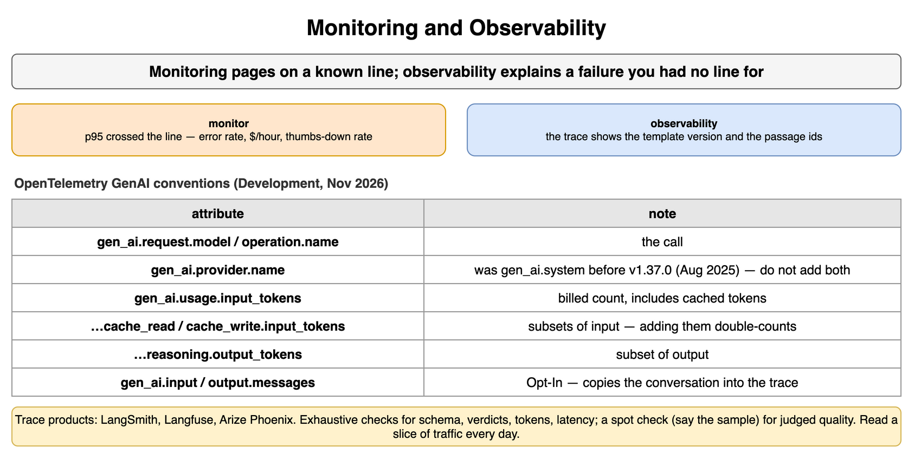

*Source: [`diagrams/ai-engineering-architecture.drawio`](/content/10_AI_Engineering/10_AI_Engineering_Architecture_and_User_Feedback/diagrams/ai-engineering-architecture.drawio), page 14.*

## Quality, latency, cost, and reliability

The metrics that decide a production model are quality, latency, cost, how fast you notice and repair a break, and what users actually do.

Quality needs both the offline pipeline in [Evaluate AI Systems](../04_Evaluate_AI_Systems/) (exact checks, earned judges, important slices) and online schema failures, citation failures, guardrail blocks, and refusals on traffic the eval may lack. Divergence is a finding. Latency keeps TTFT, TPOT, and `TTFT + TPOT × (N − 1)` from that topic and adds the user-visible clock, including gateway, guards, and client; an actionable p95 names its clock. Goodput counts finished requests meeting every latency objective (also in [Inference Optimization](../09_Inference_Optimization/)); attainment is the fraction, some dashboards call that fraction goodput, and DistServe uses goodput for capacity, so name the reading. Cost is dollars per successful task by route, model, and cache outcome. Per-call cost that ignores retries flatters a model called three times, and per-call cost also rewards a cache serving wrong answers unless the denominator is successful tasks. The router's $476.80 is a planning bill; the gateway ledger is the actual one. User-facing rates need denominators: thumbs per rating shown, regenerates per answer, Copilot acceptances per displayed suggestion. They sit beside task scores and do not outvote measured task failures, nor do task scores outvote real behavior changes.

Service reliability is how long failures last. Time to detect runs from onset to page, time to mitigate from page to user-visible recovery, and time to restore (MTTR here) from onset to recovery, the sum. For eight exercise incidents (minutes, not an SLA), detection averages 11.0, mitigation 32.5, and restoration 43.5. An 11-minute alert followed by waiting on the only person who can roll back a prompt is detection success and mitigation failure; reverting every blip also reverts fixes. Tie quality to a business north star: daily active use, session length, or retention for consumers; resolved tickets per agent-hour or untouched-ticket share for support. The evaluation-guideline and Cost cards in [Evaluate AI Systems](../04_Evaluate_AI_Systems/) connect score and unit cost to that metric; this card owes the correlation. Plot quality beside the star. If citation failures rise and retention does not move, users are not leaving over that problem or you measured too late. If retention falls and the offline eval is flat, the eval is not the traffic. A flat eval and moving thumb rate is a disagreement to investigate, not a tie broken by ignoring one, and p50 hides the p95 the guardrail budget cares about.

```python
DETECT_MIN = (6, 10, 4, 22, 8, 15, 9, 14)
RESTORE_MIN = (20, 40, 18, 90, 30, 55, 25, 70)
# Exercise minutes from onset, not a vendor SLA.


def mean(values: tuple[int, ...]) -> float:
    return sum(values) / len(values)


gaps = tuple(restore - detect for detect, restore in zip(DETECT_MIN, RESTORE_MIN))
print(f"{mean(DETECT_MIN):.1f} {mean(gaps):.1f} {mean(RESTORE_MIN):.1f}")
# 11.0 32.5 43.5
```

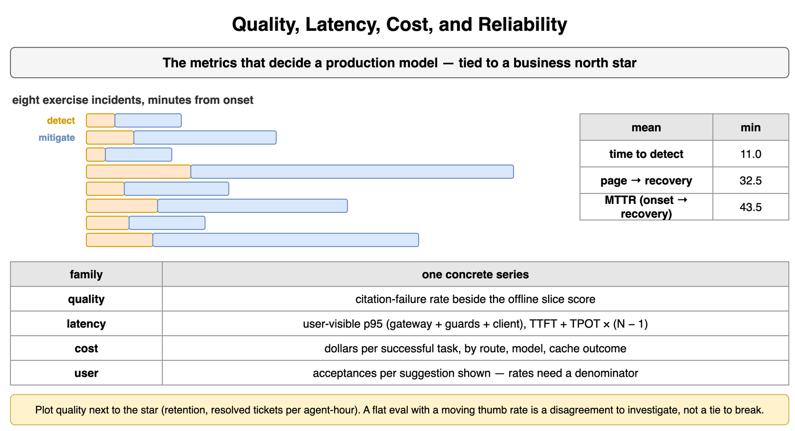

*Source: [`diagrams/ai-engineering-architecture.drawio`](/content/10_AI_Engineering/10_AI_Engineering_Architecture_and_User_Feedback/diagrams/ai-engineering-architecture.drawio), page 15.*

## Logs and traces

A log is an event you record. A trace is the tree of timed spans for one request.

A useful model-request log records request id, tenant, prompt-template id and version, model id, route, cache outcome, guardrail verdicts, tool names, token counts, and passage ids. It does not need the raw card number or, if redaction was the input guardrail's job, the raw prompt. "Error" without those fields turns incidents into guessing, a missing template version makes answers incomparable, and missing passage ids make groundedness failures look like generation failures. A trace draws the same request as time, with gateway, router, retrieval, model, and output-guard spans. OpenTelemetry joins logs and spans by request id; LangSmith, Langfuse, and Phoenix display the tree. A write should be its own child span, so a refund is visible beyond a sentence in a completion. A trace that starts at the model SDK misses the gateway queue and blames the model for earlier waits.

In one exercise help-center answer (not a production trace or the slow-request drill), the total is 1,140 ms. Retrieval and model take 1,080 ms, 94.74%; the output guard is 40 ms, 3.51%, and is not the problem. Spending a week shrinking the guard because the dashboard says "AI latency" optimizes that 3.51%; if needed, fix retrieval or generation. Another request might spend its time in a retry, so read spans rather than totals. Detailed traces expose the 94.74% and store more user text unless redaction comes first. Logging every prompt token aids replay and retains data you may lack a basis to keep. Sampling reduces cost and biases toward whatever the sampler favors.

```python
SPANS_MS = {
    "gateway": 8,
    "router": 12,
    "retrieval": 180,
    "model": 900,
    "output_guard": 40,
}
# Exercise milliseconds, not a production trace.
total = sum(SPANS_MS.values())
hot = SPANS_MS["retrieval"] + SPANS_MS["model"]
print(total, f"{hot / total:.4f}", f"{SPANS_MS['output_guard'] / total:.4f}")
# 1140 0.9474 0.0351
```

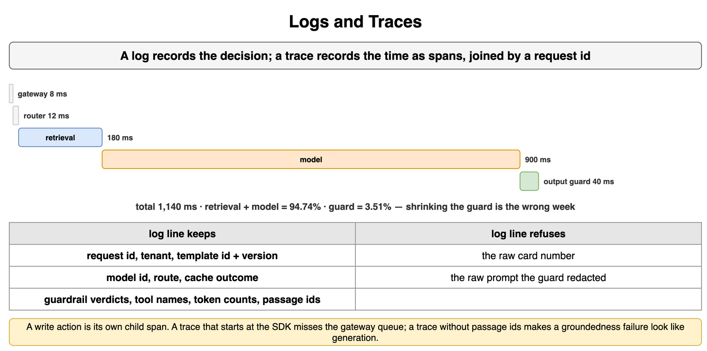

*Source: [`diagrams/ai-engineering-architecture.drawio`](/content/10_AI_Engineering/10_AI_Engineering_Architecture_and_User_Feedback/diagrams/ai-engineering-architecture.drawio), page 16.*

## Drift detection

Drift is a change in the prompts, the model behind an API name, or the mix of users, that moves behavior while your last deploy stays where it was.

Prompt drift is input moving: users paste screenshots, the help center rewrites the window, or a template edit changes the prefix. Model-API drift is the provider replacing weights behind a name while your code stays identical; the maintenance card in [Introduction to Building AI Applications with Foundation Models](../01_Introduction_to_Building_AI_Applications_with_Foundation_Models/) prescribes pinning a dated model id, while a floating alias makes drift automatic. Pinning avoids a class of drift and delays a class of improvements. User-behavior drift is a changed mix of intents, languages, or tenants, leaving a router threshold fit to the wrong traffic. Detect it with self-comparable series: fixed canary prompts with expected answers, the offline eval rerun on schedule and every model-id change, online citation and schema failures, refusal rate, output length, thumb rate, and an intent distribution. Total variation distance is half the sum of absolute share differences: 0 when unchanged, 1 when disjoint.

In the exercise week (not a Zendesk export), the distance is 0.20: account traffic rose from a quarter to nearly half, and refunds fell 18 points. A router tuned for 30% hard calls now targets a different population. Phoenix-like embedding views reveal unlabeled drift as prompts clustering where the old set did not, without naming the blob. A green canary while intent distance moves is a canary coverage gap, not proof nothing drifted. Set the page threshold from your own history; there is no universal cutoff. Alerting on every small distance trains on-call to ignore pages, while never alerting because a vendor called an alias stable lets an unpinned upgrade reach the queue. Series do not replace reading traffic. A person who knows the product should read ten or twenty prompts and completions daily, enough to notice a new apology style or a template quoting retired policy, not enough to estimate a rate. Write down what you saw, or the next person rediscovers it as an incident.

```python
LAST_WEEK = {"refund": 0.40, "shipping": 0.35, "account": 0.25}
THIS_WEEK = {"refund": 0.22, "shipping": 0.33, "account": 0.45}
# Exercise intent shares, not a ticket export.


def total_variation(left: dict[str, float], right: dict[str, float]) -> float:
    return 0.5 * sum(abs(left[name] - right[name]) for name in left)


print(f"{total_variation(LAST_WEEK, THIS_WEEK):.2f}")
# 0.20
```

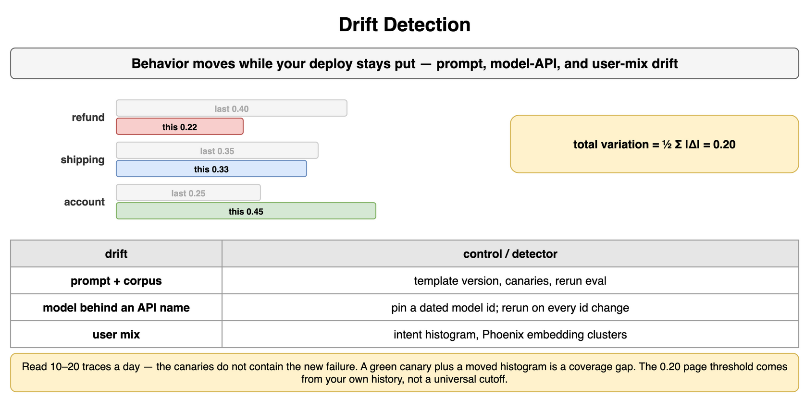

*Source: [`diagrams/ai-engineering-architecture.drawio`](/content/10_AI_Engineering/10_AI_Engineering_Architecture_and_User_Feedback/diagrams/ai-engineering-architecture.drawio), page 17.*

## Pipeline orchestration

Pipeline orchestration is how multi-step work retries, waits, and resumes. A framework earns its place when that work no longer fits in one request function.

The request path is a function: retrieve, generate, check, return, finishing while the user waits. The offline path is a workflow: rebuild the index after help-center changes, run the nightly eval, wait for a person to approve a finetune, or backfill traces. Apache Airflow and Prefect retry, schedule, and record run ids for the second kind. Putting them on the request path adds a scheduler to a function; a cron script for a reindex that must not run twice leaves you unsure whether yesterday's run finished. Start without an orchestrator. One function, one model call, guardrails, and a log line carry the product until a measured failure requires a queue, a run-id retry, or a human approval outliving the request. Adopting LangChain or Airflow on day one adds a framework around a prompt you have not scored.

LangChain, LlamaIndex, Haystack, and DSPy serve the request and authoring side. LangChain is a general framework for chains, tools, and agents; LlamaIndex centers indexes and data connectors for RAG; Haystack (deepset) builds search and QA pipelines; DSPy compiles a prompt program against a metric, with search cost and holdout requirements on the prompt engineering tools card in [Prompt Engineering](../05_Prompt_Engineering/). A compiled program still sits behind the same gateway, guardrails, and eval id as a hand-written prompt. You can use a LlamaIndex loader or Haystack retriever inside your function without adopting the framework's agent loop. The failure is a framework that calls tools itself, putting the allow-list, idempotency key, and human gate from [RAG and Agents](../06_RAG_and_Agents/) in code you do not review each change. Keep tool permissions in code you own even if a framework dispatches the call. The quote function below is the output guardrail in miniature, not a DAG; the index job producing `passages` might need one. A graph you cannot draw on one page has become the product.

```python
def answer(draft: str, passages: list[str]) -> str:
    quotes = [line.removeprefix("quote: ") for line in draft.splitlines() if line.startswith("quote: ")]
    if quotes and all(quote in "\n".join(passages) for quote in quotes):
        return draft
    return "refuse"


print(answer("quote: 30 days", ["Returns within 30 days."]))
print(answer("quote: 90 days", ["Returns within 30 days."]))
# quote: 30 days
# refuse
```

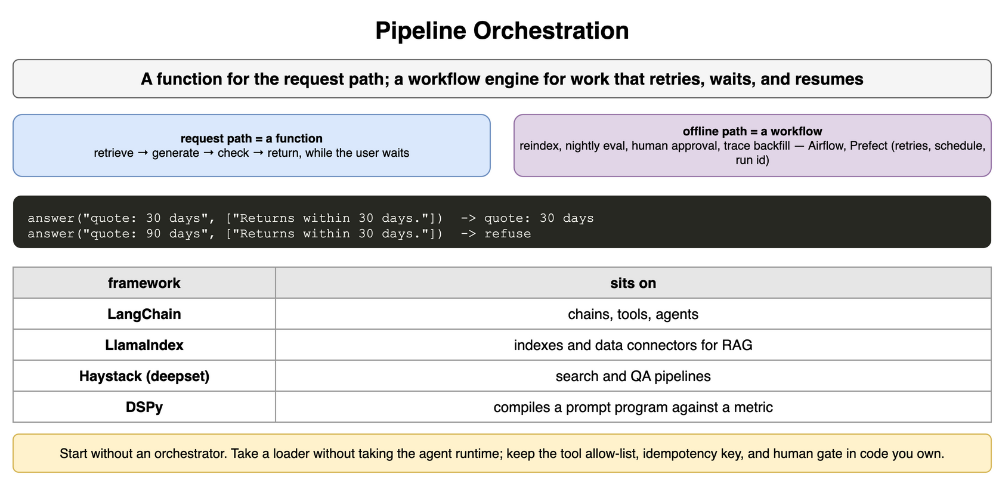

*Source: [`diagrams/ai-engineering-architecture.drawio`](/content/10_AI_Engineering/10_AI_Engineering_Architecture_and_User_Feedback/diagrams/ai-engineering-architecture.drawio), page 18.*

## Explicit and implicit feedback

Explicit feedback is a signal the person knows they are giving. Implicit feedback is behavior you interpret as a judgment.

Thumbs, stars, written complaints, and choices between answers are explicit. ChatGPT's reply thumb and side-by-side picks are explicit, and Arena is entirely side-by-side picks. Implicit signals are recorded while people work. A GitHub Copilot inline suggestion is accepted, dismissed, or cycled, and the relevant acceptance rate is accepts per suggestion shown. GitHub usage metrics also count lines suggested and accepted, a different rate from whole-suggestion acceptance, and any published percentage needs its post and date. Midjourney's four-image grid asks for a deliberate pick, which is explicit. Since version 5, buttons isolating a cell do not change resolution; Subtle or Creative upscales and variations requesting another grid are separate controls. The boundary is whether the person was asked, not how valuable the signal is.

Implicit signals are plentiful and ambiguous; explicit ones are sparse, and those who respond are not all traffic, the flywheel selection bias on the acquiring data card in [Dataset Engineering](../08_Dataset_Engineering/). Both need a denominator and a defined action. A thumb is a rate only with the number of answers offering it. Regenerate can be either kind depending on the control (its own card). Asking for thumbs annoys people and draws those with time or grievances. Acceptance is unobtrusive and conflates "I took it" with "it was right"; Copilot acceptance can rise because suggestions match the next typed line, a product success and weak factual test. Side-by-side votes are the cleanest preference and most expensive to request. Training only on votes inherits voters, and training only on accepts inherits the workflow. None replaces the offline eval, because users can accept a wrong refund and thumbs-down a correct refusal.

```text
explicit   ChatGPT thumb, side-by-side pick, Arena vote, Midjourney grid pick
implicit   Copilot accept per suggestion shown (lines accepted is a different rate)
both       need a denominator; neither is the traffic or the task eval
```

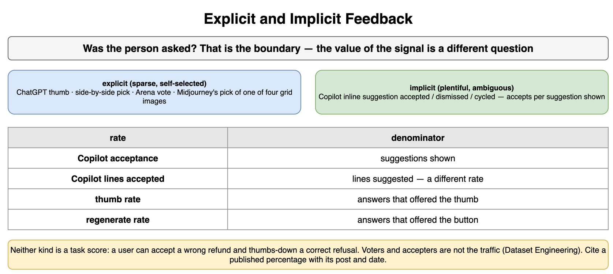

*Source: [`diagrams/ai-engineering-architecture.drawio`](/content/10_AI_Engineering/10_AI_Engineering_Architecture_and_User_Feedback/diagrams/ai-engineering-architecture.drawio), page 19.*

## Natural language feedback

Natural language feedback is the judgment hiding in what the person types or does next, in words rather than in a widget.

Chat products show four patterns. Early termination is the ChatGPT or Claude stop button: stopping after one sentence may mean it was wrong or already enough, so the next turn is better evidence. Error correction names the mistake, such as "no, the window is 14 days" or "that is the other order," and becomes a candidate preference pair (draft rejected, correction chosen) only after you believe the user, the acquiring-data card's condition. Treating every correction as truth teaches user misconceptions, the sycophancy loop. A complaint such as "this is useless" or "wrong" is a negative label without the right answer and a poor training target alone. Next-turn sentiment is weakest: thanks can follow a bad answer the person fixed, and "this is not bad" contains "bad." A classifier on the next turn is a feature, not a raw training label.

Useful extraction is a relation between turns, not a keyword. Negation plus replacement fact is a correction; a stop without follow-up is ambiguous; complaint plus reformulation is a negative label and a new attempt. Log the turn pair with template version so extraction is auditable. Storing only a sentiment model's "negative" discards the 14 days. Requests like "are you sure?" and "show the sources" mean the answer did not earn trust; rising source requests on an intent indicate a grounding failure like a citation miss and are better labels than sentiment on the next thank-you. Dialogue diversity matters: if sessions ask the same three questions, feedback is about a narrow tool, and if they fan out, one thumb rate mixes tasks, so slice by intent. Next-turn signals are already paid for and overweight people who argue, while people who leave are invisible (next card). Keywords are cheap and wrong on negation; classifiers are better and still need a read sample. Both turns pass through redaction before entering a training file.

```text
stop         ambiguous alone
correction   replacement fact -> preference-pair candidate, once verified
complaint    negative label, no target
sentiment    a hint ("not bad" contains "bad")
```

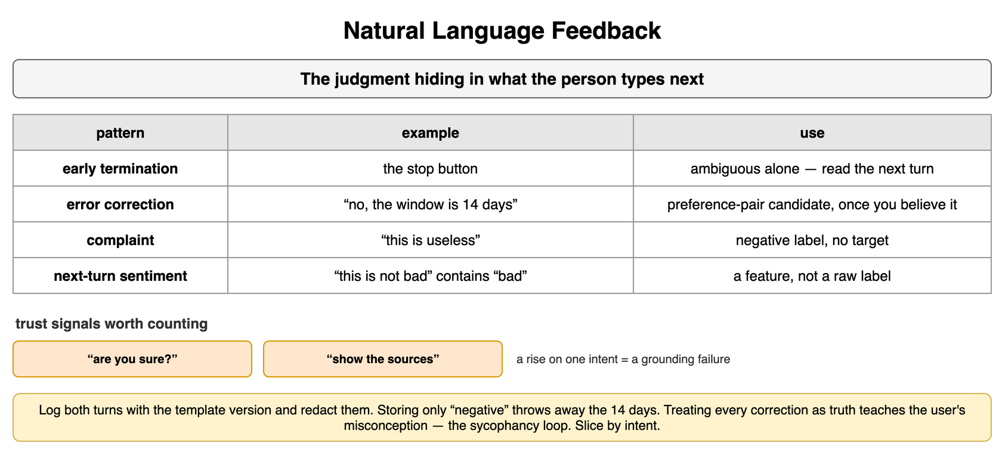

*Source: [`diagrams/ai-engineering-architecture.drawio`](/content/10_AI_Engineering/10_AI_Engineering_Architecture_and_User_Feedback/diagrams/ai-engineering-architecture.drawio), page 20.*

## Regenerate, edits, length, and deletion

Regenerate, an edit, the length of the conversation, and a deletion are feedback that never uses a rating widget.

ChatGPT's regenerate requests another sample of the same turn, an explicit version of an implicit complaint about that sample, but not proof of factual error. People regenerate for tone, a second idea, or a false answer. In Midjourney, another variation is the product, not failure. In a support draft, regeneration is closer to a miss because it delays the reply. Its rate needs regenerates per answer offering the control. Edits are stronger: the distance between a Copilot suggestion or Gmail draft and the sent text is the signal. A shortening edit is style; changing the window from 30 to 14 days is a factual correction and a preference pair only if the edit is better. Keep raw before-and-after text so reviewers can relabel; a distance alone discards that chance.

Conversation length is a trap: a long thread may be engagement or a stuck user repeating the question. Split by task completion, because a resolved ticket with a correct policy refund differs from five turns of "that is not what I asked." Deletion is the weakest negative. ChatGPT users delete conversations to tidy up or remove sensitive pastes, so treating every delete as thumbs-down chases privacy behavior as quality. Do not average these into one cross-product "unhappiness" score. Copilot inline suggestions are accepted, dismissed, or cycled, and Copilot Chat on GitHub can reload a response; Midjourney variations are requested output; a Zendesk draft wants a sendable first answer. Feeding all four into one reward trains models to avoid long conversations and second samples even when the product exists to produce them. Ignoring them leaves only sparse thumbs.

```text
regenerate   miss in a draft product; the product in Midjourney
edit         a fact change is the useful pair (keep before and after)
length       split by task completed
deletion     privacy as often as quality
```

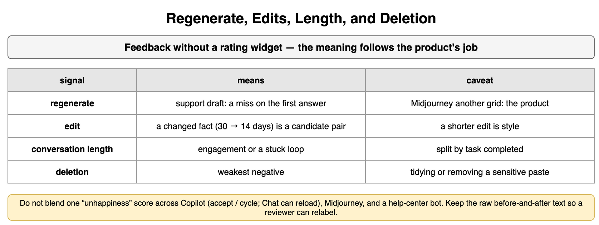

*Source: [`diagrams/ai-engineering-architecture.drawio`](/content/10_AI_Engineering/10_AI_Engineering_Architecture_and_User_Feedback/diagrams/ai-engineering-architecture.drawio), page 21.*

## When to collect feedback

When to collect feedback is the moment the person can judge the thing you will actually change, and not a moment sooner.

Copilot asks nothing and records acceptance while a suggestion is on screen, the only moment it is defined. A ChatGPT thumb belongs after the answer exists, not on a first token you might retract. A support bot can ask about the draft (was it usable?) or after resolution (was the outcome right?); these are different series, and adding them produces a meaningless number. Ask only when you will use the answer. Unread surveys impose cost, and asking every turn makes people click the nearest star to dismiss the widget. Irreversible actions are not a feedback question: confirmation before a refund is the write gate in [RAG and Agents](../06_RAG_and_Agents/). A thumb after money moves evaluates a mistake for the eval slice; it does not prevent the next bad refund.

Sampling is part of timing. Ask a small random fraction of completed answers so the widget stays rare and interpretable; the thumb-rate interval card describes the resulting width. Asking only after regenerates oversamples anger, useful for hard-case review but not a base rate. Uncertainty and onboarding are non-widget moments. When the model is unsure, such as between two receipt totals, two matching order ids, or an uncertain photo tag, show candidates and let the person pick; that question is both feedback and product. During onboarding, learn coding style, tone, or folders while the person expects setup rather than every Tuesday. Stored preferences are priors that go stale and must be visible and deletable (the What an agent remembers card in [RAG and Agents](../06_RAG_and_Agents/)). On failure, let people finish: inpainting or edit-in-place for images, a draft above the source email, editable missed form fields. A dead end teaches people to route around the feature, and feedback from blocked tasks is angrier than the model error warrants. That repair path is the human role on the Critical, reactive, and human roles card in the introduction topic.

```text
acceptance   at the suggestion
thumb        after a finished answer, sampled
refund       confirmed before it happens (the write gate, not a survey)
uncertainty  ask the person to pick
onboarding   calibrate once, keep it visible and deletable
```

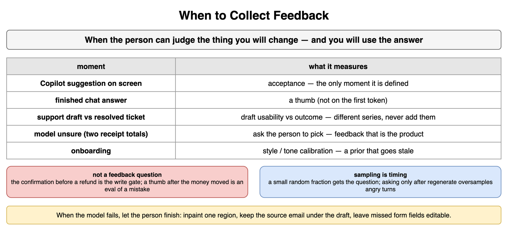

*Source: [`diagrams/ai-engineering-architecture.drawio`](/content/10_AI_Engineering/10_AI_Engineering_Architecture_and_User_Feedback/diagrams/ai-engineering-architecture.drawio), page 22.*

## How to collect feedback

How to collect feedback is the design of the control: easy to ignore, specific enough to learn from, and ordered so the slot does not pick the winner.

Unobtrusive controls let people finish without them: a corner thumb on a ChatGPT answer, a keyboard accept in Copilot, or Midjourney's upscale button as the natural continuation. A mid-draft modal survey is the opposite. Open a comment box only after a negative thumb, keeping the happy path one click; required essays produce periods from people who wanted the box gone. Comparisons are higher-quality explicit signals but cost a second generation and the person's time. ChatGPT has collected side-by-side preferences as well as thumbs, and Arena is only comparisons ranked by the methods in [Evaluation Methodology](../03_Evaluation_Methodology/). Randomize order. On that topic's bias probe, GPT-4 kept the same verdict after a swap on 65.0% of similar-answer pairs, with other judges worse; that is a model-judge measurement, not a human click rate, but the direction applies. Randomize left/right or swap and keep only wins in both orders, logging the order shown; always placing the new model on the right measures the right slot.

Name the unit: a conversation thumb is not a last-turn thumb, and a preference between answers using different tools is not a clean model comparison. Hide model names when judging text, as the Ranking from pairwise votes card warns about brand preference. Visibility changes meaning. A private thumb judges the answer; a public rating, shared gallery, or comment is also performance. Midjourney's public gallery heart is both judgment and social act, so do not train on it as a private thumb, and log which audience saw the control. Log unit id, order, and template version with each vote. Optional comments are valuable when present and usually absent. A delightful takeover widget measures obedience; a control nobody finds measures nothing.

```text
small     thumb + optional reason on the negative
strong    side-by-side pick, order randomized or swapped, names hidden
log       unit id, order shown, template version, audience (private/public)
```

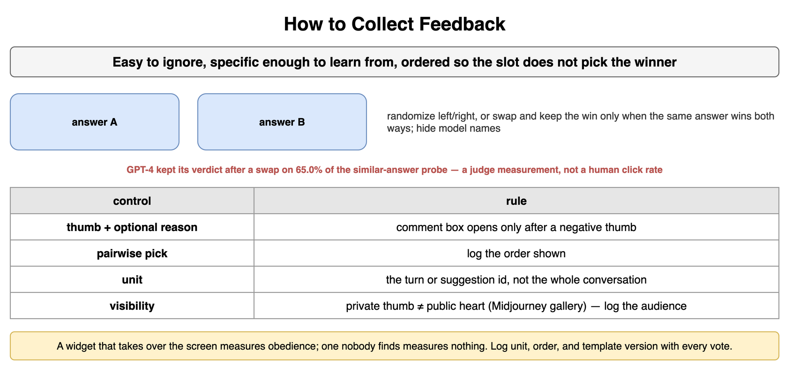

*Source: [`diagrams/ai-engineering-architecture.drawio`](/content/10_AI_Engineering/10_AI_Engineering_Architecture_and_User_Feedback/diagrams/ai-engineering-architecture.drawio), page 23.*

## Feedback biases

A feedback bias is a systematic tilt in the signal, separate from the noise of one careless click.

Leniency rates higher than behavior: a person thumbs up and heavily edits a draft, or accepts a Copilot suggestion and deletes it immediately. The rating describes courtesy; the edit describes work. Training on the thumb while ignoring the edit trains on courtesy, so log behavior beside the thumb. Randomness is a mis-tap, tired rater, or widget-clearing click. It widens the interval without pushing the average one way, and the fix is more independent judgments. For bias, change the instrument, because more biased data is merely more precise bias. Position bias favors the left answer, first image, or top suggestion, so the how-to-collect card randomizes order. Preference bias is a rater's taste for longer, agreeable, familiar-dialect, or self-matching answers. Verbosity bias on the Biases of an AI judge card is the model version; Arena's style control partials it out for rankings. Human raters share the taste, so a reward following it produces longer, warmer answers, perhaps desired but not evidence that the window became more accurate.

Selection underlies all four: raters are not traffic (the acquiring-data card), so a rating-derived training file needs a deliberately read slice of silent sessions, expensive but the only window on them. Ignoring thumbs to correct leniency discards some products' only explicit signal. Randomizing order fixes position, not agreement bias. Style control is right for a leaderboard and wrong if users truly want longer answers, in which case report both. Dropping "noisy" raters can remove the minority who dislike a fluent wrong answer. A bias you do not name becomes the objective.

```text
leniency     thumb vs later edit       -> log behavior beside the thumb
randomness   noise, no direction       -> more independent judgments
position     slot preference           -> randomize or swap order
preference   long / warm / agreeable   -> factual check beside the vote
selection    raters are not traffic    -> read silent sessions on purpose
```

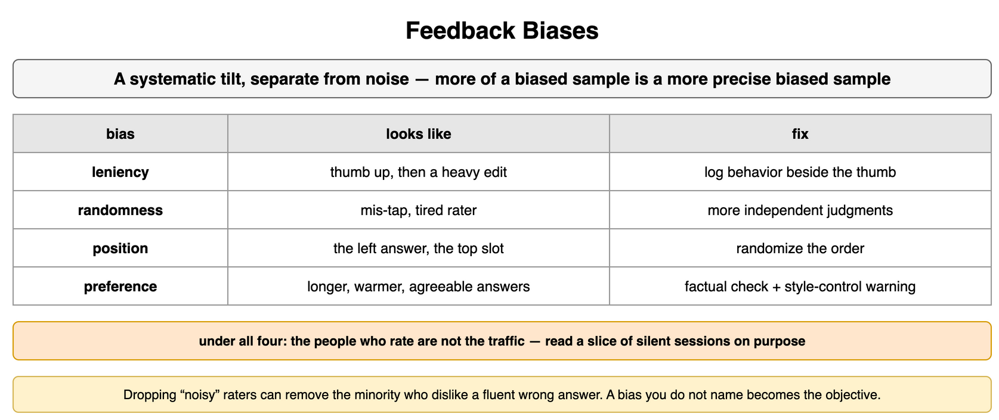

*Source: [`diagrams/ai-engineering-architecture.drawio`](/content/10_AI_Engineering/10_AI_Engineering_Architecture_and_User_Feedback/diagrams/ai-engineering-architecture.drawio), page 24.*

## A confidence interval on a thumb rate

A confidence interval on a thumb rate is the range the clicks you already collected can support, under a stated approximation.

It is not a labeling plan. The annotation card in [Evaluate AI Systems](../04_Evaluate_AI_Systems/) sizes a comparison of 70% versus 73% accuracy, with a two-sided 5% Wald test and 80% power, at 3,551 per independent arm unpooled or 3,554 with a pooled significance term. This card describes one existing rate. In the exercise (not a ChatGPT statistic), 336 of 480 ratings are thumbs up, a 0.70 rate. A two-sided 95% Wald interval, without continuity correction and using the same 1.959963984540054 quantile, has standard error `sqrt(p (1 − p) / n)`, margin 0.0410, and interval 0.6590 to 0.7410. With 336 ups and 144 downs, the normal approximation is reasonable and the rate is far from 0 or 1, where Wald can leave `[0, 1]`. When misses are a handful, Wilson's score interval stays in bounds; the Japanese-slice drill shows 10 misses separating Wald and Wilson, but this is not that case.

At this rate, a ±0.03 Wald margin takes 897 ratings, rounded up. That is not 3,551: one is the width of a single rate, the other power to detect a 3-point gap between two independent arms, a harder question with a different formula. A week of 480 ratings cannot support claims finer than about four points. Publishing the interval stops a one-point move from becoming a launch decision, but it measures sampling noise, not whether the raters represent traffic; 897 ratings narrow the margin and do nothing about leniency. Comparing weeks needs an interval on the difference or the annotation card's test, not two overlapping glances.

```python
import math

Z_975 = 1.959963984540054
RATINGS = 480
THUMBS_UP = 336
# Exercise ratings, not a ChatGPT statistic.
rate = THUMBS_UP / RATINGS
standard_error = math.sqrt(rate * (1.0 - rate) / RATINGS)
margin = Z_975 * standard_error
# Ratings so a rate of 0.70 has a Wald margin of 0.03, rounded up.
needed = math.ceil(rate * (1.0 - rate) / (0.03 / Z_975) ** 2)
print(f"{rate:.2f} {margin:.4f} {rate - margin:.4f} {rate + margin:.4f} {needed}")
# 0.70 0.0410 0.6590 0.7410 897
```

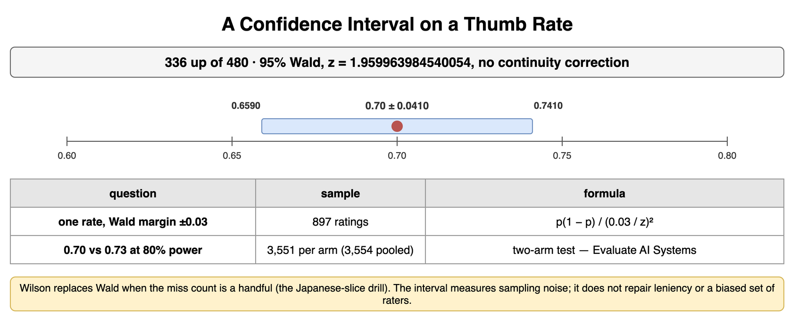

*Source: [`diagrams/ai-engineering-architecture.drawio`](/content/10_AI_Engineering/10_AI_Engineering_Architecture_and_User_Feedback/diagrams/ai-engineering-architecture.drawio), page 25.*

## Online experiments

An online experiment serves two pinned variants to assigned traffic and compares a metric you declared before you looked.

A before-and-after thumb rate cannot separate a model change from a traffic change, the drift card's confusion. An experiment holds assignment so both arms see the same weeks. Fractional rollouts are how a new ChatGPT snapshot or Copilot change reaches some people first; do not invent their percentages. The frozen eval in [Evaluate AI Systems](../04_Evaluate_AI_Systems/) remains the quality gate. The online metric is one defined here, such as acceptance per suggestion shown, thumbs per rating offered, regenerates per eligible answer, or resolved tickets, and these are not summed into one score. Assign a user or tenant for the test's life. Per-request assignment can show one person both drafts and confounds the arms, though it reacts faster; sticky assignment is interpretable and slower to move someone off a broken arm.

Sizing stays separate. A single 0.70 thumb rate needs 897 ratings for a ±0.03 Wald margin; detecting 0.70 versus 0.73 accuracy at 80% power needs 3,551 per independent arm unpooled. Comparing two rates is the second question. Peeking hourly and stopping when the interval first looks good inflates false launches, so predeclare metric, arm, and read. Recommenders can interleave rankers in one list so clicks compare under equal exposure, which is the wrong tool for an unmixable chat reply. Still log what was shown, not only clicks, and do not train on clicks created by the layout. Writes stay off the unscored arm: a refund, sent email, or merge does not use a model the eval never scored merely because the gateway can fall back (the provider-outage drill). The write gate in [RAG and Agents](../06_RAG_and_Agents/) still runs on any arm allowed to propose actions. Small experiments protect most people and leave wide intervals; large ones narrow intervals and can push a regression into the queue. Shipping because thumbs moved while the frozen eval did not repeats the metrics-card failure.

```text
pin        both variants (model id, template)
assign     user or tenant, sticky
declare    one metric and the read, before looking
size       897 = one rate's margin; 3,551/arm = power for a difference
writes     only on the arm the eval scored
```

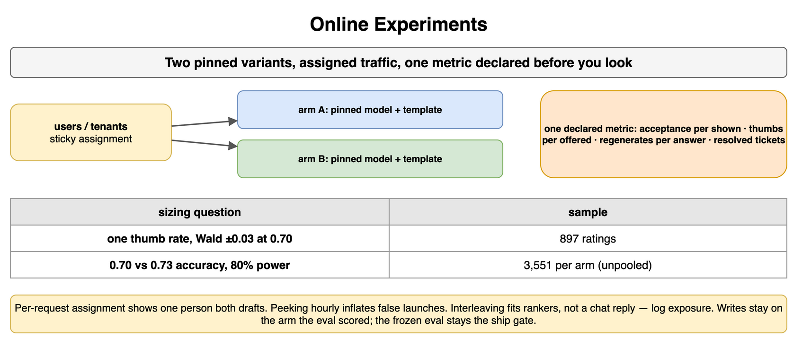

*Source: [`diagrams/ai-engineering-architecture.drawio`](/content/10_AI_Engineering/10_AI_Engineering_Architecture_and_User_Feedback/diagrams/ai-engineering-architecture.drawio), page 26.*

## Degenerate feedback loops

A degenerate feedback loop is a system that trains on behavior its own outputs created, and then produces more of that behavior.

Sycophancy is the chat-product loop: people prefer agreement, preference tuning increases agreement, and the next thumbs reward it. Sharma et al. (ICLR 2024) found sycophancy in five assistants across four free-form tasks. In the preference data examined, responses matching user views were more likely to be preferred, and both people and preference models sometimes preferred convincing sycophancy over correctness. Optimizing against a preference model sometimes sacrificed truthfulness. The same sweeps raised some forms and lowered others, so "thumbs always worsen every behavior" overstates it. Keep the mechanism: a thumb that rewards agreement rewards agreement, so a factual check belongs in the objective if correctness is the goal. A reward that always contradicts users is a product people abandon, as the mixed sweeps suggest agreement is not the only preference feature.

Popularity bias is the recommender version. YouTube's homepage and Spotify's playlists show items, people play them, and plays justify showing them again. The never-shown long tail cannot earn the play that would promote it, and the first slot's clicks justify its position. Break the loop by randomizing a traffic slice, logging exposures as well as clicks, and holding out items or prompts the loop cannot touch. Exploration spends impressions on worse items to reduce bias. For models, the eval set excluded from training ([Dataset Engineering](../08_Dataset_Engineering/)) is the holdout, and a canary set of user-wrong questions is the sycophancy holdout; if it never enters training, the loop cannot grade itself on it. Training on real preferences can make the product feel better and less truthful, while refusing all user signal leaves a model that never learns your queue. Logged exposure enables debiasing and records what you showed. The degenerate failure is selecting the checkpoint because its thumb rate rose.

```text
chat         agreement -> thumbs -> more agreement   (Sharma et al., ICLR 2024)
recommender  exposure -> clicks -> more exposure
breaks       factual check in the reward, user-wrong canaries, logged exposure, random slice
```

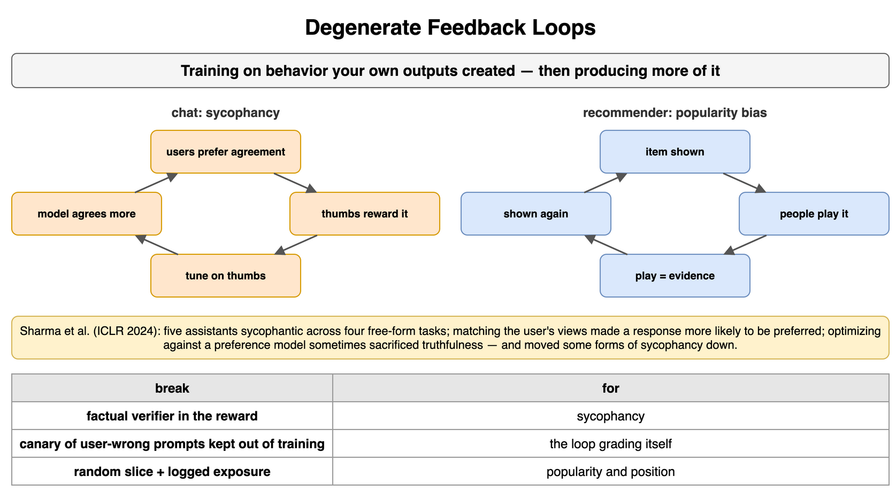

*Source: [`diagrams/ai-engineering-architecture.drawio`](/content/10_AI_Engineering/10_AI_Engineering_Architecture_and_User_Feedback/diagrams/ai-engineering-architecture.drawio), page 27.*

## What traces and feedback may keep

Retention is the decision of which text you store, for how long, who can read it, and which of those rows may train a model.

The logs-and-traces card's default record is ids, versions, routes, verdicts, passage ids, and token counts. Prompts and completions are a separate decision. OpenTelemetry's GenAI conventions, still Development in November 2026, make `gen_ai.input.messages` and `gen_ai.output.messages` Opt-In because they copy conversations into trace backends; enabling them needs privacy review. Input redaction must run before that write, or a trace containing the redacted card number undoes the guardrail. A hash of a low-entropy card number is still guessable and sensitive, so store that redaction fired, not the span. Keeping raw prompts enables replay and makes every trace tool another copy of customer data; keeping only ids makes incidents harder and keeps the card number out.

A short debug window, letting on-call read redacted traces of yesterday's incident, differs from a training export with its own purpose, access list, and deletion path. A year of raw prompts helps a postmortem you will not run and is the liability guardrails were meant to shrink. Short retention protects people and can expire the trace needed on day eight. Anyone who can open LangSmith, Langfuse, or Phoenix reads customer text; those tools are another store. A thumb, star, or regenerate bit is not the prompt; the prompt and judged completion are sensitive. ChatGPT conversation deletion, Copilot acceptance logs, training opt-outs, and rows already copied into your gateway log or training file are different controls. Product deletion does not clear stores you operate unless the deletion request maps to them, or you will train on removed text. Treating deletion as thumbs-down, already warned against, also fails privacy if the text remains in training. Consent to improve the product is not consent to paste a ticket into a public eval set, and an edit becomes a training pair only when its use is permitted and it is better (the acquiring-data card).

```text
default         ids, versions, verdicts, passage ids, token counts
prompt text     a named purpose, after redaction, Opt-In attributes on purpose
debug window    short, redacted
training export separate store, access list, deletion path
deletion        must name every store, including logs and exports
```

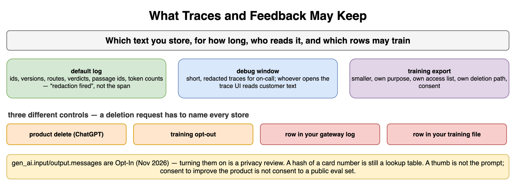

*Source: [`diagrams/ai-engineering-architecture.drawio`](/content/10_AI_Engineering/10_AI_Engineering_Architecture_and_User_Feedback/diagrams/ai-engineering-architecture.drawio), page 28.*

## Feedback and the data flywheel

The data flywheel is the path from a shipped product's feedback to the next prompt or the next model, closed by an eval the feedback is not allowed to rewrite.

Serve a pinned template and model. Collect a defined signal: a comparison, a fact-changing edit, or an acceptance stored beside the final text. Redact it, drop or label uninterpretable cases from the biases card, and write trainer-readable rows per the acquiring-data card in [Dataset Engineering](../08_Dataset_Engineering/). An edit is a preference pair only when better, and thumbs are not traffic; the $3,125.00 exercise labeling budget stays there. Train or rewrite the prompt, then score on a frozen eval the new rows are not in. Ship only if that eval, latency, and cost clear the maintenance card's bars; a thumb rate whose interval runs 0.6590 to 0.7410 is not the gate. An online experiment can choose the checkpoint, but the thumb rate alone cannot. Skipping the gateway cost check lets a slightly better model double the bill.

Consent and purpose bind the loop before any row is written: a logged Copilot acceptance is not automatically a training example. The retention card governs what text may be stored and what product deletes do not erase, and terms must allow the use. A finetune, when earned, is the model tier in [Finetuning](../07_Finetuning/). The limits-of-AI-generated-data card bounds the loop: training only on your own outputs with no human text or factual check is the recursive replacement regime, while a checked slice of edits mixed with trusted data is different. Real traffic makes the flywheel useful; previous mistakes, user misconceptions, and chosen exposures make it dangerous. Debiased comparisons with logged order, checked fact-changing edits, and stored acceptances with suggestions may enter, the latter only as weak lenient pairs. Bare thumbs may enter dashboards but not training alone; deletions and the eval set may not enter. Add this week's incidents to the eval, not training, so the eval keeps up without contamination and does not go stale. A fast flywheel ships real requests and yesterday's sycophancy; a slow one with a human slice is honest and late. Training on edits improves cases people fix and ignores silent wrong answers. The AI product defensibility card in [Introduction to Building AI Applications with Foundation Models](../01_Introduction_to_Building_AI_Applications_with_Foundation_Models/) explains why permitted traffic can be a moat even when competitors call the same model. A flywheel you cannot legally close is a log, and it needs an owner like any production process.

```text
serve pinned id -> collect defined signal -> redact -> filter -> training file
-> train or change prompt -> frozen eval (file cannot touch it) -> latency + cost -> ship
may enter:      debiased comparisons, checked edits, stored accepts (weak)
may not enter:  bare thumbs, deletions, the eval set
```

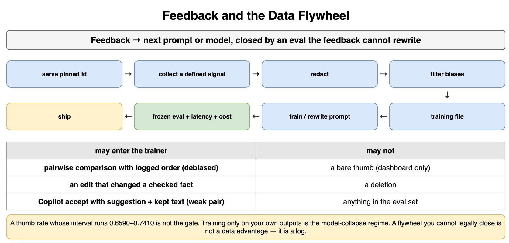

*Source: [`diagrams/ai-engineering-architecture.drawio`](/content/10_AI_Engineering/10_AI_Engineering_Architecture_and_User_Feedback/diagrams/ai-engineering-architecture.drawio), page 29.*
