## Divisibility

A positive integer `a` is divisible by `d` when `a % d == 0`: the division leaves no remainder. Checking a few small divisors by hand is faster if you use a rule that looks at the digits instead of doing the full division. A number is divisible by 2 when its last digit is even, by 5 when the last digit is 0 or 5, and by 4 when the last two digits form a number divisible by 4. It is divisible by 3 when the sum of its digits is divisible by 3, and by 9 when that digit sum is divisible by 9. It is divisible by 6 when it is divisible by both 2 and 3.

These rules are consequences of place value. Because 10 ≡ 1 (mod 3) and 10 ≡ 1 (mod 9), a number and the sum of its digits leave the same remainder. Because 100 is divisible by 4, only the last two digits matter for divisibility by 4. Use the rules to reject candidates early; still divide when you need the quotient or the exact remainder.

```python
def digit_sum(n: int) -> int:
    n = abs(n)
    while n >= 10:
        n = sum(int(ch) for ch in str(n))
    return n

n = 5832
print(digit_sum(n), n % 9, n % 4)  # 9 0 0
```

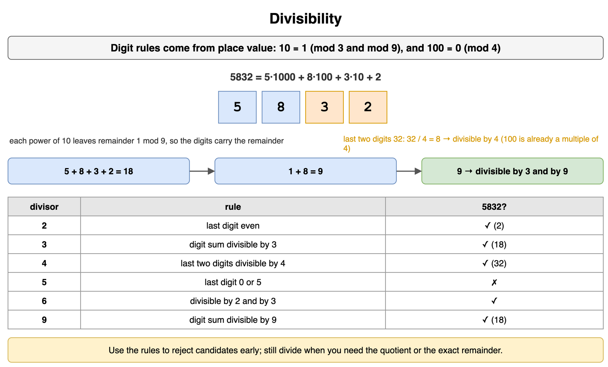

*Source: [`diagrams/math-and-logic-puzzles.drawio`](/content/11_Coding_Problems/01_Math_and_Logic_Puzzles/diagrams/math-and-logic-puzzles.drawio), page 1.*

## Checking for primality

A prime number has exactly two positive divisors: 1 and itself. So 2 is prime, and 1 is not, because 1 has only one positive divisor. The straightforward test is trial division: if any integer from 2 through `floor(sqrt(n))` divides `n`, then `n` is composite. You can stop at the square root because a factor larger than `sqrt(n)` would be paired with a factor smaller than `sqrt(n)`, and that smaller factor would already have been found.

After handling 2, test only odd candidates. The test is O(sqrt(n)) divisions, which is fine for a single moderate `n` and too slow when you need every prime up to a large limit. In Python, `math.isqrt(n)` is the right bound: it is exact, unlike `int(math.sqrt(n))`, which can fall short on some perfect squares because of floating-point rounding.

```python
import math

def is_prime(n: int) -> bool:
    if n < 2:
        return False
    if n % 2 == 0:
        return n == 2
    for d in range(3, math.isqrt(n) + 1, 2):
        if n % d == 0:
            return False
    return True

print(is_prime(1), is_prime(143), is_prime(149))  # False False True
```

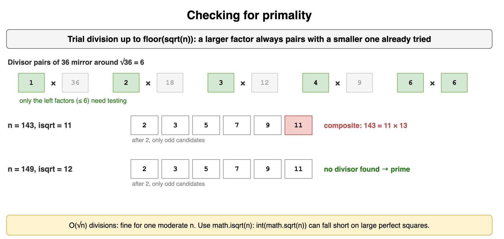

*Source: [`diagrams/math-and-logic-puzzles.drawio`](/content/11_Coding_Problems/01_Math_and_Logic_Puzzles/diagrams/math-and-logic-puzzles.drawio), page 2.*

## Sieve of Eratosthenes

When the question asks for every prime up to `n`, testing each number separately repeats a lot of division. The sieve marks composites in bulk. Allocate a boolean array `is_prime[0..n]`, set 0 and 1 to false, and then for each `p` from 2 through `floor(sqrt(n))` that is still marked prime, mark `p*p, p*p+p, p*p+2p, ...` as composite.

Starting at `p*p` is safe: any smaller multiple `k*p` with `k < p` was already marked when the sieve processed `k`. The algorithm runs in O(n log log n) time and O(n) memory. That trade is worth it once you need the whole list, or once many later primality checks can be answered with an array lookup.

```python
import math

def sieve(n: int) -> list[int]:
    is_prime = [False, False] + [True] * (n - 1)
    for p in range(2, math.isqrt(n) + 1):
        if is_prime[p]:
            for multiple in range(p * p, n + 1, p):
                is_prime[multiple] = False
    return [i for i, prime in enumerate(is_prime) if prime]

print(sieve(30))
# [2, 3, 5, 7, 11, 13, 17, 19, 23, 29]
```

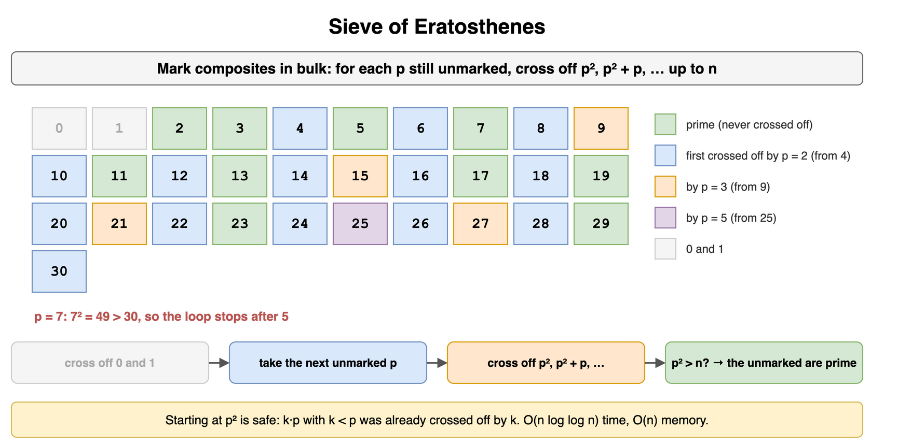

*Source: [`diagrams/math-and-logic-puzzles.drawio`](/content/11_Coding_Problems/01_Math_and_Logic_Puzzles/diagrams/math-and-logic-puzzles.drawio), page 3.*

## Probability of A and B

`P(A and B)` is the probability that both events happen on the same trial. The general rule is `P(A and B) = P(A) * P(B | A)`, where `P(B | A)` means "the probability of B given that A already happened." When A and B are independent, learning A changes nothing about B, so the conditional probability equals `P(B)` and the joint probability is just the product.

"And" walks into the overlap of the two sets, so the result is at most as large as the smaller of `P(A)` and `P(B)`. On a fair die, "even" and "greater than 3" are {2, 4, 6} and {4, 5, 6}. The overlap is {4, 6}, so the joint probability is 2/6, not (1/2)*(1/2). The product would be wrong because the events are not independent: half of the even faces are greater than 3, but two thirds of the faces greater than 3 are even.

```python
faces = range(1, 7)
even_and_gt3 = [f for f in faces if f % 2 == 0 and f > 3]
print(len(even_and_gt3), len(even_and_gt3) / 6)  # 2 0.333...
```

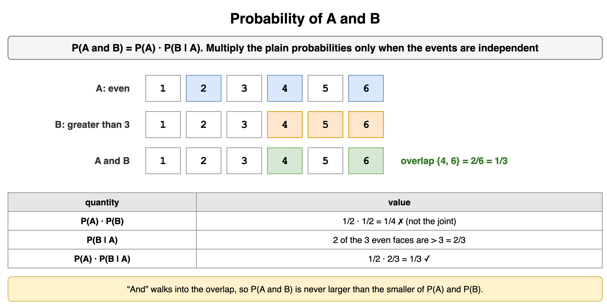

*Source: [`diagrams/math-and-logic-puzzles.drawio`](/content/11_Coding_Problems/01_Math_and_Logic_Puzzles/diagrams/math-and-logic-puzzles.drawio), page 4.*

## Probability of A or B

`P(A or B)` is the probability that at least one of the events happens. Adding `P(A) + P(B)` counts the overlap twice, once inside each event, so subtract it once: `P(A or B) = P(A) + P(B) - P(A and B)`. If the events are mutually exclusive, the overlap is empty and the probabilities add with nothing to subtract.

On one fair die, "even" or "greater than 4" is {2, 4, 6} ∪ {5, 6} = {2, 4, 5, 6}, which is 4/6. The formula gives 3/6 + 2/6 - 1/6 = 4/6. The complementary form is often shorter: `P(at least one) = 1 - P(none)`. For two dice, the chance of at least one 6 is `1 - (5/6)*(5/6) = 11/36`, because the dice are independent and "no 6" has probability 5/6 on each of them.

```python
both = range(1, 7)
at_least_one_six = sum(1 for a in both for b in both if a == 6 or b == 6)
print(at_least_one_six, at_least_one_six / 36)  # 11 0.305...
```

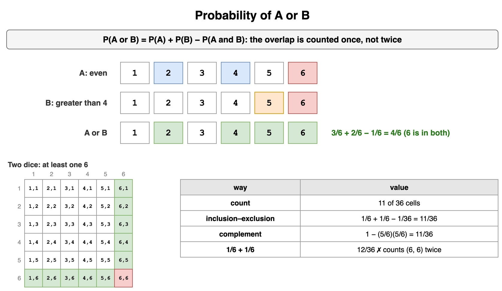

*Source: [`diagrams/math-and-logic-puzzles.drawio`](/content/11_Coding_Problems/01_Math_and_Logic_Puzzles/diagrams/math-and-logic-puzzles.drawio), page 5.*

## Independence

Two events are independent when knowing that one happened does not change the probability of the other. The tests are equivalent: `P(B | A) = P(B)`, or `P(A and B) = P(A) * P(B)`, provided `P(A)` is not zero. Separate physical random sources are the usual reason: two coins, two dice, or a shuffled card and a later independent coin flip.

Independence is about information, not about whether the events can overlap. Two coin flips can both be heads, and they are still independent. Do not assume independence because a story says "random" twice. If both events are functions of the same draw, check the product against an actual count of outcomes before multiplying.

```python
# Two fair coins. P(first heads) = 1/2, P(both heads) = 1/4, product matches.
print((1 / 2) * (1 / 2) == 1 / 4)  # True
```

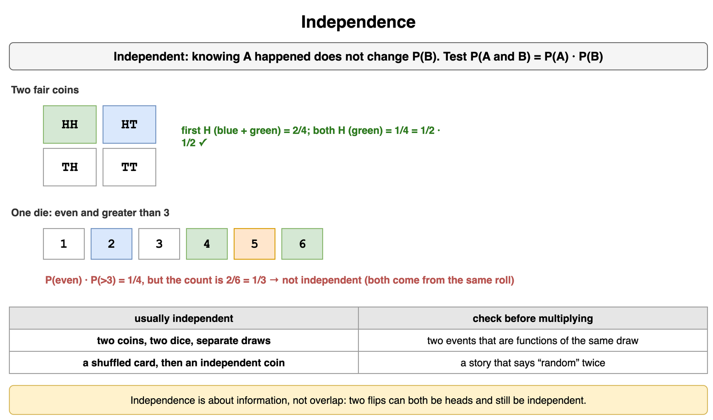

*Source: [`diagrams/math-and-logic-puzzles.drawio`](/content/11_Coding_Problems/01_Math_and_Logic_Puzzles/diagrams/math-and-logic-puzzles.drawio), page 6.*

## Mutual exclusivity

Mutually exclusive events cannot happen together. Their intersection is empty, so `P(A and B) = 0` and the "or" rule collapses to a sum. "The card is a heart" and "the card is a spade" are mutually exclusive: one card has one suit.

If both probabilities are positive, mutually exclusive events are dependent. Learning that the card is a heart tells you it is not a spade, so `P(spade | heart) = 0`, which is not `P(spade)`. A common slip is to hear "they cannot both happen" and multiply the probabilities anyway. Multiplication is the independent "and" rule. Disjoint events use addition for "or" and zero for "and."

```python
p_heart, p_spade = 13 / 52, 13 / 52
print(p_heart * p_spade)          # 0.0625, not the joint probability
print(0)                          # P(heart and spade)
print(p_heart + p_spade)          # 0.5, P(heart or spade)
```

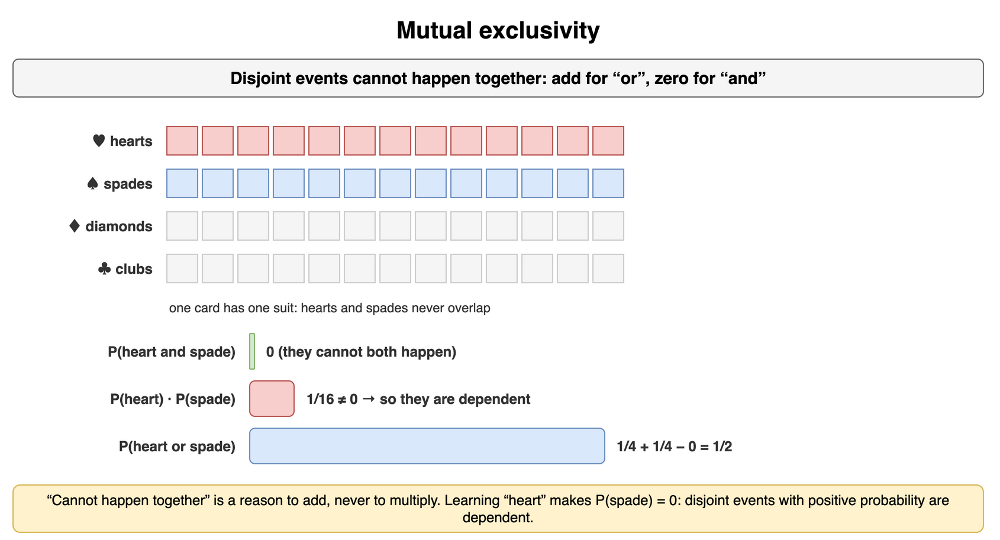

*Source: [`diagrams/math-and-logic-puzzles.drawio`](/content/11_Coding_Problems/01_Math_and_Logic_Puzzles/diagrams/math-and-logic-puzzles.drawio), page 7.*

## Start talking

A logic puzzle is graded on the search you show, not only on the final sentence. Restate the goal, list what is known, and name the assumption you are about to use. Then work a smaller version out loud: two items instead of twenty, one round instead of "eventually." The interviewer can correct a wrong reading of the problem only if they hear it.

Talking also stops you from polishing a guess in silence until you believe it. Say "I am checking whether the wait is uniform over a fixed gap" or "I am assuming every label is wrong, including the mixed one." If that assumption is the whole puzzle, you will notice. If it is wrong, you find out before the algebra.

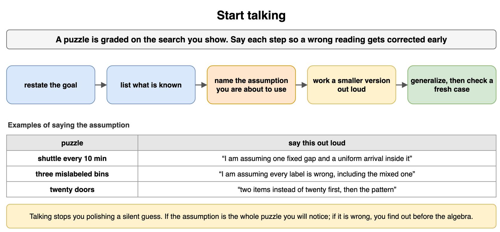

*Source: [`diagrams/math-and-logic-puzzles.drawio`](/content/11_Coding_Problems/01_Math_and_Logic_Puzzles/diagrams/math-and-logic-puzzles.drawio), page 8.*

## Develop rules and patterns

When a puzzle is a sequence or a repeated process, compute the first few cases by hand and write down what changed. Look for one of three things: an invariant that is true after every step, a recurrence that builds case `n` from earlier cases, or a closed form you can test. The differences between terms are often the rule. If the differences themselves grow by a constant, the closed form is quadratic, the same shape as triangular numbers.

Invent the rule from cases 1 through 4, then test it on a case you did not use. A rule that only fits the numbers you stared at is a coincidence until it survives a fresh case. If it fails, the failure is the next clue: which feature of that case did the rule ignore?

```python
def round_score(n: int) -> int:
    """1, 2, 4, 7, 11, ... = 1 + 0 + 1 + ... + (n - 1)."""
    return 1 + n * (n - 1) // 2

print([round_score(n) for n in range(1, 7)])  # [1, 2, 4, 7, 11, 16]
```

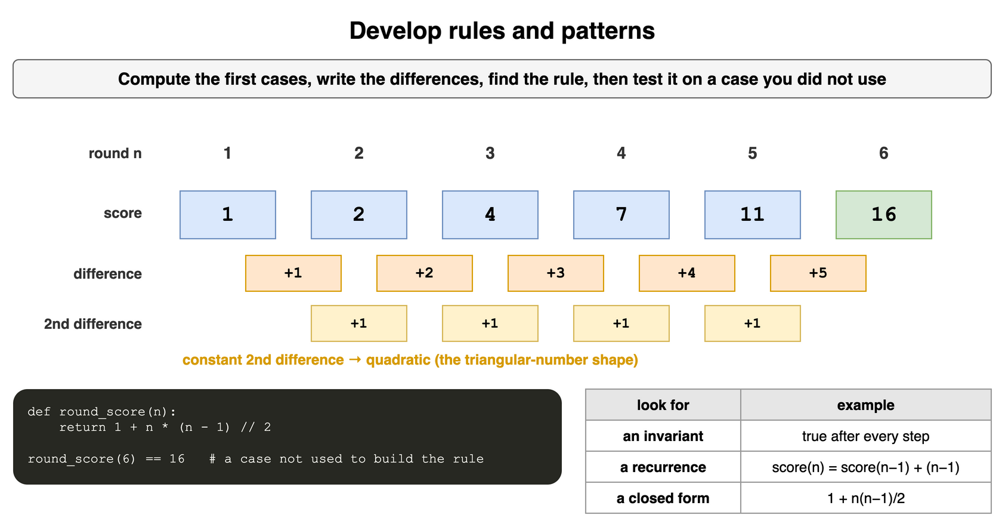

*Source: [`diagrams/math-and-logic-puzzles.drawio`](/content/11_Coding_Problems/01_Math_and_Logic_Puzzles/diagrams/math-and-logic-puzzles.drawio), page 9.*

## Worst case shifting

Some puzzles ask for a strategy that minimizes the worst case, not the average case. Each test should split the remaining possibilities into groups that are as equal as possible, because the next worst case is the size of the largest group you might have left. A yes/no question has two outcomes, so split in half. A balance scale has three outcomes (left heavy, right heavy, balance), so split into three groups.

There is also a counting bound you can say before inventing the procedure. `k` tests with `b` outcomes distinguish at most `b^k` possibilities. With 9 crates and a scale, `3^2 = 9`, so two weighings are enough and one is not. With 20 doors and yes/no questions, `2^4 = 16` is short and `2^5 = 32` covers them, so five questions are the minimum that can guarantee an answer. A strategy that matches the bound is optimal.

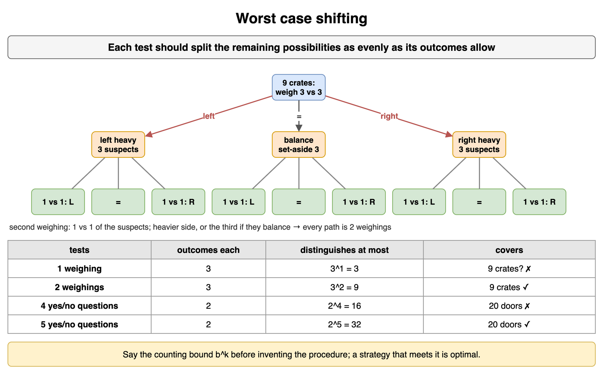

*Source: [`diagrams/math-and-logic-puzzles.drawio`](/content/11_Coding_Problems/01_Math_and_Logic_Puzzles/diagrams/math-and-logic-puzzles.drawio), page 10.*

## Algorithm approaches

Some puzzle prompts are algorithm prompts in disguise. Say the correct brute force and its cost, then name the improvement and why it stays correct. The usual moves in this topic are: trial division up to the square root for one primality test; a sieve when you need many primes; Euclid's algorithm instead of factoring both numbers to get a GCD; binary exponentiation instead of `n` multiplications; and reducing mod `m` after every arithmetic step so intermediate values stay small.

Match the tool to the output. One yes/no answer does not need an array of every prime. A list of primes does not need a fresh square-root loop per candidate. A power modulo `m` does not need the full integer `a^n`. State that choice out loud; it is the design of the solution.

```python
import math

def count_primes_trial(n: int) -> int:
    def prime(x: int) -> bool:
        if x < 2:
            return False
        return all(x % d for d in range(2, math.isqrt(x) + 1))
    return sum(prime(x) for x in range(n + 1))

print(count_primes_trial(30))  # 10, but a sieve does this without repeating factors
```

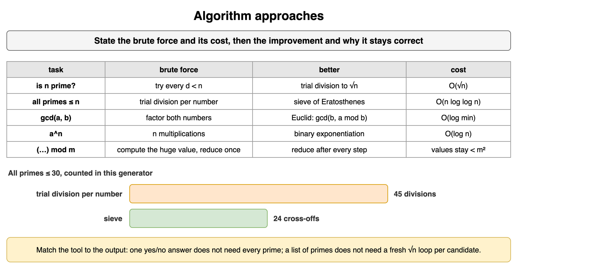

*Source: [`diagrams/math-and-logic-puzzles.drawio`](/content/11_Coding_Problems/01_Math_and_Logic_Puzzles/diagrams/math-and-logic-puzzles.drawio), page 11.*

## GCD and LCM

The greatest common divisor of `a` and `b` is the largest positive integer that divides both. Euclid's algorithm replaces the larger number with the remainder: `gcd(a, b) = gcd(b, a % b)`, and `gcd(a, 0) = |a|`. The remainder is strictly smaller than `b`, so the loop ends in O(log min(|a|, |b|)) steps. Factoring both numbers also works and is slower.

The least common multiple is the smallest positive integer that both divide. For nonzero integers, `gcd(a, b) * lcm(a, b) = |a * b|`, so `lcm(a, b) = |a| / gcd(a, b) * |b|`. Divide before multiplying. `a * b / gcd` is the same mathematically and a larger intermediate value, which is how a fixed-width integer overflows on inputs that the divide-first form handles.

```python
def gcd(a: int, b: int) -> int:
    a, b = abs(a), abs(b)
    while b:
        a, b = b, a % b
    return a

def lcm(a: int, b: int) -> int:
    if a == 0 or b == 0:
        return 0
    return abs(a) // gcd(a, b) * abs(b)

print(gcd(1071, 462), lcm(18, 24))  # 21 72
```

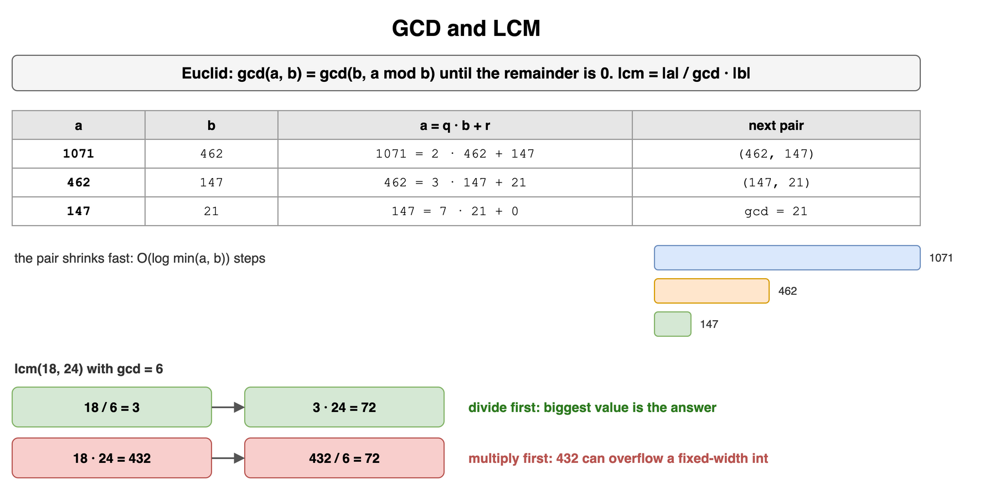

*Source: [`diagrams/math-and-logic-puzzles.drawio`](/content/11_Coding_Problems/01_Math_and_Logic_Puzzles/diagrams/math-and-logic-puzzles.drawio), page 12.*

## Modular arithmetic

Two integers are congruent mod `m` when `m` divides their difference. The useful arithmetic rules are that you may reduce before you add or multiply: `(a + b) mod m = ((a mod m) + (b mod m)) mod m`, and the same shape holds for products. Subtraction is addition of the negation. Division is not "divide, then wrap." `a / b mod m` means `a` times the modular inverse of `b`, and that inverse exists only when `gcd(b, m) = 1`.

Stay careful about the sign of a remainder. Python's `%` returns a result in `0 .. m-1` even when the left side is negative. In C and Java the sign follows the dividend, so a negative intermediate needs `((x % m) + m) % m` before you use it as an index or a digit. Reducing early does not change the result; it keeps each step inside a range you can compute without a big integer.

```python
print((98 * 97) % 17)                         # 3
print(((98 % 17) * (97 % 17)) % 17)           # 3
print((-5) % 17)                              # 12 in Python
```

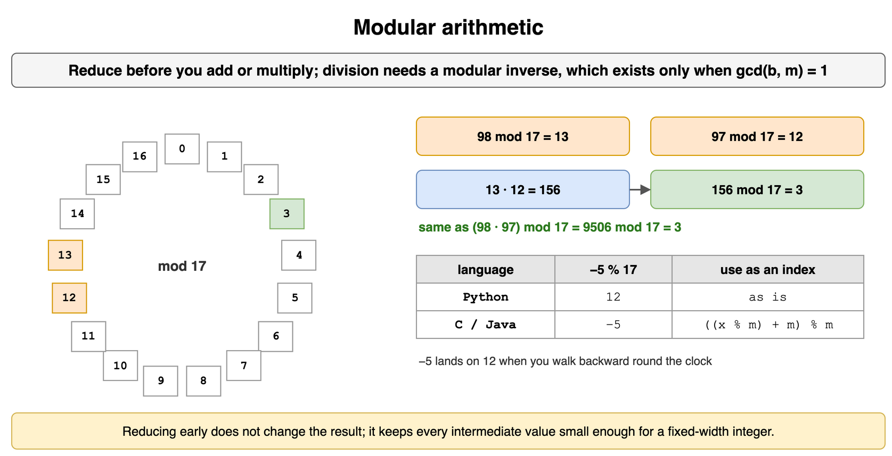

*Source: [`diagrams/math-and-logic-puzzles.drawio`](/content/11_Coding_Problems/01_Math_and_Logic_Puzzles/diagrams/math-and-logic-puzzles.drawio), page 13.*

## Fast exponentiation

Multiplying `a` by itself `n` times computes `a^n` with O(n) multiplications. Binary exponentiation uses the binary expansion of the exponent. Square the base to move to the next bit, and multiply that square into the result only when the current bit is 1. Because `n` has O(log n) bits, the algorithm does O(log n) multiplications.

Combine it with the modular rule: reduce mod `m` after every square and every multiply into the accumulator. Then `a^n mod m` never builds `a^n` itself. That is the routine behind last-digit questions, clock arithmetic, and any fixed-width language where `a^n` would overflow long before the final remainder is taken. An iterative loop is easier to get right in an interview than a recursive one, and it uses O(1) extra space.

```python
def mod_pow(base: int, exp: int, mod: int) -> int:
    result = 1
    base %= mod
    while exp:
        if exp & 1:
            result = (result * base) % mod
        base = (base * base) % mod
        exp >>= 1
    return result

print(mod_pow(5, 13, 100))  # 25
```

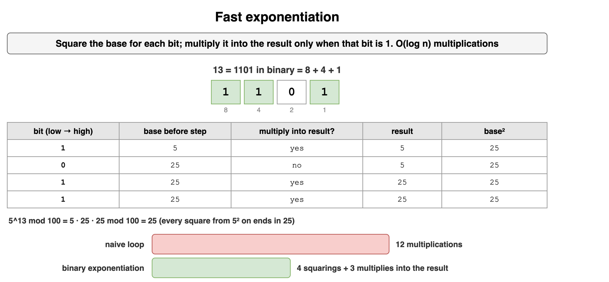

*Source: [`diagrams/math-and-logic-puzzles.drawio`](/content/11_Coding_Problems/01_Math_and_Logic_Puzzles/diagrams/math-and-logic-puzzles.drawio), page 14.*

## Overflow awareness

A fixed-width integer wraps, or the language calls it undefined, when a mathematical result leaves the type's range. Signed 32-bit values run from `-2^31` to `2^31 - 1`. The classic trap in binary search is `mid = (lo + hi) / 2` when `lo` and `hi` are both large and positive: each endpoint fits, and their sum does not. The wrapped sum is negative, and the midpoint becomes nonsense. `lo + (hi - lo) / 2` stays inside the range as long as `lo` and `hi` do, because `hi - lo` is smaller than `hi` when `lo` is nonnegative.

The same habit shows up in products. Compute an LCM by dividing out the GCD first. Compute a power mod `m` by reducing after each multiply, not by taking a huge power and then one remainder. Python hides this because `int` grows. Say so in the interview, and write the expression you would use in Java or C when the prompt implies a fixed width. Detecting a signed add overflow after the fact is possible (the operands share a sign and the wrapped result does not), but arranging the arithmetic so the overflow never happens is the better fix.

```python
def wrapping_add_i32(a: int, b: int) -> int:
    raw = (a + b) & 0xFFFFFFFF
    return raw - 0x100000000 if raw >= 0x80000000 else raw

lo, hi = 2_000_000_000, 2_000_000_010
print(wrapping_add_i32(lo, hi) // 2)   # a negative midpoint
print(lo + (hi - lo) // 2)             # 2000000005
```

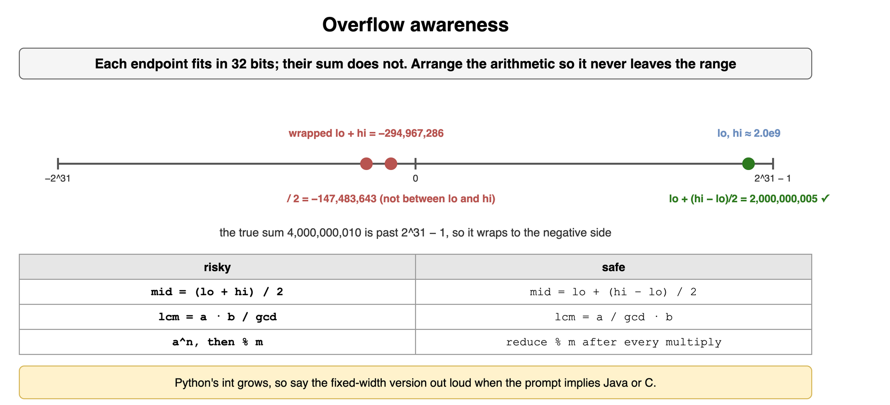

*Source: [`diagrams/math-and-logic-puzzles.drawio`](/content/11_Coding_Problems/01_Math_and_Logic_Puzzles/diagrams/math-and-logic-puzzles.drawio), page 15.*
