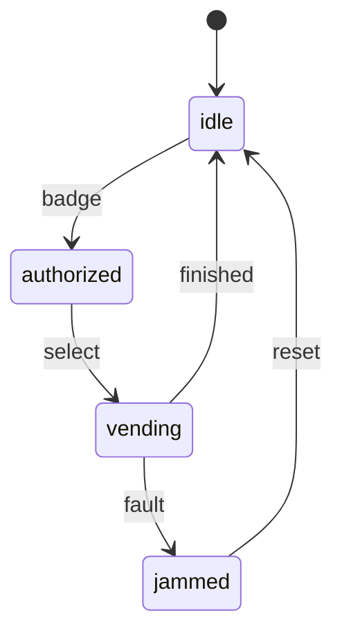

## Handle ambiguity

An object-oriented design prompt is unfinished on purpose. Before you name classes, say what you are assuming and what you are leaving out. Useful questions are about who uses the system, which actions must work in this conversation, which rules the system is allowed to refuse, and what "full" or "done" means. Scale matters only when it changes the types: a cage for 40 bikes and a garage for 40,000 cars do not share a design.

Then stop asking and design against the assumptions you just stated. "I'll assume one bike per member, a hard capacity, and no payments in this round" is a better next sentence than another question. If the interviewer corrects you, change the assumption out loud. The trade-off to name is what you are not building yet: persistence, a UI, and a second product rule can wait until the core types survive one scenario.

```text
Pin it, then move:
  Actors: members only. No guests in this pass.
  Rule: one bike at a time, and a full cage refuses the next tap.
  Out of scope: billing, maps, and overnight storage.
```

## Define the core objects

A type earns a name when it owns state that changes, or when several decisions only make sense together on that state. Read the prompt for nouns, then cross most of them off. A barcode, a week, and the word "neighbor" are usually fields, durations, and actors, not classes. `Member`, `Tool`, and `Loan` survive because each one has data the others should not be free to rewrite.

Prefer a handful of types you can draw. A class list you cannot walk through is a glossary. If two candidate types always change together and neither is used alone, they are one type. If a candidate has no fields and only one method that needs nothing private, it is a function.

```text
Tool library, one week loans, three tools per person:
  Keep: Member, Tool, Loan
  Fields, not types: barcode, due date, the number 3
```

## Analyze relationships

Say how the types know each other, and say the cardinality. "Has a" (composition or a collection) means one object owns or holds others. "Knows a" (an association) means it keeps a reference but does not own the lifetime. "Is a" (inheritance) means a caller holding the parent type can be handed the child and still be correct. Most interview relationships are "has a" or "knows a." Reach for "is a" only when the child really can stand in for the parent.

A member has zero or more loans. A loan knows one member and one tool. A tool is not a loan, and a loan is not a member. Getting those two negatives out loud prevents a class diagram that is only a pile of arrows. If a tool can have two open loans, say so; that single sentence changes the invariant the `Tool` type must protect.

```text
Member 1 --- * Loan * --- 1 Tool
A tool has at most one open loan.
Loan is not a kind of Member.
```

## Investigate actions

Verbs in the prompt become methods, and the method belongs on the object that already holds the data needed to decide. A floor button should not tell a particular cab to move if a scheduler is the thing that knows about every cab. A cab button, pressed by someone already inside, is a different action and can live on the cab. Walk one scenario as messages: who calls, who answers, what is true afterward, and which refusal is allowed.

That walk is also where you talk about a trade-off. "The scheduler assigns cabs, so adding a third cab does not change the button. The cost is an extra type. I would not put the assignment rule inside `Cab`." If the walk needs a type you never named, add it. If a method on `A` needs private fields from `B` and `C`, the action is on the wrong object.

```text
Floor button -> Scheduler.request(floor)
Scheduler picks a Cab and calls Cab.go(floor)
Cab arrives -> Scheduler.mark_idle(cab)
A full or broken cab is skipped, not crashed.
```

## Encapsulation

Encapsulation means the type that owns the data is the only code that changes it, and it refuses changes that break its rules. Callers use operations (`vend`, `borrow`, `park`), not fields. A public `stock` counter lets any function drive the hopper negative. A private counter plus `vend()` that does nothing useful when the hopper is empty keeps the invariant in one place.

Getters are not the point. Returning a mutable internal list still lets the caller break the rule. Return a copy, a tuple, or a narrow method. In Python the leading underscore is a convention, not a lock; the discipline is that the rest of the program does not touch it. Say the invariant in a sentence the method can enforce: "stock is never negative," "a member never holds more than three open loans."

```python
class Hopper:
    def __init__(self, stock: int) -> None:
        if stock < 0:
            raise ValueError("stock")
        self._stock = stock

    def vend(self) -> bool:
        if self._stock == 0:
            return False
        self._stock -= 1
        return True

    @property
    def stock(self) -> int:
        return self._stock
```

## Inheritance

Inheritance says a child type is a parent type. Every place that accepts the parent must accept the child without surprise. That is the Liskov idea, and it is the test for whether the hierarchy is real. A compact cage that rejects cargo bikes is not a `BikeCage` if existing code is allowed to park a cargo bike in any `BikeCage`. Overriding `park` to throw has changed the parent's promise.

Share structure with inheritance only when the "is a" sentence survives that test. Needing three of the parent's methods is not the test. If it fails, the differing rule is a collaborator (a policy object), not a subclass. Deep trees that exist so a child can reuse a helper are the usual smell.

```python
class BikeCage:
    def park(self, cargo: bool) -> str:
        return "parked"

class CompactCage(BikeCage):
    def park(self, cargo: bool) -> str:
        if cargo:
            raise ValueError("cargo")  # breaks callers of BikeCage
        return "parked"
```

## Polymorphism

Polymorphism is the caller using a parent type or an interface while the runtime object chooses the method body. The caller does not ask `isinstance` and then branch. A round of a card game calls `rule.score(cards)`. High-card, match-two, and a sum limit are three rules behind one method. Adding a fourth rule is a new class, not a new arm in every caller.

The switch on type names is the design you are replacing. It works for two cases and rots on the fifth, because every new case edits code that already worked. Keep the differences inside the types that own them. If you cannot name the method the caller wants, you do not have the interface yet; you have a pile of unrelated classes.

```python
def winner(rule: "ScoreRule", hands: list[list[int]]) -> int:
    return max(range(len(hands)), key=lambda i: rule.score(hands[i]))
```

## Composition over inheritance

Composition means an object is built out of other objects and forwards work to them. A cup has additions; it is not a subclass for every combination of milk and syrup. The combinations explode (milk, syrup, milk-and-syrup, extra shot) and none of those subclasses is a new kind of cup. A list of additions, each asked for its own price and label, grows by one class per addition instead of one class per combination.

Prefer this whenever the thing you wanted to vary is a part, a policy, or a collaborator. Inheritance still fits a true subtype that honors the parent contract. In the interview, say the sentence: "I am not subclassing the cage for each fee. The cage has a fee policy." That is the extensibility trade-off: one more small type, and the cage stays closed when the next fee appears.

```python
class Cup:
    def __init__(self, additions: list) -> None:
        self.additions = list(additions)

    def price(self) -> int:
        return 300 + sum(item.price() for item in self.additions)
```

## Interfaces vs abstract classes

An interface (in Python, often a `Protocol` or a narrow ABC with no fields) names a capability and nothing else. Unrelated types can provide it: a fob reader, a QR reader, and a keypad all `admit(token) -> bool`, and they share no data. Callers depend on `admit`, so a new reader does not edit them. That is the dependency inversion you want at a boundary.

An abstract class is worth it when there is a real partial implementation: shared fields and a method you do not want to copy, with a few hooks left open. It is the wrong tool when the only shared thing is a method name, because it forces a common base onto types that are not the same kind of thing. In the interview, pick one and say why. "No shared state, so this is an interface" is a complete answer. Do not add an interface that has one implementation and no stated reason to grow a second.

```python
from typing import Protocol

class Admitter(Protocol):
    def admit(self, token: str) -> bool: ...
```

## SOLID

SOLID is five checks you can apply to a design you just drew, not a checklist you recite before you have types.

- **Single responsibility.** One type, one reason to change. A desk that evaluates the loan rule, writes a file, and sends mail changes for three unrelated reasons. Split the rule, the store, and the notifier.
- **Open/closed.** Add a behavior by adding a type, not by editing a switch that already shipped. A new fee policy is a new class behind the fee interface.
- **Liskov substitution.** A subtype must be usable wherever the parent is. If you override a method to reject inputs the parent accepted, the hierarchy is lying.
- **Interface segregation.** Keep the interface as small as the caller. A lantern does not need a `write_audit_log` method because some other listener does.
- **Dependency inversion.** High-level code depends on the capability (`Admitter`, `FeePolicy`), and something at the edge constructs the concrete reader or policy and passes it in.

```python
class LoanDesk:
    def __init__(self, store, notifier) -> None:
        self._store = store
        self._notifier = notifier

    def borrow(self, member, tool) -> str:
        loan = member.open_loan(tool)  # the rule stays on Member
        self._store.save(loan)
        self._notifier.send(member, loan)
        return loan.id
```

## Singleton

A singleton is a type that allows one instance and offers a global way to reach it. It fits a true process-wide resource whose identity must not diverge, such as the one configuration loaded at startup. It does not fit "this was convenient." Two bike cages in one process, or two tests in one process, will silently share the members, the stock, and the bugs.

The costs are hidden dependencies (a method reaches `Registry.instance()` instead of taking an argument), awkward tests (you must reset the global), and a construction race if two threads create it. Prefer constructing the object at the edge and passing it in. In Python a module-level instance is the honest version of "there is one of these in this program," and it is still something you pass into the objects that need it. If you do implement `__new__`, say who resets it in tests.

```python
class Registry:
    _instance = None

    def __new__(cls) -> "Registry":
        if cls._instance is None:
            cls._instance = super().__new__(cls)
            cls._instance.members = {}
        return cls._instance
```

## Factory method

A factory method hides which concrete type comes back. Callers depend on the interface they asked for (`Session`, `Pass`) and do not import every implementation or switch on a string themselves. The simplest interview shape is a function or a method on the reader: `open_session(kind, token)` returns a `FobSession` or a `QrSession`. The branching lives in one place, next to construction.

The pattern the name usually refers to is a hook. A base `Reader.admit` calls `self.open_session(token)`, and each subclass overrides `open_session` to build its own session. Use that when the surrounding steps (lockout, logging) are shared and only the construction differs. Use the plain function when there is no shared skeleton. Either way, say what you gained: adding a guest QR edits the factory, not every caller. The trade-off is an extra type and one place that must know all the kinds.

```python
def open_session(kind: str, token: str):
    if kind == "fob":
        return ("fob", token)
    if kind == "qr":
        return ("qr", token)
    raise ValueError(kind)
```

## Strategy

Strategy is a family of interchangeable algorithms behind one method, held as a field. The cage asks `self.fee.price(hours)` and does not know whether today is a member flat rate or an event hourly rate. Swapping the policy is a constructor argument, not an edit to `park`. That is the open/closed check in practical form.

Use it when the rule is likely to grow and the rest of the object should stay still. Do not use it for a single `if` that will never grow: a strategy type per one-line branch is ceremony. Say that trade-off. "Two fees, and a third is likely, so the cage has a `FeePolicy`. If there were one fee forever, I would inline it." The policy object should not reach back into the cage's private fields; pass it the numbers it needs.

```python
class MemberFlat:
    def price(self, hours: int) -> int:
        return 0

class EventHourly:
    def __init__(self, cents_per_hour: int) -> None:
        self.cents_per_hour = cents_per_hour

    def price(self, hours: int) -> int:
        return hours * self.cents_per_hour
```

## Observer

Observer means an object keeps a list of listeners and tells them when something happens, without knowing what they will do. When a cab arrives, the hall lantern and the arrival log both care. The cab should not import either of them. It calls each listener with the floor. A new display subscribes; `Cab` does not change.

Be explicit about three things. Listeners that are never removed pin memory. The order of notification is not a contract unless you say it is. A listener that throws should not strand the others unless you decide that one failure aborts the rest. If only one object will ever care, skip the list and pass that collaborator in. The pattern pays for itself on the second listener.

```python
class Cab:
    def __init__(self) -> None:
        self._listeners: list = []

    def listen(self, fn) -> None:
        self._listeners.append(fn)

    def arrive(self, floor: int) -> None:
        for fn in list(self._listeners):
            fn(floor)
```

## Decorator and Adapter

Both wrap an object. They answer different questions. A decorator implements the same interface as the thing it wraps and adds behavior around the delegated call. A `LoggingDoor.open` writes a line, then calls `inner.open`. You can stack another decorator (a rate limit, a retry) because each layer still looks like a door. The trade-off is another object in front of the real one, and identity checks (`door is inner`) stop working.

An adapter changes the shape so an existing caller can use a foreign type. A vendor gate offers `unlock(pin) -> int` with `0` for success. Your building speaks `open(credential) -> bool`. The adapter translates the credential into a pin and the integer into a boolean. It is not a stack of extra behavior; it is a seam at a boundary you do not control. Do not "decorate" your way across a different method signature. That translation is the adapter's job.

```python
class LoggingDoor:
    def __init__(self, inner) -> None:
        self.inner = inner
        self.log: list[str] = []

    def open(self, credential: str) -> bool:
        self.log.append(credential)
        return self.inner.open(credential)

class VendorGateAdapter:
    def __init__(self, gate) -> None:
        self.gate = gate

    def open(self, credential: str) -> bool:
        return self.gate.unlock(credential) == 0
```

## State machines

When behavior depends on where the object is in a lifecycle, name the states and the legal transitions before you write methods. A tool dispenser might be `idle`, `authorized`, `vending`, or `jammed`. Badge moves idle to authorized. Select moves authorized to vending. A fault moves vending to jammed. Select from idle does nothing useful, and that refusal is part of the design, not an edge you discover later.

Two implementations are worth offering. A transition table (a map from `(state, event)` to the next state) is easy to read and easy to test: every illegal pair is a missing key. The State pattern gives each state its own object and lets that object replace the dispenser's current state. Use the objects when each state has a lot of behavior; use the table when the interesting part is which edges exist. Say which you picked and why. Extensibility here is a new event or a new state added in one place, not a boolean `is_jammed` tangled with `is_authorized`.

```python
NEXT = {
    ("idle", "badge"): "authorized",
    ("authorized", "select"): "vending",
    ("vending", "finished"): "idle",
    ("vending", "fault"): "jammed",
    ("jammed", "reset"): "idle",
}

def step(state: str, event: str) -> str:
    try:
        return NEXT[(state, event)]
    except KeyError:
        raise ValueError(f"illegal {event} from {state}") from None
```


