## What the interviewer is looking for

A testing question is graded on the cases you choose and the reason you give, not on the name of a framework. Start from the promise the caller relies on, then the groups of inputs that share a result, then the values where that result changes, then the inputs the function must refuse. Say which of those you would automate and which layer each one belongs in.

Naming a runner, a coverage percent, or "I would write happy-path tests" is a thin answer. A useful answer sounds like: "Members pay nothing for the first two hours, so I want the last free hour and the first paid hour. Guests pay from the first hour. Nobody pays more than the cap. A negative hour is an error, not a fee." You can write the code after that sentence.

```text
Say, in order:
  the promise
  one ordinary case
  the boundaries between cases
  one refusal
  which layer runs the check
```

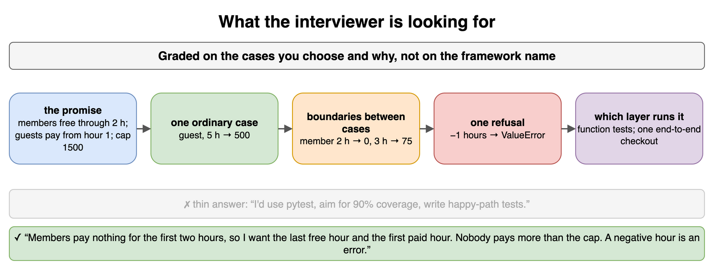

*Source: [`diagrams/testing.drawio`](/content/11_Coding_Problems/03_Testing/diagrams/testing.drawio), page 1.*

## Testing a real-world object

Before a function has a spec, you can practice the same categories on a physical thing. Take a workshop key cabinet. It should open for the right key, stay shut for the wrong key, and not spring open if it is already open. A bent key, a key turned halfway, and two people turning at once are the strange cases. You do not need the cabinet's schematic to list those. You need to know what "works" means.

The list moves to software without changing shape. The right key is the happy path. The wrong key is invalid input. Already-open is idempotence. Two people at once is concurrency. Interviewers ask for a pen, a toaster, or a locker because the categories are easier to see before anyone mentions code. Do the object out loud, then say which category each later test belongs to.

```text
Cabinet                         Software
right key opens                 valid member id
wrong key stays shut            unknown id is refused
already open, turn again        second call does not double-charge
two people at once              concurrent checkout
```

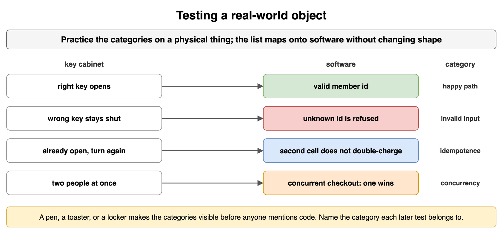

*Source: [`diagrams/testing.drawio`](/content/11_Coding_Problems/03_Testing/diagrams/testing.drawio), page 2.*

## Manual vs automated

A manual test is a person following steps and judging the result. Use it to explore a flow you do not understand yet, or when the oracle is a human judgment ("does this message sound like a threat"). An automated test is code that performs the action and checks a condition you stated in advance. Anything you will re-run after the next change, especially a boundary or a bug you already fixed, wants to be automated.

Do not automate a check whose expected result you cannot write down. A script that sleeps and then asks a human "did it look right?" is still manual, and it is slower. In the interview, split the list: "I would click through the new locker screen once by hand. The fee at 2 hours and at 3 hours becomes a test I keep."

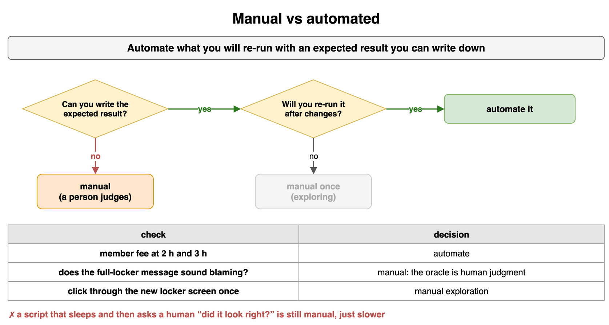

*Source: [`diagrams/testing.drawio`](/content/11_Coding_Problems/03_Testing/diagrams/testing.drawio), page 3.*

## Black-box vs white-box

A black-box test is written from the promise, without using the branches inside the implementation. You know members are free through two hours, so you try 2 and 3. You do not need to see the comparison operator. A white-box test is written because you looked: an `else` that handles a missing ledger, a loop that stops one short, a special case the spec never mentioned. Black-box tests document what callers may rely on. White-box tests cover paths those callers would not have forced you to hit.

Write the black-box cases first. If you start from the code, the tests repeat the implementation and stay green across a wrong formula. A test that asserts a private counter moved is white-box in the bad sense: a correct refactor breaks it. Look inside to find untested paths, then assert the caller-visible result of that path.

```python
def locker_fee(hours: int, member: bool) -> int:
    if hours < 0:
        raise ValueError("hours")
    raw = max(0, hours - 2) * 75 if member else hours * 100
    return min(raw, 1500)

# Black box: the promise says hour 2 is free and hour 3 is not.
assert locker_fee(2, member=True) == 0
assert locker_fee(3, member=True) == 75
```

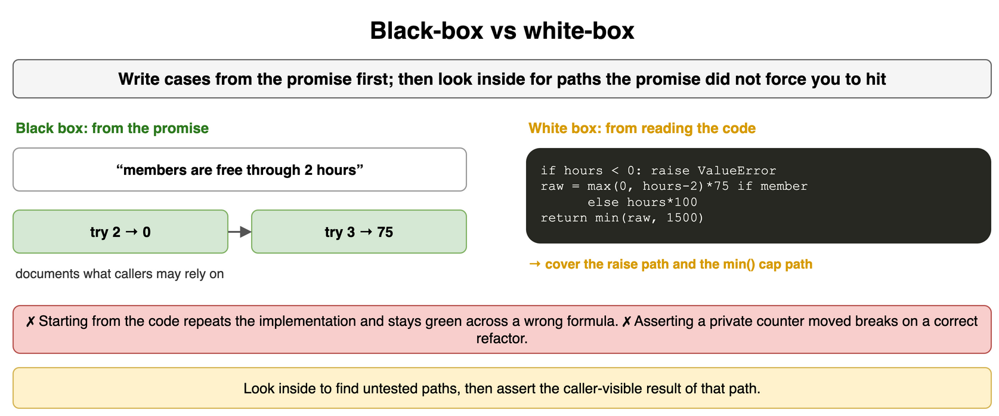

*Source: [`diagrams/testing.drawio`](/content/11_Coding_Problems/03_Testing/diagrams/testing.drawio), page 4.*

## Testing a function

A function test picks inputs, calls the function once, and checks one promise. Arrange the arguments. Act by calling it. Assert the return value or the error. Three cases carry most functions: an ordinary input, a boundary where the result changes, and an input the contract rejects. Name the check after the promise ("member is free through two hours"), not after a line number.

Keep one reason to fail in each assertion. A test that checks the fee, the email, and the database row will go red for three different defects and you will not know which. If the function talks to a clock or a ledger, pass those in so the test chooses them. The function under test is real. Its neighbors can be stand-ins.

```python
def locker_fee(hours: int, member: bool) -> int:
    if hours < 0:
        raise ValueError("hours")
    raw = max(0, hours - 2) * 75 if member else hours * 100
    return min(raw, 1500)

assert locker_fee(5, member=False) == 500
try:
    locker_fee(-1, member=True)
    raise AssertionError("expected ValueError")
except ValueError:
    pass
```

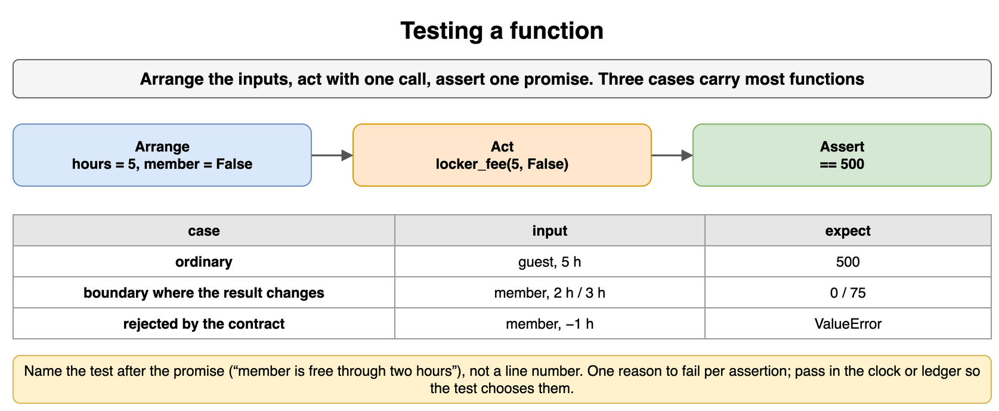

*Source: [`diagrams/testing.drawio`](/content/11_Coding_Problems/03_Testing/diagrams/testing.drawio), page 5.*

## Unit, integration, and end-to-end

A unit test exercises one piece and nothing it does not own. The fee function, with no database and no browser, is a unit. An integration test crosses a real seam: the fee is computed and then written through the actual query code into a database, or a client parses a real response from a stub server that speaks the protocol. An end-to-end test starts at the door a person uses and finishes at the outcome they see.

Put the bug in the layer that can express it. A wrong cap is a unit test. A correct fee stored in the guest column is an integration test. A button that never calls the API is an end-to-end test. Running only end-to-end tests makes a bad cap look like a broken button. Running only unit tests lets a mismatched column ship.

```text
Wrong cap in the formula          unit
Right fee, wrong column           integration
Button never calls the API        end to end
```

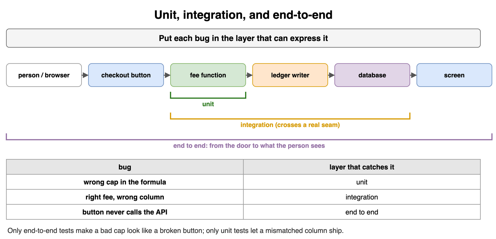

*Source: [`diagrams/testing.drawio`](/content/11_Coding_Problems/03_Testing/diagrams/testing.drawio), page 6.*

## The test pyramid

The pyramid is a ratio: many fast unit tests, fewer integration tests, a handful of end-to-end tests. The shape exists so a failure is cheap to run and close to the defect. An upside-down pyramid, dozens of browser tests and almost no unit tests, fails slowly and for reasons far from the line you changed.

The trade-off is real. An end-to-end test catches wiring that a fee unit test cannot see, and it costs minutes plus a vague red build. Say which checks you would keep at the top: one path where a member checks out a locker and sees the fee, not one browser test per hour from 0 to 40. The hours belong underneath, in the function tests.

```text
        / e2e \          one checkout a person can see
       /--------\
      / seams    \       fee written, then read back
     /------------\
    / function     \     hours, cap, refusal
```

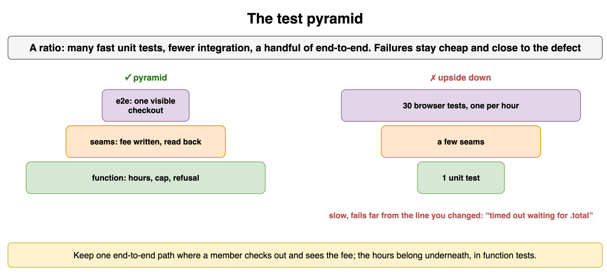

*Source: [`diagrams/testing.drawio`](/content/11_Coding_Problems/03_Testing/diagrams/testing.drawio), page 7.*

## Equivalence classes

An equivalence class is a set of inputs the promise treats the same way. One representative stands in for the rest of the class. For the locker fee, "member, still inside the free window" is one class: 0, 1, and 2 hours all cost nothing. "Member, past the free window, under the cap" is another. "Member, at the cap" is a third. Guests split differently, because they pay from the first hour.

Testing 4, 5, and 6 member-hours as three ideas wastes cases. They are one class. Spend the extra cases on a class you have not represented: a guest, the cap, a refusal. You still test both sides of a boundary between classes. The class tells you which inputs are redundant. It does not tell you to skip the edge where the class changes.

```python
def member_fee(hours: int) -> int:
    return min(max(0, hours - 2) * 75, 1500)

# One under-cap representative. Hours 4, 5, and 6 are the same class.
assert member_fee(5) == 225
```

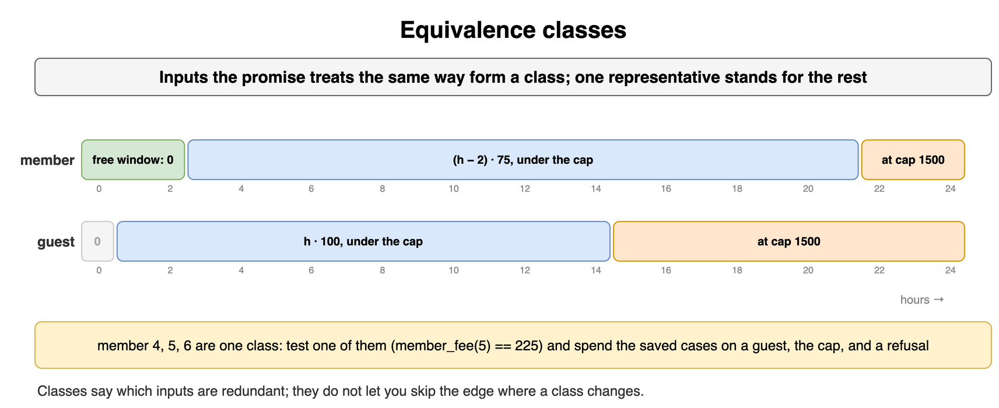

*Source: [`diagrams/testing.drawio`](/content/11_Coding_Problems/03_Testing/diagrams/testing.drawio), page 8.*

## Boundary values

Defects cluster where a class ends. Test the last input of the old class and the first input of the new one. Members are free at 2 hours and pay 75 cents at 3. The cap for a member is hit at 22 hours (`20 * 75 == 1500`) and must still be 1500 at 23. Guests hit 1500 at 15 hours and stay there at 16. Zero hours is the bottom of the legal domain. Negative hours is the first illegal value.

An off-by-one sits on those pairs. A sample at 5 hours does not notice a missing cap, because 225 is under 1500 either way, while 23 hours becomes 1575 instead of 1500. Write the boundary pairs down. Do not hope an ordinary example lands on them.

```python
def member_fee(hours: int) -> int:
    return min(max(0, hours - 2) * 75, 1500)

assert member_fee(2) == 0
assert member_fee(3) == 75
assert member_fee(22) == 1500
assert member_fee(23) == 1500
```

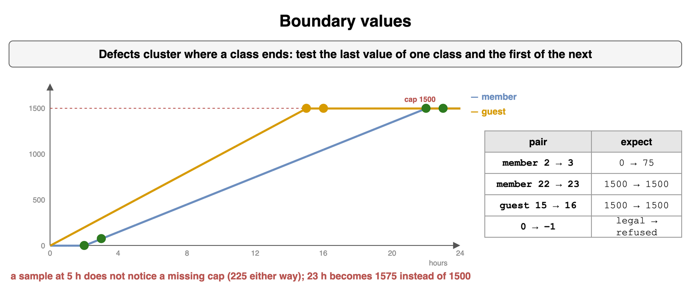

*Source: [`diagrams/testing.drawio`](/content/11_Coding_Problems/03_Testing/diagrams/testing.drawio), page 9.*

## Edge and error cases

An edge is legal and extreme. Zero hours, an empty cart, a fee that lands exactly on the cap, a member with no open loans. An error is an input the contract refuses: a negative hour, a percent of 101, a locker code that belongs to someone else. Decide the contract before you test it. Raising `ValueError` and returning a result code are different promises, and the test must match the one you stated.

Do not assert the wording of a stack trace. Assert the type of failure, or the field that says "refused," and one fact about why. One refusal per distinct rule. "Negative" and "not an integer" are two rules if the function claims to distinguish them. They are one rule if anything outside `hours >= 0` is simply invalid.

```python
def guest_fee(hours: int) -> int:
    if hours < 0:
        raise ValueError("hours")
    return min(hours * 100, 1500)

assert guest_fee(0) == 0        # edge: legal, no time
assert guest_fee(15) == 1500    # edge: exactly the cap
```

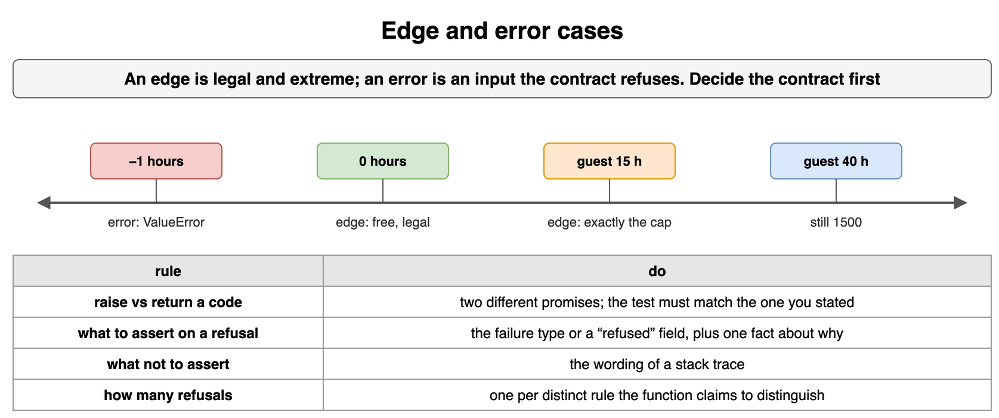

*Source: [`diagrams/testing.drawio`](/content/11_Coding_Problems/03_Testing/diagrams/testing.drawio), page 10.*

## Stubs, fakes, and mocks

A test double stands in for a neighbor so you can force the situation under test. A stub returns a canned value and does nothing else. Use it for a clock ("this instant is Thursday at 09:00") or a config flag. A fake is a simpler working version, such as a dictionary that saves and loads locker rows. Use it when the behavior of the neighbor matters and the real one is slow or shared. A mock records the calls it received. Use it when the call itself is the promise: a receipt was handed to the mailer, with this member and this fee.

Prefer a stub or a fake when you care about the return value of your own code. Reach for a mock only when a missing call would be the bug. Do not mock the function you are testing. Do not mock a type you own if a twenty-line fake would execute the real rule. A mock that only checks "the method was called" can stay green while the fee is wrong.

```python
class ClockStub:
    def __init__(self, hour: int) -> None:
        self.hour = hour

def desk_open(clock: ClockStub) -> bool:
    return 8 <= clock.hour < 18

assert desk_open(ClockStub(9)) is True
assert desk_open(ClockStub(19)) is False
```

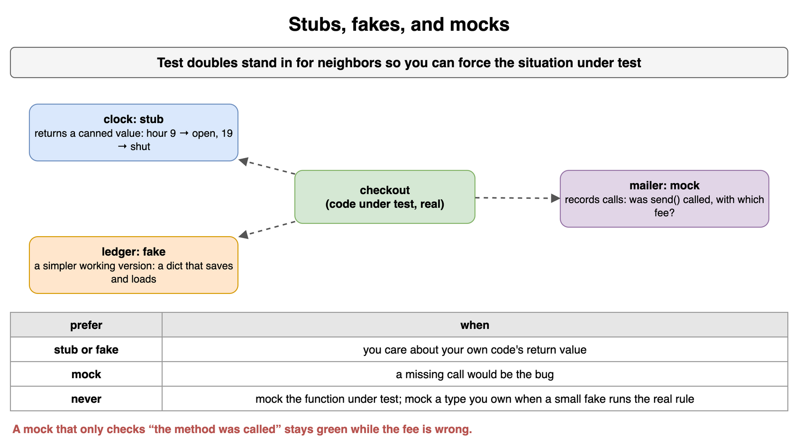

*Source: [`diagrams/testing.drawio`](/content/11_Coding_Problems/03_Testing/diagrams/testing.drawio), page 11.*

## Property-based testing

An example test checks one input. A property test checks a rule that should hold across many inputs. Useful properties for the locker fee: the result is never negative, the result is never above 1500, and a member never pays more than a guest for the same hour count. A second example, clipping a number into a range, is idempotent: clipping twice equals clipping once.

You can say the property in an interview without a generation library. Pick three inputs that would break it if the formula were wrong, including a boundary and a value past the cap. A library that generates and shrinks inputs is the automated form of the same idea. The thing being graded is the property, not the package name. A property that restates one example ("fee of 5 hours is 225") is not a property.

```python
def clip(value: int, low: int, high: int) -> int:
    return min(max(value, low), high)

for value in (-10, 0, 7, 40):
    once = clip(value, 0, 10)
    assert clip(once, 0, 10) == once
```

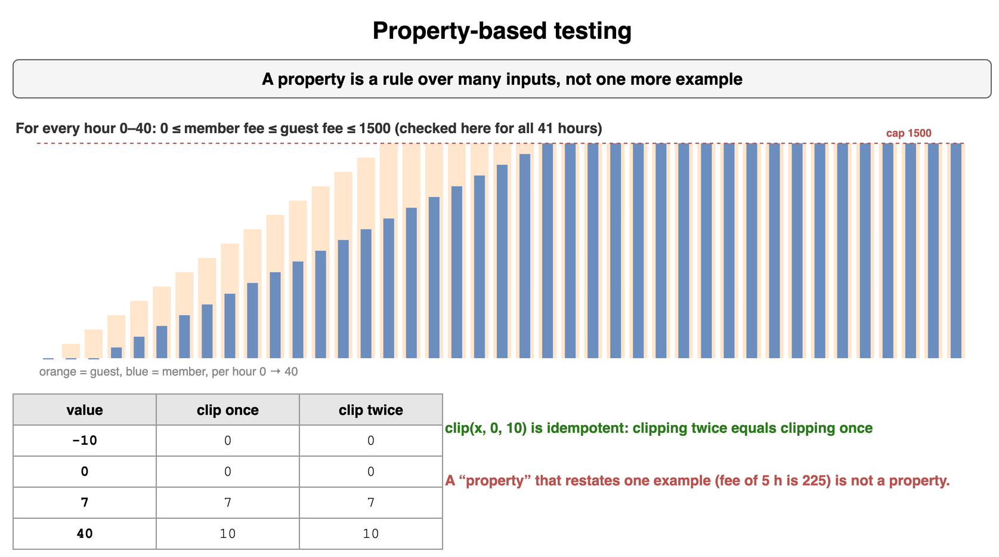

*Source: [`diagrams/testing.drawio`](/content/11_Coding_Problems/03_Testing/diagrams/testing.drawio), page 12.*

## Flaky tests and determinism

A flaky test fails on some runs and passes on others, with no change to the code under test. The usual sources are the clock, an unseeded random source, the order of a set, a sleep that is sometimes long enough, leftover global state, and a real network. The fix is to make the input part of the test: pass the clock, seed the generator, sort before you compare, and build a fresh store each time.

Retrying a red test until it passes hides the cause. Quarantine is a label so the suite stays usable while you fix it, not a fix. In the interview, point at the line that reads the outside world and say what you would inject. A test that calls `datetime.now()` and expects "the desk is open" is a different test at 09:00 and at 20:00.

```python
def desk_open(hour: int) -> bool:
    return 8 <= hour < 18

assert desk_open(9) is True
assert desk_open(20) is False
```

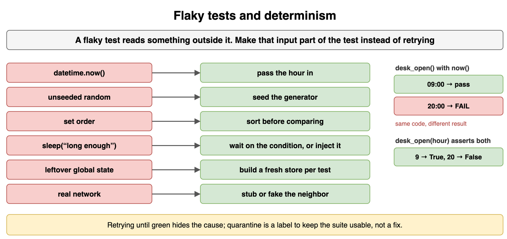

*Source: [`diagrams/testing.drawio`](/content/11_Coding_Problems/03_Testing/diagrams/testing.drawio), page 13.*

## Load and security basics

A load check starts with a question and a pass line, not with "we clicked for a while." Decide whether you care about how many checkouts per second stay under a latency limit, or about what the desk does when every locker is full. Name the workload (which calls, which data) and the number that means failure. One person refreshing a page is not that test. You also say what you are not measuring.

Security cases in this chapter are refusals, not attacks to carry out. An overlong locker code is rejected. A code that belongs to another member does not open their locker. A negative fee percent does not credit the member. A caller who is not the desk attendant cannot mark a locker free. State the input and the refusal. You are showing that hostile and unauthorized inputs are part of the test list, beside the happy path.

```text
Load: 50 checkouts/second, p95 under 200 ms, or it fails.
Security: another member's code -> refused, no latch.
```

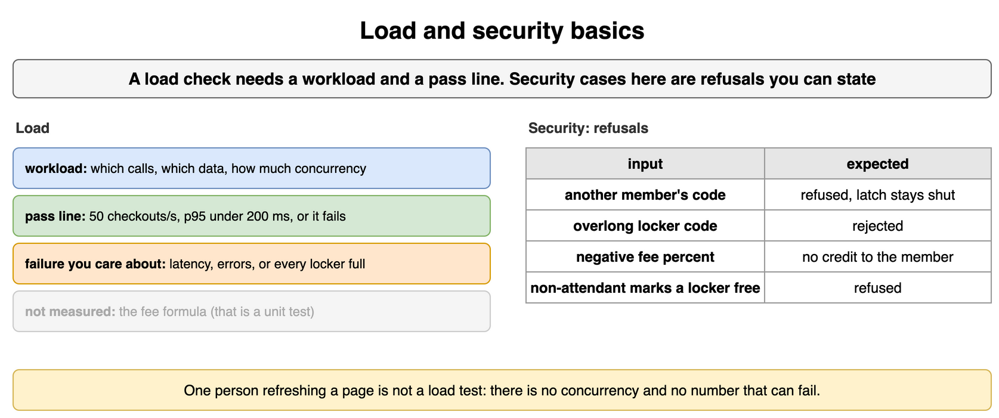

*Source: [`diagrams/testing.drawio`](/content/11_Coding_Problems/03_Testing/diagrams/testing.drawio), page 14.*

## Troubleshooting questions

Here the interviewer hands you a symptom, not a failing test. "Members are sometimes charged for the first two hours." You are not supposed to name a one-line patch. You are supposed to show how you would find out what "sometimes" means and where it happens. Ask who sees it, whether it is the first two hours or any free window, whether a guest path is mixed in, and whether the charge appears on the receipt, in the ledger, or both.

Then say how you would reproduce it. If you cannot, the next step is a log or a counter at the boundary, not a rewrite. Guessing "the comparison is wrong" before you know the layer is how a display bug gets a fee patch. Treat the report as a claim to pin down.

```text
Ask:
  Who is charged, and for which stay?
  Receipt, ledger, or both?
  Can we name one member and one hour that shows it?
```

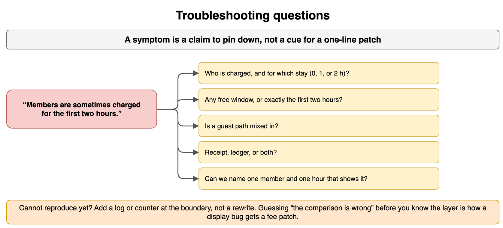

*Source: [`diagrams/testing.drawio`](/content/11_Coding_Problems/03_Testing/diagrams/testing.drawio), page 15.*

## A troubleshooting sequence

Use the same order every time, and say which step you are on. Restate the symptom and the behavior you expected. Find a reproduction, or say you do not have one yet. Narrow the layer: the hour that was sent, the fee function, the row that was stored, the number on the screen. The symptom "charged for a free hour" points at the boundary between 2 and 3, so look there once you know the layer. Fix the smallest cause. Add a test that failed on the old code.

Do not start by rewriting `locker_fee` because the word "fee" appeared in the report. If the function returns 0 and the ledger stores 75, the fix is in the writer. If you cannot reproduce, add a log of `(hours, member, fee)` at the seam and wait for one bad row. A sequence you can narrate is the answer, even when you never reach the patch in the interview.

```text
1. Expected vs reported
2. Reproduce, or admit you cannot
3. Narrow the layer
4. Check the boundary the symptom names
5. Smallest fix, plus a test that was red
```

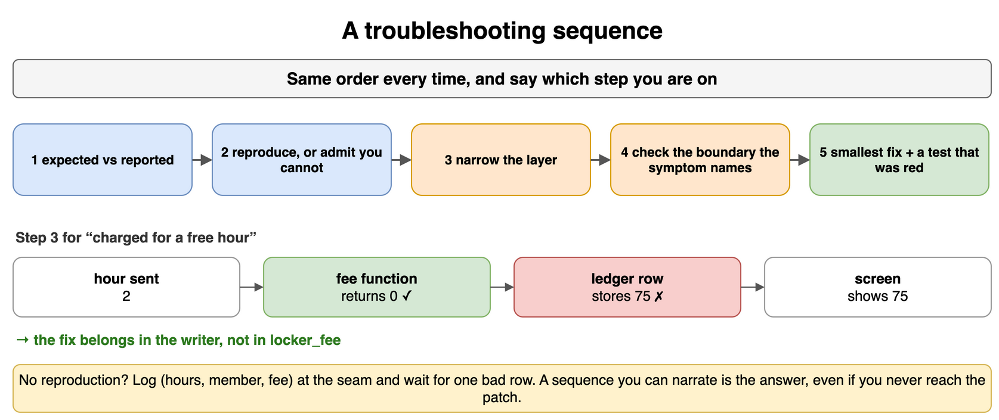

*Source: [`diagrams/testing.drawio`](/content/11_Coding_Problems/03_Testing/diagrams/testing.drawio), page 16.*
