# Testing — Drills

Original drills for choosing cases, layers, doubles, and a debugging sequence. The fee used throughout is original: members pay nothing through 2 hours, then 75 cents per hour, capped at 1500. Guests pay 100 cents per hour from the start, with the same cap. Negative hours are refused. Each card is one exercise. No copyrighted book text.

## Categories before the tool

The interviewer asks, "How would you test the locker fee?" What do you say before you name a test framework?

**Answer:** State the promise, then the groups, then the boundaries, then the refusal. Members are free through 2 hours and then pay 75 cents an hour. Guests pay 100 cents from the first hour. Nobody pays more than 1500, and nobody is charged a negative amount. A negative hour is an error. You would automate the boundary pairs and the refusal as function tests, and keep one end-to-end checkout only to see that a fee reaches the screen. The runner is irrelevant until those cases exist.

```python
def case_list() -> list[str]:
    return [
        "member hour 2 is free",
        "member hour 3 costs 75",
        "guest hour 1 costs 100",
        "neither fee exceeds 1500",
        "negative hours are refused",
    ]

print(len(case_list()))  # 5
```

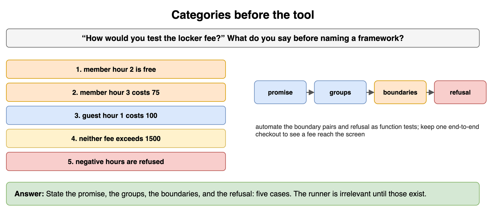

*Source: [`diagrams/testing-drills.drawio`](/content/11_Coding_Problems/03_Testing/diagrams/testing-drills.drawio), page 1.*

## From a cabinet to cases

A workshop key cabinet should open for the right key, stay shut for the wrong key, stay open if you turn an already-open lock, and not tear if two people turn it together. Map each of those four to a software check on `assign_locker(member_id, locker_id)`.

**Answer:** The right key is a member assigned an empty locker and a later lookup that returns that member. The wrong key is an unknown member id, which is refused and assigns nothing. Already open is assigning the same locker twice: the second call does not create a second occupant. Two people at once is two assignments of one locker; exactly one succeeds. Those four are happy path, invalid input, idempotence, and a race. You can name them before you pick a framework.

```python
def assign_once(occupied: dict[str, str], member: str, locker: str) -> str:
    if locker in occupied:
        return "taken"
    occupied[locker] = member
    return "assigned"

box: dict[str, str] = {}
print(assign_once(box, "ada", "L1"), assign_once(box, "bea", "L1"))
# assigned taken
```

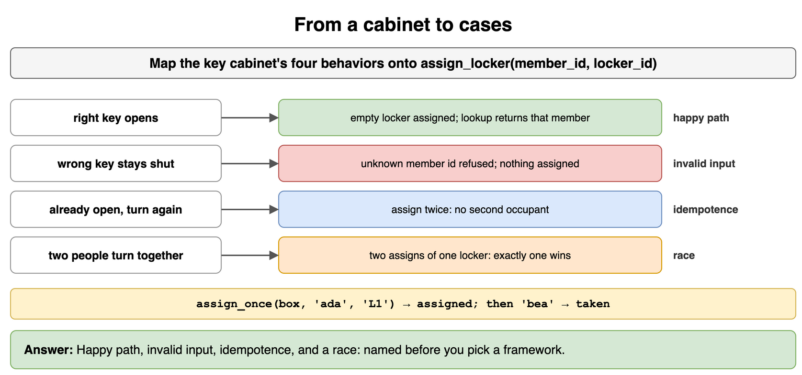

*Source: [`diagrams/testing-drills.drawio`](/content/11_Coding_Problems/03_Testing/diagrams/testing-drills.drawio), page 2.*

## What you automate

You have three checks. (1) A member's fee at 2 hours and at 3 hours. (2) Whether the new "locker full" sentence sounds blaming. (3) A script the release captain clicks whenever the fee formula changes. Which do you automate, and which stays manual?

**Answer:** Automate (1). The expected numbers are known and the check will be re-run. Leave (2) manual: the oracle is a person's judgment of tone, and you cannot write the expected string without pretending the judgment is done. (3) is already a repeated check with a known procedure, so it is a candidate to automate rather than a ritual. A manual script you are afraid to skip is an automated test that has not been written.

```python
automate = {"fee at 2 and 3 hours", "release fee script"}
manual = {"tone of the full-locker sentence"}
print(sorted(automate), sorted(manual))
```

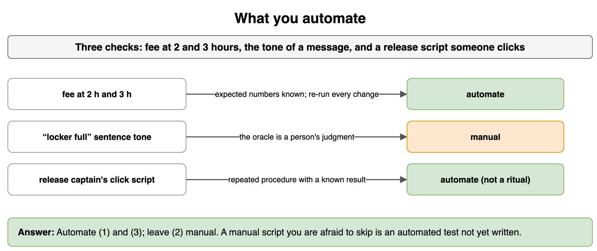

*Source: [`diagrams/testing-drills.drawio`](/content/11_Coding_Problems/03_Testing/diagrams/testing-drills.drawio), page 3.*

## Which view sees the bug

The spec says a coupon from 0 through 100 percent is valid, and 100 percent makes the payable amount 0. The code rejects any percent that is not strictly below 100. A test pays 2000 cents with 10 percent off and expects 1800. Does it fail? Which case fails, and did that case come from the spec or from reading the comparison?

**Answer:** 10 percent is valid under both the spec and the bug, and `2000 * 90 // 100` is 1800, so the test stays green. 100 percent should return 0 and instead raises. That case is black-box: the promise says 100 is allowed. White-box is noticing `< 100` in the code after you forgot to include the end of the range. A sample from the middle of the legal percents does not protect the last legal value.

```python
def payable(cents: int, percent_off: int) -> int:
    if not 0 <= percent_off < 100:
        raise ValueError("percent")
    return cents * (100 - percent_off) // 100

def correct(cents: int, percent_off: int) -> int:
    if not 0 <= percent_off <= 100:
        raise ValueError("percent")
    return cents * (100 - percent_off) // 100

print(payable(2000, 10), correct(2000, 10))  # 1800 1800
try:
    payable(2000, 100)
    print("accepted")
except ValueError:
    print("rejected", correct(2000, 100))  # rejected 0
```

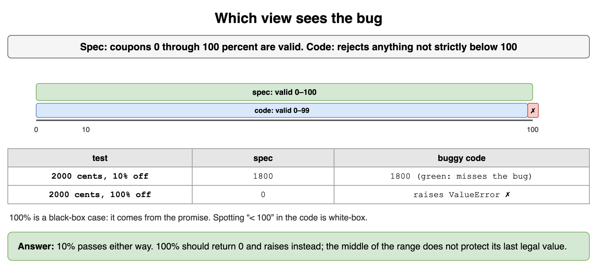

*Source: [`diagrams/testing-drills.drawio`](/content/11_Coding_Problems/03_Testing/diagrams/testing-drills.drawio), page 4.*

## The missing boundary

A teammate's tests call the correct member fee at 5 hours and at 10 hours. Both pass. Name two inputs those tests do not cover, and say what bug survives.

**Answer:** 5 and 10 are the same class: member, past the free window, under the cap. Both are `(hours - 2) * 75`, which is 225 and 600, under 1500. A forgotten cap leaves those two green and turns hour 23 into 1575. Hour 22 is 1500 with or without the cap, because `20 * 75` lands on it, so the pair that shows the bug is 22 and 23, not 22 alone. Hour 2 and hour 3 are the other missing pair, for the free window. The middle of a class is not a substitute for its edges.

```python
def fee(hours: int) -> int:
    return max(0, hours - 2) * 75  # cap omitted

print(fee(5), fee(10))                 # 225 600, spec agrees
print(fee(22), fee(23), min(fee(23), 1500))  # 1500 1575 1500
```

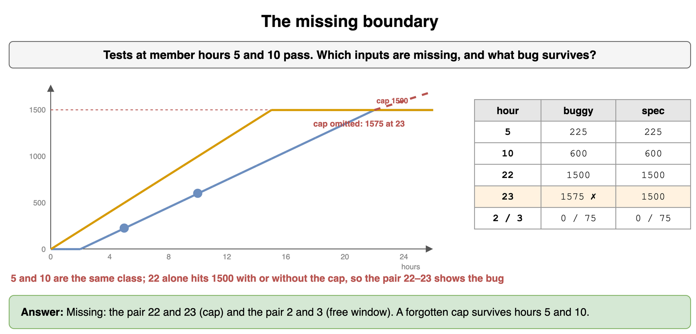

*Source: [`diagrams/testing-drills.drawio`](/content/11_Coding_Problems/03_Testing/diagrams/testing-drills.drawio), page 5.*

## One from each class

Partition member hours and guest hours for `locker_fee`. Pick one representative from each class, plus the refusal. How many calls is that, and why is hour 4 not a new class if you already have hour 5?

**Answer:** Member classes: free window (use 1), under the cap past the window (use 5), at the cap (use 22). Guest classes: zero (use 0), under the cap (use 4), at the cap (use 15). Refusal: `-1`. That is seven calls. Hour 4 and hour 5 for a member are the same class, so the second one does not teach a new promise. Boundaries still add the neighbors 2, 3, 21, 23, 14, and 16 if you are listing edges rather than classes. Say which list you are writing.

```python
def locker_fee(hours: int, member: bool) -> int:
    if hours < 0:
        raise ValueError("hours")
    raw = max(0, hours - 2) * 75 if member else hours * 100
    return min(raw, 1500)

samples = [(1, True, 0), (5, True, 225), (22, True, 1500), (0, False, 0), (4, False, 400), (15, False, 1500)]
print(all(locker_fee(h, m) == expected for h, m, expected in samples))  # True
```

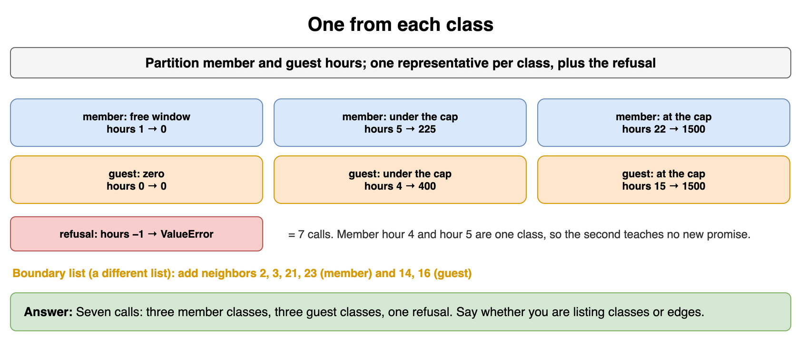

*Source: [`diagrams/testing-drills.drawio`](/content/11_Coding_Problems/03_Testing/diagrams/testing-drills.drawio), page 6.*

## Which layer fails

Three reports come in. (A) A member with a 5-hour stay is charged 300 instead of 225, and a direct call to the fee function returns 300. (B) The fee function returns 225, and the ledger row says 500. (C) The fee function and the ledger are right, and the screen still shows the placeholder "fee: --". Which test level belongs to each?

**Answer:** (A) is a unit test. The wrong number is produced by the function alone. (B) is an integration test. The seam between the function and the ledger stores a different number, so a test that never touches the writer stays green. (C) is an end-to-end, or at least a UI-level, test. The data is right and the person never sees it. Fixing (C) by editing the fee formula is the usual mistake, and it would not change the placeholder.

```python
def layer(report: str) -> str:
    return {"formula": "unit", "ledger": "integration", "screen": "end-to-end"}[report]

print(layer("formula"), layer("ledger"), layer("screen"))
```

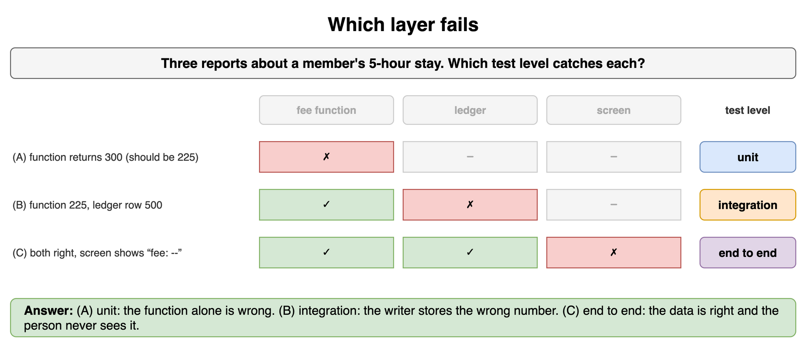

*Source: [`diagrams/testing-drills.drawio`](/content/11_Coding_Problems/03_Testing/diagrams/testing-drills.drawio), page 7.*

## Upside down

The suite has 30 browser tests, one per hour of a stay, and one unit test that checks hour 5. A one-character fee change takes twelve minutes to verify, and the browser failures say "timed out waiting for .total". What do you move, and what single browser test do you keep?

**Answer:** Move the hours into function tests: the class representatives and the boundary pairs. They fail in milliseconds and name the hour. Keep one browser test that a member can check out and see a fee on the screen, so the wiring stays covered. Delete the other 29 as duplicates of the function tests plus a slow oracle. The pyramid was upside down: the top was doing the bottom's job, and the failure was far from the defect.

```python
browser_tests_before = 30
browser_tests_after = 1
function_cases = ["h2", "h3", "h22", "h23", "guest15", "negative"]
print(browser_tests_before - browser_tests_after, len(function_cases))  # 29 6
```

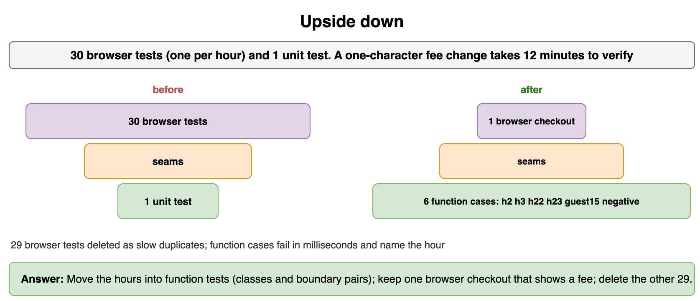

*Source: [`diagrams/testing-drills.drawio`](/content/11_Coding_Problems/03_Testing/diagrams/testing-drills.drawio), page 8.*

## Stub, fake, or mock

`checkout` asks a clock whether the desk is open, writes a row through a ledger, and asks a mailer to send a receipt. You want three tests: the desk refuses after 18:00, a checkout can be loaded back, and a receipt goes out only when the fee is non-zero. Which double is which?

**Answer:** The clock is a stub. You need a canned hour and no clock behavior. The ledger is a fake: an in-memory map that really saves and loads, because the test cares that the row round-trips. The mailer is a mock, or a recorder. The promise is that `send` was or was not called, not that a network delivered mail. Mocking the ledger would skip the only behavior that test needs. Stubbing the mailer cannot tell you the call happened.

```python
class LedgerFake:
    def __init__(self) -> None:
        self.rows: dict[str, int] = {}

    def save(self, member: str, fee: int) -> None:
        self.rows[member] = fee

    def load(self, member: str) -> int:
        return self.rows[member]

class Mailbox:
    def __init__(self) -> None:
        self.sent: list[int] = []

    def send(self, fee: int) -> None:
        self.sent.append(fee)

ledger, mail = LedgerFake(), Mailbox()
ledger.save("ada", 225)
mail.send(225)
print(ledger.load("ada"), mail.sent)  # 225 [225]
```

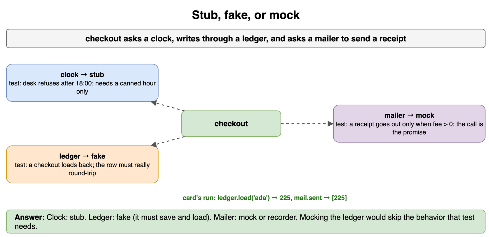

*Source: [`diagrams/testing-drills.drawio`](/content/11_Coding_Problems/03_Testing/diagrams/testing-drills.drawio), page 9.*

## A property, not another example

You already assert `locker_fee(5, True) == 225`. Name two properties that should hold for every hour from 0 through 40, and show one input that would violate "never above the cap" if the `min` were deleted.

**Answer:** The fee is always between 0 and 1500 inclusive. For the same hour, the member fee is less than or equal to the guest fee. Deleting the cap makes a guest at hour 16 pay 1600, which is the witness. Hour 5 does not witness it, because 500 is under the cap either way. A property test is how you stop writing hour 6, hour 7, and hour 8 by hand. Idempotence is the property to name for a clip function: clipping twice equals clipping once.

```python
def uncapped_guest(hours: int) -> int:
    return hours * 100

print(uncapped_guest(16) > 1500)  # True, the cap property fails
for hours in range(0, 41):
    member = min(max(0, hours - 2) * 75, 1500)
    guest = min(hours * 100, 1500)
    assert 0 <= member <= guest <= 1500
```

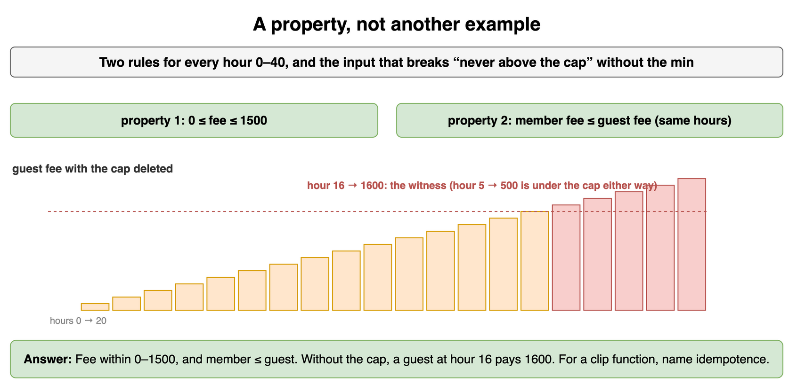

*Source: [`diagrams/testing-drills.drawio`](/content/11_Coding_Problems/03_Testing/diagrams/testing-drills.drawio), page 10.*

## Why it flickers

This test passed all morning and failed after 18:00. Nothing else changed. What is nondeterministic, and how do you make the test the same at 09:00 and at 20:00?

```python
from datetime import datetime

def desk_open() -> bool:
    return 8 <= datetime.now().hour < 18

def test_desk() -> None:
    assert desk_open()
```

**Answer:** `datetime.now()` reads the outside world, so the test means "the suite is running during opening hours." Pass the hour in, and assert both sides: open at 9, shut at 20. The same shape bites an unseeded `random`, a set compared without sorting, and a `sleep` that hopes a file appeared. Do not retry the assertion. Inject the input the production code was reading on its own.

```python
def desk_open(hour: int) -> bool:
    return 8 <= hour < 18

assert desk_open(9) and not desk_open(20)
```

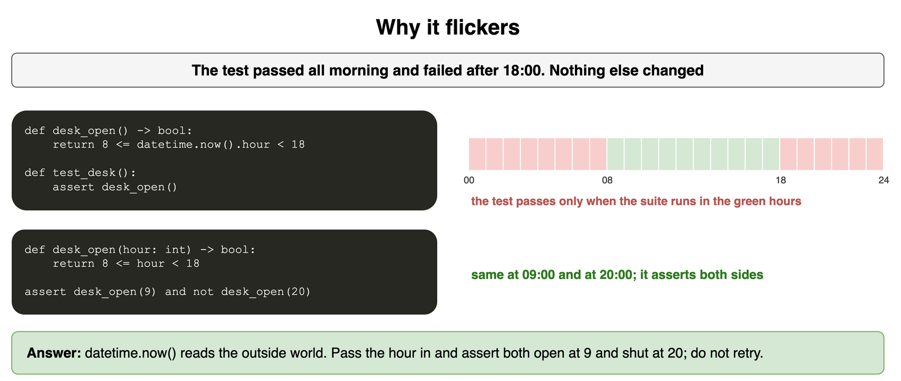

*Source: [`diagrams/testing-drills.drawio`](/content/11_Coding_Problems/03_Testing/diagrams/testing-drills.drawio), page 11.*

## Not a load test yet

Someone says the locker desk "feels fast" because they refreshed the page for a minute and nothing errored. What three facts are missing before you would call that a load result?

**Answer:** The workload (which call, what data, how much concurrency), the pass line (for example p95 latency under 200 ms at 50 checkouts per second), and the failure mode you care about (latency, errors, or a full locker table). A single person refreshing is not concurrency and has no number that can fail. Also say what you will not claim: this does not test the fee formula. That stays a unit test.

```python
def is_load_result(concurrency: int, has_pass_line: bool) -> bool:
    return concurrency > 1 and has_pass_line

print(is_load_result(1, False), is_load_result(50, True))  # False True
```

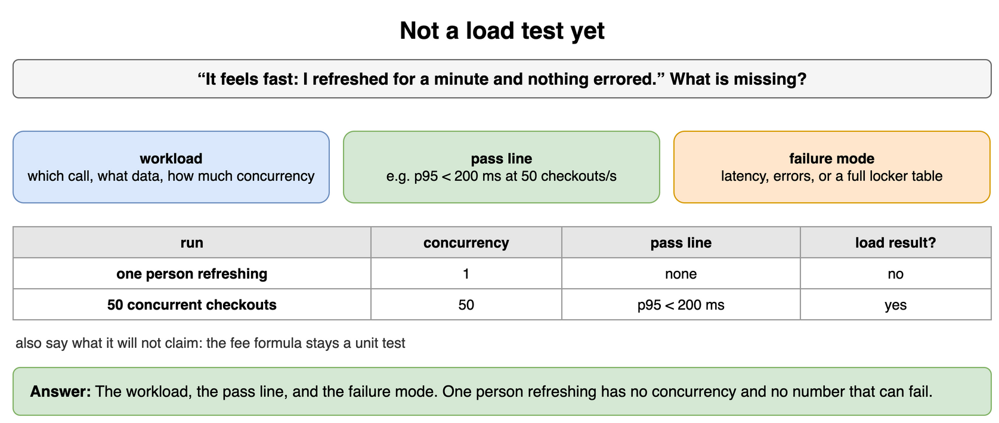

*Source: [`diagrams/testing-drills.drawio`](/content/11_Coding_Problems/03_Testing/diagrams/testing-drills.drawio), page 12.*

## Two refusals

The desk opens a locker when the code matches the member who owns it. List two checks that are about refusal rather than about the happy path, without describing how to break in.

**Answer:** A code that belongs to a different member does not open the locker and does not change the occupant. An empty code, or a code far longer than any issued code, is rejected the same way. You assert the latch stays shut and the occupant is unchanged. You do not need a catalog of malicious strings. One foreign code and one malformed code represent the two classes: not yours, and not a code. A negative hour on the fee is the same kind of case on the other function.

```python
def open_locker(owner_code: str, presented: str) -> str:
    if not presented or len(presented) > 8:
        return "refused"
    return "open" if presented == owner_code else "refused"

print(open_locker("a1", "b2"), open_locker("a1", ""), open_locker("a1", "a1"))
# refused refused open
```

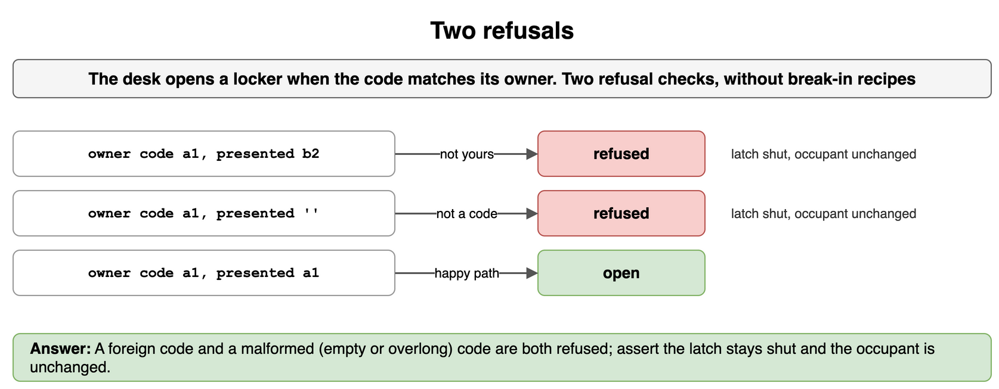

*Source: [`diagrams/testing-drills.drawio`](/content/11_Coding_Problems/03_Testing/diagrams/testing-drills.drawio), page 13.*

## Sometimes charged

Members report they are "sometimes" charged for the first two hours. You have not seen the code. What do you ask, and what do you refuse to do yet?

**Answer:** Ask which members, whether the stay was 0, 1, or 2 hours, and whether the extra amount is on the receipt, in the ledger, or both. Ask for one member id and one stay you can look up. Refuse to patch `locker_fee` until you know the layer. If one lookup shows the function returned 0 and the ledger stored 75, the bug is in the writer. If the function itself returns 75 for hour 2, you have a reproduction and the next step is a unit test at hour 2. "Sometimes" often means "only on the boundary" or "only for guests labeled as members."

```python
def next_step(function_returned: int, ledger_stored: int) -> str:
    if function_returned == 0 and ledger_stored != 0:
        return "inspect the writer"
    if function_returned != 0:
        return "unit test at the free boundary"
    return "ask for a sharper example"

print(next_step(0, 75), next_step(75, 75))
```

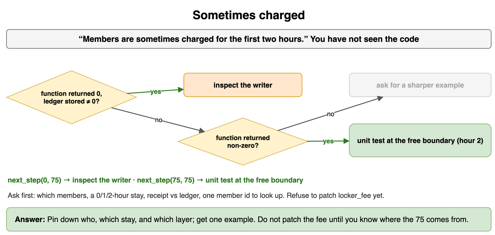

*Source: [`diagrams/testing-drills.drawio`](/content/11_Coding_Problems/03_Testing/diagrams/testing-drills.drawio), page 14.*

## A test that cannot catch the bug

This test is green. The bug is that hour 2 costs 75 cents. Why can't this test see it, and what assertion replaces it?

```python
def test_fee_runs() -> None:
    value = locker_fee(2, member=True)
    assert value == value
```

**Answer:** The assertion is true for every return value, including the wrong one. A test that only checks "it returned something" or compares a value to itself does not pin the promise. Replace it with `assert locker_fee(2, member=True) == 0`. The useful version fails on the bug and documents the free window. Coverage can be 100 percent on a test like the one above. Coverage is not a promise.

```python
def locker_fee(hours: int, member: bool) -> int:
    if hours < 2 and member:
        return 0
    return 75 if member else hours * 100

value = locker_fee(2, member=True)
print(value == value, value == 0)  # True False
```

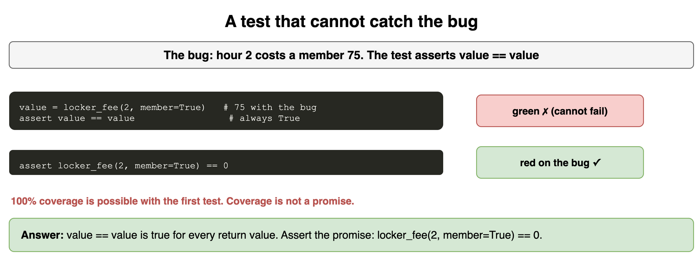

*Source: [`diagrams/testing-drills.drawio`](/content/11_Coding_Problems/03_Testing/diagrams/testing-drills.drawio), page 15.*
