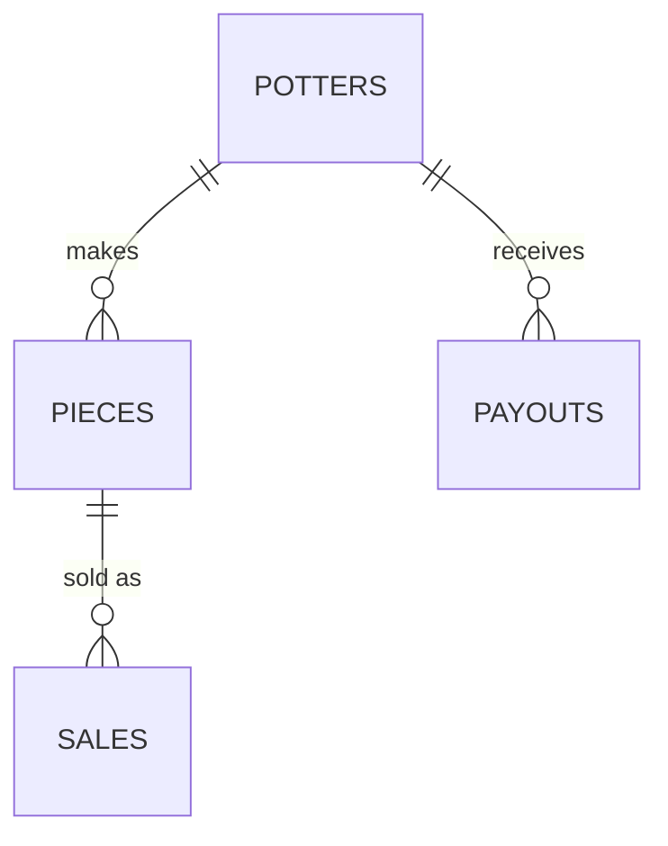

## Explicit and implicit joins

An implicit join lists tables in `FROM` and puts the match in `WHERE`. An explicit join names the match in `ON`. They can return the same rows, and the explicit form is the one to write: the match sits next to the tables, and a later filter does not get mixed up with it. Forgetting the `WHERE` on the implicit form is a cross join. Four potters and five pieces become twenty rows, not the five pieces that belong to someone.

Dialects still accept the comma form. Some also spell the explicit join as `INNER JOIN` or just `JOIN`. Prefer the explicit form and say `INNER` when you want a reader to see that unmatched rows are dropped.

```sql
-- Implicit. Drop the WHERE and this is 4 x 5 = 20 rows.
SELECT potters.name, pieces.form
FROM potters, pieces
WHERE potters.id = pieces.potter_id;

-- Same match, written where a reader expects it.
SELECT potters.name, pieces.form
FROM potters
JOIN pieces ON pieces.potter_id = potters.id;
```

## Inner, left, and full joins

An inner join keeps a row only when both sides match. Ada, Bo, and Cy have pieces. Dee does not, so Dee disappears from an inner join of potters to pieces. A left join keeps every left row and fills the right side with nulls when nothing matches, so Dee stays, with a null form. A right join is a left join with the tables swapped. A full join keeps unmatched rows from both sides.

Use the join that matches the question. "Pieces and the potter who made them" is an inner join. "Every potter, and their pieces if they have any" is a left join. A full join shows up when both lists can have orphans, for example a list of cafe names you expected and the sales that actually happened: Cafe East is on the list and has no sales, and you still want that row. Older MySQL did not implement `FULL OUTER JOIN`. The idea is the same if you `UNION` a left anti-join with a right anti-join. Say that if the interviewer names an engine.

```sql
SELECT potters.name, pieces.form
FROM potters
LEFT JOIN pieces ON pieces.potter_id = potters.id;
-- Dee appears once, form is NULL.
```

## Self joins and anti-joins

A self join matches a table to itself. Give each copy an alias. Potters who share a bench are `a` and `b` with `a.bench = b.bench` and `a.id < b.id`, so Ada pairs with Bo once and you do not also emit Bo with Ada. The `<` is what keeps the pair from doubling and from matching a potter to themself.

An anti-join is the rows on the left with no partner. "Potters who have never sold" is `NOT EXISTS`: no piece of that potter appears in sales. Dee is the only one. Cy's plate sold. A `LEFT JOIN` plus `WHERE sales.id IS NULL` looks like the same test and lies when a potter has both a sold piece and an unsold one. Ada's vase has no sale, so that filter emits Ada even though her bowl and mug sold. `NOT EXISTS` asks "is there any sale?" The left-join filter asks "is there any joined row that missed?" Those are different questions. Use `NOT EXISTS`, or join only after you have aggregated.

```sql
SELECT a.name, b.name, a.bench
FROM potters AS a
JOIN potters AS b
  ON a.bench = b.bench AND a.id < b.id;
-- Ada/Bo on A, Cy/Dee on B.
```

## SELECT, INSERT, UPDATE, DELETE

Most of an interview query is a `SELECT`: the columns, the tables, the match, the filter, the grouping. You still need the other three statements, and you need to know what they do to a row. `INSERT` adds a row and fails if a constraint fails. `UPDATE` changes columns on the rows that match `WHERE`. Without a `WHERE` it changes every row. `DELETE` removes the matching rows. Without a `WHERE` it empties the table.

Say which rows you intend to touch before you write the statement. "Mark Bo's payout paid" is an `UPDATE` of one row, not a new payout and not an update of every null `paid_on`. A `SELECT` of the same `WHERE` first is a reasonable thing to say you would run. Inserts that must land together belong in one transaction, covered later.

```sql
UPDATE payouts
SET paid_on = '2024-05-05'
WHERE potter_id = 2
  AND paid_on IS NULL;
```

## WHERE, GROUP BY, and HAVING

`WHERE` drops rows before they are grouped. `GROUP BY` collapses the surviving rows into one row per group. `HAVING` drops groups, and it is the only place an aggregate belongs. Sales before 3 May are North 3 and South 4. `HAVING SUM(qty) >= 3` keeps both. Putting `SUM(qty) >= 3` in the `WHERE` is a syntax error: the sum does not exist yet.

`COUNT(*)` counts rows in the group. `COUNT(column)` skips nulls in that column. A join that multiplies rows will inflate the count: Ada has three pieces, and joining her to pieces then counting potters counts her three times. Aggregate the side you mean, or count distinct keys. Filter the sale date in `WHERE`. Filter "cafes that sold at least 3" in `HAVING`.

```sql
SELECT cafe, SUM(qty) AS total
FROM sales
WHERE sold_on < '2024-05-03'
GROUP BY cafe
HAVING SUM(qty) >= 3;
-- North 3, South 4.
```

## NULL

`NULL` means unknown, not zero and not an empty string. It fails every ordinary comparison. `paid_on <> '2024-05-04'` does not return Bo's unpaid payout, because `NULL <> something` is not true. The test is `paid_on IS NULL`. `COUNT(*)` on payouts is 2. `COUNT(paid_on)` is 1, because Bo's date is null and `COUNT` skips it.

In a left join, the nulls on the unmatched side are the same kind of unknown. `WHERE pieces.form = 'bowl'` after a left join throws Dee away again, because the filter runs on the result and `NULL = 'bowl'` is not true. Put "Dee, even with no pieces" in the `ON` or test `IS NULL` on purpose. Do not store a sentinel `0` in a foreign key and call it null. A foreign key of `0` is a value that must match a row, or the insert fails.

```sql
SELECT COUNT(*) AS rows, COUNT(paid_on) AS dated
FROM payouts;
-- 2 rows, 1 dated. Bo is the other row.
```

## Subqueries and CTEs

A subquery is a query inside another query. In `WHERE potter_id IN (SELECT ...)` it builds a set. In the `FROM` clause it is a derived table and needs an alias. A correlated subquery runs once per outer row. That is the right shape for `NOT EXISTS`, and it is a bad shape for "compute this total a thousand times" when one grouped query would do.

A CTE (`WITH rev AS (...)`) names that inner query so the outer query can read it twice. Average potter revenue is one example: group cents per potter, then keep potters above `AVG(cents)` of that same result. A subquery would repeat the grouping or force a nested copy. The CTE is the copy with a name. It does not, by itself, make the database materialize the result. Use it for readability and for reuse inside one statement. Reach for a temporary table only when you need an index on the intermediate rows.

```sql
WITH rev AS (
  SELECT p.id AS potter_id,
         COALESCE(SUM(s.qty * pi.price_cents), 0) AS cents
  FROM potters AS p
  LEFT JOIN pieces AS pi ON pi.potter_id = p.id
  LEFT JOIN sales AS s ON s.piece_id = pi.id
  GROUP BY p.id
)
SELECT potter_id, cents
FROM rev
WHERE cents > (SELECT AVG(cents) FROM rev);
-- Ada 4400, Bo 6000, Cy 6000. Average is 4100. Dee is 0.
```

## Window functions

A window function computes a value across related rows and does not collapse them. `GROUP BY` turns five sales into two cafe totals. `SUM(qty) OVER (ORDER BY sold_on, id)` keeps five rows and adds a running total: 2, 3, 7, 8, 11. The `ORDER BY` inside `OVER` defines the sequence. Without a frame clause, the default frame for `SUM` with `ORDER BY` is "from the start through the current row."

`ROW_NUMBER()` assigns 1, 2, 3 inside a partition, with no ties. Use it to keep the latest sale per potter: partition by potter, order by date descending, keep `rn = 1`. `RANK()` gives ties the same rank and skips the next numbers. Bo and Cy both earned 6000 cents, so both are rank 1 and Ada is rank 3, not 2. `DENSE_RANK()` would make Ada 2. Say which one the question asked for. A window is not a join. If you need columns from another table, join first, then window the result.

```sql
SELECT id, sold_on, qty,
       SUM(qty) OVER (ORDER BY sold_on, id) AS running
FROM sales;
```

## First through third normal form

Normalization means each fact lives in one place, so an update cannot disagree with itself. The interview target is third normal form, explained in three steps.

First normal form: a column holds one value, not a list. A `forms` column containing `bowl, mug` is not a column you can join or constrain. Each form is a row in `pieces`.

Second normal form: on a composite key, every other column depends on the whole key, not on part of it. A line table keyed by `(order_id, piece_id)` must not also store the cafe's phone, because the phone depends only on the order. The phone belongs on the order, or on the cafe.

Third normal form: a non-key column does not depend on another non-key column. Piece form determines nothing about the sale. Potter name depends on `potter_id`, not on the sale. Store `potter_id` and join. The sentence to say: every non-key column depends on the key, the whole key, and nothing but the key.

```text
sale_line(order_id, piece_id, cafe_phone, potter_name)
  cafe_phone depends on the order, not on the piece  -> not 2NF
  potter_name depends on the potter, not on the sale -> not 3NF
```

## Keys and constraints

A primary key identifies one row. It is unique and not null. A foreign key says a value here must be a key over there: `pieces.potter_id` must be a potter, or the insert fails. That is how the database, not only the application, rejects a piece by nobody. A unique constraint is a key you did not call primary. Two potters should not share one bench label if the bench is an identifier. A check constraint is a predicate, such as `qty > 0` or `price_cents >= 0`.

Name the key before the query. Most wrong joins are a match on a name or a date instead of on the key. Surrogate integer keys are fine. A natural key (the bench letter) is fine when it is stable. Do not use a name as a key if a person can change it or share it. `ON DELETE` behavior is part of the design: deleting Ada should fail while her pieces exist, unless you have said that pieces go with her.

```sql
-- SQLite checks foreign keys only after this pragma.
-- Postgres rejects the insert without a pragma.
PRAGMA foreign_keys = ON;
INSERT INTO pieces (id, potter_id, form, price_cents)
VALUES (99, 9, 'cup', 500);
-- fails: there is no potter 9
```

## Indexes

An index is a second structure, usually a B-tree, ordered by one or more columns. A lookup or a range on a leading column of that order is a tree walk. A write updates every index that includes a changed column, so an index you never filter or join on is pure cost.

Column order is the design. For `WHERE cafe = 'North' AND sold_on >= '2024-05-02'`, an index on `(cafe, sold_on)` can seek the cafe and then range the dates. An index on `(sold_on, cafe)` can range the dates, and the cafe predicate is a filter after that, not a seek, because a range used up the left prefix. Equality columns first, then the range column.

A covering index holds every column the query needs, so the engine does not go back to the table for them. Selecting `id` and `qty` with that `WHERE` is covered by `(cafe, sold_on, qty, id)`. Name the query before you name the index. "Index every column" is not a design.

```sql
-- Supports cafe equality, then a date range, and covers qty.
-- CREATE INDEX sales_by_cafe_date ON sales (cafe, sold_on, qty, id);
SELECT id, qty
FROM sales
WHERE cafe = 'North'
  AND sold_on >= '2024-05-02';
```

## Transactions, ACID, and isolation

A transaction is a bracket around statements that must succeed or fail together. Recording a sale and adding the same cents to the potter's payout are one unit. If the process dies after the sale insert and before the payout update, the books disagree. `BEGIN`, both writes, `COMMIT`. A failure in between is `ROLLBACK`.

ACID is the promise on that bracket. Atomicity: all of the writes or none. Consistency: commit leaves the constraints intact, including foreign keys and checks. Isolation: concurrent transactions do not see each other's half-finished work at the level you asked for. Durability: after commit returns, a crash of this process can still replay the result from the log. This is not a promise about replicas. Replication and failover live in the system-design section.

Isolation is where interviews get concrete. Two clerks both read Bo's payout as 6000, both add 100 in application code, both write 6100. One hundred cents vanished. That is a lost update. The fix is one statement the database performs under its own lock: `SET amount_cents = amount_cents + 100`. A dirty read is seeing another transaction's uncommitted row. A phantom is a row that appears in a later read of the same range because someone else committed it. Say the anomaly, then the statement that avoids it. Do not recite isolation level names without the anomaly they change.

```sql
UPDATE payouts
SET amount_cents = amount_cents + 100
WHERE potter_id = 2;
```

## When to denormalize

Denormalize means storing a fact a second time so a read does not join. Copying `potter_name` onto every sale makes "sales by name" a single-table scan. It also means renaming Ada is an update of every sale she ever had, and a missed row stays wrong. Nothing expires that copy. A cache can be dropped. A denormalized column cannot.

Start in third normal form. Copy a fact when you can name the read that the join makes too expensive, and say how the copy stays honest. A monthly summary table, rebuilt from sales for a closed month, is a copy with a refresh story. A name typed again on the live sale, with no story, is a future bug. "It's faster" is not the story. Which query, which copy, who updates it.

```text
Live sale stores potter_id.          -- one fact, one place
Monthly summary stores potter name.  -- copy, rebuilt when the month closes
```

## Handle ambiguity

A schema question arrives as a sentence, the same way an object-design question does. "Track what each cafe bought from our potters." Before you draw tables, pin what a buy is. One piece per row, or an order with many lines? Do we record returns? Is a cafe just a name on the sale, or do we store its phone and owe it a table? Who gets paid, the potter or the studio?

State the assumption and move. "A sale is one piece, a quantity, a cafe name, and a date. No returns in this pass. Cafes are names, not accounts. Payouts are per potter." If the interviewer adds returns, you add a table. You do not redraw because you asked one more question. Scaling, replicas, and shards are a different conversation. Say you are designing the logical schema and the queries first.

```text
Assume for this pass:
  one sale row per piece per cafe per day
  cafe is a name, not a table
  no returns
  payouts are per potter, not per sale
```

## Core tables, relationships, and actions

The nouns that own state become tables. Potter, piece, sale, and payout survive. "Bench" is a column on potter unless benches have their own facts. "Cafe" stays a column until a cafe has a phone, a balance, or a staff list. A quantity and a date are columns, not tables.

Then say the relationships and the cardinality. A potter has many pieces. A piece has many sales. A potter has many payouts. A sale knows one piece. You do not make sale a subtype of piece. The actions are the verbs, and each one names the rows it writes. Record a sale: insert one `sales` row. Pay a potter: set `paid_on` on that potter's open payout, in the same transaction as any balance change. List unsold pieces: the anti-join above. If an action needs a column you never named, add the column and say why. If it needs a table you called a column, promote it.



## Large database design

Large, here, means the logical design still fits one primary and the sales table is the one that grows without bound. You do not start with shards. You start with what the queries touch. This week's cafe totals read recent sales. A rank of last year's potters does not need to sit on the same hot pages. Keep open payouts and recent sales in the table the checkout writes. Move closed months to an archive table, or partition sales by month so a week-shaped query prunes the rest. The partition key is the column you already filter, `sold_on`.

Indexes stay specific to those queries. A covering index on recent sales does more for the checkout report than a second copy of every column. Denormalize into a summary you rebuild per closed month, not into every live row. Replication, failover, and sharding are how a primary grows past one machine. That discussion is the system-design topic on relational databases. In this interview you say that boundary out loud, then design the schema, the keys, and the queries the report actually runs.

```text
Hot: open payouts, sales for the open month
Cold: older sales, queried by month
Not this round: replicas, failover, shards
```
