# Databases and SQL — Drills

Original drills on the pottery studio from the notes: potters Ada, Bo, Cy, and Dee; pieces including Ada's unsold vase; sales to North and South; payouts for Ada (paid) and Bo (not paid). Write the query or the judgment, then check it. No copyrighted book text.

## The missing predicate

Someone writes this and expects one row per piece. How many rows come back, and what do you write instead?

```sql
SELECT potters.name, pieces.form
FROM potters, pieces;
```

**Answer:** Twenty rows. Four potters times five pieces, every combination, because there is no match. That is a cross join. Put the match in `ON`. The explicit join returns the five pieces: Ada's bowl, mug, and vase, Bo's bowl, and Cy's plate. Dee has no piece and does not appear.

```sql
SELECT potters.name, pieces.form
FROM potters
JOIN pieces ON pieces.potter_id = potters.id;
-- 5 rows, not 20.
```

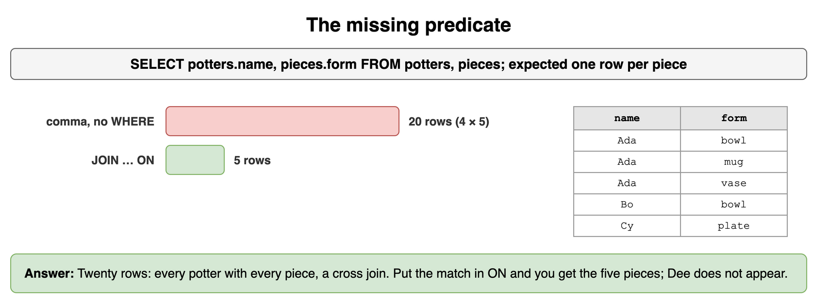

*Source: [`diagrams/databases-and-sql-drills.drawio`](/content/11_Coding_Problems/04_Databases_and_SQL/diagrams/databases-and-sql-drills.drawio), page 1.*

## Who an inner join drops

List every potter and the forms they make. Dee has no pieces. Which join keeps Dee, and what is in the form column for that row?

**Answer:** A left join from potters to pieces. Dee's form is null. An inner join drops Dee because there is nothing to match. Do not "fix" that by filtering `form IS NOT NULL` afterward. That filter deletes the row you added the left join to keep.

```sql
SELECT potters.name, pieces.form
FROM potters
LEFT JOIN pieces ON pieces.potter_id = potters.id
ORDER BY potters.id, pieces.id;
-- Dee is present, form is NULL.
```

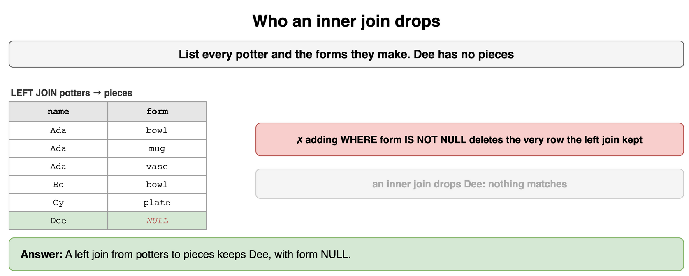

*Source: [`diagrams/databases-and-sql-drills.drawio`](/content/11_Coding_Problems/04_Databases_and_SQL/diagrams/databases-and-sql-drills.drawio), page 2.*

## Potters who never sold

Which potters have no row in `sales`? Ada's vase is unsold, and her bowl and mug sold. Write the query that returns only the potters with no sales at all, and say why this one also returns Ada:

```sql
SELECT DISTINCT p.name
FROM potters AS p
LEFT JOIN pieces AS pi ON pi.potter_id = p.id
LEFT JOIN sales AS s ON s.piece_id = pi.id
WHERE s.id IS NULL;
```

**Answer:** Only Dee has never sold. Cy's plate sold. The left-join filter returns Ada and Dee. Ada survives because the vase joins to no sale, so one of her result rows has a null `sales.id`, and `WHERE` keeps that row. `NOT EXISTS` asks whether any sale exists for the potter. Ada has one, so she is out. Dee has none.

```sql
SELECT p.name
FROM potters AS p
WHERE NOT EXISTS (
  SELECT 1
  FROM pieces AS pi
  JOIN sales AS s ON s.piece_id = pi.id
  WHERE pi.potter_id = p.id
);
-- Dee
```

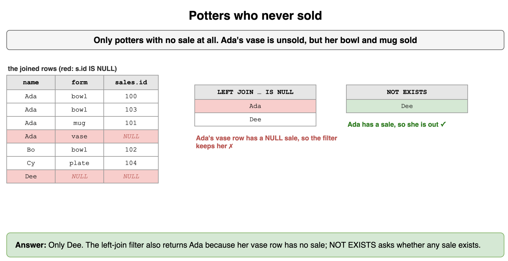

*Source: [`diagrams/databases-and-sql-drills.drawio`](/content/11_Coding_Problems/04_Databases_and_SQL/diagrams/databases-and-sql-drills.drawio), page 3.*

## Two potters, one bench

List each pair of potters who share a bench, once. Ada and Bo are both on A. Cy and Dee are both on B.

**Answer:** Join `potters` to itself. Match the bench and require `a.id < b.id` so Ada/Bo appears and Bo/Ada does not, and so nobody pairs with themself. The pairs are Ada with Bo, and Cy with Dee.

```sql
SELECT a.name, b.name, a.bench
FROM potters AS a
JOIN potters AS b
  ON a.bench = b.bench AND a.id < b.id
ORDER BY a.bench;
-- Ada Bo A
-- Cy  Dee B
```

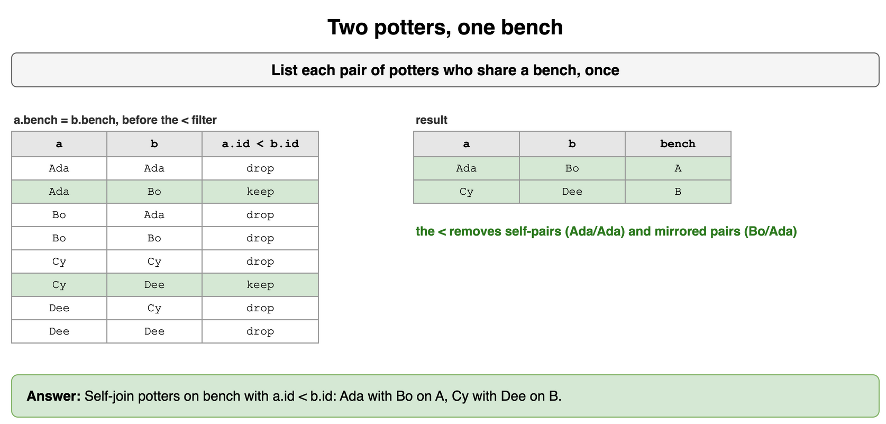

*Source: [`diagrams/databases-and-sql-drills.drawio`](/content/11_Coding_Problems/04_Databases_and_SQL/diagrams/databases-and-sql-drills.drawio), page 4.*

## Filter the rows, then the groups

Using only sales dated before 3 May 2024, which cafes sold a total quantity of at least 3? Why can't that threshold sit in the `WHERE`?

**Answer:** Before 3 May, North sold `2 + 1 = 3` and South sold `4`. Both pass. The date is a row filter, so it belongs in `WHERE`. The threshold is on `SUM(qty)`, which exists only after `GROUP BY`, so it belongs in `HAVING`. The sale on 3 May (Ada's extra bowl, and Cy's plate) is already gone before the sum.

```sql
SELECT cafe, SUM(qty) AS total
FROM sales
WHERE sold_on < '2024-05-03'
GROUP BY cafe
HAVING SUM(qty) >= 3
ORDER BY cafe;
-- North 3, South 4
```

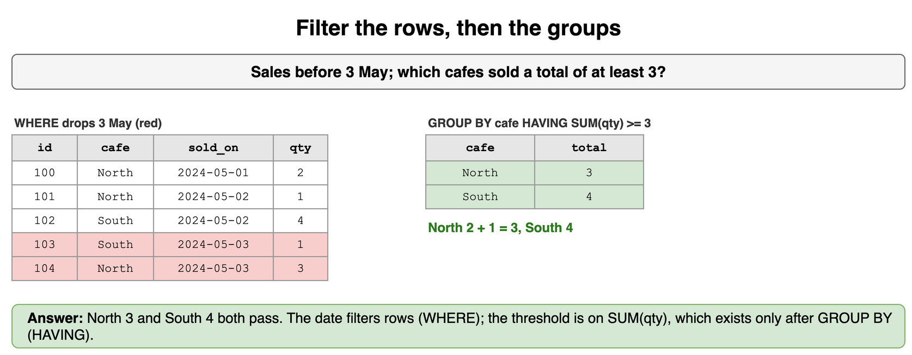

*Source: [`diagrams/databases-and-sql-drills.drawio`](/content/11_Coding_Problems/04_Databases_and_SQL/diagrams/databases-and-sql-drills.drawio), page 5.*

## The unpaid payout

Bo's `paid_on` is null. Ada's is 4 May 2024. What does each query return?

```sql
SELECT potter_id FROM payouts WHERE paid_on IS NULL;
SELECT potter_id FROM payouts WHERE paid_on <> '2024-05-04';
SELECT COUNT(*) , COUNT(paid_on) FROM payouts;
```

**Answer:** The first returns Bo (potter 2). The second returns nobody. `NULL <> '2024-05-04'` is not true, so the comparison does not keep Bo and it does not keep Ada either, because Ada's date is equal to that day. `COUNT(*)` is 2. `COUNT(paid_on)` is 1. Use `IS NULL` when you mean unpaid. Do not use a not-equal test and expect it to include unknown dates.

```sql
SELECT potter_id FROM payouts WHERE paid_on IS NULL;
-- 2
```

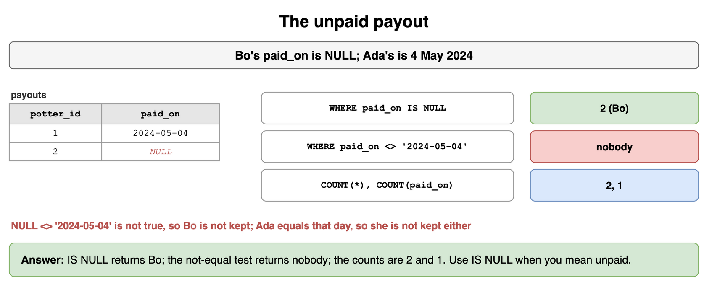

*Source: [`diagrams/databases-and-sql-drills.drawio`](/content/11_Coding_Problems/04_Databases_and_SQL/diagrams/databases-and-sql-drills.drawio), page 6.*

## Above the average potter

Report each potter's sales in cents, counting a potter with no sales as 0, and keep the potters who beat the average of those totals. What is the average, and who remains?

**Answer:** Ada 4400, Bo 6000, Cy 6000, Dee 0. The average is `(4400 + 6000 + 6000 + 0) / 4 = 4100`. Ada, Bo, and Cy remain. Group once in a CTE, then compare each total to `AVG` of that same CTE. The unsold vase adds no sale row, so it does not change Ada's 4400. A correlated subquery that recomputes the sum per potter is the same answer and harder to read.

```sql
WITH rev AS (
  SELECT p.name AS name,
         COALESCE(SUM(s.qty * pi.price_cents), 0) AS cents
  FROM potters AS p
  LEFT JOIN pieces AS pi ON pi.potter_id = p.id
  LEFT JOIN sales AS s ON s.piece_id = pi.id
  GROUP BY p.id, p.name
)
SELECT name, cents
FROM rev
WHERE cents > (SELECT AVG(cents) FROM rev)
ORDER BY cents DESC, name;
-- Bo 6000, Cy 6000, Ada 4400
```

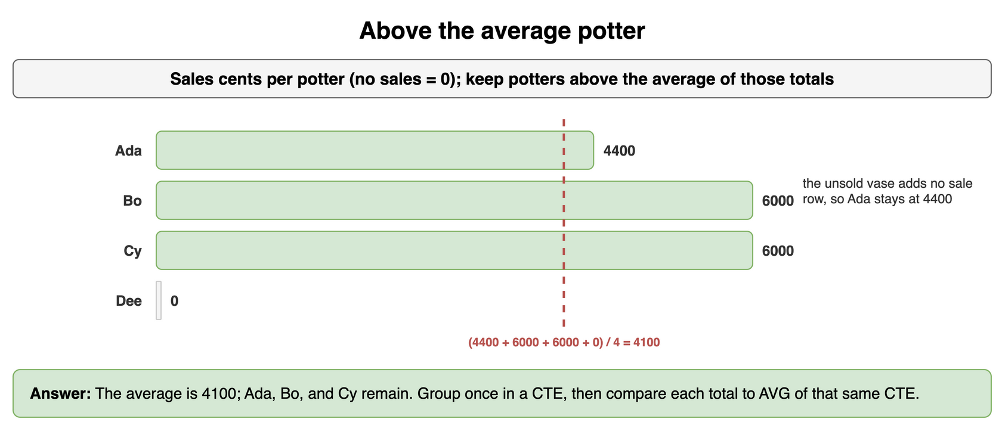

*Source: [`diagrams/databases-and-sql-drills.drawio`](/content/11_Coding_Problems/04_Databases_and_SQL/diagrams/databases-and-sql-drills.drawio), page 7.*

## The latest sale per potter

For each potter who has sold something, return the sale id of their latest sale. Ada sold on 1 May, 2 May, and 3 May.

**Answer:** Ada's latest is sale 103 on 3 May. Bo's only sale is 102. Cy's only sale is 104. Dee has none and does not appear. Partition by potter, order by `sold_on` descending and `id` descending so a same-day tie has a rule, and keep `ROW_NUMBER` 1. `RANK` would also be 1 here because no potter has two sales on the same latest day. Use `ROW_NUMBER` when you need exactly one row.

```sql
WITH lined AS (
  SELECT p.name, s.id,
         ROW_NUMBER() OVER (
           PARTITION BY p.id
           ORDER BY s.sold_on DESC, s.id DESC
         ) AS rn
  FROM sales AS s
  JOIN pieces AS pi ON pi.id = s.piece_id
  JOIN potters AS p ON p.id = pi.potter_id
)
SELECT name, id
FROM lined
WHERE rn = 1
ORDER BY name;
-- Ada 103, Bo 102, Cy 104
```

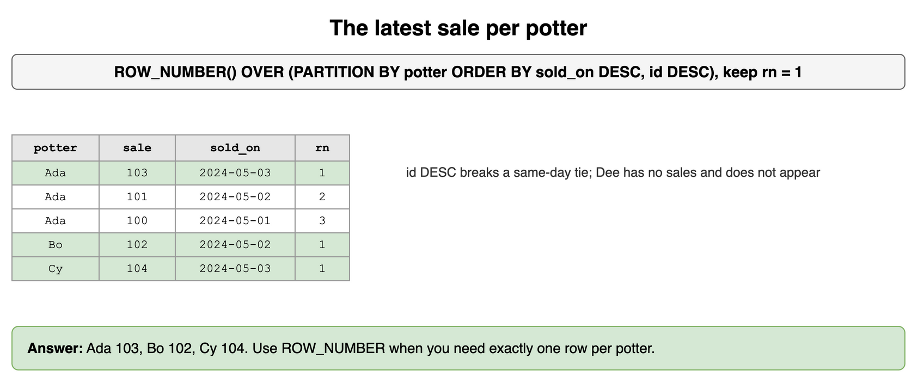

*Source: [`diagrams/databases-and-sql-drills.drawio`](/content/11_Coding_Problems/04_Databases_and_SQL/diagrams/databases-and-sql-drills.drawio), page 8.*

## A tie for first

Rank potters by sales cents, highest first. Bo and Cy both sit at 6000. What rank does `RANK` give Ada, and what does `ROW_NUMBER` give Cy if you break ties by name?

**Answer:** `RANK` gives Bo and Cy rank 1 and Ada rank 3. The tie consumes rank 2. Dee is rank 4 at 0 cents. `ROW_NUMBER` with `ORDER BY cents DESC, name` has no ties: Bo is 1 because the name orders before Cy, Cy is 2, Ada is 3, Dee is 4. Say which function you used. "First place" with a tie is `RANK` or `DENSE_RANK`, not `ROW_NUMBER`. `DENSE_RANK` would score Ada 2.

```sql
WITH rev AS (
  SELECT p.name AS name,
         COALESCE(SUM(s.qty * pi.price_cents), 0) AS cents
  FROM potters AS p
  LEFT JOIN pieces AS pi ON pi.potter_id = p.id
  LEFT JOIN sales AS s ON s.piece_id = pi.id
  GROUP BY p.id, p.name
)
SELECT name, cents,
       RANK() OVER (ORDER BY cents DESC) AS rnk
FROM rev
ORDER BY rnk, name;
-- Bo 1, Cy 1, Ada 3, Dee 4
```

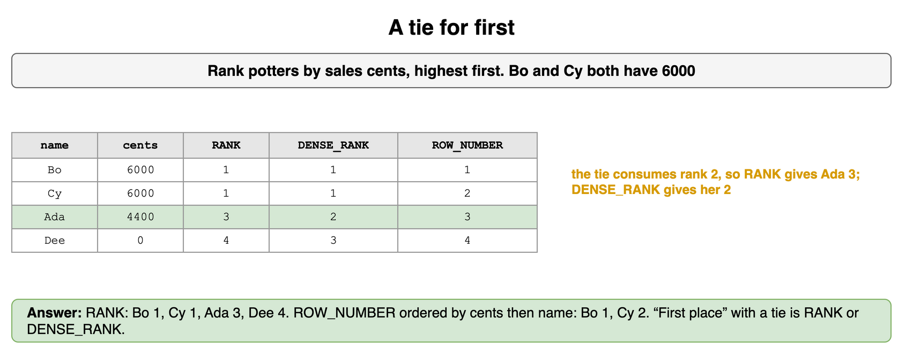

*Source: [`diagrams/databases-and-sql-drills.drawio`](/content/11_Coding_Problems/04_Databases_and_SQL/diagrams/databases-and-sql-drills.drawio), page 9.*

## Quantity so far

Add a running total of `qty` across sales ordered by `sold_on`, then `id`. What is the total after sale 102, and after the last sale?

**Answer:** The order is 100 (qty 2), 101 (1), 102 (4), 103 (1), 104 (3). The running totals are 2, 3, 7, 8, and 11. After 102 the total is 7. The last total is 11, which is also `SUM(qty)` over the whole table. The window does not collapse the five rows. `GROUP BY sold_on` would. Include `id` in the window order so two sales on 2 May have a stable sequence.

```sql
SELECT id, qty,
       SUM(qty) OVER (ORDER BY sold_on, id) AS running
FROM sales
ORDER BY sold_on, id;
-- 100/2/2, 101/1/3, 102/4/7, 103/1/8, 104/3/11
```

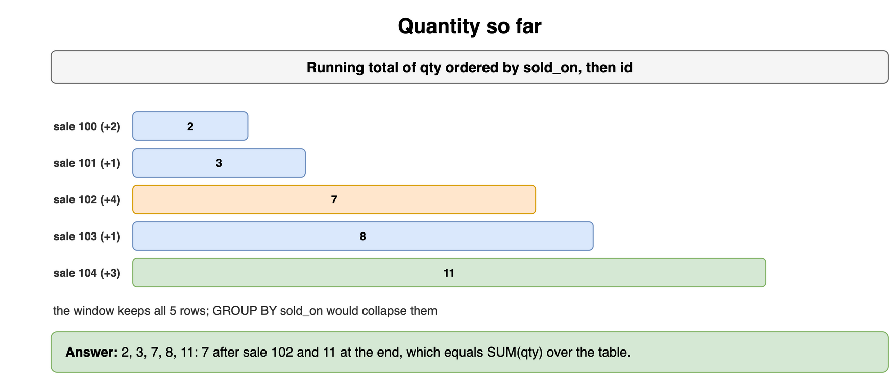

*Source: [`diagrams/databases-and-sql-drills.drawio`](/content/11_Coding_Problems/04_Databases_and_SQL/diagrams/databases-and-sql-drills.drawio), page 10.*

## One wide table

A teammate proposes one table:

```text
sale_line(order_id, piece_id, cafe_phone, potter_name, qty)
```

The key would be `(order_id, piece_id)`. A cafe's phone depends only on the order. The potter's name depends on who made the piece. Which normal forms does this break, and where do those two facts go?

**Answer:** It breaks second normal form because `cafe_phone` depends on `order_id` alone, not on the whole key. It breaks third normal form because `potter_name` depends on the potter, a non-key fact, rather than on the sale line. Put the phone on the order (or on a cafe table, if cafes become real entities). Put the potter's name on `potters` and point `pieces` at `potter_id`. The line keeps `order_id`, `piece_id`, and `qty`. The studio already has that shape: the sale stores `piece_id`, and the potter is reached through the piece.

```sql
SELECT s.id, s.qty, pi.form, p.name
FROM sales AS s
JOIN pieces AS pi ON pi.id = s.piece_id
JOIN potters AS p ON p.id = pi.potter_id
WHERE s.id = 100;
-- qty 2, bowl, Ada. The cafe phone is not a column.
```

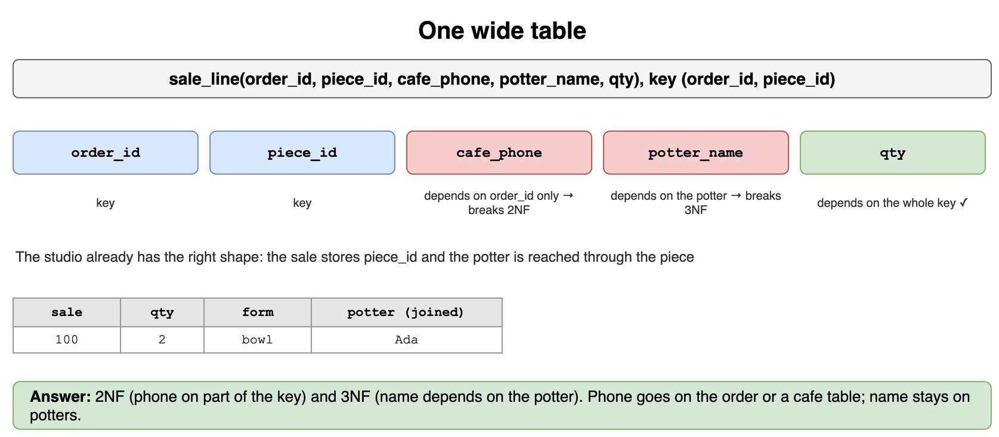

*Source: [`diagrams/databases-and-sql-drills.drawio`](/content/11_Coding_Problems/04_Databases_and_SQL/diagrams/databases-and-sql-drills.drawio), page 11.*

## Equality, then the range

The report is:

```sql
SELECT id, qty
FROM sales
WHERE cafe = 'North'
  AND sold_on >= '2024-05-02';
```

Someone adds an index on `(sold_on, cafe)`. Why is `(cafe, sold_on)` the better order? What extra columns make the index covering?

**Answer:** The query seeks one cafe and then a date range. A B-tree uses a left prefix. `(cafe, sold_on)` seeks `North` and walks dates from 2 May forward. `(sold_on, cafe)` can walk dates, and the cafe test is applied to those rows. It does not seek the cafe, because the range on the first column already used up the prefix. Add `qty` and `id` to the better index, `(cafe, sold_on, qty, id)`, if you want the query answered from the index alone.

```sql
-- CREATE INDEX sales_by_cafe_date ON sales (cafe, sold_on, qty, id);
```

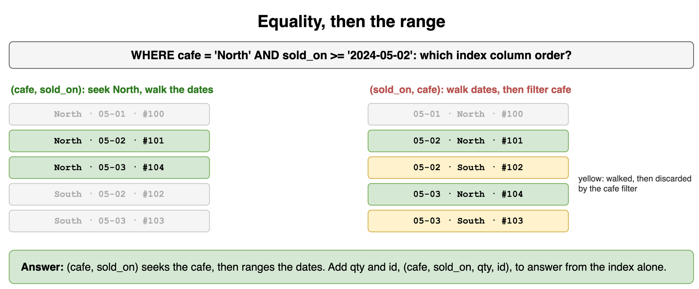

*Source: [`diagrams/databases-and-sql-drills.drawio`](/content/11_Coding_Problems/04_Databases_and_SQL/diagrams/databases-and-sql-drills.drawio), page 12.*

## Both writes or neither

Recording sale 105 of Bo's bowl and adding `1500` cents to Bo's payout must not be split across a crash. What do you wrap them in, and what does a reader see if you committed only the insert?

**Answer:** One transaction. `BEGIN`, insert the sale, update the payout with `amount_cents = amount_cents + 1500`, `COMMIT`. If only the insert commits, the studio has a sale Bo was not credited for. If only the update commits, Bo was credited for a sale that does not exist. Atomicity is that neither of those states is visible. Do the addition in SQL so two clerks cannot each read 6000 and both write 6100.

```sql
BEGIN;
INSERT INTO sales (id, piece_id, cafe, sold_on, qty)
VALUES (105, 20, 'North', '2024-05-04', 1);
UPDATE payouts
SET amount_cents = amount_cents + 1500
WHERE potter_id = 2;
COMMIT;
```

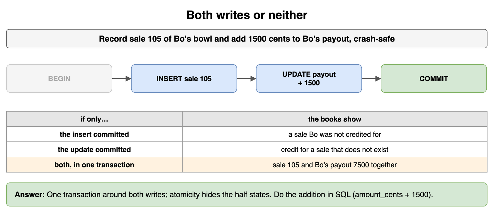

*Source: [`diagrams/databases-and-sql-drills.drawio`](/content/11_Coding_Problems/04_Databases_and_SQL/diagrams/databases-and-sql-drills.drawio), page 13.*

## Two clerks, one payout

Bo's payout reads as 6000. Clerk A and clerk B both add 100 in application memory and both write 6100. What was lost, and what statement do you run instead?

**Answer:** One of the two additions. The stored result is 6100, and it should be 6200. Each clerk wrote a total computed from a stale read. That is a lost update. One statement adds inside the database:

```sql
UPDATE payouts
SET amount_cents = amount_cents + 100
WHERE potter_id = 2;
```

Run it twice and the result is 6200, because each update reads the current row under the write. You do not need a new isolation level to say this. You need to stop doing read-modify-write in the client.

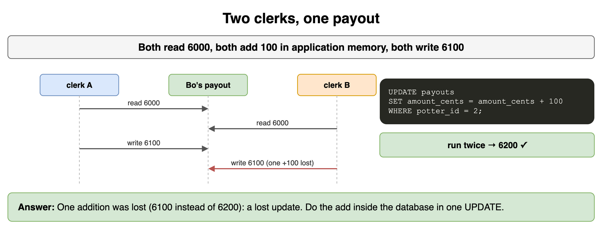

*Source: [`diagrams/databases-and-sql-drills.drawio`](/content/11_Coding_Problems/04_Databases_and_SQL/diagrams/databases-and-sql-drills.drawio), page 14.*

## What a sale is

The prompt is one sentence: "Track what each cafe bought from our potters." You have not been told whether a visit can include several pieces, whether cafes have phone numbers, or whether returns exist. What do you assume, which tables do you keep, and which noun stays a column?

**Answer:** Say the assumption, then draw. For this pass a sale is one piece, a quantity, a cafe name, and a date. No returns. A cafe has no phone and no balance, so it stays a column on the sale. The tables are potters, pieces, sales, and payouts. A potter has many pieces. A piece has many sales. A payout belongs to one potter. The first action you offer to write is "insert a sale," and the query you offer with it is "cents per potter," the grouped join in the notes. If the interviewer adds cafe phone numbers, the cafe becomes a table and the sale stores `cafe_id`. You do not start by adding that table.

```sql
SELECT p.name, s.cafe, SUM(s.qty) AS qty
FROM potters AS p
JOIN pieces AS pi ON pi.potter_id = p.id
JOIN sales AS s ON s.piece_id = pi.id
GROUP BY p.name, s.cafe
ORDER BY p.name, s.cafe;
-- Ada/North 3, Ada/South 1, Bo/South 4, Cy/North 3
```

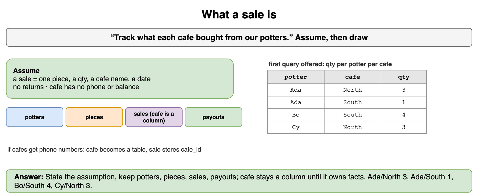

*Source: [`diagrams/databases-and-sql-drills.drawio`](/content/11_Coding_Problems/04_Databases_and_SQL/diagrams/databases-and-sql-drills.drawio), page 15.*

## When the sales table is the big one

Sales now cover several years. The desk still looks up this week's cafe totals. A poster once a month ranks potters for the previous month. What do you change in the schema, and what do you leave for a system-design conversation?

**Answer:** Keep open payouts and the open month of sales on the table the desk writes. Partition that table by `sold_on`, or move closed months to an archive the monthly poster reads, so a week-shaped query does not scan years. Rebuild a per-month summary (potter, cents) when the month closes instead of copying the potter's name onto every live sale. The index for the desk stays `(cafe, sold_on, qty, id)` or the partition's equivalent. Replicas, failover, and shards are how you go past one primary. Say they belong in the system-design discussion, and do not design them in place of the partition and the summary.

```sql
-- The desk's query is already date-shaped, so a month partition can prune.
SELECT cafe, SUM(qty) AS total
FROM sales
WHERE sold_on >= '2024-05-01'
  AND sold_on < '2024-06-01'
GROUP BY cafe
ORDER BY cafe;
-- North 6, South 5
```

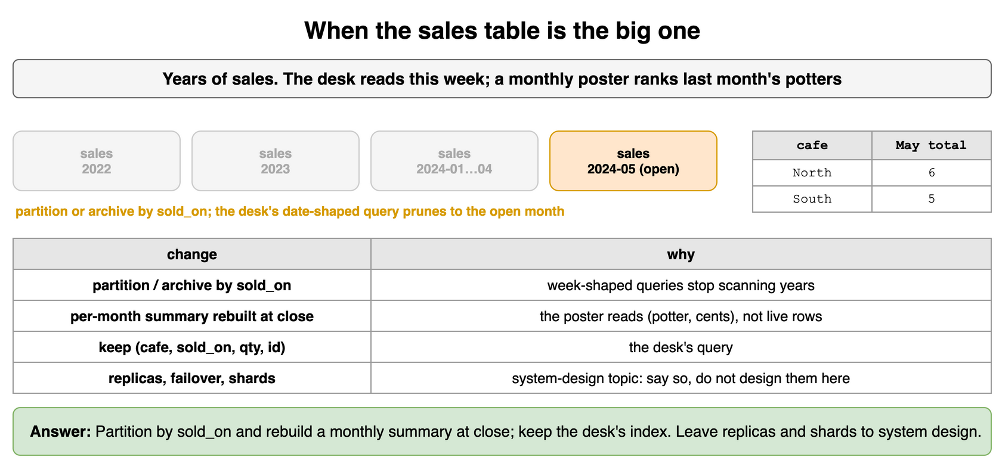

*Source: [`diagrams/databases-and-sql-drills.drawio`](/content/11_Coding_Problems/04_Databases_and_SQL/diagrams/databases-and-sql-drills.drawio), page 16.*
