## Threads and processes

A process has its own address space. Two processes do not see each other's variables unless they opt into shared memory or pass messages. A thread is a schedulable flow of control inside a process. Threads in one process share the heap, the open files, and the code. Each thread has its own stack and its own instruction pointer, so locals on the stack stay private, and anything both threads can name on the heap is shared.

Use a process when a crash or a secret must stay isolated, or when you want another core without sharing the Python interpreter lock. Use a thread when the work shares a structure and spends time waiting. The interview answer starts with what is shared, not with the class that starts the thread.

```text
Process: own heap. Talk by message or explicit shared memory.
Thread: shared heap, private stack. Talk by reading the same objects.
```

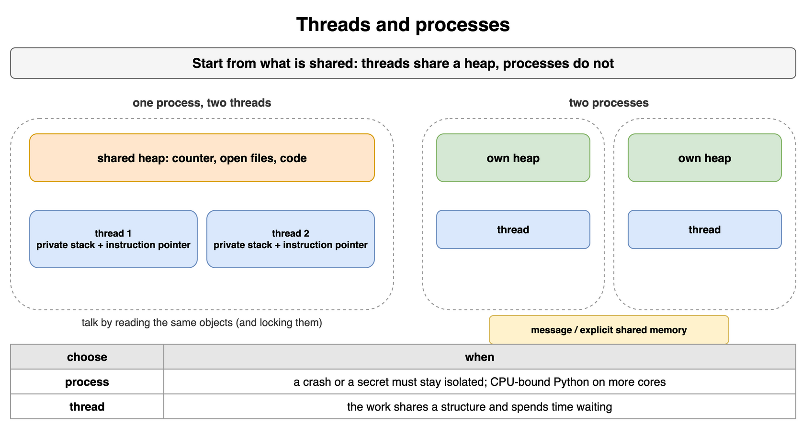

*Source: [`diagrams/threads-and-locks.drawio`](/content/11_Coding_Problems/05_Threads_and_Locks/diagrams/threads-and-locks.drawio), page 1.*

## Threads in Java

In Java you start work by passing a `Runnable` to a `Thread`, or, more often, to an executor. `thread.start()` asks the runtime to call `run` on a new thread. Calling `run()` yourself runs it on the current thread and creates no concurrency. `join()` waits until that thread finishes, and the joiner then sees the writes the other thread made.

The lock Java programmers meet first is the monitor on an object. `synchronized (obj) { ... }` means "hold `obj`'s lock for this block." A synchronized method is `synchronized (this)` for the whole method. Two threads can both be inside synchronized blocks if the blocks name different objects. The lock is the object, not the code. `wait`, `notify`, and `notifyAll` are calls on that same monitor, and the caller must already hold it.

```java
final Object lock = new Object();
void deposit(int cents) {
    synchronized (lock) {
        balance += cents;
    }
}
```

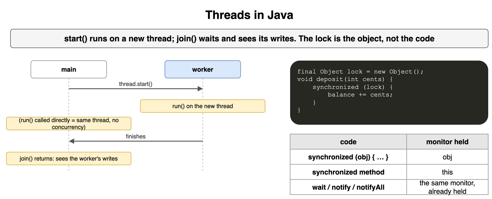

*Source: [`diagrams/threads-and-locks.drawio`](/content/11_Coding_Problems/05_Threads_and_Locks/diagrams/threads-and-locks.drawio), page 2.*

## Race conditions

A race is a bug that appears only for some interleavings. The usual shape is a read-modify-write split across threads. Both threads read `count` as 5, both compute 6, both write 6, and one increment is gone. "It passed when I ran it" is not evidence. The losing interleaving may be rare, and a different scheduler can hide it for months.

Name the shared variable and the steps that must not overlap. If the invariant is "this counter matches the number of completed jobs," the increment and the job update are one critical section, not two. A check-then-act race is the same bug with a branch: both threads see "the slot is empty" and both fill it.

```text
A reads  5
B reads  5
A writes 6
B writes 6
-- one increment is gone
```

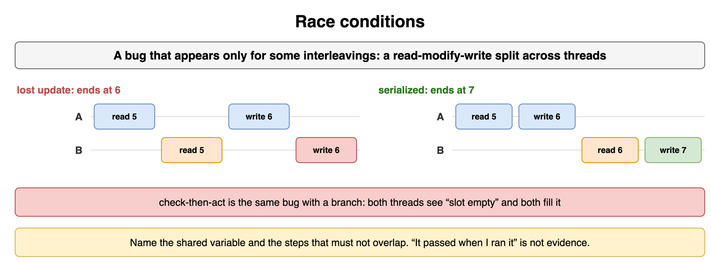

*Source: [`diagrams/threads-and-locks.drawio`](/content/11_Coding_Problems/05_Threads_and_Locks/diagrams/threads-and-locks.drawio), page 3.*

## Locks and synchronized blocks

A lock lets one thread at a time run a critical section, the stretch that touches the shared state. Acquire, do the whole read-modify-write, release. In Java that is `synchronized`. In Python it is `with lock:`. The lock does not protect "the code." It protects the data. Every path that reads or writes that data must take the same lock, including the path you added later.

Hold the lock only around the shared data. A network call or a disk write inside the lock stalls every other thread that needs the same data, and it makes deadlock easier because you now wait while holding something. If you need a result from outside, drop the lock, do the slow work, then re-acquire and re-check the condition. The state may have changed while you were gone.

```python
import threading

lock = threading.Lock()
count = 0

def increment() -> None:
    global count
    with lock:
        count += 1
```

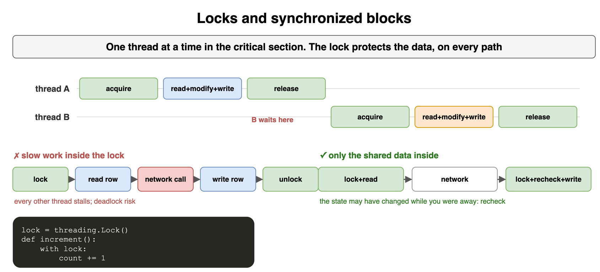

*Source: [`diagrams/threads-and-locks.drawio`](/content/11_Coding_Problems/05_Threads_and_Locks/diagrams/threads-and-locks.drawio), page 4.*

## Mutex, semaphore, and monitor

A mutex is a lock with one holder. It answers "who may touch this data." The holder is the thread that acquired it, and that thread is the one that must release it. A semaphore is a counter of permits. It answers "how many may proceed." A semaphore of 3 in front of a kiln means three firings at once. Threads do not own a semaphore permit in the way they own a mutex. Any thread can release a permit, which is useful for a pool and dangerous if you release once too often.

A monitor is the object plus its lock plus the condition variables waiting on that lock. Java's `synchronized` object is a monitor: the lock and the wait set are the same object. You use a mutex when the rule is mutual exclusion. You use a semaphore when the rule is a count. You use a monitor when threads must wait for a condition of the data, not merely for a turn.

```python
import threading

kiln = threading.Semaphore(3)  # three firings at a time

def fire() -> None:
    with kiln:
        pass  # one permit held for the firing
```

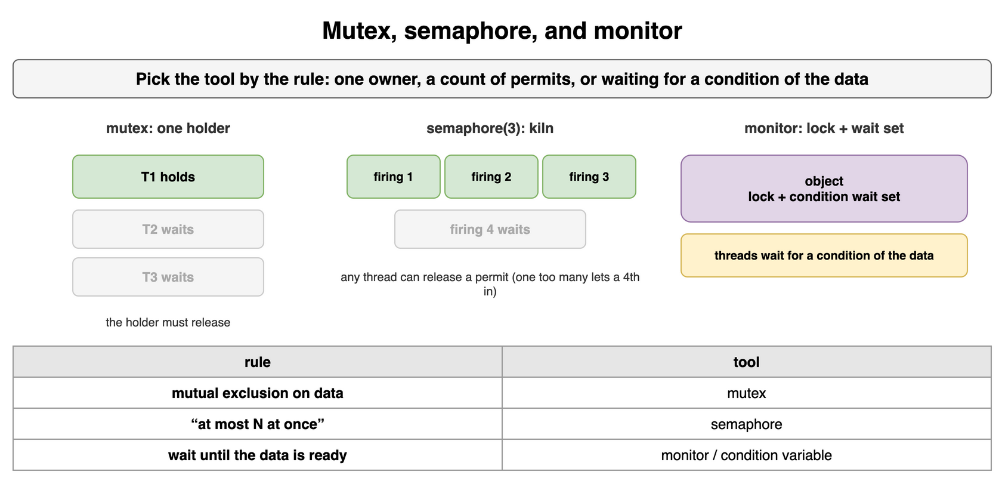

*Source: [`diagrams/threads-and-locks.drawio`](/content/11_Coding_Problems/05_Threads_and_Locks/diagrams/threads-and-locks.drawio), page 5.*

## Wait, notify, and condition variables

A thread that cannot proceed should sleep, not spin. Spinning rereads a flag and burns a core, and without a lock the flag may never become visible. A condition variable sleeps until another thread signals it. In Java, `wait` and `notify` are that mechanism, and they require you to hold the monitor. `wait` atomically releases the monitor and sleeps. On wake it re-acquires the monitor before returning.

Always wait in a loop. `while not ready: cv.wait()`. A wakeup can be spurious. Another thread can also consume the event between the wakeup and your turn. `notify` wakes one waiter. `notifyAll` wakes all of them, and each re-checks the condition. Use `notifyAll` when you are not sure which waiter can proceed. In Python the same pattern is `threading.Condition`: hold it, `wait_for(predicate)`, and `notify_all()` after the state change.

```python
import threading

cv = threading.Condition()
ready = False

def publish() -> None:
    global ready
    with cv:
        ready = True
        cv.notify_all()
```

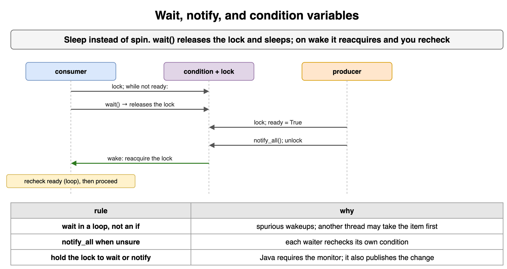

*Source: [`diagrams/threads-and-locks.drawio`](/content/11_Coding_Problems/05_Threads_and_Locks/diagrams/threads-and-locks.drawio), page 6.*

## Producer and consumer

One side produces items. The other consumes them. A bounded queue sits between them so a fast producer cannot allocate without limit. The producer waits when the queue is full. The consumer waits when it is empty. Both waits use the same lock, because both touch the queue, and two conditions (or one condition and `notify_all`) so a producer wake does not get stolen by another producer that still sees a full queue.

The lock covers "look at the queue and decide." The slow work of making the item happens outside the lock. Put the finished item under the lock, then signal. Take the item under the lock, then signal, then process it outside. Forgetting the signal leaves the other side asleep. Signaling before the item is visible wakes a consumer that correctly goes back to sleep, which is why the wait is a loop.

```text
producer: make item | lock | enqueue | notify | unlock
consumer: lock | while empty: wait | dequeue | notify | unlock | use item
```

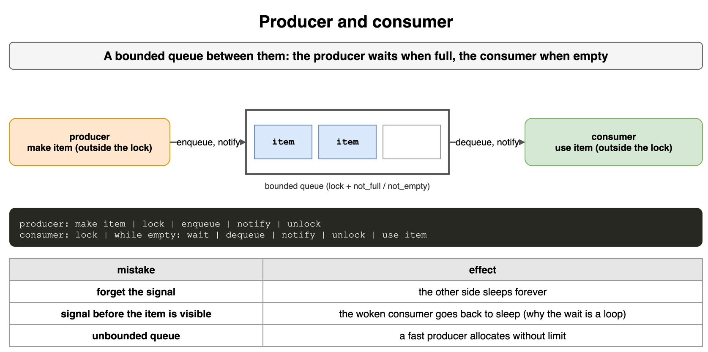

*Source: [`diagrams/threads-and-locks.drawio`](/content/11_Coding_Problems/05_Threads_and_Locks/diagrams/threads-and-locks.drawio), page 7.*

## Reader-writer locks

Some data is read far more often than it is written. A reader-writer lock lets many readers hold it together, and lets a writer hold it only alone. A reader waits if a writer holds it. A writer waits until current readers finish. The shared structure stays consistent for the writer, and readers do not queue behind each other.

The policy for new readers while a writer is waiting is the design choice. If new readers always barge in, a steady stream of readers starves the writer. Prefer a lock that blocks new readers once a writer is queued, or say that starvation is acceptable because writes are rare and you measured it. In Java this is `ReentrantReadWriteLock`. Do not invent it for a counter. A mutex is simpler, and a counter wants an atomic add.

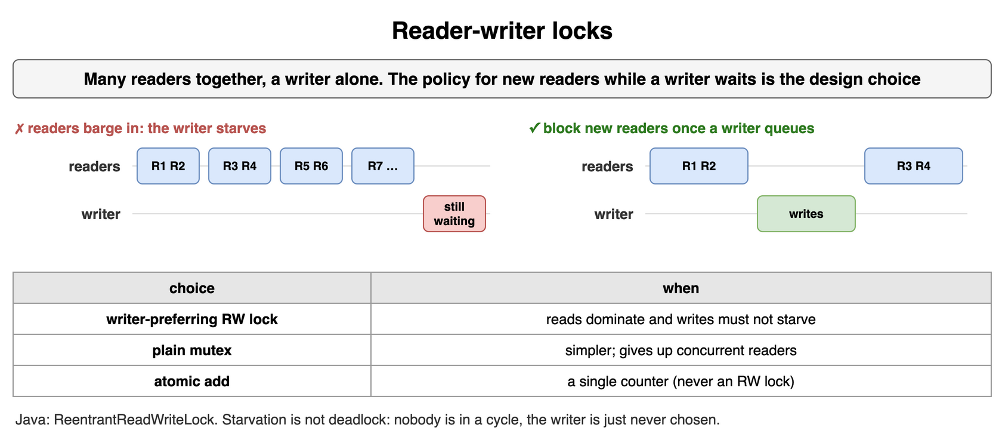

*Source: [`diagrams/threads-and-locks.drawio`](/content/11_Coding_Problems/05_Threads_and_Locks/diagrams/threads-and-locks.drawio), page 8.*

## Atomics and compare-and-swap

An atomic variable supports a read or a write or a read-modify-write as one step that other threads cannot split. `AtomicInteger.incrementAndGet()` in Java is an increment that does not lose updates. Compare-and-swap (CAS) says "if the value is still the value I read, store the new one, otherwise fail." A loop retries until the swap wins. That is a lock-free counter: no thread holds a lock, and someone always makes progress if the hardware CAS does.

CAS is the wrong tool for an invariant that spans two fields. "Both the balance and the ledger row move together" is a lock or a transaction, not two independent atomics. A successful CAS on one field and a failed CAS on the other is a torn update. Python's `queue` and `threading` locks are the ordinary tools. The GIL does not turn `count += 1` into an atomic increment of your counter. The bytecode is several steps, and other threads run between them when the GIL is released.

```python
def cas(box: list[int], seen: int, new: int) -> bool:
    """Model of a hardware CAS: succeed only if the word is still `seen`."""
    if box[0] != seen:
        return False
    box[0] = new
    return True

print(cas([5], 5, 6), cas([6], 5, 7))  # True False
```

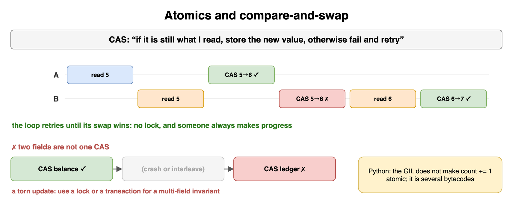

*Source: [`diagrams/threads-and-locks.drawio`](/content/11_Coding_Problems/05_Threads_and_Locks/diagrams/threads-and-locks.drawio), page 9.*

## Thread pools

A pool is a fixed set of worker threads that pull tasks from a queue. Creating a thread per request spends time and stack on the create, and an unbounded number of requests creates an unbounded number of threads. The pool caps the concurrency. The queue caps the backlog. When both are full you need a rejection policy: block the caller, drop the task, or run it on the caller. Say which one. "The pool will handle it" is not a policy.

In Java the type is `ExecutorService`, from `Executors.newFixedThreadPool` or a `ThreadPoolExecutor` you configured. Shut it down so the process can exit, and decide whether queued tasks should finish. Do not put a task on the pool that then waits for another task on the same pool. A small pool deadlocks that way: every worker is waiting for a worker that will never start.

```python
from concurrent.futures import ThreadPoolExecutor

def run_jobs(jobs: list) -> None:
    with ThreadPoolExecutor(max_workers=4) as pool:
        list(pool.map(lambda fn: fn(), jobs))
```

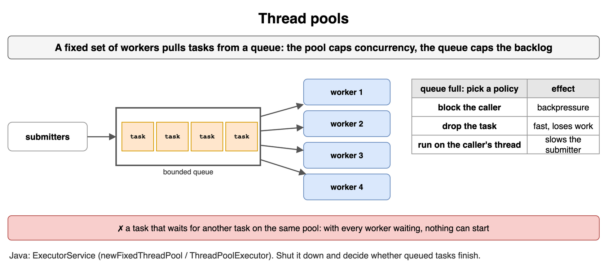

*Source: [`diagrams/threads-and-locks.drawio`](/content/11_Coding_Problems/05_Threads_and_Locks/diagrams/threads-and-locks.drawio), page 10.*

## The Coffman conditions

Deadlock is a set of threads each waiting for a resource another thread in the set holds. Four conditions are required together. Mutual exclusion: the resource cannot be shared. Hold and wait: a thread holds one resource while it waits for another. No preemption: nobody takes a lock away from the holder. Circular wait: the waits form a cycle.

Break any one and the deadlock cannot persist. Mutual exclusion is usually required for correctness, so you rarely break that one. Hold and wait can be broken by acquiring every lock you need in one step, which is awkward when you discover the second lock later. No preemption is broken in practice by `tryLock` with a timeout and a full release on failure. Circular wait is the one ordinary code breaks on purpose, with a global order.

```text
All four, or it is not deadlock:
  exclusive use
  hold while waiting
  no one steals the lock
  the waits form a cycle
```

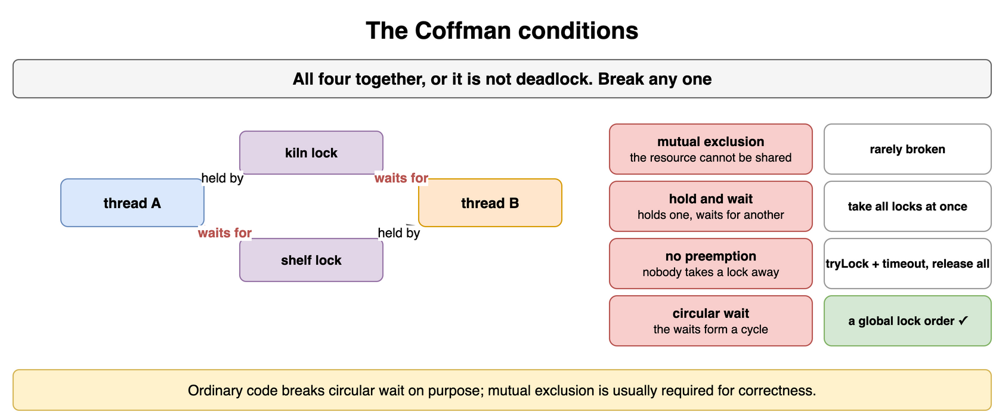

*Source: [`diagrams/threads-and-locks.drawio`](/content/11_Coding_Problems/05_Threads_and_Locks/diagrams/threads-and-locks.drawio), page 11.*

## Lock ordering

Pick a global order and acquire locks only in that order. If every transfer locks the lower account id first, two transfers cannot wait on each other. When the set of locks is dynamic, order them by identity before you acquire any of them. Releasing in reverse order is the usual pairing. A thread that already holds a later lock and then wants an earlier one has broken the order. That is the bug to look for.

If you cannot order them, use a try-lock and give up every lock you hold when one acquire fails, then retry. Retries need a bound or a random pause, or two threads can collide forever. That failure mode is livelock, below. In the interview, write the order down next to the shared fields. "I lock the kiln, then the shelf" is a design. "I lock whatever I need" is a deadlock.

```python
def ids_in_order(a: int, b: int) -> tuple[int, int]:
    return (a, b) if a < b else (b, a)

print(ids_in_order(7, 3))  # (3, 7), always the lower id first
```

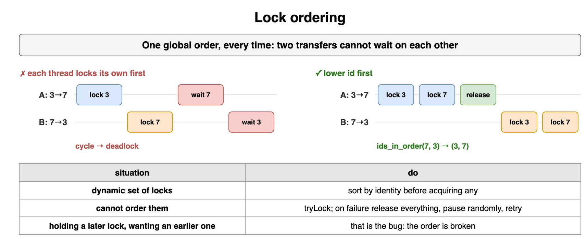

*Source: [`diagrams/threads-and-locks.drawio`](/content/11_Coding_Problems/05_Threads_and_Locks/diagrams/threads-and-locks.drawio), page 12.*

## Livelock and starvation

Livelock is motion without progress. Two threads each hold nothing, each sees the other, each backs off, and each retries in the same rhythm. Neither is blocked, so it is not deadlock, and the work never finishes. Break the symmetry: randomize the pause, or let one side proceed while the other yields.

Starvation is a thread that is ready and still never gets the resource. A reader-writer lock that always prefers readers starves a writer under a constant read load. An unfair mutex can in theory starve too, though many runtimes queue waiters. Name who waits and why the policy never picks them. The fix is a fair queue, or a rule that a waiting writer blocks new readers. Do not call starvation a deadlock. Nobody is stuck in a cycle. Someone is just never chosen.

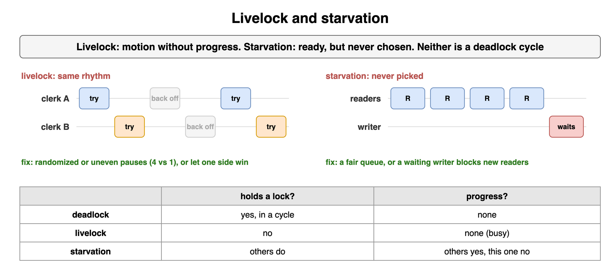

*Source: [`diagrams/threads-and-locks.drawio`](/content/11_Coding_Problems/05_Threads_and_Locks/diagrams/threads-and-locks.drawio), page 13.*

## Visibility and happens-before

A lock is not only mutual exclusion. It also publishes writes. Without a happens-before edge, a write can stay in a register or a store buffer, and another thread can keep seeing the old value. In Java, unlocking a monitor happens-before a later lock of that same monitor. A `volatile` write happens-before a later `volatile` read of that field. Starting a thread happens-before the new thread's first action. A thread's last action happens-before `join` returns.

`volatile` makes one variable's reads and writes visible and ordered. It does not make `count++` atomic. That is still a read and a write. Use `volatile` for a flag that one thread sets and others only read, such as `shutdown`. Use a lock or an atomic when the update is a compound action. Python's memory model is less formal. A `Lock` still does the publication for you. A plain bool you set from one thread and spin on from another is the bug people hit when they skip the lock "because it is just a flag."

```java
volatile boolean shutdown = false; // visible, not a compound counter
```

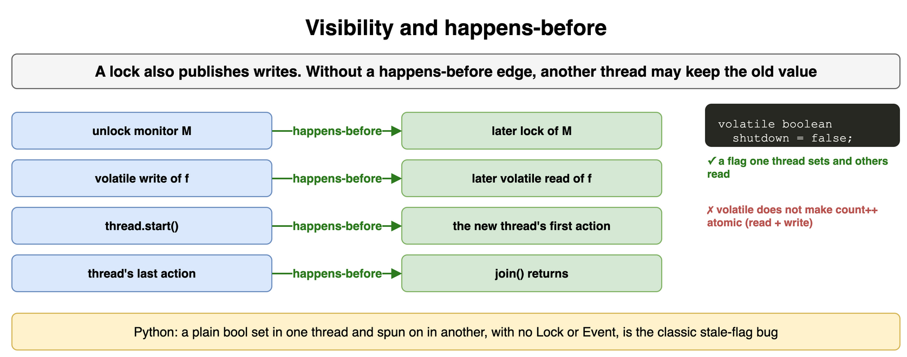

*Source: [`diagrams/threads-and-locks.drawio`](/content/11_Coding_Problems/05_Threads_and_Locks/diagrams/threads-and-locks.drawio), page 14.*

## The GIL, briefly

CPython has a global interpreter lock. One thread at a time runs Python bytecode. Threads still help when the work releases the GIL, which blocking I/O does: a thread waiting on a socket is not holding the interpreter, so another thread runs. CPU-bound Python loops do not speed up on more cores this way. The GIL is released around many C extensions, which is why numeric libraries can use cores from Python threads.

The GIL is not a lock around your objects. `n += 1` compiles to several bytecodes. Another thread can run between them whenever the GIL is dropped, including at the check interval. A check-then-act on a list still needs a `Lock` if two threads can interleave the check and the act. For CPU-bound Python, use processes, not more threads. Say that in one sentence and move on. The interview is almost never about implementing the GIL.

```python
# The GIL does not make this atomic. Two threads can both read n.
n = 0
n = n + 1
```

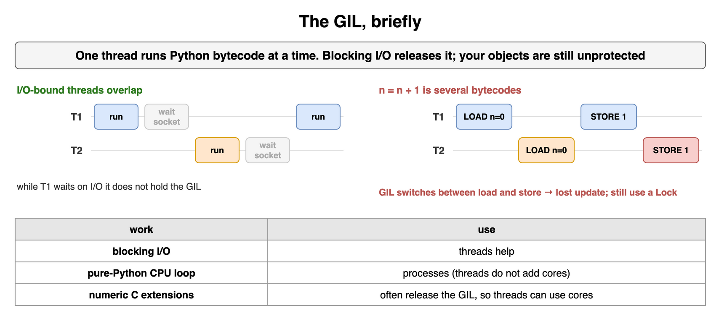

*Source: [`diagrams/threads-and-locks.drawio`](/content/11_Coding_Problems/05_Threads_and_Locks/diagrams/threads-and-locks.drawio), page 15.*

## What you say first

Start from the shared data, not from the API. Which fields are shared. Which lock guards them. What the critical section contains, and what stays outside it. The order locks are acquired. What a thread does when it cannot proceed: wait on a condition, fail, or retry. Then the failure modes you designed against: the lost update, the deadlock cycle, the starved writer.

A design you cannot describe at that level is a design you cannot debug. If the interviewer asks for Java, name `synchronized`, `volatile`, and the executor. If they ask for Python, name `Lock`, `Condition`, and the GIL's limit. The shared-state story is the same in both.

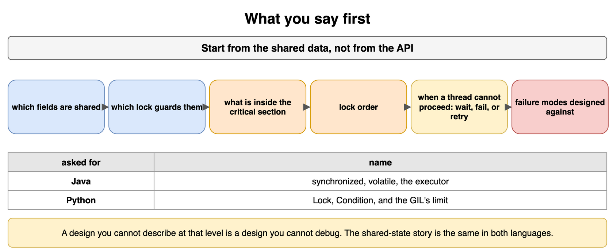

*Source: [`diagrams/threads-and-locks.drawio`](/content/11_Coding_Problems/05_Threads_and_Locks/diagrams/threads-and-locks.drawio), page 16.*
