# Threads and Locks — Drills

Original drills on shared state, locks, waits, and visibility. Each card is one situation. The Python checks the decision. It does not try to win a real race. No copyrighted book text.

## Shared counter, two heaps

A badge counter is updated by the door and read by the desk. Should those two be threads in one process, or two processes, and what do they share?

**Answer:** Threads in one process, if they are one program and the counter is a plain variable. They share the heap, so both can name the counter, and they still need a lock around the update. Two processes do not see each other's variables. You would add shared memory or a message for the count, which is extra machinery for one integer. Use processes when a crash must stay isolated or when the work is CPU-bound Python that should run on two cores.

```python
def same_heap(thread_model: str) -> bool:
    return thread_model == "threads"

print(same_heap("threads"), same_heap("processes"))  # True False
```

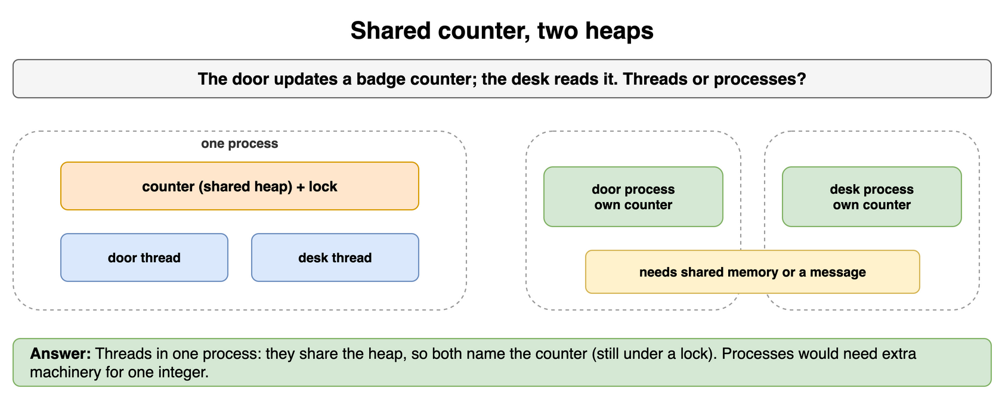

*Source: [`diagrams/threads-and-locks-drills.drawio`](/content/11_Coding_Problems/05_Threads_and_Locks/diagrams/threads-and-locks-drills.drawio), page 1.*

## One increment disappears

Two doors each add 1 to a count that both read as 40. Write the interleaving that ends at 41, and the section that prevents it.

**Answer:** Both read 40, both compute 41, both write 41. One arrival is gone. The critical section is the whole read-modify-write, under one lock that every door uses. A lock around only the write does nothing: both already computed 41. A green test run does not show this interleaving is impossible.

```python
def lost_update(start: int) -> int:
    a = start
    b = start
    a = a + 1
    b = b + 1
    return b  # both writes store start + 1

def locked_updates(start: int, times: int) -> int:
    count = start
    for _ in range(times):
        count = count + 1  # one thread at a time inside the lock
    return count

print(lost_update(40), locked_updates(40, 2))  # 41 42
```

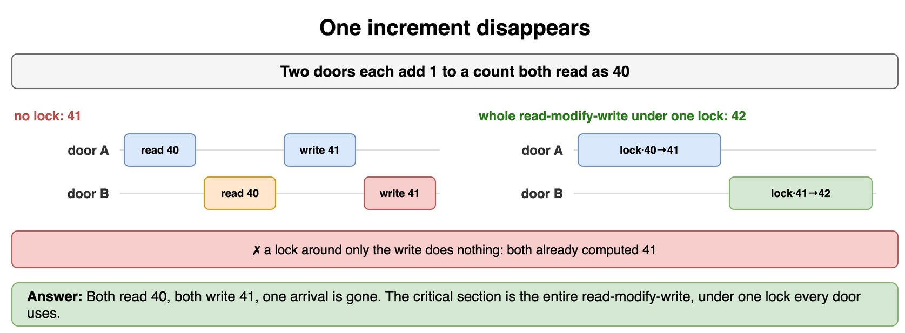

*Source: [`diagrams/threads-and-locks-drills.drawio`](/content/11_Coding_Problems/05_Threads_and_Locks/diagrams/threads-and-locks-drills.drawio), page 2.*

## Which object is the lock

A Java class has `synchronized void deposit()` and also `synchronized (log) { log.add(line); }` inside it. Can a thread be inside `deposit` while another thread is inside the log block?

**Answer:** Yes, if `log` is not `this`. A synchronized method locks the instance. The block locks `log`. They are different monitors, so two threads can hold one each. They cannot both be inside `deposit` on the same instance. If the intent was "the balance and the log move together," both must use the same lock. The source line is not the lock. The object is.

```python
def same_monitor(method_lock: str, block_lock: str) -> bool:
    return method_lock == block_lock

print(same_monitor("this", "log"))   # False, both can proceed
print(same_monitor("this", "this"))  # True, one at a time
```

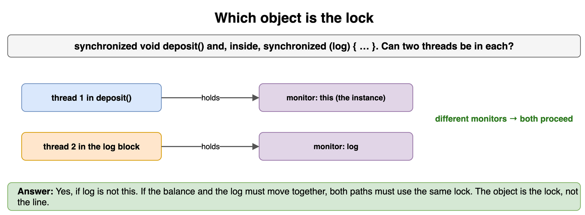

*Source: [`diagrams/threads-and-locks-drills.drawio`](/content/11_Coding_Problems/05_Threads_and_Locks/diagrams/threads-and-locks-drills.drawio), page 3.*

## Three firings, not a mutex

A kiln may run three firings at once. A fourth waits. Why is a semaphore the right tool, and why is a mutex the wrong one?

**Answer:** The rule is a count of permits, not a single owner. A `Semaphore(3)` lets three threads enter and makes the fourth block until someone releases. A mutex allows one holder. Using it would serialize firings that the kiln can do together. The mutex is still the right tool for a shared counter of finished firings. Do not ask the semaphore to protect that counter. Releasing a permit you did not acquire raises the count and lets a fourth firing in.

```python
import threading

kiln = threading.Semaphore(3)
entered = 0
lock = threading.Lock()

def enter() -> None:
    global entered
    kiln.acquire()
    with lock:
        global_entered = entered + 1
        # publish under the lock; the semaphore only caps overlap
        globals()["entered"] = global_entered

for _ in range(3):
    enter()
print(entered, kiln.acquire(blocking=False))  # 3 False, the fourth permit is gone
kiln.release()
print(kiln.acquire(blocking=False))  # True, a permit came back
```

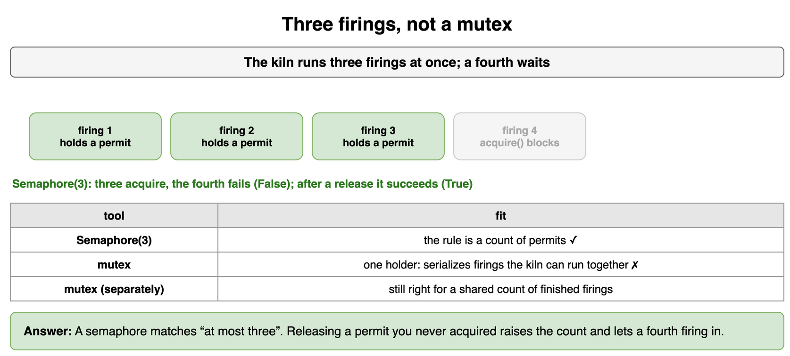

*Source: [`diagrams/threads-and-locks-drills.drawio`](/content/11_Coding_Problems/05_Threads_and_Locks/diagrams/threads-and-locks-drills.drawio), page 4.*

## The wakeup you must recheck

A consumer waits for a queue to be non-empty. It wakes, and the queue is empty again. How is that possible, and what does the wait look like?

**Answer:** `notify` wakes one waiter, and another consumer can take the item first. Java can also wake a waiter spuriously. The wait is a loop, not an if: while the queue is empty, wait. `wait` releases the monitor, so the producer can take it, enqueue, and notify. On wake, the consumer holds the monitor again and retests. An if-wait acts on a queue that may already be empty.

```python
def take(queue: list[str], woke_to_empty: bool) -> str | None:
    if woke_to_empty:
        return None  # the if-wait bug: proceed on a stale wakeup
    return queue.pop(0)

print(take(["mug"], woke_to_empty=True))  # None, do not pop
print(take(["mug"], woke_to_empty=False))  # mug
```

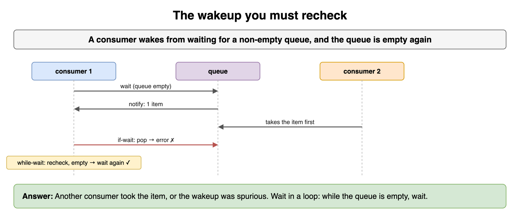

*Source: [`diagrams/threads-and-locks-drills.drawio`](/content/11_Coding_Problems/05_Threads_and_Locks/diagrams/threads-and-locks-drills.drawio), page 5.*

## Full shelf, empty shelf

A shelf holds at most two bowls. Potters add bowls. The shop removes them. Who waits, and what is signaled?

**Answer:** The potter waits while the shelf has two bowls. The shop waits while it has zero. Both use the shelf's lock. After an add, signal a shopper. After a remove, signal a potter. Build the bowl outside the lock. Put it on the shelf inside the lock, then signal. Take it inside the lock, signal, then wrap it outside. One condition and `notify_all` is correct. Two conditions avoid waking a potter when only a shopper can proceed. The bound is 2. An unbounded queue is a memory leak with a different name.

```python
def offer(shelf: list[str], bowl: str, limit: int) -> str:
    if len(shelf) >= limit:
        return "wait"
    shelf.append(bowl)
    return "added"

shelf: list[str] = ["a", "b"]
print(offer(shelf, "c", 2), offer([], "c", 2))  # wait added
```

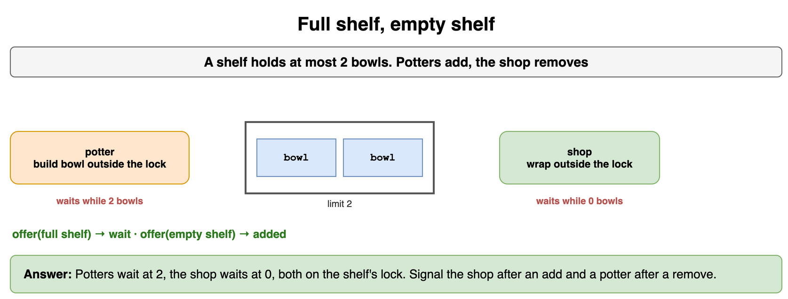

*Source: [`diagrams/threads-and-locks-drills.drawio`](/content/11_Coding_Problems/05_Threads_and_Locks/diagrams/threads-and-locks-drills.drawio), page 6.*

## Readers barging in

Dozens of threads read a price list. One thread needs to replace it. A reader-writer lock lets every new reader start even when a writer is queued. What happens to the writer, and what policy fixes it?

**Answer:** The writer starves if readers keep arriving. This is not a deadlock. The writer is not in a cycle. It is never chosen. Block new readers once a writer is waiting, and let the current readers finish, then run the writer. A plain mutex also fixes starvation and gives up concurrent readers. Say that trade if reads are rare. Do not use a reader-writer lock for a single counter.

```python
def writer_runs(waiting_writer: bool, admit_new_readers: bool) -> str:
    if waiting_writer and admit_new_readers:
        return "starved"
    if waiting_writer:
        return "runs after current readers"
    return "idle"

print(writer_runs(True, True), writer_runs(True, False))
# starved, runs after current readers
```

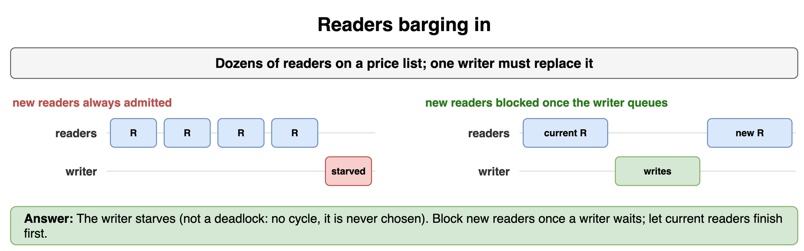

*Source: [`diagrams/threads-and-locks-drills.drawio`](/content/11_Coding_Problems/05_Threads_and_Locks/diagrams/threads-and-locks-drills.drawio), page 7.*

## One field, not two

A counter of finished firings is updated by many threads. The balance of a potter and the matching ledger row must move together. Which update can be a CAS loop, and which cannot?

**Answer:** The counter can. CAS retries "if the value is still the one I read, store plus one." One field, one step. The balance and the ledger cannot. Two successful CAS operations are still two steps. A crash or an interleaving between them shows a balance that the ledger does not have. That pair is one lock or one transaction. A CAS loop that gives up after one failure also loses updates. It has to retry until the swap wins, or fall back to a lock.

```python
def cas_inc(value: int, seen: int) -> tuple[int, bool]:
    if value != seen:
        return value, False
    return seen + 1, True

print(cas_inc(5, 5), cas_inc(6, 5))  # (6, True) (6, False)
```

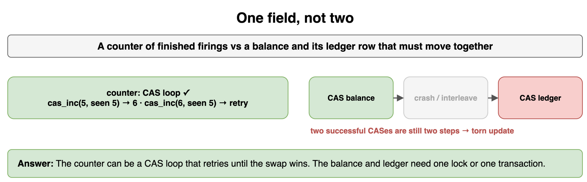

*Source: [`diagrams/threads-and-locks-drills.drawio`](/content/11_Coding_Problems/05_Threads_and_Locks/diagrams/threads-and-locks-drills.drawio), page 8.*

## A thread per ticket

Each ticket opens a new thread that writes the ledger. A sale morning creates tens of thousands of tickets. What breaks, and what do you bound?

**Answer:** Thread creation and stacks grow without a limit, and the ledger lock becomes a crowd. Use a pool with a fixed worker count and a bounded queue. When the queue is full, decide: block the ticket desk, reject the ticket, or write it on the desk's thread. Do not leave the policy implicit. Do not have a pooled task wait for another task on the same small pool. Those workers never become free.

```python
def admits(open_threads: int, cap: int) -> bool:
    return open_threads < cap

print(admits(4, 4), admits(3, 4))  # False True
```

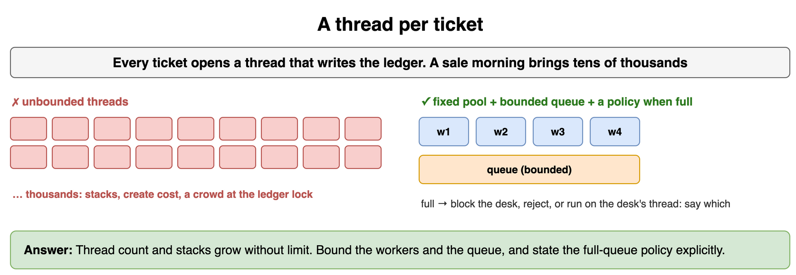

*Source: [`diagrams/threads-and-locks-drills.drawio`](/content/11_Coding_Problems/05_Threads_and_Locks/diagrams/threads-and-locks-drills.drawio), page 9.*

## Which condition is missing

Thread A holds the kiln lock and wants the shelf lock. Thread B holds the shelf lock and wants the kiln lock. Both wait. Which Coffman conditions are present, and which one will you break?

**Answer:** All four. Each lock is exclusive. Each thread holds one lock while waiting for the other. Nothing steals a lock. The waits form a cycle. Break circular wait: lock the lower id first, every time. If the kiln id is less than the shelf id, both threads take the kiln, then the shelf, and the cycle cannot form. A timeout that drops both locks breaks the "no preemption" habit in practice, and it needs a retry that does not livelock.

```python
def order(first: str, second: str) -> tuple[str, str]:
    return tuple(sorted((first, second)))

print(order("shelf", "kiln"))  # ('kiln', 'shelf') for both threads
```

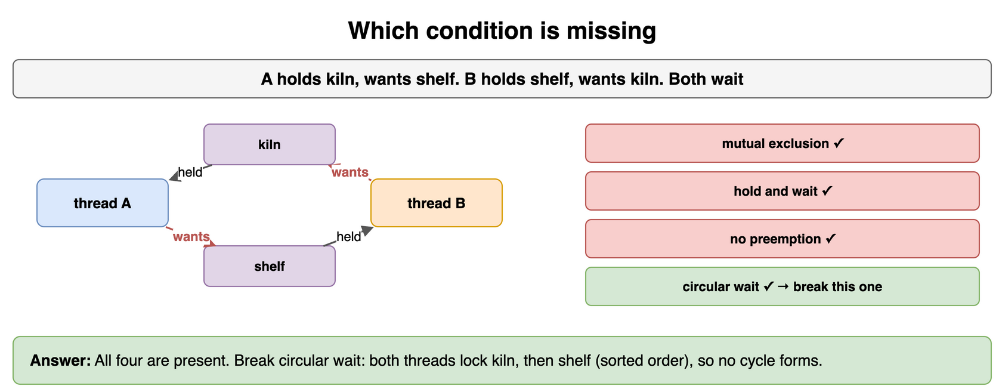

*Source: [`diagrams/threads-and-locks-drills.drawio`](/content/11_Coding_Problems/05_Threads_and_Locks/diagrams/threads-and-locks-drills.drawio), page 10.*

## Same rhythm, no progress

Two clerks each try to lock the kiln, fail, release everything, and retry immediately, forever, in step. Are they deadlocked?

**Answer:** No. Neither holds a lock and waits. They are livelocked: each responds to the other and neither enters. Break the symmetry. One waits a random short time, or one is given the kiln while the other yields. A deadlock would be both holding and both waiting. The repair for livelock is to stop mirroring each other, not to invent a fifth lock.

```python
def pause(attempt: int, salt: int) -> int:
    return 1 + ((attempt * 3 + salt) % 4)

print(pause(1, 0), pause(1, 1))  # 4 1, not the same backoff
```

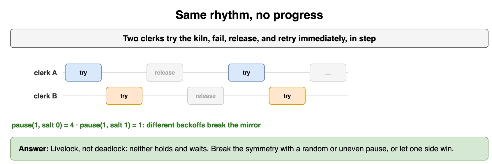

*Source: [`diagrams/threads-and-locks-drills.drawio`](/content/11_Coding_Problems/05_Threads_and_Locks/diagrams/threads-and-locks-drills.drawio), page 11.*

## A flag the other thread never sees

One thread sets `shutdown = True` when the kiln should stop. Another thread loops on `while not shutdown` with no lock and no volatile. The loop never ends. Why, and what is the smallest fix that is still wrong for a counter?

**Answer:** There is no happens-before edge between the write and the read. The looping thread can keep a register copy of `false`. In Java, `volatile boolean shutdown` publishes the write to a later read. In Python, set the flag while holding a lock the reader also takes, or use an `Event`. `volatile` is the wrong fix for `count++`. That update is two memory operations, and volatile does not glue them. The flag works because one thread only writes and the other only reads.

```python
def published(uses_volatile_or_lock: bool) -> str:
    return "visible" if uses_volatile_or_lock else "may stay stale"

print(published(False), published(True))
```

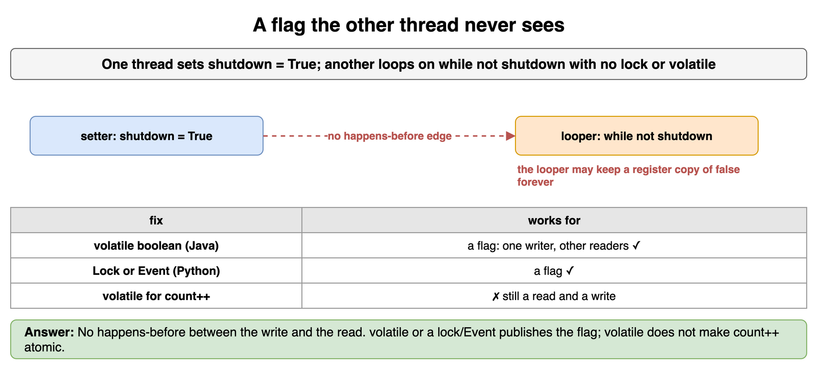

*Source: [`diagrams/threads-and-locks-drills.drawio`](/content/11_Coding_Problems/05_Threads_and_Locks/diagrams/threads-and-locks-drills.drawio), page 12.*

## The GIL is not your lock

Two Python threads both run `n = n + 1` a million times on one global. A teammate says the GIL makes the lock unnecessary. When is that false, and when do threads still help?

**Answer:** It is false for the counter. `n = n + 1` is several bytecodes, and the GIL can move to the other thread between the read and the write. You still lose updates. Threads help when each one blocks on I/O, because that releases the GIL. They do not speed up a pure Python CPU loop. Use a `Lock` around the counter, or an atomic from a library that actually provides one. Use processes for CPU-bound Python.

```python
def increments_need_a_lock() -> bool:
    # Several bytecodes: load n, add, store n.
    return True

print(increments_need_a_lock())
```

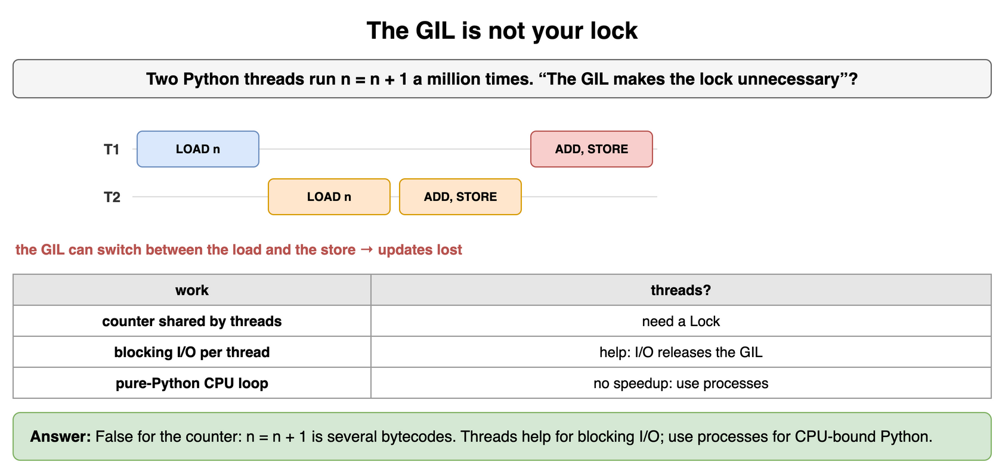

*Source: [`diagrams/threads-and-locks-drills.drawio`](/content/11_Coding_Problems/05_Threads_and_Locks/diagrams/threads-and-locks-drills.drawio), page 13.*

## Lock, then the network

A clerk holds the ledger lock, then calls a remote printer, then updates the row. What do you move outside the lock, and what do you recheck?

**Answer:** The print call leaves the lock. Hold the lock only to read the row and to write the result. After the call, re-acquire and re-check that the row is still the one you printed. Another clerk may have changed it. Holding the lock across the network stalls every other ledger user and invites deadlock if the printer path wants another lock. The critical section is the shared row, not the slow work you happened to write next to it.

```python
def section(step: str) -> str:
    return "inside" if step in {"read row", "write row"} else "outside"

print(section("read row"), section("print"), section("write row"))
# inside outside inside
```

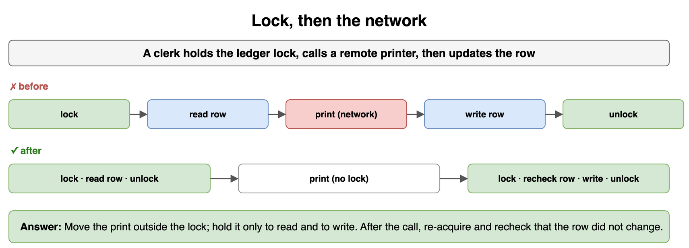

*Source: [`diagrams/threads-and-locks-drills.drawio`](/content/11_Coding_Problems/05_Threads_and_Locks/diagrams/threads-and-locks-drills.drawio), page 14.*

## Waiting on your own pool

A pool has one worker. A task on that worker submits a second task to the same pool and waits for it. Why does this stop, and what do you change?

**Answer:** The only worker is blocked waiting for a task that needs that worker. That is a deadlock of a pool, not a cycle of two locks, and adding the Coffman list still helps: the worker holds the only permit and waits for another permit. Do not wait for the same pool you are running on. Run the second piece inline, use another pool, or return a future to the caller outside the pool. A pool of one makes the bug certain. A larger pool makes it likely under load.

```python
def deadlocks(workers: int, waits_on_same_pool: bool) -> bool:
    return workers == 1 and waits_on_same_pool

print(deadlocks(1, True), deadlocks(1, False))  # True False
```

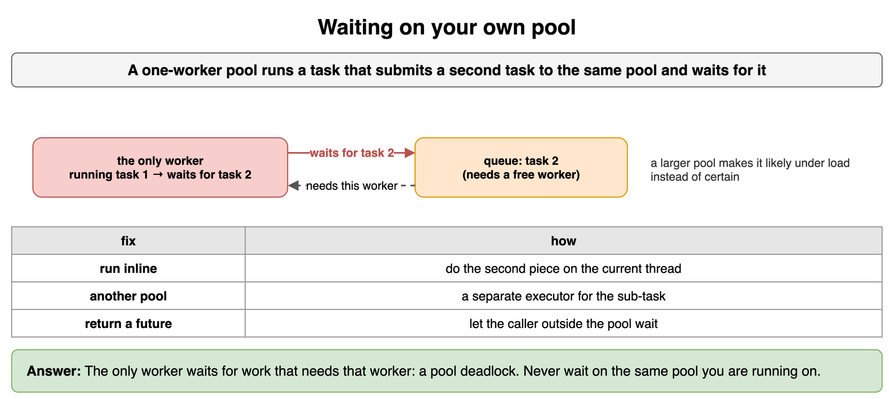

*Source: [`diagrams/threads-and-locks-drills.drawio`](/content/11_Coding_Problems/05_Threads_and_Locks/diagrams/threads-and-locks-drills.drawio), page 15.*

## Join sees the writes

A thread fills a list, and the caller reads the list after `join` returns. Why is that read safe without a second lock, and why is a read before `join` not?

**Answer:** The thread's last actions happen-before `join` returns. The caller sees the appends. A read before `join` has no such edge. The list might still be empty, or it might be half-updated if you also share it without a lock. `join` is a publication edge for that thread's work. It is not a lock around later uses of the list by a third thread. If two workers share the list after both have been joined, later mutations still need a lock.

```python
import threading

box: list[int] = []

def fill() -> None:
    box.append(1)

worker = threading.Thread(target=fill)
worker.start()
worker.join()
print(box)  # [1], the join happens-before this read
```

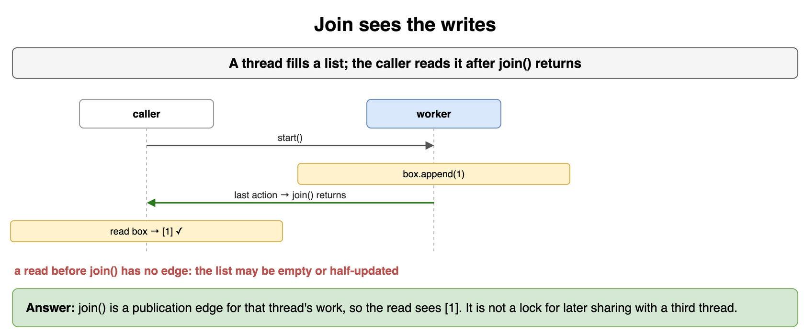

*Source: [`diagrams/threads-and-locks-drills.drawio`](/content/11_Coding_Problems/05_Threads_and_Locks/diagrams/threads-and-locks-drills.drawio), page 16.*
