# Moderate Problems — Drills

Original drills for the shortcuts on this topic: masks, swaps, overflow, counts, pointers, windows, prefixes, sorting, intervals, a small machine, digits, and gcd. Each answer has an approach, a cost, and Python. No published book problems.

## Lowest open wing

A badge is a bit mask. Bit 0 is wing 0. The mask `0b10100` opens wings 2 and 4. Which is the lowest open wing, and what is the cost after the mask is in hand?

**Answer:** Isolate the lowest set bit with `mask & -mask`, which is `0b100`, worth 4, at index 2. `bit_length() - 1` turns that power of two into the index. That is O(1) after you have the mask. A loop from bit 0 also works and is O(width), which is fine for 32 flags and worse as a habit. An empty mask has no wing. Guard it.

```python
def lowest_wing(mask: int) -> int | None:
    if mask <= 0:
        return None
    return (mask & -mask).bit_length() - 1

print(lowest_wing(0b10100), lowest_wing(0))  # 2 None
```

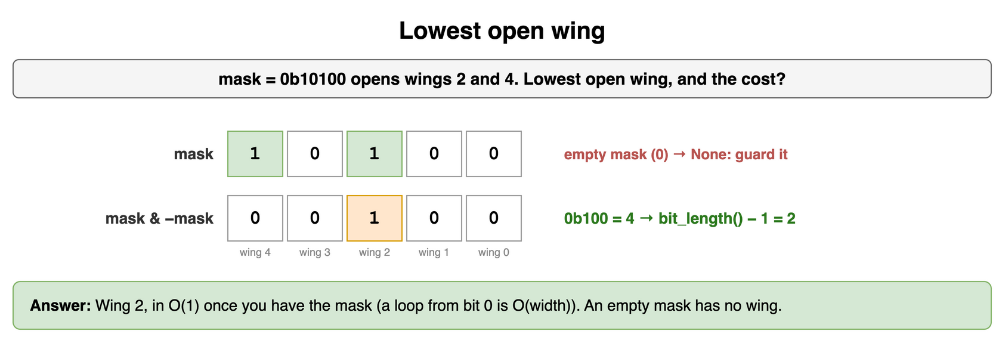

*Source: [`diagrams/moderate-problems-drills.drawio`](/content/11_Coding_Problems/06_Moderate_Problems/diagrams/moderate-problems-drills.drawio), page 1.*

## Same slot, XOR swap

This swap exchanges two locker numbers without a temporary. What does it do when both indexes are 2, and how do you fix it?

```python
def swap_slots(numbers: list[int], i: int, j: int) -> None:
    numbers[i] ^= numbers[j]
    numbers[j] ^= numbers[i]
    numbers[i] ^= numbers[j]
```

**Answer:** When `i == j`, the first line XORs the slot with itself and stores 0. The later lines stay at 0. The locker number is gone. XOR swap needs two different locations. Return immediately when the indexes match. Different indexes still work: 3 and 7 exchange. Cost is O(1). A tuple swap, `(numbers[i], numbers[j]) = (numbers[j], numbers[i])`, is the version to write when a temporary is allowed, and it is safe on one index.

```python
def swap_slots(numbers: list[int], i: int, j: int) -> None:
    if i == j:
        return
    numbers[i] ^= numbers[j]
    numbers[j] ^= numbers[i]
    numbers[i] ^= numbers[j]

same = [9]
swap_slots(same, 0, 0)
pair = [3, 7]
swap_slots(pair, 0, 1)
print(same, pair)  # [9] [7, 3]
```

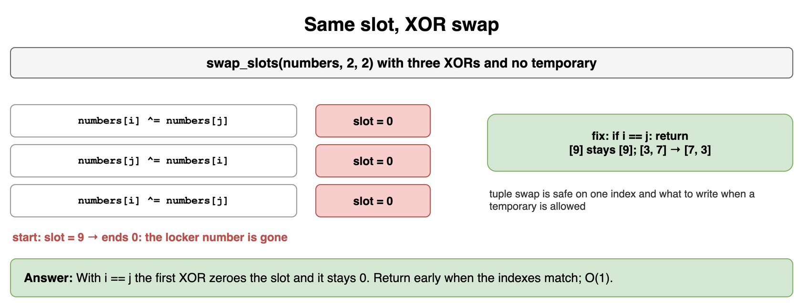

*Source: [`diagrams/moderate-problems-drills.drawio`](/content/11_Coding_Problems/06_Moderate_Problems/diagrams/moderate-problems-drills.drawio), page 2.*

## Midpoint of two big counters

Two counters hold `2000000000` and `2000000010` and both fit in a signed 32-bit integer. Their sum does not. What midpoint do you want, and which expression wraps?

**Answer:** The midpoint is `2000000005`. `lo + hi` is `4000000010`, which is past `2**31 - 1`, so a 32-bit add wraps negative before the division. `lo + (hi - lo) // 2` subtracts first. The difference is 10, half of that is 5, and the add stays in range. Cost is O(1). Test a small pair and a pair near the top of the type. Python will not show the wrap unless you mask to 32 bits.

```python
def midpoint(lo: int, hi: int) -> int:
    return lo + (hi - lo) // 2

def wrapped_mid(lo: int, hi: int) -> int:
    raw = (lo + hi) & 0xFFFFFFFF
    if raw >= 0x80000000:
        raw -= 0x100000000
    return raw // 2

lo, hi = 2_000_000_000, 2_000_000_010
print(midpoint(lo, hi), wrapped_mid(lo, hi))  # 2000000005 -147483643
```

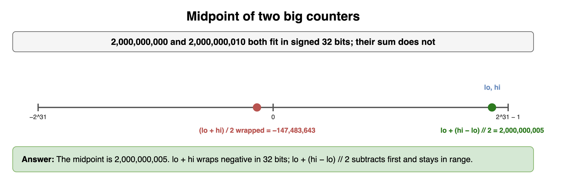

*Source: [`diagrams/moderate-problems-drills.drawio`](/content/11_Coding_Problems/06_Moderate_Problems/diagrams/moderate-problems-drills.drawio), page 3.*

## Lengths that repeat

A bin of rope offcuts is `[4, 2, 4, 3, 2, 2]`. Which lengths appear more than once?

**Answer:** Count with a map in one pass. 2 appears three times, 4 appears twice, 3 appears once. The answer is 2 and 4. Expected time is O(n). Expected extra space is O(n) distinct lengths. Sorting then scanning neighbors is O(n log n) and also works. The map is the insight when you do not otherwise need order. Return the lengths in sorted order so the caller is stable.

```python
def repeated(lengths: list[int]) -> list[int]:
    counts: dict[int, int] = {}
    for length in lengths:
        counts[length] = counts.get(length, 0) + 1
    return sorted(length for length, count in counts.items() if count > 1)

print(repeated([4, 2, 4, 3, 2, 2]))  # [2, 4]
```

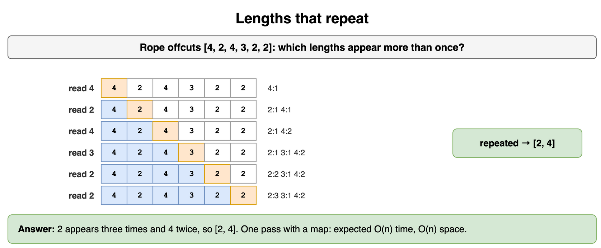

*Source: [`diagrams/moderate-problems-drills.drawio`](/content/11_Coding_Problems/06_Moderate_Problems/diagrams/moderate-problems-drills.drawio), page 4.*

## Kayaks from both ends

Sorted weights `[1, 2, 4, 5]` must cross. A kayak holds two people if their weights sum to at most 6, otherwise one person. Always consider the heaviest remaining person. How many kayaks, and what is the cost?

**Answer:** Two. Pair 5 with 1, and 4 with 2. Sort if the input is not sorted, O(n log n), then one left pointer and one right pointer, O(n). If the light person fits with the heavy person, both leave. Otherwise only the heavy person leaves. Each step discards the heavy end, so you cannot skip a better pair. `[5, 5]` with limit 6 is two kayaks, each alone. An empty list is zero kayaks.

```python
def trips(weights: list[int], limit: int) -> int:
    ordered = sorted(weights)
    lo, hi = 0, len(ordered) - 1
    boats = 0
    while lo <= hi:
        if ordered[lo] + ordered[hi] <= limit:
            lo += 1
        hi -= 1
        boats += 1
    return boats

print(trips([1, 2, 4, 5], 6), trips([5, 5], 6), trips([], 6))  # 2 2 0
```

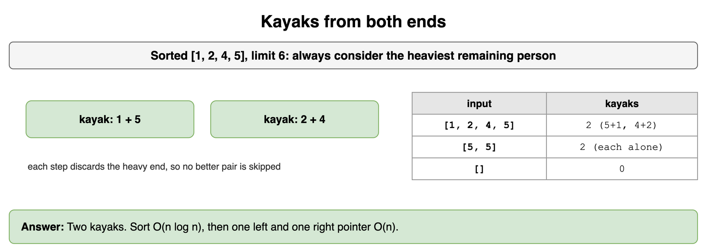

*Source: [`diagrams/moderate-problems-drills.drawio`](/content/11_Coding_Problems/06_Moderate_Problems/diagrams/moderate-problems-drills.drawio), page 5.*

## Hours under a liter budget

Hourly watering is `[1, 2, 2, 4, 1, 1]`. What is the longest streak of consecutive hours whose sum is at most 5?

**Answer:** Three hours: `1 + 2 + 2`. The window adds the right hour and drops left hours while the sum exceeds 5. Each hour enters once and leaves once, so the scan is O(n) and O(1) extra memory. The sum only grows as the window grows, which is why dropping the left side is safe. A streak that is not contiguous is a different problem. The empty log has length 0. A single hour over the budget has length 0 as well, because the window shrinks until the sum fits, and an hour larger than the limit never fits.

```python
def longest_under(hours: list[int], limit: int) -> int:
    left = 0
    total = 0
    best = 0
    for right, amount in enumerate(hours):
        total += amount
        while total > limit and left <= right:
            total -= hours[left]
            left += 1
        if total <= limit:
            best = max(best, right - left + 1)
    return best

print(longest_under([1, 2, 2, 4, 1, 1], 5), longest_under([9], 5))  # 3 0
```

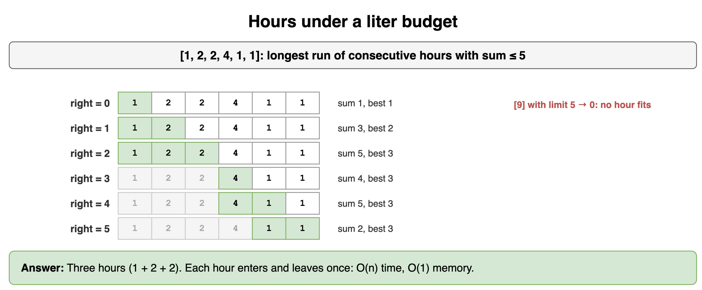

*Source: [`diagrams/moderate-problems-drills.drawio`](/content/11_Coding_Problems/06_Moderate_Problems/diagrams/moderate-problems-drills.drawio), page 6.*

## Jars between two days

Daily jar counts are `[2, 0, 3, 4]`. Several questions ask for the total from day `left` through day `right`, inclusive, with day 0 first. How do you answer many of them?

**Answer:** Build a prefix once: `[0, 2, 2, 5, 9]`. The total from `left` through `right` is `prefix[right + 1] - prefix[left]`. Days 1 through 2 are `5 - 2 = 3`. Days 0 through 3 are `9`. Building the prefix is O(n). Each question is O(1). One question does not need the array. A hand sum is clearer. The off-by-one is the extra 0 at the front. Test a range you can add yourself before you trust the indexes.

```python
def prefix(values: list[int]) -> list[int]:
    sums = [0]
    for value in values:
        sums.append(sums[-1] + value)
    return sums

def range_sum(sums: list[int], left: int, right: int) -> int:
    return sums[right + 1] - sums[left]

sums = prefix([2, 0, 3, 4])
print(range_sum(sums, 1, 2), range_sum(sums, 0, 3))  # 3 9
```

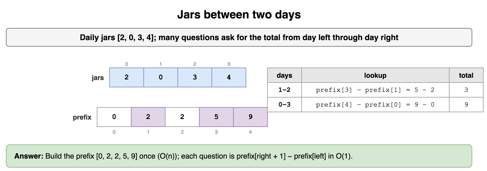

*Source: [`diagrams/moderate-problems-drills.drawio`](/content/11_Coding_Problems/06_Moderate_Problems/diagrams/moderate-problems-drills.drawio), page 7.*

## Smallest gap between crates

Crate weights are `[8, 1, 5, 3]`. What is the smallest positive difference between any two, and what do you return for one crate?

**Answer:** Sort to `[1, 3, 5, 8]`. Neighbor gaps are 2, 2, and 3. The minimum is 2. Any closer pair would be neighbors after the sort, so the scan is complete. Sort is O(n log n). The scan is O(n). One crate, or none, has no pair. Return `None` rather than 0, because 0 would mean two equal weights. All equal weights are a gap of 0, which is a real answer and a different edge.

```python
def smallest_gap(weights: list[int]) -> int | None:
    if len(weights) < 2:
        return None
    ordered = sorted(weights)
    return min(b - a for a, b in zip(ordered, ordered[1:]))

print(smallest_gap([8, 1, 5, 3]), smallest_gap([4]), smallest_gap([4, 4]))
# 2 None 0
```

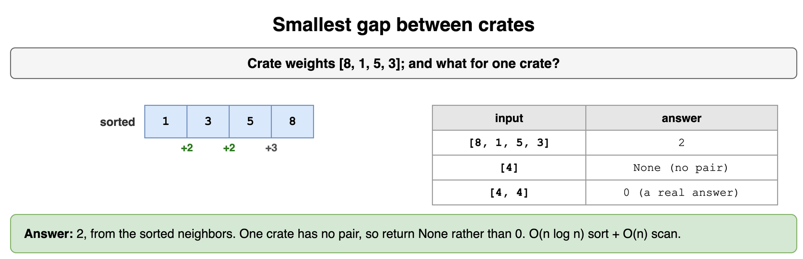

*Source: [`diagrams/moderate-problems-drills.drawio`](/content/11_Coding_Problems/06_Moderate_Problems/diagrams/moderate-problems-drills.drawio), page 8.*

## Kiln bookings that overlap

Bookings are `(1, 3)`, `(2, 6)`, `(8, 10)`, and `(9, 12)`. Merge the ones that overlap or touch. What is the cost?

**Answer:** Sort by start, which these already are. `(1, 3)` extends to `(1, 6)` because 2 is before 3. `(8, 10)` extends to `(8, 12)` because 9 is before 10. The result is `(1, 6)` and `(8, 12)`. Sort is O(n log n). The walk is O(n). Touching endpoints merge because the test is `start <= current end`. If bookings were half-open and a shared endpoint did not overlap, the test would be `<`. Say which one you are using. An empty list merges to an empty list.

```python
def merge(spans: list[tuple[int, int]]) -> list[tuple[int, int]]:
    ordered = sorted(spans)
    merged: list[tuple[int, int]] = []
    for start, end in ordered:
        if merged and start <= merged[-1][1]:
            merged[-1] = (merged[-1][0], max(merged[-1][1], end))
        else:
            merged.append((start, end))
    return merged

print(merge([(1, 3), (2, 6), (8, 10), (9, 12)]))  # [(1, 6), (8, 12)]
```

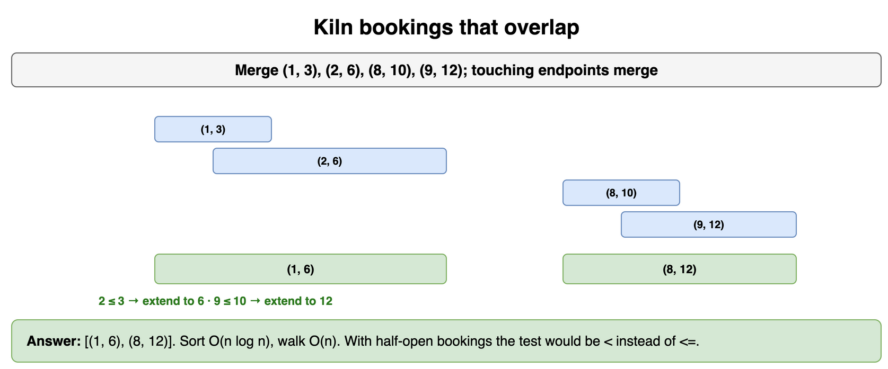

*Source: [`diagrams/moderate-problems-drills.drawio`](/content/11_Coding_Problems/06_Moderate_Problems/diagrams/moderate-problems-drills.drawio), page 9.*

## The turnstile log

A turnstile starts `locked`. Events are `badge`, `pass`, `force`. Badge opens it. Pass on an open gate locks it. Pass while locked, or force while open, raises `alarm`. Alarm stays alarm. Replay `badge, pass, badge, force`. What is the end state, and what is the cost of a log of length n?

**Answer:** `badge` opens, `pass` locks, `badge` opens, `force` alarms. The end state is `alarm`. Each event is a constant-time lookup, so the log is O(n) time and O(1) extra memory besides the input. An unknown event leaves the state alone. Write that down so a typo does not become a crash or a silent open. The insight is the state table, not a search over the log.

```python
NEXT = {
    ("locked", "badge"): "open",
    ("open", "pass"): "locked",
    ("locked", "pass"): "alarm",
    ("open", "force"): "alarm",
}

def replay(events: list[str]) -> str:
    state = "locked"
    for event in events:
        state = NEXT.get((state, event), "alarm" if state == "alarm" else state)
    return state

print(replay(["badge", "pass", "badge", "force"]))  # alarm
```

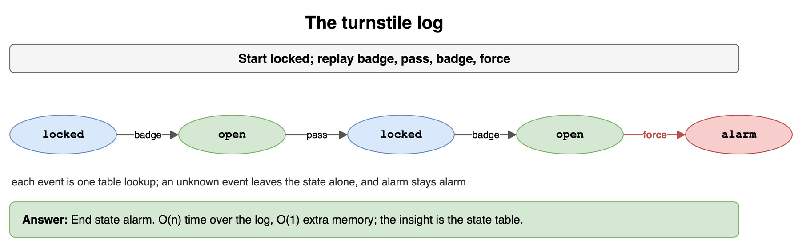

*Source: [`diagrams/moderate-problems-drills.drawio`](/content/11_Coding_Problems/06_Moderate_Problems/diagrams/moderate-problems-drills.drawio), page 10.*

## Increasing badge numbers

A positive integer is accepted when each decimal digit is strictly greater than the digit on its left. `1359` is accepted. `133` is not. `7` is accepted. What about `21`?

**Answer:** `21` is rejected. From the left the digits go 2 then 1, which is a decrease. Peel digits from the right with `% 10` and `// 10`, and require each newly peeled digit to be smaller than the one peeled before it. That is the left-to-right increase, seen backwards. One digit passes because the loop never finds a pair. Cost is O(digits), which is O(log n). Negative numbers are rejected before the loop. A code with a leading zero is a string, not this function.

```python
def strictly_increasing(number: int) -> bool:
    if number < 0:
        return False
    previous = 10
    while number:
        digit = number % 10
        if digit >= previous:
            return False
        previous = digit
        number //= 10
    return True

print(strictly_increasing(1359), strictly_increasing(133), strictly_increasing(7), strictly_increasing(21))
# True False True False
```

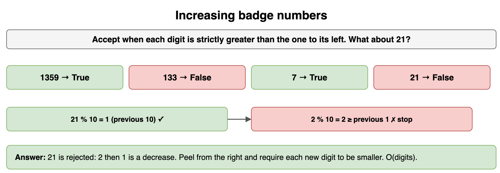

*Source: [`diagrams/moderate-problems-drills.drawio`](/content/11_Coding_Problems/06_Moderate_Problems/diagrams/moderate-problems-drills.drawio), page 11.*

## Two spools, one offcut

Spools of 18 feet and 12 feet must be cut into equal pieces with nothing left over. What is the longest piece, and why is 9 feet wrong?

**Answer:** 6 feet. 18 and 12 are both multiples of 6, and no larger integer divides both. 9 divides 18 and does not divide 12, so one spool would have a leftover. Euclid replaces the pair with `(12, 18 % 12) = (12, 6)`, then `(6, 0)`, and the answer is 6. The number of steps is O(log min(a, b)). Zero feet is a degenerate spool. Decide it up front. This function returns the other length, which is the right gcd, including `gcd(12, 0) == 12`.

```python
def gcd(a: int, b: int) -> int:
    while b:
        a, b = b, a % b
    return a

print(gcd(18, 12), gcd(12, 0))  # 6 12
```

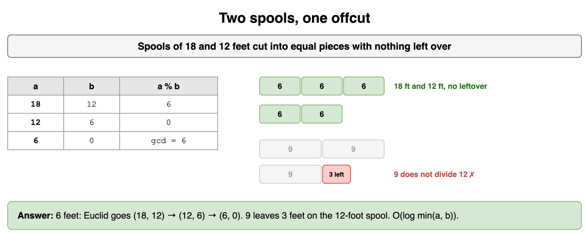

*Source: [`diagrams/moderate-problems-drills.drawio`](/content/11_Coding_Problems/06_Moderate_Problems/diagrams/moderate-problems-drills.drawio), page 12.*

## A million badge ids

Each id is a 32-bit integer. Roughly how much memory is a million of them, and does a hash map of them fit in a laptop?

**Answer:** A million times 4 bytes is 4 megabytes, plus the map's overhead, which is a small constant factor, not a different order of magnitude. A laptop holds that easily. `2**20` is about a million, which is the estimate to say if you do not want the exact product. A billion ids is about 4 gigabytes before overhead, and that is the point where you ask whether they fit. The estimate does not choose the algorithm by itself. It tells you a hash map is allowed. Empty input is still an edge of the algorithm, not of the estimate.

```python
def badge_bytes(count: int) -> int:
    return count * 4

print(badge_bytes(1_000_000), badge_bytes(1_000_000) < 10**9)  # 4000000 True
```

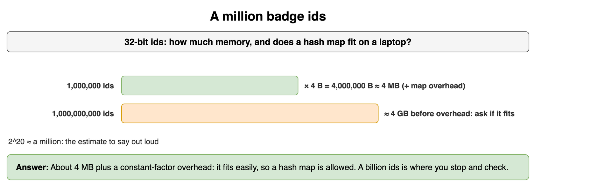

*Source: [`diagrams/moderate-problems-drills.drawio`](/content/11_Coding_Problems/06_Moderate_Problems/diagrams/moderate-problems-drills.drawio), page 13.*

## Deepest dip in a barrel

Hourly water levels are `[4, 7, 5, 9, 2]`. A dip is a later level below an earlier one. What is the deepest dip, in one forward pass?

**Answer:** 7, from the 9 down to the 2. Keep the highest level seen so far and the best drop. At 4 the drop is 0. At 7 the peak becomes 7. At 5 the drop is 2. At 9 the peak becomes 9. At 2 the drop is 7. One pass, O(n) time, O(1) memory. You never need a later peak for an earlier drop, because a drop uses an earlier higher level. An empty log has no dip. Return 0. A strictly rising log also has dip 0.

```python
def deepest_dip(levels: list[int]) -> int:
    if not levels:
        return 0
    peak = levels[0]
    best = 0
    for level in levels:
        peak = max(peak, level)
        best = max(best, peak - level)
    return best

print(deepest_dip([4, 7, 5, 9, 2]), deepest_dip([1, 2, 3]))  # 7 0
```

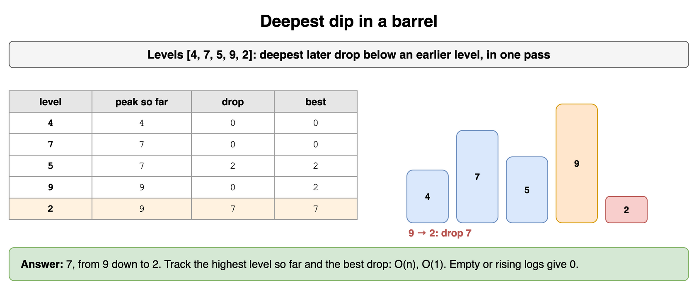

*Source: [`diagrams/moderate-problems-drills.drawio`](/content/11_Coding_Problems/06_Moderate_Problems/diagrams/moderate-problems-drills.drawio), page 14.*

## Twelve-hour clock

A studio clock reads 8. A firing runs 20 hours. What hour does it read, using a 12-hour face with 0 for midnight?

**Answer:** 4. `(8 + 20) % 12` is 28 modulo 12, which is 4. Reduce the sum if the hour count can overflow a fixed width. Many steps reduce one at a time: `hour = (hour + 1) % 12` inside the loop, O(steps), or one modulo, O(1). Negative steps need a language that wraps modulo toward a non-negative remainder, or you add `12` until the value is positive. Python's `%` already does that. `-1 % 12` is 11.

```python
def clock(start: int, steps: int) -> int:
    return (start + steps) % 12

print(clock(8, 20), clock(0, -1))  # 4 11
```

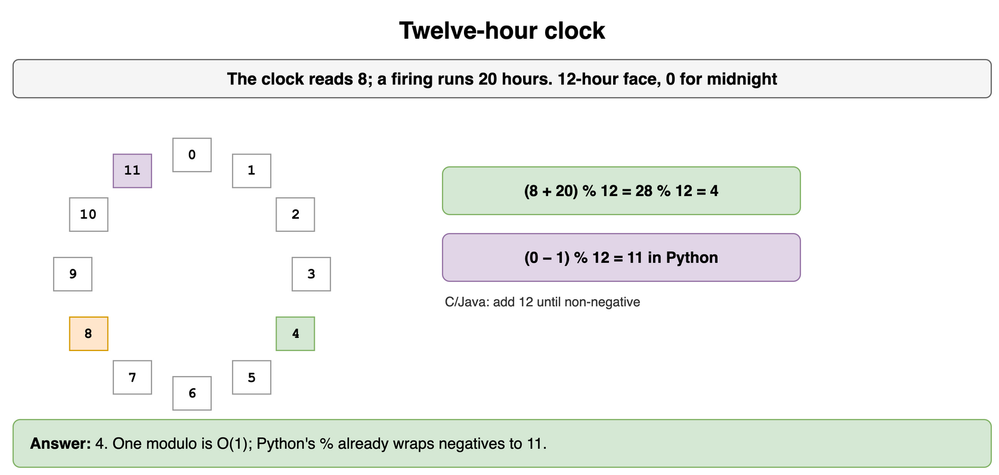

*Source: [`diagrams/moderate-problems-drills.drawio`](/content/11_Coding_Problems/06_Moderate_Problems/diagrams/moderate-problems-drills.drawio), page 15.*

## The fast window against a slow one

Check `longest_under` on `[1, 2, 2, 4, 1, 1]` with limit 5 against a loop that tries every streak. What should both return, and what does the empty log return?

**Answer:** Both return 3, the prefix `1, 2, 2`. The slow check is O(n^2) sums and exists to catch an off-by-one in the window. The empty log returns 0. A single hour of 9 against a limit of 5 returns 0, because no streak fits. If the two functions disagree, fix the window. Do not delete the slow check to make the file quiet. On a real input you can drop the slow check after a tiny case has matched. Its cost is the reason it is not the shipped algorithm.

```python
def longest_under(hours: list[int], limit: int) -> int:
    left = 0
    total = 0
    best = 0
    for right, amount in enumerate(hours):
        total += amount
        while total > limit and left <= right:
            total -= hours[left]
            left += 1
        if total <= limit:
            best = max(best, right - left + 1)
    return best

def slow(hours: list[int], limit: int) -> int:
    best = 0
    for i in range(len(hours)):
        total = 0
        for j in range(i, len(hours)):
            total += hours[j]
            if total <= limit:
                best = max(best, j - i + 1)
    return best

sample = [1, 2, 2, 4, 1, 1]
print(longest_under(sample, 5), slow(sample, 5), longest_under([], 5))  # 3 3 0
```

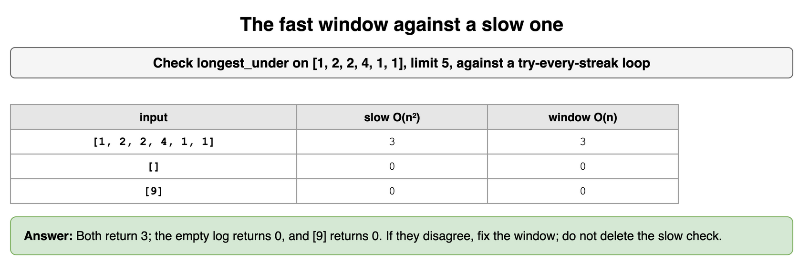

*Source: [`diagrams/moderate-problems-drills.drawio`](/content/11_Coding_Problems/06_Moderate_Problems/diagrams/moderate-problems-drills.drawio), page 16.*
