## Coding interview formats

Most hiring pipelines mix four formats. An online assessment (OA) is a timed, auto-graded set of problems on a platform such as HackerRank or CodeSignal: nobody watches, hidden test cases decide the score, and edge cases (empty input, the largest n) cost as much as the main idea. A phone or video screen is usually one medium problem, sometimes two, in a shared editor such as CoderPad, with an engineer listening for 45 to 60 minutes; how you reason counts as much as the final code. A take-home runs for hours or days and is read like a pull request: structure, tests, and a README that says how to run it and which trade-offs you made. An onsite or final loop is several back-to-back rounds (coding, often design and behavioural), and the score is consistency across them.

Each format rewards different practice. For an OA, solve timed sets with no hints and always run the empty, single-element, and maximum-size cases before submitting; a brute force that passes the small tests beats an unfinished optimal one. For a screen, practise talking while you type in a plain editor with no autocomplete and no run button. For a take-home, cut scope early and spend the saved time on tests and the README. For a loop, build stamina and reset between rounds, since one weak round rarely sinks you but a slide across three does. Processes differ between companies and change often, so ask the recruiter which format, language, and editor each round uses and whether your code will be executed.

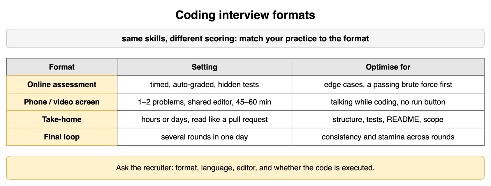

*Source: [`diagrams/approaching.drawio`](/content/11_Coding_Problems/08_Approaching_a_Coding_Problem/diagrams/approaching.drawio), page 1.*

## What interviewers score

Interviewers usually fill in a rubric with a handful of signals. Problem solving: you reach a working approach and improve it. Communication: they can follow why you chose it. Collaboration: you use hints and take feedback without arguing. Code quality: readable names, small helpers, no copy-pasted branches. Optimisation: you can state the complexity and reduce it. Adapting: when a follow-up changes the rules, you change the plan. Testing: you find your own bugs before they do.

The red flags mirror those signals: shaky fundamentals (unsure what a hash lookup costs), long silences, declaring "done" without a single trace, defending an approach after a hint shows it is wrong, ignoring a stated constraint such as "O(1) extra space", and poor time use, whether that is ten minutes of silent optimising or a perfect brute force with no time left to improve it. The final code is not the whole score: a clearly reasoned O(n log n) answer with a bug you caught yourself often rates higher than an optimal one typed in silence.

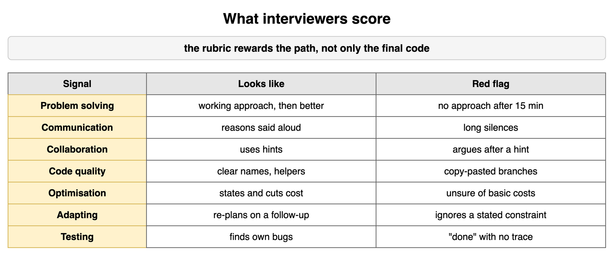

*Source: [`diagrams/approaching.drawio`](/content/11_Coding_Problems/08_Approaching_a_Coding_Problem/diagrams/approaching.drawio), page 2.*

## The six-step answer

The method behind each step (listen, draw an example, brute force, optimise, walk through, implement, test) is taught on [Problem-solving flow](#07_Data_Structures_and_Algorithms/11_Problem_Solving_Patterns/concepts/problem-solving-flow). This card is the interview script that wraps it: (1) clarify the problem and its constraints; (2) design, starting with a brute force, comparing options, and writing pseudocode first if the logic is long; (3) state a rough complexity and get a nod before typing; (4) write clean code with clear names and helpers; (5) restate the complexity of what you actually wrote and explain any change; (6) test with a simple case, then edge and boundary cases.

Steps 1 to 3 are where the interviewer can still redirect you cheaply, so do not rush them; a wrong design discovered at minute 30 rarely recovers. A rough budget for a 45-minute round (exercise numbers): 3 minutes of introductions, 5 to clarify, 8 to design, 15 to code, 2 for complexity, 7 to test, and 5 for your questions. When you fall behind, cut design polish, not testing.

```python
budget = [("intro", 3), ("clarify", 5), ("design", 8), ("code", 15),
          ("complexity", 2), ("test", 7), ("questions", 5)]
clock, marks = 0, []
for step, minutes in budget:
    clock += minutes
    marks.append(f"{step}@{clock}")
print(" ".join(marks))
print("start coding by minute", sum(m for _, m in budget[:3]))
# intro@3 clarify@8 design@16 code@31 complexity@33 test@40 questions@45
# start coding by minute 16
```

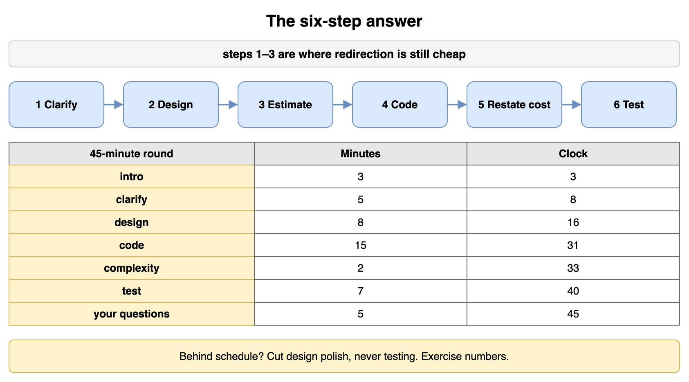

*Source: [`diagrams/approaching.drawio`](/content/11_Coding_Problems/08_Approaching_a_Coding_Problem/diagrams/approaching.drawio), page 3.*

## Clarifying questions that change the algorithm

Ask the questions whose answers change the algorithm, not the ones that only change a variable name. Is the input sorted? Sorted unlocks [Two Pointers](#11_Coding_Problems/09_Two_Pointers/concepts/two-indexes) and [Binary Search](#11_Coding_Problems/14_Binary_Search/concepts/binary-search); unsorted means a hash map or an O(n log n) sort first. Can values be negative? Negatives make a plain [sliding window](#11_Coding_Problems/13_Sliding_Windows/concepts/when-a-shrink-is-not-legal) on sums illegal and push you to prefix sums. Are there duplicates? They need skip logic in backtracking and a tie rule in sorting. What should empty input, or k larger than n, return? May I modify the input? In place saves O(n) space. Must the output keep an order, or is any valid answer fine? How large are n and the values? That last one sets the target complexity on the next card.

The detail-hunting habit itself is on [Listen carefully](#07_Data_Structures_and_Algorithms/11_Problem_Solving_Patterns/concepts/listen-carefully); the interview point is to say why you are asking ("if it's sorted I can do this in O(1) space"), which shows the interviewer the fork in your plan. The example shows one question flipping the answer: two pointers find the pair on a sorted list but miss it on the same values unsorted, while a hash set works either way at the cost of O(n) space.

```python
def pair_sorted(nums: list[int], target: int) -> tuple[int, int] | None:
    i, j = 0, len(nums) - 1
    while i < j:
        total = nums[i] + nums[j]
        if total == target:
            return nums[i], nums[j]
        if total < target:
            i += 1
        else:
            j -= 1
    return None


def pair_any(nums: list[int], target: int) -> tuple[int, int] | None:
    seen = set()
    for x in nums:
        if target - x in seen:
            return target - x, x
        seen.add(x)
    return None


print(pair_sorted([2, 5, 9, 14], 19), pair_any([2, 5, 9, 14], 19))
print(pair_sorted([14, 5, 2, 9], 19), pair_any([14, 5, 2, 9], 19))
# (5, 14) (5, 14)
# None (14, 5)
```

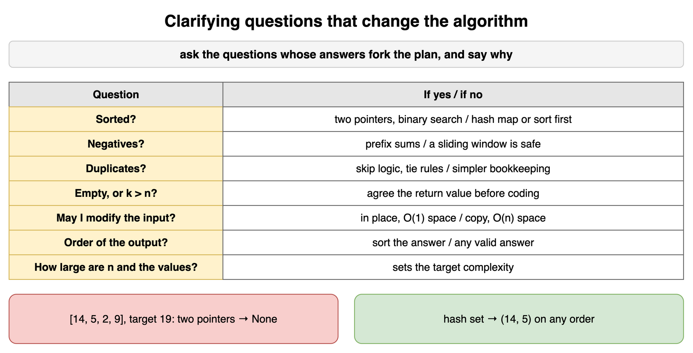

*Source: [`diagrams/approaching.drawio`](/content/11_Coding_Problems/08_Approaching_a_Coding_Problem/diagrams/approaching.drawio), page 4.*

## Constraints set the target complexity

The input limits tell you how fast the answer must be before you design anything. A common rule of thumb is that a judge allows roughly 10⁸ simple operations per second in a compiled language and around 10⁷ in Python, so: n ≤ ~10 allows O(n!) (try every ordering); n ≤ ~20 allows O(2ⁿ) (every subset, bitmasks); n ≤ ~500 allows O(n³); n ≤ ~5,000 allows O(n²); n ≤ ~10⁶ needs O(n log n) or O(n); anything larger, or a stream, needs O(n) total and O(log n) or O(1) per operation. Value limits matter too: values up to 10⁴ invite a counting array instead of a hash map or a sort.

These are rules of thumb, not laws: constant factors, language, and the number of test files all shift the lines. Use the table in both directions. It tells you which brute force is already good enough (n ≤ 15 means backtracking is the intended answer, not a fallback), and it tells you when to stop optimising: an O(n) bound is the floor whenever every value must be read, as on [Best conceivable runtime](#07_Data_Structures_and_Algorithms/11_Problem_Solving_Patterns/concepts/best-conceivable-runtime). When the interviewer gives no limits, ask.

```python
def target(n: int) -> str:
    for limit, cost in ((10, "O(n!)"), (20, "O(2^n)"), (500, "O(n^3)"),
                        (5_000, "O(n^2)"), (1_000_000, "O(n log n)")):
        if n <= limit:
            return cost
    return "O(n) total or O(log n) per op"


print([target(n) for n in (8, 18, 300, 4_000)])
print(target(200_000), "|", target(10**9))
# ['O(n!)', 'O(2^n)', 'O(n^3)', 'O(n^2)']
# O(n log n) | O(n) total or O(log n) per op
```

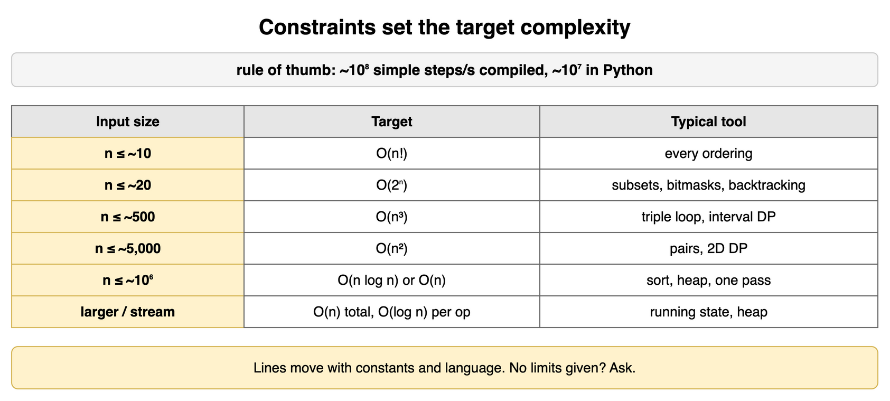

*Source: [`diagrams/approaching.drawio`](/content/11_Coding_Problems/08_Approaching_a_Coding_Problem/diagrams/approaching.drawio), page 5.*

## Brute force, then name the waste

Say the brute force in one sentence that includes its cost: "for every day, scan all earlier days for the lowest reading: O(n²) time, O(1) space". That sentence proves you understand the problem, gives the interviewer a checkpoint, and becomes the test oracle for your faster version. Do not code it unless the interviewer asks or time is short; [State a brute force](#07_Data_Structures_and_Algorithms/11_Problem_Solving_Patterns/concepts/state-a-brute-force) covers how to find it.

Then name the waste out loud: which work does the inner loop redo? Here every outer step rescans the same prefix to find its minimum, but the minimum of a growing prefix only ever changes by one comparison, so carry it. That move from "repeated work" to "the structure that remembers it" is the [BUD bottlenecks](#07_Data_Structures_and_Algorithms/11_Problem_Solving_Patterns/concepts/bud-bottlenecks) habit. Naming the waste usually names the pattern: a rescanned prefix suggests a running value or [prefix sums](#11_Coding_Problems/18_Prefix_Sums/concepts/prefix-sum-array), a repeated lookup suggests a [hash map](#11_Coding_Problems/10_Hash_Maps_and_Sets/concepts/lookup-by-a-key), and repeated subproblems suggest [dynamic programming](#11_Coding_Problems/23_Dynamic_Programming/concepts/spotting-a-dynamic-programming-problem).

```python
def biggest_rise_brute(readings: list[int]) -> int:
    return max((readings[j] - min(readings[:j]) for j in range(1, len(readings))), default=0)


def biggest_rise(readings: list[int]) -> int:
    lowest, best = float("inf"), 0
    for r in readings:
        best = max(best, r - lowest)
        lowest = min(lowest, r)
    return best


temps = [12, 9, 15, 4, 11, 13, 6]
print(biggest_rise_brute(temps), biggest_rise(temps), biggest_rise([5]))
# 9 9 0
```

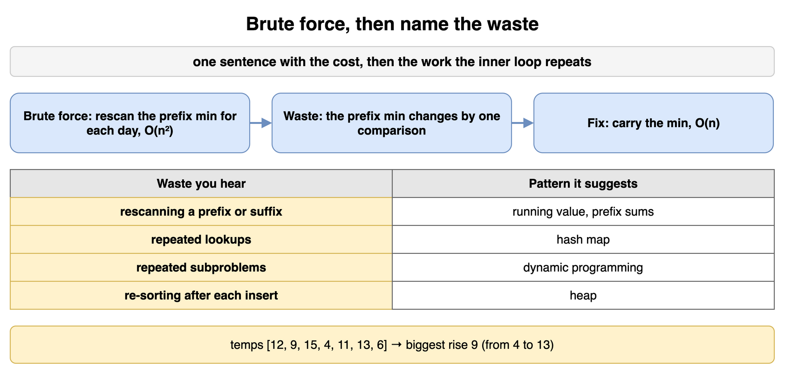

*Source: [`diagrams/approaching.drawio`](/content/11_Coding_Problems/08_Approaching_a_Coding_Problem/diagrams/approaching.drawio), page 6.*

## Restate the complexity after coding

The estimate you gave before coding was for the idea; restate the cost of the code you wrote, because they often differ. Common hidden costs: a `sorted()` inside a helper (O(n log n)), `x in some_list` inside a loop (O(n) each), slicing such as `s[1:]` in a loop or recursion (each slice copies), repeated string concatenation in a loop in languages without Python's in-place optimisation, and the recursion stack, which counts as space (O(h) for a tree of height h). If the code changed the cost, say so and say why: "I sort first, so it's O(n log n), not the O(n) I guessed".

Be explicit about what you count. Output that must be produced anyway is often excluded: listing all subsets is O(n · 2ⁿ) just to write them, so say "O(n) extra space excluding the output". The example counts the characters a slicing palindrome check copies: ten times longer input, a hundred times more copying, so the "O(n)" recursion is really O(n²).

```python
def copied_chars(s: str) -> int:
    total = 0
    while len(s) > 1:
        s = s[1:-1]
        total += len(s)
    return total


print(copied_chars("a" * 10), copied_chars("a" * 100), copied_chars("a" * 1000))
# 20 2450 249500
```

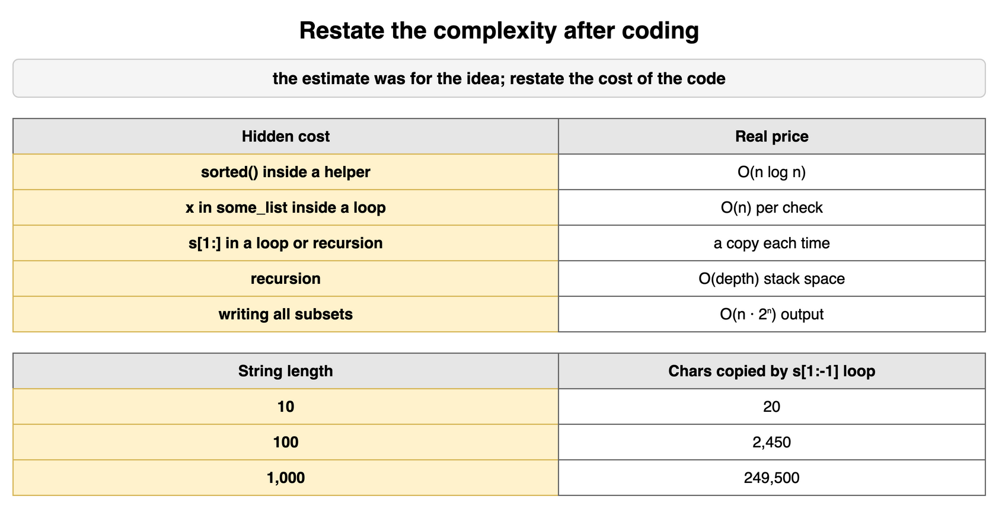

*Source: [`diagrams/approaching.drawio`](/content/11_Coding_Problems/08_Approaching_a_Coding_Problem/diagrams/approaching.drawio), page 7.*

## Ask before built-ins and in-place changes

Library calls are fine when they are not the point of the question: `sorted`, `collections.Counter`, `heapq`, and `bisect` are normal tools, as long as you say their cost (`sorted` is O(n log n), a heap push is O(log n)). When the built-in is the question, such as "find the k-th largest" answered with one `heapq.nlargest` call, or "check if a string is a palindrome" answered with `s == s[::-1]`, ask first: "May I use heapq here, or would you like me to write the heap?" Offering to implement it shows you know what it does.

Ask before you mutate the input as well. Sorting in place or writing markers into the array saves O(n) space, but the caller may still need the original order. If the interviewer says the input is read-only, copy it and include the O(n) copy in the space cost. The example is a median helper whose `sort()` silently reorders the caller's list; `sorted()` costs an extra O(n) but leaves it alone.

```python
def median_in_place(nums: list[int]) -> int:
    nums.sort()
    return nums[len(nums) // 2]


def median_copy(nums: list[int]) -> int:
    ordered = sorted(nums)
    return ordered[len(ordered) // 2]


queue_times = [7, 3, 9, 1, 5]
print(median_copy(queue_times), queue_times)
print(median_in_place(queue_times), queue_times)
# 5 [7, 3, 9, 1, 5]
# 5 [1, 3, 5, 7, 9]
```

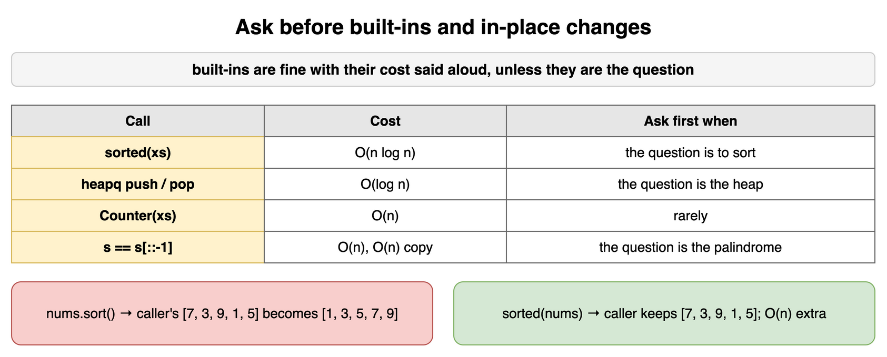

*Source: [`diagrams/approaching.drawio`](/content/11_Coding_Problems/08_Approaching_a_Coding_Problem/diagrams/approaching.drawio), page 8.*

## Testing out loud

Test on purpose, in a fixed order, and say each case aloud before running it. First trace one small ordinary case through the code you wrote, line by line, not through what you meant to write. Then the edge cases: empty input, one element, two elements, all values equal, already sorted, reverse sorted. Then the boundary values: 0, negatives, the largest allowed value, k = 0, and k = n. The detailed checklist is on [Test your code](#07_Data_Structures_and_Algorithms/11_Problem_Solving_Patterns/concepts/test-your-code).

When a test fails, fix the cause, not the symptom, and rerun the earlier tests: a patched `if` for the failing case often breaks one that passed. In a shared editor that can run code, a small table of `(input, expected)` pairs is quick to write and easy for the interviewer to read. The example tests a longest-flat-run function this way.

```python
def longest_flat(nums: list[int]) -> int:
    best = run = 0
    for i, x in enumerate(nums):
        run = run + 1 if i > 0 and x == nums[i - 1] else 1
        best = max(best, run)
    return best


cases = [([], 0), ([7], 1), ([2, 2], 2), ([1, 2, 3], 1),
         ([4, 4, 4], 3), ([1, 1, 2, 2, 2, 3], 3), ([-1, -1, 0], 2)]
print(sum(longest_flat(given) == want for given, want in cases), "of", len(cases))
# 7 of 7
```

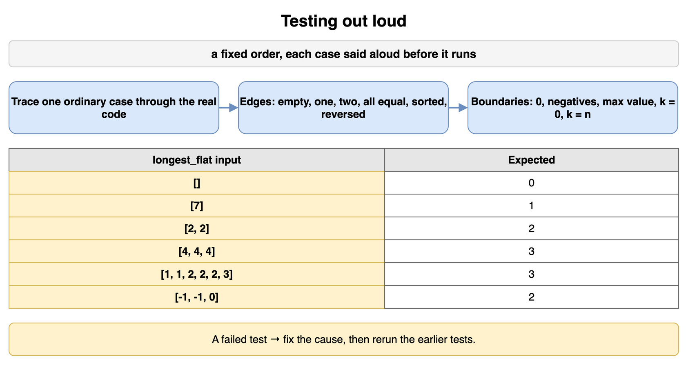

*Source: [`diagrams/approaching.drawio`](/content/11_Coding_Problems/08_Approaching_a_Coding_Problem/diagrams/approaching.drawio), page 9.*

## Talking through the problem

Narrate decisions, not keystrokes: "I'll keep a map from value to index so each lookup is O(1)" is useful, "now I'm typing a for loop" is noise. Check in at the forks: after the design ("does this approach sound reasonable before I code it?") and before a long stretch of code. Name the alternatives you rejected and why, in one line each. If you need to think, say so: "Give me thirty seconds to think about the negative case", then summarise what you concluded. Silence is only a problem when the interviewer cannot tell whether you are stuck.

Use precise words, because they change the algorithm: "subarray" and "substring" are contiguous, "subsequence" is not; "index" and "value" are different things; "sorted ascending" is not "non-decreasing" when there are duplicates. Skip formal proofs unless asked; a one-sentence argument ("each element is pushed and popped once, so it's O(n)") is what they want. The example shows why the subarray/subsequence word matters: the search space is quadratic for one and exponential for the other.

```python
n = 20
subarrays = n * (n + 1) // 2
subsequences = 2**n - 1
print(subarrays, subsequences)
# 210 1048575
```

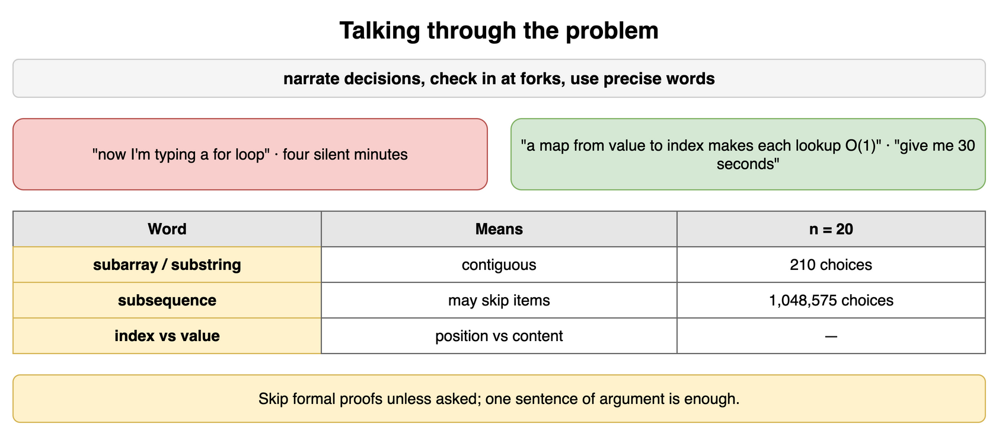

*Source: [`diagrams/approaching.drawio`](/content/11_Coding_Problems/08_Approaching_a_Coding_Problem/diagrams/approaching.drawio), page 10.*

## Getting unstuck

Being stuck is expected; going quiet is what hurts. Say what you tried and why it fails ("a window doesn't work because the values can be negative"). Then shrink the input and solve n = 1, 2, 3, 4 by hand or with a brute force, and look for a pattern. Solve a simpler version by dropping one constraint (assume sorted, assume no negatives, assume k = 1) and ask what breaks when you add it back. Finally walk the [pattern recognition map](#11_Coding_Problems/08_Approaching_a_Coding_Problem/concepts/the-pattern-recognition-map) row by row and ask whether each signal is present.

If you are still stuck after a few minutes, ask a specific question instead of "can I have a hint?": "Is there something about the sorted order I should be using?" Specific questions get specific hints and still show reasoning. The example uses a brute force on small grids to find a pattern: the number of squares of any size on an n × n board is 1, 5, 14, 30, 55, the running sum of squares, which gives a closed form.

```python
def squares_brute(n: int) -> int:
    return sum(1 for size in range(1, n + 1)
               for r in range(n - size + 1) for c in range(n - size + 1))


print([squares_brute(n) for n in range(1, 6)])
print(all(squares_brute(n) == n * (n + 1) * (2 * n + 1) // 6 for n in range(1, 30)))
# [1, 5, 14, 30, 55]
# True
```

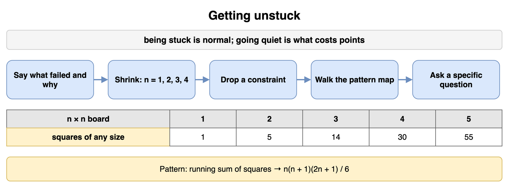

*Source: [`diagrams/approaching.drawio`](/content/11_Coding_Problems/08_Approaching_a_Coding_Problem/diagrams/approaching.drawio), page 11.*

## The pattern recognition map

Read the statement for signals, then route it to a pattern topic. The DSA version of this step is the flowchart on [Choosing a pattern](#07_Data_Structures_and_Algorithms/11_Problem_Solving_Patterns/concepts/choosing-a-pattern); this map routes to the problem sets in this section. A signal is a hint, not a proof: two rows can match, and the next card is about breaking that tie.

| Signal in the statement | Pattern |
| --- | --- |
| sorted array; pair or triplet with a target; palindrome; partition in place | [Two Pointers](#11_Coding_Problems/09_Two_Pointers/concepts/two-indexes) |
| "seen before", counts, grouping by a key, O(1) lookup | [Hash Maps and Sets](#11_Coding_Problems/10_Hash_Maps_and_Sets/concepts/lookup-by-a-key) |
| reverse, splice, or reorder a linked list | [Linked Lists](#11_Coding_Problems/11_Linked_Lists/concepts/pointer-rewiring) |
| cycle, middle of a list, repeating sequence, O(1) space | [Fast and Slow Pointers](#11_Coding_Problems/12_Fast_and_Slow_Pointers/concepts/fast-and-slow-pointers) |
| contiguous subarray or substring; longest or shortest under a condition | [Sliding Windows](#11_Coding_Problems/13_Sliding_Windows/concepts/sliding-window) |
| sorted or rotated search; "smallest value such that…" with a monotone yes/no | [Binary Search](#11_Coding_Problems/14_Binary_Search/concepts/smallest-value-that-passes-a-monotone-test) |
| nested brackets; next greater or smaller; undo | [Stacks](#11_Coding_Problems/15_Stacks/concepts/when-a-stack-fits) |
| top k, k-th, merge k sorted lists, running median | [Heaps](#11_Coding_Problems/16_Heaps/concepts/when-the-next-value-comes-from-a-heap) |
| meetings, bookings, ranges, overlaps | [Intervals](#11_Coding_Problems/17_Intervals/concepts/closed-and-half-open-intervals) |
| many range-sum queries; subarray sum equals k with negatives | [Prefix Sums](#11_Coding_Problems/18_Prefix_Sums/concepts/recognize-a-prefix-sum-problem) |
| hierarchy, ancestors, BST order, level by level | [Trees](#11_Coding_Problems/19_Trees/concepts/choose-a-traversal) |
| prefixes of many words, autocomplete, many words on one board | [Tries](#11_Coding_Problems/20_Tries/concepts/tries-as-a-pattern) |
| grids, networks, dependencies, shortest path, connected groups | [Graphs](#11_Coding_Problems/21_Graphs/concepts/spotting-a-graph) |
| all combinations, permutations, or placements | [Backtracking](#11_Coding_Problems/22_Backtracking/concepts/spotting-a-backtracking-problem) |
| minimum, maximum, or number of ways over overlapping choices | [Dynamic Programming](#11_Coding_Problems/23_Dynamic_Programming/concepts/spotting-a-dynamic-programming-problem) |
| a local best choice that never needs undoing | [Greedy](#11_Coding_Problems/24_Greedy/concepts/spotting-a-greedy-problem) |
| order first, then answer; k-th smallest of unsorted data | [Sort and Search](#11_Coding_Problems/25_Sort_and_Search/concepts/sorting-as-a-first-step) |
| one unpaired value, small sets as masks, O(1)-space tricks | [Bit Manipulation](#11_Coding_Problems/26_Bit_Manipulation/concepts/spotting-a-bit-manipulation-problem) |
| digits, overflow, points and slopes, matrix walks | [Math and Geometry](#11_Coding_Problems/27_Math_and_Geometry/concepts/spotting-a-math-and-geometry-problem) |

Two narrower rows sit inside Graphs: merges and "are these connected?" route to [union-find](#11_Coding_Problems/21_Graphs/concepts/union-find-for-merging-groups), and prerequisites route to [topological order](#11_Coding_Problems/21_Graphs/concepts/prerequisites-and-topological-order). The code is a toy keyword router; real statements need judgment, but it shows the shape of the lookup.

```python
ROUTES = [
    (("sorted", "pair"), "Two Pointers"),
    (("contiguous", "longest"), "Sliding Windows"),
    (("k largest",), "Heaps"),
    (("meetings",), "Intervals"),
    (("prerequisite",), "Graphs"),
    (("all", "combinations"), "Backtracking"),
    (("number of ways",), "Dynamic Programming"),
]


def route(statement: str) -> list[str]:
    s = statement.lower()
    return [topic for words, topic in ROUTES if all(w in s for w in words)] or ["brute force, then BUD"]


print(route("Given sorted prices, find a pair that spends the card exactly"))
print(route("Count the number of ways to climb 30 steps"), route("Rotate a matrix"))
# ['Two Pointers']
# ['Dynamic Programming'] ['brute force, then BUD']
```

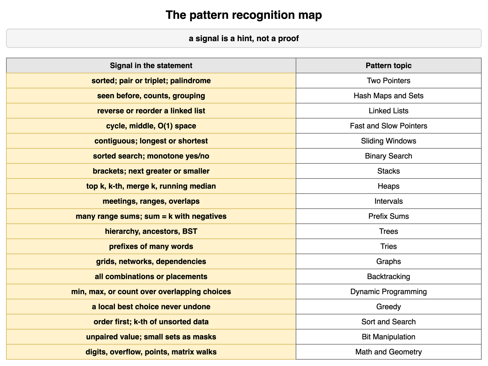

*Source: [`diagrams/approaching.drawio`](/content/11_Coding_Problems/08_Approaching_a_Coding_Problem/diagrams/approaching.drawio), page 12.*

## When two patterns fit

Many statements match two rows of the map, and each pattern topic ends with a card that breaks exactly that tie. Ask the tiebreak question and follow the link: negatives in a contiguous sum? ([Window, two pointers, or prefix sums](#11_Coding_Problems/13_Sliding_Windows/concepts/window-two-pointers-or-prefix-sums)); does the array change between queries? ([Prefix sums, sliding window, or Fenwick tree](#11_Coding_Problems/18_Prefix_Sums/concepts/prefix-sums-sliding-window-or-fenwick-tree)); sorted, or are indexes needed? ([A hash map, an array, a sort, or two pointers](#11_Coding_Problems/10_Hash_Maps_and_Sets/concepts/a-hash-map-an-array-a-sort-or-two-pointers)); is k small next to n, or is the data a stream? ([Heap, sort, quickselect, or buckets](#11_Coding_Problems/16_Heaps/concepts/heap-sort-quickselect-or-buckets), [Sort, heap, or select](#11_Coding_Problems/25_Sort_and_Search/concepts/sort-heap-or-select)).

For optimisation problems: does a local choice provably stay optimal? ([Greedy or dynamic programming](#11_Coding_Problems/24_Greedy/concepts/greedy-or-dynamic-programming)); list every answer or count the best one? ([Backtracking or dynamic programming](#11_Coding_Problems/22_Backtracking/concepts/backtracking-or-dynamic-programming), [DP, greedy, or backtracking](#11_Coding_Problems/23_Dynamic_Programming/concepts/dp-greedy-or-backtracking)). For graphs, weights and the question pick the algorithm ([Choosing a graph algorithm](#11_Coding_Problems/21_Graphs/concepts/choosing-a-graph-algorithm)). When you cannot settle it by argument, test the faster idea against a brute force on many small inputs: a counterexample within seconds is cheaper than a proof. The example finds where largest-coin-first stops being optimal for coins 1, 7, and 10.

```python
def greedy_coins(amount: int, coins=(10, 7, 1)) -> int:
    used = 0
    for c in coins:
        used += amount // c
        amount %= c
    return used


def best_coins(amount: int, coins=(1, 7, 10)) -> int:
    best = [0] + [amount + 1] * amount
    for a in range(1, amount + 1):
        best[a] = 1 + min(best[a - c] for c in coins if c <= a)
    return best[amount]


bad = next(a for a in range(1, 100) if greedy_coins(a) != best_coins(a))
print(bad, greedy_coins(bad), best_coins(bad))
# 14 5 2
```

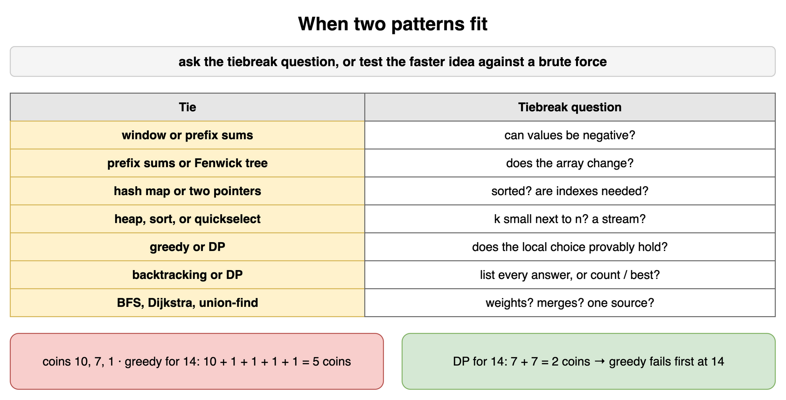

*Source: [`diagrams/approaching.drawio`](/content/11_Coding_Problems/08_Approaching_a_Coding_Problem/diagrams/approaching.drawio), page 13.*

## Practising pattern recognition

Recognition is a separate skill from implementation, so practise it separately: read a statement, then name the pattern and the tiebreak question within about a minute, before writing any code. Re-solve problems you have already seen without notes after a gap, because recognising a solution you remember is not the same as finding it. Space the reviews out (one day, then three, then a week, and so on) so each pass is a little harder to recall. Time the full solve as well, so 45 minutes stops feeling short.

Practise out loud, or record yourself, since explaining while coding is its own skill. Keep a mistake log with one line per miss: the signal you overlooked ("missed that it was sorted"), not just the bug. The drills on this topic are recognition reps; the drills on each pattern topic are implementation reps. The example builds a doubling review schedule.

```python
from datetime import date, timedelta


def review_days(start: date, rounds: int = 5) -> list[str]:
    day, gap, out = start, 1, []
    for _ in range(rounds):
        day += timedelta(days=gap)
        out.append(day.isoformat())
        gap *= 2
    return out


print(review_days(date(2026, 12, 1)))
# ['2026-12-02', '2026-12-04', '2026-12-08', '2026-12-16', '2027-01-01']
```

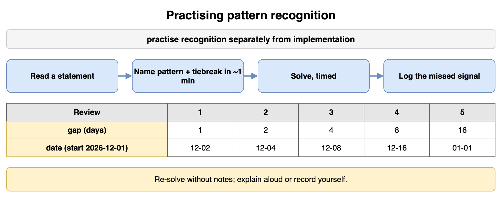

*Source: [`diagrams/approaching.drawio`](/content/11_Coding_Problems/08_Approaching_a_Coding_Problem/diagrams/approaching.drawio), page 14.*
