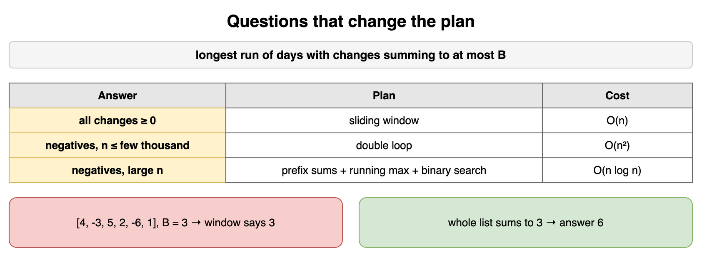
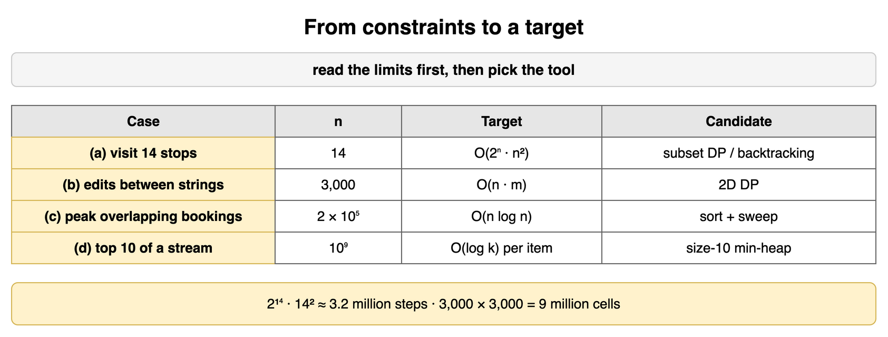
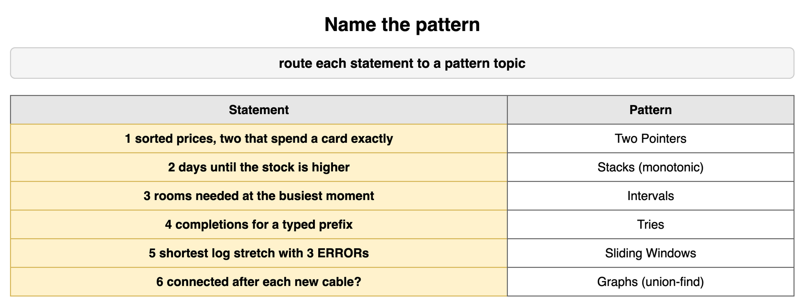
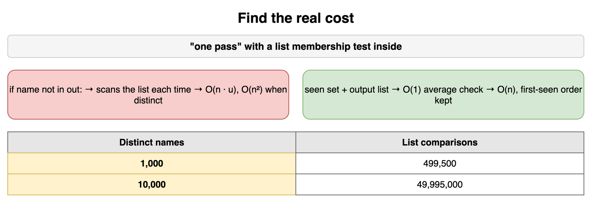
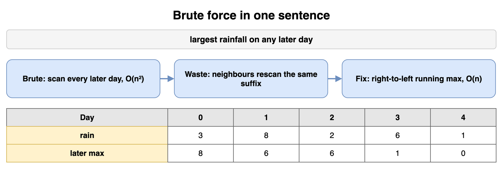
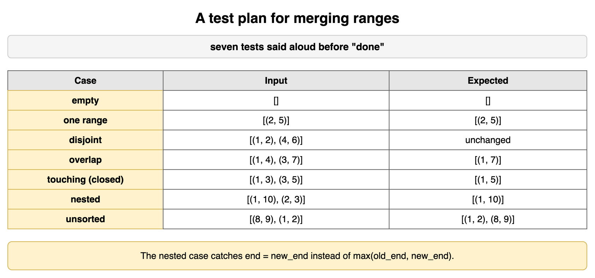
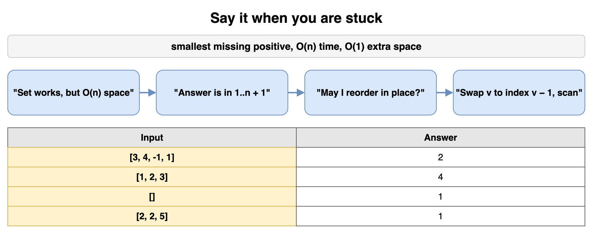
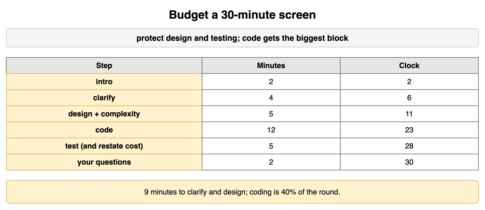
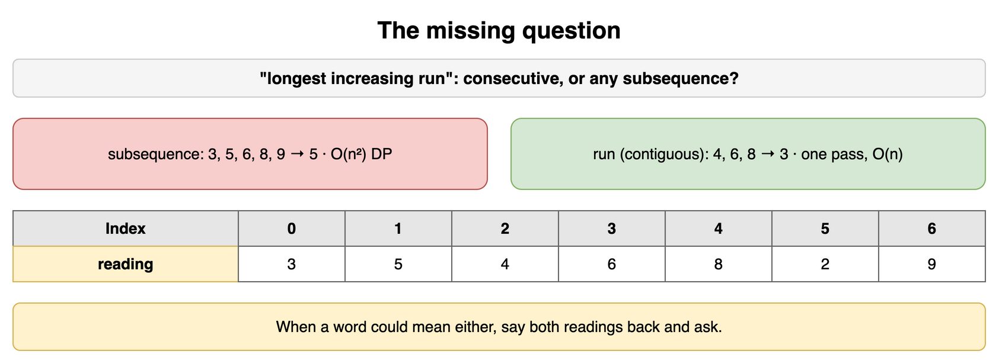

# Approaching a Coding Problem — Drills

Original drills for clarifying questions, constraints, pattern recognition, hidden costs, brute force, test plans, getting unstuck, time budgets, and a missed question. Each answer names the move, the cost, and Python. The numbers are exercise values.

## Questions that change the plan

The prompt: "Given a list of daily balance changes and a budget B, return the length of the longest run of consecutive days whose changes add up to at most B." Which two clarifying questions change the algorithm, and how?

**Answer:** "Can a change be negative?" and "How large is n?" If every change is non-negative, a [sliding window](#11_Coding_Problems/13_Sliding_Windows/concepts/longest-window-under-a-budget) that grows on the right and shrinks on the left is O(n) time and O(1) space. With negatives the shrink step is no longer safe: dropping a day from the left can raise the total, so the window gives up on runs it should keep (see [When a shrink is not legal](#11_Coding_Problems/13_Sliding_Windows/concepts/when-a-shrink-is-not-legal)). Then n decides the fallback: for n up to a few thousand the O(n²) double loop is fine; for larger n, use prefix sums with a running maximum of earlier prefixes and binary search, O(n log n). On `[4, -3, 5, 2, -6, 1]` with B = 3 the window answers 3, but the whole list sums to 3, so the answer is 6. The method is on [Clarifying questions that change the algorithm](#11_Coding_Problems/08_Approaching_a_Coding_Problem/concepts/clarifying-questions-that-change-the-algorithm).

```python
def window(changes: list[int], budget: int) -> int:
    best = total = i = 0
    for j, x in enumerate(changes):
        total += x
        while total > budget and i <= j:
            total -= changes[i]
            i += 1
        best = max(best, j - i + 1)
    return best


def brute(changes: list[int], budget: int) -> int:
    best = 0
    for i in range(len(changes)):
        total = 0
        for j in range(i, len(changes)):
            total += changes[j]
            if total <= budget:
                best = max(best, j - i + 1)
    return best


print(window([4, 7, 2, 1, 5, 2], 8), brute([4, 7, 2, 1, 5, 2], 8))
print(window([4, -3, 5, 2, -6, 1], 3), brute([4, -3, 5, 2, -6, 1], 3))
# 3 3
# 3 6
```



*Source: [`diagrams/approaching-drills.drawio`](/content/11_Coding_Problems/08_Approaching_a_Coding_Problem/diagrams/approaching-drills.drawio), page 1.*

## From constraints to a target

Give the target complexity and a candidate pattern for each: (a) 14 delivery stops, find the shortest route that visits them all; (b) two strings of up to 3,000 characters, find the fewest single-character edits between them; (c) 2 × 10⁵ room bookings, find the most bookings that overlap at one moment; (d) a stream of 10⁹ prices, keep the 10 largest seen so far.

**Answer:** (a) n = 14 allows exponential work: O(2ⁿ · n²) subset DP or [backtracking](#11_Coding_Problems/22_Backtracking/concepts/spotting-a-backtracking-problem) with pruning; 2¹⁴ · 14² is about 3.2 million steps. (b) 3,000 × 3,000 is 9 million cells, so an O(n · m) [dynamic programming](#11_Coding_Problems/23_Dynamic_Programming/concepts/table-shapes-one-and-two-dimensions) table fits. (c) 2 × 10⁵ rules out O(n²); sort the endpoints and sweep in O(n log n), as on [Count overlapping intervals](#11_Coding_Problems/17_Intervals/concepts/count-overlapping-intervals). (d) A stream that size must be O(log k) per item with O(k) memory: a size-10 [min-heap](#11_Coding_Problems/16_Heaps/concepts/the-survivor-you-would-drop). These follow the rule-of-thumb table on [Constraints set the target complexity](#11_Coding_Problems/08_Approaching_a_Coding_Problem/concepts/constraints-set-the-target-complexity).

```python
def target(n: int) -> str:
    for limit, cost in ((10, "O(n!)"), (20, "O(2^n)"), (500, "O(n^3)"),
                        (5_000, "O(n^2)"), (1_000_000, "O(n log n)")):
        if n <= limit:
            return cost
    return "O(n) total or O(log n) per op"


for label, n in (("a", 14), ("b", 3_000), ("c", 200_000), ("d", 10**9)):
    print(label, target(n))
print(2**14 * 14**2, 3_000 * 3_000)
# a O(2^n)
# b O(n^2)
# c O(n log n)
# d O(n) total or O(log n) per op
# 3211264 9000000
```



*Source: [`diagrams/approaching-drills.drawio`](/content/11_Coding_Problems/08_Approaching_a_Coding_Problem/diagrams/approaching-drills.drawio), page 2.*

## Name the pattern

Route each statement to a pattern topic: (1) a sorted list of gift prices, find two that spend a gift card exactly; (2) for each day's warehouse stock, how many days until the stock is higher; (3) booking requests as (start, end), how many rooms are needed at the busiest moment; (4) 50,000 product names, suggest completions as a shopper types; (5) the shortest stretch of a log that contains at least 3 ERROR lines; (6) servers and cables are added one at a time, after each cable say whether servers A and B are connected.

**Answer:** (1) [Two Pointers](#11_Coding_Problems/09_Two_Pointers/concepts/pair-sum-in-a-sorted-array): sorted plus a pair target, O(n) time, O(1) space. (2) [Stacks](#11_Coding_Problems/15_Stacks/concepts/monotonic-stack): "next higher" is a monotonic stack, O(n). (3) [Intervals](#11_Coding_Problems/17_Intervals/concepts/count-overlapping-intervals): a sorted sweep, O(n log n); a heap of end times also works. (4) [Tries](#11_Coding_Problems/20_Tries/concepts/tries-as-a-pattern): shared prefixes, O(length of the typed prefix) to find the node. (5) [Sliding Windows](#11_Coding_Problems/13_Sliding_Windows/concepts/shortest-window-to-a-target): contiguous plus shortest with a count condition, O(n). (6) [Graphs, union-find](#11_Coding_Problems/21_Graphs/concepts/union-find-for-merging-groups): merges and connectivity queries, near O(1) amortised each. Every row is on [The pattern recognition map](#11_Coding_Problems/08_Approaching_a_Coding_Problem/concepts/the-pattern-recognition-map).

```python
KEY = {1: "Two Pointers", 2: "Stacks", 3: "Intervals",
       4: "Tries", 5: "Sliding Windows", 6: "Graphs"}


def score(guesses: dict[int, str]) -> tuple[int, list[int]]:
    misses = [k for k in KEY if guesses.get(k) != KEY[k]]
    return len(KEY) - len(misses), misses


mine = {1: "Two Pointers", 2: "Heaps", 3: "Intervals",
        4: "Tries", 5: "Sliding Windows", 6: "Graphs"}
print(score(mine), score(KEY))
# (5, [2]) (6, [])
```



*Source: [`diagrams/approaching-drills.drawio`](/content/11_Coding_Problems/08_Approaching_a_Coding_Problem/diagrams/approaching-drills.drawio), page 3.*

## Find the real cost

A candidate writes this and says "one pass, so O(n)". What is the real cost, and what is the fix?

```python
def unique_names(names: list[str]) -> list[str]:
    out = []
    for name in names:
        if name not in out:
            out.append(name)
    return out
```

**Answer:** O(n · u), where u is the number of distinct names, so O(n²) when most names are distinct. `name not in out` scans the list, so the "one pass" hides a second loop. With 1,000 distinct names the check compares 0 + 1 + … + 999 = 499,500 times. Keep a `seen` set next to the output list: each check and insert is O(1) on average, so the whole function is O(n) time and O(n) extra space, and the first-seen order is kept. This is the habit on [Restate the complexity after coding](#11_Coding_Problems/08_Approaching_a_Coding_Problem/concepts/restate-the-complexity-after-coding).

```python
def list_checks(n: int) -> int:
    return sum(range(n))


def unique_names_fast(names: list[str]) -> list[str]:
    seen, out = set(), []
    for name in names:
        if name not in seen:
            seen.add(name)
            out.append(name)
    return out


print(list_checks(1_000), list_checks(10_000))
print(unique_names_fast(["ana", "bo", "ana", "cy", "bo"]), unique_names_fast([]))
# 499500 49995000
# ['ana', 'bo', 'cy'] []
```



*Source: [`diagrams/approaching-drills.drawio`](/content/11_Coding_Problems/08_Approaching_a_Coding_Problem/diagrams/approaching-drills.drawio), page 4.*

## Brute force in one sentence

The prompt: "For each day's rainfall, return the largest rainfall on any later day, or 0 if there is none." Say the brute force in one sentence, name its waste, and give the fix.

**Answer:** Brute force: "for each day, scan every later day for the maximum: O(n²) time, O(1) extra space." Waste: day i and day i + 1 scan almost the same suffix, so the same maximum is recomputed n times. Fix: walk from right to left carrying the running maximum of what is already behind you, O(n) time and O(1) extra space beyond the output. The pattern is on [Brute force, then name the waste](#11_Coding_Problems/08_Approaching_a_Coding_Problem/concepts/brute-force-then-name-the-waste). The brute force stays useful as the checker.

```python
def later_max_brute(rain: list[int]) -> list[int]:
    return [max(rain[i + 1:], default=0) for i in range(len(rain))]


def later_max(rain: list[int]) -> list[int]:
    out, running = [0] * len(rain), 0
    for i in range(len(rain) - 1, -1, -1):
        out[i] = running
        running = max(running, rain[i])
    return out


rain = [3, 8, 2, 6, 1]
print(later_max(rain), later_max(rain) == later_max_brute(rain), later_max([]))
# [8, 6, 6, 1, 0] True []
```



*Source: [`diagrams/approaching-drills.drawio`](/content/11_Coding_Problems/08_Approaching_a_Coding_Problem/diagrams/approaching-drills.drawio), page 5.*

## A test plan for merging ranges

You wrote `merge_ranges(ranges: list[tuple[int, int]]) -> list[tuple[int, int]]`, which merges overlapping closed ranges. List the tests you would say aloud before saying "done".

**Answer:** Seven cases, each with a reason: empty input returns `[]`; one range comes back unchanged; disjoint ranges stay separate; overlapping ranges merge, `(1, 4)` and `(3, 7)` into `(1, 7)`; touching ranges `(1, 3)` and `(3, 5)` merge because the ranges are closed (ask whether they are, as on [Closed and half-open intervals](#11_Coding_Problems/17_Intervals/concepts/closed-and-half-open-intervals)); a nested range disappears inside its parent; unsorted input still comes back sorted. The nested case catches the classic bug of setting the end to the new range's end instead of the larger of the two. Sorting makes it O(n log n). The merge itself is on [Merge intervals](#11_Coding_Problems/06_Moderate_Problems/concepts/merge-intervals); the order of the tests is on [Testing out loud](#11_Coding_Problems/08_Approaching_a_Coding_Problem/concepts/testing-out-loud).

```python
def merge_ranges(ranges: list[tuple[int, int]]) -> list[tuple[int, int]]:
    out: list[tuple[int, int]] = []
    for start, end in sorted(ranges):
        if out and start <= out[-1][1]:
            out[-1] = (out[-1][0], max(out[-1][1], end))
        else:
            out.append((start, end))
    return out


cases = [([], []), ([(2, 5)], [(2, 5)]), ([(1, 2), (4, 6)], [(1, 2), (4, 6)]),
         ([(1, 4), (3, 7)], [(1, 7)]), ([(1, 3), (3, 5)], [(1, 5)]),
         ([(1, 10), (2, 3)], [(1, 10)]), ([(8, 9), (1, 2)], [(1, 2), (8, 9)])]
print([merge_ranges(given) == want for given, want in cases])
# [True, True, True, True, True, True, True]
```



*Source: [`diagrams/approaching-drills.drawio`](/content/11_Coding_Problems/08_Approaching_a_Coding_Problem/diagrams/approaching-drills.drawio), page 6.*

## Say it when you are stuck

The prompt: "Return the smallest positive integer missing from an unsorted list, in O(n) time and O(1) extra space." A candidate has a set-based answer, then goes silent for four minutes on the space limit. Rewrite that silence as what you would say.

**Answer:** (1) "I have O(n) time with a set, but that's O(n) space; the space limit is where I'm stuck." (2) "Let me shrink it: for `[3, 4, -1, 1]` the answer is 2. With n values, the answer must be between 1 and n + 1." (3) "So only values 1 to n matter, and I have exactly n slots. May I reorder the input in place?" (4) "Then I'll swap each value v into index v − 1 and scan for the first slot that holds the wrong value." Each swap puts one value in its final slot, so there are at most n swaps: O(n) time, O(1) extra space. Each line follows [Getting unstuck](#11_Coding_Problems/08_Approaching_a_Coding_Problem/concepts/getting-unstuck), and line 3 is the question from [Ask before built-ins and in-place changes](#11_Coding_Problems/08_Approaching_a_Coding_Problem/concepts/ask-before-built-ins-and-in-place-changes).

```python
def first_missing_set(nums: list[int]) -> int:
    seen = set(nums)
    k = 1
    while k in seen:
        k += 1
    return k


def first_missing(nums: list[int]) -> int:
    n = len(nums)
    for i in range(n):
        while 1 <= nums[i] <= n and nums[nums[i] - 1] != nums[i]:
            j = nums[i] - 1
            nums[i], nums[j] = nums[j], nums[i]
    for i in range(n):
        if nums[i] != i + 1:
            return i + 1
    return n + 1


print(first_missing_set([3, 4, -1, 1]), first_missing([3, 4, -1, 1]))
print(first_missing([1, 2, 3]), first_missing([]), first_missing([2, 2, 5]))
# 2 2
# 4 1 1
```



*Source: [`diagrams/approaching-drills.drawio`](/content/11_Coding_Problems/08_Approaching_a_Coding_Problem/diagrams/approaching-drills.drawio), page 7.*

## Budget a 30-minute screen

A phone screen gives you 30 minutes in total, including introductions and your questions. Split the time across the six steps and justify the split.

**Answer:** 2 minutes of introductions, 4 to clarify, 5 to design and agree a complexity, 12 to code, 5 to test, and 2 for your questions. Coding still gets the largest block, but clarify and design together get 9 minutes because a wrong design is the one mistake you cannot recover from in 30 minutes. Testing keeps 5 minutes even under pressure: an untested answer is the most common red flag on [What interviewers score](#11_Coding_Problems/08_Approaching_a_Coding_Problem/concepts/what-interviewers-score). Restating the complexity takes seconds and fits inside the test block. Compare the 45-minute split on [The six-step answer](#11_Coding_Problems/08_Approaching_a_Coding_Problem/concepts/the-six-step-answer).

```python
plan = {"intro": 2, "clarify": 4, "design": 5, "code": 12, "test": 5, "questions": 2}
total = sum(plan.values())
print(total, f"code {plan['code'] / total:.0%}", f"before code {plan['clarify'] + plan['design']} min")
# 30 code 40% before code 9 min
```



*Source: [`diagrams/approaching-drills.drawio`](/content/11_Coding_Problems/08_Approaching_a_Coding_Problem/diagrams/approaching-drills.drawio), page 8.*

## The missing question

The interviewer says: "Return the length of the longest increasing run in these sensor readings." The candidate writes an O(n²) longest-increasing-subsequence DP and gets 5 on `[3, 5, 4, 6, 8, 2, 9]`; the interviewer expected 3. Which question was missing?

**Answer:** "Do you mean consecutive readings, or any increasing subsequence?" A run is contiguous: `4, 6, 8` has length 3, found in one pass in O(n) time and O(1) space. A subsequence may skip readings: `3, 5, 6, 8, 9` has length 5 and needs DP (O(n²), or O(n log n) with binary search). The two words differ by a whole pattern, which is why [Talking through the problem](#11_Coding_Problems/08_Approaching_a_Coding_Problem/concepts/talking-through-the-problem) asks for precise language. When a word could mean either, say both readings back and ask.

```python
def longest_run(xs: list[int]) -> int:
    best = run = 0
    for i, x in enumerate(xs):
        run = run + 1 if i > 0 and x > xs[i - 1] else 1
        best = max(best, run)
    return best


def longest_subsequence(xs: list[int]) -> int:
    best = [1] * len(xs)
    for j in range(len(xs)):
        for i in range(j):
            if xs[i] < xs[j]:
                best[j] = max(best[j], best[i] + 1)
    return max(best, default=0)


readings = [3, 5, 4, 6, 8, 2, 9]
print(longest_run(readings), longest_subsequence(readings), longest_run([]))
# 3 5 0
```



*Source: [`diagrams/approaching-drills.drawio`](/content/11_Coding_Problems/08_Approaching_a_Coding_Problem/diagrams/approaching-drills.drawio), page 9.*
