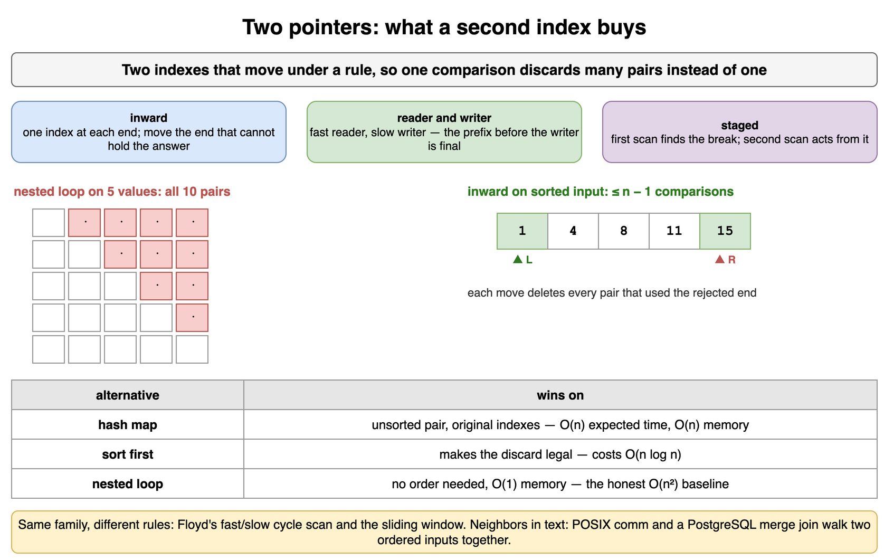
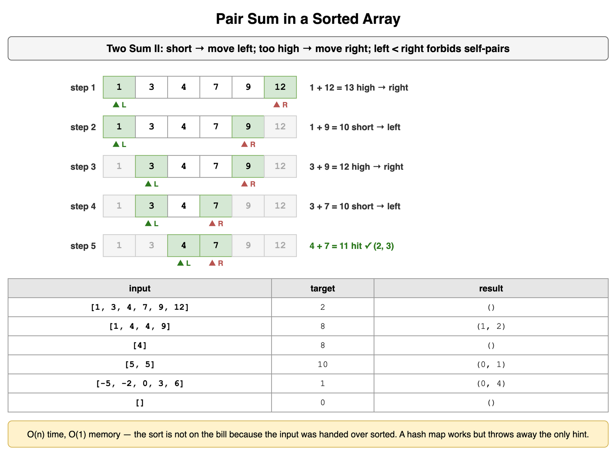
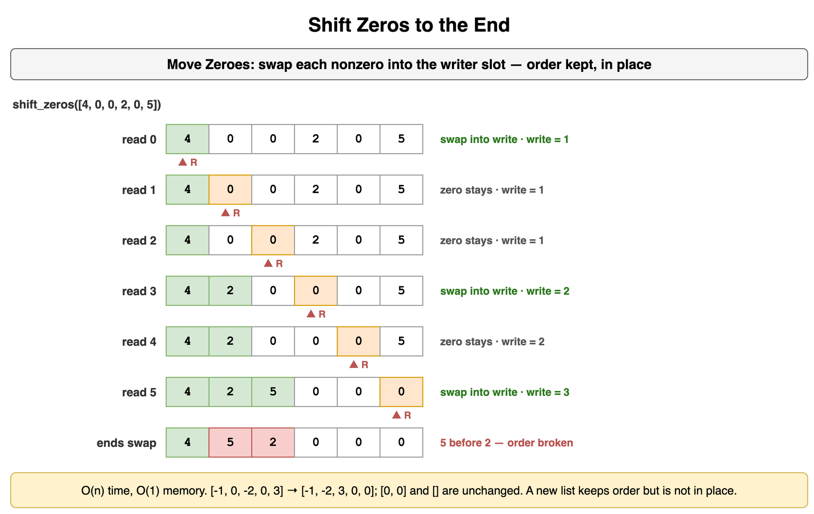
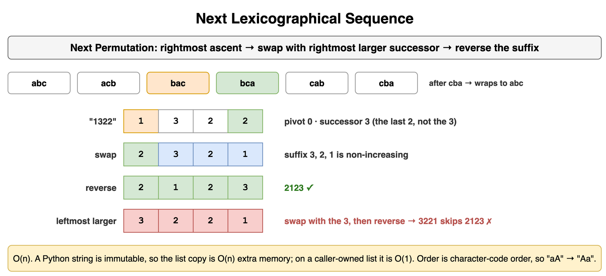
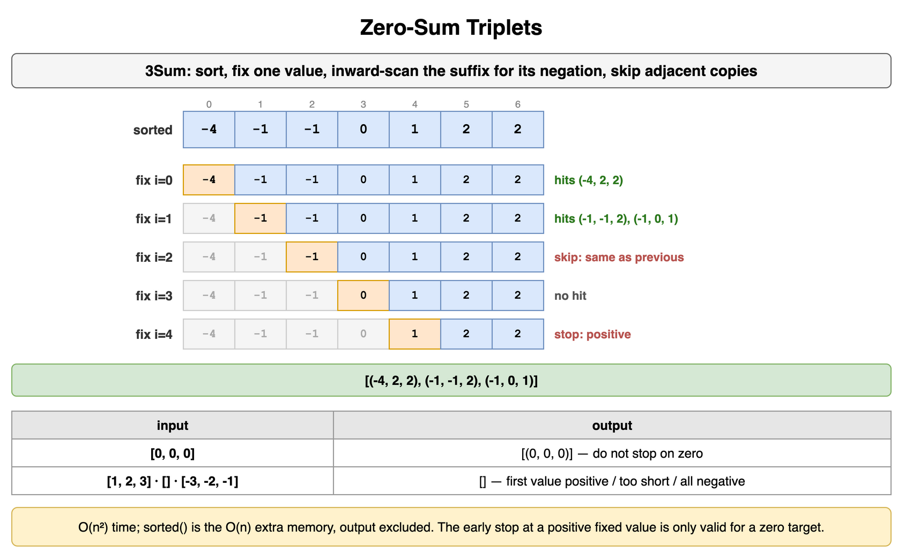
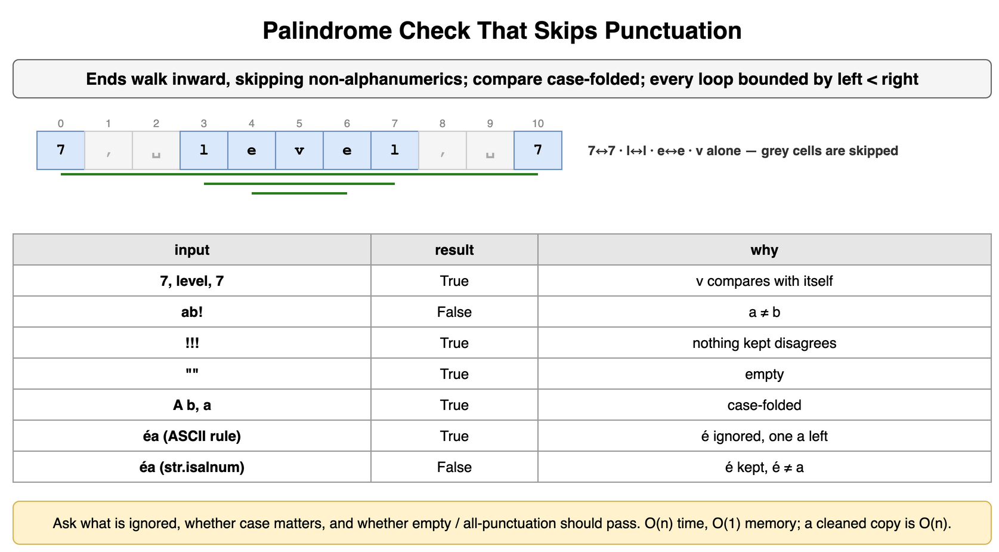
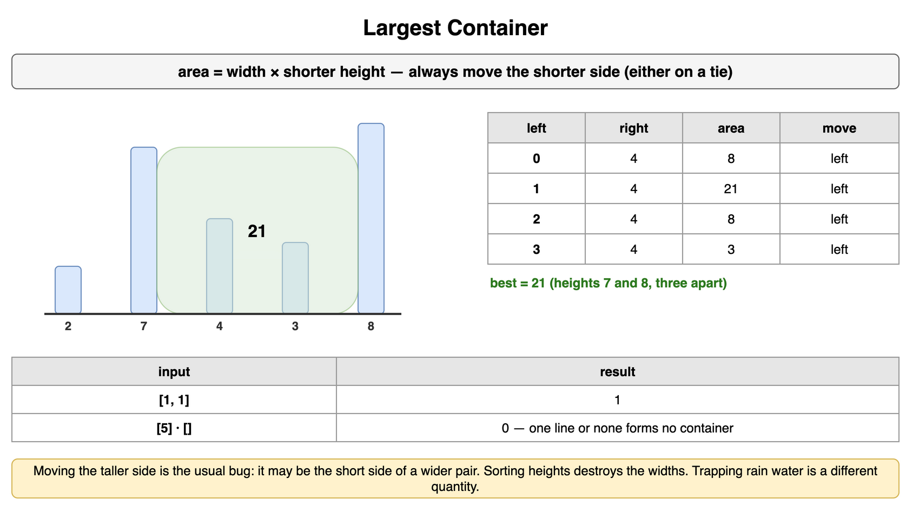
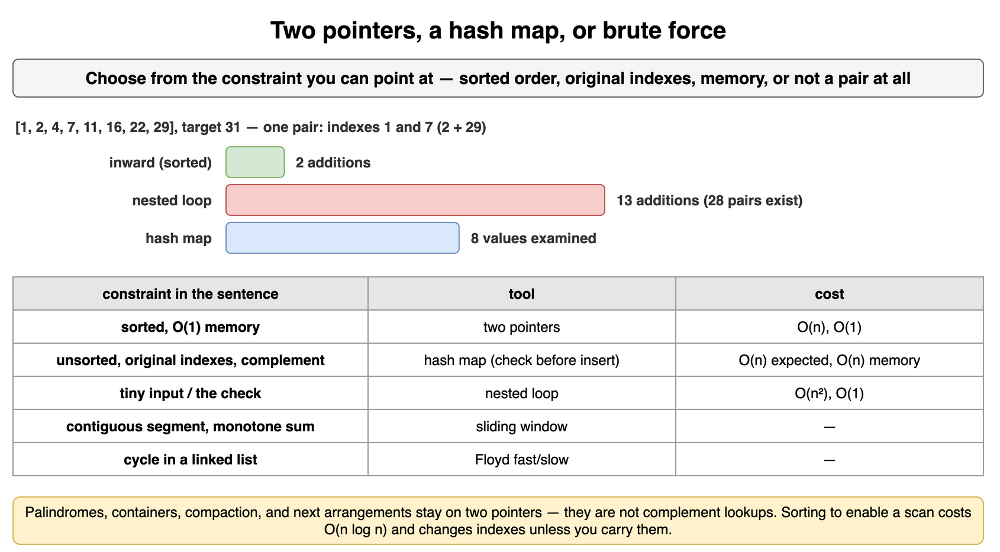

## What a second index buys

A pointer here is an index. Two indexes move under a rule, so one comparison drops every pair that used the rejected end. The second index compares the two ends, or holds the write position behind the reader. Inward moves the end that cannot hold the answer. The prefix before a same-direction writer is final. A staged scan finds a break, then acts on what that scan proved. [Two-pointer technique](#07_Data_Structures_and_Algorithms/02_Arrays_Strings_and_Hash_Tables/concepts/two-pointer-technique) and [Two pointers](#07_Data_Structures_and_Algorithms/11_Problem_Solving_Patterns/concepts/two-pointers) name the moves. [Two pointers](#11_Coding_Problems/06_Moderate_Problems/concepts/two-pointers) is the inward scan on kayak weights.

Use it on an ordered sequence, a symmetric one, an in-place compaction, or a pair plus at most one fixed value. The direct pair loop is the O(n^2) baseline ([Optimize brute force in steps](#11_Coding_Problems/07_Hard_Problems/concepts/optimize-brute-force-in-steps)). Replace it when a move has a proof that the skipped pairs are useless: O(n) time and O(1) extra memory. A sort that makes the discard legal costs O(n log n). [Unsorted pair-sum with a hash set](#07_Data_Structures_and_Algorithms/02_Arrays_Strings_and_Hash_Tables/concepts/unsorted-pair-sum-with-a-hash-set) is expected linear time, O(n) memory, and it keeps the original indexes. Moving both indexes on a miss drops a pair the rule has not rejected. [Cycle detection with Floyd's algorithm](#07_Data_Structures_and_Algorithms/03_Linked_Lists/concepts/cycle-detection-with-floyd-s-algorithm) and [Sliding window](#11_Coding_Problems/06_Moderate_Problems/concepts/sliding-window) are two indexes with different rules.

```python
def pairs_checked(values: list[int], target: int) -> list[tuple[int, int]]:
    left, right = 0, len(values) - 1
    checked: list[tuple[int, int]] = []
    while left < right:
        checked.append((left, right))
        total = values[left] + values[right]
        if total == target:
            break
        if total < target:
            left += 1
        else:
            right -= 1
    return checked


print(pairs_checked([1, 4, 8, 11, 15], 19), 5 * 4 // 2)
# [(0, 4), (1, 4)] 10
```



*Source: [`diagrams/two-pointers.drawio`](/content/11_Coding_Problems/09_Two_Pointers/diagrams/two-pointers.drawio), page 1.*

## A short sum moves the left end

On a sorted array the left end is the smallest value still in range and the right end is the largest. Too high drops the right end: every other partner is at least the left end. Too low drops the left end: every other partner is at most the right end. Each step rejects every pair that used the dropped index. Anything still inside `[left, right]` might hit. [Two-pointer technique](#07_Data_Structures_and_Algorithms/02_Arrays_Strings_and_Hash_Tables/concepts/two-pointer-technique) is this scan.

`left < right` refuses a self-pair. Return on a hit when one pair is enough. For every pair, move both ends after the hit and skip equal neighbors. Moving both on a miss drops an unrejected pair. The scan is O(n) time and O(1) extra memory, and the given sort is off the bill. A hash map spends O(n) memory. Indexes into a sorted copy belong to that copy. `[4, 4]` may contribute both indexes to a target of 8. One element and an empty list return nothing. Negatives use the same moves: `-5 + 6` is target 1 at `(0, 4)`. LeetCode 167 is 1-based and promises a pair. This card is 0-based and returns empty when none exists. A fixed-width sum can wrap ([Overflow-safe arithmetic](#11_Coding_Problems/06_Moderate_Problems/concepts/overflow-safe-arithmetic)).

```python
def pair_sum_sorted(values: list[int], target: int) -> tuple[int, int] | tuple[()]:
    left, right = 0, len(values) - 1
    while left < right:
        total = values[left] + values[right]
        if total == target:
            return (left, right)
        if total < target:
            left += 1
        else:
            right -= 1
    return ()


print(pair_sum_sorted([1, 3, 4, 7, 9, 12], 11))
print(pair_sum_sorted([1, 3, 4, 7, 9, 12], 2))
print(pair_sum_sorted([1, 4, 4, 9], 8))
print(pair_sum_sorted([4], 8))
print(pair_sum_sorted([5, 5], 10), pair_sum_sorted([-5, -2, 0, 3, 6], 1), pair_sum_sorted([], 0))
# (2, 3)
# ()
# (1, 2)
# ()
# (0, 1) (0, 4) ()
```



*Source: [`diagrams/two-pointers.drawio`](/content/11_Coding_Problems/09_Two_Pointers/diagrams/two-pointers.drawio), page 5.*

## Nonzeros keep the order the reader saw

A reader scans every slot. A writer, moving the same way, marks the next slot that may keep a value, so the prefix before it is final. [In-place array manipulation](#07_Data_Structures_and_Algorithms/02_Arrays_Strings_and_Hash_Tables/concepts/in-place-array-manipulation) uses that split to drop duplicates from a sorted array. Here each nonzero is swapped into the writer slot and the writer advances. The displaced zero stays behind the writer, and the nonzero order follows the reader. The pass is O(n) time and O(1) extra memory.

An inward swap on `[4, 0, 0, 2, 0, 5]` also finishes with the zeros at the back, and it places 5 before 2. Keep that swap when order does not matter. A second list keeps order and spends O(n) memory. A returned length leaves a stale tail. Deleting from the writer down makes the length match. All zeros, no zeros, and an empty list stay put. Only an exact zero moves, so `-1`, `-2`, `3` keep that order. A swap of a slot with itself, both indexes on a leading nonzero, changes nothing. Two sorted inputs advance the smaller side ([Merging two sorted lists](#07_Data_Structures_and_Algorithms/03_Linked_Lists/concepts/merging-two-sorted-lists)). Fill spare room from the back, and keep the writer behind the reader.

```python
def shift_zeros(values: list[int]) -> list[int]:
    write = 0
    for read, value in enumerate(values):
        if value != 0:
            values[write], values[read] = values[read], values[write]
            write += 1
    return values


def push_zeros_from_the_ends(values: list[int]) -> list[int]:
    left, right = 0, len(values) - 1
    while left < right:
        if values[left] == 0:
            values[left], values[right] = values[right], values[left]
            right -= 1
        else:
            left += 1
    return values


print(shift_zeros([4, 0, 0, 2, 0, 5]))
print(push_zeros_from_the_ends([4, 0, 0, 2, 0, 5]))
print(shift_zeros([-1, 0, -2, 0, 3]), shift_zeros([0, 0]), shift_zeros([]))
# [4, 2, 5, 0, 0, 0]
# [4, 5, 2, 0, 0, 0]
# [-1, -2, 3, 0, 0] [0, 0] []
```



*Source: [`diagrams/two-pointers.drawio`](/content/11_Coding_Problems/09_Two_Pointers/diagrams/two-pointers.drawio), page 9.*

## The rightmost ascent, then the smallest suffix

The next arrangement is the next permutation in lexicographic order, or the first arrangement when this one is already last. After `bac` comes `bca`. After `cba` the order wraps to `abc`. Find the rightmost index with `s[i] < s[i + 1]`. The suffix after that pivot is non-increasing, which the second scan trusts. Finding and rewriting in one loop saves no asymptotic time and wipes that proof.

Swap the pivot with the rightmost suffix character strictly larger than it, then reverse the suffix. That successor is the smallest increase still as far right as possible. The reverse is the smallest order of a non-increasing run. Sorting the suffix is correct and adds a log factor. On `1322` the pivot is `1` and the successor is the final `2`: swap to `2321`, reverse to `2123`. Taking the `3` produces `3221` and skips `2123`. No ascent reverses the whole string, so `cba` becomes `abc`. One character is already first and last. An empty string stays empty. The scans are O(n). A Python string pays O(n) for the list copy. A caller-owned list mutates in O(1). Order is character-code order, so `A` precedes `a`. LeetCode 31 does this in place on integers.

```python
def next_sequence(text: str) -> str:
    chars = list(text)
    pivot = len(chars) - 2
    while pivot >= 0 and chars[pivot] >= chars[pivot + 1]:
        pivot -= 1
    if pivot >= 0:
        successor = len(chars) - 1
        while chars[successor] <= chars[pivot]:
            successor -= 1
        chars[pivot], chars[successor] = chars[successor], chars[pivot]
    left, right = pivot + 1, len(chars) - 1
    while left < right:
        chars[left], chars[right] = chars[right], chars[left]
        left += 1
        right -= 1
    return "".join(chars)


print(next_sequence("bac"), next_sequence("cba"), next_sequence("1322"), next_sequence("a"), next_sequence("aA"), repr(next_sequence("")))
# bca abc 2123 a Aa ''
```



*Source: [`diagrams/two-pointers.drawio`](/content/11_Coding_Problems/09_Two_Pointers/diagrams/two-pointers.drawio), page 10.*

## A zero-sum triplet skips the copy beside it

Sort, then each fixed value needs two later values that sum to its negation. That inner search is the inward scan. [Sort, then scan](#11_Coding_Problems/06_Moderate_Problems/concepts/sort-then-scan) is why a neighbor comparison is enough once copies sit together. Skip a fixed value equal to the one before it. After a hit, move both inner indexes and keep moving either while it copies the value just used. On `[-2, 0, 0, 2]`, advancing only the left index after `(-2, 0, 2)` emits that triplet twice. A set of answer tuples also dedupes, and it can store a quadratic number of them.

Stop when the fixed value is positive: the suffix is at least that large, so three positives cannot sum to zero. `[0, 0, 0]` is a real triplet, so zero itself stays in play. Fewer than three values, all positives, and all negatives return nothing. Time is O(n^2). `sorted` costs O(n) extra memory, and the output can be quadratic too. The positive stop is for a zero target. For k values, fix one and repeat on the suffix until the question is a pair. Four values are O(n^3) after the sort. A fixed-width sum of three values can wrap ([Overflow-safe arithmetic](#11_Coding_Problems/06_Moderate_Problems/concepts/overflow-safe-arithmetic)).

```python
def zero_sum_triplets(values: list[int]) -> list[tuple[int, int, int]]:
    ordered = sorted(values)
    found: list[tuple[int, int, int]] = []
    for i in range(len(ordered)):
        if ordered[i] > 0:
            break
        if i > 0 and ordered[i] == ordered[i - 1]:
            continue
        left, right = i + 1, len(ordered) - 1
        while left < right:
            total = ordered[i] + ordered[left] + ordered[right]
            if total == 0:
                found.append((ordered[i], ordered[left], ordered[right]))
                left += 1
                right -= 1
                while left < right and ordered[left] == ordered[left - 1]:
                    left += 1
                while left < right and ordered[right] == ordered[right + 1]:
                    right -= 1
            elif total < 0:
                left += 1
            else:
                right -= 1
    return found


print(zero_sum_triplets([-4, -1, -1, 0, 1, 2, 2]))
print(zero_sum_triplets([0, 0, 0]))
print(zero_sum_triplets([1, 2, 3]))
print(zero_sum_triplets([]), zero_sum_triplets([-3, -2, -1]))
# [(-4, 2, 2), (-1, -1, 2), (-1, 0, 1)]
# [(0, 0, 0)]
# []
# [] []
```



*Source: [`diagrams/two-pointers.drawio`](/content/11_Coding_Problems/09_Two_Pointers/diagrams/two-pointers.drawio), page 6.*

## Skip the characters a palindrome will not compare

Ends walk inward. A kept character is compared, case-folded, with the kept character at the other end. Anything else is skipped by the end sitting on it. This predicate keeps ASCII letters and digits. A cleaned copy uses O(n) extra memory. Skipping in the loop is O(n) time and O(1) extra memory. The inner loops also stop at `left < right`. Without that bound, punctuation walks off the string and raises `IndexError`.

Empty, `"!!!"`, `"a"`, and `"!a!"` are palindromes: no kept pair disagrees. `"7, level, 7"` meets on `v`. `"ab!"` compares `a` with `b` and rejects. `"A b, a"` passes after the case fold, and it fails if the fold is skipped. `str.isalnum` also accepts `"é"`. On `"éa"` the ASCII rule ignores `é` and keeps a single `a`, so it passes. The Unicode rule keeps both characters and fails. Confirm the alphabet, and whether case differs, before calling `isalnum`. A mismatch rejects the string. Allowing one deletion is a separate budget.

```python
def is_ascii_alnum(ch: str) -> bool:
    return ("0" <= ch <= "9") or ("A" <= ch <= "Z") or ("a" <= ch <= "z")


def is_palindrome(text: str) -> bool:
    left, right = 0, len(text) - 1
    while left < right:
        while left < right and not is_ascii_alnum(text[left]):
            left += 1
        while left < right and not is_ascii_alnum(text[right]):
            right -= 1
        if left < right and text[left].lower() != text[right].lower():
            return False
        left += 1
        right -= 1
    return True


def unicode_palindrome(text: str) -> bool:
    left, right = 0, len(text) - 1
    while left < right:
        while left < right and not text[left].isalnum():
            left += 1
        while left < right and not text[right].isalnum():
            right -= 1
        if left < right and text[left].lower() != text[right].lower():
            return False
        left += 1
        right -= 1
    return True


print(is_palindrome("7, level, 7"), is_palindrome("ab!"), is_palindrome("!!!"), is_palindrome(""))
print(is_palindrome("A b, a"), is_palindrome("éa"), unicode_palindrome("éa"))
print(is_palindrome("a"), is_palindrome("!a!"))
# True False True True
# True True False
# True True
```



*Source: [`diagrams/two-pointers.drawio`](/content/11_Coding_Problems/09_Two_Pointers/diagrams/two-pointers.drawio), page 7.*

## Move the shorter line

Width is the gap between the indexes. Height is the shorter line. Area is the product. A closer partner of the shorter line has less width and cannot exceed that line, so move the shorter side. On a tie either side is a cap, and this scan moves the left one. Time is O(n) and extra memory is O(1). Every pair is the O(n^2) check. Sorting the heights discards the widths. The rectangle has no complement for a hash map to store.

Moving the taller side can abandon the short side of a wider pair still open. On `[2, 7, 4, 3, 8]` the ends hold area 8, then 7 and 8, three apart, hold 21. `[1, 1]` holds 1. One line and an empty list hold 0. Heights are non-negative and `best` starts at 0, so zeros return 0. A negative height is outside the problem: its area is negative and loses to that 0. A fixed-width product can wrap ([Overflow-safe arithmetic](#11_Coding_Problems/06_Moderate_Problems/concepts/overflow-safe-arithmetic)). Trapping rain water sums water above every index. This card returns one rectangle.

```python
def largest_container(heights: list[int]) -> int:
    left, right = 0, len(heights) - 1
    best = 0
    while left < right:
        width = right - left
        if heights[left] <= heights[right]:
            best = max(best, width * heights[left])
            left += 1
        else:
            best = max(best, width * heights[right])
            right -= 1
    return best


print(largest_container([2, 7, 4, 3, 8]), largest_container([1, 1]), largest_container([5]), largest_container([]))
# 21 1 0 0
```



*Source: [`diagrams/two-pointers.drawio`](/content/11_Coding_Problems/09_Two_Pointers/diagrams/two-pointers.drawio), page 8.*

## Two pointers, a hash map, or brute force

The constraint picks the tool. A nested pair loop is the baseline: unsorted, O(1) extra memory, O(n^2). Name it, then replace it ([Optimize brute force in steps](#11_Coding_Problems/07_Hard_Problems/concepts/optimize-brute-force-in-steps)). A proved move on a sorted array makes the inward scan O(n) time and O(1) extra memory. [Unsorted pair-sum with a hash set](#07_Data_Structures_and_Algorithms/02_Arrays_Strings_and_Hash_Tables/concepts/unsorted-pair-sum-with-a-hash-set) handles an unsorted complement in expected O(n) time and O(n) memory. Check `target - value` before inserting, or one copy pairs with itself.

On `[1, 2, 4, 7, 11, 16, 22, 29]` and target 31 the inward scan stops on `2 + 29` after 2 additions. The double loop stops after 13. The map examines all 8 values, and the eighth is 29. Eight values have 28 pairs. Another target changes the counts, and the bounds stay put. Sorting to unlock the inward scan costs O(n log n) and a new list, and the indexes belong to that list unless each value carries its original index. A palindrome, a container, a zero shift, and a next arrangement stay on two pointers. [Sliding window](#11_Coding_Problems/06_Moderate_Problems/concepts/sliding-window) is a contiguous monotone sum. [Cycle detection with Floyd's algorithm](#07_Data_Structures_and_Algorithms/03_Linked_Lists/concepts/cycle-detection-with-floyd-s-algorithm) is a cycle in a linked list.

```python
def comparisons(values: list[int], target: int) -> tuple[int, int, int]:
    left, right = 0, len(values) - 1
    inward = 0
    while left < right:
        inward += 1
        total = values[left] + values[right]
        if total == target:
            break
        if total < target:
            left += 1
        else:
            right -= 1

    brute = 0
    for i in range(len(values)):
        found = False
        for j in range(i + 1, len(values)):
            brute += 1
            if values[i] + values[j] == target:
                found = True
                break
        if found:
            break

    seen: dict[int, int] = {}
    hashed = 0
    for index, value in enumerate(values):
        hashed += 1
        if target - value in seen:
            break
        seen[value] = index
    return inward, brute, hashed


print(comparisons([1, 2, 4, 7, 11, 16, 22, 29], 31))
# (2, 13, 8)
```



*Source: [`diagrams/two-pointers.drawio`](/content/11_Coding_Problems/09_Two_Pointers/diagrams/two-pointers.drawio), page 12.*
