## Hash maps and sets: lookup by a key

A hash map stores a value under a key so that a later lookup, insert, or delete is expected constant time. A hash set stores the keys alone. Membership, deduplication, and a visited mark are the set. A payload, a count, or an index is the map.

A scan answers "have I seen this?" by walking everything stored so far. The key turns that walk into a bucket computation. RFC 9111 defines an HTTP cache key as at least the request method and the target URI. Many caches store only GET responses and then key on the URI, and a `Vary` header adds the listed request fields. The next request is a lookup, not a walk of every stored response. Git names each object by a hash of a header plus the object's bytes. The header is the type, a space, the decimal size, and a null byte. SHA-1 is the historical default, and a repository can be created with SHA-256. The name is the key, so two identical contents share one object and a changed byte is a different key.

Python's `dict` is the map and `set` is the set. Since Python 3.7, a `dict` preserves insertion order: updating a key does not move it, and a key inserted again after a deletion goes to the end. The language still calls a `set` unordered. Do not depend on set iteration order. Keys have to be hashable. A `list` and a `set` are not. A `tuple` of hashables is. A `frozenset` is. The mechanics of the hash, of collisions, and of the load factor sit on the [Hash table fundamentals](../../07_Data_Structures_and_Algorithms/02_Arrays_Strings_and_Hash_Tables/), [Hash collisions and resolution strategies](../../07_Data_Structures_and_Algorithms/02_Arrays_Strings_and_Hash_Tables/), and [Load factor and rehashing](../../07_Data_Structures_and_Algorithms/02_Arrays_Strings_and_Hash_Tables/) cards. CPython stores a `dict` in an open-addressed table. It salts the hash of a `str` and of `bytes` with a per-process secret, so a collision set built in one process does not transfer to the next. Integer hashes are not salted. A small integer hashes to itself, except that `hash(-1)` is `-2` because the implementation reserves `-1` as an internal error code. Integers that do not fit the hash width are reduced.

You reach for the pattern when the statement says frequency, unique, duplicate, seen before, group, lookup, dictionary, or count, and a pointer move has nothing ordered to discard. The [Two pointers, a hash map, or brute force](../09_Two_Pointers/) card is that fork from the pointer side. This topic is the key side: what you store, when you store it, and what the key has to mean.

One operation is expected O(1) while keys spread across buckets, and O(n) when every key lands in one bucket. n operations are therefore expected O(n) and worst-case O(n^2). A resize, covered on the load-factor card, makes a long run of inserts amortized O(1) on top of the hash cost, the same accounting as a dynamic array. Say "expected" for the hash. Say O(n log n) when you sorted and want a guarantee that does not depend on the hash.

```python
def deduped(ids: list[int]) -> list[int]:
    """Exercise numbers. Keep the first copy of each id, in arrival order."""
    seen: set[int] = set()
    fresh: list[int] = []
    for item in ids:
        if item in seen:
            continue
        seen.add(item)
        fresh.append(item)
    return fresh


print(deduped([7, 7, 3, 7, 3, 1]))
print(deduped([]), deduped([4]), deduped([4, 4]))
# [7, 3, 1]
# [] [4] [4]
```

The result list, not the set, carries the order. The set answers "already kept." An empty input stays empty. A one-element input stays that element. Two copies collapse to one.

**Trade-offs.** A hash map spends memory proportional to the number of distinct keys, plus empty buckets, and it offers expected constant lookup. A sort spends O(n log n) time and, with `sorted`, a new list, and then neighbors mean something. Two pointers spend constant extra memory once that order or a symmetry is real. An array indexed by the key spends worst-case constant time and no hash, and it fits only when the keys are a small dense range. A nested loop spends no extra memory and does not scale.

**Interview.** Name the key and the payload before the loop. Say expected linear time and the collision worst case in the same sentence, and point at the load-factor card if the interviewer wants the resize. Say that a Python `dict` keeps insertion order and a `set` does not promise an order. If the keys are integers in a tight range, or the data is already sorted and memory is tight, say so and switch.

**Recap.** A hash map is a key to a payload, and a hash set is the keys alone. Lookup, insert, and delete are expected constant time and linear in the worst case when every key collides. The pattern fits frequency, membership, and grouping. A sort, two pointers, and a small array win when the constraint is order, constant memory, or a dense integer key.

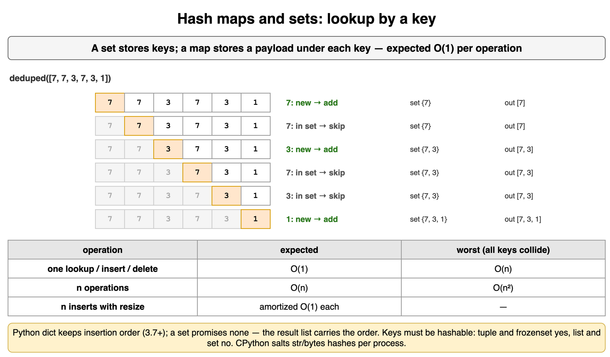

*Source: [`diagrams/hash-maps-and-sets.drawio`](/content/11_Coding_Problems/10_Hash_Maps_and_Sets/diagrams/hash-maps-and-sets.drawio), page 1.*

## Complement lookup

A complement lookup stores values it has already passed and asks, for the current value, whether the partner the formula names is already there.

The partner is a function of the current value. For a target sum the partner is `target - value`. The scan is one pass. Check the map, and insert the current value only after that check. Inserting first lets a single copy of a number satisfy a target of twice itself: the value finds the index that was just written. A two-pass map that keeps only the last index has a cousin of the same bug. If the check does not require a different index, the first copy of a value whose double is the target returns that same index and can hide a real pair later in the list. A set built from the whole array cannot tell one copy from two, so a yes/no answer for "two values that sum to the target" is wrong for a lone value that is half the target.

The nested loop is the baseline: every pair, quadratic time, constant extra memory. Sorting and then running the inward scan is the [Pair Sum in a Sorted Array (LeetCode-style: Two Sum II)](../09_Two_Pointers/) card. That scan is linear after the sort and uses constant extra memory, and the indexes it returns belong to the sorted copy unless each entry carries its original index. The hash keeps the original indexes and skips the sort. The [Unsorted pair-sum with a hash set](../../07_Data_Structures_and_Algorithms/02_Arrays_Strings_and_Hash_Tables/) card is the index-returning version of this check. The template below answers yes or no, which is all a set can honestly answer.

```python
def has_complement(values: list[int], target: int) -> bool:
    seen: set[int] = set()
    for value in values:
        if target - value in seen:
            return True
        seen.add(value)
    return False


print(has_complement([4, 1, 7], 8), has_complement([4, 1, 7], 2))
print(has_complement([6], 12), has_complement([6, 6], 12), has_complement([], 0))
print(has_complement([-4, 2, 4], 0))
# True False
# False True False
# True
```

`1` is stored before `7` is seen, so `8 - 7` hits. Target `2` never hits. A lone `6` with target `12` does not hit, because the check happens before the insert. Two sixes do hit. The empty list does not. Negatives use the same subtraction. On the exercise list `[-4, 2, 4]`, target `0` is `-4 + 4`.

The pass is expected O(n) time and O(n) extra memory, and O(n^2) time if every key collides. Python's `int` grows, so `target - value` stays exact. A fixed-width subtraction can wrap, which is the [Overflow-safe arithmetic](../06_Moderate_Problems/) card.

**Trade-offs.** The set answers existence and spends memory proportional to the input. The dict answers indexes and spends the same memory. The inward scan answers a sorted array in constant extra memory. Carrying indexes through a sort costs the sort and a list of pairs. The nested loop is the check on a short list.

**Interview.** Say the three steps out loud: every pair, then sort and move an end, then a hash if the array is unsorted or the original indexes matter. Say "check, then insert," and give the single `6` with target `12` as the case the reversed order gets wrong. The drill on this topic is the two-pass last-index version of that mistake. The one-pass version is the [Seen-set pair sum: spot the bug](../../07_Data_Structures_and_Algorithms/02_Arrays_Strings_and_Hash_Tables/) drill.

**Recap.** For each value, ask whether its partner is already stored, then store the value. The check-before-insert rule is what stops a value from pairing with itself. A set answers yes or no. A map from value to index answers where. Sorting plus two pointers is the constant-memory alternative once the indexes are allowed to move.

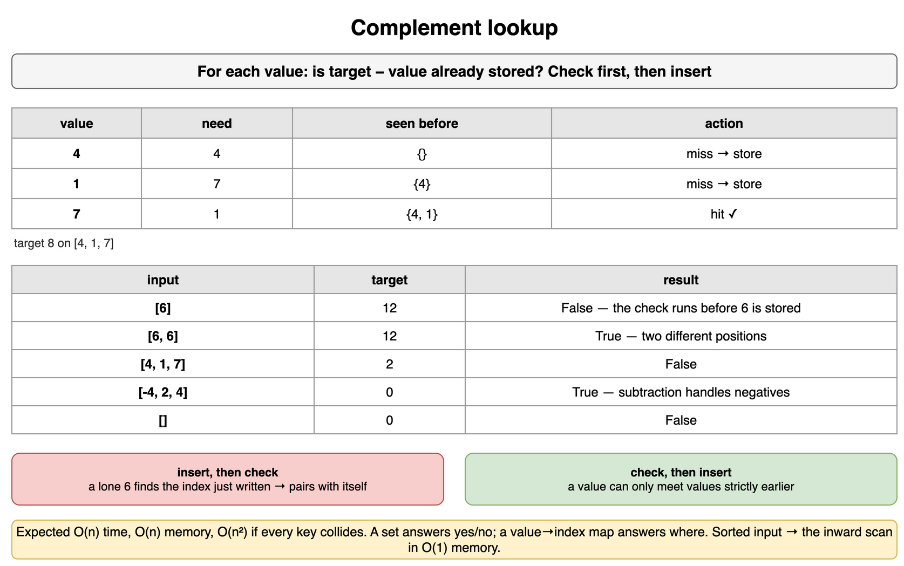

*Source: [`diagrams/hash-maps-and-sets.drawio`](/content/11_Coding_Problems/10_Hash_Maps_and_Sets/diagrams/hash-maps-and-sets.drawio), page 2.*

## Counting with a map

A counting map stores, under each key, how many times that key has appeared.

The second fact is a lookup. Which code appears more than once, and which character appears once: build the counts, then read them. POSIX `uniq -c` can prefix a count, and it only compares adjacent lines, so the file has to be sorted first when equal lines are not already neighbors. A hash map counts without that sort. `collections.Counter` is this map with a zero default. The [Frequency map and character counting](../../07_Data_Structures_and_Algorithms/02_Arrays_Strings_and_Hash_Tables/) card, the [Frequency map](../../07_Data_Structures_and_Algorithms/11_Problem_Solving_Patterns/) card, and the [Count with a map](../06_Moderate_Problems/) card already use it for anagrams and repeated lengths. The loop below is the same map written out, on exercise status codes rather than those examples.

When the key is a small dense integer, the map is an array. Twenty-six lowercase letters are indexes `ord(ch) - ord("a")`. Digits are indexes `0` through `9`. The array operation is worst-case O(1), not expected O(1), and the extra memory is the fixed length of the array. A hash of those same letters still works and adds a collision case the array does not have.

```python
def repeated_codes(codes: list[int]) -> list[int]:
    counts: dict[int, int] = {}
    for code in codes:
        counts[code] = counts.get(code, 0) + 1
    return sorted(code for code, count in counts.items() if count > 1)


def lowercase_tally(text: str) -> list[tuple[str, int]]:
    tally = [0] * 26
    for ch in text:
        if "a" <= ch <= "z":
            tally[ord(ch) - ord("a")] += 1
    return [(chr(ord("a") + i), tally[i]) for i in range(26) if tally[i]]


print(repeated_codes([404, 200, 404, 500, 200, 200]))
print(repeated_codes([]), repeated_codes([201]))
print(lowercase_tally("bookkeeper"), lowercase_tally("Book"), lowercase_tally(""))
# [200, 404]
# [] []
# [('b', 1), ('e', 3), ('k', 2), ('o', 2), ('p', 1), ('r', 1)] [('k', 1), ('o', 2)] []
```

`200` and `404` are the codes that appear more than once. The sorted result is for stable output. The tally of `"bookkeeper"` is the lowercase letters only. `"Book"` drops the capital `B`, which is a contract to confirm if the problem treats case as the same letter. An empty input is an empty result in both functions. A missing key reads as zero through `.get` or through an array slot that started at zero.

The build is expected O(n) for a hash and worst-case O(n) for the array, with O(n^2) as the hash's collision case. Extra memory is O(d) for d distinct keys, or 26 slots for the letter array. A second pass over the original string, reading counts, is how "first key that appears once" stays in arrival order. Sorting the keys would answer a different order.

**Trade-offs.** The hash accepts any hashable key and has a collision worst case. The array accepts a dense range and has a hard bound. Sorting then scanning neighbors is O(n log n) and is the right tool when the next step needs the keys in order. Building a fresh string by repeated concatenation while counting is a separate cost, covered with string builders on the arrays card, and it is not part of the count.

**Interview.** Say whether the key is an open vocabulary or a range you can index. Say where order matters: the count map does not remember which index came first unless you store it or you scan the original input again. Give the empty input and the all-unique input as empty results when the question is "which keys repeat."

**Recap.** One pass writes a count under each key. A second lookup, or a second pass over the original order, answers the question. Use an array when the keys are a small dense range, and a hash when they are not. `uniq` can count too, after the lines have been made adjacent.

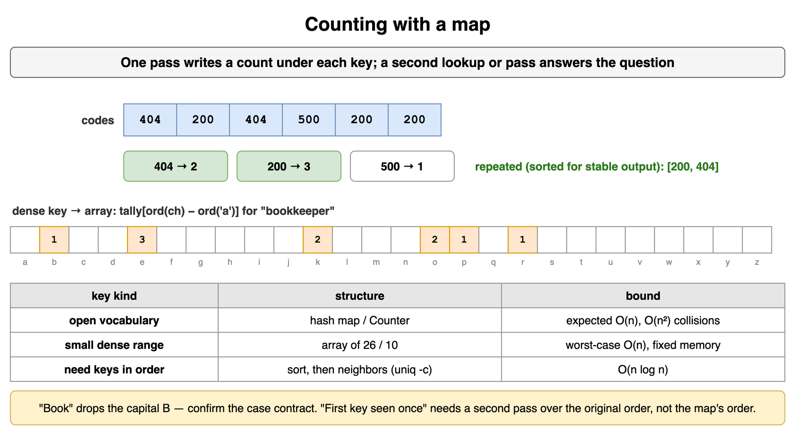

*Source: [`diagrams/hash-maps-and-sets.drawio`](/content/11_Coding_Problems/10_Hash_Maps_and_Sets/diagrams/hash-maps-and-sets.drawio), page 3.*

## Designing the key

The key is the definition of "same." Design it before the loop. A lookup can only find what that definition treats as equal.

Two cells share a box when the key is the box, not the cell. On a grid of side 9 divided into 3 by 3 blocks, the block of row `r` and column `c` is `(r // 3, c // 3)`, or the single integer `(r // 3) * 3 + c // 3`. A tuple of hashables is a legal `dict` key. The pair-sum key is different: there the key is the value itself and the payload is the index. An anagram key is different again. Sorting the letters puts the same multiset of characters on one string, so `"time"`, `"item"`, and `"mite"` share `"eimt"`. A key that keeps only the set of letters drops counts, so it would also merge words the sorted key keeps apart. That comparison is the [Group-by key: which key?](../../07_Data_Structures_and_Algorithms/02_Arrays_Strings_and_Hash_Tables/) drill. A key that is only the length merges every four-letter word. The groups below are exercise words.

```python
def grouped_by_sorted_letters(words: list[str]) -> list[list[str]]:
    groups: dict[str, list[str]] = {}
    for word in words:
        key = "".join(sorted(word))
        groups.setdefault(key, []).append(word)
    return [groups[key] for key in sorted(groups)]


def block_key(row: int, col: int) -> tuple[int, int]:
    return (row // 3, col // 3)


print(grouped_by_sorted_letters(["time", "item", "mite", "star", "rats"]))
print(block_key(0, 0), block_key(2, 2), block_key(3, 5), block_key(8, 8))
# [['star', 'rats'], ['time', 'item', 'mite']]
# (0, 0) (0, 0) (1, 1) (2, 2)
```

`"star"` and `"rats"` share `"arst"`. The three `"eimt"` words stay in the order they arrived, because a `dict` keeps insertion order and the list appends. Cells `(0, 0)` and `(2, 2)` share block `(0, 0)`. Cell `(3, 5)` is block `(1, 1)`. The formula assumes a cell inside the grid. A negative index floors toward negative infinity under Python's `//`, which is not a block on this board.

Sorting each word of length `k` makes the build expected O(n k log k) time, with a collision worst case on the inserts. The extra memory is the groups. The block key is O(1) arithmetic. The key has to be hashable and its equality has to match the problem's "same." A `list` cannot be a key. A `tuple` or a `frozenset` can.

**Trade-offs.** A sorted string keeps duplicate letters. A `frozenset` of characters forgets how many of each letter there were. A tuple of coordinates keeps a position. Hashing the raw word groups only exact copies. The wrong key runs in the same expected linear time and answers a different question, so a test with a repeated letter or a shared block is the test that catches it.

**Interview.** Say the sentence "two items match when ..." and then name the key that implements it. For a grid, write the block formula and test a cell on a boundary, such as column 3, which is the first column of the next block. For an anagram, say that order inside the word does not matter and counts do. Mention that the key has to be hashable.

**Recap.** The key is the equality the lookup will use. A block index groups cells, a sorted word groups anagrams, and the value itself groups a complement with its partner. A key that drops part of that equality still runs quickly and groups the wrong items. Tuples and frozensets can be keys. Lists cannot.

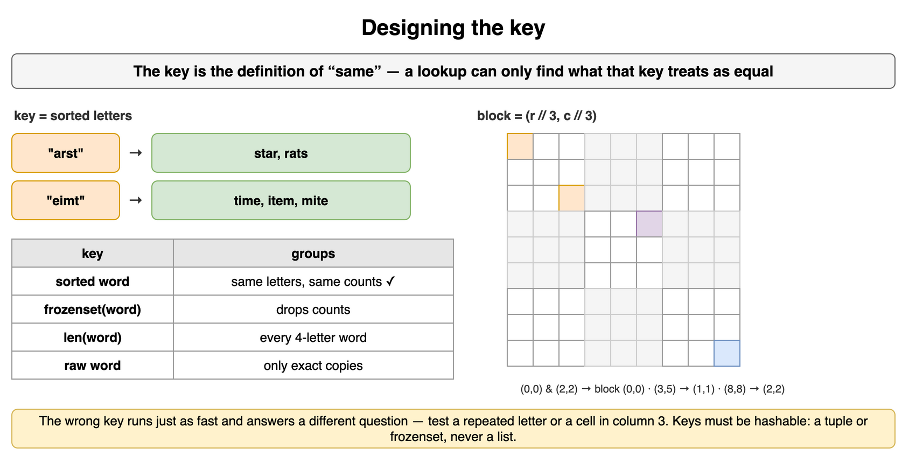

*Source: [`diagrams/hash-maps-and-sets.drawio`](/content/11_Coding_Problems/10_Hash_Maps_and_Sets/diagrams/hash-maps-and-sets.drawio), page 4.*

## Marks stored in the input

Sometimes the table you would allocate is already sitting in the input, in cells the rest of the algorithm can rebuild.

Zeroing a row and a column is the case. The result overwrites the matrix, so a zero row does not need its old values. Those cells can hold marks instead of a second list of row numbers. The safe order is record, then mutate. The [Matrix as 2D array](../../07_Data_Structures_and_Algorithms/02_Arrays_Strings_and_Hash_Tables/) card names that order. Writing zeros as soon as a zero is seen paints new zeros, and the rest of the scan treats the paint as original input. The first row and the first column can store the marks for the other rows and columns. Those two lines are also data, so two flags record whether they themselves contained a zero before any mark was written. The flags are the whole extra memory.

A sign flip is the same idea on a list of positive numbers: a negative entry means "seen," and the absolute value is the data. It is legal only when the problem promises that every value is positive and nonzero. LeetCode 73, the zeroing problem, allows negative values and uses zero as the signal, so a sign is not a free mark there. The full zeroing walk is the card below. The snippet here only shows why the flags have to be taken first. The matrix is exercise numbers.

```python
def flags_before_marks(matrix: list[list[int]]) -> tuple[bool, bool]:
    first_row = any(value == 0 for value in matrix[0])
    first_col = any(row[0] == 0 for row in matrix)
    return first_row, first_col


grid = [[1, 0, 2], [3, 4, 5], [6, 7, 8]]
print(flags_before_marks(grid))
grid[0][0] = 0  # a later mark, or a real zero, both look the same now
print(flags_before_marks(grid))
# (True, False)
# (True, True)
```

The original grid has a zero in the first row and none in the first column. After a write into `grid[0][0]`, a fresh read of the first column reports a zero that the original grid did not have. The flags have to be captured before that write. An empty matrix has no first row to read. The walkthrough guards it.

**Trade-offs.** A set of row indexes and a set of column indexes use O(m + n) extra memory and are easier to say. Marks in the first row and first column use O(1) extra memory and a stricter order. A second matrix uses O(m n) memory and makes the bug hard to write. The sign flip uses O(1) extra memory and forbids zeros and negatives in the input. Clarity favors the sets. An in-place constraint forbids them.

**Interview.** Repeat "in place" if the statement says it. Name the two flags before any write. Say the order: flags, marks from the interior, clear the interior from the marks, then clear the first row and the first column from the flags. Give one matrix where a zero created during the scan would zero an extra row if you acted immediately.

**Recap.** Record every original zero before you write any new one. The first row and the first column can hold those marks, and two flags remember whether those lines were already due to be cleared. A sign can be a mark only when the data is known to be positive. Sets of indexes are the same record-then-mutate idea with memory proportional to the two dimensions.

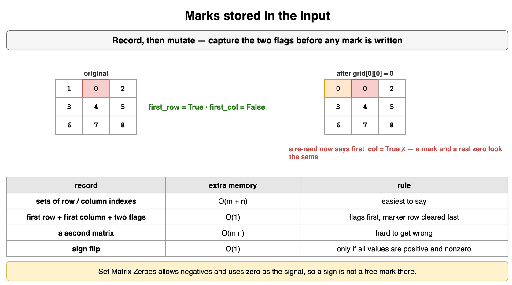

*Source: [`diagrams/hash-maps-and-sets.drawio`](/content/11_Coding_Problems/10_Hash_Maps_and_Sets/diagrams/hash-maps-and-sets.drawio), page 5.*

## Pair Sum in an Unsorted Array (LeetCode-style: Two Sum)

Given integers in any order and a target, return the indexes of two different positions that add up to the target. If no pair exists, return an empty result. A value may not be paired with itself. The earlier index comes first.

This is the complement lookup with a payload. The payload is the index, because the answer is positions in the original order. For each value, ask whether `target - value` is already in the map. On a hit, return the stored index and the current one. On a miss, store this value's index. The list below is exercise numbers.

```python
def pair_sum_unsorted(values: list[int], target: int) -> tuple[int, int] | tuple[()]:
    seen: dict[int, int] = {}
    for index, value in enumerate(values):
        need = target - value
        if need in seen:
            return (seen[need], index)
        seen[value] = index
    return ()


print(pair_sum_unsorted([4, 1, 7, 3], 8))
print(pair_sum_unsorted([4, 1, 7, 3], 11), pair_sum_unsorted([4, 1, 7, 3], 2))
print(pair_sum_unsorted([6, 6], 12), pair_sum_unsorted([6], 12), pair_sum_unsorted([], 0))
print(pair_sum_unsorted([-4, 2, 4], 0), pair_sum_unsorted([5, 5, 5], 10))
print(pair_sum_unsorted([1, 1, -4], -3))
# (1, 2)
# (0, 2) ()
# (0, 1) () ()
# (0, 2) (0, 1)
# (1, 2)
```

`1 + 7` is the hit for target `8`, at indexes 1 and 2. `4 + 7` is the hit for target `11`. Target `2` has no pair. Two sixes at different indexes sum to `12`. One six does not. The empty list does not. `-4 + 4` shows that the subtraction handles a negative. Three fives return the first pair the scan completes, indexes 0 and 1. A later pair of fives also sums to the target. This function returns one pair. When a value repeats before its partner appears, the map keeps the latest index of that value. On `[1, 1, -4]` with target `-3`, both `(0, 2)` and `(1, 2)` sum to the target, and the scan returns `(1, 2)`.

The scan is expected O(n) time and O(n) extra memory. The worst case is O(n^2) if every key collides. The sort-plus-inward alternative is O(n log n) time. `sorted` builds a second list, and the indexes then belong to that list unless you sort `(value, index)` pairs. The [Pair Sum in a Sorted Array (LeetCode-style: Two Sum II)](../09_Two_Pointers/) card is the inward scan when the array is already sorted. LeetCode 1, Two Sum, promises exactly one solution, allows any return order, uses 0-based indexes, and constrains the length to at least 2. This card stays 0-based, returns the stored index first, and returns an empty result when there is no pair, including a one-element list and an empty list.

Inserting before the check makes `[6]` and target `12` return `(0, 0)`. A two-pass map that overwrites with the last index returns that same self-pair whenever the check forgets `j != i`, and on an exercise list such as `[5, 2, 8]` with target `10` it returns `(0, 0)` and never reports `(1, 2)`. The drill runs that version. Python's `int` grows. A fixed-width subtraction can wrap, which is the [Overflow-safe arithmetic](../06_Moderate_Problems/) card.

**Trade-offs.** The map keeps original indexes and spends memory proportional to the length. The inward scan keeps constant extra memory and needs sorted order. A nested loop keeps constant extra memory and is quadratic. Returning values instead of indexes answers a different question. Returning after the first hit is enough when any one pair is enough. All pairs means keep scanning and store every index, not only the last one.

**Interview.** Walk brute force, then sort plus two pointers, then the hash, and name the cost that changed at each step. Ask whether any one pair is enough and whether the indexes are into the original array. State the check-before-insert rule with the single half-target value. Say the empty result is this card's choice. LeetCode 1 will not ask for it.

**Recap.** One pass looks up `target - value` and then stores the current index. The pair comes back with the stored index first, and that index is always smaller than the current one. A lone value whose double is the target is not a pair. The expected cost is linear time and linear extra memory. The sorted twin of this problem moves two indexes and does not need the map.

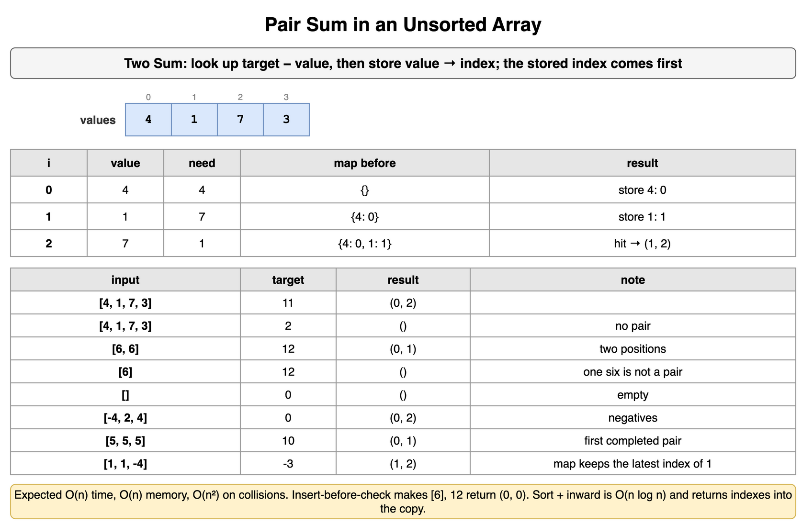

*Source: [`diagrams/hash-maps-and-sets.drawio`](/content/11_Coding_Problems/10_Hash_Maps_and_Sets/diagrams/hash-maps-and-sets.drawio), page 6.*

## Valid Digit Grid (LeetCode-style: Valid Sudoku)

A 9 by 9 grid is valid when no digit from 1 through 9 repeats in a row, in a column, or in a 3 by 3 block. A dot is an empty cell and is ignored. The check says whether the filled cells already conflict. It does not say whether the blanks can be filled in.

Three families of sets do it in one pass. The families are the nine rows, the nine columns, and the nine blocks. The block index is `(r // 3) * 3 + c // 3`, the key from the key-design card. A digit that is already in any of the three sets for its cell is a conflict. A dot is skipped before any set is touched. The boards below are exercise grids, built by placing a few digits on blanks.

```python
def valid_digit_grid(board: list[str]) -> bool:
    if len(board) != 9 or any(len(row) != 9 for row in board):
        return False
    digits = set("123456789")
    rows: list[set[str]] = [set() for _ in range(9)]
    cols: list[set[str]] = [set() for _ in range(9)]
    blocks: list[set[str]] = [set() for _ in range(9)]
    for r, row in enumerate(board):
        for c, ch in enumerate(row):
            if ch == ".":
                continue
            if ch not in digits:
                return False
            block = (r // 3) * 3 + (c // 3)
            if ch in rows[r] or ch in cols[c] or ch in blocks[block]:
                return False
            rows[r].add(ch)
            cols[c].add(ch)
            blocks[block].add(ch)
    return True


def blank() -> list[str]:
    return ["." * 9 for _ in range(9)]


def place(board: list[str], row: int, col: int, digit: str) -> list[str]:
    chars = list(board[row])
    chars[col] = digit
    board[row] = "".join(chars)
    return board


same_block = place(place(blank(), 0, 0, "5"), 1, 1, "5")
same_row = place(place(blank(), 4, 0, "8"), 4, 8, "8")
same_col = place(place(blank(), 0, 6, "2"), 8, 6, "2")
repeated_ok = place(place(blank(), 0, 0, "5"), 3, 3, "5")
print(valid_digit_grid(blank()), valid_digit_grid(same_block))
print(valid_digit_grid(same_row), valid_digit_grid(same_col), valid_digit_grid(repeated_ok))
print(valid_digit_grid(place(blank(), 0, 0, "a")), valid_digit_grid([]), valid_digit_grid(["." * 9] * 8))
# True False
# False False True
# False False False
```

Two fives at `(0, 0)` and `(1, 1)` sit in different rows and different columns. They share block 0, so the grid is invalid. Two eights at the ends of row 4 share a row. Two twos in column 6 share a column. Two fives at `(0, 0)` and `(3, 3)` sit in different rows, columns, and blocks, so a repeated digit is fine. An all-dot grid has nothing to conflict and passes. A letter is not a digit and not a dot, so it fails. A board that is not 9 by 9 fails the shape check. Nothing in the loop writes a digit into a dot. A pass is not a completed puzzle and not a proof that a completion exists. LeetCode 37, Sudoku Solver, is that search.

The fixed board has 81 cells, so the time and the extra memory are O(1). Each set holds at most nine digits. For an `s` by `s` board whose block width `b` divides `s`, the block index is `(r // b) * (s // b) + c // b`, and the time and extra memory are O(s^2). A width that does not divide the side is not this grid. Digits 1 through 9 also fit a length-10 array of booleans per row, per column, and per block. That array drops the hash. The sets generalize to tokens that are not a tiny integer range. LeetCode 36 promises a 9 by 9 board whose cells are already `'.'` or `'1'` through `'9'`, and it asks only for validity. This card also rejects a short board and a character outside that alphabet.

**Trade-offs.** Three families of sets are one pass and expected constant work per cell. A boolean array per family is worst-case constant work per cell on this alphabet. Checking every pair of cells in a row is correct and clumsier. Searching for a completion is a different problem with a different cost. Treating a dot as a digit makes every blank collide with every other blank.

**Interview.** Say "valid, not solvable" before you code. Write the block formula and test a cell in column 3, which starts the next block. Ask what an empty cell looks like. Mention that a boolean array fits digits 1 through 9 if the interviewer wants the collision case gone. Give the all-blank grid as valid.

**Recap.** One pass adds each filled digit to its row set, its column set, and its block set, and rejects a digit that is already there. Dots are ignored. The block key is integer division by 3. The fixed grid is constant work. A passing grid has no repeated digit in those groups, and it may still be impossible to fill.

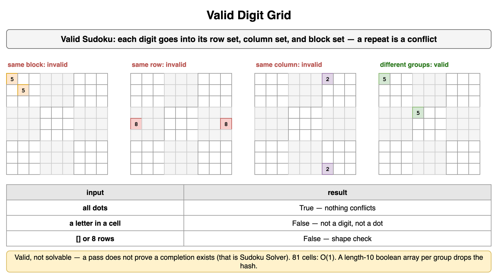

*Source: [`diagrams/hash-maps-and-sets.drawio`](/content/11_Coding_Problems/10_Hash_Maps_and_Sets/diagrams/hash-maps-and-sets.drawio), page 7.*

## Zero a Row and a Column (LeetCode-style: Set Matrix Zeroes)

Given a rectangular matrix of integers, wherever a zero stands, set its whole row and its whole column to zero. Do the work in the matrix itself.

The sets record every original zero, and a second pass writes. That is O(m n) time and O(m + n) extra memory. The marker version uses the first row and the first column as that record. Capture two flags first. Then, for every zero outside that row and column, write a zero into `matrix[r][0]` and `matrix[0][c]`. Clear the interior from those marks. Clear the first row from its flag, then the first column from its flag. Clearing the first row earlier destroys column marks that still live there, and the interior clear then sees a marked column in every position. The matrices below are exercise numbers.

```python
def zero_using_sets(matrix: list[list[int]]) -> list[list[int]]:
    if not matrix or not matrix[0]:
        return matrix
    zero_rows = {r for r, row in enumerate(matrix) if 0 in row}
    zero_cols = {c for row in matrix for c, value in enumerate(row) if value == 0}
    for r in range(len(matrix)):
        for c in range(len(matrix[0])):
            if r in zero_rows or c in zero_cols:
                matrix[r][c] = 0
    return matrix


def zero_using_marks(matrix: list[list[int]]) -> list[list[int]]:
    if not matrix or not matrix[0]:
        return matrix
    rows, cols = len(matrix), len(matrix[0])
    first_row_zero = any(matrix[0][c] == 0 for c in range(cols))
    first_col_zero = any(matrix[r][0] == 0 for r in range(rows))
    for r in range(1, rows):
        for c in range(1, cols):
            if matrix[r][c] == 0:
                matrix[r][0] = 0
                matrix[0][c] = 0
    for r in range(1, rows):
        for c in range(1, cols):
            if matrix[r][0] == 0 or matrix[0][c] == 0:
                matrix[r][c] = 0
    if first_row_zero:
        for c in range(cols):
            matrix[0][c] = 0
    if first_col_zero:
        for r in range(rows):
            matrix[r][0] = 0
    return matrix


def zero_first_row_too_early(matrix: list[list[int]]) -> list[list[int]]:
    if not matrix or not matrix[0]:
        return matrix
    rows, cols = len(matrix), len(matrix[0])
    first_row_zero = any(matrix[0][c] == 0 for c in range(cols))
    first_col_zero = any(matrix[r][0] == 0 for r in range(rows))
    for r in range(1, rows):
        for c in range(1, cols):
            if matrix[r][c] == 0:
                matrix[r][0] = 0
                matrix[0][c] = 0
    if first_row_zero:
        for c in range(cols):
            matrix[0][c] = 0
    for r in range(1, rows):
        for c in range(1, cols):
            if matrix[r][0] == 0 or matrix[0][c] == 0:
                matrix[r][c] = 0
    if first_col_zero:
        for r in range(rows):
            matrix[r][0] = 0
    return matrix


print(zero_using_sets([[1, 0, 2], [3, 4, 5], [6, 7, 8]]))
print(zero_using_marks([[1, 0, 2], [3, 4, 5], [6, 7, 8]]))
print(zero_using_marks([[0, 1, 2], [3, 4, 0], [5, 6, 7]]))
print(zero_first_row_too_early([[0, 1, 2], [3, 4, 0], [5, 6, 7]]))
print(zero_using_marks([[4]]), zero_using_marks([[0]]), zero_using_marks([]), zero_using_marks([[]]))
print(zero_using_marks([[1, 0, 2]]), zero_using_marks([[-2, 0], [4, 5]]))
# [[0, 0, 0], [3, 0, 5], [6, 0, 8]]
# [[0, 0, 0], [3, 0, 5], [6, 0, 8]]
# [[0, 0, 0], [0, 0, 0], [0, 6, 0]]
# [[0, 0, 0], [0, 0, 0], [0, 0, 0]]
# [[4]] [[0]] [] [[]]
# [[0, 0, 0]] [[0, 0], [4, 0]]
```

On `[[1, 0, 2], [3, 4, 5], [6, 7, 8]]` the only original zero is row 0, column 1. Both versions clear that row and that column and leave `3`, `5`, `6`, and `8`. On `[[0, 1, 2], [3, 4, 0], [5, 6, 7]]` the original zeros are `(0, 0)` and `(1, 2)`, so rows 0 and 1 and columns 0 and 2 clear, and `6` stays. Clearing the first row before the interior wipe sees a zero in every column mark and clears `6` as well. A 1 by 1 nonzero stays. A 1 by 1 zero stays zero. An empty matrix and a matrix with an empty first row stay empty. A single row with a zero becomes all zeros, because the row flag is the whole matrix. A negative entry is ordinary data. Only an exact zero marks a row and a column. LeetCode 73 requires the work in place, allows negative entries, and its constraints start at 1 by 1. The follow-up asks for constant extra memory, which is the marker version. This card also returns an empty matrix unchanged.

Both versions are O(m n) time. The sets use O(m + n) extra memory. The markers use O(1) extra memory besides the matrix. Writing zeros during the discovery pass is the cascade the drill runs: a zero you just wrote becomes another row to clear.

**Trade-offs.** Sets are the version to write while you are still naming the rows. Markers meet an in-place follow-up and punish the wrong pass order. A copied matrix is O(m n) extra memory and easy to get right. Signs as marks fail when negatives or zeros are legal data, which they are here.

**Interview.** Say "record, then write." If the interviewer asks for constant extra memory, name the two flags and the four passes in order, and show one matrix where clearing the marker row too early zeros a cell that should survive. Say a negative number is data. Give the 1 by 1 cases.

**Recap.** Original zeros name the rows and columns that will be cleared. Sets remember those indexes. The first row, the first column, and two flags remember them with constant extra memory, if the flags are taken first and the marker row is cleared last. A zero written too early is read as input and clears a row that did not contain one.

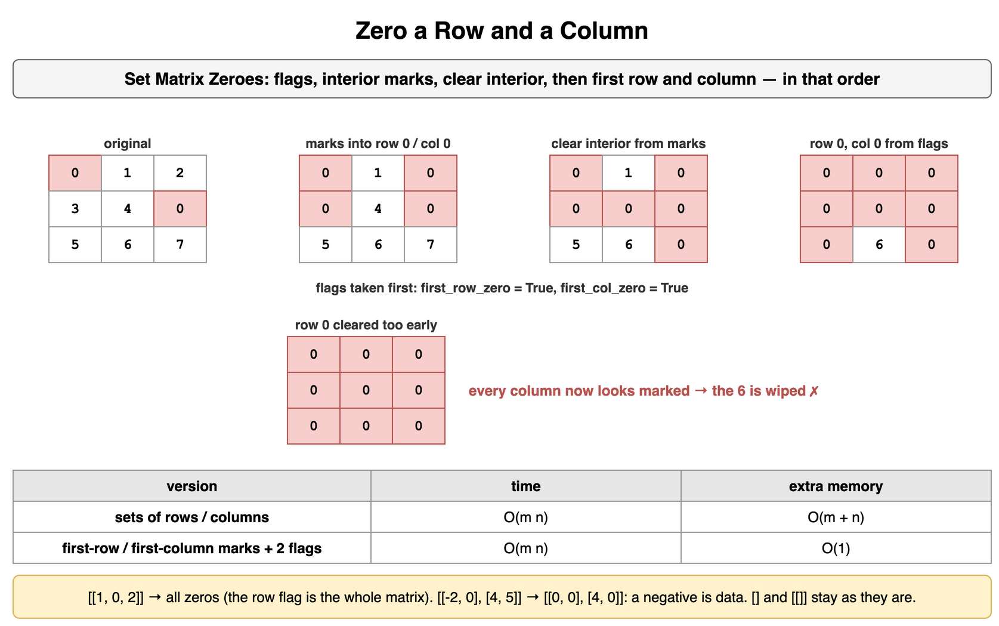

*Source: [`diagrams/hash-maps-and-sets.drawio`](/content/11_Coding_Problems/10_Hash_Maps_and_Sets/diagrams/hash-maps-and-sets.drawio), page 8.*

## Longest Run of Consecutive Values (LeetCode-style: Longest Consecutive Sequence)

Given integers in any order, return the length of the longest run of values that differ by one. Duplicates do not extend the run. Order in the list does not matter. An empty list has length 0.

Put the values in a set. A value starts a run only when `value - 1` is absent. From each start, walk `value + 1`, `value + 2`, and so on while the set contains them. The walk length is the run. Every distinct value is the successor in at most one walk, because it has one predecessor and only the walk that began at the minimum of its run reaches it. The nested loops are therefore expected linear, not quadratic. Starting a walk from every value drops that proof. A run of length L then costs `L + (L - 1) + ... + 1` visits. The lists below are exercise numbers.

```python
def longest_run(values: list[int]) -> int:
    present = set(values)
    best = 0
    for value in present:
        if value - 1 in present:
            continue
        length = 1
        nxt = value + 1
        while nxt in present:
            length += 1
            nxt += 1
        if length > best:
            best = length
    return best


def longest_run_sorted(values: list[int]) -> int:
    ordered = sorted(set(values))
    best = run = 1 if ordered else 0
    for index in range(1, len(ordered)):
        if ordered[index] == ordered[index - 1] + 1:
            run += 1
            if run > best:
                best = run
        else:
            run = 1
    return best


samples = [
    [9, 1, 8, 2, 7, 2],
    [],
    [4],
    [4, 4, 4],
    [-2, -1, 0, 5],
    [10, 11, 12, 13],
]
print([longest_run(sample) for sample in samples])
print([longest_run_sorted(sample) for sample in samples])
# [3, 0, 1, 1, 3, 4]
# [3, 0, 1, 1, 3, 4]
```

`[9, 1, 8, 2, 7, 2]` holds the run `7, 8, 9` of length 3, and `1, 2` of length 2. The extra `2` does not make a longer run. The empty list is 0. One value, repeated or not, is a run of length 1. `-2, -1, 0` has length 3, and `5` is a separate run. Four consecutive values have length 4. The sorted scan agrees on each of these. It collapses duplicates by sorting a set, then counts a neighbor that is exactly one larger.

The set version is expected O(n) time and O(n) extra memory, and O(n^2) time if the hashes collide or if the start test is omitted on a long run. The sort is O(n log n) time and O(n) extra memory for `sorted`, and that bound does not depend on the hash. A presence array would need a slot for every integer from the minimum to the maximum. LeetCode 128 allows values from `-10^9` to `10^9`, so that array does not fit, and it asks for a linear algorithm, which is the set. Duplicates appear in its examples and do not extend the run. An empty input returns 0. This card uses the same rules.

**Trade-offs.** The set meets a linear expected bound and spends memory proportional to the distinct values. The sort meets a guaranteed O(n log n) and is the version to offer if the interviewer drops the linear requirement. Walking from every value is simpler to type and quadratic on one long run. A presence array is worst-case linear only when the value range is small.

**Interview.** Say "only start at a value whose predecessor is missing," and say why that makes the inner walks add up to n. Give the duplicate and the empty list. Mention the sort as the guaranteed alternative. Say a span from the smallest value to the largest is the wrong size if the values are sparse.

**Recap.** A set answers "is the neighbor present?" in expected constant time. Walks begin only at the bottom of a run, so each distinct value is visited by an inner walk at most once. Duplicates collapse in the set and do not add length. Sorting and scanning neighbors is the guaranteed O(n log n) version of the same length.

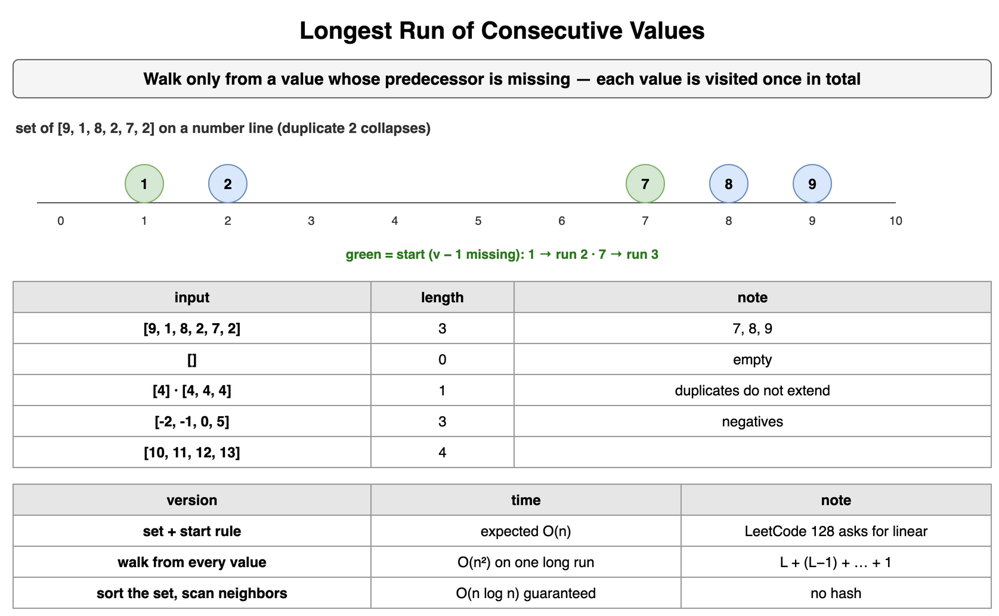

*Source: [`diagrams/hash-maps-and-sets.drawio`](/content/11_Coding_Problems/10_Hash_Maps_and_Sets/diagrams/hash-maps-and-sets.drawio), page 9.*

## Triplets at a Fixed Ratio (HackerRank-style: Count Triplets)

Count index triplets `i < j < k` whose values form a geometric step with a given integer ratio. The middle value equals the left value times the ratio, and the right value equals the middle value times the ratio.

Take each value as the middle. Its left partner is `value // ratio` when `value` is divisible by `ratio`. Its right partner is `value * ratio`. A map of values already passed supplies the left count. A map of values not yet passed supplies the right count. The product is the number of triplets with this middle, because every earlier partner pairs with every later partner and the indexes stay in order. Drop the current value from the later map before the product. It is the middle, so it is not a legal right partner. Leaving it in inflates the product whenever the right partner equals the middle: ratio `1`, or a zero with any nonzero ratio.

Ratio `0` is a different formula. The middle must be `0` and the right partner must be `0`. Any earlier value times `0` is `0`, so the left count is the number of values already passed, not the number of earlier zeros. `value % ratio` and `value // ratio` raise `ZeroDivisionError` when the ratio is `0`, so that case is a branch, not a division. Using `//` without a remainder test is a false hit. `//` floors, and `%` is that floor remainder, including when the ratio is negative. On these positive numbers the floor drops the fraction: `5 // 2` is `2`, and a stored `2` is not a value that produces `5` when doubled. The lists below are exercise numbers.

```python
def count_fixed_ratio(values: list[int], ratio: int) -> int:
    earlier: dict[int, int] = {}
    later: dict[int, int] = {}
    for value in values:
        later[value] = later.get(value, 0) + 1
    total = 0
    seen = 0
    for value in values:
        later[value] -= 1
        if ratio == 0:
            if value == 0:
                total += seen * later.get(0, 0)
        elif value % ratio == 0:
            left_value = value // ratio
            right_value = value * ratio
            total += earlier.get(left_value, 0) * later.get(right_value, 0)
        earlier[value] = earlier.get(value, 0) + 1
        seen += 1
    return total


def count_if_current_stays_on_the_right(values: list[int], ratio: int) -> int:
    earlier: dict[int, int] = {}
    later: dict[int, int] = {}
    for value in values:
        later[value] = later.get(value, 0) + 1
    total = 0
    for value in values:
        if ratio != 0 and value % ratio == 0:
            total += earlier.get(value // ratio, 0) * later.get(value * ratio, 0)
        later[value] -= 1
        earlier[value] = earlier.get(value, 0) + 1
    return total


def count_skipping_remainder(values: list[int], ratio: int) -> int:
    earlier: dict[int, int] = {}
    later: dict[int, int] = {}
    for value in values:
        later[value] = later.get(value, 0) + 1
    total = 0
    for value in values:
        later[value] -= 1
        if ratio != 0:
            total += earlier.get(value // ratio, 0) * later.get(value * ratio, 0)
        earlier[value] = earlier.get(value, 0) + 1
    return total


print(count_fixed_ratio([3, 6, 12, 4, 8], 2))
print(count_fixed_ratio([4, 4, 4, 4], 1), count_if_current_stays_on_the_right([4, 4, 4, 4], 1))
print(count_fixed_ratio([0, 0, 0], 5), count_fixed_ratio([5, 0, 0], 0))
print(count_fixed_ratio([2, 5, 10], 2), count_skipping_remainder([2, 5, 10], 2))
print(count_fixed_ratio([2, -4, 8], -2), count_fixed_ratio([], 3), count_fixed_ratio([9], 3), count_fixed_ratio([9, 18], 2))
# 1
# 4 10
# 1 1
# 0 1
# 1 0 0 0
```

`[3, 6, 12, 4, 8]` with ratio `2` has one triplet, indexes `(0, 1, 2)`. Four equal values with ratio `1` have `C(4, 3) = 4` triplets. Leaving the current value on the right counts `10`. Three zeros with ratio `5` are one triplet, because `0 * 5` is `0`. `[5, 0, 0]` with ratio `0` is one triplet: the `5` is a legal left value. `[2, 5, 10]` with ratio `2` has no triplet. Skipping the remainder test on `5 // 2` invents one. `[2, -4, 8]` with ratio `-2` is one triplet. Fewer than three values is zero.

The scan is expected O(n) time and O(n) extra memory, and O(n^2) time if every key collides. Three nested loops are O(n^3) and constant extra memory, and they are the check on a short list. Sorting does not preserve index order, and the constraint `i < j < k` is about positions. HackerRank's Count Triplets is this count for a positive ratio and positive values, so ratio `0`, zeros, and negatives do not arise there. This card includes them. Python's product grows. A fixed-width `value * ratio` can wrap and look up the wrong key, which is the [Overflow-safe arithmetic](../06_Moderate_Problems/) card.

**Trade-offs.** Two count maps are expected linear time and linear extra memory. The triple loop is the obvious correct count and the cubic bill. An approach that treats the current value as the end of the triplet, adding up pairs already completed, is the same complexity and a different bookkeeping. Either one has to refuse a non-integer partner and has to exclude the current index from both sides.

**Interview.** Define the triplet with indexes in order and one exercise list you can multiply by hand. Say the current value is the middle, name the left and right partners, and say you drop it from the right-hand map before the product. Call out ratio `1`, ratio `0`, and a value that is not divisible by the ratio. Say HackerRank's constraints stay positive if that is the statement in front of you, and write the extra branches only when zero and negatives are in bounds.

**Recap.** Each value is a middle. The number of triplets is the earlier count of `value / ratio` times the later count of `value * ratio`, after the middle has been removed from the later counts and only when the division is exact. Ratio `0` counts every earlier value against later zeros, with a middle of zero. The expected cost is linear time and linear extra memory.

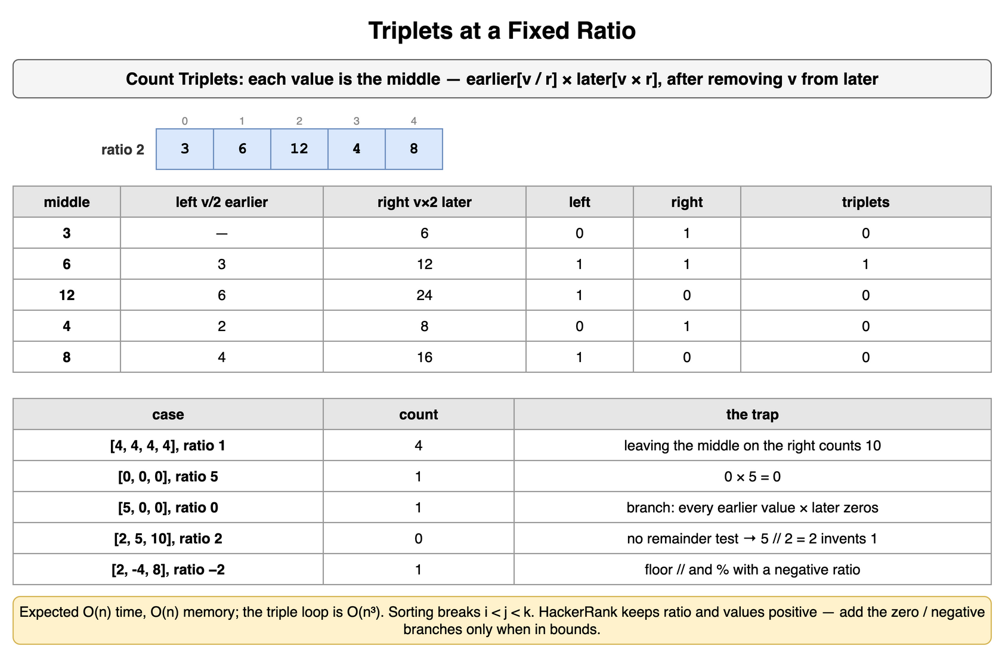

*Source: [`diagrams/hash-maps-and-sets.drawio`](/content/11_Coding_Problems/10_Hash_Maps_and_Sets/diagrams/hash-maps-and-sets.drawio), page 10.*

## A hash map, an array, a sort, or two pointers

The choice follows the constraint you can point at: a complement or a count, a dense integer key, sorted order, original indexes, or a worst-case guarantee.

A nested loop is the baseline. It uses constant extra memory, it works unsorted, and its time grows with the square of the length for a pair and with the cube for a triplet. Say it, give that cost, then replace it. A hash replaces it when the question is a partner, a count, or a group, and the partner is computable from the current value. That is expected linear time, linear extra memory, and a quadratic worst case under collisions. An array replaces the hash when the key is a small dense range: 26 letters, 10 digits, or the digits of a Sudoku row. The bound is then worst-case linear. A sort replaces the hash when you next need order, or when you want O(n log n) even if every hash collided. Two pointers replace both when the array is sorted, or safe to sort, and a move has a proof. The [Pair Sum in a Sorted Array (LeetCode-style: Two Sum II)](../09_Two_Pointers/) card is that move for a pair. The [Balanced BST as a map alternative](../../07_Data_Structures_and_Algorithms/02_Arrays_Strings_and_Hash_Tables/) card is the ordered map, O(log n) per operation with a guaranteed bound. A prefix array answers a range sum in constant time after a linear build. The [Prefix sums](../06_Moderate_Problems/) card is that array. Storing those prefixes in a map, so an unsorted subarray sum becomes a complement, is a later pattern. This topic stops at the lookup.

The counts below are for one exercise list, not a benchmark. The target is `17`. One pair hits it: indexes `(3, 4)`, values `2` and `15`.

```python
def pair_costs(values: list[int], target: int) -> tuple[int, int, int, tuple[int, int] | None]:
    brute = 0
    found: tuple[int, int] | None = None
    for i in range(len(values)):
        hit = False
        for j in range(i + 1, len(values)):
            brute += 1
            if values[i] + values[j] == target:
                found = (i, j)
                hit = True
                break
        if hit:
            break

    seen: dict[int, int] = {}
    hashed = 0
    for index, value in enumerate(values):
        hashed += 1
        if target - value in seen:
            break
        seen[value] = index

    ordered = sorted(values)
    left, right = 0, len(ordered) - 1
    inward = 0
    while left < right:
        inward += 1
        total = ordered[left] + ordered[right]
        if total == target:
            break
        if total < target:
            left += 1
        else:
            right -= 1
    return brute, hashed, inward, found


print(pair_costs([8, 3, 11, 2, 15, 7], 17))
# (13, 5, 1, (3, 4))
```

The double loop stops at the first hit, after 13 additions, and that hit is the pair `(3, 4)` in the caller's list: `2` and `15`. Six values have 15 pairs, and this run stops early. The hash examines 5 values. The fifth is `15`, whose complement `2` is already stored. The inward scan sorts a copy to `[2, 3, 7, 8, 11, 15]`, adds `2 + 15` once, and stops. Its left and right indexes point into that copy, and this function does not return them. A different target moves the counts. The bounds do not: quadratic for the nested loop, expected linear for the hash, linear for the inward scan after an O(n log n) sort.

The other problems in this topic are not pair searches, so two pointers are not the competitor. The digit grid wants three grouping keys, and a length-10 boolean array is the dense-key alternative. The zeroing wants a record of rows and columns, and the matrix itself can hold that record. The consecutive run wants membership of a neighbor. A sort answers it with a guarantee, and a presence array does not fit a sparse range. The ratio triplets want two counts and index order, which a sort throws away. A sliding window, on the [Sliding window](../06_Moderate_Problems/) card, is the tool when the constraint is a contiguous segment. A set of the values inside that segment is a hash used by the window, not a replacement for it.

**Trade-offs.** A hash buys expected linear time and spends memory, and its worst case is a long chain in one bucket. An array buys a worst-case bound and fits a dense range only. A sort buys order and a guarantee and spends the log factor. Two pointers buy linear time and constant extra memory after the order is real, and they are wrong when a move has no proof. A set used to clean up duplicates after the fact buys shorter code and hides both time and memory.

**Interview.** Start from the sentence, not from a favorite structure. Unsorted complement or count: hash, and say expected linear plus the collision case. Tiny integer keys: array. Need the keys in order, or a guaranteed bound: sort or a tree map. Sorted pair, tight memory: two pointers, and name which end moves. Then give both costs, time and extra memory, including a sort if you introduced one. Offer the nested loop as the check on a tiny input.

**Recap.** A hash map is the expected-linear lookup when the question is a partner, a count, or a group. An array is that lookup with a worst-case bound when the keys are a small range. A sort is the guaranteed, ordered alternative. Two pointers are the constant-memory scan once the data is sorted or symmetric. The nested loop is the baseline you name first.

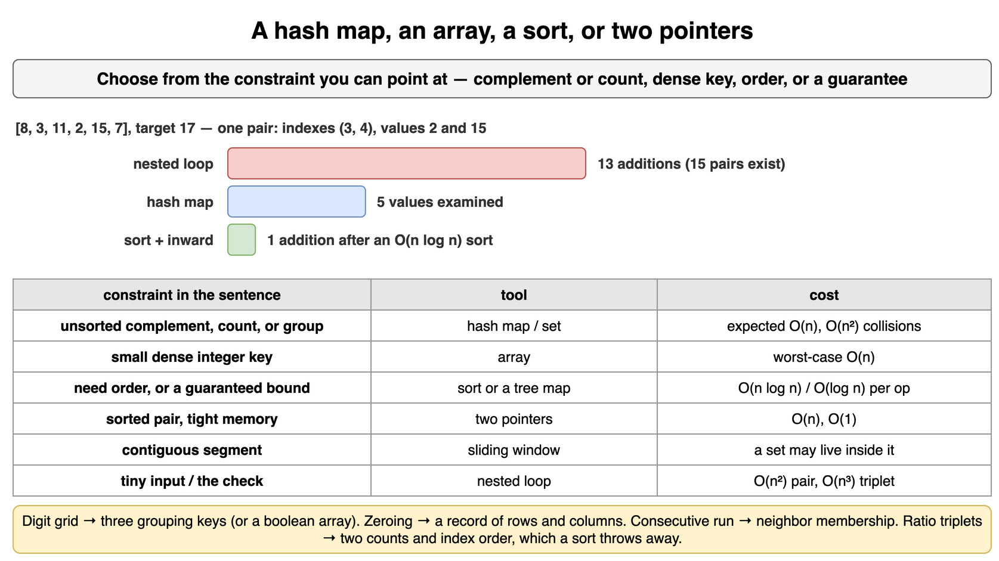

*Source: [`diagrams/hash-maps-and-sets.drawio`](/content/11_Coding_Problems/10_Hash_Maps_and_Sets/diagrams/hash-maps-and-sets.drawio), page 11.*
