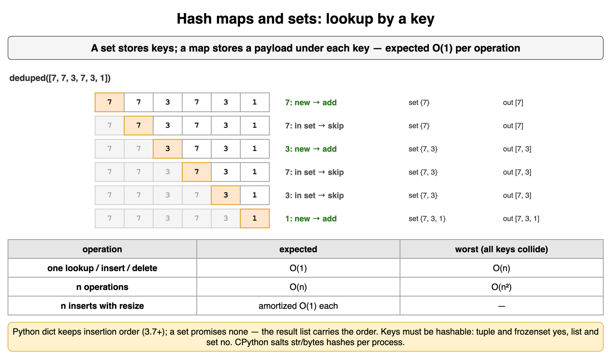
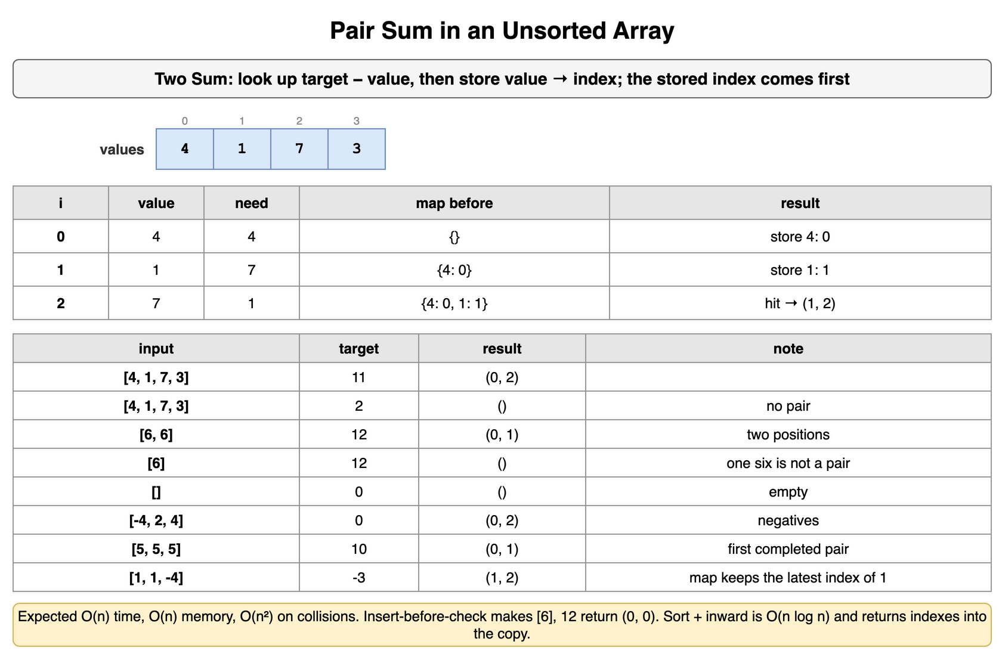
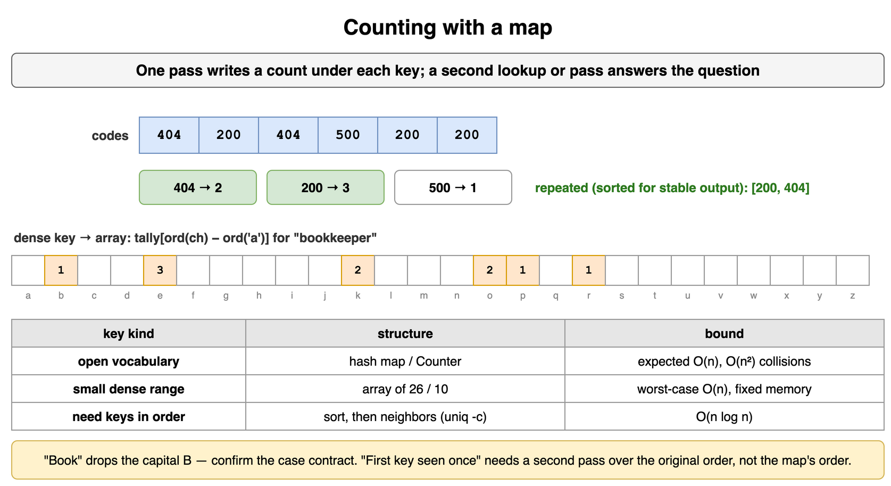
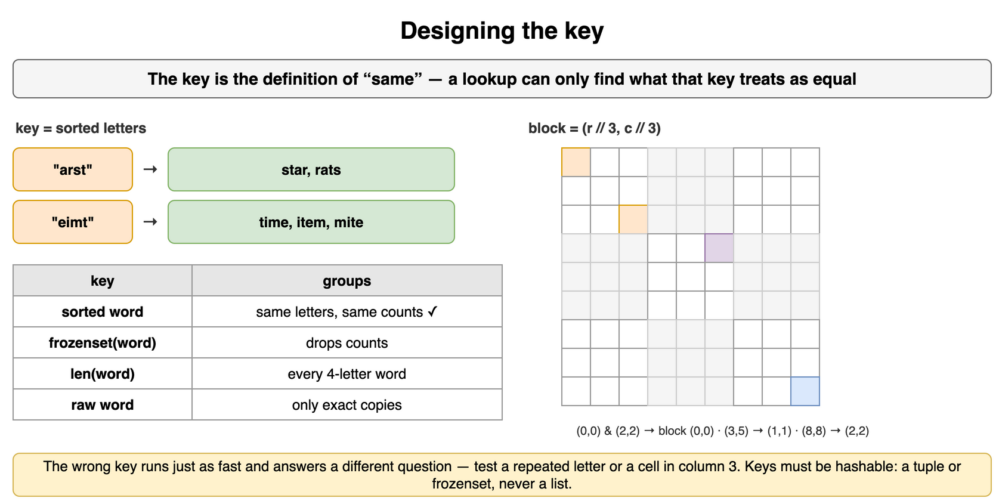
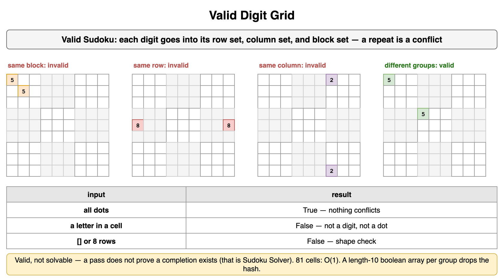
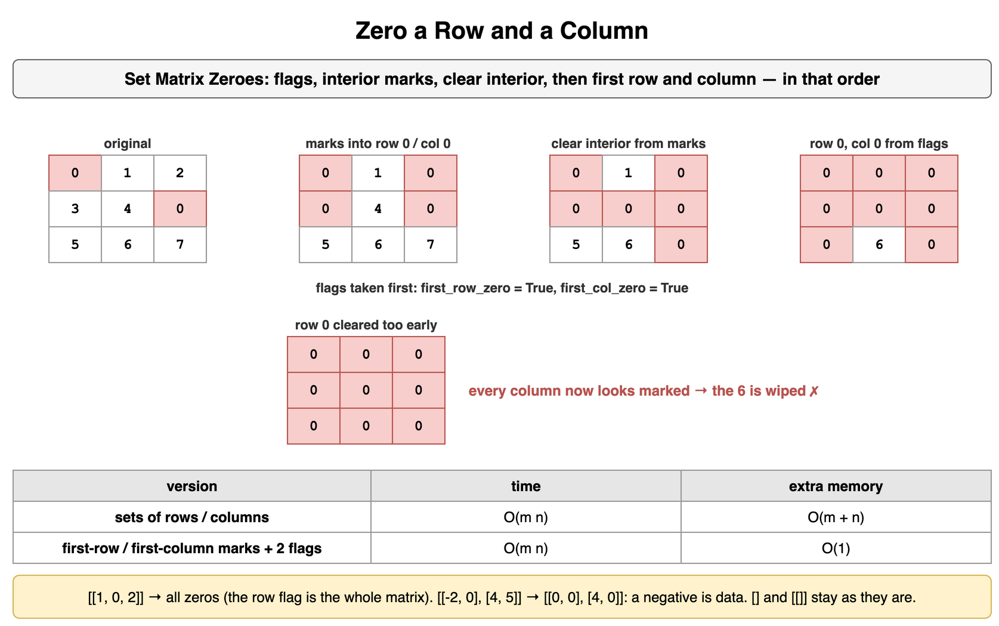
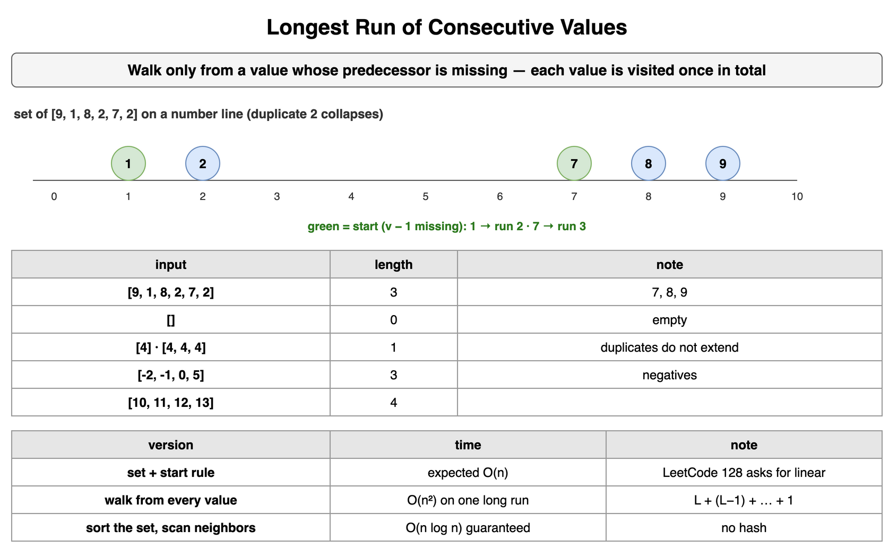
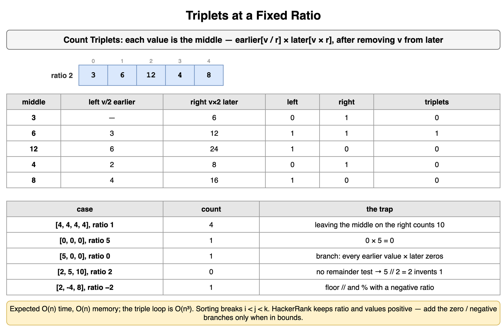
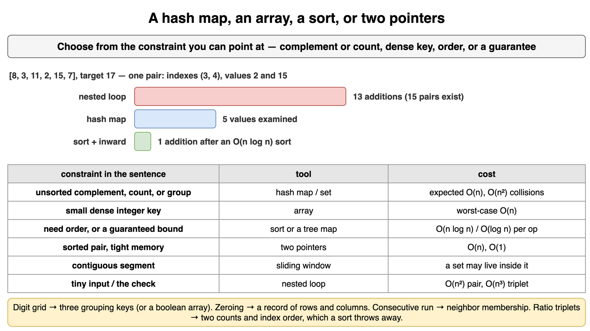

## Lookup by a key

A hash map stores a payload under a key. A hash set stores the key alone: membership, a duplicate, or a visited mark. One operation is expected O(1), and O(n) when every key lands in one bucket, so n operations are expected O(n) and worst-case O(n^2). A resize makes each insert in a long run amortized O(1). See [Hash table fundamentals](#07_Data_Structures_and_Algorithms/02_Arrays_Strings_and_Hash_Tables/concepts/hash-table-fundamentals), [Hash collisions and resolution strategies](#07_Data_Structures_and_Algorithms/02_Arrays_Strings_and_Hash_Tables/concepts/hash-collisions-and-resolution-strategies), and [Load factor and rehashing](#07_Data_Structures_and_Algorithms/02_Arrays_Strings_and_Hash_Tables/concepts/load-factor-and-rehashing). A sort that survives a bad hash is O(n log n). The fork is [Two pointers, a hash map, or brute force](#11_Coding_Problems/09_Two_Pointers/concepts/two-pointers-a-hash-map-or-brute-force).

Python's `dict` is the map and `set` is the set. Since Python 3.7 a dict keeps insertion order: an update does not move a key, and a key inserted again after deletion goes to the end. A set promises no order. A `list` and a `set` are not hashable. A `tuple` of hashables is, and so is a `frozenset`. CPython's dict is open-addressed and salts `str` and `bytes` per process, so a collision set does not transfer. Integer hashes are not salted. A small integer hashes to itself, except `hash(-1)` is `-2`, because `-1` is an internal error code. Order lives in that list.

```python
def deduped(ids: list[int]) -> list[int]:
    seen: set[int] = set()
    fresh: list[int] = []
    for item in ids:
        if item in seen:
            continue
        seen.add(item)
        fresh.append(item)
    return fresh


print(deduped([7, 7, 3, 7, 3, 1]))
print(deduped([]), deduped([4]), deduped([4, 4]))
# [7, 3, 1]
# [] [4] [4]
```



*Source: [`diagrams/hash-maps-and-sets.drawio`](/content/11_Coding_Problems/10_Hash_Maps_and_Sets/diagrams/hash-maps-and-sets.drawio), page 1.*

## Pair sum in an unsorted array

For each value, look up `target - value`, then store this index. The stored index is earlier. Inserting first lets a lone `6` and target `12` return `(0, 0)`. A set that checks, then inserts, answers yes or no. A set of the whole array cannot tell one copy from two, so that lone half-target is a false yes. A two-pass last-index map does the same if one index may be used twice: `[5, 2, 8]` and target `10` returns `(0, 0)` and misses `(1, 2)`. [Unsorted pair-sum with a hash set](#07_Data_Structures_and_Algorithms/02_Arrays_Strings_and_Hash_Tables/concepts/unsorted-pair-sum-with-a-hash-set) is this check. The nested loop is the O(n^2) baseline.

Expected time is O(n) and extra memory is O(n), or O(n^2) if every key collides. The inward scan after a sort is O(n log n), and those indexes belong to the copy unless each value carries its original index ([Pair sum in a sorted array](#11_Coding_Problems/09_Two_Pointers/concepts/pair-sum-in-a-sorted-array)). A repeat keeps the latest index: `[1, 1, -4]` and target `-3` returns `(1, 2)`, and `(0, 2)` also hits. All pairs means store every index. LeetCode 1 promises one pair and length at least 2. Empty input and one element return empty. Python's `int` does not wrap. A fixed-width subtraction can ([Overflow-safe arithmetic](#11_Coding_Problems/06_Moderate_Problems/concepts/overflow-safe-arithmetic)).

```python
def pair_sum_unsorted(values: list[int], target: int) -> tuple[int, int] | tuple[()]:
    seen: dict[int, int] = {}
    for index, value in enumerate(values):
        need = target - value
        if need in seen:
            return (seen[need], index)
        seen[value] = index
    return ()


print(pair_sum_unsorted([4, 1, 7, 3], 8))
print(pair_sum_unsorted([4, 1, 7, 3], 11), pair_sum_unsorted([4, 1, 7, 3], 2))
print(pair_sum_unsorted([6, 6], 12), pair_sum_unsorted([6], 12), pair_sum_unsorted([], 0))
print(pair_sum_unsorted([-4, 2, 4], 0), pair_sum_unsorted([5, 5, 5], 10))
print(pair_sum_unsorted([1, 1, -4], -3))
# (1, 2)
# (0, 2) ()
# (0, 1) () ()
# (0, 2) (0, 1)
# (1, 2)
```



*Source: [`diagrams/hash-maps-and-sets.drawio`](/content/11_Coding_Problems/10_Hash_Maps_and_Sets/diagrams/hash-maps-and-sets.drawio), page 6.*

## A second pass for arrival order

[Count with a map](#11_Coding_Problems/06_Moderate_Problems/concepts/count-with-a-map), [Frequency map and character counting](#07_Data_Structures_and_Algorithms/02_Arrays_Strings_and_Hash_Tables/concepts/frequency-map-and-character-counting), and [Frequency map](#07_Data_Structures_and_Algorithms/11_Problem_Solving_Patterns/concepts/frequency-map) write the counts in one pass. `collections.Counter` is that map, and a missing key reads as zero. The map does not remember which index came first. A second pass over the input returns the first key whose count is 1, in arrival order. Keys with a count above 1, sorted, are the repeats: `[404, 200, 404, 500, 200, 200]` gives `[200, 404]`. POSIX `uniq -c` counts only adjacent lines, so equals have to be neighbors first. A hash does not need that sort.

Letters `a` through `z` are indexes `ord(ch) - ord("a")`, and digits are `0` through `9`. That update is worst-case O(1) in fixed memory ([Counting and buckets](#11_Coding_Problems/07_Hard_Problems/concepts/counting-and-buckets)). A hash of those letters is expected O(n), or O(n^2) on collisions, with O(d) memory for d distinct keys. The two passes share that bound. `"stress"` returns 1. `"Stress"` returns 0, because `S` and `s` differ. `"Book"` drops `B` under a lowercase contract. Empty input and a string with no singleton return nothing. Building a string by repeated concatenation is a separate cost ([String immutability and the builder pattern](#07_Data_Structures_and_Algorithms/02_Arrays_Strings_and_Hash_Tables/concepts/string-immutability-and-the-builder-pattern)).

```python
def first_once(text: str) -> int | None:
    counts: dict[str, int] = {}
    for ch in text:
        counts[ch] = counts.get(ch, 0) + 1
    for index, ch in enumerate(text):
        if counts[ch] == 1:
            return index
    return None


def lowercase_tally(text: str) -> list[tuple[str, int]]:
    tally = [0] * 26
    for ch in text:
        if "a" <= ch <= "z":
            tally[ord(ch) - ord("a")] += 1
    return [(chr(ord("a") + i), tally[i]) for i in range(26) if tally[i]]


print(first_once("stress"), first_once("aabb"), first_once(""), first_once("a"), first_once("Stress"))
print(lowercase_tally("bookkeeper"), lowercase_tally("Book"), lowercase_tally(""))
# 1 None None 0 0
# [('b', 1), ('e', 3), ('k', 2), ('o', 2), ('p', 1), ('r', 1)] [('k', 1), ('o', 2)] []
```



*Source: [`diagrams/hash-maps-and-sets.drawio`](/content/11_Coding_Problems/10_Hash_Maps_and_Sets/diagrams/hash-maps-and-sets.drawio), page 3.*

## A grouping key

The key is the equality a lookup can find. Sorting the letters groups one multiset, so `"time"`, `"item"`, and `"mite"` share `"eimt"`. A `frozenset` of letters drops counts and merges words that key keeps apart. A length key merges every word of that length. The raw word groups only exact copies. The wrong key is still expected linear time and answers a different question ([Hash table fundamentals](#07_Data_Structures_and_Algorithms/02_Arrays_Strings_and_Hash_Tables/concepts/hash-table-fundamentals)). A `list` and a `set` cannot be keys. A `tuple` of hashables can, and so can a `frozenset`.

On a side-9 grid the block of row `r` and column `c` is `(r // 3, c // 3)`, or `(r // 3) * 3 + c // 3`. `(0, 0)` and `(2, 2)` share `(0, 0)`. Column 3 starts the next block. Python's `//` floors toward negative infinity, so a negative index stays negative and is not a block here. [A valid digit grid](#11_Coding_Problems/10_Hash_Maps_and_Sets/concepts/a-valid-digit-grid) uses the integer as a set index. Sorting words of length `k` is expected O(n k log k), or O(n^2) if the inserts collide. The block key is O(1). The snippet sorts the groups by key. Words inside a group stay in arrival order.

```python
def grouped_by_sorted_letters(words: list[str]) -> list[list[str]]:
    groups: dict[str, list[str]] = {}
    for word in words:
        key = "".join(sorted(word))
        groups.setdefault(key, []).append(word)
    return [groups[key] for key in sorted(groups)]


def block_key(row: int, col: int) -> tuple[int, int]:
    return (row // 3, col // 3)


print(grouped_by_sorted_letters(["time", "item", "mite", "star", "rats"]))
print(block_key(0, 0), block_key(2, 2), block_key(3, 5), block_key(8, 8))
# [['star', 'rats'], ['time', 'item', 'mite']]
# (0, 0) (0, 0) (1, 1) (2, 2)
```



*Source: [`diagrams/hash-maps-and-sets.drawio`](/content/11_Coding_Problems/10_Hash_Maps_and_Sets/diagrams/hash-maps-and-sets.drawio), page 4.*

## A valid digit grid

A 9 by 9 grid is valid when no digit from 1 through 9 repeats in its row, column, or 3 by 3 block. A dot is empty and is ignored. The check does not fill the blanks. One pass adds each filled digit to its row set, column set, and block `(r // 3) * 3 + c // 3` ([A grouping key](#11_Coding_Problems/10_Hash_Maps_and_Sets/concepts/a-grouping-key)). A digit already in any of the three is a conflict. Skip a dot, or every blank collides. A letter or a short board fails.

Two fives at `(0, 0)` and `(1, 1)` share block 0. The same digit at `(0, 0)` and `(3, 3)` does not. An all-dot grid passes. Eighty-one cells are O(1) time and extra memory, with at most nine digits in a set. For side `s` and block width `b` that divides `s`, the index is `(r // b) * (s // b) + c // b`, in O(s^2). A width that does not divide the side is not this grid. Digits 1 through 9 also fit a length-10 boolean array per family, which drops the hash. LeetCode 36 promises that alphabet and asks only for validity.

```python
def valid_digit_grid(board: list[str]) -> bool:
    if len(board) != 9 or any(len(row) != 9 for row in board):
        return False
    digits = set("123456789")
    rows: list[set[str]] = [set() for _ in range(9)]
    cols: list[set[str]] = [set() for _ in range(9)]
    blocks: list[set[str]] = [set() for _ in range(9)]
    for r, row in enumerate(board):
        for c, ch in enumerate(row):
            if ch == ".":
                continue
            if ch not in digits:
                return False
            block = (r // 3) * 3 + (c // 3)
            if ch in rows[r] or ch in cols[c] or ch in blocks[block]:
                return False
            rows[r].add(ch)
            cols[c].add(ch)
            blocks[block].add(ch)
    return True


def blank() -> list[str]:
    return ["." * 9 for _ in range(9)]


def place(board: list[str], row: int, col: int, digit: str) -> list[str]:
    chars = list(board[row])
    chars[col] = digit
    board[row] = "".join(chars)
    return board


same_block = place(place(blank(), 0, 0, "5"), 1, 1, "5")
same_row = place(place(blank(), 4, 0, "8"), 4, 8, "8")
same_col = place(place(blank(), 0, 6, "2"), 8, 6, "2")
repeated_ok = place(place(blank(), 0, 0, "5"), 3, 3, "5")
print(valid_digit_grid(blank()), valid_digit_grid(same_block))
print(valid_digit_grid(same_row), valid_digit_grid(same_col), valid_digit_grid(repeated_ok))
print(valid_digit_grid(place(blank(), 0, 0, "a")), valid_digit_grid([]), valid_digit_grid(["." * 9] * 8))
# True False
# False False True
# False False False
```



*Source: [`diagrams/hash-maps-and-sets.drawio`](/content/11_Coding_Problems/10_Hash_Maps_and_Sets/diagrams/hash-maps-and-sets.drawio), page 7.*

## Zero a row and a column

Wherever a zero stands, set its row and its column to zero, in the matrix. Record every original zero before writing a new one, or a painted zero is later read as input ([Matrix as 2D array](#07_Data_Structures_and_Algorithms/02_Arrays_Strings_and_Hash_Tables/concepts/matrix-as-2d-array)). Sets of indexes use O(m + n) extra memory, a copy uses O(m n), and marks in the first row and column use O(1). Time is O(m n) either way. Two flags remember whether those lines already held a zero. Take them first: a `0` written into `matrix[0][0]` is indistinguishable from an original first-column zero. A sign means "seen" only when every value is positive and nonzero.

Mark from the interior, clear the interior from the marks, then clear the first row from its flag and the first column from its flag. Clearing the first row before the interior, when its flag is set, marks every column. On `[[0, 1, 2], [3, 4, 0], [5, 6, 7]]`, `6` survives only if that row is cleared last. A zero in a one-row matrix clears that row, because the row flag is the whole matrix. Only an exact zero marks a line. LeetCode 73 allows negatives, starts at 1 by 1, and its follow-up is these marks.

```python
def zero_using_marks(matrix: list[list[int]]) -> list[list[int]]:
    if not matrix or not matrix[0]:
        return matrix
    rows, cols = len(matrix), len(matrix[0])
    first_row_zero = any(matrix[0][c] == 0 for c in range(cols))
    first_col_zero = any(matrix[r][0] == 0 for r in range(rows))
    for r in range(1, rows):
        for c in range(1, cols):
            if matrix[r][c] == 0:
                matrix[r][0] = 0
                matrix[0][c] = 0
    for r in range(1, rows):
        for c in range(1, cols):
            if matrix[r][0] == 0 or matrix[0][c] == 0:
                matrix[r][c] = 0
    if first_row_zero:
        for c in range(cols):
            matrix[0][c] = 0
    if first_col_zero:
        for r in range(rows):
            matrix[r][0] = 0
    return matrix


def zero_first_row_too_early(matrix: list[list[int]]) -> list[list[int]]:
    if not matrix or not matrix[0]:
        return matrix
    rows, cols = len(matrix), len(matrix[0])
    first_row_zero = any(matrix[0][c] == 0 for c in range(cols))
    first_col_zero = any(matrix[r][0] == 0 for r in range(rows))
    for r in range(1, rows):
        for c in range(1, cols):
            if matrix[r][c] == 0:
                matrix[r][0] = 0
                matrix[0][c] = 0
    if first_row_zero:
        for c in range(cols):
            matrix[0][c] = 0
    for r in range(1, rows):
        for c in range(1, cols):
            if matrix[r][0] == 0 or matrix[0][c] == 0:
                matrix[r][c] = 0
    if first_col_zero:
        for r in range(rows):
            matrix[r][0] = 0
    return matrix


print(zero_using_marks([[1, 0, 2], [3, 4, 5], [6, 7, 8]]))
print(zero_using_marks([[0, 1, 2], [3, 4, 0], [5, 6, 7]]))
print(zero_first_row_too_early([[0, 1, 2], [3, 4, 0], [5, 6, 7]]))
print(zero_using_marks([[4]]), zero_using_marks([[0]]), zero_using_marks([]), zero_using_marks([[]]))
print(zero_using_marks([[1, 0, 2]]), zero_using_marks([[-2, 0], [4, 5]]))
# [[0, 0, 0], [3, 0, 5], [6, 0, 8]]
# [[0, 0, 0], [0, 0, 0], [0, 6, 0]]
# [[0, 0, 0], [0, 0, 0], [0, 0, 0]]
# [[4]] [[0]] [] [[]]
# [[0, 0, 0]] [[0, 0], [4, 0]]
```



*Source: [`diagrams/hash-maps-and-sets.drawio`](/content/11_Coding_Problems/10_Hash_Maps_and_Sets/diagrams/hash-maps-and-sets.drawio), page 8.*

## Longest consecutive run

Put the values in a set. Start a walk only when `value - 1` is absent, then count successors that are present. Only the walk from a run's minimum reaches that run, so each distinct value is an inner-loop successor at most once and the loops are expected linear. Walking from every value drops the proof. A run of length L then costs `L + (L - 1) + ... + 1` visits, which is `L(L + 1) / 2`. Duplicates collapse in the set and do not add length. Order in the list does not matter. An empty list has length 0.

Expected time is O(n) and extra memory is O(n), or O(n^2) if the hashes collide or the start test is omitted. Sorting distinct values and counting a neighbor one larger is O(n log n) and does not depend on the hash ([Sort, then scan](#11_Coding_Problems/06_Moderate_Problems/concepts/sort-then-scan)). A presence array needs a slot from the minimum to the maximum. LeetCode 128 spans `-10^9` to `10^9` and asks for a linear algorithm, so the set fits. `[9, 1, 8, 2, 7, 2]` is length 3 (`7, 8, 9`). The extra `2` does not extend `1, 2`. One value, repeated or not, is length 1.

```python
def longest_run(values: list[int]) -> int:
    present = set(values)
    best = 0
    for value in present:
        if value - 1 in present:
            continue
        length = 1
        nxt = value + 1
        while nxt in present:
            length += 1
            nxt += 1
        if length > best:
            best = length
    return best


def longest_run_sorted(values: list[int]) -> int:
    ordered = sorted(set(values))
    best = run = 1 if ordered else 0
    for index in range(1, len(ordered)):
        if ordered[index] == ordered[index - 1] + 1:
            run += 1
            if run > best:
                best = run
        else:
            run = 1
    return best


samples = [
    [9, 1, 8, 2, 7, 2],
    [],
    [4],
    [4, 4, 4],
    [-2, -1, 0, 5],
    [10, 11, 12, 13],
]
print([longest_run(sample) for sample in samples])
print([longest_run_sorted(sample) for sample in samples])
# [3, 0, 1, 1, 3, 4]
# [3, 0, 1, 1, 3, 4]
```



*Source: [`diagrams/hash-maps-and-sets.drawio`](/content/11_Coding_Problems/10_Hash_Maps_and_Sets/diagrams/hash-maps-and-sets.drawio), page 9.*

## Triplets at a fixed ratio

Count index triplets `i < j < k` at an integer ratio. Each value is the middle: the left partner is `value // ratio` when the division is exact, and the right partner is `value * ratio`. Earlier count times later count is the triplet count, with the indexes still in order. Drop the current value from the later map before that product. Leaving it in counts 10, not `C(4, 3) = 4`, on four equals at ratio `1`, and 4, not 1, on three zeros, because `0 * ratio` is `0`.

Ratio `0` raises `ZeroDivisionError` on `%` and `//`. The middle and the right partner must both be `0`, and the left count is every earlier value. `[5, 0, 0]` is one triplet. Without a remainder test, `5 // 2` invents a triplet on `[2, 5, 10]` and ratio `2`. `%` matches that floor, including a negative ratio, so a non-exact split is rejected. `[2, -4, 8]` at ratio `-2` is exact and counts as one. Fewer than three values is zero. Expected time and extra memory are O(n), or O(n^2) on collisions. Three loops are O(n^3). A sort drops index order. HackerRank stays on positive ratios and values. A fixed-width product can wrap ([Overflow-safe arithmetic](#11_Coding_Problems/06_Moderate_Problems/concepts/overflow-safe-arithmetic)).

```python
def count_fixed_ratio(values: list[int], ratio: int) -> int:
    earlier: dict[int, int] = {}
    later: dict[int, int] = {}
    for value in values:
        later[value] = later.get(value, 0) + 1
    total = 0
    seen = 0
    for value in values:
        later[value] -= 1
        if ratio == 0:
            if value == 0:
                total += seen * later.get(0, 0)
        elif value % ratio == 0:
            left_value = value // ratio
            right_value = value * ratio
            total += earlier.get(left_value, 0) * later.get(right_value, 0)
        earlier[value] = earlier.get(value, 0) + 1
        seen += 1
    return total


def count_if_current_stays_on_the_right(values: list[int], ratio: int) -> int:
    earlier: dict[int, int] = {}
    later: dict[int, int] = {}
    for value in values:
        later[value] = later.get(value, 0) + 1
    total = 0
    for value in values:
        if ratio != 0 and value % ratio == 0:
            total += earlier.get(value // ratio, 0) * later.get(value * ratio, 0)
        later[value] -= 1
        earlier[value] = earlier.get(value, 0) + 1
    return total


print(count_fixed_ratio([3, 6, 12, 4, 8], 2))
print(count_fixed_ratio([4, 4, 4, 4], 1), count_if_current_stays_on_the_right([4, 4, 4, 4], 1))
print(count_fixed_ratio([0, 0, 0], 5), count_fixed_ratio([5, 0, 0], 0))
print(count_fixed_ratio([2, 5, 10], 2))
print(count_fixed_ratio([2, -4, 8], -2), count_fixed_ratio([], 3), count_fixed_ratio([9], 3), count_fixed_ratio([9, 18], 2))
# 1
# 4 10
# 1 1
# 0
# 1 0 0 0
```



*Source: [`diagrams/hash-maps-and-sets.drawio`](/content/11_Coding_Problems/10_Hash_Maps_and_Sets/diagrams/hash-maps-and-sets.drawio), page 10.*

## A hash map, an array, a sort, or two pointers

A nested loop is the unsorted, O(1)-memory baseline: O(n^2) for a pair and O(n^3) for a triplet. Match it on a short list first ([Optimize brute force in steps](#11_Coding_Problems/07_Hard_Problems/concepts/optimize-brute-force-in-steps)). A hash is the partner, the count, or the group: expected O(n), O(n) memory, O(n^2) on collisions. An array replaces it for 26 letters or 10 digits ([Counting and buckets](#11_Coding_Problems/07_Hard_Problems/concepts/counting-and-buckets), [Count with a map](#11_Coding_Problems/06_Moderate_Problems/concepts/count-with-a-map)). A sort buys order and a bound that survives collisions. Two pointers are the sorted pair when a move has a proof ([Pair sum in a sorted array](#11_Coding_Problems/09_Two_Pointers/concepts/pair-sum-in-a-sorted-array)). An ordered map is O(log n) per operation ([Balanced BST as a map alternative](#07_Data_Structures_and_Algorithms/02_Arrays_Strings_and_Hash_Tables/concepts/balanced-bst-as-a-map-alternative)). [Prefix sums](#11_Coding_Problems/06_Moderate_Problems/concepts/prefix-sums) answer a range sum. An unsorted subarray sum comes later.

On `[8, 3, 11, 2, 15, 7]` and target `17` the pair is `(3, 4)`. Six values make 15 pairs. The loop stops at 13, the hash on the fifth value, and the inward scan after `2 + 15` in the sorted copy `[2, 3, 7, 8, 11, 15]`. Those indexes belong to that copy. A sort drops triplet index order, and a sparse run does not fit a presence array. [Sliding window](#11_Coding_Problems/06_Moderate_Problems/concepts/sliding-window) is a contiguous segment, and a set inside it is still a hash.

```python
def pair_costs(values: list[int], target: int) -> tuple[int, int, int, tuple[int, int] | None]:
    brute = 0
    found: tuple[int, int] | None = None
    for i in range(len(values)):
        hit = False
        for j in range(i + 1, len(values)):
            brute += 1
            if values[i] + values[j] == target:
                found = (i, j)
                hit = True
                break
        if hit:
            break

    seen: dict[int, int] = {}
    hashed = 0
    for index, value in enumerate(values):
        hashed += 1
        if target - value in seen:
            break
        seen[value] = index

    ordered = sorted(values)
    left, right = 0, len(ordered) - 1
    inward = 0
    while left < right:
        inward += 1
        total = ordered[left] + ordered[right]
        if total == target:
            break
        if total < target:
            left += 1
        else:
            right -= 1
    return brute, hashed, inward, found


print(pair_costs([8, 3, 11, 2, 15, 7], 17))
# (13, 5, 1, (3, 4))
```



*Source: [`diagrams/hash-maps-and-sets.drawio`](/content/11_Coding_Problems/10_Hash_Maps_and_Sets/diagrams/hash-maps-and-sets.drawio), page 11.*
