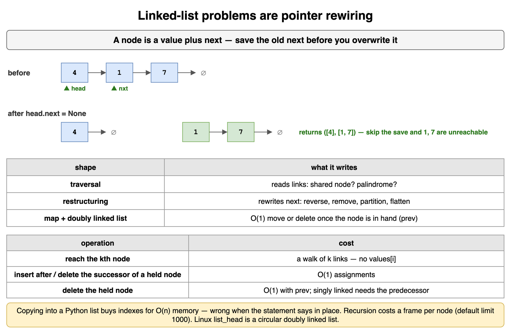
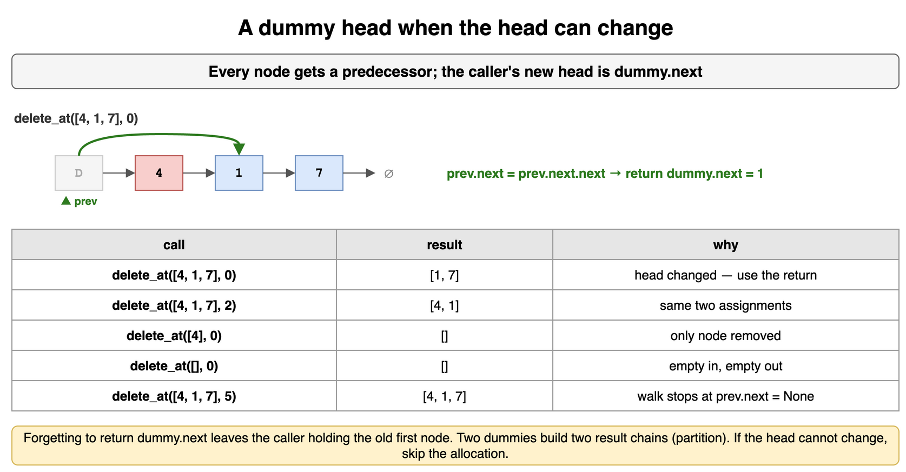
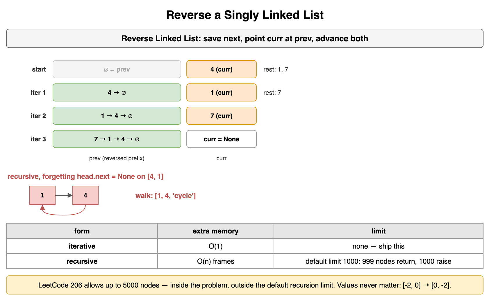
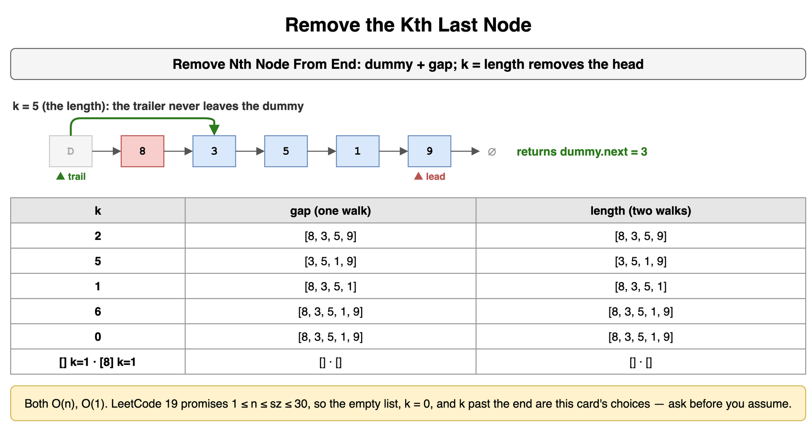
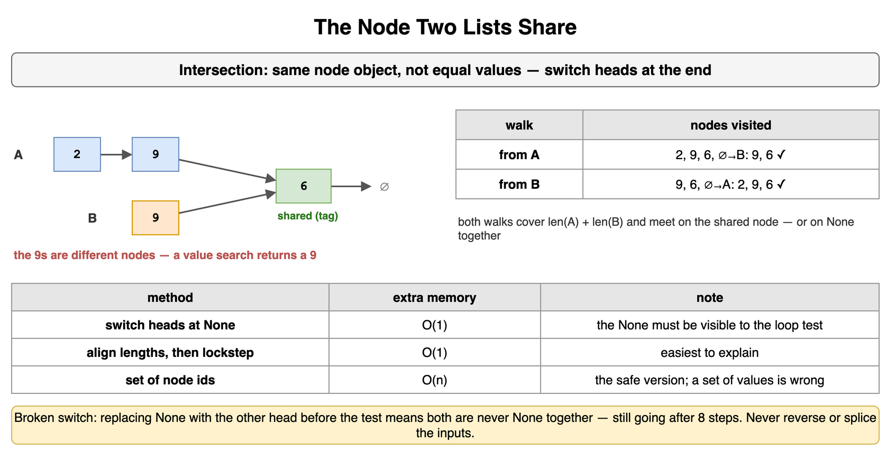
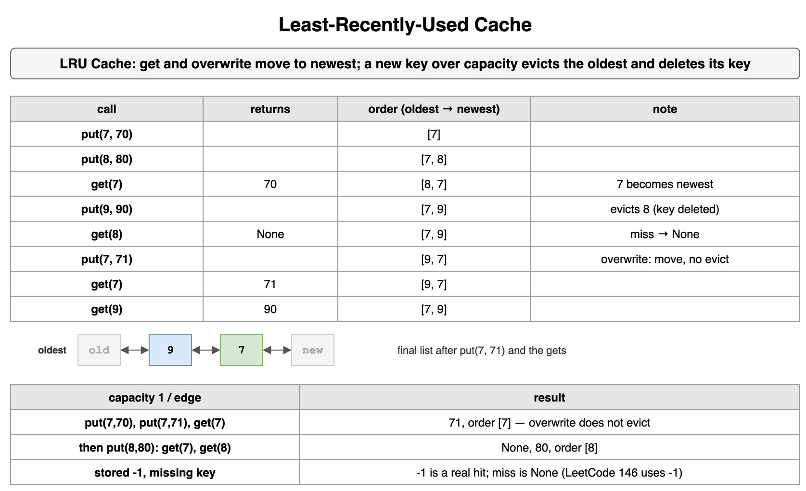
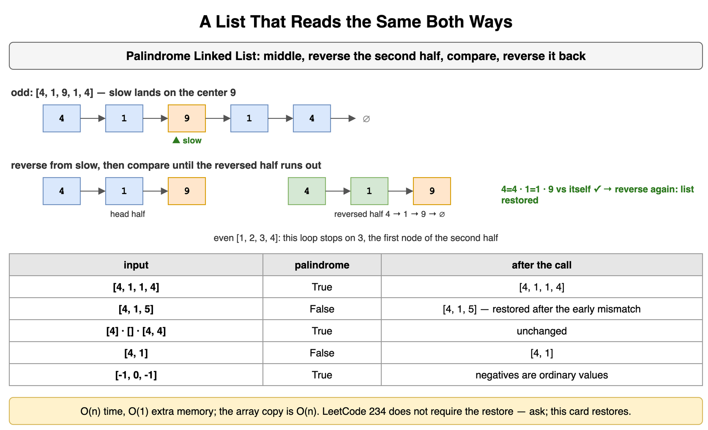
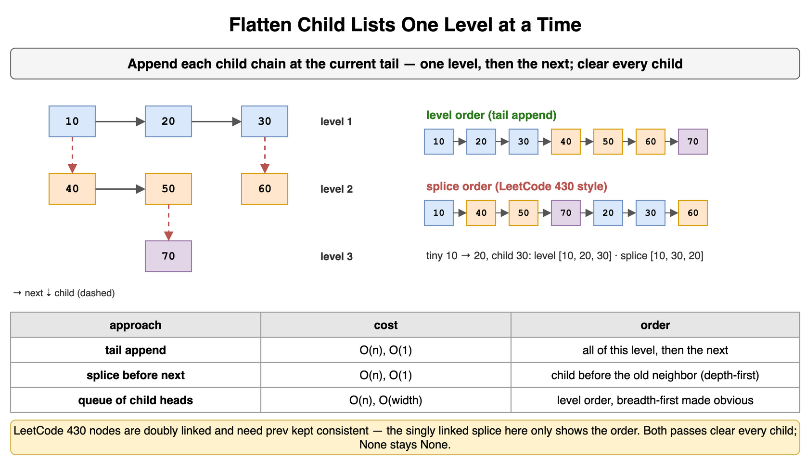
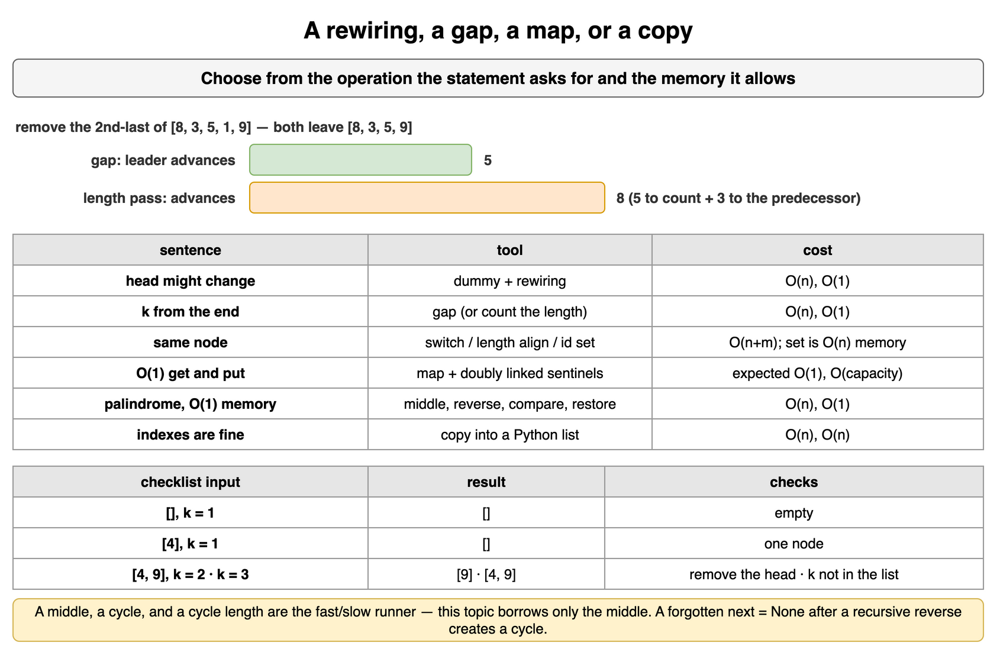

## Pointer rewiring
Overwriting `next` drops every node that pointer was the only path to. Save the successor, then assign. On `4 → 1 → 7` that leaves `[4]` and `[1, 7]`. Skip the save and `1` and `7` are unreachable. A one-node list has no rest to save. An empty list has no node to cut. There is no `values[i]`. The kth node is k links away. [Singly linked list: nodes chained by next pointers](#07_Data_Structures_and_Algorithms/03_Linked_Lists/concepts/singly-linked-list-nodes-chained-by-next-pointers), [Doubly linked list: bidirectional traversal](#07_Data_Structures_and_Algorithms/03_Linked_Lists/concepts/doubly-linked-list-bidirectional-traversal), and [Arrays vs. linked lists: choosing the right structure](#07_Data_Structures_and_Algorithms/03_Linked_Lists/concepts/arrays-vs-linked-lists-choosing-the-right-structure) name the field `data`. These snippets use `val`. `collections.deque` is on [Edge cases and test helpers](#07_Data_Structures_and_Algorithms/03_Linked_Lists/concepts/edge-cases-and-test-helpers).

Linux `list_head` (`include/linux/list.h`) deletes a held entry by rewiring neighbors it already points at. Insert after a held node, or delete its successor, is a few assignments. Deleting the held node needs `prev`. Copy the successor and skip it only when a successor exists, so the tail cannot be deleted that way. A Python list buys indexes at O(n) memory. Recursion spends a frame per node against the default limit of 1000 ([Recursive list processing](#07_Data_Structures_and_Algorithms/03_Linked_Lists/concepts/recursive-list-processing)). The loop is [Iterative in-place reversal](#07_Data_Structures_and_Algorithms/03_Linked_Lists/concepts/iterative-in-place-reversal).

```python
class ListNode:
    def __init__(self, val: int = 0, nxt: "ListNode | None" = None) -> None:
        self.val = val
        self.next = nxt


def to_list(head: ListNode | None) -> list[int]:
    values: list[int] = []
    while head is not None:
        values.append(head.val)
        head = head.next
    return values


head = ListNode(4, ListNode(1, ListNode(7)))
saved = head.next
head.next = None
print(to_list(head), to_list(saved), to_list(ListNode(4)))
# [4] [1, 7] [4]
```



*Source: [`diagrams/linked-lists.drawio`](/content/11_Coding_Problems/11_Linked_Lists/diagrams/linked-lists.drawio), page 1.*

## Dummy head
[Sentinel (dummy) head node](#07_Data_Structures_and_Algorithms/03_Linked_Lists/concepts/sentinel-dummy-head-node) puts one throwaway node in front of the real head, so the first node has a predecessor and the head branch disappears. The caller needs `dummy.next`. It may be a different node, or `None` when the list is empty. Returning the old head, or assigning a local `head`, leaves the caller holding the removed node. Use a dummy when the first node might go, or when a result is built before its first node is known. [Merging two sorted lists](#07_Data_Structures_and_Algorithms/03_Linked_Lists/concepts/merging-two-sorted-lists) uses it that second way. Two dummies, one per side, cover a partition that does not know which side is first. If the head cannot change, skip the allocation.

Deleting at an index, including 0, is that same unlink. A list has no indexes, so the loop walks. Index 0 on `[4, 1, 7]` returns `[1, 7]`. Index 2 returns `[4, 1]`. The only node becomes empty, so the caller must keep the returned reference. An empty list stays empty. An index past the end stops when `prev.next` is missing and leaves the list alone. The dummy's value is not in the result. The walk is O(n). The extra memory is that one node.

```python
class ListNode:
    def __init__(self, val: int = 0, nxt: "ListNode | None" = None) -> None:
        self.val = val
        self.next = nxt


def from_list(values: list[int]) -> ListNode | None:
    head: ListNode | None = None
    for value in reversed(values):
        head = ListNode(value, head)
    return head


def to_list(head: ListNode | None) -> list[int]:
    values: list[int] = []
    while head is not None:
        values.append(head.val)
        head = head.next
    return values


def delete_at(head: ListNode | None, index: int) -> ListNode | None:
    dummy = ListNode(0, head)
    prev = dummy
    for _ in range(index):
        if prev.next is None:
            return dummy.next
        prev = prev.next
    if prev.next is not None:
        prev.next = prev.next.next
    return dummy.next


print(to_list(delete_at(from_list([4, 1, 7]), 0)), to_list(delete_at(from_list([4, 1, 7]), 2)))
print(to_list(delete_at(from_list([4]), 0)), to_list(delete_at(from_list([]), 0)), to_list(delete_at(from_list([4, 1, 7]), 5)))
# [1, 7] [4, 1]
# [] [] [4, 1, 7]
```



*Source: [`diagrams/linked-lists.drawio`](/content/11_Coding_Problems/11_Linked_Lists/diagrams/linked-lists.drawio), page 2.*

## Reverse a linked list
[Iterative in-place reversal](#07_Data_Structures_and_Algorithms/03_Linked_Lists/concepts/iterative-in-place-reversal) uses three references. `prev` starts at `None`. Save `nxt` before overwriting `curr.next`, point `curr` at the reversed prefix, and step both. When `curr` is `None`, `prev` is the new head: the old tail was the last node turned. On `4 → 1 → 7` the first step saves `1`, points `4` at `None`, and leaves `curr` on `1`. Empty and one node come back unchanged. Values are never read, so `-2, 0` becomes `0, -2`. Time is O(n) and extra memory is O(1). A stack or a reversed copy also reverses and spends O(n) memory.

[Recursive list processing](#07_Data_Structures_and_Algorithms/03_Linked_Lists/concepts/recursive-list-processing) reverses the tail, points the old successor back, and sets `next` to `None`. Skip that assignment and the two nodes point at each other. A bounded walk of `4, 1` reports a cycle. Recursion is O(n) time and O(n) frames. CPython's default limit is 1000. From a module this reverse returns on 999 nodes and raises `RecursionError` on 1000. One extra caller returns on 998 and raises on 999, because frames already on the stack count. LeetCode 206 allows an empty list, 0 to 5000 nodes, and values from -5000 to 5000, so 5000 nodes is past that limit.

```python
class ListNode:
    def __init__(self, val: int = 0, nxt: "ListNode | None" = None) -> None:
        self.val = val
        self.next = nxt


def from_list(values: list[int]) -> ListNode | None:
    head: ListNode | None = None
    for value in reversed(values):
        head = ListNode(value, head)
    return head


def to_list(head: ListNode | None) -> list[int]:
    values: list[int] = []
    while head is not None:
        values.append(head.val)
        head = head.next
    return values


def reverse_iter(head: ListNode | None) -> ListNode | None:
    prev: ListNode | None = None
    curr = head
    while curr is not None:
        nxt = curr.next
        curr.next = prev
        prev = curr
        curr = nxt
    return prev


def reverse_rec(head: ListNode | None) -> ListNode | None:
    if head is None or head.next is None:
        return head
    new_head = reverse_rec(head.next)
    head.next.next = head
    head.next = None
    return new_head


def forget_none(head: ListNode | None) -> ListNode | None:
    if head is None or head.next is None:
        return head
    new_head = forget_none(head.next)
    head.next.next = head
    return new_head


def walk_cap(head: ListNode | None, limit: int) -> list[int | str]:
    values: list[int | str] = []
    seen: set[int] = set()
    while head is not None and len(values) < limit:
        ident = id(head)
        if ident in seen:
            values.append("cycle")
            break
        seen.add(ident)
        values.append(head.val)
        head = head.next
    return values


print(to_list(reverse_iter(from_list([4, 1, 7]))), to_list(reverse_iter(from_list([]))), to_list(reverse_iter(from_list([4]))))
print(to_list(reverse_rec(from_list([4, 1, 7]))), to_list(reverse_rec(from_list([-2, 0]))))
print(walk_cap(forget_none(from_list([4, 1])), 6))
# [7, 1, 4] [] [4]
# [7, 1, 4] [0, -2]
# [1, 4, 'cycle']
```



*Source: [`diagrams/linked-lists.drawio`](/content/11_Coding_Problems/11_Linked_Lists/diagrams/linked-lists.drawio), page 5.*

## Remove the kth last node
A fixed gap keeps two references k links apart, one step each. [Runner (two-pointer) technique](#07_Data_Structures_and_Algorithms/03_Linked_Lists/concepts/runner-two-pointer-technique) moves two links per slow step. [Two indexes](#11_Coding_Problems/09_Two_Pointers/concepts/two-indexes) moves indexes. A [Dummy head](#11_Coding_Problems/11_Linked_Lists/concepts/dummy-head) is the predecessor when k equals the length. Advance the leader k steps from the dummy, then both while `lead.next` exists, so the leader stops on the last node and the trailer, k behind, is the predecessor. Stopping when `lead` is `None` parks the trailer on the target: the unlink takes the neighbor, or reads `next` of `None`. `k - 1` or `k + 1` is still linear and removes a neighbor.

Counting the length, then walking `length - k`, finds that predecessor in a second pass. Both are O(n) time and O(1) extra memory. An array of the nodes is O(n). On `[8, 3, 5, 1, 9]`, k = 2, 5, and 1 leave the trailer on `5`, the dummy, and `1`, dropping `1`, the head, and the tail. k below 1 or past the end leaves the list. LeetCode 19 requires `1 <= n <= sz` on a non-empty list of at most 30 nodes. Empty stays empty. One node with k = 1 becomes empty.

```python
class ListNode:
    def __init__(self, val: int = 0, nxt: "ListNode | None" = None) -> None:
        self.val = val
        self.next = nxt


def from_list(values: list[int]) -> ListNode | None:
    head: ListNode | None = None
    for value in reversed(values):
        head = ListNode(value, head)
    return head


def to_list(head: ListNode | None) -> list[int]:
    values: list[int] = []
    while head is not None:
        values.append(head.val)
        head = head.next
    return values


def remove_gap(head: ListNode | None, k: int) -> ListNode | None:
    if k < 1:
        return head
    dummy = ListNode(0, head)
    lead: ListNode | None = dummy
    for _ in range(k):
        if lead is None or lead.next is None:
            return head
        lead = lead.next
    trail = dummy
    while lead.next is not None:
        lead = lead.next
        trail = trail.next
    trail.next = trail.next.next
    return dummy.next


def remove_two_pass(head: ListNode | None, k: int) -> ListNode | None:
    length = 0
    curr = head
    while curr is not None:
        length += 1
        curr = curr.next
    if k < 1 or k > length:
        return head
    dummy = ListNode(0, head)
    prev = dummy
    for _ in range(length - k):
        prev = prev.next
    prev.next = prev.next.next
    return dummy.next


def show(values: list[int], k: int) -> tuple[list[int], list[int]]:
    return to_list(remove_gap(from_list(values), k)), to_list(remove_two_pass(from_list(values), k))


print(show([8, 3, 5, 1, 9], 2), show([8, 3, 5, 1, 9], 5), show([8, 3, 5, 1, 9], 1))
print(show([8, 3, 5, 1, 9], 6), show([8, 3, 5, 1, 9], 0), show([], 1), show([8], 1))
# ([8, 3, 5, 9], [8, 3, 5, 9]) ([3, 5, 1, 9], [3, 5, 1, 9]) ([8, 3, 5, 1], [8, 3, 5, 1])
# ([8, 3, 5, 1, 9], [8, 3, 5, 1, 9]) ([8, 3, 5, 1, 9], [8, 3, 5, 1, 9]) ([], []) ([], [])
```



*Source: [`diagrams/linked-lists.drawio`](/content/11_Coding_Problems/11_Linked_Lists/diagrams/linked-lists.drawio), page 6.*

## Intersection of two lists
Sharing is one node object, not equal values. Each pointer walks its list, then the other. Both routes have length n + m, so they meet on the shared node or on `None`. The step is one expression, the next node or the other head, so `None` is visible. Replacing `None` before the test hides that pair and the loop does not end. A length difference, then lockstep, meets there in constant memory. A set of identities does too, in linear memory, or O(n * m) time in one bucket. A set of values is a different question.

On `2 → 9 → 6` and `9 → 6` the `9`s are different nodes. A value search returns a `9`. The junction is the shared `6`. Heads already on that node meet at once, and a longer prefix still meets there. Empty with empty, or a list with empty, is `None`. The switch and the alignment are O(n + m) time and O(1) memory. Do not reverse or splice the lists. A cycle does not end the switch ([Cycle detection with Floyd's algorithm](#07_Data_Structures_and_Algorithms/03_Linked_Lists/concepts/cycle-detection-with-floyd-s-algorithm)). LeetCode 160 allows 30,000 nodes, repeating values from 1 to 100,000, no cycles, and the original links. `intersectVal` 0 means none shared. An empty head is allowed here.

```python
class ListNode:
    def __init__(self, val: int = 0, nxt: "ListNode | None" = None, tag: str = "") -> None:
        self.val = val
        self.next = nxt
        self.tag = tag


def tag_of(node: ListNode | None) -> str | None:
    return None if node is None else node.tag


def intersection(a: ListNode | None, b: ListNode | None) -> ListNode | None:
    first, second = a, b
    while first is not second:
        first = first.next if first is not None else b
        second = second.next if second is not None else a
    return first


def by_length(a: ListNode | None, b: ListNode | None) -> ListNode | None:
    def length(head: ListNode | None) -> int:
        count = 0
        while head is not None:
            count += 1
            head = head.next
        return count

    len_a, len_b = length(a), length(b)
    if len_a < len_b:
        a, b = b, a
        len_a, len_b = len_b, len_a
    for _ in range(len_a - len_b):
        a = a.next
    while a is not b:
        a = a.next
        b = b.next
    return a


def by_ids(a: ListNode | None, b: ListNode | None) -> ListNode | None:
    seen: set[int] = set()
    while a is not None:
        seen.add(id(a))
        a = a.next
    while b is not None:
        if id(b) in seen:
            return b
        b = b.next
    return None


def first_shared_value(a: ListNode | None, b: ListNode | None) -> str | None:
    seen: set[int] = set()
    while a is not None:
        seen.add(a.val)
        a = a.next
    while b is not None:
        if b.val in seen:
            return b.tag
        b = b.next
    return None


def broken_switch(a: ListNode | None, b: ListNode | None, limit: int) -> str:
    first, second = a, b
    steps = 0
    while first is not second:
        if steps >= limit:
            return f"still going after {limit}"
        first = first.next if first is not None else None
        second = second.next if second is not None else None
        if first is None:
            first = b
        if second is None:
            second = a
        steps += 1
    return "met"


def chain(*nodes: ListNode) -> ListNode:
    for earlier, later in zip(nodes, nodes[1:]):
        earlier.next = later
    return nodes[0]


separate_a = chain(ListNode(4, tag="a4"), ListNode(1, tag="a1"))
separate_b = chain(ListNode(4, tag="b4"), ListNode(1, tag="b1"))
shared = ListNode(6, tag="shared")
joined_a = chain(ListNode(2, tag="a2"), ListNode(9, tag="a9"), shared)
joined_b = chain(ListNode(9, tag="b9"), shared)
head_join = ListNode(6, tag="head-join")
prefix = chain(ListNode(2, tag="pre"), head_join)
print(tag_of(intersection(separate_a, separate_b)), tag_of(by_length(separate_a, separate_b)), tag_of(by_ids(separate_a, separate_b)))
print(
    tag_of(intersection(joined_a, joined_b)),
    tag_of(by_length(joined_a, joined_b)),
    tag_of(by_ids(joined_a, joined_b)),
    first_shared_value(joined_a, joined_b),
)
print(tag_of(intersection(head_join, head_join)), tag_of(intersection(prefix, head_join)), tag_of(by_ids(prefix, head_join)))
print(tag_of(intersection(None, None)), tag_of(intersection(joined_a, None)))
print(broken_switch(separate_a, separate_b, 8))
# None None None
# shared shared shared b9
# head-join head-join head-join
# None None
# still going after 8
```



*Source: [`diagrams/linked-lists.drawio`](/content/11_Coding_Problems/11_Linked_Lists/diagrams/linked-lists.drawio), page 7.*

## Least recently used cache
`get` returns the value or `None`. `put` inserts or overwrites and counts as a use. A new key past capacity drops the least recently used key. The map finds the node ([Lookup by a key](#11_Coding_Problems/10_Hash_Maps_and_Sets/concepts/lookup-by-a-key)). Sentinels order it ([Doubly linked list with sentinels: O(1) unlink](#07_Data_Structures_and_Algorithms/03_Linked_Lists/concepts/doubly-linked-list-with-sentinels-o-1-unlink)): both directions, for the oldest node or the middle. Writing only `next` or only `prev` leaves those directions in disagreement. A singly linked predecessor is a walk. `order` is oldest to newest. It appends before the newest sentinel. Either end can be recent. [Eviction Policies](#09_System_Design_Interview/05_Caching/concepts/eviction-policies) is not a TTL. FIFO ignores a later get.

An overwrite moves and does not evict. Over capacity, unlink the oldest and delete its key together. A leftover key stays a hit. While its old neighbors stay joined, re-unlinking does nothing and the append grows the cache. After they move, that unlink cuts a live edge. `LinkedHashMap.removeEldestEntry` runs on insert, not on overwrite, and `get` counts. `OrderedDict.move_to_end` with `popitem(last=False)`, and `d[key] = d.pop(key)` with `next(iter(d))`, are that order. A dict reorders less cheaply. CPython 3.13 `lru_cache` stores `prev` and `next`. Expected O(1), collision O(capacity), memory O(capacity). LeetCode 146 returns `-1` because values are at least 0. Here a miss is `None`, so `-1` is a hit. Capacity is at least 1.

```python
class DNode:
    def __init__(self, key: int = 0, val: int = 0) -> None:
        self.key = key
        self.val = val
        self.prev: "DNode | None" = None
        self.next: "DNode | None" = None


class LRUCache:
    def __init__(self, capacity: int) -> None:
        self.capacity = capacity
        self.nodes: dict[int, DNode] = {}
        self.oldest = DNode()
        self.newest = DNode()
        self.oldest.next = self.newest
        self.newest.prev = self.oldest

    def _unlink(self, node: DNode) -> None:
        node.prev.next = node.next
        node.next.prev = node.prev

    def _append_newest(self, node: DNode) -> None:
        last = self.newest.prev
        last.next = node
        node.prev = last
        node.next = self.newest
        self.newest.prev = node

    def order(self) -> list[int]:
        keys: list[int] = []
        current = self.oldest.next
        while current is not self.newest:
            keys.append(current.key)
            current = current.next
        return keys

    def get(self, key: int) -> int | None:
        node = self.nodes.get(key)
        if node is None:
            return None
        self._unlink(node)
        self._append_newest(node)
        return node.val

    def put(self, key: int, value: int) -> None:
        node = self.nodes.get(key)
        if node is not None:
            node.val = value
            self._unlink(node)
            self._append_newest(node)
            return
        node = DNode(key, value)
        self.nodes[key] = node
        self._append_newest(node)
        if len(self.nodes) > self.capacity:
            stale = self.oldest.next
            self._unlink(stale)
            del self.nodes[stale.key]


cache = LRUCache(2)
cache.put(7, 70)
cache.put(8, 80)
print(cache.get(7), cache.order())
cache.put(9, 90)
print(cache.get(8), cache.order())
cache.put(7, 71)
print(cache.order(), cache.get(7), cache.get(9))
small = LRUCache(1)
small.put(7, 70)
small.put(7, 71)
small.put(8, 80)
print(small.get(7), small.get(8), small.order())
negative = LRUCache(1)
negative.put(4, -1)
print(negative.get(4), negative.get(99), LRUCache(2).get(7))
# 70 [8, 7]
# None [7, 9]
# [9, 7] 71 90
# None 80 [8]
# -1 None None
```



*Source: [`diagrams/linked-lists.drawio`](/content/11_Coding_Problems/11_Linked_Lists/diagrams/linked-lists.drawio), page 8.*

## Palindrome linked list
An array compared with its reverse is O(n) time and O(n) memory. Constant memory finds the middle, reverses the second half, compares, and reverses that half back. Version A steps one and two while the fast node has two steps ([Runner (two-pointer) technique](#07_Data_Structures_and_Algorithms/03_Linked_Lists/concepts/runner-two-pointer-technique), [Which middle the loop stops on](#11_Coding_Problems/12_Fast_and_Slow_Pointers/concepts/which-middle-the-loop-stops-on)). An even length lands on the second middle, the start of the second half: on `1 → 2 → 3 → 4`, node `3`. Version B stops on `2`. An odd length lands both on the center, which then ends the reversed half and matches itself. [Split, reverse, and weave](#07_Data_Structures_and_Algorithms/03_Linked_Lists/concepts/split-reverse-and-weave) cuts at version B. The cut is optional here. Reversing from version B's node, rather than `slow.next`, takes one node too many. The loop is [Reverse a linked list](#11_Coding_Problems/11_Linked_Lists/concepts/reverse-a-linked-list).

Odd and even palindromes match, and a mismatch still restores the order. One node, empty, and two equals pass. Two different values fail. Negatives compare as values, so `-1, 0, -1` passes. Time is O(n) and extra memory is O(1). A recursive compare spends O(n) stack and hits the limit. LeetCode 234 allows 1 to 100,000 nodes, digits 0 through 9, and does not require a restore. This card restores, accepts empty, and accepts any integer. Skipping the restore leaves a reversed tail.

```python
class ListNode:
    def __init__(self, val: int = 0, nxt: "ListNode | None" = None) -> None:
        self.val = val
        self.next = nxt


def from_list(values: list[int]) -> ListNode | None:
    head: ListNode | None = None
    for value in reversed(values):
        head = ListNode(value, head)
    return head


def to_list(head: ListNode | None) -> list[int]:
    values: list[int] = []
    while head is not None:
        values.append(head.val)
        head = head.next
    return values


def reverse_from(head: ListNode | None) -> ListNode | None:
    prev: ListNode | None = None
    curr = head
    while curr is not None:
        nxt = curr.next
        curr.next = prev
        prev = curr
        curr = nxt
    return prev


def is_palindrome(head: ListNode | None) -> bool:
    slow = fast = head
    while fast is not None and fast.next is not None:
        slow = slow.next
        fast = fast.next.next
    reversed_half = reverse_from(slow)
    left, right = head, reversed_half
    same = True
    while right is not None:
        if left is None or left.val != right.val:
            same = False
            break
        left = left.next
        right = right.next
    reverse_from(reversed_half)
    return same


def check(values: list[int]) -> tuple[list[int], bool, list[int]]:
    head = from_list(values)
    return values, is_palindrome(head), to_list(head)


print(check([4, 1, 9, 1, 4]), check([4, 1, 1, 4]), check([4, 1, 5]))
print(check([4]), check([]), check([4, 4]), check([4, 1]), check([-1, 0, -1]))
# ([4, 1, 9, 1, 4], True, [4, 1, 9, 1, 4]) ([4, 1, 1, 4], True, [4, 1, 1, 4]) ([4, 1, 5], False, [4, 1, 5])
# ([4], True, [4]) ([], True, []) ([4, 4], True, [4, 4]) ([4, 1], False, [4, 1]) ([-1, 0, -1], True, [-1, 0, -1])
```



*Source: [`diagrams/linked-lists.drawio`](/content/11_Coding_Problems/11_Linked_Lists/diagrams/linked-lists.drawio), page 9.*

## Flatten child lists
A node has `next` and `child`. A child heads another list. Level order emits one level, then the next, and clears `child`. Append the child's `next` chain at the tail, walk the tail to the new end, and clear `child`. A `next` sibling is the same level. A grandchild stays on `child` until the scan reaches it. One visit per node, and the tail only advances: O(n) time, O(1) memory. A queue of the child heads is the same order at O(width). Leaving `child` set keeps a second path.

LeetCode 430 splices the child before the old `next`, so a grandchild precedes the neighbor. The nodes are doubly linked. `child` is cleared and `prev` matches `next`. At most 1000 nodes, values 1 to 100,000. `10 → 20` with child `30` is `10, 20, 30` by level and `10, 30, 20` by the splice. On the deep shape, `50` is `next` of `40`, `60` is the child of `30`, and `70` is the child of `50`: level order is `10, 20, 30`, then `40, 50, 60`, then `70`. The splice emits `70` before `20`, still inside `50`. Empty stays empty. This splice writes no `prev`. A level join sets only the child head's `prev`, to the old tail.

```python
class ChildNode:
    def __init__(self, val: int, nxt: "ChildNode | None" = None, child: "ChildNode | None" = None) -> None:
        self.val = val
        self.next = nxt
        self.child = child


def to_list(head: ChildNode | None) -> list[int]:
    values: list[int] = []
    while head is not None:
        values.append(head.val)
        head = head.next
    return values


def children_cleared(head: ChildNode | None) -> bool:
    while head is not None:
        if head.child is not None:
            return False
        head = head.next
    return True


def flatten_level(head: ChildNode | None) -> ChildNode | None:
    if head is None:
        return None
    tail = head
    while tail.next is not None:
        tail = tail.next
    curr: ChildNode | None = head
    while curr is not None:
        if curr.child is not None:
            tail.next = curr.child
            while tail.next is not None:
                tail = tail.next
            curr.child = None
        curr = curr.next
    return head


def flatten_between(head: ChildNode | None) -> ChildNode | None:
    curr = head
    while curr is not None:
        if curr.child is not None:
            nxt = curr.next
            child = curr.child
            curr.child = None
            curr.next = child
            tail = child
            while tail.next is not None:
                tail = tail.next
            tail.next = nxt
        curr = curr.next
    return head


def deep() -> ChildNode:
    n10, n20, n30 = ChildNode(10), ChildNode(20), ChildNode(30)
    n40, n50, n60, n70 = ChildNode(40), ChildNode(50), ChildNode(60), ChildNode(70)
    n10.next, n20.next = n20, n30
    n40.next = n50
    n10.child, n50.child, n30.child = n40, n70, n60
    return n10


level, spliced = flatten_level(deep()), flatten_between(deep())
tiny_level = ChildNode(10, ChildNode(20), ChildNode(30))
tiny_splice = ChildNode(10, ChildNode(20), ChildNode(30))
print(to_list(level), children_cleared(level))
print(to_list(spliced), children_cleared(spliced))
print(to_list(flatten_level(tiny_level)), to_list(flatten_between(tiny_splice)))
print(flatten_level(None), flatten_between(None))
# [10, 20, 30, 40, 50, 60, 70] True
# [10, 40, 50, 70, 20, 30, 60] True
# [10, 20, 30] [10, 30, 20]
# None None
```



*Source: [`diagrams/linked-lists.drawio`](/content/11_Coding_Problems/11_Linked_Lists/diagrams/linked-lists.drawio), page 10.*

## Rewire, copy, gap, or map
Recounting from the head for every index is quadratic ([Optimize brute force in steps](#11_Coding_Problems/07_Hard_Problems/concepts/optimize-brute-force-in-steps)). A Python list buys indexes at O(n) memory. A dummy stays when the head can change ([Dummy head](#11_Coding_Problems/11_Linked_Lists/concepts/dummy-head)). A fixed gap is one pass for k from the end, and a length count is the second ([Remove the kth last node](#11_Coding_Problems/11_Linked_Lists/concepts/remove-the-kth-last-node)). On `[8, 3, 5, 1, 9]` and k = 2 the block counts 5 leader steps against 8 on the length pass, five to count and three to the predecessor. The trailer also steps on those last three. Both leave `[8, 3, 5, 9]`. That difference is not a new complexity class. The fast/slow middle is the wrong distance ([Runner (two-pointer) technique](#07_Data_Structures_and_Algorithms/03_Linked_Lists/concepts/runner-two-pointer-technique)).

A shared node is the switch, the length alignment, or identities ([Intersection of two lists](#11_Coding_Problems/11_Linked_Lists/concepts/intersection-of-two-lists)), not values. Expected O(1) get and put is the map plus sentinels ([Least recently used cache](#11_Coding_Problems/11_Linked_Lists/concepts/least-recently-used-cache)). Middles and cycles are [Fast and slow pointers](#11_Coding_Problems/12_Fast_and_Slow_Pointers/concepts/fast-and-slow-pointers) and [Cycle detection with Floyd's algorithm](#07_Data_Structures_and_Algorithms/03_Linked_Lists/concepts/cycle-detection-with-floyd-s-algorithm). This topic borrows the middle and does not find cycles. Sorted lists merge on [Merging two sorted lists](#07_Data_Structures_and_Algorithms/03_Linked_Lists/concepts/merging-two-sorted-lists). [Edge cases and test helpers](#07_Data_Structures_and_Algorithms/03_Linked_Lists/concepts/edge-cases-and-test-helpers) names empty, one node, two nodes, and the ends. k equal to the length removes the head. A recursive reverse that leaves `next` set cycles.

```python
class ListNode:
    def __init__(self, val: int = 0, nxt: "ListNode | None" = None) -> None:
        self.val = val
        self.next = nxt


def from_list(values: list[int]) -> ListNode | None:
    head: ListNode | None = None
    for value in reversed(values):
        head = ListNode(value, head)
    return head


def to_list(head: ListNode | None) -> list[int]:
    values: list[int] = []
    while head is not None:
        values.append(head.val)
        head = head.next
    return values


def count_gap(values: list[int], k: int) -> tuple[int, list[int]]:
    dummy = ListNode(0, from_list(values))
    moves = 0
    lead = dummy
    for _ in range(k):
        lead = lead.next
        moves += 1
    trail = dummy
    while lead.next is not None:
        lead = lead.next
        trail = trail.next
        moves += 1
    trail.next = trail.next.next
    return moves, to_list(dummy.next)


def count_two_pass(values: list[int], k: int) -> tuple[int, list[int]]:
    head = from_list(values)
    moves = 0
    length = 0
    curr = head
    while curr is not None:
        length += 1
        curr = curr.next
        moves += 1
    dummy = ListNode(0, head)
    prev = dummy
    for _ in range(length - k):
        prev = prev.next
        moves += 1
    prev.next = prev.next.next
    return moves, to_list(dummy.next)


def remove_kth(values: list[int], k: int) -> list[int]:
    if k < 1:
        return values
    dummy = ListNode(0, from_list(values))
    lead = dummy
    for _ in range(k):
        if lead.next is None:
            return values
        lead = lead.next
    trail = dummy
    while lead.next is not None:
        lead = lead.next
        trail = trail.next
    trail.next = trail.next.next
    return to_list(dummy.next)


print(count_gap([8, 3, 5, 1, 9], 2))
print(count_two_pass([8, 3, 5, 1, 9], 2))
print(remove_kth([], 1), remove_kth([4], 1), remove_kth([4, 9], 2), remove_kth([4, 9], 3))
# (5, [8, 3, 5, 9])
# (8, [8, 3, 5, 9])
# [] [] [9] [4, 9]
```



*Source: [`diagrams/linked-lists.drawio`](/content/11_Coding_Problems/11_Linked_Lists/diagrams/linked-lists.drawio), page 11.*
