## Linked-list problems are pointer rewiring

A linked-list problem hands you a node and asks you to change, or follow, the links. A node is a value plus a `next` reference. Some nodes also carry `prev` or `child`. There is no index.

If the sidebar shows two topics named Linked Lists, this one is under Coding Problems. The node, the sentinel, insertion, deletion, and the reversal loop are already written under Data Structures and Algorithms. Start with [Singly linked list: nodes chained by next pointers](../../07_Data_Structures_and_Algorithms/03_Linked_Lists/), [Doubly linked list: bidirectional traversal](../../07_Data_Structures_and_Algorithms/03_Linked_Lists/), and [Arrays vs. linked lists: choosing the right structure](../../07_Data_Structures_and_Algorithms/03_Linked_Lists/). Those cards use a field named `data`. The snippets in this topic use `val`, which is the field name on the usual interview node. The [Edge cases and test helpers](../../07_Data_Structures_and_Algorithms/03_Linked_Lists/) card is where `collections.deque` belongs: a doubly linked block list for production code that only needs the two ends.

The Linux kernel's `list_head`, in `include/linux/list.h`, is a circular doubly linked list. Deleting an entry rewires the neighbors that entry already points at. The kernel does not scan the list to find an entry it is already holding. That is the doubly linked shape. Reaching the kth node is still a walk of k links. Inserting after a node you already hold, or deleting its successor, is a constant number of assignments. Deleting the node itself is a constant number of assignments when that node has `prev`. On a singly linked list the predecessor has to be in hand, unless you copy the successor into the node and skip the successor, and that copy has no successor to read on the tail. The list grows by allocating a node, so the length is not fixed in advance, and nothing gives you `values[i]` in constant time.

The statement tells you which shape it is. A traversal only reads links: "do these lists share a node," "is this a palindrome." A restructuring writes `next`: reverse, remove, partition, flatten. A doubly linked list shows up when the statement also says the operation is O(1) after you have found the node, which is the cache card below. Draw the links before the change and after it. The assignment that overwrites `next` has to happen after you have stored the old `next`, or the rest of the chain is unreachable. The [Pointer order: what gets lost?](../../07_Data_Structures_and_Algorithms/03_Linked_Lists/) drill is that loss on a longer trace. The numbers below are exercise numbers.

```python
class ListNode:
    def __init__(self, val: int = 0, nxt: "ListNode | None" = None) -> None:
        self.val = val
        self.next = nxt


def from_list(values: list[int]) -> ListNode | None:
    head: ListNode | None = None
    for value in reversed(values):
        head = ListNode(value, head)
    return head


def to_list(head: ListNode | None) -> list[int]:
    values: list[int] = []
    while head is not None:
        values.append(head.val)
        head = head.next
    return values


def save_then_cut(head: ListNode) -> tuple[list[int], list[int]]:
    nxt = head.next
    head.next = None
    return to_list(head), to_list(nxt)


print(save_then_cut(from_list([4, 1, 7])))
# ([4], [1, 7])
```

`4` still exists because the function kept `head`. `1` and `7` still exist because `nxt` was saved before `head.next` was cleared. Skip that save and those two nodes are unreachable from anything the function returns. A one-node list has no rest to save: `next` is already `None`. An empty list has no node to cut. Each block that builds a list repeats `from_list` and `to_list`.

**Trade-offs.** Rewiring uses a constant amount of extra memory and one walk, once you hold the nodes you need to touch. Copying the values into a Python list buys real indexes and spends memory proportional to the length. That copy is the honest first answer when the statement allows it. It is the wrong answer when the statement says in place, or O(1) extra memory. A recursive walk reads cleanly and spends a call frame per node. CPython's default recursion limit is 1000, so a long list can raise `RecursionError` before the algorithm is wrong. The [Recursion depth on a long list](../../07_Data_Structures_and_Algorithms/03_Linked_Lists/) drill measures that limit.

**Interview.** Say "node reference" before you say "pointer," and say which field you are writing. Name the shape: read the links, rewire `next`, or combine a map with a doubly linked list. Sketch two iterations of the assignments before you type the loop. Ask whether the caller still needs the original order, because several of these algorithms reverse a half or splice a child and only restore the links if you ask them to.

**Recap.** The work is following or rewriting links, and a link you overwrite without saving is gone. Random access is a walk. Inserting after a node you hold is a few assignments, and deleting that node is a few assignments when it has `prev`. Copying into a list buys indexes and spends linear memory. The mechanics of the node itself stay on the Data Structures cards linked above.

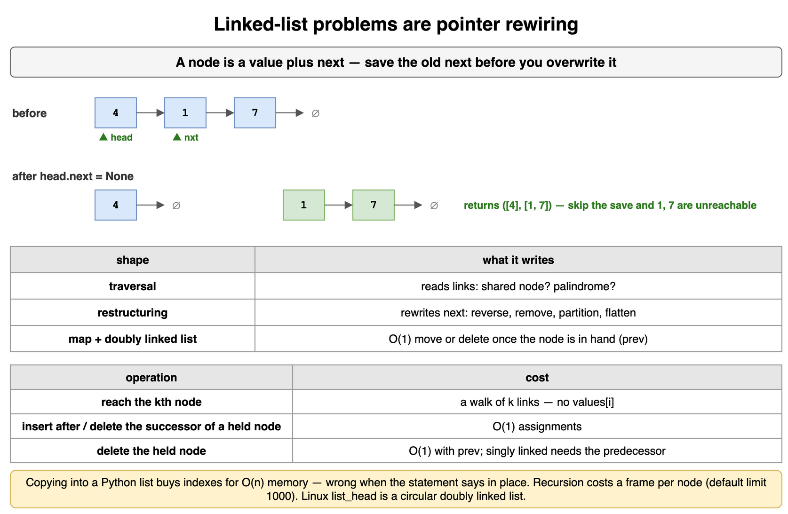

*Source: [`diagrams/linked-lists.drawio`](/content/11_Coding_Problems/11_Linked_Lists/diagrams/linked-lists.drawio), page 1.*

## A dummy head when the head can change

A dummy head is an extra node placed in front of the real first node, so the head is no longer a special case.

Any unlink is "the predecessor's `next` skips this node." The first node has no predecessor unless you invent one. The dummy is that predecessor. When the function returns, the real head is `dummy.next`, which may be a different node from the head the caller passed in, or `None` when the list is now empty. The [Sentinel (dummy) head node](../../07_Data_Structures_and_Algorithms/03_Linked_Lists/) card is the same idea, and the [Head deletion: why didn't it change?](../../07_Data_Structures_and_Algorithms/03_Linked_Lists/) drill is what happens when you update a local variable and the caller still holds the old head. Reach for a dummy when the first node might be removed, or when you are building a result one node at a time and you do not yet know which node will be first. The [Merging two sorted lists](../../07_Data_Structures_and_Algorithms/03_Linked_Lists/) card uses it that second way.

The loop below deletes the node at a given index, including index 0. The index is an exercise position. A real list has no indexes, so the loop walks.

```python
class ListNode:
    def __init__(self, val: int = 0, nxt: "ListNode | None" = None) -> None:
        self.val = val
        self.next = nxt


def from_list(values: list[int]) -> ListNode | None:
    head: ListNode | None = None
    for value in reversed(values):
        head = ListNode(value, head)
    return head


def to_list(head: ListNode | None) -> list[int]:
    values: list[int] = []
    while head is not None:
        values.append(head.val)
        head = head.next
    return values


def delete_at(head: ListNode | None, index: int) -> ListNode | None:
    dummy = ListNode(0, head)
    prev = dummy
    for _ in range(index):
        if prev.next is None:
            return dummy.next
        prev = prev.next
    if prev.next is not None:
        prev.next = prev.next.next
    return dummy.next


print(to_list(delete_at(from_list([4, 1, 7]), 0)), to_list(delete_at(from_list([4, 1, 7]), 2)))
print(to_list(delete_at(from_list([4]), 0)), to_list(delete_at(from_list([]), 0)), to_list(delete_at(from_list([4, 1, 7]), 5)))
# [1, 7] [4, 1]
# [] [] [4, 1, 7]
```

Index 0 removes `4` and the returned head is `1`. Index 2 removes `7` through the same two assignments. A one-node list becomes empty, so the caller has to use the returned reference. An empty list stays empty. An index past the end leaves the list alone, because the walk stops when `prev.next` is missing. The dummy's value is never part of the result.

**Trade-offs.** One extra node, allocated on the heap and thrown away, removes the branch that used to handle the head. Returning `dummy.next` is mandatory. Forgetting the return and mutating a local `head` leaves the caller with the old first node, which is the head-deletion drill. Two dummies, one per result chain, are the same trick when you are partitioning into two lists and you do not know which side receives the first node. That shows up in a drill on this topic.

**Interview.** Say "the head might change, so I want every node to have a predecessor." Write the return of `dummy.next` before the loop. Give the empty list, the one-node list, and a removal of the first node as the three inputs that justify the dummy. If the head cannot change, say so and skip the allocation.

**Recap.** A dummy node stands in front of the list so unlinking the first node is the same assignment as unlinking any other node. The value the caller needs is `dummy.next`. Empty in, empty out, and a removal of the only node, both fall out of that return.

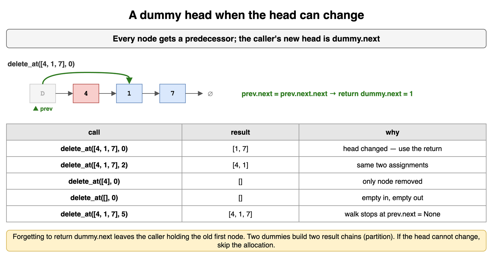

*Source: [`diagrams/linked-lists.drawio`](/content/11_Coding_Problems/11_Linked_Lists/diagrams/linked-lists.drawio), page 2.*

## A fixed gap between two node pointers

A fixed gap is two node references that stay k links apart, so when the leader reaches the end the trailer is standing on the node the question asked for.

This is the tool when the statement says "kth from the end," or "remove the nth last," and you want one walk. Count the phrase carefully. The leader starts on the dummy, k steps in front of the trailer. When the leader is on the last real node, the trailer is k nodes behind it, which is the predecessor of the node to remove. Stopping when the leader becomes `None`, one step later, parks the trailer on the target itself and the unlink deletes the wrong node, or reads `next` of `None`. The [Runner (two-pointer) technique](../../07_Data_Structures_and_Algorithms/03_Linked_Lists/) card is a different rule: the fast reference moves two links for every one the slow reference moves, which is how you find a middle. A fixed gap does not change speed. The [Two pointers: what a second index buys](../09_Two_Pointers/) card moves indexes in an array. The references here are nodes.

The other legal version counts the length, then walks `length - k` steps to the same predecessor. That is two walks and the same answer. It is easier to check, and it is the version to write if the interviewer has not asked for one pass. The positions below are on the exercise list `8, 3, 5, 1, 9`.

```python
class ListNode:
    def __init__(self, val: int = 0, nxt: "ListNode | None" = None) -> None:
        self.val = val
        self.next = nxt


def from_list(values: list[int]) -> ListNode | None:
    head: ListNode | None = None
    for value in reversed(values):
        head = ListNode(value, head)
    return head


def predecessor(head: ListNode | None, k: int, passes: int) -> tuple[str | int, int] | None:
    if k < 1:
        return None
    if passes == 1:
        dummy = ListNode(0, head)
        lead: ListNode | None = dummy
        for _ in range(k):
            if lead is None or lead.next is None:
                return None
            lead = lead.next
        trail = dummy
        while lead.next is not None:
            lead = lead.next
            trail = trail.next
        nxt = trail.next
        if nxt is None:
            return None
        return ("dummy" if trail is dummy else trail.val, nxt.val)
    length = 0
    curr = head
    while curr is not None:
        length += 1
        curr = curr.next
    if k > length:
        return None
    dummy = ListNode(0, head)
    trail = dummy
    for _ in range(length - k):
        trail = trail.next
    nxt = trail.next
    if nxt is None:
        return None
    return ("dummy" if trail is dummy else trail.val, nxt.val)


print(predecessor(from_list([8, 3, 5, 1, 9]), 2, 1), predecessor(from_list([8, 3, 5, 1, 9]), 2, 2))
print(predecessor(from_list([8, 3, 5, 1, 9]), 5, 1), predecessor(from_list([8, 3, 5, 1, 9]), 1, 1))
print(predecessor(from_list([8, 3, 5, 1, 9]), 6, 1), predecessor(from_list([]), 1, 1), predecessor(from_list([8]), 1, 1))
# (5, 1) (5, 1)
# ('dummy', 8) (1, 9)
# None None ('dummy', 8)
```

For k = 2 the predecessor is `5` and the target is `1`, from either the gap or the length. For k = 5 the predecessor is the dummy and the target is the head, which is why the dummy exists. For k = 1 the predecessor is `1` and the target is the tail. k = 6 is longer than the list, and an empty list has no node to remove, so both return `None`. On a one-node list, k = 1 names the dummy and that only node.

**Trade-offs.** The gap is one walk, O(n) time and O(1) extra memory. The length pass is two walks, with the same bounds, and the subtraction `length - k` makes the off-by-one obvious. Copying into a list and deleting at index `len(values) - k` is O(n) time and O(n) extra memory, and it is the version to mention before either walk. Advancing the leader `k - 1` or `k + 1` steps from the dummy, instead of `k`, still runs in linear time and removes a neighbor of the node you wanted.

**Interview.** Repeat k back, and ask whether k is guaranteed to fall inside the list. Say which condition ends the joint walk: the leader is on the last node, so you test `lead.next`, not `lead`. Name the dummy as the predecessor of the head. The drill on this topic runs the loop that stops one node late.

**Recap.** Keep two references k nodes apart. When the leader sits on the last node, the trailer sits on the predecessor of the kth-last node. Counting the length and walking `length - k` lands on that same predecessor in a second walk. k equal to the length means the predecessor is the dummy.

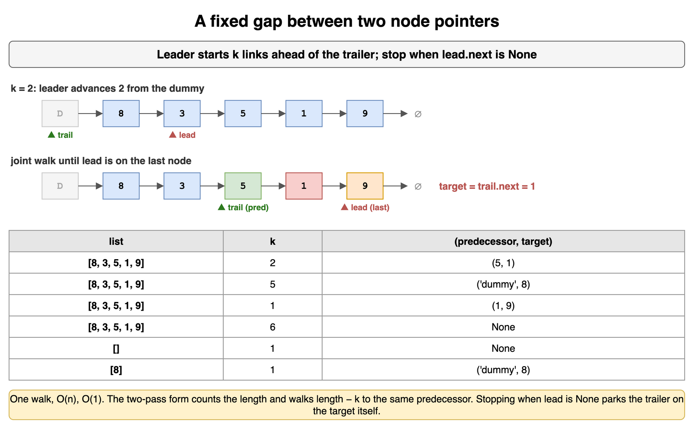

*Source: [`diagrams/linked-lists.drawio`](/content/11_Coding_Problems/11_Linked_Lists/diagrams/linked-lists.drawio), page 3.*

## A hash map plus a doubly linked list

A hash map plus a doubly linked list is the pairing you use when one structure cannot answer every operation in constant time.

The map answers "which node is this key." Expected lookup, insert, and delete are O(1), and the worst case is linear when every key collides. That bound is the [Hash maps and sets: lookup by a key](../10_Hash_Maps_and_Sets/) card. The list answers "which node is oldest" and "move this node to the recent end" without scanning, but only once you hold the node and it has a `prev` link. A singly linked list can unlink a node only after you have walked to its predecessor. The [Doubly linked list with sentinels: O(1) unlink](../../07_Data_Structures_and_Algorithms/03_Linked_Lists/) card is that unlink. Two sentinels, one at each end, mean a real node always has neighbors, so the unlink is the same two assignments for the oldest node and for a node in the middle.

Java's `LinkedHashMap` is this pairing in the standard library. The class documentation describes a hash table with a doubly linked list running through the entries. Construct it with access order and iteration runs from least recently accessed to most recently accessed. Override `removeEldestEntry` to drop the eldest entry when a new one is inserted. An update of a key that is already present does not insert a new entry, so that hook does not evict on an overwrite. On an access-ordered map, `get` counts as an access. Python's `collections.OrderedDict` is the library shortcut. The collections documentation says the type is built for reordering and suits LRU caches: `move_to_end` repositions a key, and `popitem(last=False)` drops the oldest. A plain `dict` keeps insertion order. `d[key] = d.pop(key)` moves a key to the newest end, and popping `next(iter(d))` drops the oldest, so a dict-only cache does run. The same page says a plain `dict` has no efficient move to the front, and that `OrderedDict` handles frequent reordering better than `dict`. CPython 3.13's `functools.lru_cache`, in the C implementation, stores each result in a dictionary and orders the entries with `prev` and `next` links. The [Eviction Policies](../../09_System_Design_Interview/05_Caching/) card is the production reading: exact LRU is this pair of structures, and a TTL is a different mechanism. The [Move to front in a doubly linked list](../../07_Data_Structures_and_Algorithms/03_Linked_Lists/) drill is the unlink-and-relink by itself. That drill inserts after the head sentinel, so the most recent node is first, and the caching card evicts from the tail. The snippet below appends in front of the tail sentinel, so the most recent node is last. Either end can be the recent end.

The snippet moves the oldest real node to the recent end. The printed numbers are the real nodes, not the sentinels.

```python
class DNode:
    def __init__(self, val: int) -> None:
        self.val = val
        self.prev: "DNode | None" = None
        self.next: "DNode | None" = None


def move_oldest_to_recent() -> tuple[list[int], list[int]]:
    head, tail = DNode(0), DNode(0)
    nodes = [DNode(4), DNode(1), DNode(7)]
    previous = head
    for node in nodes:
        previous.next = node
        node.prev = previous
        previous = node
    previous.next = tail
    tail.prev = previous

    def order() -> list[int]:
        values: list[int] = []
        current = head.next
        while current is not tail:
            values.append(current.val)
            current = current.next
        return values

    before = order()
    oldest = head.next
    oldest.prev.next = oldest.next
    oldest.next.prev = oldest.prev
    last = tail.prev
    last.next = oldest
    oldest.prev = last
    oldest.next = tail
    tail.prev = oldest
    return before, order()


print(move_oldest_to_recent())
# ([4, 1, 7], [1, 7, 4])
```

Unlink `4` first, then append it in front of the tail sentinel. The assignments go through `prev` and `next` on both sides. Doing only one direction leaves a node whose forward link and backward link disagree, and the next walk either skips a live node or follows a stale one. The map is not in this snippet. The cache card adds it, and the bug it adds is deleting the node from the list while leaving the key in the map.

**Trade-offs.** The pair is O(1) expected time per get or put, and O(capacity) memory. `OrderedDict` is less code and hides the sentinels. The manual list is what you write when the interviewer wants the links. A Python list of keys is O(n) to move an item to the end. A singly linked list forces a walk to the predecessor, so the "O(1) after you have the node" claim is false. The collision worst case on the map is linear in the number of keys.

**Interview.** Say the sentence "the map finds the node, the list orders it." Name the two sentinels before you write `prev.next`. Say that an update moves and overwrites and does not evict, and that the evicted key has to leave the map in the same step that unlinks the node. Offer `OrderedDict.move_to_end` as the library version, then write the links if the interviewer wants them.

**Recap.** A map gives key-to-node lookup. A doubly linked list with sentinels gives unlink and move-to-recent once the node is in hand. Together they are an exact LRU. Either structure alone scans. The key and the node are removed together.

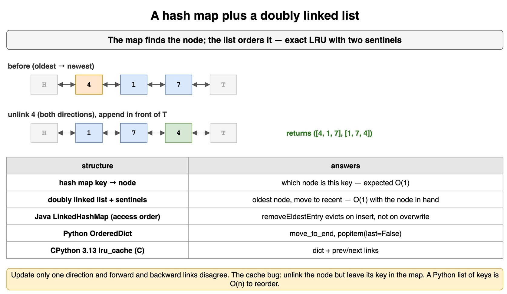

*Source: [`diagrams/linked-lists.drawio`](/content/11_Coding_Problems/11_Linked_Lists/diagrams/linked-lists.drawio), page 4.*

## Reverse a Singly Linked List (LeetCode-style: Reverse Linked List)

Reverse a singly linked list in place and return the new head. An empty list stays empty. A list of one node stays that node.

The iterative form is three references. `prev` is the reversed prefix, and it starts at `None`. `curr` is the node being turned around. `nxt` is the rest of the original list, saved before `curr.next` is overwritten. Then `curr` joins the reversed prefix and both references step forward. After the loop, `prev` is the new head, because `curr` has become `None`. The [Iterative in-place reversal](../../07_Data_Structures_and_Algorithms/03_Linked_Lists/) card is this loop as a building block for sublists and for reversing a half. Sketch two nodes on paper before writing it: on `4 -> 1 -> 7`, the first iteration saves `1`, points `4` at `None`, and leaves `curr` on `1`.

The recursive form reverses the tail first, then points the old successor back at the current node, then sets the current node's `next` to `None`. Skip that last assignment and the old forward link remains, so the node and its successor point at each other. The [Recursive list processing](../../07_Data_Structures_and_Algorithms/03_Linked_Lists/) card is the general trade. The lists below are exercise numbers.

```python
class ListNode:
    def __init__(self, val: int = 0, nxt: "ListNode | None" = None) -> None:
        self.val = val
        self.next = nxt


def from_list(values: list[int]) -> ListNode | None:
    head: ListNode | None = None
    for value in reversed(values):
        head = ListNode(value, head)
    return head


def to_list(head: ListNode | None) -> list[int]:
    values: list[int] = []
    while head is not None:
        values.append(head.val)
        head = head.next
    return values


def reverse_iter(head: ListNode | None) -> ListNode | None:
    prev: ListNode | None = None
    curr = head
    while curr is not None:
        nxt = curr.next
        curr.next = prev
        prev = curr
        curr = nxt
    return prev


def reverse_rec(head: ListNode | None) -> ListNode | None:
    if head is None or head.next is None:
        return head
    new_head = reverse_rec(head.next)
    head.next.next = head
    head.next = None
    return new_head


def reverse_rec_forget_none(head: ListNode | None) -> ListNode | None:
    if head is None or head.next is None:
        return head
    new_head = reverse_rec_forget_none(head.next)
    head.next.next = head
    return new_head


def walk_cap(head: ListNode | None, limit: int) -> list[int | str]:
    values: list[int | str] = []
    seen: set[int] = set()
    while head is not None and len(values) < limit:
        ident = id(head)
        if ident in seen:
            values.append("cycle")
            break
        seen.add(ident)
        values.append(head.val)
        head = head.next
    return values


print(to_list(reverse_iter(from_list([4, 1, 7]))), to_list(reverse_iter(from_list([]))), to_list(reverse_iter(from_list([4]))))
print(to_list(reverse_rec(from_list([4, 1, 7]))), to_list(reverse_rec(from_list([-2, 0]))))
print(walk_cap(reverse_rec_forget_none(from_list([4, 1])), 6))
# [7, 1, 4] [] [4]
# [7, 1, 4] [0, -2]
# [1, 4, 'cycle']
```

Both correct forms turn `4, 1, 7` into `7, 1, 4`. The empty list and the single `4` come back unchanged. Negatives reverse with the same assignments, because the algorithm never reads the values: `-2, 0` becomes `0, -2`. The recursive form that leaves `head.next` in place turns `4, 1` into a two-node cycle. The bounded walk reports that cycle instead of spinning. LeetCode 206 allows an empty list, allows from 0 to 5000 nodes, allows values from -5000 to 5000, and its follow-up asks for both the iterative and the recursive form. The iterative form is O(n) time and O(1) extra memory. The recursive form is O(n) time and O(n) stack frames. CPython's default recursion limit is 1000, and the limit counts every Python frame on the stack. Called from module level, this recursive reverse returns on 999 nodes, where the base case sits at depth 1000, and raises `RecursionError` on 1000 nodes. One extra function around that call returns on 998 nodes and raises on 999. A list of 5000 nodes is inside the LeetCode bound and outside that default limit.

**Trade-offs.** Iteration is the form to ship, and the form that survives a long list. Recursion makes the "reverse the rest, then fix this link" sentence obvious, and it spends a frame per node. Building a new list by pushing values onto a stack also reverses, in O(n) extra memory, and it does not reuse the nodes. Copying into an array, reversing the array, and rebuilding is the same memory trade and is easier to read.

**Interview.** Draw the three references for two iterations, and say the save happens before the overwrite. State the empty list and the one-node list as base cases of both forms. If you offer the recursive form, say the stack cost and the recursion limit in the same sentence, and point at LeetCode's 5000-node bound if that is the problem on the table. The forgotten `head.next = None` is the cycle you should mention before the interviewer finds it.

**Recap.** Save `next`, point the current node at the reversed prefix, and advance. The new head is the old tail. Recursion reverses the tail first and has to clear the old forward link, or the two nodes cycle. Iteration uses constant extra memory. Recursion uses a frame per node and can hit the default recursion limit on a list the published problem still allows.

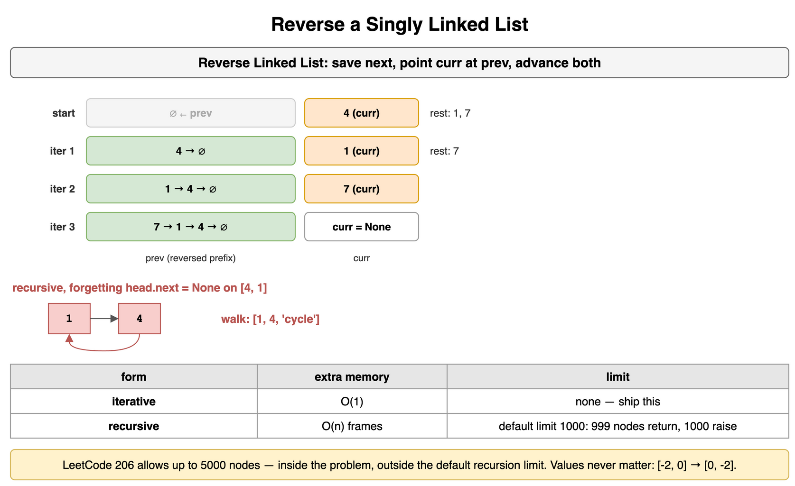

*Source: [`diagrams/linked-lists.drawio`](/content/11_Coding_Problems/11_Linked_Lists/diagrams/linked-lists.drawio), page 5.*

## Remove the Kth Last Node (LeetCode-style: Remove Nth Node From End of List)

Remove the kth node from the end of a singly linked list and return the head. The head you return may be a different node from the one you were given.

This is the fixed gap, with a dummy so that k equal to the length still has a predecessor. Advance the leader k steps from the dummy. Then advance the leader and the trailer together until the leader is on the last node. The trailer's `next` is the target. Point it at `target.next`. The two-pass form counts the nodes, then walks `length - k` steps from the dummy and does the same unlink. Both are on the exercise list `8, 3, 5, 1, 9`. This card treats k < 1, and k greater than the length, as "leave the list alone." Ask before you assume that. An interviewer who says k is always valid wants the error left out.

```python
class ListNode:
    def __init__(self, val: int = 0, nxt: "ListNode | None" = None) -> None:
        self.val = val
        self.next = nxt


def from_list(values: list[int]) -> ListNode | None:
    head: ListNode | None = None
    for value in reversed(values):
        head = ListNode(value, head)
    return head


def to_list(head: ListNode | None) -> list[int]:
    values: list[int] = []
    while head is not None:
        values.append(head.val)
        head = head.next
    return values


def remove_gap(head: ListNode | None, k: int) -> ListNode | None:
    if k < 1:
        return head
    dummy = ListNode(0, head)
    lead: ListNode | None = dummy
    for _ in range(k):
        if lead is None or lead.next is None:
            return head
        lead = lead.next
    trail = dummy
    while lead.next is not None:
        lead = lead.next
        trail = trail.next
    trail.next = trail.next.next
    return dummy.next


def remove_two_pass(head: ListNode | None, k: int) -> ListNode | None:
    length = 0
    curr = head
    while curr is not None:
        length += 1
        curr = curr.next
    if k < 1 or k > length:
        return head
    dummy = ListNode(0, head)
    prev = dummy
    for _ in range(length - k):
        prev = prev.next
    prev.next = prev.next.next
    return dummy.next


def show(values: list[int], k: int) -> tuple[list[int], list[int]]:
    return to_list(remove_gap(from_list(values), k)), to_list(remove_two_pass(from_list(values), k))


print(show([8, 3, 5, 1, 9], 2), show([8, 3, 5, 1, 9], 5), show([8, 3, 5, 1, 9], 1))
print(show([8, 3, 5, 1, 9], 6), show([8, 3, 5, 1, 9], 0), show([], 1), show([8], 1))
# ([8, 3, 5, 9], [8, 3, 5, 9]) ([3, 5, 1, 9], [3, 5, 1, 9]) ([8, 3, 5, 1], [8, 3, 5, 1])
# ([8, 3, 5, 1, 9], [8, 3, 5, 1, 9]) ([8, 3, 5, 1, 9], [8, 3, 5, 1, 9]) ([], []) ([], [])
```

k = 2 removes `1`, the second node from the end. k = 5 removes the head `8`, and both functions return the new head because they return `dummy.next`. k = 1 removes the tail. k = 6 and k = 0 leave the five nodes in place. An empty list stays empty. A one-node list with k = 1 becomes empty. Each function is O(n) time and O(1) extra memory. The gap walks once. The length version walks twice. LeetCode 19, Remove Nth Node From End of List, uses `n` for this k. Its list length `sz` satisfies `1 <= sz <= 30`, its values are from 0 to 100, and `1 <= n <= sz`. The list is never empty, and n is never out of range. This card also defines the empty list, k = 0, and k past the end.

**Trade-offs.** One pass is what you want after the gap is clear. Two passes are what you want while you are still getting the predecessor right, and they cost the same class of time. An array of the nodes, then an unlink at index `len - k`, is O(n) memory and makes the index arithmetic obvious. The late-stop bug is still O(n), and it deletes the next node over, or raises `AttributeError` when the trailer walks onto the tail and reads `next` of `None`. That bug is a drill.

**Interview.** Ask whether k is inside the list. Write the dummy, then the leader's k steps, then the joint walk that stops while `lead.next` exists. Say out loud what k = length does: the trailer never leaves the dummy, and the returned head changes. Walk k = 2 on a five-node list you can draw. If the interviewer asks for one pass, the gap is that pass. Offer the length count as the explanation of the same predecessor.

**Recap.** A leader that starts k nodes ahead, and stops on the last node, leaves the trailer on the predecessor of the kth-last node. The dummy is that predecessor when the head itself is removed. Counting the length first finds the same node in a second walk. k outside the list is a question to ask. The published problem promises it will not happen.

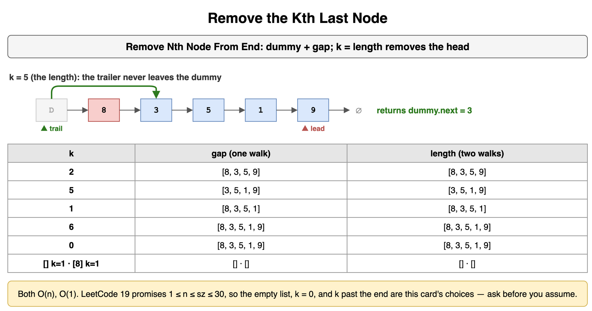

*Source: [`diagrams/linked-lists.drawio`](/content/11_Coding_Problems/11_Linked_Lists/diagrams/linked-lists.drawio), page 6.*

## The Node Two Lists Share (LeetCode-style: Intersection of Two Linked Lists)

Given the heads of two singly linked lists, return the first node that is on both lists, or `None` when they share nothing. Sharing means the same node object. Equal values are not enough.

Walk the first list, and when you fall off the end, continue at the head of the second. Walk the second list, and when you fall off, continue at the head of the first. The two walks have the same length, the sum of the two lengths, so they arrive at the shared node together. If there is no shared node, they arrive at `None` together and the loop stops. A set of node identities does the same job in one walk of each list and spends memory proportional to the first list. Aligning the lengths does it in constant memory with a count first: measure both lengths, advance the longer head by the difference, then step in lockstep. All three return the node, not a copy of its value.

The switch has a bad twin. If you advance, and then whenever a reference is `None` you immediately replace it with the other head, the two references never sit on `None` at the same time. The loop does not end. The correct step is one expression: the next node if you are on a node, otherwise the other head. The `None` is visible to the loop test. The lists below are exercise nodes. Tags are labels so the print can show identity. The value `4` appears on both separate lists and they share no node.

```python
class ListNode:
    def __init__(self, val: int = 0, nxt: "ListNode | None" = None, tag: str = "") -> None:
        self.val = val
        self.next = nxt
        self.tag = tag


def tag_of(node: ListNode | None) -> str | None:
    return None if node is None else node.tag


def intersection(a: ListNode | None, b: ListNode | None) -> ListNode | None:
    first, second = a, b
    while first is not second:
        first = first.next if first is not None else b
        second = second.next if second is not None else a
    return first


def by_length(a: ListNode | None, b: ListNode | None) -> ListNode | None:
    def length(head: ListNode | None) -> int:
        count = 0
        while head is not None:
            count += 1
            head = head.next
        return count

    len_a, len_b = length(a), length(b)
    if len_a < len_b:
        a, b = b, a
        len_a, len_b = len_b, len_a
    for _ in range(len_a - len_b):
        a = a.next
    while a is not b:
        a = a.next
        b = b.next
    return a


def by_ids(a: ListNode | None, b: ListNode | None) -> ListNode | None:
    seen: set[int] = set()
    while a is not None:
        seen.add(id(a))
        a = a.next
    while b is not None:
        if id(b) in seen:
            return b
        b = b.next
    return None


def broken_switch(a: ListNode | None, b: ListNode | None, limit: int) -> str:
    first, second = a, b
    steps = 0
    while first is not second:
        if steps >= limit:
            return f"still going after {limit}"
        first = first.next if first is not None else None
        second = second.next if second is not None else None
        if first is None:
            first = b
        if second is None:
            second = a
        steps += 1
    return "met"


def chain(*nodes: ListNode) -> ListNode:
    for earlier, later in zip(nodes, nodes[1:]):
        earlier.next = later
    return nodes[0]


separate_a = chain(ListNode(4, tag="a4"), ListNode(1, tag="a1"), ListNode(7, tag="a7"))
separate_b = chain(ListNode(4, tag="b4"), ListNode(1, tag="b1"), ListNode(7, tag="b7"))
shared = ListNode(6, tag="shared")
joined_a = chain(ListNode(2, tag="a2"), ListNode(9, tag="a9"), shared)
joined_b = chain(ListNode(9, tag="b9"), shared)
print(
    tag_of(intersection(separate_a, separate_b)),
    tag_of(by_length(separate_a, separate_b)),
    tag_of(by_ids(separate_a, separate_b)),
)
print(
    tag_of(intersection(joined_a, joined_b)),
    tag_of(by_length(joined_a, joined_b)),
    tag_of(by_ids(joined_a, joined_b)),
)
head_join = ListNode(6, tag="head-join")
prefix = chain(ListNode(2, tag="pre"), head_join)
print(
    tag_of(intersection(head_join, head_join)),
    tag_of(intersection(prefix, head_join)),
    tag_of(by_length(prefix, head_join)),
    tag_of(by_ids(prefix, head_join)),
)
print(tag_of(intersection(None, None)), tag_of(intersection(joined_a, None)))
print(broken_switch(separate_a, separate_b, 8))
# None None None
# shared shared shared
# head-join head-join head-join head-join
# None None
# still going after 8
```

On the separate lists every method returns `None`. The values match and the nodes do not. On the joined lists the shared node is the one tagged `shared`, value `6`. The `9` in front of it on each list is a different node, so a search that returns the first matching value returns a `9`. That comparison is the drill. When both heads are the node tagged `head-join`, the loop test fails immediately and all three methods return that node. When only the second head is the junction, after the prefix `2`, the longer walk absorbs the prefix and the methods still return `head-join`. Both empty heads are `None`, and a real list paired with an empty list is `None`. The broken switch is still running after 8 steps on the separate lists: each time a reference becomes `None` it is replaced by the other head before the loop can observe both `None`s. The correct switch on those same lists meets at `None`.

The switch and the length alignment are O(n + m) time and O(1) extra memory in the worst case. The identity set is expected O(n + m) time and O(n) extra memory, and O(n * m) time when every key collides. LeetCode 160 gives each list between 1 and 30,000 nodes, values from 1 to 100,000, no cycles anywhere, and it requires the original structure to be left in place. `intersectVal` of 0 means there is no shared node. This card also accepts an empty head. Because values repeat inside the allowed range, value equality cannot decide the question even on the published input.

**Trade-offs.** The switch is constant memory and easy to get wrong at `None`. The length alignment is constant memory and easier to explain. The identity set is the version to write if you are at all unsure, and you say the memory. A set of values is the wrong structure at the same cost as the identity set. Reversing either list, or splicing them, breaks the "leave the lists as you found them" rule.

**Interview.** Ask "same node, or same value?" and ask whether a cycle is possible. If a cycle is possible, this loop does not terminate, and the cycle cards are the [Cycle detection with Floyd's algorithm](../../07_Data_Structures_and_Algorithms/03_Linked_Lists/) card. Then pick one of the three methods and give its memory. Walk a case with no shared node through the `None` switch so the interviewer sees the loop end. Say you will not reverse either list.

**Recap.** Two references that switch lists at the end cover the same number of nodes and meet at the shared node, or at `None`. A length difference followed by a lockstep walk, and a set of node identities, return that same node. Equal values are a different question. Replacing `None` with the other head before the loop sees it keeps the walk running.

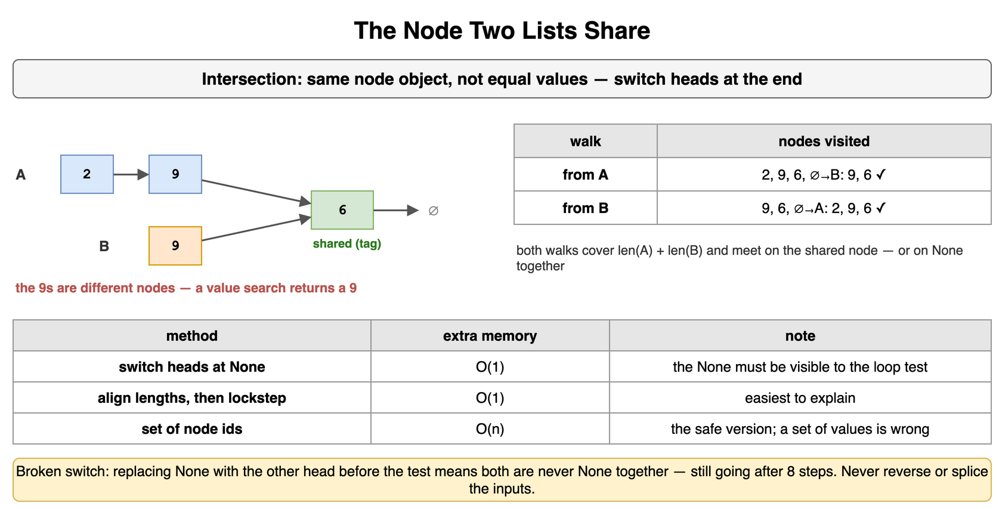

*Source: [`diagrams/linked-lists.drawio`](/content/11_Coding_Problems/11_Linked_Lists/diagrams/linked-lists.drawio), page 7.*

## Least-Recently-Used Cache (LeetCode-style: LRU Cache)

Build a cache with a fixed capacity. `get(key)` returns the stored value, or `None` if the key is absent, and marks the key as just used. `put(key, value)` inserts or overwrites. When a new key would exceed the capacity, the key that was used least recently is evicted. Both operations run in expected constant time.

The map stores key to node. The doubly linked list, with a sentinel at the oldest end and a sentinel at the newest end, stores recency. `get` on a hit unlinks that node and appends it at the newest end. `put` on an existing key overwrites the value and does the same move, and it does not evict, because the number of keys did not change. `put` on a new key appends a node and, if the map is now over capacity, unlinks the oldest real node and deletes that key from the map. Leave the key in the map and a later `get` still finds the node. `get` unlinks, then appends at the newest end, using the `prev` and `next` the detached node still holds. When those two neighbors are still joined, the extra unlink changes nothing and the append puts the node back, so the cache grows past capacity. When a later call has rewired those neighbors, the same unlink cuts a live edge: a node drops out of the order and its key stays in the map. That bug is a drill. The [Eviction Policies](../../09_System_Design_Interview/05_Caching/) card separates this eviction from a TTL. The keys and values below are exercise numbers, not the sample sequence from the published problem.

```python
class DNode:
    def __init__(self, key: int = 0, val: int = 0) -> None:
        self.key = key
        self.val = val
        self.prev: "DNode | None" = None
        self.next: "DNode | None" = None


class LRUCache:
    def __init__(self, capacity: int) -> None:
        self.capacity = capacity
        self.nodes: dict[int, DNode] = {}
        self.oldest = DNode()
        self.newest = DNode()
        self.oldest.next = self.newest
        self.newest.prev = self.oldest

    def _unlink(self, node: DNode) -> None:
        node.prev.next = node.next
        node.next.prev = node.prev

    def _append_newest(self, node: DNode) -> None:
        last = self.newest.prev
        last.next = node
        node.prev = last
        node.next = self.newest
        self.newest.prev = node

    def order(self) -> list[int]:
        keys: list[int] = []
        current = self.oldest.next
        while current is not self.newest:
            keys.append(current.key)
            current = current.next
        return keys

    def get(self, key: int) -> int | None:
        node = self.nodes.get(key)
        if node is None:
            return None
        self._unlink(node)
        self._append_newest(node)
        return node.val

    def put(self, key: int, value: int) -> None:
        node = self.nodes.get(key)
        if node is not None:
            node.val = value
            self._unlink(node)
            self._append_newest(node)
            return
        node = DNode(key, value)
        self.nodes[key] = node
        self._append_newest(node)
        if len(self.nodes) > self.capacity:
            stale = self.oldest.next
            self._unlink(stale)
            del self.nodes[stale.key]


cache = LRUCache(2)
cache.put(7, 70)
cache.put(8, 80)
print(cache.get(7), cache.order())
cache.put(9, 90)
print(cache.get(8), cache.order())
cache.put(7, 71)
print(cache.order())
print(cache.get(7), cache.get(9))
small = LRUCache(1)
small.put(7, 70)
small.put(7, 71)
print(small.get(7), small.order())
small.put(8, 80)
print(small.get(7), small.get(8), small.order())
negative = LRUCache(1)
negative.put(4, -1)
print(negative.get(4), negative.get(99), LRUCache(2).get(7))
# 70 [8, 7]
# None [7, 9]
# [9, 7]
# 71 90
# 71 [7]
# None 80 [8]
# -1 None None
```

Capacity 2: after `7` and `8` are stored, `get(7)` makes the order oldest-to-newest `8, 7` and returns 70. `put(9, 90)` evicts `8`. `get(8)` is `None`. `put(7, 71)` overwrites `7` and moves it to the newest end, so the order is `9, 7`. Capacity 1: overwriting `7` does not evict it. The following `put(8)` does. A stored `-1` comes back as `-1`, and a missing key comes back as `None`, including a get on a cache that has never been written. Order lists the keys from oldest to newest.

Each call is expected O(1) time. The collision worst case is O(capacity). Memory is O(capacity). LeetCode 146 requires O(1) average time, capacity from 1 to 3000, keys from 0 to 10,000, values from 0 to 100,000, and at most 200,000 calls. Its `get` returns `-1` for a miss. That sentinel is free because every stored value is at least 0. This card returns `None`, so a stored `-1` is a real hit. Capacity here is assumed to be at least 1, matching that problem. `OrderedDict.move_to_end` plus `popitem(last=False)` is the same policy with the links inside the standard library.

**Trade-offs.** The manual list makes every assignment visible and is what an interviewer is usually asking for. `OrderedDict` is shorter and harder to sneak a stale key past. A plain `dict` keeps insertion order. Pop and reinsert moves a hit to the newest end, and popping the first key evicts the oldest. That emulation is amortized constant time in CPython. `OrderedDict.move_to_end` and `popitem(last=False)` are the documented operations, and the collections page says `OrderedDict` handles frequent reordering better than `dict`. A Python list of keys is linear to reorder. Evicting the oldest insertion, ignoring later gets, is FIFO, and the caching card shows those policies side by side. Forgetting `del` on the map keeps expected constant time and the wrong set of keys.

**Interview.** Draw capacity 2 and four operations, including one get and one overwrite, before the class. Say what the map contributes and what the list contributes. Say the overwrite path returns before the size check. Say the evicted key leaves the map. Mention `OrderedDict` as the shortcut, then offer the sentinels. State that `None` is the miss and `-1` would be a stored value.

**Recap.** The map finds the node and the doubly linked sentinels order it. Get and an overwrite move the node to the newest end and do not evict. A new key over capacity unlinks the oldest node and deletes its key. The miss is `None`. A library ordered dict hides the same links.

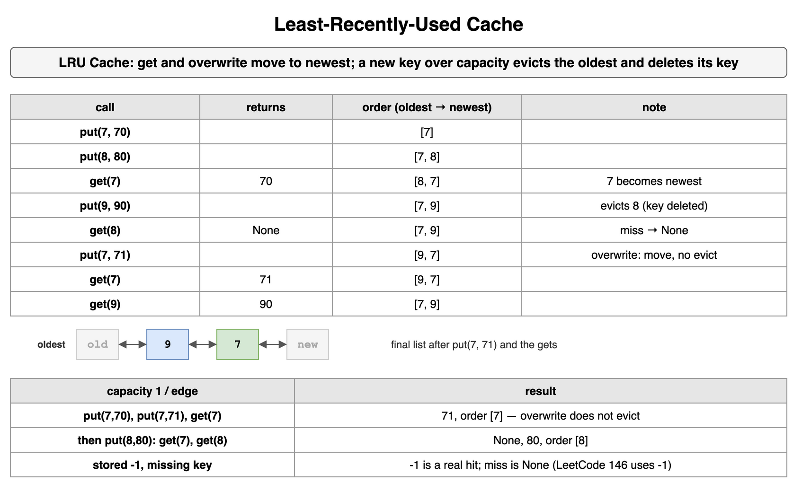

*Source: [`diagrams/linked-lists.drawio`](/content/11_Coding_Problems/11_Linked_Lists/diagrams/linked-lists.drawio), page 8.*

## A List That Reads the Same Both Ways (LeetCode-style: Palindrome Linked List)

Decide whether the values of a singly linked list read the same from the head and from the tail.

Copying the values into a list and comparing that list with its reverse is correct, O(n) time, and O(n) extra memory. The constant-memory version finds the middle, reverses the second half, compares, and reverses the second half again so the caller's list is unchanged. The middle is the slow reference in the [Runner (two-pointer) technique](../../07_Data_Structures_and_Algorithms/03_Linked_Lists/) card: one step for the slow reference, two for the fast, until the fast reference cannot take two steps. That loop is version A in the [Which middle on an even length?](../../07_Data_Structures_and_Algorithms/03_Linked_Lists/) drill. On an even length it lands on the second middle, which is the first node of the second half: on `1 -> 2 -> 3 -> 4` it stops on `3`. Version B in that drill stops on `2`, the last node of the first half. On an odd length both versions land on the center. Reversing from version A's landing makes the center the end of the reversed half, and the compare stops when the reversed half runs out, so the center is compared with itself. The [Split, reverse, and weave](../../07_Data_Structures_and_Algorithms/03_Linked_Lists/) card uses version B and then cuts. The cut is optional for this compare, because the walk follows the reversed half rather than both full halves. Reversing from version B's node, instead of from `slow.next`, would reverse one node too many. Restore anyway if the caller still needs the original order. The lists below are exercise numbers.

```python
class ListNode:
    def __init__(self, val: int = 0, nxt: "ListNode | None" = None) -> None:
        self.val = val
        self.next = nxt


def from_list(values: list[int]) -> ListNode | None:
    head: ListNode | None = None
    for value in reversed(values):
        head = ListNode(value, head)
    return head


def to_list(head: ListNode | None) -> list[int]:
    values: list[int] = []
    while head is not None:
        values.append(head.val)
        head = head.next
    return values


def reverse_from(head: ListNode | None) -> ListNode | None:
    prev: ListNode | None = None
    curr = head
    while curr is not None:
        nxt = curr.next
        curr.next = prev
        prev = curr
        curr = nxt
    return prev


def is_palindrome(head: ListNode | None) -> bool:
    slow = fast = head
    while fast is not None and fast.next is not None:
        slow = slow.next
        fast = fast.next.next
    reversed_half = reverse_from(slow)
    left, right = head, reversed_half
    same = True
    while right is not None:
        if left is None or left.val != right.val:
            same = False
            break
        left = left.next
        right = right.next
    reverse_from(reversed_half)
    return same


def check(values: list[int]) -> tuple[list[int], bool, list[int]]:
    head = from_list(values)
    return values, is_palindrome(head), to_list(head)


print(check([4, 1, 9, 1, 4]), check([4, 1, 1, 4]), check([4, 1, 5]))
print(check([4]), check([]), check([4, 4]), check([4, 1]), check([-1, 0, -1]))
# ([4, 1, 9, 1, 4], True, [4, 1, 9, 1, 4]) ([4, 1, 1, 4], True, [4, 1, 1, 4]) ([4, 1, 5], False, [4, 1, 5])
# ([4], True, [4]) ([], True, []) ([4, 4], True, [4, 4]) ([4, 1], False, [4, 1]) ([-1, 0, -1], True, [-1, 0, -1])
```

`4, 1, 9, 1, 4` is a palindrome, and so is the even list `4, 1, 1, 4`. `4, 1, 5` is not. After every call the original order is back, including after the early mismatch on `4, 1, 5`. A single node, an empty list, and two equal values are palindromes. Two different values, `4, 1`, are not, and those two nodes come back in the original order. The empty list has no pair of values that disagree. Negatives are ordinary values: `-1, 0, -1` matches. The walk is O(n) time and O(1) extra memory. The array copy is O(n) extra memory. LeetCode 234 allows from 1 to 100,000 nodes, values from 0 through 9, and its follow-up asks for O(n) time and O(1) extra memory. It does not require the list to be restored. This card restores, accepts an empty list, and accepts any integer value.

**Trade-offs.** The half-reverse meets the constant-memory follow-up and mutates the list unless you reverse a second time. The array is easier to explain and spends linear memory. A recursive compare that walks to the tail and compares on the way back also works, and it spends O(n) stack, which brings back the recursion limit. Skipping the restore is fine only after you have asked. Forgetting it and then printing the list from the head shows a reversed tail.

**Interview.** Offer the array first and state the memory. If the interviewer asks for constant extra memory, name middle, reverse, compare, restore. Say where the slow reference lands on an odd length and on an even length. Ask whether the list must come back unchanged. Give the empty list and the single node as true.

**Recap.** The constant-memory check reverses the second half, compares it with the first, and reverses it back. The middle finder puts the center on the reversed side for an odd length, and the compare stops at the end of that side. The array version is linear memory and the same answer. The caller's order survives only if you restore it.

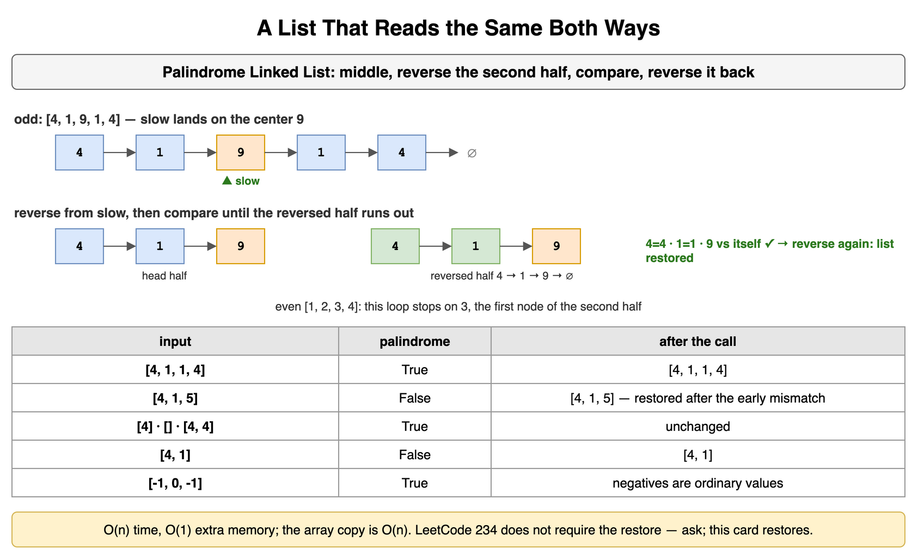

*Source: [`diagrams/linked-lists.drawio`](/content/11_Coding_Problems/11_Linked_Lists/diagrams/linked-lists.drawio), page 9.*

## Flatten Child Lists One Level at a Time

Each node has a `next` and a `child`. A child, when present, is the head of another list of the same kind. Flatten the structure into one list that follows `next` only: every node of one level, in order, then every node of the next level. Clear each `child` after its list has been appended.

Keep a tail on the end of the list you have already committed to. Scan from the head with a second reference. Whenever that reference has a child, append the list that starts at that child, following `next`, onto the tail. Walk the tail to the new end, and clear `child`. Grandchildren are still stored as `child` links, so they are appended later, when the scan reaches them. That is why the order is level by level. Each node is scanned once and the tail only moves forward, so the time is O(n) and the extra memory is O(1).

LeetCode 430 is a different order and a different node. Its nodes are doubly linked: `prev`, `next`, and `child`. The required order splices a child between a node and that node's old `next`, and then does the same inside the child, so a grandchild appears before the original neighbor. The published example shape `1 -> 2` with a child on `1` becomes `1, child, 2`. At most 1000 nodes, values from 1 to 100,000, every `child` must be null afterward, and `prev` has to agree with `next`. The exercise below uses different values. Level order of `10 -> 20` with a child `30` on `10` is `10, 20, 30`. The splice order is `10, 30, 20`.

```python
class ChildNode:
    def __init__(self, val: int, nxt: "ChildNode | None" = None, child: "ChildNode | None" = None) -> None:
        self.val = val
        self.next = nxt
        self.child = child


def to_list(head: ChildNode | None) -> list[int]:
    values: list[int] = []
    while head is not None:
        values.append(head.val)
        head = head.next
    return values


def children_cleared(head: ChildNode | None) -> bool:
    while head is not None:
        if head.child is not None:
            return False
        head = head.next
    return True


def flatten_level(head: ChildNode | None) -> ChildNode | None:
    if head is None:
        return None
    tail = head
    while tail.next is not None:
        tail = tail.next
    curr: ChildNode | None = head
    while curr is not None:
        if curr.child is not None:
            tail.next = curr.child
            while tail.next is not None:
                tail = tail.next
            curr.child = None
        curr = curr.next
    return head


def flatten_between(head: ChildNode | None) -> ChildNode | None:
    curr = head
    while curr is not None:
        if curr.child is not None:
            nxt = curr.next
            child = curr.child
            curr.child = None
            curr.next = child
            tail = child
            while tail.next is not None:
                tail = tail.next
            tail.next = nxt
        curr = curr.next
    return head


def deep() -> ChildNode:
    n10, n20, n30 = ChildNode(10), ChildNode(20), ChildNode(30)
    n40, n50, n60, n70 = ChildNode(40), ChildNode(50), ChildNode(60), ChildNode(70)
    n10.next, n20.next = n20, n30
    n40.next = n50
    n10.child, n50.child, n30.child = n40, n70, n60
    return n10


level = flatten_level(deep())
spliced = flatten_between(deep())
tiny_level = ChildNode(10, ChildNode(20), ChildNode(30))
tiny_splice = ChildNode(10, ChildNode(20), ChildNode(30))
print(to_list(level), children_cleared(level))
print(to_list(spliced), children_cleared(spliced))
print(to_list(flatten_level(tiny_level)), to_list(flatten_between(tiny_splice)))
print(flatten_level(None), flatten_between(None))
# [10, 20, 30, 40, 50, 60, 70] True
# [10, 40, 50, 70, 20, 30, 60] True
# [10, 20, 30] [10, 30, 20]
# None None
```

The deep structure is `10 -> 20 -> 30`, with `40 -> 50` under `10`, `70` under `50`, and `60` under `30`. Level order emits `10, 20, 30`, then `40, 50, 60`, then `70`. `50` is the `next` of `40`, so it is on the same level as `40`, and `60` is the child of `30`. The splice emits `40, 50, 70` before `20`, because `70` is inserted while the scan is still inside `50`. Both passes clear every `child`. An empty head stays empty. `flatten_between` is the LeetCode order on these singly linked exercise nodes. It does not maintain `prev`, so it is not a solution to LeetCode 430. It is here to show the order. A doubly linked level-order join also sets the child head's `prev` to the old tail at the moment of the append. The other `prev` links inside that child chain stay as they were.

**Trade-offs.** Level order is one scan and a tail, O(n) time and O(1) extra memory, and it answers "finish each level." The splice is also O(n) time and O(1) extra memory, and it answers "a child comes before the old neighbor." A queue of child heads is the same level order with O(width) extra memory, and it makes the breadth-first reading obvious. Using the splice on a statement that asked for levels, or the tail-append on LeetCode 430, is a linear algorithm with the wrong sequence. Leaving `child` set keeps a second path into nodes that `next` can already reach.

**Interview.** Ask which order, and ask whether the node has `prev`. Repeat the order in one sentence: "all of this level, then the next" or "the child is inserted before `next`." Then write the tail, or the splice, and clear `child`. Walk the three-node shape, `10 -> 20` with child `30`, because the two orders disagree on it. Say the empty head. If the node is doubly linked, write the one `prev` assignment at the join.

**Recap.** Appending each child chain at the current tail, then scanning into that chain, emits one level after another and clears `child`. Inserting the child between a node and its `next` emits the depth-first order LeetCode 430 asks for, and that problem also keeps `prev` consistent. Both walks are linear and use constant extra memory. The three-node shape is enough to see which order you implemented.

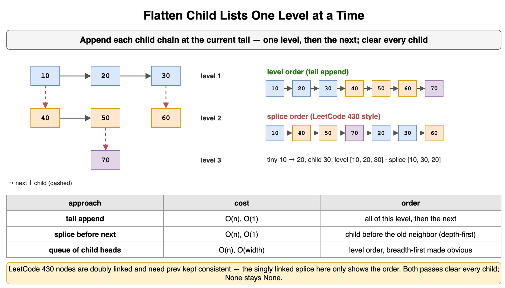

*Source: [`diagrams/linked-lists.drawio`](/content/11_Coding_Problems/11_Linked_Lists/diagrams/linked-lists.drawio), page 10.*

## A rewiring, a gap, a map, or a copy

The choice follows the operation the statement actually asks for, and the memory it allows.

A nested walk that starts from the head every time is the baseline. Finding the kth-last node by recounting from the head for every index is quadratic. Say that, then replace it. Copying values into a Python list is the next baseline: O(n) time, O(n) extra memory, and real indexes. It makes a palindrome, a kth-last removal, and a reverse easy. Use it when the statement allows the memory, and say so. A dummy plus rewiring is the in-place tool when the head might change or the result is built node by node. A fixed gap is the one-pass form of "k from the end." Counting the length first is the two-pass form. On the exercise list of five nodes, removing the second-last node, the gap's leader advances 5 times and the length pass advances 8 times, 5 to count and 3 to reach the predecessor. The joint walk also moves the trailer on those last 3 steps. Both return `8, 3, 5, 9`. The class of cost is linear either way.

A shared node is the switch, the length alignment, or a set of identities. A set of values answers a different question. A cache with O(1) get and put is the map plus the doubly linked sentinels, or `OrderedDict` if the links are not the point. A middle, a cycle, and the length of a cycle are the fast and slow references on the [Runner (two-pointer) technique](../../07_Data_Structures_and_Algorithms/03_Linked_Lists/) card and the [Cycle detection with Floyd's algorithm](../../07_Data_Structures_and_Algorithms/03_Linked_Lists/) card. This topic borrows the middle for the palindrome and does not detect cycles. Merging two sorted lists is the [Merging two sorted lists](../../07_Data_Structures_and_Algorithms/03_Linked_Lists/) card. The edge checklist from [Edge cases and test helpers](../../07_Data_Structures_and_Algorithms/03_Linked_Lists/) still applies: empty, one node, two nodes, and an operation that touches the first or last node. k equal to the length removes the head. A forgotten `next = None` after a recursive reverse cycles, and a later walk does not end.

```python
class ListNode:
    def __init__(self, val: int = 0, nxt: "ListNode | None" = None) -> None:
        self.val = val
        self.next = nxt


def from_list(values: list[int]) -> ListNode | None:
    head: ListNode | None = None
    for value in reversed(values):
        head = ListNode(value, head)
    return head


def to_list(head: ListNode | None) -> list[int]:
    values: list[int] = []
    while head is not None:
        values.append(head.val)
        head = head.next
    return values


def count_gap(values: list[int], k: int) -> tuple[int, list[int]]:
    dummy = ListNode(0, from_list(values))
    moves = 0
    lead = dummy
    for _ in range(k):
        lead = lead.next
        moves += 1
    trail = dummy
    while lead.next is not None:
        lead = lead.next
        trail = trail.next
        moves += 1
    trail.next = trail.next.next
    return moves, to_list(dummy.next)


def count_two_pass(values: list[int], k: int) -> tuple[int, list[int]]:
    head = from_list(values)
    moves = 0
    length = 0
    curr = head
    while curr is not None:
        length += 1
        curr = curr.next
        moves += 1
    dummy = ListNode(0, head)
    prev = dummy
    for _ in range(length - k):
        prev = prev.next
        moves += 1
    prev.next = prev.next.next
    return moves, to_list(dummy.next)


def remove_kth(values: list[int], k: int) -> list[int]:
    if k < 1:
        return values
    dummy = ListNode(0, from_list(values))
    lead = dummy
    for _ in range(k):
        if lead.next is None:
            return values
        lead = lead.next
    trail = dummy
    while lead.next is not None:
        lead = lead.next
        trail = trail.next
    trail.next = trail.next.next
    return to_list(dummy.next)


print(count_gap([8, 3, 5, 1, 9], 2))
print(count_two_pass([8, 3, 5, 1, 9], 2))
print(remove_kth([], 1), remove_kth([4], 1), remove_kth([4, 9], 2), remove_kth([4, 9], 3))
# (5, [8, 3, 5, 9])
# (8, [8, 3, 5, 9])
# [] [] [9] [4, 9]
```

The five-node removal really does advance 5 times in the gap and 8 times in the length pass, and both leave `8, 3, 5, 9`. An empty list with k = 1 stays empty. A one-node list with k = 1 becomes empty. k equal to the length of `4, 9` removes the head and leaves `9`. k past that length leaves `4, 9` in place. Those four inputs are the checklist: empty, one node, remove the head, and a k the list does not contain.

**Trade-offs.** The copy into a list spends linear memory and makes the index obvious. The gap and the length pass spend constant memory and differ by a few advances, not by a complexity class. The identity set spends linear memory and is the safe intersection. The manual cache spends a node and two sentinels per key and meets the expected constant bound. Picking the fast/slow middle for a kth-last removal is the neighboring pattern applied to the wrong distance.

**Interview.** Start from the sentence, not from a favorite loop. Head might change: dummy. K from the end: gap, or length if you want the arithmetic visible. Same node: switch or identities, and say you compared objects. O(1) get and put: map plus doubly linked sentinels. Palindrome with constant memory: middle, reverse, compare, restore. Then give empty, one node, and the operation on the head. Mention the cycle you create if a reversed `next` is left pointing forward.

**Recap.** Copying to a list is the linear-memory baseline. A dummy and a rewiring stay in place when the head can change. A gap and a length count both find the kth-last predecessor in linear time. A shared node is identity, and a cache is a map plus a doubly linked list. Empty, one node, and removing the head are the inputs that check the return value.

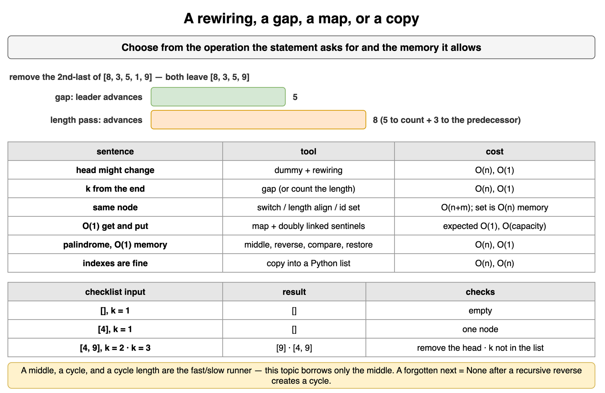

*Source: [`diagrams/linked-lists.drawio`](/content/11_Coding_Problems/11_Linked_Lists/diagrams/linked-lists.drawio), page 11.*
