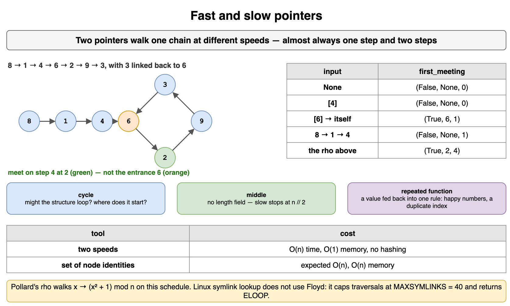
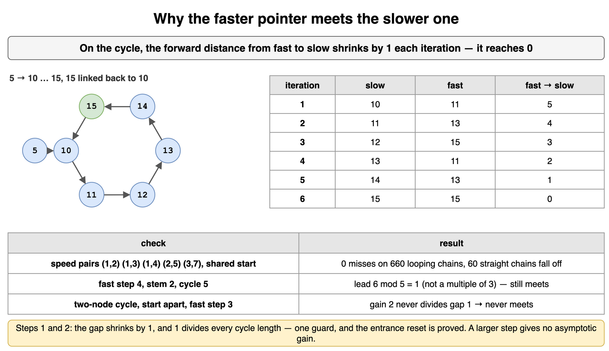
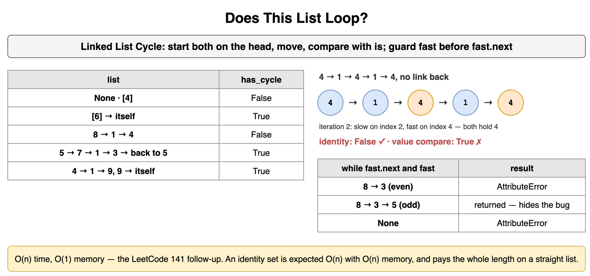
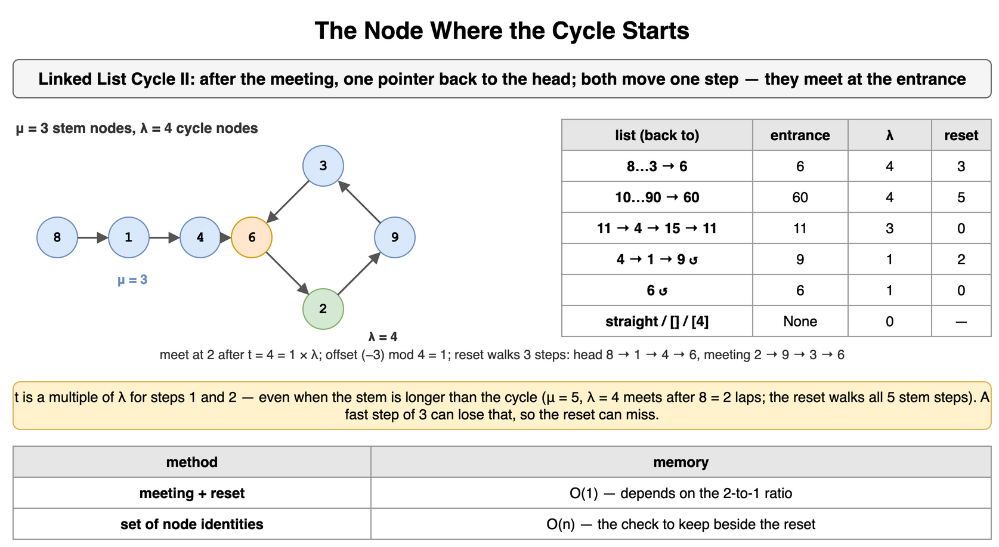
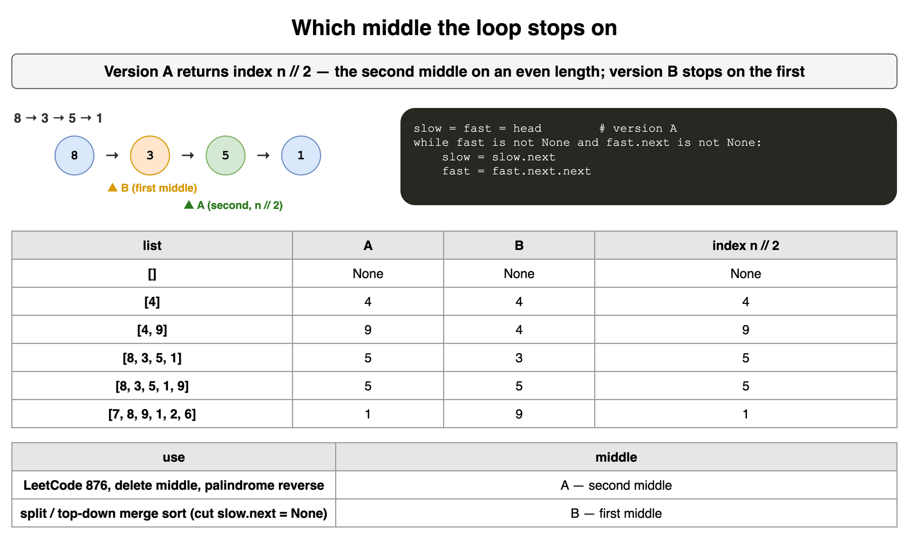
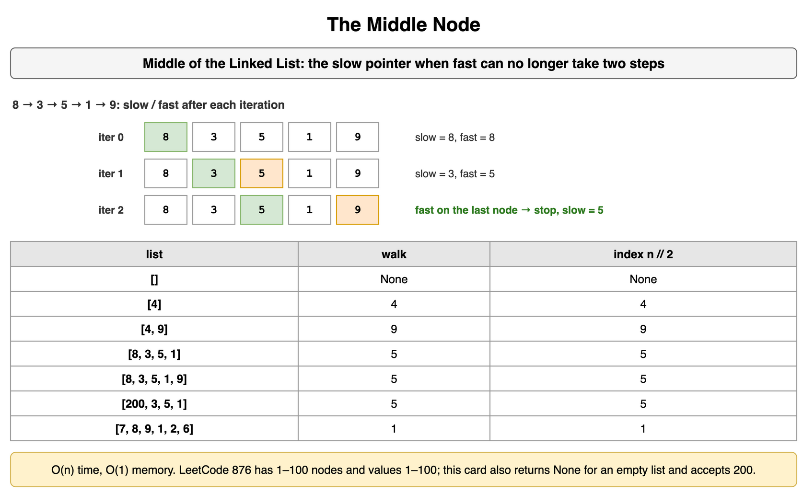
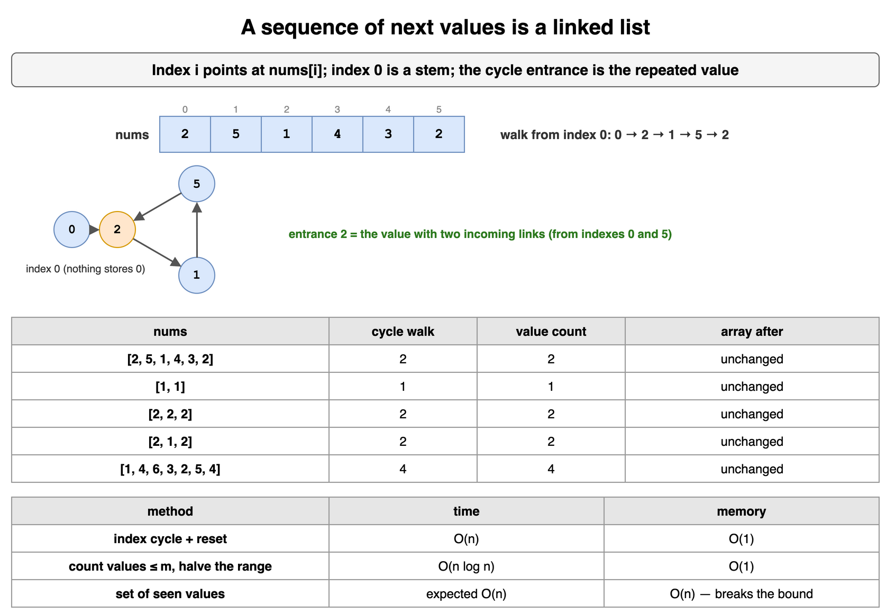
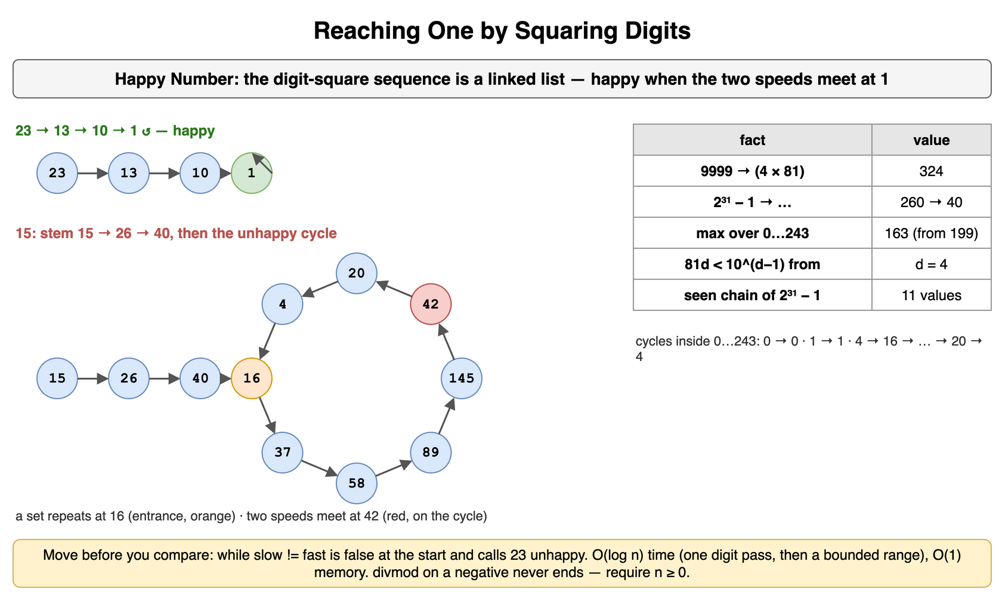
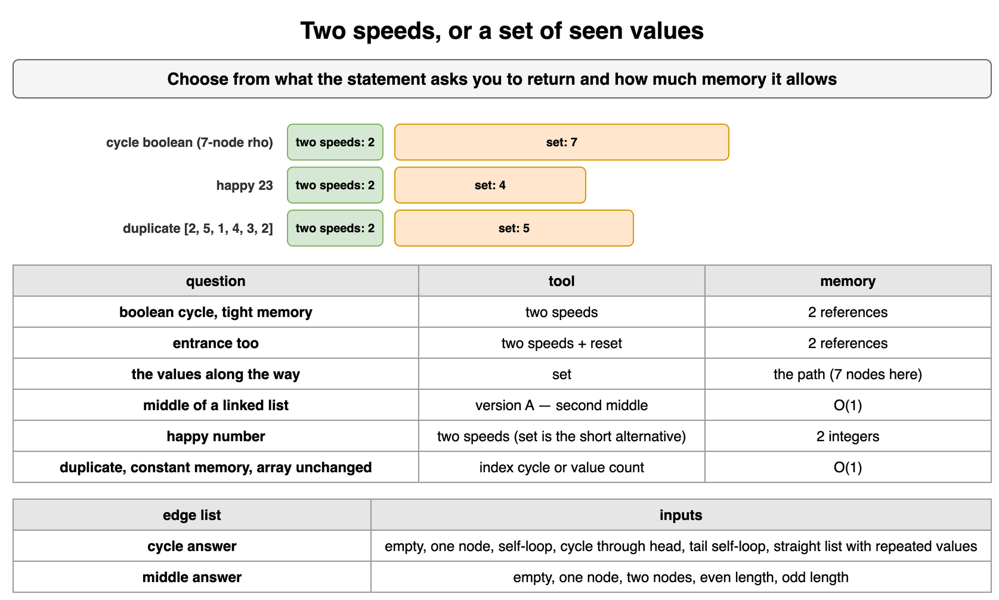

## Fast and slow pointers
A fast and slow pointer pair is two variables on one chain, almost always one step and two steps. A pointer holds a node or `None`. Each value has one next value, so there is no index. Both start on the head. Move, then compare with `is`. [Runner (two-pointer) technique](#07_Data_Structures_and_Algorithms/03_Linked_Lists/concepts/runner-two-pointer-technique) is the middle. [Cycle detection with Floyd's algorithm](#07_Data_Structures_and_Algorithms/03_Linked_Lists/concepts/cycle-detection-with-floyd-s-algorithm) is the cycle. Indexes that close on each other are [Two indexes](#11_Coding_Problems/09_Two_Pointers/concepts/two-indexes). A fixed gap, both pointers taking one step, is [Remove the kth last node](#11_Coding_Problems/11_Linked_Lists/concepts/remove-the-kth-last-node).

A cycle, a middle with no length field, and a value fed back into the same rule are the shapes. Time is O(n) and extra memory is O(1): the fast pointer follows at most twice as many links as there are nodes. A set of identities is expected linear time, O(n) memory, and quadratic on collisions. Pollard's rho uses this schedule on x → (x² + 1) mod n. The original polynomial was (x² − 1) mod n. A gcd of the two copies' difference and n is a factor when it is neither 1 nor n ([GCD and LCM](#11_Coding_Problems/01_Math_and_Logic_Puzzles/concepts/gcd-and-lcm)). Linux pathname lookup returns `ELOOP` at `MAXSYMLINKS`, 40, in `include/linux/namei.h`. That cap also stops a long chain that is not a loop.

```python
class ListNode:
    def __init__(self, val: int = 0, nxt: "ListNode | None" = None) -> None:
        self.val = val
        self.next = nxt


def chain(values: list[int], back: int | None) -> ListNode | None:
    if not values:
        return None
    nodes = [ListNode(value) for value in values]
    for earlier, later in zip(nodes, nodes[1:]):
        earlier.next = later
    if back is not None:
        nodes[-1].next = nodes[back]
    return nodes[0]


def first_meeting(head: ListNode | None) -> tuple[bool, int | None, int]:
    slow = fast = head
    steps = 0
    while fast is not None and fast.next is not None:
        slow = slow.next
        fast = fast.next.next
        steps += 1
        if slow is fast:
            return (True, slow.val, steps)
    return (False, None, steps)


print(first_meeting(None), first_meeting(chain([4], None)), first_meeting(chain([6], 0)))
print(first_meeting(chain([8, 1, 4], None)))
print(first_meeting(chain([8, 1, 4, 6, 2, 9, 3], 3)))
# (False, None, 0) (False, None, 0) (True, 6, 1)
# (False, None, 1)
# (True, 2, 4)
```



*Source: [`diagrams/fast-and-slow-pointers.drawio`](/content/11_Coding_Problems/12_Fast_and_Slow_Pointers/diagrams/fast-and-slow-pointers.drawio), page 1.*

## Meeting on a cycle
Once both pointers are on a cycle, steps of 1 and 2 shrink the forward distance from the fast pointer to the slow pointer by 1 each iteration. That gap is at most λ − 1, so they meet within one lap. Relative speed 1 cannot jump the slow pointer, and 1 divides every cycle length. With no cycle the fast pointer reaches a `next` of `None`. The block's distance falls 5, 4, 3, 2, 1, 0.

A fast step h > 1 also meets when both start on the head, once both are on the cycle: λ divides k·(h − 1). The smallest positive k is λ / gcd(h − 1, λ), and a multiple of that k is past the stem. For stem 2, cycle 5, and a fast step of 4, a multiple of 3 reduces to a gap of 1, and the pointers still meet. On a 2-cycle a fast step of 3 gains 2 against a gap of 1, and 2 does not divide 1, so they never meet. The reset on [Find the start of a cycle](#11_Coding_Problems/12_Fast_and_Slow_Pointers/concepts/find-the-start-of-a-cycle) needs that slow step count to be a multiple of λ. Steps 1 and 2 guarantee it. A fast step of 3 can meet and miss the entrance.

```python
class ListNode:
    def __init__(self, val: int = 0, nxt: "ListNode | None" = None) -> None:
        self.val = val
        self.next = nxt


def chain(values: list[int], back: int | None) -> ListNode | None:
    if not values:
        return None
    nodes = [ListNode(value) for value in values]
    for earlier, later in zip(nodes, nodes[1:]):
        earlier.next = later
    if back is not None:
        nodes[-1].next = nodes[back]
    return nodes[0]


def gaps(head: ListNode) -> list[tuple[int, int, int, int]]:
    slow = fast = head
    rows: list[tuple[int, int, int, int]] = []
    for step in range(1, 8):
        slow = slow.next
        fast = fast.next.next
        distance = 0
        cursor = fast
        while cursor is not slow:
            cursor = cursor.next
            distance += 1
        rows.append((step, slow.val, fast.val, distance))
        if slow is fast:
            return rows
    return rows


def detects(head: ListNode | None, slow_step: int, fast_step: int) -> bool:
    slow = fast = head
    for _ in range(40):
        for _ in range(slow_step):
            if slow is None:
                return False
            slow = slow.next
        for _ in range(fast_step):
            if fast is None:
                return False
            fast = fast.next
        if slow is fast:
            return True
    return False


def separated_step3() -> str:
    first, second = ListNode(1), ListNode(2)
    first.next, second.next = second, first
    slow, fast = first, second
    for _ in range(8):
        slow = slow.next
        fast = fast.next.next.next
        if slow is fast:
            return "met"
    return "never"


print(gaps(chain([5, 10, 11, 12, 13, 14, 15], 1)))
print((2 * (4 - 1)) % 5, detects(chain(list(range(7)), 2), 1, 4))
print(separated_step3())
# [(1, 10, 11, 5), (2, 11, 13, 4), (3, 12, 15, 3), (4, 13, 11, 2), (5, 14, 13, 1), (6, 15, 15, 0)]
# 1 True
# never
```



*Source: [`diagrams/fast-and-slow-pointers.drawio`](/content/11_Coding_Problems/12_Fast_and_Slow_Pointers/diagrams/fast-and-slow-pointers.drawio), page 2.*

## Detect a cycle
Return true when following `next` reaches a node again, and false when the tail is `None`. Both pointers start on the head, move one step and two, then compare with `is`. Equal values on different nodes are not a cycle. On `4 → 1 → 4 → 1 → 4` with no link back, `.val` reports a cycle and `is` does not. Why they can meet is [Meeting on a cycle](#11_Coding_Problems/12_Fast_and_Slow_Pointers/concepts/meeting-on-a-cycle). [Cycle detection with Floyd's algorithm](#07_Data_Structures_and_Algorithms/03_Linked_Lists/concepts/cycle-detection-with-floyd-s-algorithm) is this boolean.

Name the node before `next`. `while fast.next and fast` reads `next` of `None` and raises `AttributeError` on an empty list, and on the even list `8 → 3` after one double step. The odd list `8 → 3 → 5` stops with `next` of `None`, so the reversed guard returns. A cycle hides that bug, because `fast` never becomes `None`. LeetCode 141 allows 0 to 10,000 nodes and values from −100,000 to 100,000. That walk is the O(1)-memory follow-up, worst-case O(n). A set of identities is expected O(n) time and O(n) memory. Empty, one node, a self-loop, a straight list, a cycle through the head, and a tail self-loop are the edges.

```python
class ListNode:
    def __init__(self, val: int = 0, nxt: "ListNode | None" = None) -> None:
        self.val = val
        self.next = nxt


def chain(values: list[int], back: int | None) -> ListNode | None:
    if not values:
        return None
    nodes = [ListNode(value) for value in values]
    for earlier, later in zip(nodes, nodes[1:]):
        earlier.next = later
    if back is not None:
        nodes[-1].next = nodes[back]
    return nodes[0]


def has_cycle(head: ListNode | None) -> bool:
    slow = fast = head
    while fast is not None and fast.next is not None:
        slow = slow.next
        fast = fast.next.next
        if slow is fast:
            return True
    return False


def values_look_cyclic(head: ListNode | None) -> bool:
    slow = fast = head
    while fast is not None and fast.next is not None:
        slow = slow.next
        fast = fast.next.next
        if fast is not None and slow.val == fast.val:
            return True
    return False


def unsafe_scan(head: ListNode | None) -> str:
    fast = head
    try:
        while fast.next and fast:
            fast = fast.next.next
        return "returned"
    except AttributeError:
        return "AttributeError"


repeated = chain([4, 1, 4, 1, 4], None)
print(has_cycle(None), has_cycle(chain([4], None)), has_cycle(chain([6], 0)))
print(has_cycle(chain([8, 1, 4], None)), has_cycle(chain([5, 7, 1, 3], 0)), has_cycle(chain([4, 1, 9], 2)))
print(has_cycle(repeated), values_look_cyclic(repeated))
print(unsafe_scan(chain([8, 3], None)), unsafe_scan(chain([8, 3, 5], None)), unsafe_scan(None))
# False False True
# False True True
# False True
# AttributeError returned AttributeError
```



*Source: [`diagrams/fast-and-slow-pointers.drawio`](/content/11_Coding_Problems/12_Fast_and_Slow_Pointers/diagrams/fast-and-slow-pointers.drawio), page 3.*

## Find the start of a cycle
The entrance is the first cycle node, or `None` when there is no cycle. [Cycle detection with Floyd's algorithm](#07_Data_Structures_and_Algorithms/03_Linked_Lists/concepts/cycle-detection-with-floyd-s-algorithm) shows the reset. Let the stem hold μ nodes and the cycle λ. At the meeting, slow has taken t steps and fast 2t. A stem node has one path from the head, so the meeting is on the cycle and t ≥ μ. On the cycle the distances t − μ and 2t − μ differ by t, so t = mλ. The offset is (t − μ) mod λ = (−μ) mod λ. Laps with m ≥ 2 cancel in that mod.

Send one pointer to the head and move both one step. The head pointer is off the cycle until step μ, so they cannot meet early. μ steps from offset (−μ) mod λ land on the entrance, and the head pointer arrives on that step. A longer stem still takes every stem step: the extra steps are laps. The short list meets at `2` and the entrance is `6`. A cycle through the head takes 0 reset steps. A tail self-loop has length 1. Steps 1 and 2 make t a multiple of λ, so one step each meets the entrance, including when m ≥ 2. A fast step of 3 only makes 2t a multiple of λ: the 4-cycle misses and the 3-cycle hits. Time is O(n) and extra memory is O(1).

```python
class ListNode:
    def __init__(self, val: int = 0, nxt: "ListNode | None" = None) -> None:
        self.val = val
        self.next = nxt


def chain(values: list[int], back: int | None) -> ListNode | None:
    if not values:
        return None
    nodes = [ListNode(value) for value in values]
    for earlier, later in zip(nodes, nodes[1:]):
        earlier.next = later
    if back is not None:
        nodes[-1].next = nodes[back]
    return nodes[0]


def entrance(head: ListNode | None) -> tuple[int | None, int, int | None]:
    slow = fast = head
    while fast is not None and fast.next is not None:
        slow = slow.next
        fast = fast.next.next
        if slow is fast:
            length = 1
            cursor = slow.next
            while cursor is not slow:
                length += 1
                cursor = cursor.next
            steps = 0
            walker = head
            while walker is not slow:
                walker = walker.next
                slow = slow.next
                steps += 1
            return (walker.val, length, steps)
    return (None, 0, None)


def fast3(length: int) -> tuple[int, str]:
    nodes = [ListNode(i) for i in range(length)]
    for index, node in enumerate(nodes):
        node.next = nodes[(index + 1) % length]
    slow = fast = nodes[0]
    for steps in range(1, 12):
        slow = slow.next
        fast = fast.next.next.next
        if slow is fast:
            walker = nodes[0]
            for _ in range(12):
                if walker is slow:
                    return (steps, "entrance")
                walker = walker.next
                slow = slow.next
            return (steps, "miss")
    return (0, "no-meet")


def show(values: list[int], back: int | None) -> tuple[int | None, int, int | None]:
    return entrance(chain(values, back))


print(show([8, 1, 4, 6, 2, 9, 3], 3))
print(show([10, 20, 30, 40, 50, 60, 70, 80, 90], 5))
print(show([11, 4, 15], 0), show([4, 1, 9], 2), show([6], 0))
print(show([8, 1, 4], None), show([], None), show([4], None))
print(fast3(4), fast3(3))
# (6, 4, 3)
# (60, 4, 5)
# (11, 3, 0) (9, 1, 2) (6, 1, 0)
# (None, 0, None) (None, 0, None) (None, 0, None)
# (2, 'miss') (3, 'entrance')
```



*Source: [`diagrams/fast-and-slow-pointers.drawio`](/content/11_Coding_Problems/12_Fast_and_Slow_Pointers/diagrams/fast-and-slow-pointers.drawio), page 4.*

## Middle of a linked list
The middle is the node at index n // 2, the second middle on an even length. Version A starts both pointers on the head and moves one and two while the fast pointer has a successor ([Runner (two-pointer) technique](#07_Data_Structures_and_Algorithms/03_Linked_Lists/concepts/runner-two-pointer-technique)). On `4 → 9` that node is `9`, and on `1 → 2 → 3 → 4` it is `3`. One node stays. Empty stays `None`. An odd length has one middle. The even-length middle drill calls this version A.

Version B starts the fast pointer one node ahead and, on an even length, stops on the first middle: `4` and `2` on those lists. [Split, reverse, and weave](#07_Data_Structures_and_Algorithms/03_Linked_Lists/concepts/split-reverse-and-weave) cuts there with `slow.next = None`. A top-down merge sort uses that cut. [Palindrome linked list](#11_Coding_Problems/11_Linked_Lists/concepts/palindrome-linked-list) reverses from version A's node. LeetCode 876 asks for the second middle, length 1 to 100, values 1 to 100. This card returns `None` for empty and accepts 200. A count, then n // 2 steps, matches version A in O(n) time and O(1) extra memory. An array copy is O(n) memory. Version B returns the neighbor. The unlink drill uses version A.

```python
class ListNode:
    def __init__(self, val: int = 0, nxt: "ListNode | None" = None) -> None:
        self.val = val
        self.next = nxt


def chain(values: list[int]) -> ListNode | None:
    head: ListNode | None = None
    for value in reversed(values):
        head = ListNode(value, head)
    return head


def version_a(head: ListNode | None) -> int | None:
    slow = fast = head
    while fast is not None and fast.next is not None:
        slow = slow.next
        fast = fast.next.next
    return None if slow is None else slow.val


def version_b(head: ListNode | None) -> int | None:
    if head is None:
        return None
    slow: ListNode | None = head
    fast = head.next
    while fast is not None and fast.next is not None:
        slow = slow.next
        fast = fast.next.next
    return None if slow is None else slow.val


def show(values: list[int]) -> tuple[int | None, int | None, int | None]:
    head = chain(values)
    counted = None if not values else values[len(values) // 2]
    return (version_a(head), version_b(head), counted)


print(show([]), show([4]), show([4, 9]), show([1, 2, 3, 4]))
print(show([8, 3, 5, 1]), show([8, 3, 5, 1, 9]), show([200, 3, 5, 1]))
print(show([7, 8, 9, 1, 2, 6]))
# (None, None, None) (4, 4, 4) (9, 4, 9) (3, 2, 3)
# (5, 3, 5) (5, 5, 5) (5, 3, 5)
# (1, 9, 1)
```



*Source: [`diagrams/fast-and-slow-pointers.drawio`](/content/11_Coding_Problems/12_Fast_and_Slow_Pointers/diagrams/fast-and-slow-pointers.drawio), page 5.*



*Source: [`diagrams/fast-and-slow-pointers.drawio`](/content/11_Coding_Problems/12_Fast_and_Slow_Pointers/diagrams/fast-and-slow-pointers.drawio), page 6.*

## Duplicate in 1 through n
A function with one next value is a linked list, a stem into a cycle. The array has length n + 1. Each value is in 1 through n, exactly one value appears more than once, and the others appear at most once. The array stays unchanged. LeetCode 287 requires O(1) extra memory, takes n from 1 to 100,000, and allows more than two copies of that value. Index i points at `nums[i]`. Nothing stores 0, so index 0 is a stem. The repeated value is the only index with more than one incoming link, so it is the cycle entrance. The reset on [Find the start of a cycle](#11_Coding_Problems/12_Fast_and_Slow_Pointers/concepts/find-the-start-of-a-cycle), from 0, returns it. Compare indexes with `==`. `[2, 5, 1, 4, 3, 2]` walks `0 → 2 → 1 → 5 → 2`.

That walk is O(n) time and O(1) memory. Counting entries at most m is the other constant-memory method: a count above m puts the repeat in 1 through m. It needs the single-repeat contract and takes O(n log n). A set is expected linear time and O(n) memory ([Lookup by a key](#11_Coding_Problems/10_Hash_Maps_and_Sets/concepts/lookup-by-a-key)). Sorting a copy spends linear memory. Sorting in place modifies the array. Three copies still meet at that entrance.

```python
def find_duplicate(nums: list[int]) -> int:
    slow = fast = 0
    while True:
        slow = nums[slow]
        fast = nums[nums[fast]]
        if slow == fast:
            break
    slow = 0
    while slow != fast:
        slow = nums[slow]
        fast = nums[fast]
    return slow


def find_duplicate_by_count(nums: list[int]) -> int:
    low, high = 1, len(nums) - 1
    while low < high:
        mid = (low + high) // 2
        count = sum(value <= mid for value in nums)
        if count > mid:
            high = mid
        else:
            low = mid + 1
    return low


def show(nums: list[int]) -> tuple[int, int]:
    return (find_duplicate(nums), find_duplicate_by_count(nums))


print(show([2, 5, 1, 4, 3, 2]), show([1, 1]), show([2, 2, 2]))
print(show([2, 1, 2]), show([1, 4, 6, 3, 2, 5, 4]))
# (2, 2) (1, 1) (2, 2)
# (2, 2) (4, 4)
```



*Source: [`diagrams/fast-and-slow-pointers.drawio`](/content/11_Coding_Problems/12_Fast_and_Slow_Pointers/diagrams/fast-and-slow-pointers.drawio), page 7.*

## Happy number
A non-negative integer is happy when repeated sums of squared digits reach 1. The successor of 1 is 1, so the speeds meet at 1 exactly on that cycle. The sequence is the linked list on [Duplicate in 1 through n](#11_Coding_Problems/12_Fast_and_Slow_Pointers/concepts/duplicate-in-1-through-n). Move before comparing. `while slow != fast` never moves, and it calls 23 unhappy. 15 meets at 42; the first repeat is 16. LeetCode 202 runs from 1 to 2³¹ − 1. 0 maps to 0. `divmod` on a negative does not peel digits ([Modular arithmetic](#11_Coding_Problems/01_Math_and_Logic_Puzzles/concepts/modular-arithmetic), [Digits, not the whole number](#11_Coding_Problems/06_Moderate_Problems/concepts/digits-not-the-whole-number)). The quotient of −23 stays −1, so that loop never ends. Require n ≥ 0.

A d-digit value is at least 10^(d − 1), and one step is at most 81d. For d ≥ 4, 81d < 10^(d − 1): 9999 steps to 324. Under the cap the next value is at most 810, then 211, from 799, then inside 0 through 243, where the largest step is 163, from 199. The walk enters a finite set and must repeat, so the check terminates. The only cycles are 0 → 0, 1 → 1, and the cycle through 4. Happy means the cycle is 1. 2³¹ − 1 steps to 260, then 40, and is not happy. Time is O(log n) and extra memory is O(1).

```python
def digit_square_sum(number: int) -> int:
    total = 0
    while number:
        number, digit = divmod(number, 10)
        total += digit * digit
    return total


def meeting(number: int) -> int:
    slow = fast = number
    while True:
        slow = digit_square_sum(slow)
        fast = digit_square_sum(digit_square_sum(fast))
        if slow == fast:
            return slow


def happy_if_already_equal(number: int) -> bool:
    slow = fast = number
    while slow != fast:
        slow = digit_square_sum(slow)
        fast = digit_square_sum(digit_square_sum(fast))
    return slow == 1


def chain_until_repeat(number: int) -> list[int]:
    seen: list[int] = []
    while number not in seen:
        seen.append(number)
        number = digit_square_sum(number)
    return seen


def quotients(number: int, limit: int = 4) -> list[tuple[int, int, int]]:
    rows: list[tuple[int, int, int]] = []
    for _ in range(limit):
        if number == 0:
            break
        nxt, digit = divmod(number, 10)
        rows.append((number, digit, nxt))
        number = nxt
    return rows


def cycles(limit: int) -> list[tuple[int, ...]]:
    found: set[tuple[int, ...]] = set()
    for start in range(limit + 1):
        seen: dict[int, int] = {}
        order: list[int] = []
        value = start
        while value not in seen:
            seen[value] = len(order)
            order.append(value)
            value = digit_square_sum(value)
        body = order[seen[value] :]
        pivot = body.index(min(body))
        found.add(tuple(body[pivot:] + body[:pivot]))
    return sorted(found)


capped = 2**31 - 1
unhappy = chain_until_repeat(15)
print(meeting(23) == 1, meeting(15), digit_square_sum(unhappy[-1]), meeting(0), meeting(7) == 1)
print(happy_if_already_equal(23), meeting(23) == 1)
print(digit_square_sum(9999), digit_square_sum(capped), digit_square_sum(260))
print(max(range(811), key=digit_square_sum), max(digit_square_sum(value) for value in range(811)))
print(max(range(244), key=digit_square_sum), max(digit_square_sum(value) for value in range(244)))
print([81 * digits < 10 ** (digits - 1) for digits in range(1, 7)])
print(len(chain_until_repeat(capped)), meeting(capped) == 1, meeting(10**18) == 1)
print(quotients(23))
print(quotients(-23))
print(cycles(243))
# True 42 16 0 True
# False True
# 324 260 40
# 799 211
# 199 163
# [False, False, False, True, True, True]
# 11 False True
# [(23, 3, 2), (2, 2, 0)]
# [(-23, 7, -3), (-3, 7, -1), (-1, 9, -1), (-1, 9, -1)]
# [(0,), (1,), (4, 16, 37, 58, 89, 145, 42, 20)]
```



*Source: [`diagrams/fast-and-slow-pointers.drawio`](/content/11_Coding_Problems/12_Fast_and_Slow_Pointers/diagrams/fast-and-slow-pointers.drawio), page 8.*

## Two speeds or a set
Constant extra memory and a yes-or-no cycle is two speeds: worst-case O(n), because the walk follows links. A set of identities is expected linear time, O(n) memory, and quadratic on collisions ([Lookup by a key](#11_Coding_Problems/10_Hash_Maps_and_Sets/concepts/lookup-by-a-key)). The entrance adds the reset on [Find the start of a cycle](#11_Coding_Problems/12_Fast_and_Slow_Pointers/concepts/find-the-start-of-a-cycle) and stays O(1). On `8 → 1 → 4 → 6 → 2 → 9 → 3` linked to `6`, the set stores 7 nodes and the two speeds store 2 references. The values along the path require the set.

Version A on [Middle of a linked list](#11_Coding_Problems/12_Fast_and_Slow_Pointers/concepts/middle-of-a-linked-list) is the constant-memory middle. A Python list already in hand makes index n // 2 the same node. A happy number under the same bound is two speeds. The set for 23 holds 4 integers. A duplicate in 1 through n, when memory is allowed, is a set: `[2, 5, 1, 4, 3, 2]` has 5 distinct values. Constant memory and an unchanged array use the index cycle, or the O(n log n) count. Cycle edges are empty, one node, a self-loop, a cycle through the head, a tail self-loop, and repeated values on a straight list. Middle edges are empty, one node, two nodes, even, and odd.

```python
class ListNode:
    def __init__(self, val: int = 0, nxt: "ListNode | None" = None) -> None:
        self.val = val
        self.next = nxt


def chain(values: list[int], back: int | None) -> ListNode | None:
    nodes = [ListNode(value) for value in values]
    for earlier, later in zip(nodes, nodes[1:]):
        earlier.next = later
    if back is not None:
        nodes[-1].next = nodes[back]
    return nodes[0]


def values_until_repeat(head: ListNode | None) -> list[int]:
    seen: set[int] = set()
    values: list[int] = []
    while head is not None and id(head) not in seen:
        seen.add(id(head))
        values.append(head.val)
        head = head.next
    return values


looping = chain([8, 1, 4, 6, 2, 9, 3], 3)
print(("two-speeds", 2, len(values_until_repeat(looping))))
print(("happy-23", len([23, 13, 10, 1])), ("duplicate", len({2, 5, 1, 4, 3, 2})))
# ('two-speeds', 2, 7)
# ('happy-23', 4) ('duplicate', 5)
```



*Source: [`diagrams/fast-and-slow-pointers.drawio`](/content/11_Coding_Problems/12_Fast_and_Slow_Pointers/diagrams/fast-and-slow-pointers.drawio), page 9.*
