## Sliding window
A sliding window is a contiguous span `[left, right]` whose edges move only forward while its state stays equal to that span. Recomputing every span is quadratic. Expand steps `right` and adds. Shrink steps `left` and removes. Slide steps both and keeps the length fixed. The invariant is that the state is exactly `[left, right]` and `left` never decreases. Each index is added once and removed at most once, so a burst of shrinks is linear across the scan ([Amortized time](#07_Data_Structures_and_Algorithms/01_Algorithmic_Complexity/concepts/amortized-time)). [Sliding window](#07_Data_Structures_and_Algorithms/02_Arrays_Strings_and_Hash_Tables/concepts/sliding-window), [Sliding window](#07_Data_Structures_and_Algorithms/11_Problem_Solving_Patterns/concepts/sliding-window), and [Sliding window](#11_Coding_Problems/06_Moderate_Problems/concepts/sliding-window) name the update. Inward indexes on a sorted array are [Two indexes](#11_Coding_Problems/09_Two_Pointers/concepts/two-indexes).

Use it when the span is contiguous and the question is a longest span, a shortest span, a count, or a given length. A subsequence can skip. Shrink only when growing makes the condition harder: a non-negative sum, a product of integers at least 1, a distinct count, or "at most k." A fixed length never discards a span for a budget. The same edges are `pandas.Series.rolling`, Cloudflare's `42 * ((60 - 15) / 60) + 18 = 49.5` (0.003% of 400 million requests missed that estimate; [Sliding Window](#09_System_Design_Interview/17_Rate_Limiting_and_Throttling/concepts/sliding-window)), and TCP's receive window in RFC 9293 section 3.8.6, which is flow control. A block maximum is [Non-monotone spans](#11_Coding_Problems/13_Sliding_Windows/concepts/non-monotone-spans).

```python
def entries_and_removals(values: list[int], limit: int) -> tuple[int, int]:
    left = 0
    total = 0
    removed = 0
    for right, value in enumerate(values):
        total += value
        while total > limit and left <= right:
            total -= values[left]
            left += 1
            removed += 1
    return (len(values), removed)


print(entries_and_removals([3, 1, 2, 1, 4, 1], 5))
# (6, 4)
```

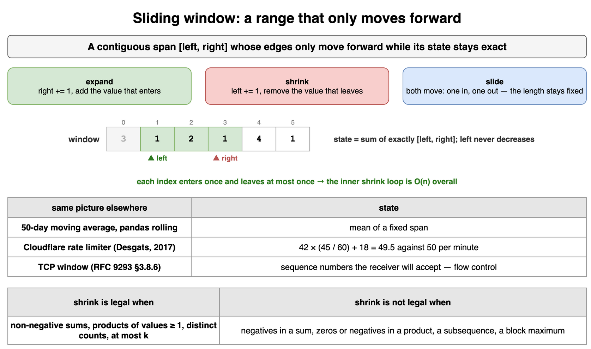

*Source: [`diagrams/sliding-windows.drawio`](/content/11_Coding_Problems/13_Sliding_Windows/diagrams/sliding-windows.drawio), page 1.*

## Fixed-size window
The length is given. There are `n - k + 1` spans when `k` is from 1 through `n`. The first costs `k` additions. Each later span is one addition and one subtraction, with no inner loop, so the O(n) bound is direct. After `right` has reached at least `k - 1`, the total is `values[right - k + 1]` through `values[right]`. On `[8, 2, 6, 4, 10]` and `k` of 2 the totals are 10, 8, 10, and 14, so the averages are 5, 4, 5, and 7. `pandas.Series.rolling(window).mean()` is this update. A boxcar filter is the same mean. The best sum, including a negative, is the fixed-window drill beside [Sliding window](#07_Data_Structures_and_Algorithms/02_Arrays_Strings_and_Hash_Tables/concepts/sliding-window).

A `k` of 0, a `k` longer than the list, and an empty list produce no block. A `k` of 1 is the list. `[7, -2, 5]` with `k` of 2 sums to 5, then 3. A negative is legal, because a fixed window never drops an index for being too large. The best total is O(1) extra memory. Every total is O(n - k + 1). Re-summing each block is O(n · k). Subtracting the leaving value does not name the new maximum when that value was the maximum ([Non-monotone spans](#11_Coding_Problems/13_Sliding_Windows/concepts/non-monotone-spans)).

```python
def fixed_totals(values: list[int], k: int) -> list[int]:
    if k <= 0 or k > len(values):
        return []
    total = sum(values[:k])
    totals = [total]
    for right in range(k, len(values)):
        total += values[right] - values[right - k]
        totals.append(total)
    return totals


print(fixed_totals([8, 2, 6, 4, 10], 2))
print(fixed_totals([8, 2, 6, 4, 10], 1))
print(fixed_totals([8, 2, 6, 4, 10], 0), fixed_totals([8, 2, 6, 4, 10], 6), fixed_totals([], 2))
print(fixed_totals([7, -2, 5], 2))
# [10, 8, 10, 14]
# [8, 2, 6, 4, 10]
# [] [] []
# [5, 3]
```

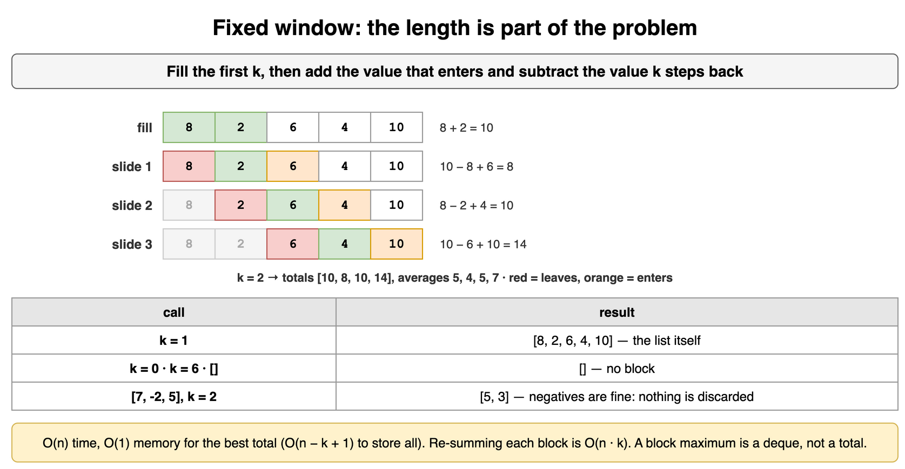

*Source: [`diagrams/sliding-windows.drawio`](/content/11_Coding_Problems/13_Sliding_Windows/diagrams/sliding-windows.drawio), page 2.*

## Longest window under a budget
Grow `right`, shrink `left` only while the span is illegal, and keep the largest legal length. A sum at most a budget needs non-negative values. Growing cannot lower the sum, so an over-budget start stays over if you keep it. Dropping it never skips a valid window. [Sliding window](#11_Coding_Problems/06_Moderate_Problems/concepts/sliding-window) is that rule on a watering log. After each right step, `[left, right]` is legal, and if `left` is positive then `[left - 1, right]` is not. Every later start is a shorter non-negative suffix, so it is legal too. The longest span ending at `right` starts at `left`.

On `[3, 1, 2, 1, 4, 1]` and limit 5, `3 + 1` is 4. Adding 2 makes 6, so 3 leaves. `[1, 2, 1]` has length 3. Adding 4 leaves `[1, 4]`. The last 1 leaves `[4, 1]`. An empty log is 0. A 9 against 5 shrinks until the window is empty. A value equal to the limit has length 1. Two zeros against 0 have length 2. `right` moves `n` times and `left` at most `n`, so the inner loop is O(n) and extra memory is O(1). A value larger than the limit is removed before the length is recorded. Recording first counts an illegal span. Sorting destroys the order. Negatives belong to [Prefix sums](#11_Coding_Problems/06_Moderate_Problems/concepts/prefix-sums). Every pair of ends is O(n²).

```python
def longest_at_most(values: list[int], limit: int) -> int:
    left = 0
    total = 0
    best = 0
    for right, value in enumerate(values):
        total += value
        while total > limit and left <= right:
            total -= values[left]
            left += 1
        if total <= limit:
            best = max(best, right - left + 1)
    return best


print(longest_at_most([3, 1, 2, 1, 4, 1], 5))
print(longest_at_most([], 5), longest_at_most([9], 5), longest_at_most([2], 2), longest_at_most([0, 0], 0))
# 3
# 0 0 1 2
```

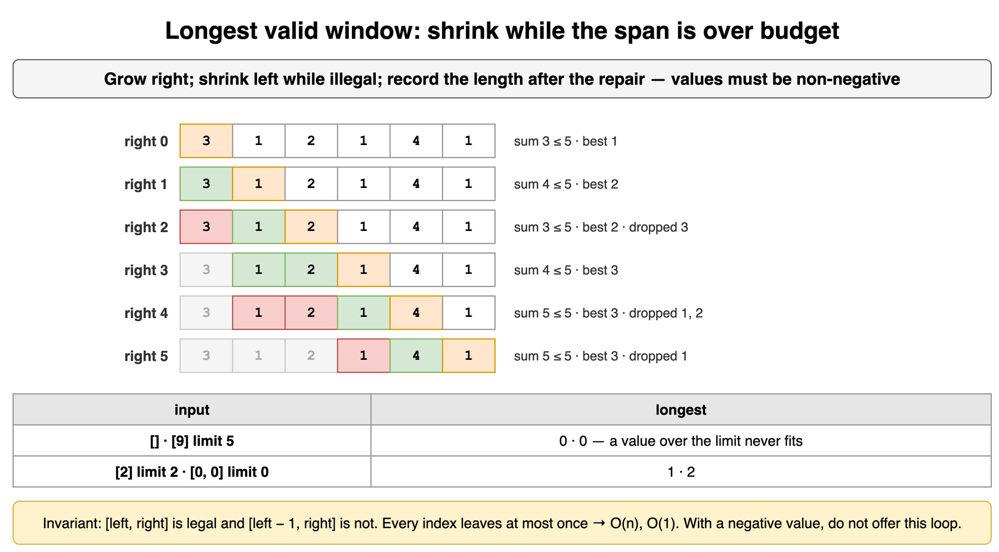

*Source: [`diagrams/sliding-windows.drawio`](/content/11_Coding_Problems/13_Sliding_Windows/diagrams/sliding-windows.drawio), page 3.*

## Shortest window to a target
Record while the span is still legal, then shrink. The longest scan records after the repair. This one records first: the shortest span ending at `right` is the last length before a non-negative sum falls under a positive target. Shrinking lowers that sum. The drill beside [Sliding window](#07_Data_Structures_and_Algorithms/11_Problem_Solving_Patterns/concepts/sliding-window) is the same sum on another list.

On `[4, 2, 5, 1, 3]` and 8, length 3 is recorded at 11, then at 8, then at 9. No neighboring pair reaches 8. An empty list and two 1s against 10 return 0. A 9 against 3, and a value equal to the target, have length 1. A non-positive target is outside the contract. Every non-negative sum is at least 0, the empty span would qualify, and this loop never measures it, so the function returns 0, the same answer as no span. LeetCode 209 uses positive integers, a positive target, lengths 1 through 10⁵, values 1 through 10⁴, and a target through 10⁹, or 0 when none qualifies. A zero is outside that contract. This function accepts zeros. `left` moves at most `n` times: O(n) time and O(1) extra memory. `best` starts at `len(values) + 1`. Returning that sentinel leaks it. Recording after the shrink measures the first illegal length. A fixed window cannot answer "shortest."

```python
def shortest_at_least(values: list[int], target: int) -> int:
    if target <= 0:
        return 0
    left = 0
    total = 0
    best = len(values) + 1
    for right, value in enumerate(values):
        total += value
        while total >= target and left <= right:
            best = min(best, right - left + 1)
            total -= values[left]
            left += 1
    return best if best <= len(values) else 0


print(shortest_at_least([4, 2, 5, 1, 3], 8))
print(shortest_at_least([], 3), shortest_at_least([9], 3), shortest_at_least([1, 1], 10), shortest_at_least([4], 4))
# 3
# 0 1 0 1
```

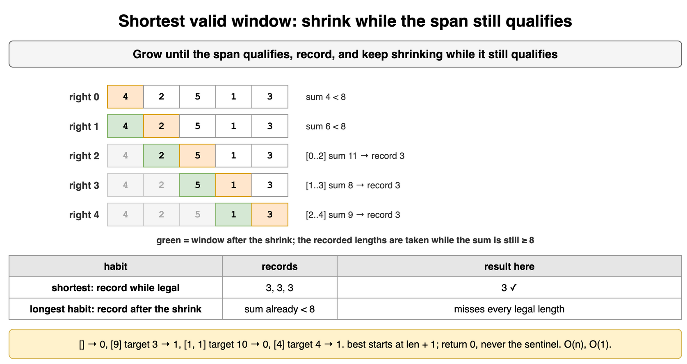

*Source: [`diagrams/sliding-windows.drawio`](/content/11_Coding_Problems/13_Sliding_Windows/diagrams/sliding-windows.drawio), page 4.*

## Window state
State is what one enter and one leave can update: a sum, a product of positive integers, or character counts ([Frequency map and character counting](#07_Data_Structures_and_Algorithms/02_Arrays_Strings_and_Hash_Tables/concepts/frequency-map-and-character-counting), [Frequency map](#07_Data_Structures_and_Algorithms/11_Problem_Solving_Patterns/concepts/frequency-map), [Count with a map](#11_Coding_Problems/06_Moderate_Problems/concepts/count-with-a-map)). [A second pass for arrival order](#11_Coding_Problems/10_Hash_Maps_and_Sets/concepts/a-second-pass-for-arrival-order) reads them in order. The window only changes that update. Lowercase letters are 26 slots ([Counting and buckets](#11_Coding_Problems/07_Hard_Problems/concepts/counting-and-buckets)), so two arrays compare in constant time. A matches counter starts at the slots that are still 0, then moves by one when a window count lands on the pattern count or leaves it. An anagram is a counter of 26. Rebuilding each window is O(n · m). A [Rolling hash for substrings](#07_Data_Structures_and_Algorithms/02_Arrays_Strings_and_Hash_Tables/concepts/rolling-hash-for-substrings) answers "same string." Counts answer "same multiset."

The length is the pattern's. `bca` and `acb` in `bcaacb` match `abc`, and both counters report 2. Empty text, an empty pattern, or a longer pattern returns 0, not `len(text) + 1` empty blocks. A code point before `a` is a negative index, counted from the end, so the arrays can agree for the wrong reason. Past `z` raises `IndexError`. A key left at 0 is not a missing key. `Counter` ignores zeros, so delete the key or compare the arrays. Time is O(n), the arrays are O(1), and a wider alphabet is a dict of size O(m). LeetCode 438 returns the start indexes (lowercase, lengths 1 through 3 · 10⁴). LeetCode 567 is the boolean (lengths 1 through 10⁴). Both exclude empty strings. The index list can be O(n).

```python
from collections import Counter


def anagram_hits(text: str, pattern: str) -> tuple[int, int]:
    if not pattern or len(pattern) > len(text):
        return (0, 0)
    base = ord("a")
    need = [0] * 26
    have = [0] * 26
    for ch in pattern:
        need[ord(ch) - base] += 1
    matched = sum(slot == 0 for slot in need)

    def bump(idx: int, delta: int) -> None:
        nonlocal matched
        if have[idx] == need[idx]:
            matched -= 1
        have[idx] += delta
        if have[idx] == need[idx]:
            matched += 1

    for ch in text[: len(pattern)]:
        bump(ord(ch) - base, 1)
    by_counter = int(matched == 26)
    by_array = int(have == need)
    for right in range(len(pattern), len(text)):
        bump(ord(text[right]) - base, 1)
        bump(ord(text[right - len(pattern)]) - base, -1)
        by_counter += int(matched == 26)
        by_array += int(have == need)
    return (by_array, by_counter)


print(anagram_hits("bcaacb", "abc"))
print(anagram_hits("aaaa", "aa"), anagram_hits("zz", "z"))
print(anagram_hits("ab", "abcd"), anagram_hits("", "a"), anagram_hits("abc", ""))
print({"a": 1, "b": 0} == {"a": 1}, Counter({"a": 1, "b": 0}) == Counter({"a": 1}))
# (2, 2)
# (3, 3) (2, 2)
# (0, 0) (0, 0) (0, 0)
# False True
```

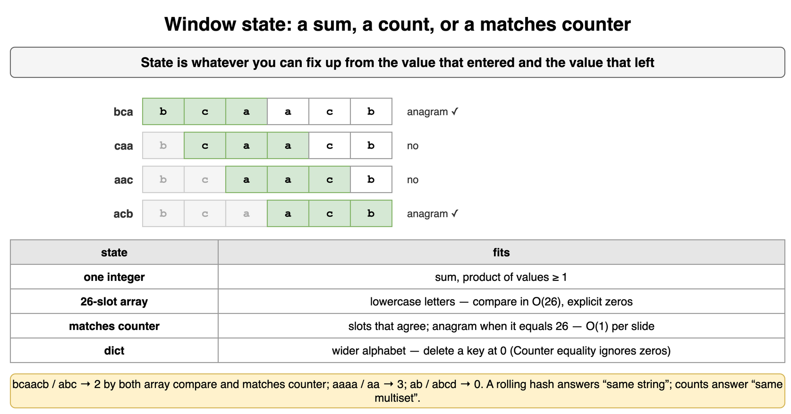

*Source: [`diagrams/sliding-windows.drawio`](/content/11_Coding_Problems/13_Sliding_Windows/diagrams/sliding-windows.drawio), page 5.*

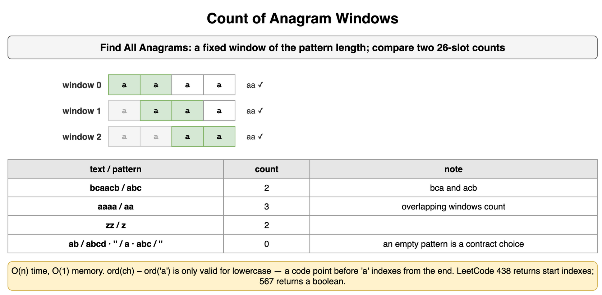

*Source: [`diagrams/sliding-windows.drawio`](/content/11_Coding_Problems/13_Sliding_Windows/diagrams/sliding-windows.drawio), page 6.*

## Longest substring without repeats
The longest contiguous piece with no repeated character is a window. A subsequence that skips is a different problem. Shrink a set until the new character is gone, then add it and measure. Measuring first counts the repeat. `diction` grows through `dict`. The second `i` drops `d` and the first `i`, and `ction` has length 5. In `a b a` the space counts, and the length is still 3. Each character is inserted and removed at most once: O(n) time and O(m) memory for m distinct characters. A 26-slot array is the wrong alphabet. LeetCode 3 allows length 0 through 10⁵ and letters, digits, symbols, and spaces. A dict or a set covers that alphabet. A 128-slot array covers only that byte range.

The last index jumps with `left = max(left, previous + 1)`. Without `max`, an index already outside the window pulls `left` backward and restores characters the shrink dropped. On `success` the second `c` sets `left` to 3. The later `s` still has a copy at 0. The buggy assignment sets `left` to 1, length 5, and the span holds both copies of `c`. `max(3, 1)` keeps 3, and the best length stays 3 (`suc`, or `ces`). Store the new index after reading the old one, or the jump goes nowhere. A missing character uses `-1`, so `-1 + 1` does not move a left edge already at 0. `left` never decreases. The set only removes the character at `left`, so it cannot move backward. The jump has that same bound.

```python
def longest_unique(text: str) -> int:
    seen: set[str] = set()
    left = 0
    best = 0
    for right, ch in enumerate(text):
        while ch in seen:
            seen.remove(text[left])
            left += 1
        seen.add(ch)
        best = max(best, right - left + 1)
    return best


def buggy_jump(text: str) -> int:
    last: dict[str, int] = {}
    left = 0
    best = 0
    for right, ch in enumerate(text):
        if ch in last:
            left = last[ch] + 1
        last[ch] = right
        best = max(best, right - left + 1)
    return best


def jump_unique(text: str) -> int:
    last: dict[str, int] = {}
    left = 0
    best = 0
    for right, ch in enumerate(text):
        left = max(left, last.get(ch, -1) + 1)
        last[ch] = right
        best = max(best, right - left + 1)
    return best


print(longest_unique("diction"), jump_unique("diction"))
print(buggy_jump("success"), jump_unique("success"))
print(longest_unique(""), longest_unique("aaaa"), longest_unique("a b a"))
# 5 5
# 5 3
# 0 1 3
```

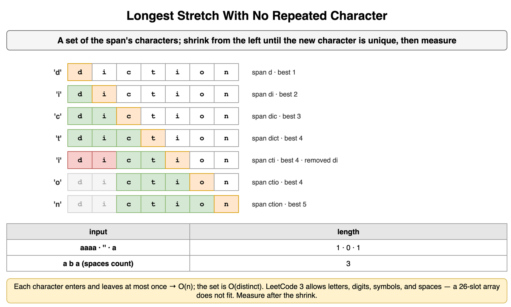

*Source: [`diagrams/sliding-windows.drawio`](/content/11_Coding_Problems/13_Sliding_Windows/diagrams/sliding-windows.drawio), page 7.*

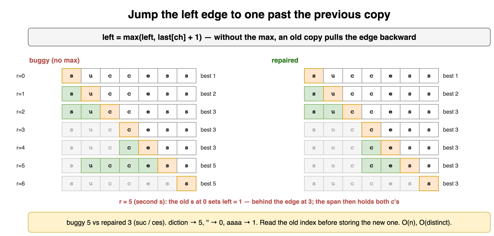

*Source: [`diagrams/sliding-windows.drawio`](/content/11_Coding_Problems/13_Sliding_Windows/diagrams/sliding-windows.drawio), page 8.*

## Repeating character replacement
The longest piece you can make into one character with at most `k` changes is legal when its length minus its most frequent count is at most `k`. A window shorter than the best already found is useless, so one step over budget slides `left` by one. The high-water mark is the largest count seen, and it is not lowered when `left` moves. On `AAAB` with `k` of 0 the mark reaches 3 on `AAA`. Adding `B` slides once. The final slice `AAB` needs one change and is over budget. The length 3 still belongs to `AAA`. `k` of 0 is that longest run: 4 on `AAAA`, 1 on `ABC`. Empty text or a negative `k` is 0.

A count rises by at most 1, and only a live count raises the mark, so one added character changes `length - high` by 1 or by 0. A legal window is at most one over, and one slide restores `length = high + k`. That is why the test never shrinks by more than one. The length grows on the next add only when that add sets a new live mark, so the longer window can be made uniform within `k`. A stale mark cannot. The window slides, the length stays, and later illegal slices do not raise it. The final slice can still be over budget. Recompute the true maximum when the caller wants the slice. On 26 letters that scan is linear. Time is O(n), a dict is O(m), and uppercase letters are O(1). LeetCode 424 is uppercase, length 1 through 10⁵, and `k` from 0 through the length. Fewer than `k` changes is allowed, to any other uppercase letter. A `k` past the length returns the whole string. Other characters are accepted.

```python
def longest_uniform(text: str, k: int) -> tuple[int, str]:
    if k < 0 or not text:
        return (0, "")
    counts: dict[str, int] = {}
    left = 0
    high = 0
    for right, ch in enumerate(text):
        counts[ch] = counts.get(ch, 0) + 1
        high = max(high, counts[ch])
        if (right - left + 1) - high > k:
            counts[text[left]] -= 1
            left += 1
    return (len(text) - left, text[left:])


print(longest_uniform("AAAB", 0))
print(longest_uniform("AAAB", 1))
print(longest_uniform("AAAA", 0), longest_uniform("ABC", 0), longest_uniform("", 2))
# (3, 'AAB')
# (4, 'AAAB')
# (4, 'AAAA') (1, 'C') (0, '')
```

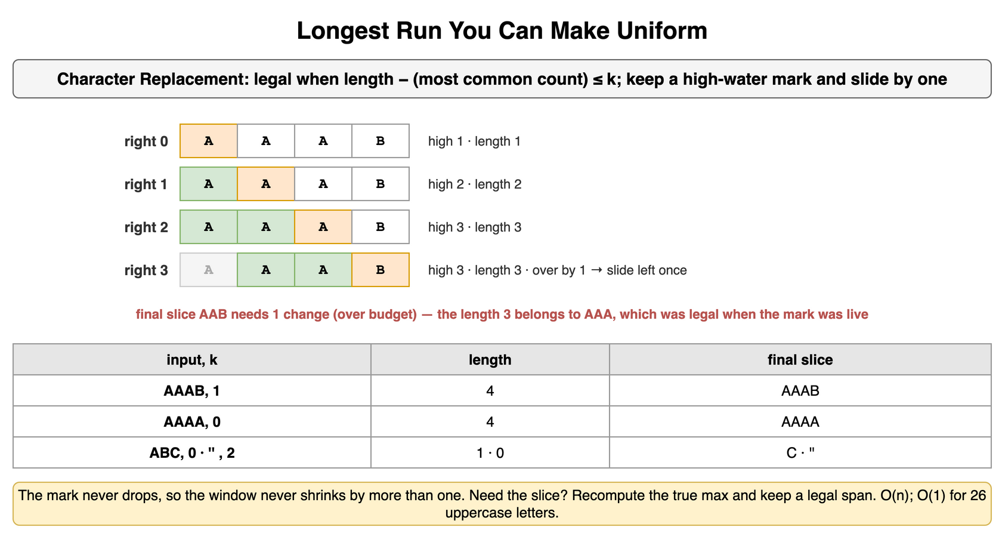

*Source: [`diagrams/sliding-windows.drawio`](/content/11_Coding_Problems/13_Sliding_Windows/diagrams/sliding-windows.drawio), page 9.*

## Non-monotone spans
A shrink is legal only when a larger span cannot become legal again. On a longest sum at most 4, `[3, 3, -2]` drops the first 3 when the sum hits 6. Then `[3, -2]` has length 2. The whole list sums to 4, length 3, and `left` cannot move back. The prefix is `[0, 3, 6, 4]`, and `4 - 0` is 4 ([Prefix sums](#11_Coding_Problems/06_Moderate_Problems/concepts/prefix-sums)). Every pair of ends is the brute force once negatives are allowed. A fixed window still adds them, because it never discards a start. Blocks of length 2 on `[7, -2, 5]` sum to 5 and then 3.

Integers at least 1 do not fall as the window grows, so every inner subarray is legal. A zero does not: `[2, 0, 5]` under a strict ceiling of 4 stays at product 0, never moves `left`, and counts 6, but `[5]` is illegal and the true count is 5. Dividing out that 0 raises `ZeroDivisionError`. `[4, -2]` under 3 drops 4, then -8 is legal and `left` cannot return. The shrink counts 1. The true count is 2. `[8, 3, 5]` then `[3, 5, 1]` have maxima 8 then 5, and subtracting 8 does not recover 5. [Monotonic deque: sliding window maximum](#07_Data_Structures_and_Algorithms/04_Stacks_and_Queues/concepts/monotonic-deque-sliding-window-maximum) keeps those candidates in linear time. A heap that deletes the leaving value is O(n log k) and easier to describe. A subsequence that skips is not this span.

```python
def shrink_sum(values: list[int], limit: int) -> int:
    left = 0
    total = 0
    best = 0
    for right, value in enumerate(values):
        total += value
        while total > limit and left <= right:
            total -= values[left]
            left += 1
        if total <= limit:
            best = max(best, right - left + 1)
    return best


def every_sum(values: list[int], limit: int) -> int:
    best = 0
    for start in range(len(values)):
        total = 0
        for end in range(start, len(values)):
            total += values[end]
            if total <= limit:
                best = max(best, end - start + 1)
    return best


def shrink_products(values: list[int], limit: int) -> int:
    left = 0
    prod = 1
    total = 0
    for right, value in enumerate(values):
        prod *= value
        while left <= right and prod >= limit:
            prod //= values[left]
            left += 1
        total += right - left + 1
    return total


def every_product(values: list[int], limit: int) -> int:
    total = 0
    for start in range(len(values)):
        prod = 1
        for end in range(start, len(values)):
            prod *= values[end]
            if prod < limit:
                total += 1
    return total


print(shrink_sum([3, 3, -2], 4), every_sum([3, 3, -2], 4))
print(shrink_products([2, 0, 5], 4), every_product([2, 0, 5], 4))
print(shrink_products([4, -2], 3), every_product([4, -2], 3))
print([7 + -2, -2 + 5])
print([max(block) for block in ([8, 3, 5], [3, 5, 1])])
# 2 3
# 6 5
# 1 2
# [5, 3]
# [8, 5]
```

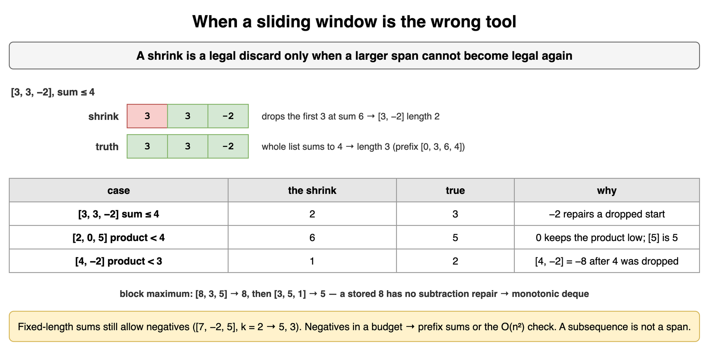

*Source: [`diagrams/sliding-windows.drawio`](/content/11_Coding_Problems/13_Sliding_Windows/diagrams/sliding-windows.drawio), page 10.*

## Window, two pointers, or prefix sums
A named length is the fixed window. A longest contiguous budget, at most k distinct values or at most k changes, is the longest window. A shortest non-negative sum that reaches a quota is the shortest window. A count of products under a ceiling, with values at least 1, adds `right - left + 1`, because every subarray of a legal window is legal. A sorted pair sum is [Two pointers](#11_Coding_Problems/06_Moderate_Problems/concepts/two-pointers) and [Pair sum in a sorted array](#11_Coding_Problems/09_Two_Pointers/concepts/pair-sum-in-a-sorted-array). An unsorted complement is [Pair sum in an unsorted array](#11_Coding_Problems/10_Hash_Maps_and_Sets/concepts/pair-sum-in-an-unsorted-array). A range sum, or a budget that must survive negatives, is [Prefix sums](#11_Coding_Problems/06_Moderate_Problems/concepts/prefix-sums). A block maximum is [Monotonic deque: sliding window maximum](#07_Data_Structures_and_Algorithms/04_Stacks_and_Queues/concepts/monotonic-deque-sliding-window-maximum). The pair loop is the O(n²) check on a short list ([Optimize brute force in steps](#11_Coding_Problems/07_Hard_Problems/concepts/optimize-brute-force-in-steps)).

The non-negative word is what makes the shortest sum legal to shrink. A block maximum only looks like a fixed window, because the leaving value may be the one a total would have remembered. The shrink is linear only when growing makes the condition harder. Two pointers need order or symmetry and do not keep a multiset ([Two pointers, a hash map, or brute force](#11_Coding_Problems/09_Two_Pointers/concepts/two-pointers-a-hash-map-or-brute-force)). Prefix sums answer a range after one build and do not give the shortest span. The deque is linear for maxima. The quadratic scan is the check on a short list.

```python
def choose(kind: str) -> str:
    return {
        "mean of 5 tank readings": "fixed window",
        "longest stretch with at most 2 status codes": "longest window",
        "fewest non-negative days that reach a quota": "shortest window",
        "maximum inside each block of 4 hours": "monotonic deque",
    }[kind]


print(choose("mean of 5 tank readings"))
print(choose("longest stretch with at most 2 status codes"))
print(choose("fewest non-negative days that reach a quota"))
print(choose("maximum inside each block of 4 hours"))
# fixed window
# longest window
# shortest window
# monotonic deque
```

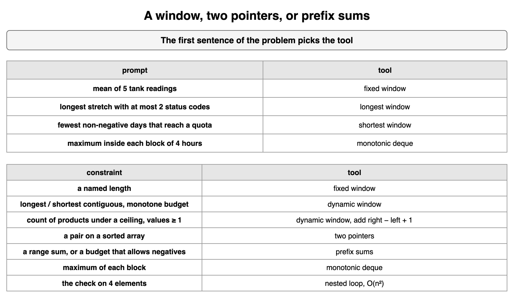

*Source: [`diagrams/sliding-windows.drawio`](/content/11_Coding_Problems/13_Sliding_Windows/diagrams/sliding-windows.drawio), page 11.*
