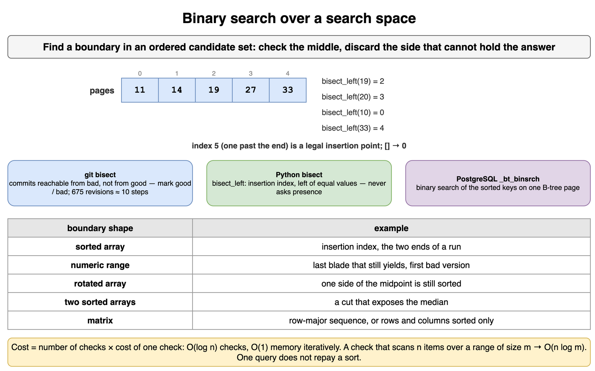
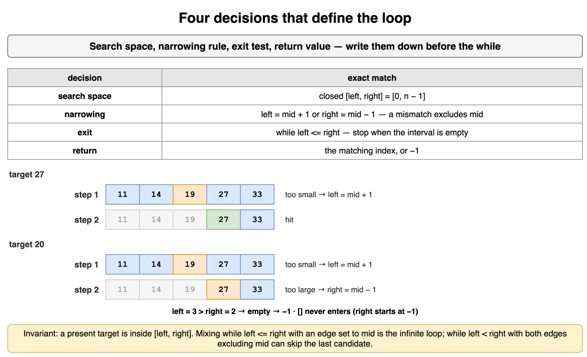
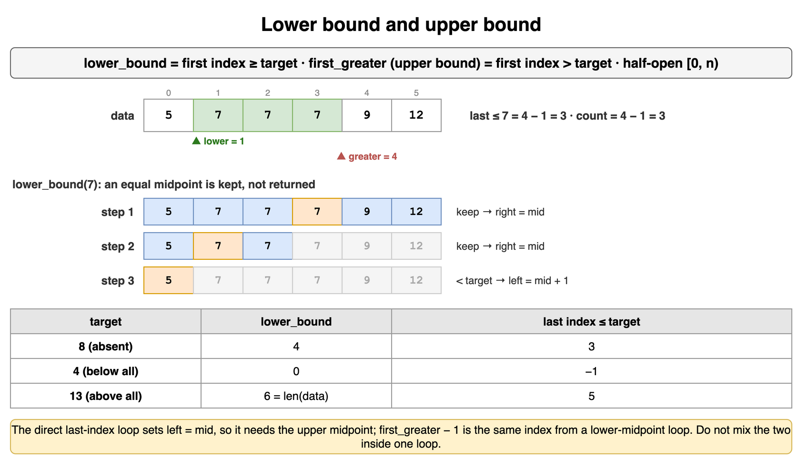
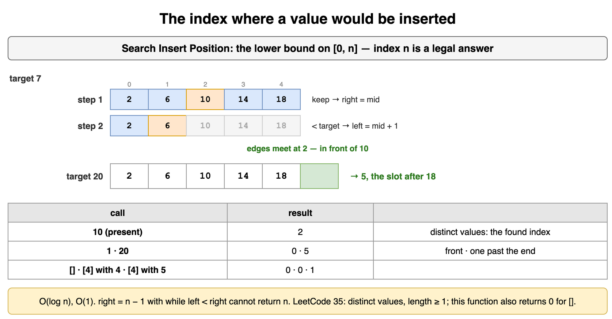
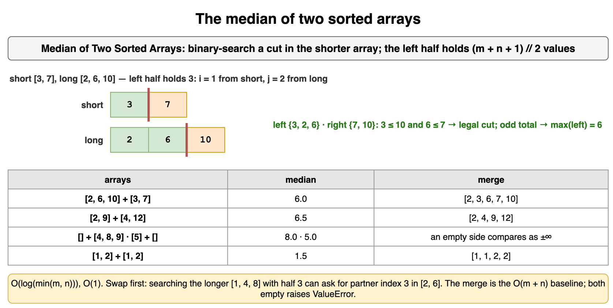
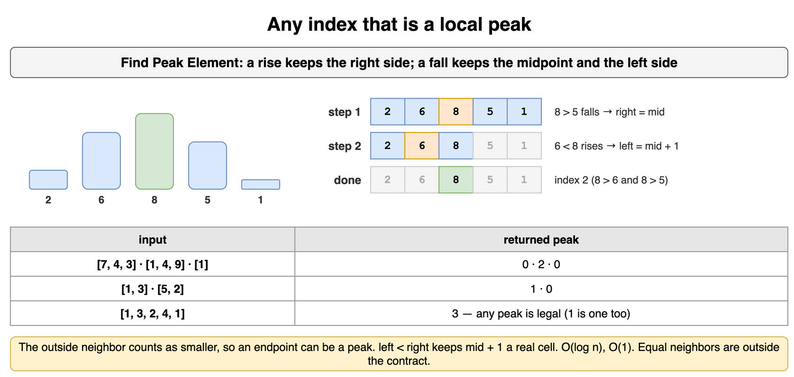
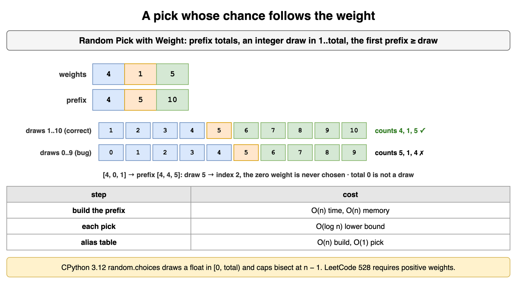
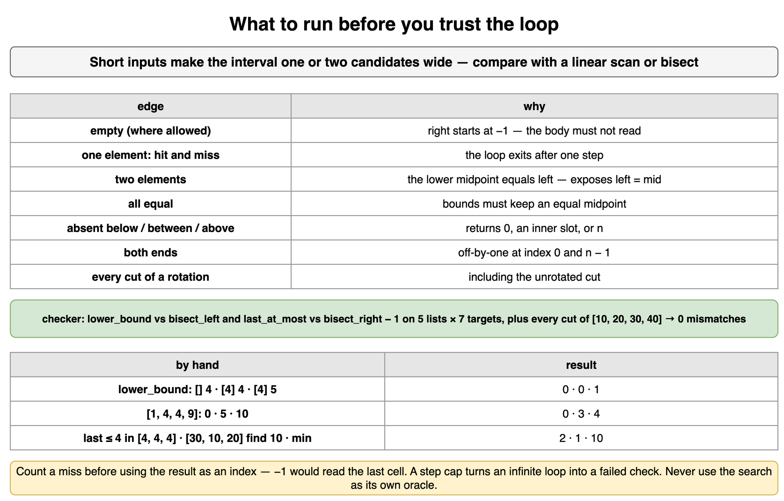

## Search space
Binary search discards the side of an ordered candidate set that one middle check has ruled out. The candidates are indexes, commits, or integers in a range. `git bisect` keeps commits reachable from a bad commit and not from a good one. Straight history halves, and several parents make the remainder a graph. One documented run had 675 revisions left and about 10 steps. `bisect_left` returns the insertion index to the left of equals. PostgreSQL's `_bt_binsrch` binary-searches one B-tree page, apart from the root-to-leaf descent.

Use it when values are ordered or a yes/no check flips once. An unsorted array is a linear scan, and one query does not repay a sort. A second flip leaves answers on both sides of the discarded half. The shapes are a sorted run, a numeric range, a rotated array, two sorted arrays, and a matrix. The loop is logarithmic in the size of the space and uses O(1) extra memory. Recursion keeps one frame per step ([Binary search](#07_Data_Structures_and_Algorithms/09_Sorting_and_Searching/concepts/binary-search)). A check of n items over a range of size m costs O(n log m). A hash set answers exact membership in expected constant time. Insertion indexes, run ends, and the smallest feasible value stay here.

```python
import bisect

pages = [11, 14, 19, 27, 33]
print(bisect.bisect_left(pages, 19), bisect.bisect_left(pages, 20), bisect.bisect_left(pages, 10))
print(bisect.bisect_left(pages, 33), bisect.bisect_left([], 4))
# 2 3 0
# 4 0
```



*Source: [`diagrams/binary-search.drawio`](/content/11_Coding_Problems/14_Binary_Search/diagrams/binary-search.drawio), page 1.*

## Exact match
Four decisions define the loop: which candidates remain, which side of the midpoint is discarded, when it stops, and what it returns. [Binary search](#07_Data_Structures_and_Algorithms/09_Sorting_and_Searching/concepts/binary-search) is that loop for one exact value. Keeping the midpoint and discarding it stop on different tests.

The interval is closed, from 0 through `n - 1`. A miss sets `left = mid + 1` or `right = mid - 1`. A present target stays inside `[left, right]`. Each miss drops the midpoint, so the interval shrinks and the loop ends when `left > right`. An empty interval returns -1. An empty list starts `right` at -1 and is not read. One cell matches or empties the interval. On `[11, 14, 19, 27, 33]`, 19 hits at once, 27 steps to index 3, and 20 makes the interval empty. The ends are 0 and 4. Slot `n` lies outside this interval. A half-open range can return it ([Lower and upper bound](#11_Coding_Problems/14_Binary_Search/concepts/lower-and-upper-bound)). Assigning an edge to `mid` under `while left <= right` stops shrinking once `mid` is that edge. Excluding `mid` on both sides of `while left < right` can skip the last candidate.

```python
def find_exact(values: list[int], target: int) -> int:
    """Index of target in a sorted list, or -1. Closed interval, midpoint excluded."""
    left, right = 0, len(values) - 1
    while left <= right:
        mid = left + (right - left) // 2
        if values[mid] == target:
            return mid
        if values[mid] < target:
            left = mid + 1
        else:
            right = mid - 1
    return -1


print(find_exact([11, 14, 19, 27, 33], 19))
print(find_exact([11, 14, 19, 27, 33], 27))
print(find_exact([11, 14, 19, 27, 33], 20))
print(find_exact([11, 14, 19, 27, 33], 11), find_exact([11, 14, 19, 27, 33], 33))
print(find_exact([], 19), find_exact([14], 14), find_exact([14], 15))
# 2
# 3
# -1
# 0 4
# -1 0 -1
```



*Source: [`diagrams/binary-search.drawio`](/content/11_Coding_Problems/14_Binary_Search/diagrams/binary-search.drawio), page 2.*

## Lower and upper midpoint
The midpoint has to lie strictly inside the ends and fit the integer type. 1500000000 and 1500000020 fit in a signed 32-bit integer. Java wraps their sum 3000000020 to -1294967276, and half of that is -647483638. C and C++ leave `left + right` undefined. `left + (right - left) // 2` is 1500000010, because a nonnegative difference that fits stays in range when half is added back. Python grows ([Overflow-safe arithmetic](#11_Coding_Problems/06_Moderate_Problems/concepts/overflow-safe-arithmetic), [Overflow awareness](#11_Coding_Problems/01_Math_and_Logic_Puzzles/concepts/overflow-awareness)).

`(right - left) // 2` is the lower midpoint. The upper midpoint adds 1 before dividing and is the right index. `left = mid` needs that upper form. The lower form can already equal `left`, and then the interval never shrinks. While `left < right` the upper midpoint sits above `left`, so `left = mid` and `right = mid - 1` both shrink until the edges meet. On `[4, 9]` the last value at most 4 is index 0, and the lower update sticks there. The extra `+ 1` overflows when `right` is the type's maximum. `left` at -1 with the length at that maximum overflows too, though every index fits. One before the first greater index keeps both edges nonnegative ([Lower and upper bound](#11_Coding_Problems/14_Binary_Search/concepts/lower-and-upper-bound)).

```python
def wrap_i32(left: int, right: int) -> int:
    raw = (left + right) & 0xFFFFFFFF
    return raw - 0x100000000 if raw >= 0x80000000 else raw


def stuck_last(values: list[int], target: int) -> int | None:
    """Lower midpoint and left = mid. Returns None when the interval stops shrinking."""
    left, right = 0, len(values) - 1
    for _ in range(4):
        if left >= right:
            return left
        mid = left + (right - left) // 2
        if values[mid] <= target:
            if mid == left:
                return None
            left = mid
        else:
            right = mid - 1
    return None


def last_at_most(values: list[int], target: int) -> int:
    """Last index whose value is <= target, or -1. Upper midpoint."""
    left, right = -1, len(values) - 1
    while left < right:
        mid = left + (right - left + 1) // 2
        if values[mid] <= target:
            left = mid
        else:
            right = mid - 1
    return left


left, right = 1_500_000_000, 1_500_000_020
print(wrap_i32(left, right), wrap_i32(left, right) // 2)
print(left + (right - left) // 2)
print(8 + (9 - 8) // 2, 8 + (9 - 8 + 1) // 2)
print(stuck_last([4, 9], 4), last_at_most([4, 9], 4))
print(last_at_most([4, 9], 3), last_at_most([4, 9], 9), last_at_most([], 1))
# -1294967276 -647483638
# 1500000010
# 8 9
# None 0
# -1 1 -1
```


*Source: [`diagrams/binary-search.drawio`](/content/11_Coding_Problems/14_Binary_Search/diagrams/binary-search.drawio), page 3.*

## Lower and upper bound
A lower bound is the first index at least the target. An upper bound (`bisect_right`, [Lower and upper bound](#07_Data_Structures_and_Algorithms/09_Sorting_and_Searching/concepts/lower-and-upper-bound)) is the first strictly greater index. Both search `[0, n)` with the lower midpoint, and `right = mid` keeps an equal value that may be the first. Indexes below `left` are too small, indexes at or after `right` are large enough, and the answer stays in `[left, right)`. While `left < right`, `left <= mid < right`, so each branch shrinks the interval until the edges meet. PostgreSQL's `_bt_binsrch` uses this shape on one page. Equal bounds are the insertion index, including `n`. The gap between them is the run, and the difference is its length.

`right` fixed at `n - 1` cannot return `n`. [Exact match](#11_Coding_Problems/14_Binary_Search/concepts/exact-match) returns -1 on a miss. The last feasible index is the upper bound minus one, or -1. A loop with `left = mid` needs the upper midpoint ([Lower and upper midpoint](#11_Coding_Problems/14_Binary_Search/concepts/lower-and-upper-midpoint)). The lower midpoint sticks on the last two feasible indexes. [Ends of a run](#11_Coding_Problems/14_Binary_Search/concepts/ends-of-a-run) adds the absent check. One bound is O(log n) time and O(1) memory. LeetCode 35 asks for this index on distinct values of length at least 1.

```python
import bisect


def lower_bound(values: list[int], target: int) -> int:
    """First index with values[i] >= target, or len(values) if every value is smaller."""
    left, right = 0, len(values)
    while left < right:
        mid = left + (right - left) // 2
        if values[mid] < target:
            left = mid + 1
        else:
            right = mid
    return left


def first_greater(values: list[int], target: int) -> int:
    """First index with values[i] > target, or len(values) if every value is smaller or equal."""
    left, right = 0, len(values)
    while left < right:
        mid = left + (right - left) // 2
        if values[mid] <= target:
            left = mid + 1
        else:
            right = mid
    return left


data = [5, 7, 7, 7, 9, 12]
print(lower_bound(data, 7), bisect.bisect_left(data, 7), first_greater(data, 7), bisect.bisect_right(data, 7))
print(lower_bound(data, 8), first_greater(data, 8) - 1, lower_bound(data, 4), lower_bound(data, 13))
pages = [2, 6, 10, 14, 18]
print(lower_bound(pages, 10), lower_bound(pages, 7), lower_bound(pages, 1), lower_bound(pages, 20))
print(lower_bound([], 3), lower_bound([4], 4), lower_bound([4], 5))
# 1 1 4 4
# 4 3 0 6
# 2 2 0 5
# 0 0 1
```



*Source: [`diagrams/binary-search.drawio`](/content/11_Coding_Problems/14_Binary_Search/diagrams/binary-search.drawio), page 4.*



*Source: [`diagrams/binary-search.drawio`](/content/11_Coding_Problems/14_Binary_Search/diagrams/binary-search.drawio), page 6.*

## Ends of a run
The first and last indexes of a target are the lower bound and one before the first strictly greater value ([Lower and upper bound](#11_Coding_Problems/14_Binary_Search/concepts/lower-and-upper-bound)). A non-decreasing list puts those matches in one run. Read `values[left]` only when `left < n`. Past the end, or a different value there, the result is `[-1, -1]`. Run length is the last index minus the first, plus one. `[4, 6, 6, 6, 8, 10]` holds 6 on `[1, 3]`. A 5 between the neighbors is absent. The single values at the ends are runs of one index. Empty, one 6, and three 6s return `[-1, -1]`, `[0, 0]`, and `[0, 2]`.

Two bounds stay O(log n) time and O(1) memory when every entry equals the target. Walking out from one hit is O(n) on that list. Subtracting one from a loop that already returns the last feasible index shifts the end. LeetCode 34 allows length 0 and requires a logarithmic bound, so the empty list is part of the contract.

```python
def lower_bound(values: list[int], target: int) -> int:
    left, right = 0, len(values)
    while left < right:
        mid = left + (right - left) // 2
        if values[mid] < target:
            left = mid + 1
        else:
            right = mid
    return left


def first_greater(values: list[int], target: int) -> int:
    left, right = 0, len(values)
    while left < right:
        mid = left + (right - left) // 2
        if values[mid] <= target:
            left = mid + 1
        else:
            right = mid
    return left


def first_last(values: list[int], target: int) -> list[int]:
    left = lower_bound(values, target)
    if left == len(values) or values[left] != target:
        return [-1, -1]
    return [left, first_greater(values, target) - 1]


run = [4, 6, 6, 6, 8, 10]
print(first_last(run, 6), first_last(run, 5), first_last(run, 4), first_last(run, 10))
print(first_last([], 6), first_last([6], 6), first_last([6, 6, 6], 6))
print(3 - 1 + 1, 2 - 0 + 1)
# [1, 3] [-1, -1] [0, 0] [5, 5]
# [-1, -1] [0, 0] [0, 2]
# 3 3
```


*Source: [`diagrams/binary-search.drawio`](/content/11_Coding_Problems/14_Binary_Search/diagrams/binary-search.drawio), page 7.*

## First index that passes a test
A predicate that flips from false to true once turns a numeric range into a search space ([Binary search on the answer](#07_Data_Structures_and_Algorithms/09_Sorting_and_Searching/concepts/binary-search-on-the-answer), [Binary search on answer](#07_Data_Structures_and_Algorithms/11_Problem_Solving_Patterns/concepts/binary-search-on-answer)). Return the first true value, or the last. `git bisect` is that test: after a bad mark, later marks stay bad when the bug remains.

The first true value lies in `[left, right)`. A true midpoint may be first, so `right = mid`. A false one sets `left = mid + 1`. The lower midpoint shrinks both branches until the edges meet. A predicate that stays false meets at the exclusive end. Versions 1 through 16 take 4 calls when 11 is first bad, 5 when 1 is first, and 4 when 16 is first. The last true value is the first false minus one, or `left = mid` with the upper midpoint ([Highest blade](#11_Coding_Problems/14_Binary_Search/concepts/highest-blade)). The true side is one prefix or one suffix. A second flip drops a real answer. LeetCode 278 promises a bad version and allows `n` of 2147483647. `n + 1` does not fit in a signed 32-bit integer. `right` starting at `n` fits, and returns `n` when every version is good. Calls stay logarithmic, and memory is O(1).

```python
def first_bad(n: int, bad_at: int) -> tuple[int, int]:
    """Smallest version in 1..n that is bad, and how many times the predicate ran."""
    calls = 0

    def is_bad(version: int) -> bool:
        nonlocal calls
        calls += 1
        return version >= bad_at

    left, right = 1, n + 1
    while left < right:
        mid = left + (right - left) // 2
        if is_bad(mid):
            right = mid
        else:
            left = mid + 1
    return left, calls


def first_bad_fits(n: int, bad_at: int) -> int:
    """Same answer with right starting at n, so n + 1 is never formed."""
    left, right = 1, n
    while left < right:
        mid = left + (right - left) // 2
        if mid >= bad_at:
            right = mid
        else:
            left = mid + 1
    return left


print(first_bad(16, 11))
print(first_bad(16, 1), first_bad(16, 16))
print(first_bad_fits(16, 11), first_bad_fits(16, 1), first_bad_fits(16, 16), first_bad_fits(1, 1))
# (11, 4)
# (1, 5) (16, 4)
# 11 1 16 1
```


*Source: [`diagrams/binary-search.drawio`](/content/11_Coding_Problems/14_Binary_Search/diagrams/binary-search.drawio), page 5.*

## Highest blade
Wood above blade H is the sum of `max(height - H, 0)`. A lower blade never yields less, so the predicate is true through some height and false above it. The answer is the last true height ([First index that passes a test](#11_Coding_Problems/14_Binary_Search/concepts/first-index-that-passes-a-test)). Search 0 through the tallest trunk. A quota of 0 returns that trunk. A quota above the total, or no trunks, returns -1.

A feasible height sets `left = mid` and needs the upper midpoint ([Lower and upper midpoint](#11_Coding_Problems/14_Binary_Search/concepts/lower-and-upper-midpoint)). While `left < right` that midpoint is above `left`, both branches shrink, and the edges meet. The lower midpoint sticks: on `[4, 9]` with quota 5, heights 4 and 5 yield 5 and 4, and `[4, 5]` leaves `left` at 4. Height 8 on `[8, 12, 6, 15]` yields 11 and height 9 yields 9, so quota 10 returns 8. n trunks and M + 1 heights cost O(n log (M + 1)) plus a pass for the tallest trunk, and O(1) extra memory. 1800000000 + 1800000000 wraps to -694967296 in signed 32-bit arithmetic ([Overflow-safe arithmetic](#11_Coding_Problems/06_Moderate_Problems/concepts/overflow-safe-arithmetic)). The first failing height minus one is the same blade. The lowest success is 0 whenever 0 already works. LeetCode 875 checks a speed, not this sum.

```python
def wood_above(heights: list[int], blade: int) -> int:
    return sum(max(height - blade, 0) for height in heights)


def highest_blade(heights: list[int], need: int) -> int:
    if not heights:
        return -1
    if need <= 0:
        return max(heights)
    if wood_above(heights, 0) < need:
        return -1
    left, right = 0, max(heights)
    while left < right:
        mid = left + (right - left + 1) // 2
        if wood_above(heights, mid) >= need:
            left = mid
        else:
            right = mid - 1
    return left


def wrap_i32(left: int, right: int) -> int:
    raw = (left + right) & 0xFFFFFFFF
    return raw - 0x100000000 if raw >= 0x80000000 else raw


def stuck_blade(heights: list[int], need: int) -> tuple[int, int, int, str] | int:
    """Lower midpoint with left = mid. Returns the pair that stops shrinking."""
    left, right = 0, max(heights)
    for _ in range(8):
        if left >= right:
            return left
        mid = left + (right - left) // 2
        if wood_above(heights, mid) >= need:
            if mid == left:
                return (left, right, mid, "stuck")
            left = mid
        else:
            right = mid - 1
    return (left, right, -1, "cap")


print(highest_blade([8, 12, 6, 15], 10))
print(wood_above([8, 12, 6, 15], 8), wood_above([8, 12, 6, 15], 9))
print(highest_blade([8, 12, 6, 15], 0), highest_blade([8, 12, 6, 15], 42), highest_blade([], 1))
print(stuck_blade([4, 9], 5), highest_blade([4, 9], 5))
print(wrap_i32(1_800_000_000, 1_800_000_000))
# 8
# 11 9
# 15 -1 -1
# (4, 5, 4, 'stuck') 4
# -694967296
```


*Source: [`diagrams/binary-search.drawio`](/content/11_Coding_Problems/14_Binary_Search/diagrams/binary-search.drawio), page 8.*

## Search a rotated sorted array
One cut of distinct sorted values leaves one sorted side at every midpoint ([Rotated sorted array](#07_Data_Structures_and_Algorithms/09_Sorting_and_Searching/concepts/rotated-sorted-array)). `values[left] <= values[mid]` means that side, both ends included, is sorted, and the target belongs there when `values[left] <= target < values[mid]`. Otherwise it is on the right. If the left side is unsorted, the right side holds the target when `values[mid] < target <= values[right]`. The interval is closed. A miss excludes the midpoint, so the interval shrinks until it is empty ([Exact match](#11_Coding_Problems/14_Binary_Search/concepts/exact-match)). Return the index, or -1.

Keep `<=`. On `[3, 1]` the only midpoint is index 0, the same cell as `left`. It counts as sorted, 1 lies outside it, and the next step finds 1. A strict `<` walks off the array. Equals break the test: `[2, 3, 2, 2, 2]` hides 3 at index 1, because the first midpoint's ends match and `[2, 3, 2]` is not sorted. LeetCode 81 is then linear. An equal end may shrink the range by one index, so a linear scan is the fallback. Distinct values are O(log n) time and O(1) memory. Empty input returns -1. LeetCode 33 requires distinct values, length at least 1, and allows the unrotated array.

```python
def search_rotated(values: list[int], target: int) -> int:
    left, right = 0, len(values) - 1
    while left <= right:
        mid = left + (right - left) // 2
        if values[mid] == target:
            return mid
        if values[left] <= values[mid]:
            if values[left] <= target < values[mid]:
                right = mid - 1
            else:
                left = mid + 1
        elif values[mid] < target <= values[right]:
            left = mid + 1
        else:
            right = mid - 1
    return -1


def search_rotated_strict(values: list[int], target: int) -> int:
    """Same loop with < instead of <= on the left end. Can miss a two-element rotation."""
    left, right = 0, len(values) - 1
    while left <= right:
        mid = left + (right - left) // 2
        if values[mid] == target:
            return mid
        if values[left] < values[mid]:
            if values[left] <= target < values[mid]:
                right = mid - 1
            else:
                left = mid + 1
        elif values[mid] < target <= values[right]:
            left = mid + 1
        else:
            right = mid - 1
    return -1


print(search_rotated([9, 12, 15, 2, 5, 8], 5))
print(search_rotated([9, 12, 15, 2, 5, 8], 9), search_rotated([9, 12, 15, 2, 5, 8], 8))
print(search_rotated([9, 12, 15, 2, 5, 8], 7))
print(search_rotated([3, 1], 1), search_rotated_strict([3, 1], 1))
print(search_rotated([2, 3, 2, 2, 2], 3))
print(search_rotated([], 1), search_rotated([7], 7), search_rotated([7], 8))
# 4
# 0 5
# -1
# 1 -1
# -1
# -1 0 -1
```


*Source: [`diagrams/binary-search.drawio`](/content/11_Coding_Problems/14_Binary_Search/diagrams/binary-search.drawio), page 9.*

## Median of two sorted arrays
The median is the middle merged value, or the average of the two middle values on an even count. Cut the shorter array so the left half holds `(m + n + 1) // 2` values and every left value is at most every right value. Cut `i` takes `i` short values and `j = half - i` long values. An empty side is negative infinity on the left and positive infinity on the right. Too far right sets `hi = i - 1`. Otherwise `lo = i + 1`. Each step excludes `i`, the interval shrinks, and the loop ends. Sorted input returns inside the loop. Unsorted input raises `ValueError`.

Lengths 3 and 2 need three values on the left, so a cut of 0 in the longer array asks the shorter one for index 3. Swap first. `[2, 6, 10]` and `[3, 7]` have median 6.0. Time is O(log(min(m, n))) and extra memory is O(1). Add half the gap between the two middle values onto the smaller one when that sum can overflow. [Merging sorted sequences](#07_Data_Structures_and_Algorithms/09_Sorting_and_Searching/concepts/merging-sorted-sequences) is the O(m + n) baseline. LeetCode 4 allows one empty array and rejects two, which raise here. [Quickselect](#07_Data_Structures_and_Algorithms/09_Sorting_and_Searching/concepts/quickselect) ignores the sorted order.

```python
def median_sorted(left_run: list[int], right_run: list[int]) -> float:
    if len(left_run) > len(right_run):
        left_run, right_run = right_run, left_run
    short, long = left_run, right_run
    m, n = len(short), len(long)
    if m + n == 0:
        raise ValueError("both arrays are empty")
    half = (m + n + 1) // 2
    lo, hi = 0, m
    while lo <= hi:
        i = lo + (hi - lo) // 2
        j = half - i
        a_left = short[i - 1] if i else float("-inf")
        a_right = short[i] if i < m else float("inf")
        b_left = long[j - 1] if j else float("-inf")
        b_right = long[j] if j < n else float("inf")
        if a_left <= b_right and b_left <= a_right:
            if (m + n) % 2:
                return float(max(a_left, b_left))
            return (max(a_left, b_left) + min(a_right, b_right)) / 2
        if a_left > b_right:
            hi = i - 1
        else:
            lo = i + 1
    raise ValueError("inputs were not sorted")


print(median_sorted([2, 6, 10], [3, 7]))
print(median_sorted([2, 9], [4, 12]))
print(median_sorted([], [4, 8, 9]), median_sorted([5], []))
print(median_sorted([1, 2], [1, 2]))
print((3 + 2 + 1) // 2, (3 + 2 + 1) // 2 - 0, len([2, 6]))
# 6.0
# 6.5
# 8.0 5.0
# 1.5
# 3 3 2
```



*Source: [`diagrams/binary-search.drawio`](/content/11_Coding_Problems/14_Binary_Search/diagrams/binary-search.drawio), page 10.*

## Search a row-major matrix
Sorted rows, each starting above the previous row's end, are one sequence. Index `i` is row `i // cols` and column `i % cols`. Search 0 through `rows * cols - 1`. A miss excludes the midpoint and the closed interval shrinks until it is empty ([Exact match](#11_Coding_Problems/14_Binary_Search/concepts/exact-match)). In the 3 by 4 matrix, 16 is index 7. Stride 3 maps 7 elsewhere and reports 16 absent, and later indexes walk off the matrix. Time is O(log(rows * cols)) and extra memory is O(1).

Rows and columns can each increase while the flat order does not. `[1, 4, 7, 2, 5, 8, 3, 6, 9]` holds 8 at index 5. Midpoint 5 keeps it, then midpoint 3 discards it. A smaller neighbor locates a target only in sorted order. From the top-right, step left when the cell is larger: the column increases downward. Step down when the cell is smaller: the row increases rightward. Each step drops a row or a column, O(rows + cols). Here 7 steps onto 8. LeetCode 74 is the flat search and needs at least one row and column. LeetCode 240 is the staircase. The flat search misses 8 there.

```python
def search_matrix(matrix: list[list[int]], target: int) -> bool:
    if not matrix or not matrix[0]:
        return False
    rows, cols = len(matrix), len(matrix[0])
    left, right = 0, rows * cols - 1
    while left <= right:
        mid = left + (right - left) // 2
        value = matrix[mid // cols][mid % cols]
        if value == target:
            return True
        if value < target:
            left = mid + 1
        else:
            right = mid - 1
    return False


def search_matrix_stride(matrix: list[list[int]], target: int, stride: int) -> bool | str:
    rows, cols = len(matrix), len(matrix[0])
    left, right = 0, rows * cols - 1
    while left <= right:
        mid = left + (right - left) // 2
        row, col = divmod(mid, stride)
        if row >= rows or col >= cols:
            return "off"
        value = matrix[row][col]
        if value == target:
            return True
        if value < target:
            left = mid + 1
        else:
            right = mid - 1
    return False


def flatten_search(matrix: list[list[int]], target: int) -> int:
    flat = [value for row in matrix for value in row]
    left, right = 0, len(flat) - 1
    while left <= right:
        mid = left + (right - left) // 2
        if flat[mid] == target:
            return mid
        if flat[mid] < target:
            left = mid + 1
        else:
            right = mid - 1
    return -1


def staircase(matrix: list[list[int]], target: int) -> bool:
    if not matrix or not matrix[0]:
        return False
    row, col = 0, len(matrix[0]) - 1
    while row < len(matrix) and col >= 0:
        value = matrix[row][col]
        if value == target:
            return True
        if value > target:
            col -= 1
        else:
            row += 1
    return False


matrix = [
    [2, 4, 6, 8],
    [10, 12, 14, 16],
    [18, 20, 22, 24],
]
print(search_matrix(matrix, 16), search_matrix(matrix, 15))
print(search_matrix(matrix, 2), search_matrix(matrix, 24))
print(search_matrix_stride(matrix, 16, 3))
print(search_matrix_stride(matrix, 24, 3))
print(divmod(7, 4), divmod(7, 3))
stairs = [
    [1, 4, 7],
    [2, 5, 8],
    [3, 6, 9],
]
print(flatten_search(stairs, 8), staircase(stairs, 8), staircase(stairs, 10))
# True False
# True True
# False
# off
# (1, 3) (2, 1)
# -1 True False
```


*Source: [`diagrams/binary-search.drawio`](/content/11_Coding_Problems/14_Binary_Search/diagrams/binary-search.drawio), page 11.*

## Local peak
Return any index strictly greater than its neighbors. A missing neighbor counts as smaller, so an end can be a peak and one element peaks at 0. Adjacent values differ. A midpoint below the next value leaves a peak on the right, including `mid + 1`, because uphill reaches a descent or the end. Discard `mid`. A midpoint above the next value leaves a peak at `mid` or on the left. The maximum there is a peak: neighbors differ, and that side steps down at its right edge.

The indexes are half-open and the midpoint is the lower one. `left < right` keeps `mid + 1` in range. A rise sets `left = mid + 1`. A fall sets `right = mid`, below the old right edge. Both branches shrink until the edges meet. `mid - 1` would read off the front. Several peaks make any one of them legal. Time is O(log n) and extra memory is O(1). The first descent is the O(n) check. LeetCode 162 requires distinct neighbors, length at least 1, and logarithmic time. A plateau fails `<` and can stop on an equal neighbor. The global maximum is a peak, and selecting that one index is linear.

```python
def find_peak(values: list[int]) -> int:
    left, right = 0, len(values) - 1
    while left < right:
        mid = left + (right - left) // 2
        if values[mid] < values[mid + 1]:
            left = mid + 1
        else:
            right = mid
    return left


print(find_peak([2, 6, 8, 5, 1]))
print(find_peak([7, 4, 3]), find_peak([1, 4, 9]), find_peak([1]))
print(find_peak([1, 3]), find_peak([5, 2]))
print(find_peak([1, 3, 2, 4, 1]))
# 2
# 0 2 0
# 1 0
# 3
```



*Source: [`diagrams/binary-search.drawio`](/content/11_Coding_Problems/14_Binary_Search/diagrams/binary-search.drawio), page 12.*

## Weighted pick
Return index `i` with probability proportional to `weights[i]`. One prefix serves every draw ([Prefix sums](#11_Coding_Problems/06_Moderate_Problems/concepts/prefix-sums)). Nonnegative weights make it non-decreasing, so the draw is the first prefix at least an integer from 1 through the total ([Lower and upper bound](#11_Coding_Problems/14_Binary_Search/concepts/lower-and-upper-bound)). CPython 3.12's `random.choices` draws a float in `[0, total)` and bisects with the right edge at `n - 1`. A non-positive total raises `ValueError`. A fresh scan on every draw is O(n).

`[4, 1, 5]` has prefix `[4, 5, 10]`, and draws 1 through 10 split 4, 1, 5. Draws 0 through 9 split 5, 1, 4: draw 0 lands on index 0 and takes one outcome from the last weight. A zero weight does not move the prefix, so `[4, 0, 1]` sends draw 5 to index 2. Total 0 is stored and is not a draw. Setup is O(n). Each pick is O(log n) time and O(1) extra memory. An alias table draws in constant time after a linear build. A float times the total can sit on a boundary. The integer range matches each weight's count. LeetCode 528 requires positive weights.

```python
class WeightedPicker:
    def __init__(self, weights: list[int]) -> None:
        self.prefix: list[int] = []
        total = 0
        for weight in weights:
            total += weight
            self.prefix.append(total)
        self.total = total

    def index_for(self, draw: int) -> int:
        """First prefix >= draw. draw is in 1..total when the total is positive."""
        left, right = 0, len(self.prefix)
        while left < right:
            mid = left + (right - left) // 2
            if self.prefix[mid] < draw:
                left = mid + 1
            else:
                right = mid
        return left


picker = WeightedPicker([4, 1, 5])
print(picker.prefix)
print([picker.index_for(draw) for draw in range(1, 11)])
print([picker.index_for(draw) for draw in range(0, 10)])
print(WeightedPicker([4, 0, 1]).index_for(5), WeightedPicker([0, 0]).total)
# [4, 5, 10]
# [0, 0, 0, 0, 1, 2, 2, 2, 2, 2]
# [0, 0, 0, 0, 0, 1, 2, 2, 2, 2]
# 2 0
```



*Source: [`diagrams/binary-search.drawio`](/content/11_Coding_Problems/14_Binary_Search/diagrams/binary-search.drawio), page 13.*

## Short inputs
One or two candidates are where the four decisions show an adjacent index, a range that stops shrinking, or a discarded answer. Wide intervals hide all three. Cover an empty list where it is legal, one element as a hit and a miss, two elements whose midpoint is the left index, equal values, and targets below, between, above, and at both ends. Every cut of one short rotation belongs there, including the unrotated cut.

Compare a lower bound with `bisect_left` and a last-at-most index with `bisect_right - 1`. Cut `[10, 20, 30, 40]` at every offset against a linear scan and `min`. Count a miss before the index is used: index -1 reads the last cell, so a target stored there would look found. A rotated minimum treats a midpoint above the right end as proof the minimum is strictly right, and otherwise sets `right = mid`. That lower midpoint lies below `right`, so both branches shrink and the loop ends. A predicate still needs its ends, the first flip, and a one-value range. Repeated rotated values need the linear scan as the oracle. A step cap fails a search that has stopped shrinking. A search compared only with itself checks nothing.

```python
import bisect


def lower_bound(values: list[int], target: int) -> int:
    left, right = 0, len(values)
    while left < right:
        mid = left + (right - left) // 2
        if values[mid] < target:
            left = mid + 1
        else:
            right = mid
    return left


def last_at_most(values: list[int], target: int) -> int:
    left, right = -1, len(values) - 1
    while left < right:
        mid = left + (right - left + 1) // 2
        if values[mid] <= target:
            left = mid
        else:
            right = mid - 1
    return left


def search_rotated(values: list[int], target: int) -> int:
    left, right = 0, len(values) - 1
    while left <= right:
        mid = left + (right - left) // 2
        if values[mid] == target:
            return mid
        if values[left] <= values[mid]:
            if values[left] <= target < values[mid]:
                right = mid - 1
            else:
                left = mid + 1
        elif values[mid] < target <= values[right]:
            left = mid + 1
        else:
            right = mid - 1
    return -1


def find_min_rotated(values: list[int]) -> int:
    left, right = 0, len(values) - 1
    while left < right:
        mid = left + (right - left) // 2
        if values[mid] > values[right]:
            left = mid + 1
        else:
            right = mid
    return values[left]


def mismatches() -> int:
    bad = 0
    groups = [[], [4], [4, 9], [4, 4, 4], [1, 4, 4, 9]]
    targets = [-1, 0, 1, 4, 5, 9, 10]
    for values in groups:
        for target in targets:
            if lower_bound(values, target) != bisect.bisect_left(values, target):
                bad += 1
            if last_at_most(values, target) != bisect.bisect_right(values, target) - 1:
                bad += 1
    base = [10, 20, 30, 40]
    for shift in range(len(base)):
        rotated = base[shift:] + base[:shift]
        for target in base + [0, 25, 50]:
            found = search_rotated(rotated, target)
            if target in rotated:
                bad += found < 0 or rotated[found] != target
            else:
                bad += found != -1
            bad += find_min_rotated(rotated) != min(base)
    return bad


print(mismatches())
print(lower_bound([], 4), lower_bound([4], 4), lower_bound([4], 5))
print(lower_bound([1, 4, 4, 9], 0), lower_bound([1, 4, 4, 9], 5), lower_bound([1, 4, 4, 9], 10))
print(last_at_most([4, 4, 4], 4), search_rotated([30, 10, 20], 10), find_min_rotated([30, 10, 20]))
# 0
# 0 0 1
# 0 3 4
# 2 1 10
```



*Source: [`diagrams/binary-search.drawio`](/content/11_Coding_Problems/14_Binary_Search/diagrams/binary-search.drawio), page 14.*
