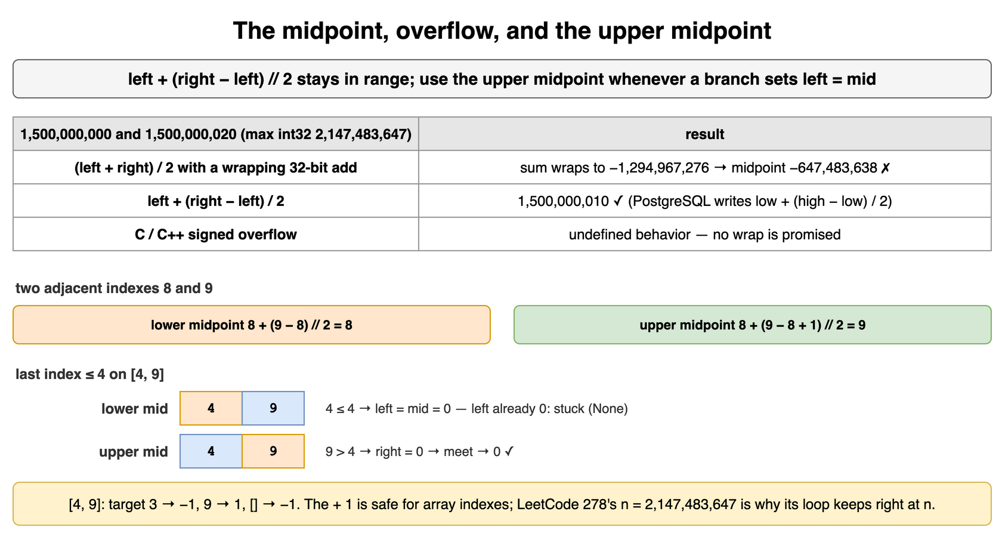
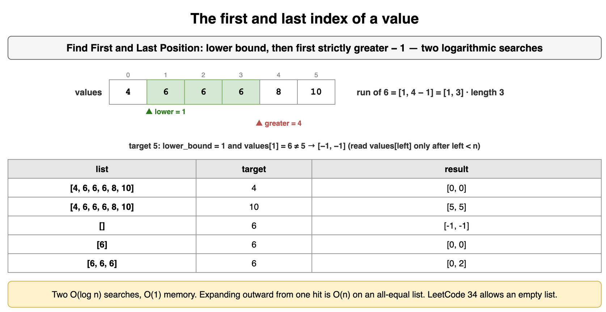
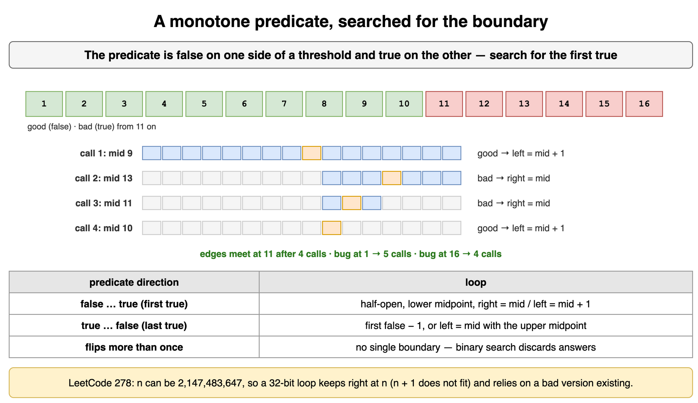
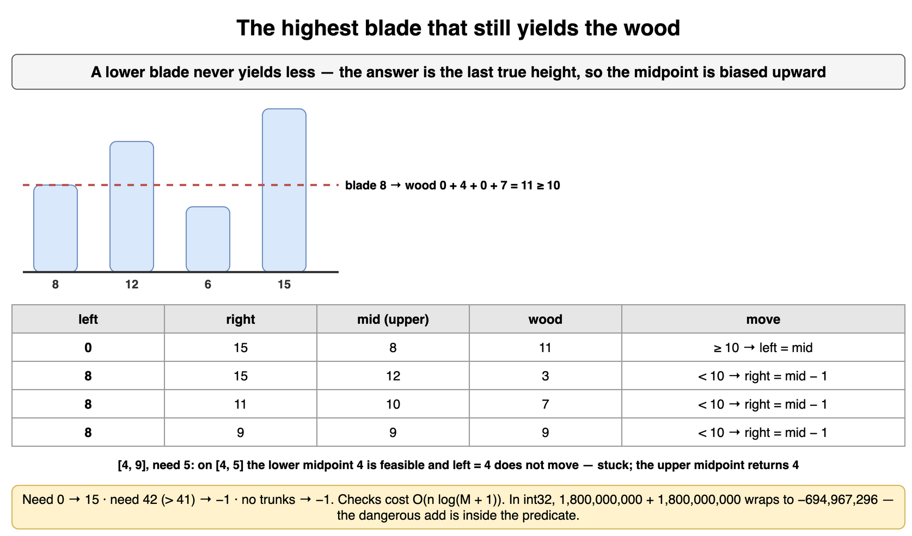
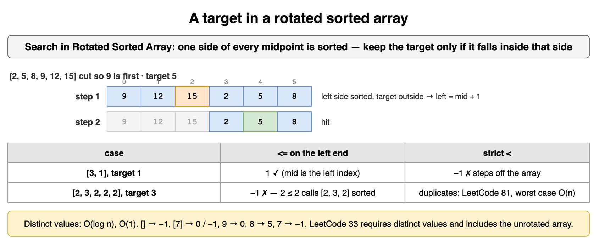
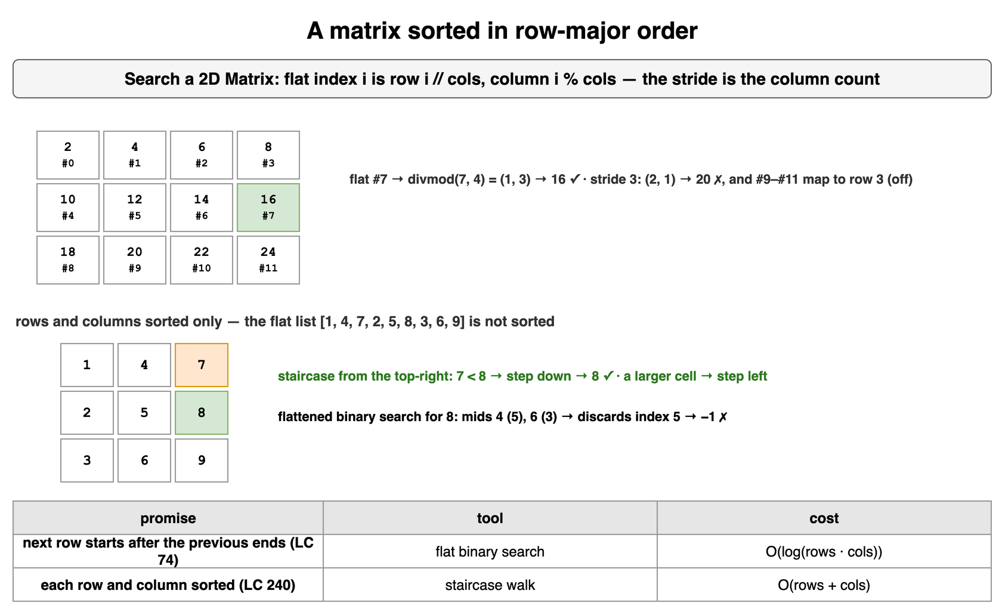

## Binary search
Binary search discards the side of an ordered candidate set that one middle check has ruled out. The candidates are indexes, commits, or integers in a range. `git bisect` keeps commits reachable from a bad commit and not from a good one. Straight history halves. Several parents make the remainder a graph. One documented run had 675 revisions left and about 10 steps. `bisect_left` returns the insertion index to the left of any equals and does not ask whether the value is present. PostgreSQL's `_bt_binsrch` binary-searches one B-tree page, apart from the root-to-leaf descent.

Use it when values are ordered or a yes/no check flips once. A second flip leaves answers on the discarded side. An unsorted array is a linear scan, and one query does not repay a sort. The loop needs random access. A hash set answers exact membership in expected constant time and does not return an insertion index, a run's ends, or the smallest feasible value. The shapes are a sorted run, a numeric range, a rotated array, two sorted arrays, and a matrix. The loop is logarithmic in the size of the space and uses O(1) extra memory. Recursion keeps one frame per step ([Binary search](#07_Data_Structures_and_Algorithms/09_Sorting_and_Searching/concepts/binary-search)). A check of n items over a range of size m costs O(n log m).

```python
import bisect

pages = [11, 14, 19, 27, 33]
print(bisect.bisect_left(pages, 19), bisect.bisect_left(pages, 20), bisect.bisect_left(pages, 10))
print(bisect.bisect_left(pages, 33), bisect.bisect_left([], 4))
# 2 3 0
# 4 0
```


*Source: [`diagrams/binary-search.drawio`](/content/11_Coding_Problems/14_Binary_Search/diagrams/binary-search.drawio), page 1.*

## Exact match in a sorted array
Four decisions define the loop: which candidates remain, which side of the midpoint is discarded, when it stops, and what it returns. [Binary search](#07_Data_Structures_and_Algorithms/09_Sorting_and_Searching/concepts/binary-search) is that loop for one exact value. Keeping the midpoint and discarding it stop on different tests.

The interval is closed, from 0 through `n - 1`. A miss sets `left = mid + 1` or `right = mid - 1`. The invariant is that if the target occurs, its index is inside `[left, right]`. Every miss excludes the midpoint, so the interval shrinks, and the loop ends when `left > right`. An empty interval returns -1. An empty list starts `right` at -1 and is not read. One cell matches or empties the interval. The page list hits 19 at index 2 and 27 at 3, and 20 empties the interval. The ends are 0 and 4. Slot `n` is outside this interval. A half-open range can return it ([Lower and upper bound](#11_Coding_Problems/14_Binary_Search/concepts/lower-and-upper-bound)). Assigning an edge to `mid` under `while left <= right` stops shrinking ([Bug hunt: binary search never ends](#07_Data_Structures_and_Algorithms/09_Sorting_and_Searching)). Excluding `mid` on both sides of `while left < right` can skip the last candidate.

```python
def find_exact(values: list[int], target: int) -> int:
    """Index of target in a sorted list, or -1. Closed interval, midpoint excluded."""
    left, right = 0, len(values) - 1
    while left <= right:
        mid = left + (right - left) // 2
        if values[mid] == target:
            return mid
        if values[mid] < target:
            left = mid + 1
        else:
            right = mid - 1
    return -1


print(find_exact([11, 14, 19, 27, 33], 19))
print(find_exact([11, 14, 19, 27, 33], 27))
print(find_exact([11, 14, 19, 27, 33], 20))
print(find_exact([11, 14, 19, 27, 33], 11), find_exact([11, 14, 19, 27, 33], 33))
print(find_exact([], 19), find_exact([14], 14), find_exact([14], 15))
# 2
# 3
# -1
# 0 4
# -1 0 -1
```


*Source: [`diagrams/binary-search.drawio`](/content/11_Coding_Problems/14_Binary_Search/diagrams/binary-search.drawio), page 2.*

## Lower and upper bound
A lower bound is the first index at least the target. An upper bound (`bisect_right`, [Lower and upper bound](#07_Data_Structures_and_Algorithms/09_Sorting_and_Searching/concepts/lower-and-upper-bound)) is the first strictly greater index. Both search `[0, n)` with the lower midpoint, and `right = mid` keeps an equal that may still be first. Indexes below `left` are too small and indexes at or after `right` are large enough. A lower bound keeps equals on the right. An upper bound keeps them on the left. The answer stays in `[left, right)`. While `left < right`, `left <= mid < right`, so each branch shrinks until the edges meet. That index is the insertion point, including `n`, and the gap is the run. A right edge at `n - 1` cannot return `n`. The last feasible index is the upper bound minus one, or -1. One bound is O(log n) time and O(1) memory.

Both ends 1500000000 and 1500000020 fit in a signed 32-bit integer. Java wraps the sum to -1294967276, and half is -647483638. C and C++ leave `left + right` undefined. `left + (right - left) // 2` is 1500000010, the form `_bt_binsrch` writes. Python grows ([Overflow-safe arithmetic](#11_Coding_Problems/06_Moderate_Problems/concepts/overflow-safe-arithmetic), [Overflow awareness](#11_Coding_Problems/01_Math_and_Logic_Puzzles/concepts/overflow-awareness)). Indexes 8 and 9 have lower midpoint 8 and upper midpoint 9. `left = mid` needs the upper form, or the interval never shrinks ([Bug hunt: binary search never ends](#07_Data_Structures_and_Algorithms/09_Sorting_and_Searching)). While `left < right` that midpoint is above `left`. On `[4, 9]` the lower update sticks at 0. The extra `+ 1` overflows at the type maximum, including `left` at -1. Empty, one cell, two cells, equals, and targets below, between, and above agree with `bisect`. Using -1 as an index reads the last cell. A step cap fails a stuck loop. Comparing a search only with itself checks nothing ([Search a rotated sorted array](#11_Coding_Problems/14_Binary_Search/concepts/search-a-rotated-sorted-array)).

```python
import bisect


def wrap_i32(left: int, right: int) -> int:
    raw = (left + right) & 0xFFFFFFFF
    return raw - 0x100000000 if raw >= 0x80000000 else raw


def lower_bound(values: list[int], target: int) -> int:
    """First index with values[i] >= target, or len(values) if every value is smaller."""
    left, right = 0, len(values)
    while left < right:
        mid = left + (right - left) // 2
        if values[mid] < target:
            left = mid + 1
        else:
            right = mid
    return left


def first_greater(values: list[int], target: int) -> int:
    """First index with values[i] > target, or len(values) if every value is smaller or equal."""
    left, right = 0, len(values)
    while left < right:
        mid = left + (right - left) // 2
        if values[mid] <= target:
            left = mid + 1
        else:
            right = mid
    return left


def last_at_most(values: list[int], target: int) -> int:
    """Last index whose value is <= target, or -1. Upper midpoint, because left = mid."""
    left, right = -1, len(values) - 1
    while left < right:
        mid = left + (right - left + 1) // 2
        if values[mid] <= target:
            left = mid
        else:
            right = mid - 1
    return left


def stuck_last(values: list[int], target: int) -> int | None:
    """Lower midpoint and left = mid. Returns None when the interval stops shrinking."""
    left, right = 0, len(values) - 1
    for _ in range(4):
        if left >= right:
            return left
        mid = left + (right - left) // 2
        if values[mid] <= target:
            if mid == left:
                return None
            left = mid
        else:
            right = mid - 1
    return None


def bound_mismatches() -> int:
    bad = 0
    groups = [[], [4], [4, 9], [4, 4, 4], [1, 4, 4, 9]]
    targets = [-1, 0, 1, 4, 5, 9, 10]
    for values in groups:
        for target in targets:
            if lower_bound(values, target) != bisect.bisect_left(values, target):
                bad += 1
            if last_at_most(values, target) != bisect.bisect_right(values, target) - 1:
                bad += 1
    return bad


left, right = 1_500_000_000, 1_500_000_020
print(wrap_i32(left, right), wrap_i32(left, right) // 2)
print(left + (right - left) // 2)
print(8 + (9 - 8) // 2, 8 + (9 - 8 + 1) // 2)
data = [5, 7, 7, 7, 9, 12]
print(lower_bound(data, 7), bisect.bisect_left(data, 7), first_greater(data, 7), bisect.bisect_right(data, 7))
print(last_at_most(data, 7), first_greater(data, 7) - 1)
print(lower_bound(data, 8), lower_bound(data, 4), lower_bound(data, 13))
pages = [2, 6, 10, 14, 18]
print(lower_bound(pages, 10), lower_bound(pages, 7), lower_bound(pages, 1), lower_bound(pages, 20))
print(stuck_last([4, 9], 4), last_at_most([4, 9], 4), last_at_most([4, 9], 3), last_at_most([], 1))
print(bound_mismatches())
print(lower_bound([], 4), lower_bound([4], 4), lower_bound([4], 5))
print(lower_bound([1, 4, 4, 9], 0), lower_bound([1, 4, 4, 9], 5), lower_bound([1, 4, 4, 9], 10))
print(last_at_most([4, 4, 4], 4))
# -1294967276 -647483638
# 1500000010
# 8 9
# 1 1 4 4
# 3 3
# 4 0 6
# 2 2 0 5
# None 0 -1 -1
# 0
# 0 0 1
# 0 3 4
# 2
```


*Source: [`diagrams/binary-search.drawio`](/content/11_Coding_Problems/14_Binary_Search/diagrams/binary-search.drawio), page 4.*


*Source: [`diagrams/binary-search.drawio`](/content/11_Coding_Problems/14_Binary_Search/diagrams/binary-search.drawio), page 6.*



*Source: [`diagrams/binary-search.drawio`](/content/11_Coding_Problems/14_Binary_Search/diagrams/binary-search.drawio), page 3.*


*Source: [`diagrams/binary-search.drawio`](/content/11_Coding_Problems/14_Binary_Search/diagrams/binary-search.drawio), page 14.*

## First and last index of a value
The first and last indexes of a target are the lower bound and one before the first strictly greater value ([Lower and upper bound](#11_Coding_Problems/14_Binary_Search/concepts/lower-and-upper-bound)). A non-decreasing list puts those matches in one run. Read `values[left]` only when `left < n`. Past the end, or a different value there, the result is `[-1, -1]`. Run length is the last index minus the first, plus one. `[4, 6, 6, 6, 8, 10]` holds 6 on `[1, 3]`. A 5 between the neighbors is absent. The single values at the ends are runs of one index. Empty, one 6, and three 6s return `[-1, -1]`, `[0, 0]`, and `[0, 2]`.

Two bounds stay O(log n) time and O(1) memory when every entry equals the target. Walking out from one hit is O(n) on that list. Subtracting one from a loop that already returns the last feasible index shifts the end. LeetCode 34 allows length 0 and requires a logarithmic bound, so the empty list is part of the contract.

```python
def lower_bound(values: list[int], target: int) -> int:
    left, right = 0, len(values)
    while left < right:
        mid = left + (right - left) // 2
        if values[mid] < target:
            left = mid + 1
        else:
            right = mid
    return left


def first_greater(values: list[int], target: int) -> int:
    left, right = 0, len(values)
    while left < right:
        mid = left + (right - left) // 2
        if values[mid] <= target:
            left = mid + 1
        else:
            right = mid
    return left


def first_last(values: list[int], target: int) -> list[int]:
    left = lower_bound(values, target)
    if left == len(values) or values[left] != target:
        return [-1, -1]
    return [left, first_greater(values, target) - 1]


run = [4, 6, 6, 6, 8, 10]
print(first_last(run, 6), first_last(run, 5), first_last(run, 4), first_last(run, 10))
print(first_last([], 6), first_last([6], 6), first_last([6, 6, 6], 6))
print(3 - 1 + 1, 2 - 0 + 1)
# [1, 3] [-1, -1] [0, 0] [5, 5]
# [-1, -1] [0, 0] [0, 2]
# 3 3
```



*Source: [`diagrams/binary-search.drawio`](/content/11_Coding_Problems/14_Binary_Search/diagrams/binary-search.drawio), page 7.*

## Smallest value that passes a monotone test
A predicate that is false on one side of a threshold and true on the other turns a numeric range into a search space ([Binary search on the answer](#07_Data_Structures_and_Algorithms/09_Sorting_and_Searching/concepts/binary-search-on-the-answer), [Binary search on answer](#07_Data_Structures_and_Algorithms/11_Problem_Solving_Patterns/concepts/binary-search-on-answer)). Return the first true value, or the last. The true side has to be one prefix or one suffix. A second flip, or a larger candidate that becomes infeasible again, drops a real answer. `git bisect` is this test when the bug stays in the marked history.

The invariant is that the first true value lies in `[left, right)`. A true midpoint may be first, so `right = mid`. A false one sets `left = mid + 1`. While `left < right` the lower midpoint has `left <= mid < right`, so both branches shrink until the edges meet. If the predicate stays false, they meet at the exclusive end. Versions 1 through 16 take 4, 5, and 4 calls when the first bad version is 11, 1, and 16. The last true value is the first false minus one, or `left = mid` with the upper midpoint ([Largest cut height that still yields enough](#11_Coding_Problems/14_Binary_Search/concepts/largest-cut-height-that-still-yields-enough)). LeetCode 278 promises a bad version and allows `n` of 2147483647. `n + 1` does not fit in a signed 32-bit integer. `right` at `n` fits and returns `n` if every version is good, so that form needs the promise. Calls are logarithmic and memory is O(1).

```python
def first_bad(n: int, bad_at: int) -> tuple[int, int]:
    """Smallest version in 1..n that is bad, and how many times the predicate ran."""
    calls = 0

    def is_bad(version: int) -> bool:
        nonlocal calls
        calls += 1
        return version >= bad_at

    left, right = 1, n + 1
    while left < right:
        mid = left + (right - left) // 2
        if is_bad(mid):
            right = mid
        else:
            left = mid + 1
    return left, calls


def first_bad_fits(n: int, bad_at: int) -> int:
    """Same answer with right starting at n, so n + 1 is never formed."""
    left, right = 1, n
    while left < right:
        mid = left + (right - left) // 2
        if mid >= bad_at:
            right = mid
        else:
            left = mid + 1
    return left


print(first_bad(16, 11))
print(first_bad(16, 1), first_bad(16, 16))
print(first_bad_fits(16, 11), first_bad_fits(16, 1), first_bad_fits(16, 16), first_bad_fits(1, 1))
# (11, 4)
# (1, 5) (16, 4)
# 11 1 16 1
```



*Source: [`diagrams/binary-search.drawio`](/content/11_Coding_Problems/14_Binary_Search/diagrams/binary-search.drawio), page 5.*

## Largest cut height that still yields enough
Wood above blade H is the sum of `max(height - H, 0)`. A lower blade never yields less, so the predicate is true through some height and false above it. The answer is the last true height, not the first ([Smallest value that passes a monotone test](#11_Coding_Problems/14_Binary_Search/concepts/smallest-value-that-passes-a-monotone-test)). Search 0 through the tallest trunk. `[8, 12, 6, 15]` sums to 41. A quota of 0 returns that trunk. A quota above the total, or no trunks, returns -1. The first height that works is 0 whenever 0 already works.

A feasible height sets `left = mid` and needs the upper midpoint ([Lower and upper bound](#11_Coding_Problems/14_Binary_Search/concepts/lower-and-upper-bound)). While `left < right` that midpoint is above `left`, both branches shrink, and the edges meet. The lower midpoint sticks: on `[4, 9]` with quota 5, heights 4 and 5 yield 5 and 4. Height 8 yields 11 and height 9 yields 9, so quota 10 returns 8. n trunks and M + 1 heights cost O(n log (M + 1)) plus a pass for the tallest trunk, and O(1) extra memory. 1800000000 + 1800000000 wraps to -694967296 ([Overflow-safe arithmetic](#11_Coding_Problems/06_Moderate_Problems/concepts/overflow-safe-arithmetic)). The dangerous add is inside the predicate. The first failing height minus one is the same blade. LeetCode 875 checks a speed, not this sum.

```python
def wood_above(heights: list[int], blade: int) -> int:
    return sum(max(height - blade, 0) for height in heights)


def highest_blade(heights: list[int], need: int) -> int:
    if not heights:
        return -1
    if need <= 0:
        return max(heights)
    if wood_above(heights, 0) < need:
        return -1
    left, right = 0, max(heights)
    while left < right:
        mid = left + (right - left + 1) // 2
        if wood_above(heights, mid) >= need:
            left = mid
        else:
            right = mid - 1
    return left


def wrap_i32(left: int, right: int) -> int:
    raw = (left + right) & 0xFFFFFFFF
    return raw - 0x100000000 if raw >= 0x80000000 else raw


def stuck_blade(heights: list[int], need: int) -> tuple[int, int, int, str] | int:
    """Lower midpoint with left = mid. Returns the pair that stops shrinking."""
    left, right = 0, max(heights)
    for _ in range(8):
        if left >= right:
            return left
        mid = left + (right - left) // 2
        if wood_above(heights, mid) >= need:
            if mid == left:
                return (left, right, mid, "stuck")
            left = mid
        else:
            right = mid - 1
    return (left, right, -1, "cap")


print(highest_blade([8, 12, 6, 15], 10))
print(wood_above([8, 12, 6, 15], 8), wood_above([8, 12, 6, 15], 9), sum([8, 12, 6, 15]))
print(highest_blade([8, 12, 6, 15], 0), highest_blade([8, 12, 6, 15], 42), highest_blade([], 1))
print(stuck_blade([4, 9], 5), highest_blade([4, 9], 5))
print(wrap_i32(1_800_000_000, 1_800_000_000))
# 8
# 11 9 41
# 15 -1 -1
# (4, 5, 4, 'stuck') 4
# -694967296
```



*Source: [`diagrams/binary-search.drawio`](/content/11_Coding_Problems/14_Binary_Search/diagrams/binary-search.drawio), page 8.*

## Search a rotated sorted array
One cut of distinct sorted values leaves one sorted side at every midpoint ([Rotated sorted array](#07_Data_Structures_and_Algorithms/09_Sorting_and_Searching/concepts/rotated-sorted-array)). `values[left] <= values[mid]` means that side, both ends included, is sorted, and the target belongs there when `values[left] <= target < values[mid]`. Otherwise it is on the right. If the left side is unsorted, the right side holds the target when `values[mid] < target <= values[right]`. The interval is closed. A miss excludes the midpoint, so the interval shrinks until it is empty ([Exact match in a sorted array](#11_Coding_Problems/14_Binary_Search/concepts/exact-match-in-a-sorted-array)). Return the index, or -1.

Keep `<=`. On `[3, 1]` the midpoint is the left index, and the next step finds 1. A strict `<` walks off the array. Equals break the test: `[2, 3, 2, 2, 2]` hides 3. LeetCode 81 is linear, because an equal end can shrink by one index, and a linear scan is the fallback. On distinct values the minimum compares the midpoint with the right end. A larger midpoint sets `left = mid + 1`; otherwise `right = mid`. The lower midpoint keeps both branches shrinking until the edges meet. `[2, 2, 2, 0, 2]` returns 2, not 0. Distinct search is O(log n) time and O(1) memory. Empty input returns -1. Every cut of `[10, 20, 30, 40]`, including the unrotated cut, agrees with a scan and with `min`. Count a miss before using -1 as an index. LeetCode 33 requires distinct values and allows the unrotated array.

```python
def search_rotated(values: list[int], target: int) -> int:
    left, right = 0, len(values) - 1
    while left <= right:
        mid = left + (right - left) // 2
        if values[mid] == target:
            return mid
        if values[left] <= values[mid]:
            if values[left] <= target < values[mid]:
                right = mid - 1
            else:
                left = mid + 1
        elif values[mid] < target <= values[right]:
            left = mid + 1
        else:
            right = mid - 1
    return -1


def search_rotated_strict(values: list[int], target: int) -> int:
    """Same loop with < instead of <= on the left end. Can miss a two-element rotation."""
    left, right = 0, len(values) - 1
    while left <= right:
        mid = left + (right - left) // 2
        if values[mid] == target:
            return mid
        if values[left] < values[mid]:
            if values[left] <= target < values[mid]:
                right = mid - 1
            else:
                left = mid + 1
        elif values[mid] < target <= values[right]:
            left = mid + 1
        else:
            right = mid - 1
    return -1


def find_min_rotated(values: list[int]) -> int:
    """Minimum of a rotated array of distinct values. Equals can hide it."""
    left, right = 0, len(values) - 1
    while left < right:
        mid = left + (right - left) // 2
        if values[mid] > values[right]:
            left = mid + 1
        else:
            right = mid
    return values[left]


def cut_mismatches() -> int:
    bad = 0
    base = [10, 20, 30, 40]
    for shift in range(len(base)):
        rotated = base[shift:] + base[:shift]
        for target in base + [0, 25, 50]:
            found = search_rotated(rotated, target)
            if target in rotated:
                bad += int(found < 0 or rotated[found] != target)
            else:
                bad += int(found != -1)
            bad += int(find_min_rotated(rotated) != min(base))
    return bad


print(search_rotated([9, 12, 15, 2, 5, 8], 5))
print(search_rotated([9, 12, 15, 2, 5, 8], 9), search_rotated([9, 12, 15, 2, 5, 8], 8))
print(search_rotated([9, 12, 15, 2, 5, 8], 7))
print(search_rotated([3, 1], 1), search_rotated_strict([3, 1], 1))
print(search_rotated([2, 3, 2, 2, 2], 3))
print(search_rotated([], 1), search_rotated([7], 7), search_rotated([7], 8))
print(cut_mismatches(), search_rotated([30, 10, 20], 10), find_min_rotated([30, 10, 20]))
print(find_min_rotated([2, 2, 2, 0, 2]), min([2, 2, 2, 0, 2]))
# 4
# 0 5
# -1
# 1 -1
# -1
# -1 0 -1
# 0 1 10
# 2 0
```



*Source: [`diagrams/binary-search.drawio`](/content/11_Coding_Problems/14_Binary_Search/diagrams/binary-search.drawio), page 9.*

## Median of two sorted arrays
The median is the middle merged value, or the mean of the two middle values when the count is even. Binary-search a cut `i` in the shorter array so the left half holds `(m + n + 1) // 2` values and each side's last left value is at most the other's first right value. The longer array contributes `j = half - i`. With `m <= n` and `i` in `[0, m]`, `j` stays in `0` through `n`. Lengths 3 and 2 need a left half of 3, so swap before a cut of 0 asks for index 3. An empty side compares as infinity. Too far right sets `hi = i - 1`; otherwise `lo = i + 1`. Each step excludes `i`. On sorted input the legal cut stays in `[lo, hi]` and the loop returns before the edges cross.

`[2, 6, 10]` and `[3, 7]` have median 6.0. Time is O(log(min(m, n))) and extra memory is O(1). Add half the gap onto the smaller middle value when the sum can overflow. [Merging sorted sequences](#07_Data_Structures_and_Algorithms/09_Sorting_and_Searching/concepts/merging-sorted-sequences) is the O(m + n) baseline. LeetCode 4 allows one empty array. Both empty raise `ValueError`. `[1, 3]` and `[4, 2]` are unsorted and return 3.5, not the merged median 2.5. [Quickselect](#07_Data_Structures_and_Algorithms/09_Sorting_and_Searching/concepts/quickselect) ignores the sorted order.

```python
def median_sorted(left_run: list[int], right_run: list[int]) -> float:
    if len(left_run) > len(right_run):
        left_run, right_run = right_run, left_run
    short, long = left_run, right_run
    m, n = len(short), len(long)
    if m + n == 0:
        raise ValueError("both arrays are empty")
    half = (m + n + 1) // 2
    lo, hi = 0, m
    while lo <= hi:
        i = lo + (hi - lo) // 2
        j = half - i
        a_left = short[i - 1] if i else float("-inf")
        a_right = short[i] if i < m else float("inf")
        b_left = long[j - 1] if j else float("-inf")
        b_right = long[j] if j < n else float("inf")
        if a_left <= b_right and b_left <= a_right:
            if (m + n) % 2:
                return float(max(a_left, b_left))
            return (max(a_left, b_left) + min(a_right, b_right)) / 2
        if a_left > b_right:
            hi = i - 1
        else:
            lo = i + 1
    raise ValueError("inputs were not sorted")


print(median_sorted([2, 6, 10], [3, 7]))
print(median_sorted([2, 9], [4, 12]))
print(median_sorted([], [4, 8, 9]), median_sorted([5], []))
print(median_sorted([1, 2], [1, 2]))
print((3 + 2 + 1) // 2, (3 + 2 + 1) // 2 - 0, len([2, 6]))
merged = sorted([1, 3, 4, 2])
true_median = (merged[len(merged) // 2 - 1] + merged[len(merged) // 2]) / 2
print(median_sorted([1, 3], [4, 2]), true_median)
try:
    median_sorted([], [])
except ValueError as exc:
    print(exc.args[0])
# 6.0
# 6.5
# 8.0 5.0
# 1.5
# 3 3 2
# 3.5 2.5
# both arrays are empty
```


*Source: [`diagrams/binary-search.drawio`](/content/11_Coding_Problems/14_Binary_Search/diagrams/binary-search.drawio), page 10.*

## Search a row-major matrix
Sorted rows, each starting above the previous row's end, are one sequence. Index `i` is row `i // cols` and column `i % cols`. Search 0 through `rows * cols - 1`. A miss excludes the midpoint and the closed interval shrinks until it is empty ([Exact match in a sorted array](#11_Coding_Problems/14_Binary_Search/concepts/exact-match-in-a-sorted-array)). In the 3 by 4 matrix, 16 is index 7. Stride 3 maps 7 elsewhere and reports 16 absent, and later indexes walk off the matrix. Time is O(log(rows * cols)) and extra memory is O(1).

Rows and columns can each increase while the flat order does not. `[1, 4, 7, 2, 5, 8, 3, 6, 9]` holds 8 at index 5. Midpoint index 4, value 5, keeps it. Midpoint index 6, value 3, steps right and discards it. A smaller midpoint places the target to its right only in sorted order. From the top-right, step left when the cell is larger, because the column increases downward, and step down when it is smaller, because the row increases rightward. Each step drops a row or a column, O(rows + cols). Here 7 steps onto 8. LeetCode 74 is the flat search. LeetCode 240 is the staircase.

```python
def search_matrix(matrix: list[list[int]], target: int) -> bool:
    if not matrix or not matrix[0]:
        return False
    rows, cols = len(matrix), len(matrix[0])
    left, right = 0, rows * cols - 1
    while left <= right:
        mid = left + (right - left) // 2
        value = matrix[mid // cols][mid % cols]
        if value == target:
            return True
        if value < target:
            left = mid + 1
        else:
            right = mid - 1
    return False


def search_matrix_stride(matrix: list[list[int]], target: int, stride: int) -> bool | str:
    rows, cols = len(matrix), len(matrix[0])
    left, right = 0, rows * cols - 1
    while left <= right:
        mid = left + (right - left) // 2
        row, col = divmod(mid, stride)
        if row >= rows or col >= cols:
            return "off"
        value = matrix[row][col]
        if value == target:
            return True
        if value < target:
            left = mid + 1
        else:
            right = mid - 1
    return False


def flatten_search(matrix: list[list[int]], target: int) -> int:
    flat = [value for row in matrix for value in row]
    left, right = 0, len(flat) - 1
    while left <= right:
        mid = left + (right - left) // 2
        if flat[mid] == target:
            return mid
        if flat[mid] < target:
            left = mid + 1
        else:
            right = mid - 1
    return -1


def staircase(matrix: list[list[int]], target: int) -> bool:
    if not matrix or not matrix[0]:
        return False
    row, col = 0, len(matrix[0]) - 1
    while row < len(matrix) and col >= 0:
        value = matrix[row][col]
        if value == target:
            return True
        if value > target:
            col -= 1
        else:
            row += 1
    return False


matrix = [
    [2, 4, 6, 8],
    [10, 12, 14, 16],
    [18, 20, 22, 24],
]
print(search_matrix(matrix, 16), search_matrix(matrix, 15))
print(search_matrix(matrix, 2), search_matrix(matrix, 24))
print(search_matrix_stride(matrix, 16, 3))
print(search_matrix_stride(matrix, 24, 3))
print(divmod(7, 4), divmod(7, 3))
stairs = [
    [1, 4, 7],
    [2, 5, 8],
    [3, 6, 9],
]
print(flatten_search(stairs, 8), staircase(stairs, 8), staircase(stairs, 10))
# True False
# True True
# False
# off
# (1, 3) (2, 1)
# -1 True False
```



*Source: [`diagrams/binary-search.drawio`](/content/11_Coding_Problems/14_Binary_Search/diagrams/binary-search.drawio), page 11.*

## Any index greater than its neighbors
Return any index strictly greater than its neighbors. A missing neighbor counts as smaller, so an end can be a peak and one element peaks at 0. Adjacent values differ. A midpoint below the next value leaves a peak on the right, including `mid + 1`, because walking uphill reaches a descent or the end. Discard `mid`. A midpoint above the next value leaves a peak at `mid` or on the left. The maximum on that side is a peak: neighbors differ, and that side steps down at its right edge.

The range is half-open and the midpoint is the lower one. `left < right` keeps `mid + 1` in range, so the loop does not read `mid - 1`. A rise sets `left = mid + 1`. A fall sets `right = mid`. Both branches shrink until the edges meet. Several peaks make any one legal. Time is O(log n) and extra memory is O(1). The first descent is the O(n) check. LeetCode 162 requires distinct neighbors, length at least 1, and logarithmic time. A plateau can stop on an equal neighbor. The global maximum is a peak, and selecting that one index is linear.

```python
def find_peak(values: list[int]) -> int:
    left, right = 0, len(values) - 1
    while left < right:
        mid = left + (right - left) // 2
        if values[mid] < values[mid + 1]:
            left = mid + 1
        else:
            right = mid
    return left


print(find_peak([2, 6, 8, 5, 1]))
print(find_peak([7, 4, 3]), find_peak([1, 4, 9]), find_peak([1]))
print(find_peak([1, 3]), find_peak([5, 2]))
print(find_peak([1, 3, 2, 4, 1]))
# 2
# 0 2 0
# 1 0
# 3
```


*Source: [`diagrams/binary-search.drawio`](/content/11_Coding_Problems/14_Binary_Search/diagrams/binary-search.drawio), page 12.*

## Random pick by weight
Return index `i` with probability proportional to `weights[i]`. One prefix serves every draw ([Prefix sums](#11_Coding_Problems/06_Moderate_Problems/concepts/prefix-sums)). Nonnegative weights make it non-decreasing, so the draw is the first prefix at least an integer from 1 through the total ([Lower and upper bound](#11_Coding_Problems/14_Binary_Search/concepts/lower-and-upper-bound)). A negative weight breaks that order. CPython 3.12's `random.choices` draws a float in `[0, total)` and bisects with the right edge at `n - 1`. A non-positive total raises `ValueError`. A fresh scan on every draw is O(n).

`[4, 1, 5]` has prefix `[4, 5, 10]`. Draws 1 through 4 land on index 0, draw 5 on index 1, and draws 6 through 10 on index 2. Draws 0 through 9 split 5, 1, and 4, because draw 0 takes one outcome from the last weight. A zero weight does not move the prefix, so `[4, 0, 1]` sends draw 5 to index 2. Total 0 is not a draw. Setup is O(n) time and O(n) memory. Each pick is O(log n) time and O(1) extra memory. An alias table draws in constant time after a linear build. The integer range matches each weight's count. LeetCode 528 requires positive weights.

```python
class WeightedPicker:
    def __init__(self, weights: list[int]) -> None:
        self.prefix: list[int] = []
        total = 0
        for weight in weights:
            total += weight
            self.prefix.append(total)
        self.total = total

    def index_for(self, draw: int) -> int:
        """First prefix >= draw. draw is in 1..total when the total is positive."""
        left, right = 0, len(self.prefix)
        while left < right:
            mid = left + (right - left) // 2
            if self.prefix[mid] < draw:
                left = mid + 1
            else:
                right = mid
        return left


picker = WeightedPicker([4, 1, 5])
print(picker.prefix)
print([picker.index_for(draw) for draw in range(1, 11)])
print([picker.index_for(draw) for draw in range(0, 10)])
print(WeightedPicker([4, 0, 1]).index_for(5), WeightedPicker([0, 0]).total)
# [4, 5, 10]
# [0, 0, 0, 0, 1, 2, 2, 2, 2, 2]
# [0, 0, 0, 0, 0, 1, 2, 2, 2, 2]
# 2 0
```


*Source: [`diagrams/binary-search.drawio`](/content/11_Coding_Problems/14_Binary_Search/diagrams/binary-search.drawio), page 13.*
