## Last-in, first-out order
A stack changes at one end. Pop returns the last push. Push, pop, peek, and the empty test are O(1) ([Stack (LIFO)](#07_Data_Structures_and_Algorithms/04_Stacks_and_Queues/concepts/stack-lifo)). Use it when the unfinished item is the most recent one: a closer and the opener still open, an undo, a value waiting on a parenthesis or a later larger reading, or a pour that reverses one stack into another. `append` pushes and `pop()` pops. `append` is amortized O(1) from buffer growth ([Stack implementation with arrays vs. linked lists](#07_Data_Structures_and_Algorithms/04_Stacks_and_Queues/concepts/stack-implementation-with-arrays-vs-linked-lists)).

`git stash` with no arguments records the work tree and index, reverts both to `HEAD`, and stores that as `refs/stash`. `stash@{0}` is newest and `stash@{1}` is the previous entry. Pop drops `stash@{0}` on success and leaves it on conflict. `git stash drop` can name an older entry. A call pushes a frame and a return pops it. The default recursion limit is 1000 ([Explicit stack for converting recursion to iteration](#07_Data_Structures_and_Algorithms/04_Stacks_and_Queues/concepts/explicit-stack-for-converting-recursion-to-iteration), [Recursive vs. iterative DFS](#07_Data_Structures_and_Algorithms/05_Trees/concepts/recursive-vs-iterative-dfs)). The oldest item is a [Queue (FIFO)](#07_Data_Structures_and_Algorithms/04_Stacks_and_Queues/concepts/queue-fifo). Both ends are a deque. A non-arrival extreme is a [Priority queue](#07_Data_Structures_and_Algorithms/04_Stacks_and_Queues/concepts/priority-queue). A sorted array you can cut in half is [Binary search](#11_Coding_Problems/14_Binary_Search/concepts/binary-search). Memory is the unfinished items. An empty pop raises, because `None` can be stored ([Stack and queue as ADTs: contract first, implementation second](#07_Data_Structures_and_Algorithms/04_Stacks_and_Queues/concepts/stack-and-queue-as-adts-contract-first-implementation-second)). A constant-time minimum is a [Min stack](#07_Data_Structures_and_Algorithms/04_Stacks_and_Queues/concepts/min-stack).

```python
undo = []
for action in ["type-a", "type-b", "delete"]:
    undo.append(action)
print([undo.pop() for _ in range(len(undo))])
# ['delete', 'type-b', 'type-a']
```

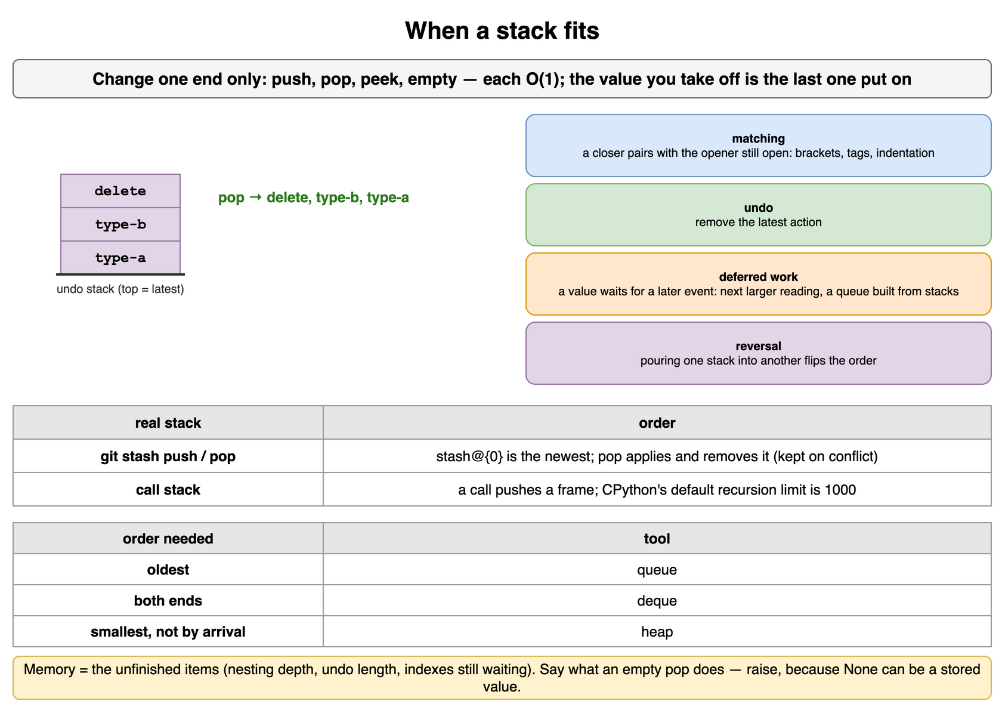

*Source: [`diagrams/stacks.drawio`](/content/11_Coding_Problems/15_Stacks/diagrams/stacks.drawio), page 1.*

## Indentation and open tags
Python emits `INDENT` and `DEDENT` from a stack of columns. A 0 is pushed first and never popped. Columns increase toward the top. An equal column changes nothing. A deeper column pushes and emits one `INDENT`. A shallower column must land on a saved column, and each pop is one `DEDENT`. End of file emits one `DEDENT` per column above 0. A column that matches none is an error. Tabs expand to the next multiple of 8. In CPython `Parser/lexer/state.h`, as of 12 Nov 2026, `layout.stack` holds 100 levels (`MAXINDENT`), each a column and an alternate column. `parenstack` holds 200 bracket frames (`MAXLEVEL`). `level` counts open `()[]{}`, so a newline inside brackets does not change the indent.

The HTML open-element stack starts empty and grows downward (living standard 13.2.4.2, fetched 12 Nov 2026). The current node is the element most recently added, and popping it finishes that element's children. Section 13.2.6.3 pops implied end tags such as `p`, `li`, and `dd`. [Valid parentheses](#11_Coding_Problems/15_Stacks/concepts/valid-parentheses) is only the bracket check, and so is [Stack for expression evaluation and bracket matching](#07_Data_Structures_and_Algorithms/04_Stacks_and_Queues/concepts/stack-for-expression-evaluation-and-bracket-matching). Time is linear in the text. Extra memory is the nesting depth. A counter loses the bracket type: a `)` can close a `[`. Re-scanning every prefix is quadratic. A dedent needs the saved column, not only the depth.

```python
def indent_events(columns: list[int]) -> list[list[str]]:
    stack = [0]
    rows: list[list[str]] = []
    for col in columns:
        if col == stack[-1]:
            rows.append(["same"])
        elif col > stack[-1]:
            stack.append(col)
            rows.append(["indent"])
        else:
            removed = 0
            while len(stack) > 1 and stack[-1] > col:
                stack.pop()
                removed += 1
            if stack[-1] != col:
                rows.append(["error"])
                return rows
            rows.append(["dedent"] * removed)
    end: list[str] = []
    while len(stack) > 1:
        stack.pop()
        end.append("dedent")
    rows.append(end)
    return rows


print(indent_events([0, 4, 8, 4, 0]))
print(indent_events([0, 4, 8, 0]))
print(indent_events([0, 4, 2]))
print(indent_events([0, 4]))
# [['same'], ['indent'], ['indent'], ['dedent'], ['dedent'], []]
# [['same'], ['indent'], ['indent'], ['dedent', 'dedent'], []]
# [['same'], ['indent'], ['error']]
# [['same'], ['indent'], ['dedent']]
```

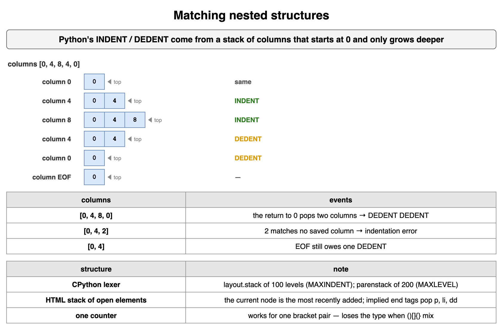

*Source: [`diagrams/stacks.drawio`](/content/11_Coding_Problems/15_Stacks/diagrams/stacks.drawio), page 2.*

## Next and previous greater or smaller
A monotonic stack keeps indexes in value order. Pop every index the new value resolves, then push. For next strictly greater, left to right, values decrease toward the top. The top is the nearest and smallest waiting value, so missing it misses everything below. A popped index has its answer, because everything between it and the new index was smaller and already gone. An index that remains has no greater value to its right. [Monotonic stack: next greater element](#07_Data_Structures_and_Algorithms/04_Stacks_and_Queues/concepts/monotonic-stack-next-greater-element), [Monotonic stack](#07_Data_Structures_and_Algorithms/11_Problem_Solving_Patterns/concepts/monotonic-stack), and [A monotonic stack](#11_Coding_Problems/07_Hard_Problems/concepts/a-monotonic-stack) are that direction. [Indentation and open tags](#11_Coding_Problems/15_Stacks/concepts/indentation-and-open-tags) keeps columns the same way.

Next greater pops while the top is `<` when the question is strict and `<=` when an equal counts. Next smaller flips those tests. Previous greater pops while the top is `<=` when strict and `<` when an equal counts, then reads the top that remains. Previous smaller flips those tests. The Nearest shorter bar drill is previous strictly smaller. `<=` on a strictly-greater question writes the equal and stops. On `[8, 3, 3, 9, 3]`, `<` waits for 9 and `<=` lets the second 3 answer the first. Store the index. Each index is pushed once and popped at most once ([Each index is pushed once](#11_Coding_Problems/15_Stacks/concepts/each-index-is-pushed-once)): O(n) time and O(n) memory, against an O(n²) nested scan. Pop only an index that has its answer or can never answer a later one. Every greater value, not merely the next, cannot drop the middle. The wrong operator is still linear and fails the tie.

```python
def next_right(values: list[int], greater: bool, strict: bool) -> list[int]:
    answer = [-1] * len(values)
    stack: list[int] = []
    for i, value in enumerate(values):
        if greater:
            while stack and (values[stack[-1]] < value if strict else values[stack[-1]] <= value):
                answer[stack.pop()] = value
        else:
            while stack and (values[stack[-1]] > value if strict else values[stack[-1]] >= value):
                answer[stack.pop()] = value
        stack.append(i)
    return answer


def previous_left(values: list[int], greater: bool, strict: bool) -> list[int]:
    answer = [-1] * len(values)
    stack: list[int] = []
    for i, value in enumerate(values):
        if greater:
            while stack and (values[stack[-1]] <= value if strict else values[stack[-1]] < value):
                stack.pop()
        else:
            while stack and (values[stack[-1]] >= value if strict else values[stack[-1]] > value):
                stack.pop()
        answer[i] = values[stack[-1]] if stack else -1
        stack.append(i)
    return answer


readings = [8, 3, 3, 9, 3]
print(next_right(readings, True, True))
print(next_right(readings, True, False))
print(next_right(readings, False, True))
print(next_right(readings, False, False))
print(previous_left(readings, True, True))
print(previous_left(readings, True, False))
print(previous_left(readings, False, True))
print(previous_left(readings, False, False))
# [9, 9, 9, -1, -1]
# [9, 3, 9, -1, -1]
# [3, -1, -1, 3, -1]
# [3, 3, 3, 3, -1]
# [-1, 8, 8, -1, 9]
# [-1, 8, 3, -1, 9]
# [-1, -1, -1, 3, -1]
# [-1, -1, 3, 3, 3]
```

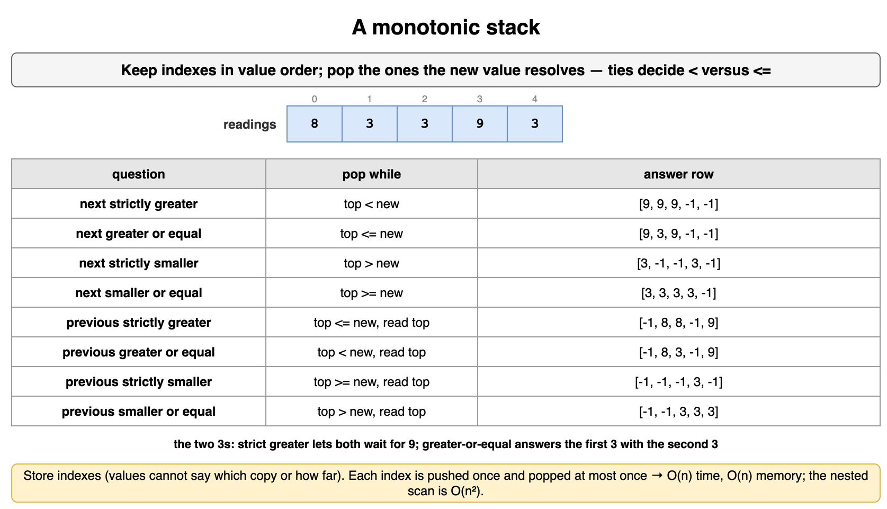

*Source: [`diagrams/stacks.drawio`](/content/11_Coding_Problems/15_Stacks/diagrams/stacks.drawio), page 3.*

## Each index is pushed once
One monotonic step can pop the whole stack. A decreasing run, then a larger value, does Θ(n) pops. Later steps see an empty stack. Pops cannot outnumber pushes, and each index is pushed once, so the scan does at most 2n stack operations: O(n), while one step is O(n). [Amortized time](#07_Data_Structures_and_Algorithms/01_Algorithmic_Complexity/concepts/amortized-time) spreads one buffer copy across many appends. Here each index pays for its own push and its own pop, once. That charge covers [Next and previous greater or smaller](#11_Coding_Problems/15_Stacks/concepts/next-and-previous-greater-or-smaller), [Remove adjacent duplicates](#11_Coding_Problems/15_Stacks/concepts/remove-adjacent-duplicates), where a survivor is never popped, and [Queue from two stacks](#11_Coding_Problems/15_Stacks/concepts/queue-from-two-stacks), where a value moves from inbox to outbox at most once.

The bound is the whole scan. One pour of n values is still O(n) on that call. Amortized O(1) means n calls take O(n). Worst-case O(1) means every call is constant. A [Circular buffer (ring buffer) queue](#07_Data_Structures_and_Algorithms/04_Stacks_and_Queues/concepts/circular-buffer-ring-buffer-queue) has that. This pour does not. Rebuilding the string on every cancelled pair is quadratic, because each copy includes characters copied again. On `[5, 4, 3, 2, 9]` four pushes are followed by four pops in one step. The sum of the pop counts is 4. The last index stays.

```python
def pop_counts(values: list[int]) -> list[int]:
    counts = []
    stack: list[int] = []
    for i, value in enumerate(values):
        popped = 0
        while stack and values[stack[-1]] < value:
            stack.pop()
            popped += 1
        counts.append(popped)
        stack.append(i)
    return counts


spike = [5, 4, 3, 2, 9]
print(pop_counts(spike), sum(pop_counts(spike)))
# [0, 0, 0, 0, 4] 4
```

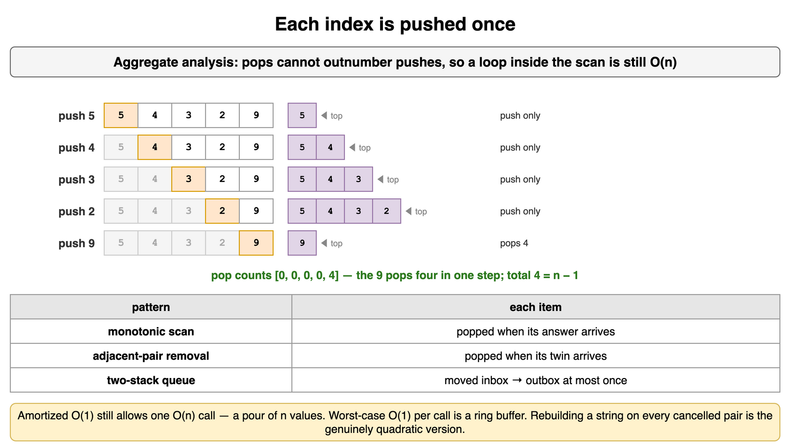

*Source: [`diagrams/stacks.drawio`](/content/11_Coding_Problems/15_Stacks/diagrams/stacks.drawio), page 4.*

## Valid parentheses
A bracket string is valid when every closer matches the opener on top and the stack ends empty. Push `(`, `[`, and `{`. A closer needs a non-empty stack and that partner, then a pop. Any other character fails. An empty string is valid here. [Stack for expression evaluation and bracket matching](#07_Data_Structures_and_Algorithms/04_Stacks_and_Queues/concepts/stack-for-expression-evaluation-and-bracket-matching) is this check. A net-open counter loses the type: a `)` can close a `[` ([Indentation and open tags](#11_Coding_Problems/15_Stacks/concepts/indentation-and-open-tags)).

`{[()()]}` ends empty. `{[(])}` fails with `(` on top. `[[]` leaves one `[`. `]` pops an empty stack. `(a)` fails on `a`. An odd length rejects a brackets-only string and does not decide `][`, which is even and invalid. The scan is O(n) time and O(n) memory. Skipping the empty test raises `IndexError` on `]`, or reads a missing sentinel. Accepting a leftover opener accepts `[[]`. LeetCode 20 is length 1 through 10^4 and only `()[]{}`. Empty and a letter are outside that contract. This function is true for empty and false for any other character.

```python
def valid_brackets(text: str) -> bool:
    pairs = {")": "(", "]": "[", "}": "{"}
    stack: list[str] = []
    for ch in text:
        if ch in "([{":
            stack.append(ch)
        elif ch in pairs:
            if not stack or stack[-1] != pairs[ch]:
                return False
            stack.pop()
        else:
            return False
    return not stack


print(valid_brackets("{[()()]}"))
print(valid_brackets("{[(])}"))
print(valid_brackets("[[]"))
print(valid_brackets("]"))
print(valid_brackets(""))
print(valid_brackets("(a)"))
# True
# False
# False
# False
# True
# False
```

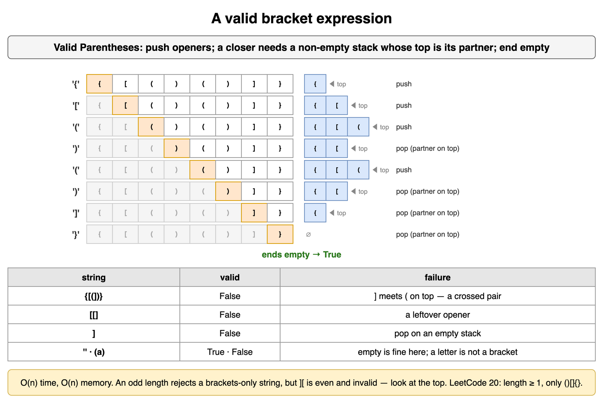

*Source: [`diagrams/stacks.drawio`](/content/11_Coding_Problems/15_Stacks/diagrams/stacks.drawio), page 6.*

## Next greater element
For each value, the first strictly larger value to the right, or -1. Indexes on the stack decrease toward the top. Pop while the top is `<` the new value, write that value, and push. Leftovers stay -1. An equal stays, so a later greater value can still answer it. `<=` writes 4 for the first of two 4s and that index never sees the 9. The other seven comparisons are [Next and previous greater or smaller](#11_Coding_Problems/15_Stacks/concepts/next-and-previous-greater-or-smaller). An index, not a bare value, can name a distance and which copy.

`[7, 2, 8, 4, 4, 9]` is `[8, 8, 9, 9, 9, -1]`. Empty has no row. One value, all equals, and a decreasing list stay -1. An increasing list answers with the next neighbor. Each index is pushed once and popped at most once: O(n) time and O(n) memory ([Each index is pushed once](#11_Coding_Problems/15_Stacks/concepts/each-index-is-pushed-once)). A nested scan is O(n²). Scanning from the right is the same bound. LeetCode 496 looks up unique values of `nums1` in `nums2`, lengths 1 through 1000, `nums1` no longer, values 0 through 10^4. LeetCode 503 is circular: each index is pushed once, and a second lap stops so a value does not answer itself. This function allows duplicates, does not wrap, and uses -1.

```python
def next_greater(values: list[int]) -> list[int]:
    answer = [-1] * len(values)
    stack: list[int] = []
    for i, value in enumerate(values):
        while stack and values[stack[-1]] < value:
            answer[stack.pop()] = value
        stack.append(i)
    return answer


print(next_greater([7, 2, 8, 4, 4, 9]))
print(next_greater([]), next_greater([7]), next_greater([4, 4, 4]))
print(next_greater([2, 5, 8]), next_greater([9, 7, 5]))
# [8, 8, 9, 9, 9, -1]
# [] [-1] [-1, -1, -1]
# [5, 8, -1] [-1, -1, -1]
```

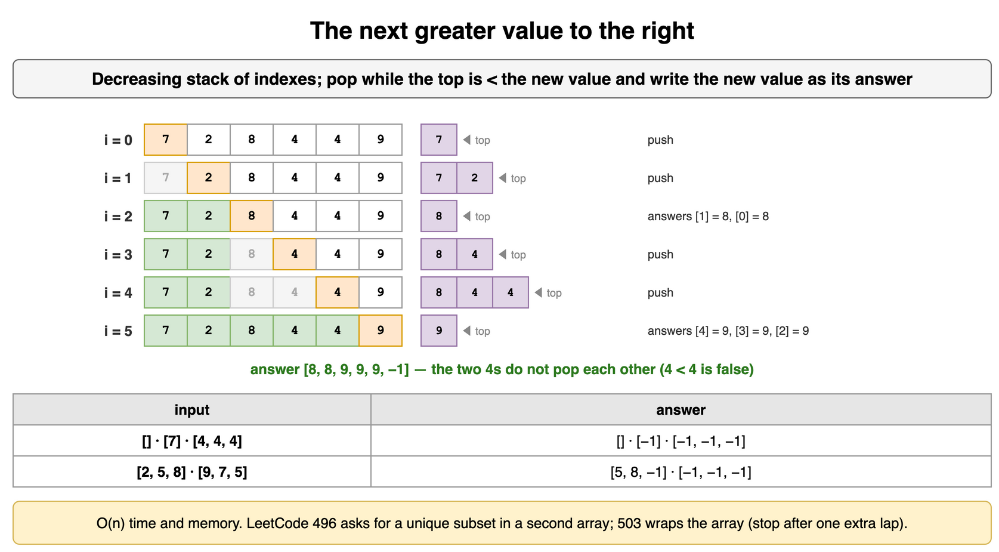

*Source: [`diagrams/stacks.drawio`](/content/11_Coding_Problems/15_Stacks/diagrams/stacks.drawio), page 7.*

## Basic calculator
Read non-negative integers, `+`, `-`, parentheses, and spaces. A minus may be unary. Do not call `eval`. Digits accumulate, so `12` is twelve. On `+` or `-`, flush a finished number and set the next sign. On `(`, push the total and the sign and start at 0. On `)`, flush, pop, and replace the total with `saved + saved_sign * inner`. A sign before a digit is unary, and the saved sign is why `8-(3-1)` subtracts. [Stack for expression evaluation and bracket matching](#07_Data_Structures_and_Algorithms/04_Stacks_and_Queues/concepts/stack-for-expression-evaluation-and-bracket-matching) includes postfix. A `>=` test sends equal-priority operators out left to right. Plus and minus tie.

`12 + 3` is 15, `8-(3-1)` is 6, and `-(4+5)` is -9. Empty is 0 and `2-(3-(4))` is 3. `)` with nothing saved raises `IndexError`. An unclosed opener never applies the saved pair: `(` is 0, `8-(3` is 3, and `-(4+5` is 9. `1--2` overwrites the sign and returns -1. One pass is O(n), and the stack is the nesting. Python `int` does not wrap. LeetCode 224 allows length 1 through 3 * 10^5, a valid expression, and unary minus, including `-(2 + 3)`. Unary plus and two operators in a row are outside it. Intermediates fit in a signed 32-bit integer. LeetCode 227 is `*` and `/`, no parentheses, division toward zero. Recursive descent hits depth 1000. Multiplication applies `*` and `/` to the latest term before the next `+` or `-`.

```python
def evaluate(expression: str) -> int:
    total = 0
    sign = 1
    number = 0
    saw_digit = False
    stack: list[tuple[int, int]] = []
    for ch in expression:
        if ch.isdigit():
            number = number * 10 + int(ch)
            saw_digit = True
        elif ch in "+-":
            if saw_digit:
                total += sign * number
                number = 0
                saw_digit = False
            sign = -1 if ch == "-" else 1
        elif ch == "(":
            stack.append((total, sign))
            total = 0
            sign = 1
            number = 0
            saw_digit = False
        elif ch == ")":
            total += sign * number
            number = 0
            saw_digit = False
            prev, prev_sign = stack.pop()
            total = prev + prev_sign * total
            sign = 1
        elif ch != " ":
            raise ValueError(ch)
    return total + sign * number


print(evaluate("12 + 3"), evaluate("8-(3-1)"), evaluate("-(4+5)"))
print(evaluate(" 10 - 2 "), evaluate(""), evaluate("42"), evaluate("2-(3-(4))"))
try:
    evaluate(")")
except IndexError:
    print("closer")
print(evaluate("("), evaluate("8-(3"), evaluate("-(4+5"), evaluate("1--2"))
# 15 6 -9
# 8 0 42 3
# closer
# 0 3 9 -1
```

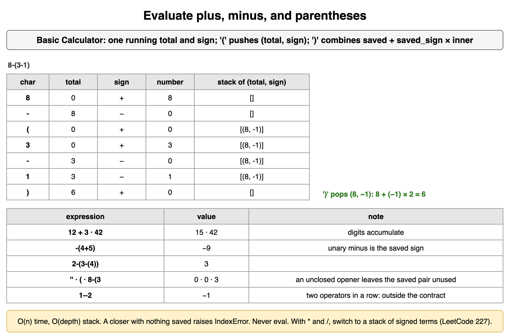

*Source: [`diagrams/stacks.drawio`](/content/11_Coding_Problems/15_Stacks/diagrams/stacks.drawio), page 8.*

## Remove adjacent duplicates
Delete two adjacent equal characters until none remain. Which pair goes first does not change the result. The stack is the string so far. An equal top pops, and the buried character becomes the new neighbor. Anything else pushes. Join once. Joining on every pop copies the prefix again and is quadratic ([Each index is pushed once](#11_Coding_Problems/15_Stacks/concepts/each-index-is-pushed-once)).

`bookkeeper` cancels `oo`, `kk`, and `ee` and leaves `bper`. `abccba` finishes empty. `zzz` leaves `z`: a pair is two characters, not a run. Empty stays empty. Each character is pushed once and popped at most once, so the time is O(n) and the memory is O(n), the answer when nothing cancels. A Python-string deletion loop allocates every time. LeetCode 1047 is lowercase letters, length 1 through 10^5, with a unique result. This function also accepts empty and other characters. LeetCode 1209 removes k copies and needs a count on each character.

```python
def collapse_pairs(text: str) -> str:
    stack: list[str] = []
    for ch in text:
        if stack and stack[-1] == ch:
            stack.pop()
        else:
            stack.append(ch)
    return "".join(stack)


print(
    collapse_pairs("bookkeeper"),
    repr(collapse_pairs("abccba")),
    collapse_pairs("zzz"),
    repr(collapse_pairs("")),
)
# bper '' z ''
```

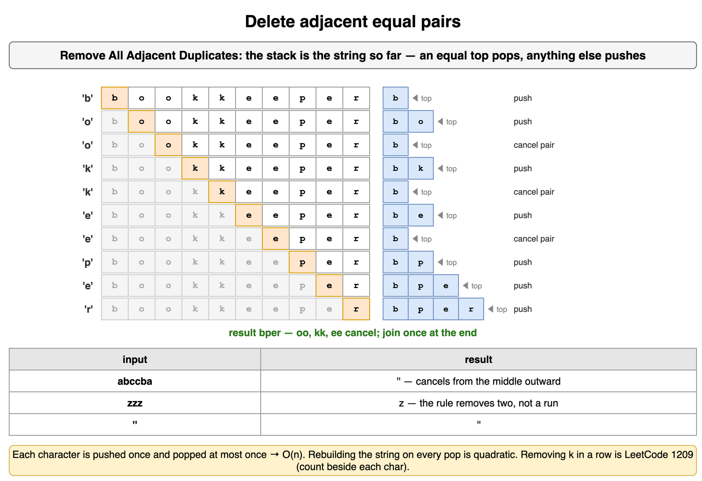

*Source: [`diagrams/stacks.drawio`](/content/11_Coding_Problems/15_Stacks/diagrams/stacks.drawio), page 9.*

## Queue from two stacks
A queue returns the oldest value. Pushes land on `inbox`. Pop and peek read `outbox`, and they pour `inbox` onto `outbox` only when `outbox` is empty. The pour reverses order. Pouring while `outbox` still holds values puts a newer value on top of an older one. [Two-stack queue](#07_Data_Structures_and_Algorithms/04_Stacks_and_Queues/concepts/two-stack-queue) is this structure. Each value moves across once, so n pushes and n pops transfer O(n) values ([Each index is pushed once](#11_Coding_Problems/15_Stacks/concepts/each-index-is-pushed-once)). One pop can pour all n and is O(n). Pop and peek are amortized O(1). A push does not pour.

Push 4, 1, 7. The first pop pours three times and returns 4. Peek then returns 1 and does not pour. Later pops return 1, 7, and 2. Four values take four moves. An empty pop or peek raises `IndexError`. LeetCode 232 is push, pop, peek, and empty, stack operations only, values 1 through 9, at most 100 calls, and pop or peek only when non-empty. Its follow-up is amortized O(1). This class raises on empty and takes any integer. `collections.deque` is worst-case O(1) at both ends when a queue is allowed. One stack cannot return the oldest value without a second stack or a recursion of the same depth.

```python
class TwoStackQueue:
    def __init__(self) -> None:
        self.inbox: list[int] = []
        self.outbox: list[int] = []
        self.moves = 0

    def push(self, value: int) -> None:
        self.inbox.append(value)

    def _pour(self) -> None:
        if self.outbox:
            return
        while self.inbox:
            self.outbox.append(self.inbox.pop())
            self.moves += 1

    def pop(self) -> int:
        self._pour()
        if not self.outbox:
            raise IndexError("pop from empty queue")
        return self.outbox.pop()

    def peek(self) -> int:
        self._pour()
        if not self.outbox:
            raise IndexError("peek at empty queue")
        return self.outbox[-1]

    def empty(self) -> bool:
        return not self.inbox and not self.outbox


q = TwoStackQueue()
q.push(4)
q.push(1)
q.push(7)
print(q.pop(), q.moves, q.inbox, q.outbox)
q.push(2)
print(q.peek(), q.moves)
print(q.pop(), q.pop(), q.pop(), q.moves, q.empty())
try:
    TwoStackQueue().peek()
except IndexError:
    print("empty")
# 4 3 [] [7, 1]
# 1 3
# 1 7 2 4 True
# empty
```

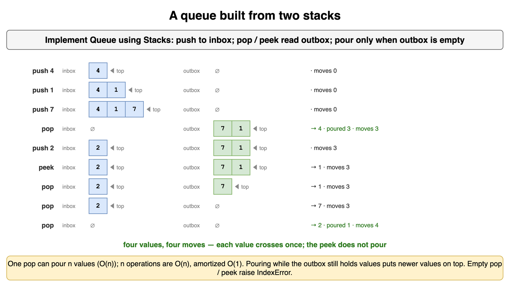

*Source: [`diagrams/stacks.drawio`](/content/11_Coding_Problems/15_Stacks/diagrams/stacks.drawio), page 10.*

## Sliding window maximum
The maximum of every block of length k is the front of a deque of indexes, values decreasing toward the back. Subtracting a leaving value does not recover that maximum ([When a shrink is not legal](#11_Coding_Problems/13_Sliding_Windows/concepts/when-a-shrink-is-not-legal)). A stack has one end. [Deque (double-ended queue)](#07_Data_Structures_and_Algorithms/04_Stacks_and_Queues/concepts/deque-double-ended-queue) has O(1) `popleft`, and [Monotonic deque: sliding window maximum](#07_Data_Structures_and_Algorithms/04_Stacks_and_Queues/concepts/monotonic-deque-sliding-window-maximum) is the pattern. `pandas.Series.rolling(k).max()` is the library call, not a claim that pandas uses a deque.

Expire the front when its index is at most `i - k`. One pop is enough. Pop the back while it is `<=` the new value, push, and read the front only after k values. A value without an index cannot tell an exit from a dominated entry. Popping the front on every slide can drop a maximum still in the window. `<` and `<=` report the same maximum, and an older tie leaves first under `<=`. Each index is pushed once and popped at most once: O(n) time and O(k) memory. A k outside 1 through the length returns nothing. A heap that deletes the leaving value is O(n log k). A lazy heap keeps expired indexes until the root: O(n log n) time and O(n) memory. A running sum does not use this deque. LeetCode 239 keeps k from 1 through the length, on up to 10^5 values from -10^4 through 10^4.

```python
from collections import deque


def window_maximums(values: list[int], k: int) -> list[int]:
    if k <= 0 or k > len(values):
        return []
    window: deque[int] = deque()
    out = []
    for i, value in enumerate(values):
        if window and window[0] <= i - k:
            window.popleft()
        while window and values[window[-1]] <= value:
            window.pop()
        window.append(i)
        if i >= k - 1:
            out.append(values[window[0]])
    return out


print(window_maximums([6, 2, 8, 4, 7, 3], 3))
print(window_maximums([5, 5, 1], 2))
print(window_maximums([5, 5, 1, 4, 6], 3))
print(window_maximums([2, -3, 2], 2))
print(window_maximums([4, 4, 4], 2), window_maximums([9, 7, 5, 3], 2), window_maximums([2, 5, 8], 2))
print(window_maximums([4], 1), window_maximums([], 2), window_maximums([1, 2, 3], 4))
# [8, 8, 8, 7]
# [5, 5]
# [5, 5, 6]
# [2, 2]
# [4, 4] [9, 7, 5] [5, 8]
# [4] [] []
```

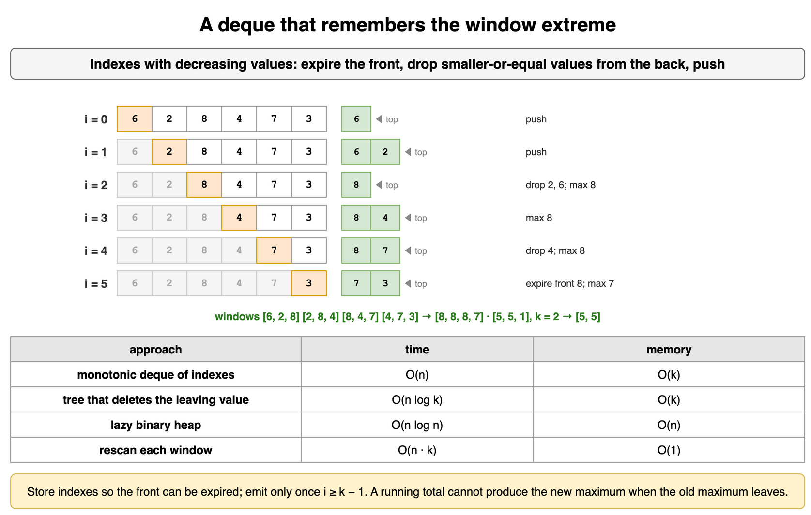

*Source: [`diagrams/stacks.drawio`](/content/11_Coding_Problems/15_Stacks/diagrams/stacks.drawio), page 5.*

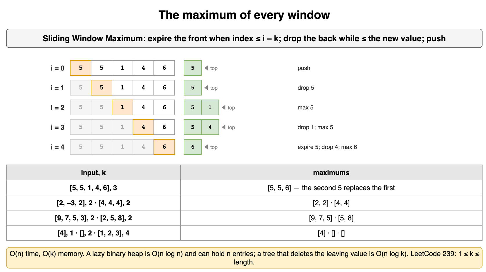

*Source: [`diagrams/stacks.drawio`](/content/11_Coding_Problems/15_Stacks/diagrams/stacks.drawio), page 11.*
