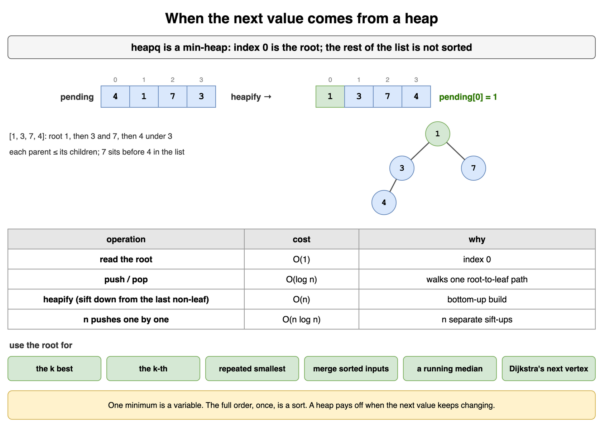
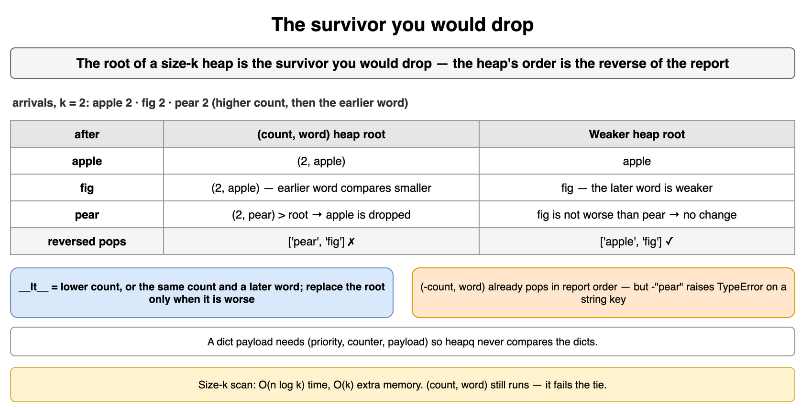
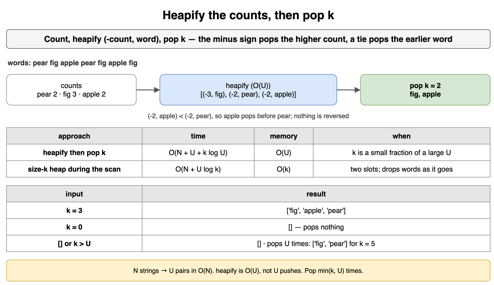
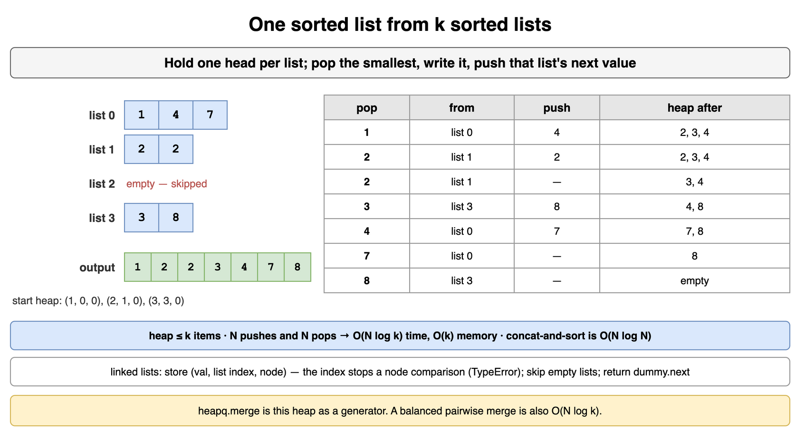
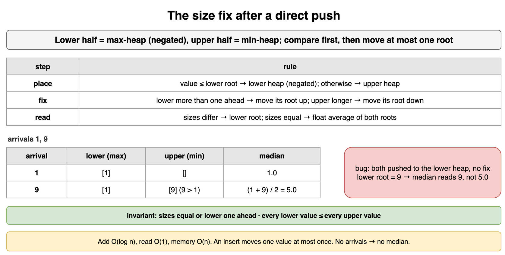
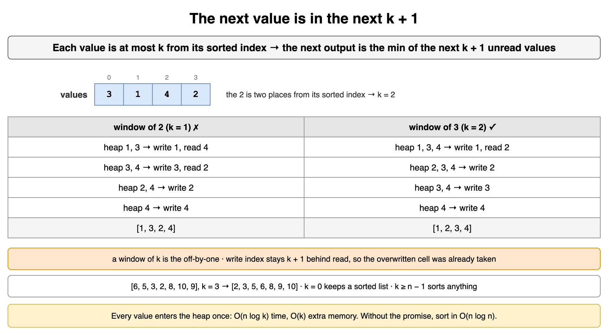
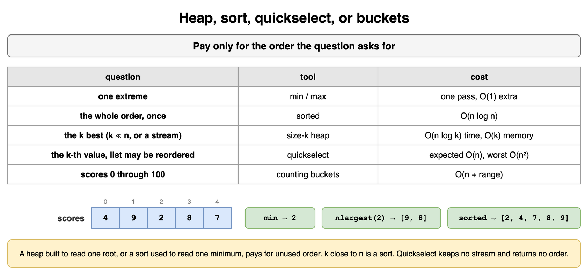

## When the next value comes from a heap

Push and pop each walk one path, so each costs O(log n). Reading the root costs O(1). Sifting down from the last non-leaf builds a heap in O(n). Inserting the same n items one by one costs O(n log n). Those operations are [Binary heap](#07_Data_Structures_and_Algorithms/06_Heaps_and_Tries/concepts/binary-heap), [Heap insert (sift up)](#07_Data_Structures_and_Algorithms/06_Heaps_and_Tries/concepts/heap-insert-sift-up), [Extract min (sift down)](#07_Data_Structures_and_Algorithms/06_Heaps_and_Tries/concepts/extract-min-sift-down), and [Bottom-up heapify](#07_Data_Structures_and_Algorithms/06_Heaps_and_Tries/concepts/bottom-up-heapify). Python's `heapq` is a min-heap: after `heapify`, index 0 is the root and the rest of the list is not sorted.

Use that root when the next step is the k best, the k-th, repeated removal of the current smallest, a merge of sorted inputs, or a median kept current. [Dijkstra's algorithm](#07_Data_Structures_and_Algorithms/07_Graphs/concepts/dijkstra-s-algorithm) pops the unsettled vertex with the smallest distance. One minimum is a variable. The full order, once, is a sort. [When not to use a heap](#07_Data_Structures_and_Algorithms/06_Heaps_and_Tries/concepts/when-not-to-use-a-heap) is that split. The four values below are exercise numbers.

```python
import heapq

pending = [4, 1, 7, 3]
heapq.heapify(pending)
print(pending, pending[0])
# [1, 3, 7, 4] 1
```



*Source: [`diagrams/heaps.drawio`](/content/11_Coding_Problems/16_Heaps/diagrams/heaps.drawio), page 1.*

## The survivor you would drop

The root of a size-k heap is the survivor you would drop, so the heap's order is the reverse of the report. "Higher count, then the earlier word" drops a lower count, then a later word. The scan is [A heap for top-k](#11_Coding_Problems/07_Hard_Problems/concepts/a-heap-for-top-k) and [Top-K with a bounded heap](#07_Data_Structures_and_Algorithms/06_Heaps_and_Tries/concepts/top-k-with-a-bounded-heap): O(n log k) time and O(k) extra memory. `(count, word)` gets the tie wrong. A later word compares greater, so it replaces the earlier one. On the exercise counts apple 2, fig 2, and pear 2, in that order, with k of 2, pear replaces apple. The reversed pops are pear then fig.

`__lt__` means "lower count, or the same count and a later word." Replace the root only when it is worse, then reverse the pops. `(-count, word)` already pops in report order. `-"pear"` raises `TypeError`. A dict needs a counter between the priority and the payload so `heapq` never compares the dict.

```python
import heapq


class Weaker:
    def __init__(self, count: int, word: str) -> None:
        self.count = count
        self.word = word

    def __lt__(self, other: "Weaker") -> bool:
        if self.count != other.count:
            return self.count < other.count
        return self.word > other.word


def wrongly(pairs: list[tuple[str, int]], k: int) -> list[str]:
    heap: list[tuple[int, str]] = []
    for word, count in pairs:
        item = (count, word)
        if len(heap) < k:
            heapq.heappush(heap, item)
        elif item > heap[0]:
            heapq.heapreplace(heap, item)
    out = [heapq.heappop(heap)[1] for _ in range(len(heap))]
    out.reverse()
    return out


def keep(pairs: list[tuple[str, int]], k: int) -> list[str]:
    heap: list[Weaker] = []
    for word, count in pairs:
        item = Weaker(count, word)
        if len(heap) < k:
            heapq.heappush(heap, item)
        elif heap[0] < item:
            heapq.heapreplace(heap, item)
    out = [heapq.heappop(heap).word for _ in range(len(heap))]
    out.reverse()
    return out


pairs = [("apple", 2), ("fig", 2), ("pear", 2)]
print(wrongly(pairs, 2), keep(pairs, 2))
# ['pear', 'fig'] ['apple', 'fig']
```



*Source: [`diagrams/heaps.drawio`](/content/11_Coding_Problems/16_Heaps/diagrams/heaps.drawio), page 2.*

## Heapify the counts, then pop k

Count the words, then heapify `(-count, word)`. The minus sign pops the higher count first. An equal count pops the earlier word, so nothing is reversed. N strings become U pairs in O(N) time and O(U) memory. `heapify` is O(U) ([Bottom-up heapify](#07_Data_Structures_and_Algorithms/06_Heaps_and_Tries/concepts/bottom-up-heapify)), not U pushes. k pops are O(k log U). The total is O(N + U + k log U).

The size-k heap is O(U log k) after the count and stores O(k). Heapify-then-pop is cheaper when k is a small fraction of a large U. Two slots favor the size-k heap, and only that heap can drop a word during the scan. Pop U times when k is larger than U. A k of 0 pops nothing. The exercise strings below give fig three times, and apple and pear twice each.

```python
import heapq


def top_k_words(words: list[str], k: int) -> list[str]:
    counts: dict[str, int] = {}
    for word in words:
        counts[word] = counts.get(word, 0) + 1
    heap = [(-count, word) for word, count in counts.items()]
    heapq.heapify(heap)
    return [heapq.heappop(heap)[1] for _ in range(min(k, len(heap)))]


sample = ["pear", "fig", "apple", "pear", "fig", "apple", "fig"]
print(top_k_words(sample, 2), top_k_words(sample, 3), top_k_words(sample, 0))
print(top_k_words([], 2), top_k_words(["fig", "pear"], 5))
# ['fig', 'apple'] ['fig', 'apple', 'pear'] []
# [] ['fig', 'pear']
```



*Source: [`diagrams/heaps.drawio`](/content/11_Coding_Problems/16_Heaps/diagrams/heaps.drawio), page 3.*

## One sorted list from k sorted lists

A min-heap holds one head from each sorted list. Pop the smallest, write it, and push that list's next value. The heap never holds more than k items. Each of the N values is pushed once and popped once: O(N log k) time and O(k) extra memory. Concatenate-and-sort is O(N log N). A balanced pairwise merge is the same O(N log k), one pass per round. [Merging sorted sequences](#07_Data_Structures_and_Algorithms/09_Sorting_and_Searching/concepts/merging-sorted-sequences) is the two-list case. `heapq.merge` is this heap as a generator and skips an empty input.

On a linked list the third field is the node, with the list index in front of it. Comparing two nodes raises `TypeError`. Skip an empty list, or the push reads `None.val`. A dummy node's `next` is the answer, and it is `None` when every input was empty ([Dummy head](#11_Coding_Problems/11_Linked_Lists/concepts/dummy-head)). The block stores a column instead of a node. The exercise lists are `1, 4, 7`, `2, 2`, an empty list, and `3, 8`.

```python
import heapq


def merge_k(rows: list[list[int]]) -> list[int]:
    heap = [(row[0], index, 0) for index, row in enumerate(rows) if row]
    heapq.heapify(heap)
    out: list[int] = []
    while heap:
        value, index, place = heapq.heappop(heap)
        out.append(value)
        if place + 1 < len(rows[index]):
            heapq.heappush(heap, (rows[index][place + 1], index, place + 1))
    return out


print(merge_k([[1, 4, 7], [2, 2], [], [3, 8]]))
print(merge_k([]), merge_k([[], []]), merge_k([[4]]))
# [1, 2, 2, 3, 4, 7, 8]
# [] [] [4]
```



*Source: [`diagrams/heaps.drawio`](/content/11_Coding_Problems/16_Heaps/diagrams/heaps.drawio), page 4.*

## The size fix after a direct push

The lower half is a max-heap and the upper half is a min-heap. [Two heaps (running median)](#07_Data_Structures_and_Algorithms/06_Heaps_and_Tries/concepts/two-heaps-running-median) and [Two heaps for a running median](#11_Coding_Problems/07_Hard_Problems/concepts/two-heaps-for-a-running-median) push each arrival into the lower heap, move that root up, and move it back if the upper half is longer. A direct push compares first. A value at or below the lower root, stored negated, joins the lower half. A greater value joins the upper half. Then one root moves if the lower half is more than one ahead, or if the upper half is longer.

Sizes stay equal, or the lower half stays one ahead, and every lower value stays at or below every upper value. The median is the lower root, or the float average of both roots when the sizes match. An insert moves one value at most once: O(log n) to add, O(1) to read, O(n) memory. No arrivals means no median. Skipping the move is the bug. The exercise arrivals 1 and then 9, both left on the lower heap, leave 9 at the root. The medians are 1 and then 5.

```python
import heapq


def medians(values: list[int]) -> list[float]:
    low: list[int] = []
    high: list[int] = []
    out: list[float] = []
    for value in values:
        if not low or value <= -low[0]:
            heapq.heappush(low, -value)
        else:
            heapq.heappush(high, value)
        if len(low) > len(high) + 1:
            heapq.heappush(high, -heapq.heappop(low))
        elif len(high) > len(low):
            heapq.heappush(low, -heapq.heappop(high))
        if len(low) > len(high):
            out.append(float(-low[0]))
        else:
            out.append((-low[0] + high[0]) / 2)
    return out


stuck: list[int] = []
for value in (1, 9):
    heapq.heappush(stuck, -value)
print(medians([1, 9]), -stuck[0], medians([]))
# [1.0, 5.0] 9 []
```



*Source: [`diagrams/heaps.drawio`](/content/11_Coding_Problems/16_Heaps/diagrams/heaps.drawio), page 5.*

## The next value is in the next k + 1

If each value sits at most k indexes from its sorted index, the next output is the min of the next `k + 1` unread values. A value for that slot cannot start more than k places further right. Heapify the window, write the root, and push the next unread value. Every value enters once: O(n log k) time and O(k) extra memory. Without the promise, a full sort is O(n log n).

A window of k is the off-by-one. On the exercise list `[3, 1, 4, 2]` the 2 is two places from its sorted index. A window of 2 writes `[1, 3, 2, 4]`. A window of 3 writes `[1, 2, 3, 4]`. The window is a copy, and the write index stays `k + 1` behind the read, so the overwritten cell was already taken. A k of 0 only preserves a sorted list. A k of at least n - 1 sorts any list. On `[6, 5, 3, 2, 8, 10, 9]` the farthest move is 3.

```python
import heapq


def sort_k_away(values: list[int], k: int) -> list[int]:
    data = list(values)
    window = data[: k + 1]
    heapq.heapify(window)
    write = 0
    for read in range(k + 1, len(data)):
        data[write] = heapq.heapreplace(window, data[read])
        write += 1
    while window:
        data[write] = heapq.heappop(window)
        write += 1
    return data


print(sort_k_away([3, 1, 4, 2], 1))
print(sort_k_away([3, 1, 4, 2], 2))
print(sort_k_away([6, 5, 3, 2, 8, 10, 9], 3))
print(sort_k_away([], 2), sort_k_away([4], 3), sort_k_away([1, 2, 3], 0))
# [1, 3, 2, 4]
# [1, 2, 3, 4]
# [2, 3, 5, 6, 8, 9, 10]
# [] [4] [1, 2, 3]
```



*Source: [`diagrams/heaps.drawio`](/content/11_Coding_Problems/16_Heaps/diagrams/heaps.drawio), page 6.*

## Heap, sort, quickselect, or buckets

One extreme is `min` or `max`: one pass, O(1) extra memory. The whole order, once, is `sorted`, O(n log n). The k best, with k well below n or on a stream you will not store, is a size-k heap: O(n log k) time and O(k) extra memory. The k-th value alone, in a list you may reorder, is [Quickselect](#07_Data_Structures_and_Algorithms/09_Sorting_and_Searching/concepts/quickselect): expected O(n), worst case O(n^2). Scores from 0 through 100 are counting buckets, O(n + range), on [Counting sort](#07_Data_Structures_and_Algorithms/09_Sorting_and_Searching/concepts/counting-sort). The longer table is [When not to use a heap](#07_Data_Structures_and_Algorithms/06_Heaps_and_Tries/concepts/when-not-to-use-a-heap). [A heap for top-k](#11_Coding_Problems/07_Hard_Problems/concepts/a-heap-for-top-k) is the coldest-hours case of the size-k row.

A heap built only to read one root, or a sort used only to read one minimum, pays for an order the question did not ask for. A k close to n is a sort. Quickselect does not keep a stream, and it does not return the other values in order. The scores below are exercise numbers.

```python
import heapq

scores = [4, 9, 2, 8, 7]
print(min(scores), heapq.nlargest(2, scores), sorted(scores))
# 2 [9, 8] [2, 4, 7, 8, 9]
```



*Source: [`diagrams/heaps.drawio`](/content/11_Coding_Problems/16_Heaps/diagrams/heaps.drawio), page 7.*
