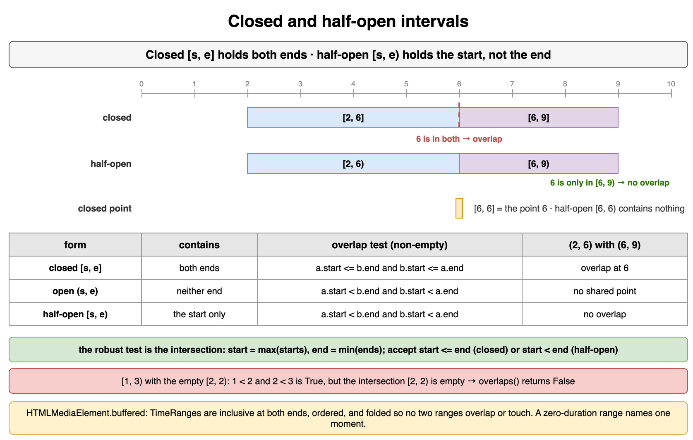
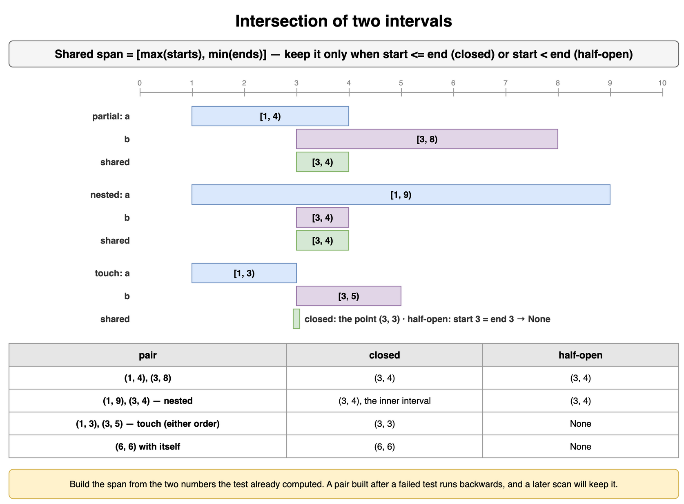
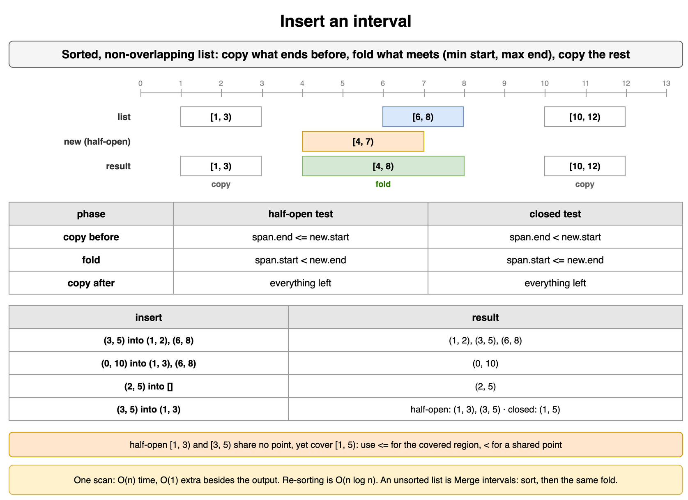
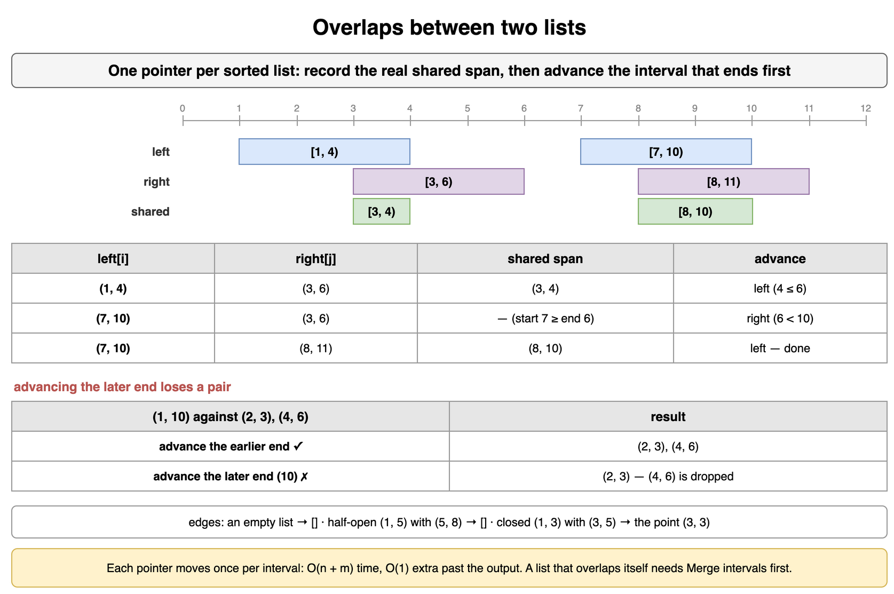
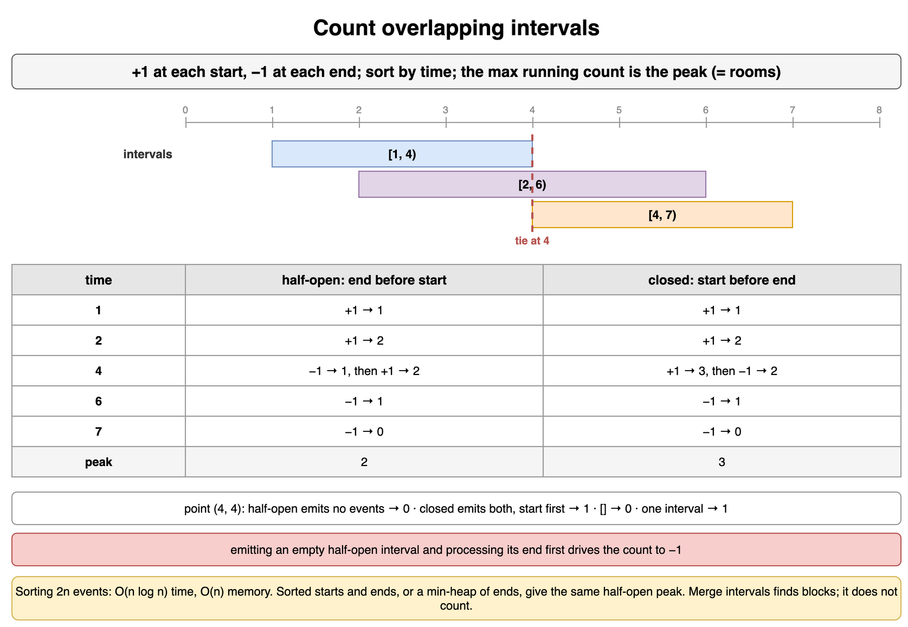
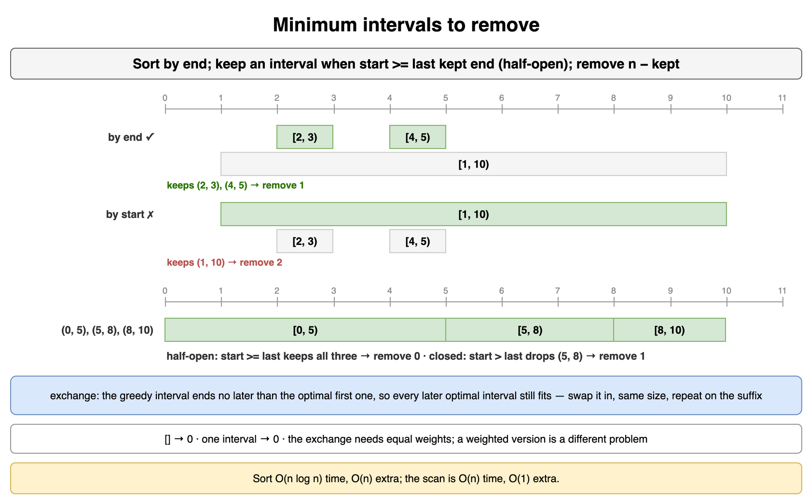
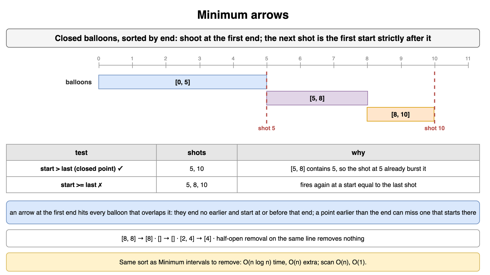

## Closed and half-open intervals

An interval is a start and an end. Closed `[start, end]` contains both ends. Open `(start, end)` contains neither, so a shared endpoint sits in neither interval. Half-open `[start, end)` contains the start and excludes the end. The pair `(2, 6)` and `(6, 9)` shares 6: the closed pair overlaps, and the half-open pair does not. A closed `[6, 6]` is the point 6. A half-open `[6, 6)` contains nothing. `HTMLMediaElement.buffered` returns a normalized `TimeRanges`. The HTML spec makes each range inclusive at both ends, keeps the ranges ordered, and folds a range that would only touch the previous one, so the stored list neither overlaps nor touches. A zero-duration range is allowed, and it names one moment.

A tuple holds the pair. A small class with `start` and `end` is that pair with names. The overlap check is the intersection. For a non-empty interval the two written forms agree: half-open overlap is `a.start < b.end and b.start < a.end` when both have `start < end`, and closed overlap uses `<=` when both have `start <= end`. An empty half-open interval sitting inside another breaks the two comparisons. `[1, 3)` and `[2, 2)` give `1 < 2 and 2 < 3`, which is true, and the intersection starts at 2 and ends at 2, which is not a half-open interval. Accept the intersection only when `start <= end` for closed ranges or `start < end` for half-open ranges. No intervals is an empty list. One interval has no partner.

```python
def overlaps(a: tuple[int, int], b: tuple[int, int], closed: bool) -> bool:
    start, end = max(a[0], b[0]), min(a[1], b[1])
    return start <= end if closed else start < end


print(overlaps((2, 6), (6, 9), True), overlaps((2, 6), (6, 9), False))
print(overlaps((6, 6), (6, 6), True), overlaps((6, 6), (6, 6), False))
print(overlaps((1, 3), (2, 2), False), (1 < 2 and 2 < 3))
# True False
# True False
# False True
```



*Source: [`diagrams/intervals.drawio`](/content/11_Coding_Problems/17_Intervals/diagrams/intervals.drawio), page 1.*

## Intersection of two intervals

The shared span is `[max(starts), min(ends)]`. It is a real closed interval when that start is at or before the end, and a real half-open interval when the start is strictly before the end. A pair built after the test has failed runs backwards. A later scan that treats every pair as a span will keep it. The test is symmetric, so swapping the arguments does not change the span. Build the span from the two numbers the comparison already computed. A second walk that only asks whether the intervals overlap has thrown those numbers away.

A nested interval shares its whole span with the outer one, and the intersection is the inner interval. A partial overlap shares only the middle. Disjoint intervals produce a start past the end. Half-open intervals that only touch do too. A single point is a valid closed intersection and an invalid half-open one. On `(1, 4)` and `(3, 8)` the half-open span is `(3, 4)`. On `(1, 9)` and `(3, 4)` the span is the inner `(3, 4)`. On `(1, 3)` and `(3, 5)` the closed span is the point `(3, 3)` and the half-open span is rejected. The same point comes back if the arguments are swapped. A half-open point intersected with itself is rejected. Empty input is not a pair.

```python
def shared(a: tuple[int, int], b: tuple[int, int], closed: bool) -> tuple[int, int] | None:
    start, end = max(a[0], b[0]), min(a[1], b[1])
    valid = start <= end if closed else start < end
    return (start, end) if valid else None


print(shared((1, 4), (3, 8), False), shared((1, 9), (3, 4), False))
print(shared((1, 3), (3, 5), True), shared((1, 3), (3, 5), False))
print(shared((3, 5), (1, 3), True), shared((6, 6), (6, 6), False))
# (3, 4) (3, 4)
# (3, 3) None
# (3, 3) None
```



*Source: [`diagrams/intervals.drawio`](/content/11_Coding_Problems/17_Intervals/diagrams/intervals.drawio), page 2.*

## Insert an interval

The list is sorted by start and already non-overlapping, so one new interval is one left-to-right scan. Copy every interval the new one does not meet. Fold every interval the new one meets, taking the minimum start and the maximum end. Copy the rest, still in order. The union of an unsorted list is [Merge intervals](#11_Coding_Problems/06_Moderate_Problems/concepts/merge-intervals): sort by start, then the same fold. Insert does not sort. The scan is O(n) time. The new list is the output, and extra memory besides it is O(1). Sorting again is O(n log n) time and O(n) extra memory. The inputs here are non-empty: `start < end` for half-open, and `start <= end` for closed.

Half-open overlap folds while the next start is strictly before the new end, and it copies a neighbor that ends at or before the new start, including one that only touches. Closed ranges fold that neighbor, because the shared endpoint is in both. Half-open `[1, 3)` and `[3, 5)` share no point, so the overlap rule leaves them apart. Their covered region is still `[1, 5)`, since every value from 1 up to 5 sits in one of them. Use `<=` when the question is that region. Use `<` when the question is a shared point. Closed ranges have no such split: the point is in both, so overlap and the covered region use the same test. The exercise list `(1, 3), (6, 8), (10, 12)` with half-open `(4, 7)` becomes `(1, 3), (4, 8), (10, 12)`. `(3, 5)` lands between `(1, 2)` and `(6, 8)`. `(0, 10)` swallows `(1, 3), (6, 8)`. An empty list with `(2, 5)` is that one span. Half-open `(3, 5)` into `(1, 3)` stays two intervals. The closed pair becomes `(1, 5)`.

```python
def insert(
    spans: list[tuple[int, int]], new: tuple[int, int], closed: bool = False
) -> list[tuple[int, int]]:
    out: list[tuple[int, int]] = []
    start, end = new
    index = 0
    while index < len(spans) and (spans[index][1] < start if closed else spans[index][1] <= start):
        out.append(spans[index])
        index += 1
    while index < len(spans) and (spans[index][0] <= end if closed else spans[index][0] < end):
        start = min(start, spans[index][0])
        end = max(end, spans[index][1])
        index += 1
    out.append((start, end))
    out.extend(spans[index:])
    return out


print(insert([(1, 3), (6, 8), (10, 12)], (4, 7)))
print(insert([(1, 2), (6, 8)], (3, 5)), insert([(1, 3), (6, 8)], (0, 10)), insert([], (2, 5)))
print(insert([(1, 3)], (3, 5)), insert([(1, 3)], (3, 5), True))
# [(1, 3), (4, 8), (10, 12)]
# [(1, 2), (3, 5), (6, 8)] [(0, 10)] [(2, 5)]
# [(1, 3), (3, 5)] [(1, 5)]
```



*Source: [`diagrams/intervals.drawio`](/content/11_Coding_Problems/17_Intervals/diagrams/intervals.drawio), page 3.*

## Overlaps between two lists

Each list is already sorted by start and does not overlap itself. A pointer sits on each list. Record the shared span when it is a real interval, then advance the pointer whose interval ends first. That interval cannot meet anything later in the other list. Later intervals there start at or after the one still open, because that list does not overlap itself, and this interval has already ended at or before that open end. Each pointer moves once per interval, so the scan is O(n + m) time and O(1) extra memory past the output. Sorting first adds O(n log n + m log m) time and O(n + m) memory. [Two pointers](#11_Coding_Problems/06_Moderate_Problems/concepts/two-pointers) on one sorted array discards an end of that array. The move here is the earlier of two ends. A list that overlaps itself is outside this scan. Run [Merge intervals](#11_Coding_Problems/06_Moderate_Problems/concepts/merge-intervals) on it first.

Advancing the interval that ends later skips a pair that still overlaps the one left behind. On `(1, 10)` and `(2, 3), (4, 6)`, the later end is 10. Advancing it after `(2, 3)` drops `(4, 6)`. The earlier-end scan returns both. On `(1, 4), (7, 10)` and `(3, 6), (8, 11)` the half-open overlaps are `(3, 4)` and `(8, 10)`. Either list empty returns nothing. Half-open `(1, 5)` and `(5, 8)` share no value. A nested `(1, 10)` against `(2, 3), (4, 5)` returns both inner spans. Closed lists use `start <= end` for the span and still advance the earlier end. After a closed merge, the next start in one list is strictly past its previous end, so the interval that already ended cannot reach it. Half-open `(1, 3)` and `(3, 5)` return nothing. The closed pair returns the point `(3, 3)`.

```python
def pair_overlaps(
    left: list[tuple[int, int]], right: list[tuple[int, int]], closed: bool = False
) -> list[tuple[int, int]]:
    i = j = 0
    out: list[tuple[int, int]] = []
    while i < len(left) and j < len(right):
        start, end = max(left[i][0], right[j][0]), min(left[i][1], right[j][1])
        if start <= end if closed else start < end:
            out.append((start, end))
        if left[i][1] <= right[j][1]:
            i += 1
        else:
            j += 1
    return out


def advance_later(left: list[tuple[int, int]], right: list[tuple[int, int]]) -> list[tuple[int, int]]:
    i = j = 0
    out: list[tuple[int, int]] = []
    while i < len(left) and j < len(right):
        start, end = max(left[i][0], right[j][0]), min(left[i][1], right[j][1])
        if start < end:
            out.append((start, end))
        if left[i][1] >= right[j][1]:
            i += 1
        else:
            j += 1
    return out


print(pair_overlaps([(1, 4), (7, 10)], [(3, 6), (8, 11)]))
print(pair_overlaps([(1, 10)], [(2, 3), (4, 6)]), advance_later([(1, 10)], [(2, 3), (4, 6)]))
print(pair_overlaps([], [(1, 2)]), pair_overlaps([(1, 5)], [(5, 8)]), pair_overlaps([(1, 10)], [(2, 3), (4, 5)]))
print(pair_overlaps([(1, 3)], [(3, 5)]), pair_overlaps([(1, 3)], [(3, 5)], True))
# [(3, 4), (8, 10)]
# [(2, 3), (4, 6)] [(2, 3)]
# [] [] [(2, 3), (4, 5)]
# [] [(3, 3)]
```



*Source: [`diagrams/intervals.drawio`](/content/11_Coding_Problems/17_Intervals/diagrams/intervals.drawio), page 4.*

## Count overlapping intervals

Split each interval into `+1` at the start and `-1` at the end. Sort by time. For half-open ranges, process the end before the start when the time ties: an interval that ends at t does not cover t, so a start at t must see it already closed. Add the delta after each event. The maximum of the running count is the largest overlap, which is also the number of rooms. Sorting the 2n events is O(n log n) time and O(n) memory. The scan is O(n). Two sorted arrays, starts and ends, compute the same half-open peak in one pass after those sorts: take a start while it is strictly before the next end, and drop one when an end is due. A min-heap of end times answers the same half-open count. That version is the Rooms for the meetings drill on the Heaps topic. [Merge intervals](#11_Coding_Problems/06_Moderate_Problems/concepts/merge-intervals) writes the occupied blocks. It does not count how many intervals share an instant.

Processing a start before an end at the same time answers the closed question, where t belongs to an interval ending at t and to one starting at t. A half-open interval with `start == end` is empty and must emit no events. Emitting both, and processing the end first, drives the count to -1. A closed point emits both and processes the start first, so the peak is 1. The exercise list `(1, 4), (2, 6), (4, 7)` peaks at 2 when ends win the tie and at 3 when starts win it. An empty list peaks at 0. One non-empty interval peaks at 1. The point `(4, 4)` peaks at 0 under the half-open rule and at 1 under the closed rule. After a sort by start, the half-open peak is at most 1 exactly when every interval starts at or after the previous end. An empty list passes that check and still peaks at 0. The adjacent check is not the room count once the peak can exceed 1.

```python
def peak(spans: list[tuple[int, int]], ends_first: bool) -> int:
    events: list[tuple[int, int, int]] = []
    for start, end in spans:
        if ends_first and start >= end:
            continue
        if not ends_first and start > end:
            continue
        events.append((start, 1 if ends_first else 0, 1))
        events.append((end, 0 if ends_first else 1, -1))
    events.sort()
    count = best = 0
    for _time, _order, delta in events:
        count += delta
        best = max(best, count)
    return best


sample = [(1, 4), (2, 6), (4, 7)]
print(peak(sample, True), peak(sample, False), peak([], True), peak([(2, 5)], True))
print(peak([(4, 4)], True), peak([(4, 4)], False))
# 2 3 0 1
# 0 1
```



*Source: [`diagrams/intervals.drawio`](/content/11_Coding_Problems/17_Intervals/diagrams/intervals.drawio), page 5.*

## Minimum intervals to remove

[Greedy choice](#07_Data_Structures_and_Algorithms/11_Problem_Solving_Patterns/concepts/greedy-choice) names a local best you do not undo. Sort by end. Keep a half-open interval when its start is at or after the last kept end. The number to remove is n minus the number kept. Let the greedy set and an optimal set both be ordered by end. The greedy interval ends no later than the optimal one, because it has the earliest end still available. Every later optimal interval starts at or after that optimal end, so it also starts at or after the greedy end and still fits. Swap the optimal first interval for the greedy one. The set stays feasible and the same size. Repeat on the suffix. The exchange needs equal weights. A long interval worth more than two short ones is a different problem.

Sorting by start fails the exchange. On `(1, 10), (2, 3), (4, 5)` the earliest start is the long interval, both short ones overlap it, and the removal count is 2. The earliest end keeps `(2, 3)` and `(4, 5)` and removes 1. Closed intervals overlap on a shared endpoint, so the same exchange uses `start > last end`. On `(0, 5), (5, 8), (8, 10)` the half-open rule removes 0 and the closed rule removes 1. An empty list removes 0. One interval removes 0. The sort is O(n log n) time and O(n) extra memory. The scan is O(n) time and O(1) extra. Half-open inputs satisfy `start < end`.

```python
def removals(spans: list[tuple[int, int]], touch_ok: bool = True) -> int:
    last = None
    kept = 0
    for start, end in sorted(spans, key=lambda span: span[1]):
        if last is None or (start >= last if touch_ok else start > last):
            kept += 1
            last = end
    return len(spans) - kept


def removals_by_start(spans: list[tuple[int, int]]) -> int:
    last = None
    kept = 0
    for start, end in sorted(spans):
        if last is None or start >= last:
            kept += 1
            last = end
    return len(spans) - kept


long = [(1, 10), (2, 3), (4, 5)]
line = [(0, 5), (5, 8), (8, 10)]
print(removals(long), removals_by_start(long))
print(removals(line), removals(line, False), removals([]), removals([(4, 7)]))
# 1 2
# 0 1 0 0
```



*Source: [`diagrams/intervals.drawio`](/content/11_Coding_Problems/17_Intervals/diagrams/intervals.drawio), page 6.*

## Minimum arrows

A closed balloon contains both ends, and an arrow is one point. The arrow bursts every balloon that contains that point. Sort by end. The balloon that ends first must be hit somewhere in its span. An arrow at its end hits it, and it hits every other balloon that overlaps it: that other balloon ends no earlier, and an overlap puts its start at or before this end, so the closed point is inside it. A point earlier than the end can miss a balloon that starts exactly here. One arrow is necessary for this balloon and enough for every balloon that overlaps it. Drop the balloons that contain the point and repeat. The next shot is the first start strictly after the point. [Greedy choice](#07_Data_Structures_and_Algorithms/11_Problem_Solving_Patterns/concepts/greedy-choice) names the pattern. The exchange is the argument above. [Minimum intervals to remove](#11_Coding_Problems/17_Intervals/concepts/minimum-intervals-to-remove) sorts the same way and keeps a half-open interval when `start >= last end`.

On `(0, 5), (5, 8), (8, 10)` the shots are 5 and 10. The balloon that starts at 5 contains 5, so `start > last` does not fire again. Using `start >= last` fires at 5, at 8, and at 10. Half-open removal on this line removes nothing, because each start equals the previous end. A single point still needs the shot at that point. An empty list needs none. One ordinary balloon needs the shot at its end. The sort is O(n log n) time and O(n) extra memory. The scan is O(n) time and O(1) extra.

```python
def arrows(balloons: list[tuple[int, int]], point: bool = True) -> list[int]:
    last = None
    shots: list[int] = []
    for start, end in sorted(balloons, key=lambda span: span[1]):
        if last is None or (start > last if point else start >= last):
            shots.append(end)
            last = end
    return shots


line = [(0, 5), (5, 8), (8, 10)]
print(arrows(line), arrows(line, False))
print(arrows([(8, 8)]), arrows([]), arrows([(2, 4)]))
# [5, 10] [5, 8, 10]
# [8] [] [4]
```



*Source: [`diagrams/intervals.drawio`](/content/11_Coding_Problems/17_Intervals/diagrams/intervals.drawio), page 7.*
