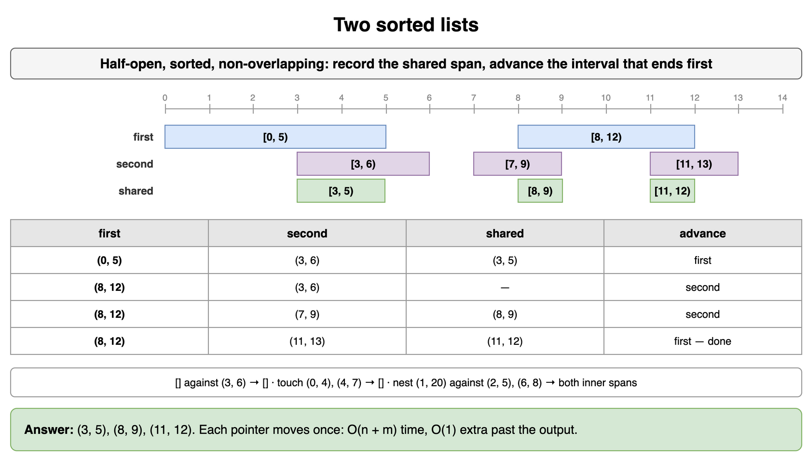
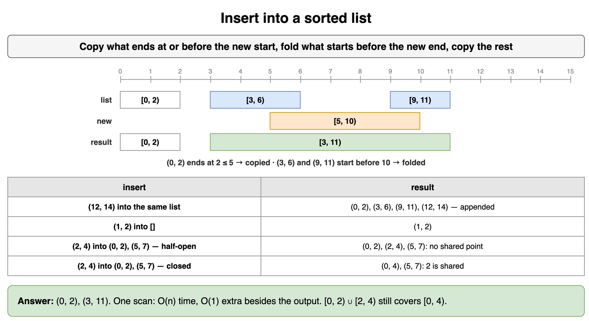
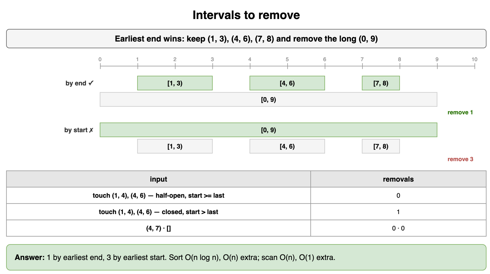
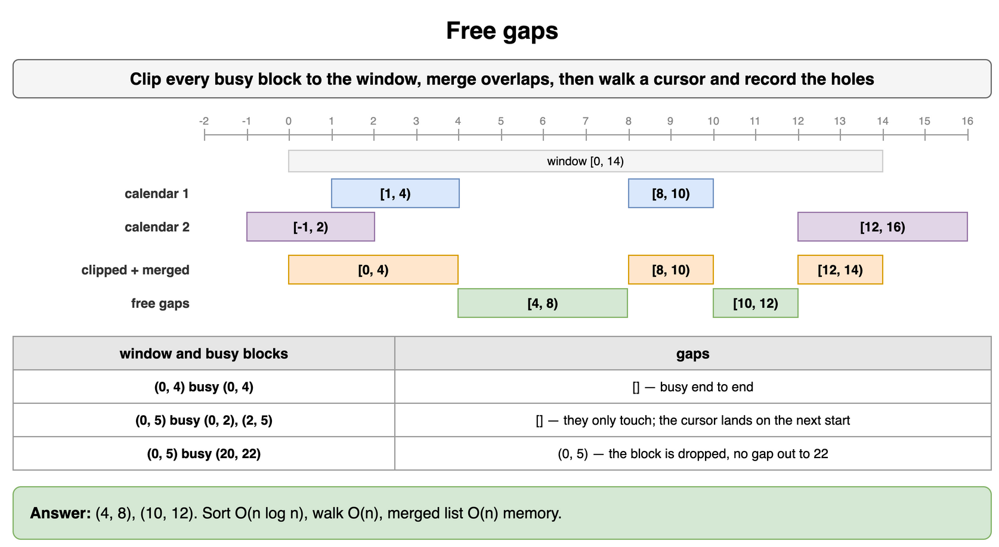
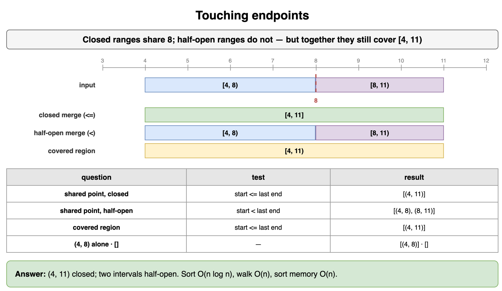
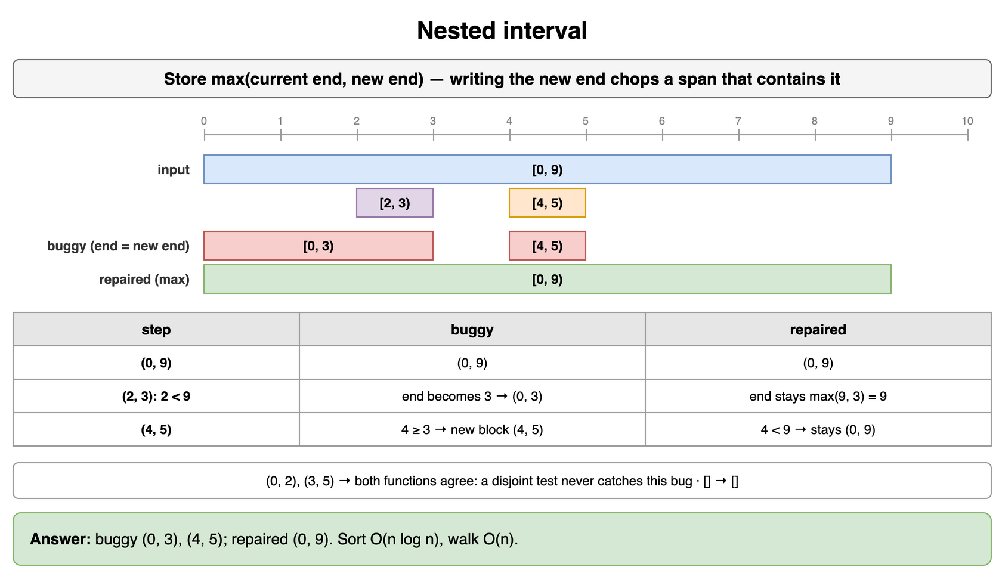
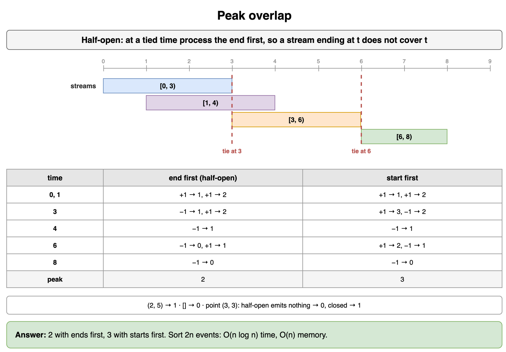
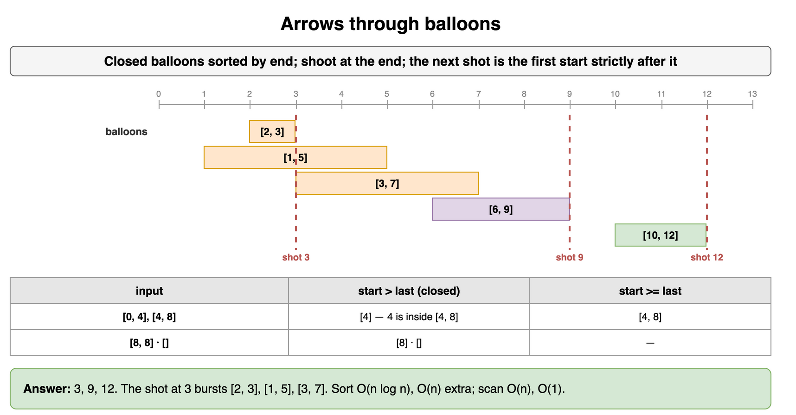

# Intervals — Drills

Original drills for two sorted lists, an insert, a removal count, free gaps, a touching endpoint, a nested end, a sweep, and arrows. Each answer has an approach, a cost, and Python. The numbers are exercise numbers.

## Two sorted lists

The exercise lists are half-open, sorted, and non-overlapping. The first is `(0, 5)`, `(8, 12)`. The second is `(3, 6)`, `(7, 9)`, `(11, 13)`. Which spans sit in both? Also answer an empty first list against `(3, 6)`, the touch `(0, 4)` and `(4, 7)`, and the nest `(1, 20)` against `(2, 5)`, `(6, 8)`.

**Answer:** `(3, 5)`, `(8, 9)`, and `(11, 12)`. `(0, 5)` meets `(3, 6)` and ends first, so the pointer on the first list moves. `(8, 12)` misses `(3, 6)` and `(7, 9)` contributes `(8, 9)`. `(11, 13)` contributes `(11, 12)`. An empty list contributes nothing. The touch shares no half-open value. The nest returns both inner spans. Advance the interval that ends first. Each pointer moves once, so the scan is O(n + m) time and O(1) extra memory past the output. The lists are already sorted. The walk is [Overlaps between two lists](#11_Coding_Problems/17_Intervals/concepts/overlaps-between-two-lists).

```python
def pair_overlaps(left: list[tuple[int, int]], right: list[tuple[int, int]]) -> list[tuple[int, int]]:
    i = j = 0
    out: list[tuple[int, int]] = []
    while i < len(left) and j < len(right):
        start, end = max(left[i][0], right[j][0]), min(left[i][1], right[j][1])
        if start < end:
            out.append((start, end))
        if left[i][1] <= right[j][1]:
            i += 1
        else:
            j += 1
    return out


print(pair_overlaps([(0, 5), (8, 12)], [(3, 6), (7, 9), (11, 13)]))
print(pair_overlaps([], [(3, 6)]), pair_overlaps([(0, 4)], [(4, 7)]))
print(pair_overlaps([(1, 20)], [(2, 5), (6, 8)]))
# [(3, 5), (8, 9), (11, 12)]
# [] []
# [(2, 5), (6, 8)]
```



*Source: [`diagrams/intervals-drills.drawio`](/content/11_Coding_Problems/17_Intervals/diagrams/intervals-drills.drawio), page 1.*

## Insert into a sorted list

The exercise list is half-open, sorted, and non-overlapping: `(0, 2)`, `(3, 6)`, `(9, 11)`. Insert `(5, 10)`. Also insert `(12, 14)` into that same list, insert `(1, 2)` into an empty list, and insert `(2, 4)` into `(0, 2)`, `(5, 7)` under both rules.

**Answer:** `(0, 2)` and `(3, 11)`. `(0, 2)` ends at the new start, so the half-open rule copies it. `(3, 6)` and `(9, 11)` fold into `(3, 11)`. `(12, 14)` starts after every end, so it is appended. An empty list becomes `(1, 2)`. Half-open `(2, 4)` does not share a point with `(0, 2)`, so the result stays three intervals. The closed rule shares 2 and returns `(0, 4)`, `(5, 7)`. The covered region of the half-open touch is that same `(0, 4)`, because `[0, 2) ∪ [2, 4) = [0, 4)`. The scan is O(n) time. The new list is the output, and extra memory besides it is O(1). The walk is [Insert an interval](#11_Coding_Problems/17_Intervals/concepts/insert-an-interval).

```python
def insert(
    spans: list[tuple[int, int]], new: tuple[int, int], closed: bool = False
) -> list[tuple[int, int]]:
    out: list[tuple[int, int]] = []
    start, end = new
    index = 0
    while index < len(spans) and (spans[index][1] < start if closed else spans[index][1] <= start):
        out.append(spans[index])
        index += 1
    while index < len(spans) and (spans[index][0] <= end if closed else spans[index][0] < end):
        start = min(start, spans[index][0])
        end = max(end, spans[index][1])
        index += 1
    out.append((start, end))
    out.extend(spans[index:])
    return out


base = [(0, 2), (3, 6), (9, 11)]
print(insert(base, (5, 10)))
print(insert(base, (12, 14)), insert([], (1, 2)))
print(insert([(0, 2), (5, 7)], (2, 4)), insert([(0, 2), (5, 7)], (2, 4), True))
# [(0, 2), (3, 11)]
# [(0, 2), (3, 6), (9, 11), (12, 14)] [(1, 2)]
# [(0, 2), (2, 4), (5, 7)] [(0, 4), (5, 7)]
```



*Source: [`diagrams/intervals-drills.drawio`](/content/11_Coding_Problems/17_Intervals/diagrams/intervals-drills.drawio), page 2.*

## Intervals to remove

The exercise intervals are half-open `(0, 9)`, `(1, 3)`, `(4, 6)`, and `(7, 8)`. How many must be removed so the rest share no point? Also answer the same list if you keep the earliest start instead of the earliest end, the touch `(1, 4)`, `(4, 6)` under both rules, the single interval `(4, 7)`, and an empty list.

**Answer:** Remove 1 by the earliest end, and remove 3 by the earliest start. Sort by end and keep `(1, 3)`, `(4, 6)`, and `(7, 8)`. `(0, 9)` overlaps the first of those. Sorting by start keeps `(0, 9)` and drops the three short intervals. The half-open touch removes 0. The closed touch removes 1, because the shared endpoint overlaps and the keep test is `start > last end`. One interval removes 0. An empty list removes 0. The sort is O(n log n) time and O(n) extra memory. The scan is O(n) and O(1) extra. The exchange is [Minimum intervals to remove](#11_Coding_Problems/17_Intervals/concepts/minimum-intervals-to-remove).

```python
def removals(spans: list[tuple[int, int]], touch_ok: bool = True) -> int:
    last = None
    kept = 0
    for start, end in sorted(spans, key=lambda span: span[1]):
        if last is None or (start >= last if touch_ok else start > last):
            kept += 1
            last = end
    return len(spans) - kept


def removals_by_start(spans: list[tuple[int, int]]) -> int:
    last = None
    kept = 0
    for start, end in sorted(spans):
        if last is None or start >= last:
            kept += 1
            last = end
    return len(spans) - kept


meetings = [(0, 9), (1, 3), (4, 6), (7, 8)]
print(removals(meetings), removals_by_start(meetings))
print(removals([(1, 4), (4, 6)]), removals([(1, 4), (4, 6)], False))
print(removals([(4, 7)]), removals([]))
# 1 3
# 0 1
# 0 0
```



*Source: [`diagrams/intervals-drills.drawio`](/content/11_Coding_Problems/17_Intervals/diagrams/intervals-drills.drawio), page 3.*

## Free gaps

Two exercise calendars, half-open, inside the window `(0, 14)`. The first is `(1, 4)` and `(8, 10)`. The second is `(-1, 2)` and `(12, 16)`. What are the free gaps? Also answer a window `(0, 4)` whose only busy block is `(0, 4)`, busy `(0, 2)`, `(2, 5)` inside `(0, 5)`, and busy `(20, 22)` inside `(0, 5)`.

**Answer:** The gaps are `(4, 8)` and `(10, 12)`. Clip each block to the window, then merge blocks that overlap. `(-1, 2)` becomes `(0, 2)` and joins `(1, 4)` as `(0, 4)`. `(12, 16)` becomes `(12, 14)`. `(8, 10)` stays. The cursor walks from 0, records a gap when a busy start is later, and jumps to that block's end. A block that ends at or before the window, or starts at or after it, is dropped, so `(20, 22)` does not open a gap out to 22. The window that is busy from end to end has no gap. `(0, 2)` and `(2, 5)` only touch. They share no point, and the cursor still lands on the next start, so the gap list is empty. The sort is O(n log n) time. The walk is O(n). The merged list is O(n) memory. The occupied blocks are [Merge intervals](#11_Coding_Problems/06_Moderate_Problems/concepts/merge-intervals). This walk is the holes between them, clipped to the window.

```python
def free_gaps(
    calendars: list[list[tuple[int, int]]], window: tuple[int, int]
) -> list[tuple[int, int]]:
    merged: list[tuple[int, int]] = []
    for start, end in sorted(span for calendar in calendars for span in calendar):
        if end <= window[0] or start >= window[1]:
            continue
        start = max(start, window[0])
        end = min(end, window[1])
        if start >= end:
            continue
        if merged and start < merged[-1][1]:
            merged[-1] = (merged[-1][0], max(merged[-1][1], end))
        else:
            merged.append((start, end))
    gaps: list[tuple[int, int]] = []
    cursor = window[0]
    for start, end in merged:
        if cursor < start:
            gaps.append((cursor, start))
        cursor = max(cursor, end)
    if cursor < window[1]:
        gaps.append((cursor, window[1]))
    return gaps


print(free_gaps([[(1, 4), (8, 10)], [(-1, 2), (12, 16)]], (0, 14)))
print(free_gaps([[(0, 4)]], (0, 4)), free_gaps([[(0, 2), (2, 5)]], (0, 5)))
print(free_gaps([[(20, 22)]], (0, 5)))
# [(4, 8), (10, 12)]
# [] []
# [(0, 5)]
```



*Source: [`diagrams/intervals-drills.drawio`](/content/11_Coding_Problems/17_Intervals/diagrams/intervals-drills.drawio), page 4.*

## Touching endpoints

The exercise intervals are `(4, 8)` and `(8, 11)`. Merge them if the question is a shared point and the intervals are closed. Merge them if the question is a shared point and the intervals are half-open. Also merge a single closed `(4, 8)`, and merge an empty list.

**Answer:** `(4, 11)`, and the two-interval list. Closed ranges share 8, so they become `(4, 11)`. Half-open ranges do not share a point, so the overlap merge leaves `(4, 8)` and `(8, 11)`. Those two half-open spans still cover every value from 4 up to 11, so the covered region is `(4, 11)`, the pair the closed call returns. `<=` builds that region. `<` answers whether they share a point. One interval is that interval. An empty list stays empty. The sort is O(n log n) and the walk is O(n). In Python the sort uses O(n) extra memory, separate from the output. The walk, including a nested end, is [Merge intervals](#11_Coding_Problems/06_Moderate_Problems/concepts/merge-intervals).

```python
def merge(spans: list[tuple[int, int]], closed: bool) -> list[tuple[int, int]]:
    ordered = sorted(spans)
    merged: list[tuple[int, int]] = []
    for start, end in ordered:
        if merged and (start <= merged[-1][1] if closed else start < merged[-1][1]):
            merged[-1] = (merged[-1][0], max(merged[-1][1], end))
        else:
            merged.append((start, end))
    return merged


pair = [(4, 8), (8, 11)]
print(merge(pair, True), merge(pair, False))
print(merge([(4, 8)], True), merge([], True))
# [(4, 11)] [(4, 8), (8, 11)]
# [(4, 8)] []
```



*Source: [`diagrams/intervals-drills.drawio`](/content/11_Coding_Problems/17_Intervals/diagrams/intervals-drills.drawio), page 5.*

## Nested interval

The exercise intervals are half-open `(0, 9)`, `(2, 3)`, and `(4, 5)`. The merge writes the new end whenever the next start falls inside the current span. What does that return, and what is the repaired result? Also run both functions on `(0, 2)`, `(3, 5)`, and on an empty list.

**Answer:** The buggy merge returns `(0, 3)` and `(4, 5)`. `(2, 3)` replaces the end 9 with 3, and `(4, 5)` then starts after that chopped end, so it opens a second block. The repaired result is `(0, 9)`, because the stored end is the max of the two ends. On `(0, 2)`, `(3, 5)` both functions return the same two intervals. A disjoint example does not catch this bug. An empty list stays empty. The comparison here is the half-open overlap test, `start < current end`. The sort is O(n log n) and the walk is O(n). The repaired walk is [Merge intervals](#11_Coding_Problems/06_Moderate_Problems/concepts/merge-intervals).

```python
def merge(spans: list[tuple[int, int]], later: bool) -> list[tuple[int, int]]:
    ordered = sorted(spans)
    merged: list[tuple[int, int]] = []
    for start, end in ordered:
        if merged and start < merged[-1][1]:
            kept = max(merged[-1][1], end) if later else end
            merged[-1] = (merged[-1][0], kept)
        else:
            merged.append((start, end))
    return merged


nested = [(0, 9), (2, 3), (4, 5)]
apart = [(0, 2), (3, 5)]
print(merge(nested, False), merge(nested, True))
print(merge(apart, False), merge(apart, True), merge([], False))
# [(0, 3), (4, 5)] [(0, 9)]
# [(0, 2), (3, 5)] [(0, 2), (3, 5)] []
```



*Source: [`diagrams/intervals-drills.drawio`](/content/11_Coding_Problems/17_Intervals/diagrams/intervals-drills.drawio), page 6.*

## Peak overlap

The exercise streams are half-open `(0, 3)`, `(1, 4)`, `(3, 6)`, and `(6, 8)`. What is the peak if an end is processed before a start at the same time? What is the peak if the start is processed first? Also answer one stream `(2, 5)`, an empty log, and the point `(3, 3)` under both rules.

**Answer:** The half-open peak is 2. At time 3 the stream that started at 0 ends before the stream that starts at 3, so the count goes 2, then 1, then 2. At time 6 the same tie keeps a new peak from forming. Processing starts first at those ties reaches 3. One stream peaks at 1. An empty log peaks at 0. The half-open point emits no events and peaks at 0. The closed point peaks at 1. Sort the 2n events by time, with the tie order in the second field. The sort is O(n log n) time and the event list is O(n) memory. The count is [Count overlapping intervals](#11_Coding_Problems/17_Intervals/concepts/count-overlapping-intervals).

```python
def peak(spans: list[tuple[int, int]], ends_first: bool) -> int:
    events: list[tuple[int, int, int]] = []
    for start, end in spans:
        if ends_first and start >= end:
            continue
        if not ends_first and start > end:
            continue
        events.append((start, 1 if ends_first else 0, 1))
        events.append((end, 0 if ends_first else 1, -1))
    events.sort()
    count = best = 0
    for _time, _order, delta in events:
        count += delta
        best = max(best, count)
    return best


streams = [(0, 3), (1, 4), (3, 6), (6, 8)]
print(peak(streams, True), peak(streams, False), peak([(2, 5)], True), peak([], True))
print(peak([(3, 3)], True), peak([(3, 3)], False))
# 2 3 1 0
# 0 1
```



*Source: [`diagrams/intervals-drills.drawio`](/content/11_Coding_Problems/17_Intervals/diagrams/intervals-drills.drawio), page 7.*

## Arrows through balloons

The exercise balloons are closed `[1, 5]`, `[2, 3]`, `[3, 7]`, `[6, 9]`, and `[10, 12]`. An arrow at a point bursts every balloon that contains that point. Which points does the earliest-end scan shoot? Also answer the touch `[0, 4]`, `[4, 8]` under the closed test and under `start >= last`, the single point `[8, 8]`, and an empty list.

**Answer:** The shots are 3, then 9, then 12. Sort by end. The shot at 3 bursts `[2, 3]`, `[1, 5]`, and `[3, 7]`. `[6, 9]` starts after 3, so the next shot is 9. `[10, 12]` starts after 9, so the last shot is 12. On `[0, 4]`, `[4, 8]` one shot at 4 bursts both, because 4 is inside the second balloon. The test `start >= last` shoots 4 and then 8. A point balloon needs the shot at that point. An empty list needs none. The sort is O(n log n) time and O(n) extra memory. The scan is O(n) and O(1) extra. The closed test is [Minimum arrows](#11_Coding_Problems/17_Intervals/concepts/minimum-arrows).

```python
def arrows(balloons: list[tuple[int, int]], point: bool = True) -> list[int]:
    last = None
    shots: list[int] = []
    for start, end in sorted(balloons, key=lambda span: span[1]):
        if last is None or (start > last if point else start >= last):
            shots.append(end)
            last = end
    return shots


print(arrows([(1, 5), (2, 3), (3, 7), (6, 9), (10, 12)]))
print(arrows([(0, 4), (4, 8)]), arrows([(0, 4), (4, 8)], False))
print(arrows([(8, 8)]), arrows([]))
# [3, 9, 12]
# [4] [4, 8]
# [8] []
```



*Source: [`diagrams/intervals-drills.drawio`](/content/11_Coding_Problems/17_Intervals/diagrams/intervals-drills.drawio), page 8.*
