## Prefix sum array

A prefix sum array stores the running total of a list. Build it with a leading 0: `prefix[0] = 0` and `prefix[i + 1] = prefix[i] + nums[i]`, so `prefix[i]` is the sum of the first `i` values. The sum of `nums[i..j]`, both ends included, is `prefix[j + 1] - prefix[i]`. A range that starts at index 0 subtracts `prefix[0]`, which is 0, so it needs no special case. The build is one pass, O(n) time and O(n) memory. Each range after that is two lookups and one subtraction. The short version is in [Prefix sums](#11_Coding_Problems/06_Moderate_Problems/concepts/prefix-sums) on the Moderate Problems topic. This topic is the set of problems built on it.

The other layout skips the leading 0: `run[i]` is the sum of `nums[0..i]`, and the range is `run[j] - run[i - 1]`. That form needs a branch for `i == 0`, because `run[-1]` is the last element in Python and returns a wrong answer with no error. Pick one layout and keep it for the whole solution. The array is one longer than the input in the leading-zero layout. An empty input gives `[0]`, and every range over it is empty. `itertools.accumulate(nums, initial=0)` builds the same array in one call. Check one range by hand before trusting the rest.

```python
from itertools import accumulate

nums = [4, -1, 3, 6, -2]
prefix = list(accumulate(nums, initial=0))
run = list(accumulate(nums))
print(prefix, run)
print(prefix[4] - prefix[1], run[3] - run[0])
print(prefix[3] - prefix[0], run[2], run[2] - run[-1])
# [0, 4, 3, 6, 12, 10] [4, 3, 6, 12, 10]
# 8 8
# 6 6 -4
```

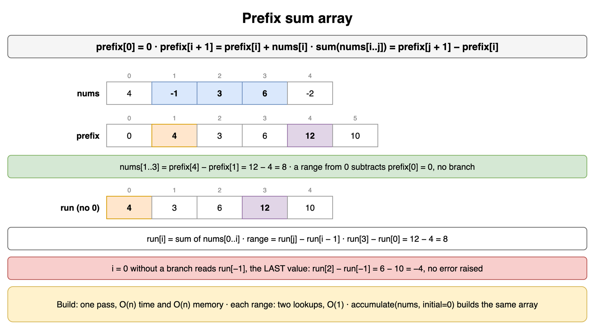

*Source: [`diagrams/prefix-sums.drawio`](/content/11_Coding_Problems/18_Prefix_Sums/diagrams/prefix-sums.drawio), page 1.*

## Recognize a prefix sum problem

The cue is a sum over a contiguous block asked more than once. "Many range-sum queries" is the direct form. "How many subarrays sum to k" is the same subtraction read backwards: every subarray is the difference of two prefixes, so the question becomes which earlier prefix pairs with the current one. "Running balance", "cumulative total", "total up to day d", and "net change over a period" are prefixes with a different name. A bank statement's running balance is a prefix array. The balance between two dates is one subtraction.

A single range is one loop and needs no array. With q queries on n values the loop costs O(n·q) and the prefix array costs O(n + q). For three short queries the loop may touch fewer values. For a thousand full-length queries it touches four times as many on this input. The second cue is negatives. A sum target with negative values rules out a [sliding window](#11_Coding_Problems/13_Sliding_Windows/concepts/sliding-window), because adding a value no longer only grows the sum. The prefix difference still holds. A sum that must change after edits is a different structure, covered in the update card below.

```python
from itertools import accumulate

nums = [3, 1, 4, 1, 5, 9, 2, 6]
queries = [(0, 7), (2, 4), (5, 5)]
prefix = list(accumulate(nums, initial=0))
print([sum(nums[i : j + 1]) for i, j in queries], [prefix[j + 1] - prefix[i] for i, j in queries])
print(sum(j - i + 1 for i, j in queries), len(nums) + 2 * len(queries))
print(1000 * len(nums), len(nums) + 2 * 1000)
# [31, 10, 9] [31, 10, 9]
# 12 14
# 8000 2008
```

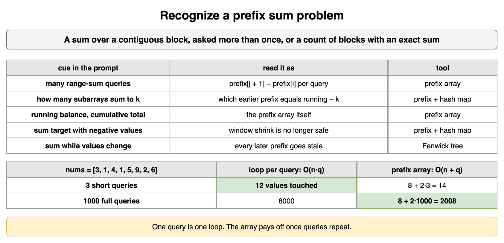

*Source: [`diagrams/prefix-sums.drawio`](/content/11_Coding_Problems/18_Prefix_Sums/diagrams/prefix-sums.drawio), page 2.*

## Range sum queries

The class form builds the prefix array once in the constructor and answers each `query(i, j)` with `prefix[j + 1] - prefix[i]`. Build is O(n) time and O(n) memory. Each query is O(1). The interface usually means both ends inclusive. Check the statement, because a half-open `query(i, j)` over `nums[i:j]` is `prefix[j] - prefix[i]` and nothing else changes. Validate `0 <= i <= j < n` when the input is untrusted. A query with `i > j` silently returns a negative of a real range.

Two bugs show up most. Using `prefix[j] - prefix[i]` for an inclusive `j` drops the last value. Using the no-leading-zero layout and forgetting `i == 0` reads `run[-1]`. On `[2, 7, -3, 5, 0, 4]`, the inclusive query `(1, 3)` is `7 - 3 + 5 = 9`. The dropped-end bug returns 4. `(0, 2)` is 6 and `(5, 5)` is 4. An inclusive running array returns the same 9 and 6 once the branch is there. Databases precompute the same running totals for dashboards over fixed history, then answer "revenue between two dates" by subtraction.

```python
class RangeSum:
    def __init__(self, nums: list[int]) -> None:
        self.prefix = [0]
        for value in nums:
            self.prefix.append(self.prefix[-1] + value)

    def query(self, i: int, j: int) -> int:
        return self.prefix[j + 1] - self.prefix[i]


def query_running(run: list[int], i: int, j: int) -> int:
    return run[j] if i == 0 else run[j] - run[i - 1]


sums = RangeSum([2, 7, -3, 5, 0, 4])
print(sums.query(1, 3), sums.query(0, 2), sums.query(5, 5))
print(sums.prefix[3] - sums.prefix[1])
print(query_running([2, 9, 6, 11, 11, 15], 1, 3), query_running([2, 9, 6, 11, 11, 15], 0, 2))
# 9 6 4
# 4
# 9 6
```

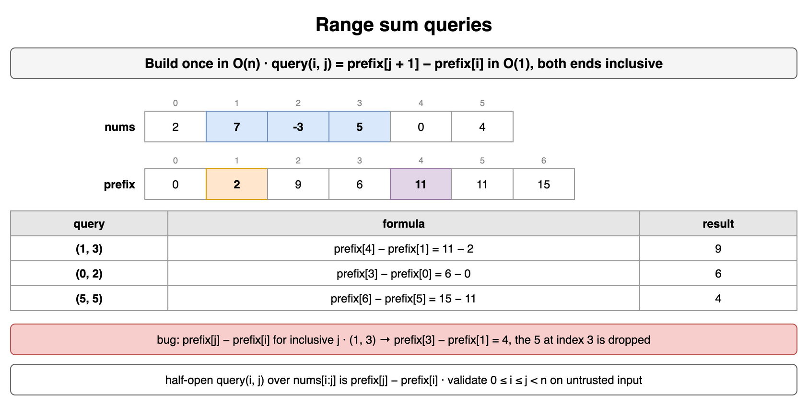

*Source: [`diagrams/prefix-sums.drawio`](/content/11_Coding_Problems/18_Prefix_Sums/diagrams/prefix-sums.drawio), page 3.*

## When the array changes

A prefix array is a snapshot. Changing `nums[k]` changes every prefix from `k + 1` to the end, so one update is O(n) and a mix of updates and queries is O(n) per update. When updates are rare, rebuild. When they interleave with queries, use a Fenwick tree (binary indexed tree). It stores partial sums over blocks sized by the lowest set bit of each index, so both a point update and a prefix query take O(log n) time with O(n) memory. The step `i += i & -i` climbs to the next block that covers index `i`, and `i -= i & -i` peels one block off a prefix. The bit trick is [Isolate lowest set bit](#07_Data_Structures_and_Algorithms/10_Bit_Manipulation/concepts/isolate-lowest-set-bit). The walk is worked by hand in the "Walk a Fenwick index" drill on the [Bit Manipulation](#07_Data_Structures_and_Algorithms/10_Bit_Manipulation) topic.

The Fenwick tree is 1-indexed inside: slot 0 is unused. `total(i)` returns the sum of the first `i` values, the same meaning as `prefix[i]`, so a range is still `total(j + 1) - total(i)`. An update takes a delta, not a new value. To set `nums[k] = x`, add `x - nums[k]` and keep a copy of `nums`. A segment tree answers the same queries and also handles range minimum and range assignment, at more code. For a fixed array, the plain prefix array is simpler and faster.

```python
class Fenwick:
    def __init__(self, nums: list[int]) -> None:
        self.tree = [0] * (len(nums) + 1)
        for index, value in enumerate(nums):
            self.add(index, value)

    def add(self, index: int, delta: int) -> None:
        index += 1
        while index < len(self.tree):
            self.tree[index] += delta
            index += index & -index

    def total(self, count: int) -> int:
        result = 0
        while count > 0:
            result += self.tree[count]
            count -= count & -count
        return result


tree = Fenwick([2, 7, -3, 5, 0, 4])
print(tree.total(4) - tree.total(1), tree.total(6))
tree.add(2, 10)
print(tree.total(4) - tree.total(1), tree.total(6))
# 9 15
# 19 25
```

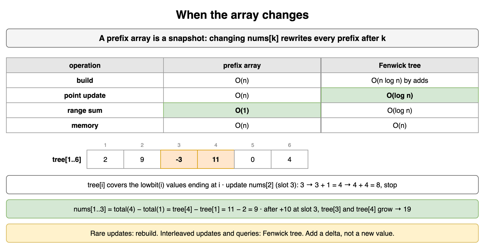

*Source: [`diagrams/prefix-sums.drawio`](/content/11_Coding_Problems/18_Prefix_Sums/diagrams/prefix-sums.drawio), page 4.*

## Count subarrays that sum to k

A subarray `nums[i..j]` sums to k exactly when `prefix[j + 1] - prefix[i] == k`, so `prefix[i] == prefix[j + 1] - k`. Scan once, keep the running sum, and keep a hash map from each prefix value to how many times it has appeared. At each step, add `seen[running - k]` to the count, then record `running`. Seed the map with `{0: 1}`: the empty prefix before index 0 is a real prefix, and without it every subarray that starts at index 0 is missed. The scan is O(n) time and O(n) memory. The pair loop is O(n²).

Negative values and zeros are why a window cannot do this. On `[3, -2, 2, 1, -1, 3]` with k = 3, seven subarrays qualify, including `[3, -2, 2]` and the single `[3]` at each end. `[0, 0, 0]` with k = 0 has six, because every subarray qualifies, and the seed accounts for the three that start at index 0. Record after the lookup, not before. Recording first lets the current prefix pair with itself, which counts an empty subarray whenever k is 0. The existence variant replaces the map with a set. The pair loop is the reference test for a short list.

```python
def count_sum_k(nums: list[int], k: int) -> int:
    seen = {0: 1}
    running = count = 0
    for value in nums:
        running += value
        count += seen.get(running - k, 0)
        seen[running] = seen.get(running, 0) + 1
    return count


def brute(nums: list[int], k: int) -> int:
    return sum(sum(nums[i : j + 1]) == k for i in range(len(nums)) for j in range(i, len(nums)))


print(count_sum_k([3, -2, 2, 1, -1, 3], 3), brute([3, -2, 2, 1, -1, 3], 3))
print(count_sum_k([0, 0, 0], 0), brute([0, 0, 0], 0), count_sum_k([], 5))
# 7 7
# 6 6 0
```

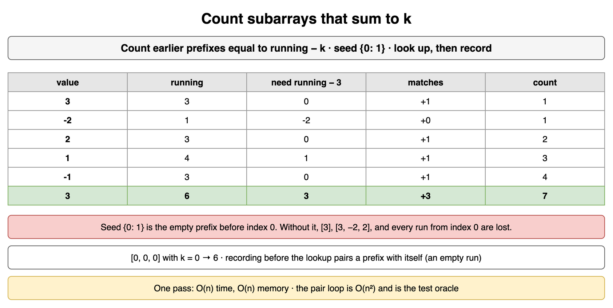

*Source: [`diagrams/prefix-sums.drawio`](/content/11_Coding_Problems/18_Prefix_Sums/diagrams/prefix-sums.drawio), page 5.*

## Longest subarray that sums to k

The same subtraction finds the longest match. Keep a map from each prefix value to the first index where it appeared, seeded with `{0: -1}` for the empty prefix. At index `i`, if `running - k` is in the map, the subarray after that first index ends at `i` and has length `i - first[running - k]`. Store a prefix only if it is not already present. The earliest index gives the longest subarray, so overwriting it with a later one shortens every answer that would have used it. The scan is O(n) time and O(n) memory.

On `[4, -4, 1, 2, -3, 3]` with k = 3, the whole array sums to 3, so the answer is 6. The prefix value 0 appears at the start, after index 1, and after index 4. Keeping the first gives 6. Overwriting keeps the last and returns 2. The seed `-1` is what makes a match from index 0 have length `i + 1`. A list with no match returns 0. The shortest subarray that sums to exactly k uses the opposite rule: overwrite, so the latest index wins. A shortest sum of at least k with negatives needs a monotonic deque instead.

```python
def longest_sum_k(nums: list[int], k: int, keep_first: bool = True) -> int:
    first = {0: -1}
    running = best = 0
    for index, value in enumerate(nums):
        running += value
        if running - k in first:
            best = max(best, index - first[running - k])
        if keep_first:
            first.setdefault(running, index)
        else:
            first[running] = index
    return best


print(longest_sum_k([4, -4, 1, 2, -3, 3], 3), longest_sum_k([4, -4, 1, 2, -3, 3], 3, keep_first=False))
print(longest_sum_k([1, 2], 7), longest_sum_k([3], 3))
# 6 2
# 0 1
```

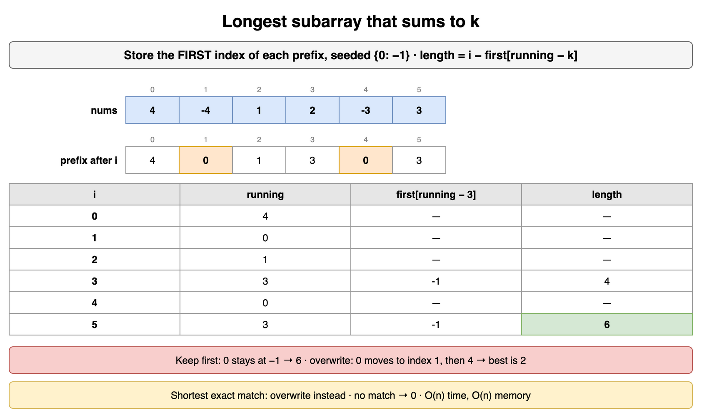

*Source: [`diagrams/prefix-sums.drawio`](/content/11_Coding_Problems/18_Prefix_Sums/diagrams/prefix-sums.drawio), page 6.*

## Product of array except self

Each output is the product of everything to the left times everything to the right. Write the left products into the output in one forward pass, then sweep backward with a single running product of the right side and multiply it in. The two passes are O(n) time. Past the output array, the extra memory is one variable, O(1). This is a prefix and a suffix with multiplication instead of addition. Dividing the total product by `nums[i]` looks shorter and breaks on a zero.

One zero makes every output 0 except at the zero, which gets the product of the rest. Two zeros make every output 0. The two-pass version handles both with no branch. Division needs special cases for both and still fails on floating-point inputs whose product overflows or rounds. On `[2, 3, 4, 5]` the answer is `[60, 40, 30, 24]`. `[3, 0, 2]` gives `[0, 6, 0]`. `[0, 4, 0]` gives zeros. A single value gives `[1]`, the empty product. Large integers are exact in Python. In a fixed-width language, ask about overflow.

```python
def except_self(nums: list[int]) -> list[int]:
    out = [1] * len(nums)
    left = 1
    for index, value in enumerate(nums):
        out[index] = left
        left *= value
    right = 1
    for index in range(len(nums) - 1, -1, -1):
        out[index] *= right
        right *= nums[index]
    return out


print(except_self([2, 3, 4, 5]))
print(except_self([3, 0, 2]), except_self([0, 4, 0]), except_self([9]))
# [60, 40, 30, 24]
# [0, 6, 0] [0, 0, 0] [1]
```

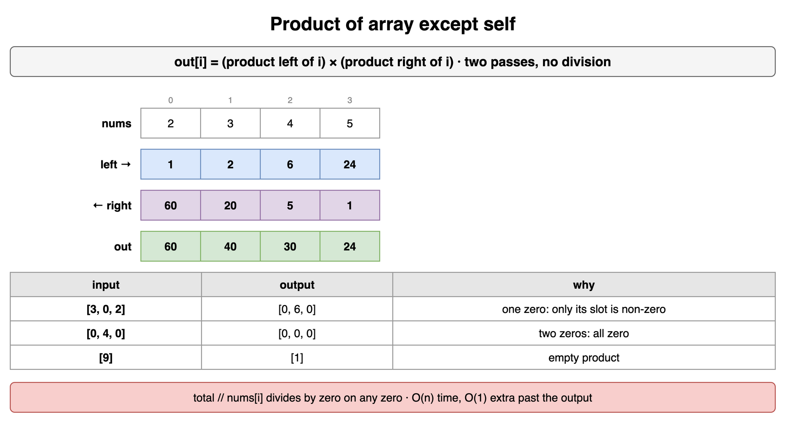

*Source: [`diagrams/prefix-sums.drawio`](/content/11_Coding_Problems/18_Prefix_Sums/diagrams/prefix-sums.drawio), page 7.*

## Prefix remainders

A subarray sum is divisible by m when the two prefixes around it leave the same remainder: `(prefix[j + 1] - prefix[i]) % m == 0` exactly when `prefix[j + 1] % m == prefix[i] % m`. Count remainders in a map seeded with `{0: 1}`, and at each step add the count of the current remainder before recording it. The scan is O(n) time. The map has at most m keys, so memory is O(min(n, m)), and a list of size m works as well as a dict.

Python's `%` returns a result with the sign of the divisor, so `-7 % 3` is 2 and remainders stay in `0..m-1` even with negative values. C, Java, and JavaScript return -1 for the same expression, so the same code there must normalize with `((x % m) + m) % m`. `math.fmod` follows the C rule. On `[5, -3, 4, 2]` with m = 3 four subarrays qualify, among them `[-3]` and `[5, -3, 4]`. The "sum is a multiple of k and at least two long" variant stores the first index of each remainder instead of a count, the same move as the longest-match card.

```python
import math


def count_divisible(nums: list[int], m: int) -> int:
    seen = {0: 1}
    running = count = 0
    for value in nums:
        running = (running + value) % m
        count += seen.get(running, 0)
        seen[running] = seen.get(running, 0) + 1
    return count


print(count_divisible([5, -3, 4, 2], 3), count_divisible([1, 1], 5))
print(-7 % 3, math.fmod(-7, 3))
# 4 0
# 2 -1.0
```

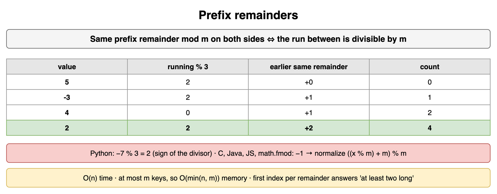

*Source: [`diagrams/prefix-sums.drawio`](/content/11_Coding_Problems/18_Prefix_Sums/diagrams/prefix-sums.drawio), page 8.*

## 2D prefix sums

A summed-area table stores, at `table[r + 1][c + 1]`, the sum of every cell above and to the left of `(r, c)`, inclusive. Build it with inclusion-exclusion: the cell, plus the block above, plus the block to the left, minus the corner block counted twice. The sum of a rectangle from `(r1, c1)` to `(r2, c2)` is the big block, minus the strip above, minus the strip to the left, plus the corner removed twice. The extra row and column of zeros remove every edge case for rectangles that touch row 0 or column 0. Build is O(rows·cols) time and memory. Each rectangle is O(1).

The Viola–Jones face detector used this table, under the name integral image, to score thousands of rectangular features per image window in constant time each. The usual bug is a sign: the corner is added back, not subtracted. Another is mixing `(row, col)` order with `(x, y)` order. On the 3 × 4 grid below, the rectangle from `(1, 1)` to `(2, 2)` is `6 + 1 + 0 + 8 = 15`. The whole grid is 47. A single cell is its own value. Check one rectangle against a nested loop.

```python
def summed_area(grid: list[list[int]]) -> list[list[int]]:
    rows, cols = len(grid), len(grid[0])
    table = [[0] * (cols + 1) for _ in range(rows + 1)]
    for r in range(rows):
        for c in range(cols):
            table[r + 1][c + 1] = grid[r][c] + table[r][c + 1] + table[r + 1][c] - table[r][c]
    return table


def rect(table: list[list[int]], r1: int, c1: int, r2: int, c2: int) -> int:
    return table[r2 + 1][c2 + 1] - table[r1][c2 + 1] - table[r2 + 1][c1] + table[r1][c1]


grid = [[3, 0, 2, 5], [4, 6, 1, 2], [7, 0, 8, 9]]
table = summed_area(grid)
print(rect(table, 1, 1, 2, 2), rect(table, 0, 0, 2, 3), rect(table, 2, 3, 2, 3))
print(sum(grid[r][c] for r in range(1, 3) for c in range(1, 3)))
# 15 47 9
# 15
```

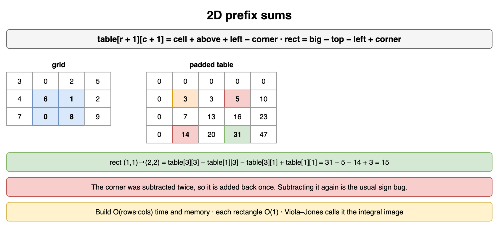

*Source: [`diagrams/prefix-sums.drawio`](/content/11_Coding_Problems/18_Prefix_Sums/diagrams/prefix-sums.drawio), page 9.*

## Difference arrays

A difference array runs the prefix idea backwards. To add `d` to every value in `[i, j]`, write `+d` at `diff[i]` and `-d` at `diff[j + 1]`. After all updates, one prefix sum over `diff` gives each position's total. Each update is O(1), the final pass is O(n), and q updates cost O(n + q) instead of O(n·q). Make `diff` one longer than the output so `j + 1` at the last index has a slot. Add the result to an original array if there is one.

The trick only works when every update arrives before any read. Reads between updates need a Fenwick tree over the difference array, where a point query becomes a prefix sum. Calendar and booking systems use it to turn "reserved from night 2 to night 4" into a per-night occupancy count. Train seat systems do the same per segment. A half-open update `[i, j)` writes `-d` at `diff[j]`. Mixing the two forms gives off-by-one counts at every right edge. Five slots with `+2` on `[1, 3]` and `+5` on `[0, 1]` end as `[5, 7, 2, 2, 0]`.

```python
def apply_ranges(n: int, updates: list[tuple[int, int, int]]) -> list[int]:
    diff = [0] * (n + 1)
    for start, end, delta in updates:
        diff[start] += delta
        diff[end + 1] -= delta
    out: list[int] = []
    running = 0
    for index in range(n):
        running += diff[index]
        out.append(running)
    return out


print(apply_ranges(5, [(1, 3, 2), (0, 1, 5)]))
print(apply_ranges(3, [(0, 2, 1), (2, 2, -4)]), apply_ranges(4, []))
# [5, 7, 2, 2, 0]
# [1, 1, -3] [0, 0, 0, 0]
```

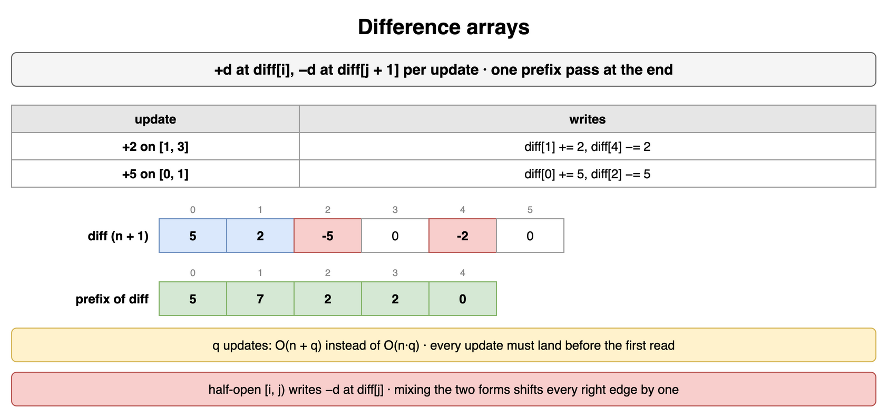

*Source: [`diagrams/prefix-sums.drawio`](/content/11_Coding_Problems/18_Prefix_Sums/diagrams/prefix-sums.drawio), page 10.*

## Prefix counts and prefix XOR

Any operation with an inverse works as a prefix. A prefix of counts answers "how many vowels in `s[i..j]`" or "how many failed requests between two minutes" with the same subtraction. A prefix of XOR answers the XOR of a range with `px[j + 1] ^ px[i]`, because XOR is its own inverse. A prefix of products works only while there are no zeros. The pattern needs `combine` and `undo`. Build and query costs match the sum version: O(n) once, then O(1) per range.

Maximum and minimum have no inverse. Knowing the max of `nums[0..9]` and of `nums[0..3]` says nothing about `nums[4..9]`. A range maximum on a fixed array needs a sparse table, O(n log n) to build and O(1) per query, or a segment tree when values change. A prefix of counts per letter, 26 arrays or one array of 26-tuples, answers "can `s[i..j]` be rearranged into a palindrome" by checking how many letter counts are odd. In `"programming"`, `s[3..6]` is `"gram"` with one vowel. The XOR of `[5, 1, 7, 2]` over `[1, 2]` is `1 ^ 7 = 6`.

```python
from itertools import accumulate
from operator import xor

word = "programming"
vowels = list(accumulate((ch in "aeiou" for ch in word), initial=0))
print(vowels[7] - vowels[3], word[3:7])
px = list(accumulate([5, 1, 7, 2], xor, initial=0))
print(px, px[3] ^ px[1])
# 1 gram
# [0, 5, 4, 3, 1] 6
```

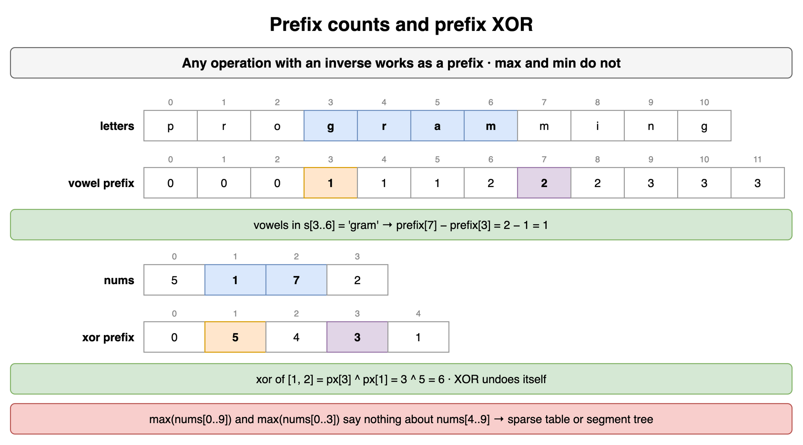

*Source: [`diagrams/prefix-sums.drawio`](/content/11_Coding_Problems/18_Prefix_Sums/diagrams/prefix-sums.drawio), page 11.*

## Prefix sums, sliding window, or Fenwick tree

Three tools answer sums over contiguous blocks, and the input decides. A fixed array with many range queries, or a count of subarrays with an exact sum, takes prefix sums. A longest or shortest block under a budget with non-negative values takes a [sliding window](#11_Coding_Problems/13_Sliding_Windows/concepts/window-two-pointers-or-prefix-sums): growing only raises the sum, so shrinking from the left is safe. A sum that must stay correct while values change takes a Fenwick tree. Prefix sums cost O(n) memory. The window costs O(1) memory. The tree costs O(log n) per operation.

The window breaks on negatives because a shrink may be undone by a later negative value. On `[5, -3, 1]` with target 3, the whole array qualifies. The window drops the 5 as soon as the sum passes 3, before the -3 that would have brought it back, so it finds nothing. The prefix map finds the match. When the question is a count of subarrays with sum at most k on non-negative values, the window still wins, because it adds `right - left + 1` per step with no map. When the question is a range sum during edits, a prefix array is wrong after the first edit.

```python
def window_exact(nums: list[int], target: int) -> bool:
    left = total = 0
    for value in nums:
        total += value
        while total > target and left < len(nums):
            total -= nums[left]
            left += 1
        if total == target:
            return True
    return False


def prefix_exact(nums: list[int], target: int) -> bool:
    seen = {0}
    running = 0
    for value in nums:
        running += value
        if running - target in seen:
            return True
        seen.add(running)
    return False


print(window_exact([5, -3, 1], 3), prefix_exact([5, -3, 1], 3))
print(window_exact([1, 2, 3], 5), prefix_exact([1, 2, 3], 5))
# False True
# True True
```

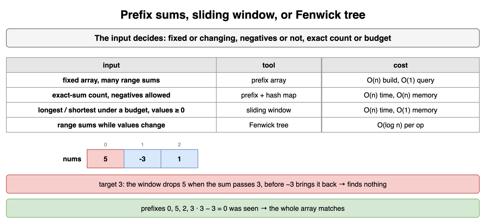

*Source: [`diagrams/prefix-sums.drawio`](/content/11_Coding_Problems/18_Prefix_Sums/diagrams/prefix-sums.drawio), page 12.*

## Weighted random pick

To pick index `i` with probability `weights[i] / total`, build the running totals of the weights and draw a number in `[0, total)`. The first running total strictly greater than the draw is the chosen index, found with `bisect_right` in O(log n). The build is O(n) once. A linear scan of the totals is also correct and costs O(n) per draw. The binary search side, including why `bisect_left` gives the wrong index on a boundary, is [Random pick by weight](#11_Coding_Problems/14_Binary_Search/concepts/random-pick-by-weight).

Weights `[5, 1, 3, 1]` give totals `[5, 6, 9, 10]`. Draws 0 through 4 pick index 0, draw 5 picks 1, draws 6 to 8 pick 2, and draw 9 picks 3, so over all ten integer draws each index appears exactly as often as its weight. That makes the test deterministic: feed every draw and count. A zero weight gives a repeated total, and `bisect_right` skips it, so that index is never chosen. Load balancers and A/B test splits route by weight this way. `random.choices(population, cum_weights=totals)` accepts the totals directly.

```python
from bisect import bisect_right
from collections import Counter
from itertools import accumulate

weights = [5, 1, 3, 1]
totals = list(accumulate(weights))
print(totals, [bisect_right(totals, draw) for draw in range(10)])
print(Counter(bisect_right(totals, draw) for draw in range(totals[-1])) == Counter(dict(enumerate(weights))))
print([bisect_right([2, 2, 5], draw) for draw in range(5)])
# [5, 6, 9, 10] [0, 0, 0, 0, 0, 1, 2, 2, 2, 3]
# True
# [0, 0, 2, 2, 2]
```

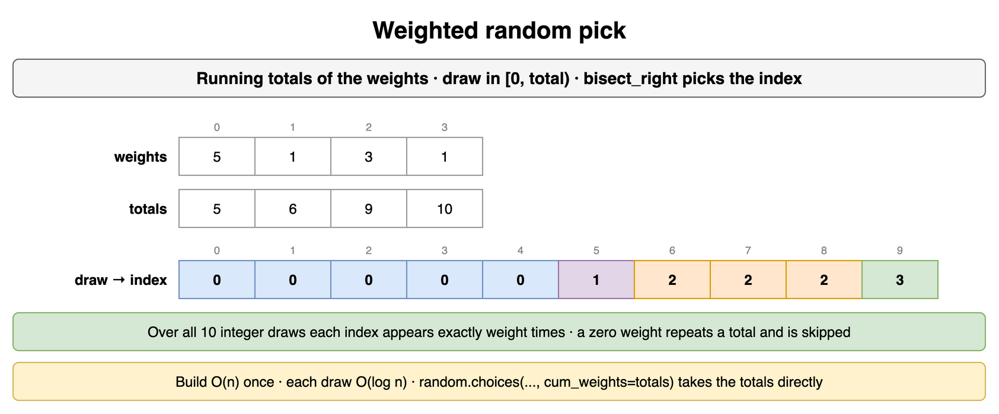

*Source: [`diagrams/prefix-sums.drawio`](/content/11_Coding_Problems/18_Prefix_Sums/diagrams/prefix-sums.drawio), page 13.*
