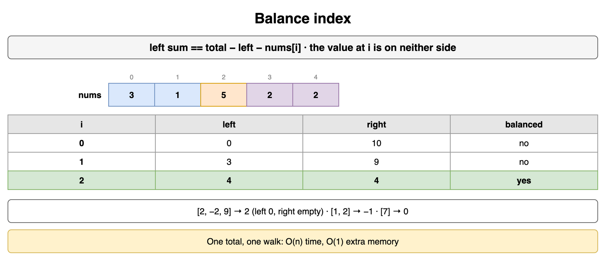
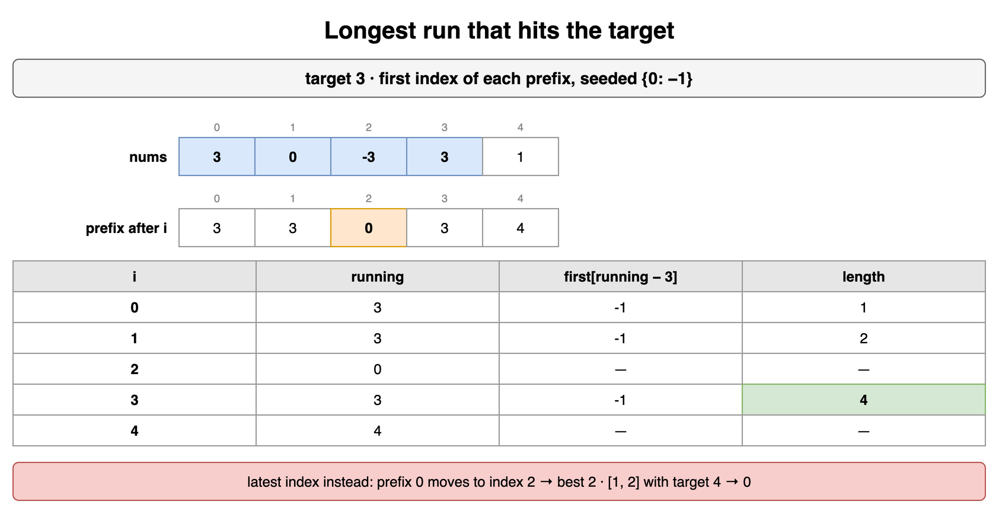
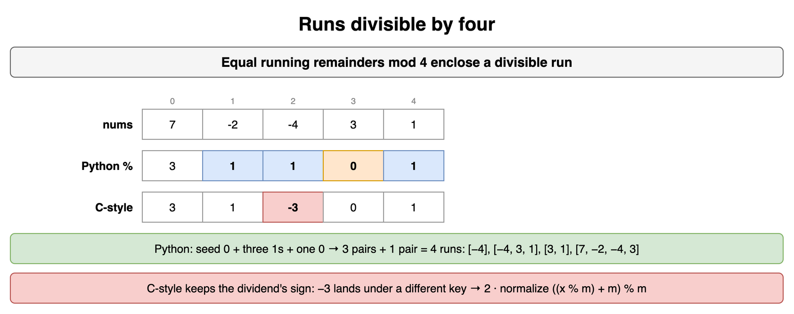
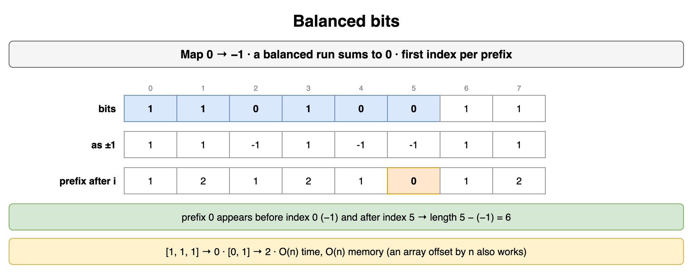
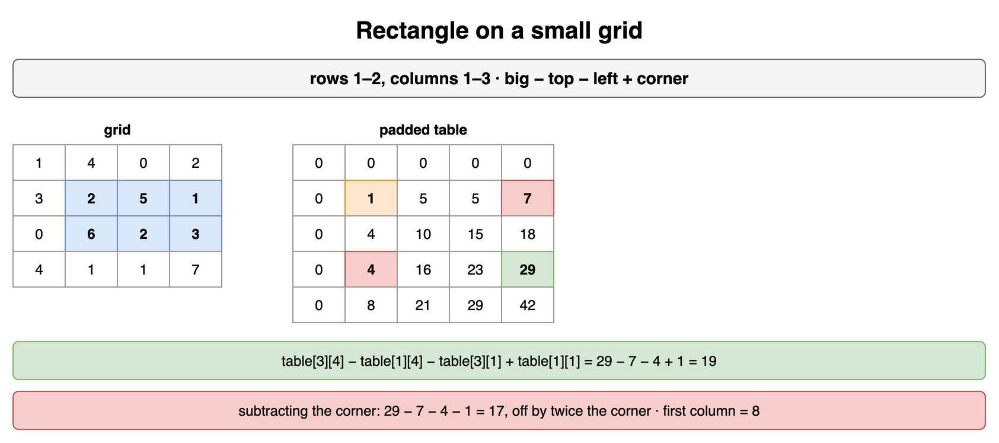
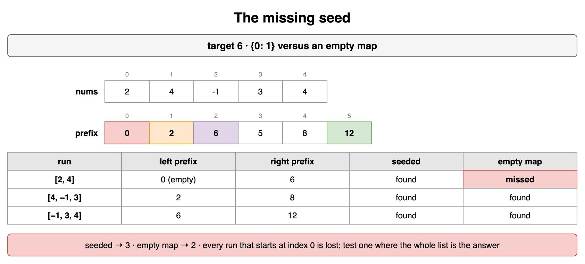
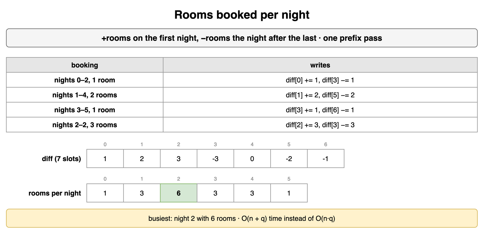
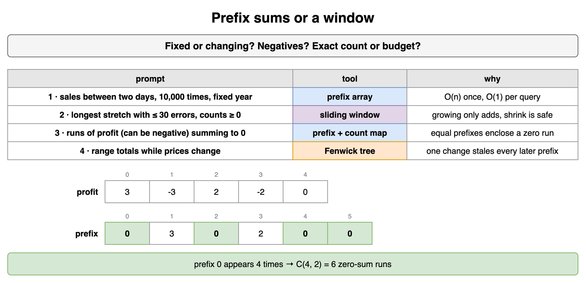
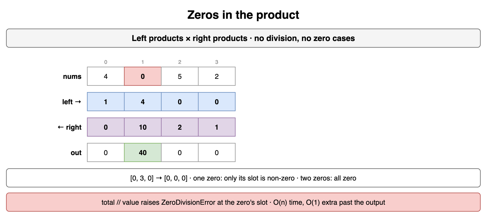

# Prefix Sums — Drills

Original drills for a balance index, a longest match, a remainder count, a balanced bit run, a rectangle, a missing seed, range bookings, a tool choice, and zeros in a product. Each answer has an approach, a cost, and Python. The numbers are exercise numbers.

## Balance index

Find the first index where the sum of the values to its left equals the sum of the values to its right. The value at the index belongs to neither side. The exercise list is `[3, 1, 5, 2, 2]`. Also answer `[2, -2, 9]`, `[1, 2]`, and the single `[7]`.

**Answer:** Index 2 for the exercise list: the left side is `3 + 1 = 4` and the right side is `2 + 2 = 4`. `[2, -2, 9]` also answers 2, because the left side sums to 0 and the right side is empty. `[1, 2]` has no balance index, so return -1. `[7]` answers 0: both sides are empty. Compute the total once. Walk left to right with a running left sum, and the right sum is `total - left - nums[i]`. No prefix array is needed, because each index asks about one split. The walk is O(n) time and O(1) extra memory. The subtraction is the [Prefix sum array](#11_Coding_Problems/18_Prefix_Sums/concepts/prefix-sum-array) read at one point.

```python
def balance_index(nums: list[int]) -> int:
    total = sum(nums)
    left = 0
    for index, value in enumerate(nums):
        if left == total - left - value:
            return index
        left += value
    return -1


print(balance_index([3, 1, 5, 2, 2]))
print(balance_index([2, -2, 9]), balance_index([1, 2]), balance_index([7]))
# 2
# 2 -1 0
```



*Source: [`diagrams/prefix-sums-drills.drawio`](/content/11_Coding_Problems/18_Prefix_Sums/diagrams/prefix-sums-drills.drawio), page 1.*

## Longest run that hits the target

The exercise list is `[3, 0, -3, 3, 1]` with target 3. How long is the longest contiguous run that sums to exactly 3? What does the same code return if it stores the latest index of each prefix instead of the first? Also answer `[1, 2]` with target 4.

**Answer:** 4, from `[3, 0, -3, 3]`. The prefixes are `0, 3, 3, 0, 3, 4`. The value 0 first appears before index 0, stored as -1, and the prefix 3 at index 3 pairs with it for length `3 - (-1) = 4`. Storing the latest index moves 0 to index 2, and the best length falls to 2. `[1, 2]` never reaches 4, so the answer is 0. Store each prefix only once, with `setdefault`. The scan is O(n) time and O(n) memory. The rule is [Longest subarray that sums to k](#11_Coding_Problems/18_Prefix_Sums/concepts/longest-subarray-that-sums-to-k).

```python
def longest_run(nums: list[int], target: int, keep_first: bool = True) -> int:
    first = {0: -1}
    running = best = 0
    for index, value in enumerate(nums):
        running += value
        if running - target in first:
            best = max(best, index - first[running - target])
        if keep_first:
            first.setdefault(running, index)
        else:
            first[running] = index
    return best


print(longest_run([3, 0, -3, 3, 1], 3), longest_run([3, 0, -3, 3, 1], 3, keep_first=False))
print(longest_run([1, 2], 4))
# 4 2
# 0
```



*Source: [`diagrams/prefix-sums-drills.drawio`](/content/11_Coding_Problems/18_Prefix_Sums/diagrams/prefix-sums-drills.drawio), page 2.*

## Runs divisible by four

The exercise list is `[7, -2, -4, 3, 1]`. How many contiguous runs have a sum divisible by 4? What changes if the remainder is computed the way C and Java compute it, where the result keeps the sign of the dividend?

**Answer:** 4. The running remainders mod 4 are `3, 1, 1, 0, 1`, plus the seed 0. Equal remainders pair up: the three 1s give three pairs and the seed 0 pairs with the 0 at index 3. The runs are `[-4]`, `[-4, 3, 1]`, `[3, 1]`, and `[7, -2, -4, 3]`. The C-style remainder produces 1 at index 2 as `-3` instead, so equal residues land under different keys and the count drops to 2. Normalize with `((x % m) + m) % m` in those languages. Python's `%` is already non-negative for a positive m. The scan is O(n) time and O(min(n, m)) memory. The rule is [Prefix remainders](#11_Coding_Problems/18_Prefix_Sums/concepts/prefix-remainders).

```python
import math


def count_divisible(nums: list[int], m: int, c_style: bool = False) -> int:
    seen = {0: 1}
    running = count = 0
    for value in nums:
        running = int(math.fmod(running + value, m)) if c_style else (running + value) % m
        count += seen.get(running, 0)
        seen[running] = seen.get(running, 0) + 1
    return count


print(count_divisible([7, -2, -4, 3, 1], 4), count_divisible([7, -2, -4, 3, 1], 4, c_style=True))
# 4 2
```



*Source: [`diagrams/prefix-sums-drills.drawio`](/content/11_Coding_Problems/18_Prefix_Sums/diagrams/prefix-sums-drills.drawio), page 3.*

## Balanced bits

The exercise list of bits is `[1, 1, 0, 1, 0, 0, 1, 1]`. Find the longest contiguous run with as many 0s as 1s. Also answer `[1, 1, 1]` and `[0, 1]`.

**Answer:** 6, from the first six bits, which hold three 1s and three 0s. Map every 0 to -1. A balanced run is then a run that sums to 0, which is the longest-match scan with target 0: two equal prefixes enclose a balanced run, and the first index of each prefix gives the longest. `[1, 1, 1]` has no balanced run, so the answer is 0. `[0, 1]` is 2. The scan is O(n) time and O(n) memory. The map has at most `2n + 1` keys, so an array offset by n works too. The rule is [Longest subarray that sums to k](#11_Coding_Problems/18_Prefix_Sums/concepts/longest-subarray-that-sums-to-k).

```python
def longest_balanced(bits: list[int]) -> int:
    first = {0: -1}
    running = best = 0
    for index, bit in enumerate(bits):
        running += 1 if bit else -1
        if running in first:
            best = max(best, index - first[running])
        else:
            first[running] = index
    return best


print(longest_balanced([1, 1, 0, 1, 0, 0, 1, 1]))
print(longest_balanced([1, 1, 1]), longest_balanced([0, 1]))
# 6
# 0 2
```



*Source: [`diagrams/prefix-sums-drills.drawio`](/content/11_Coding_Problems/18_Prefix_Sums/diagrams/prefix-sums-drills.drawio), page 4.*

## Rectangle on a small grid

The exercise grid has four rows: `[1, 4, 0, 2]`, `[3, 2, 5, 1]`, `[0, 6, 2, 3]`, `[4, 1, 1, 7]`. Find the sum of the rectangle from row 1, column 1 to row 2, column 3. Also find the first column as a rectangle, and say what a solution returns if it subtracts the corner instead of adding it back.

**Answer:** 19, from `2 + 5 + 1 + 6 + 2 + 3`. With the padded table, the rectangle is `table[3][4] - table[1][4] - table[3][1] + table[1][1]`, which is `29 - 7 - 4 + 1`. The first column is `1 + 3 + 0 + 4 = 8`. Subtracting the corner gives `29 - 7 - 4 - 1 = 17`, off by twice the corner. Build is O(rows·cols) time and memory. Each rectangle is O(1). The table is [2D prefix sums](#11_Coding_Problems/18_Prefix_Sums/concepts/2d-prefix-sums).

```python
def summed_area(grid: list[list[int]]) -> list[list[int]]:
    table = [[0] * (len(grid[0]) + 1) for _ in range(len(grid) + 1)]
    for r, row in enumerate(grid):
        for c, value in enumerate(row):
            table[r + 1][c + 1] = value + table[r][c + 1] + table[r + 1][c] - table[r][c]
    return table


def rect(table: list[list[int]], r1: int, c1: int, r2: int, c2: int, sign: int = 1) -> int:
    return table[r2 + 1][c2 + 1] - table[r1][c2 + 1] - table[r2 + 1][c1] + sign * table[r1][c1]


grid = [[1, 4, 0, 2], [3, 2, 5, 1], [0, 6, 2, 3], [4, 1, 1, 7]]
table = summed_area(grid)
print(rect(table, 1, 1, 2, 3), rect(table, 0, 0, 3, 0), rect(table, 1, 1, 2, 3, sign=-1))
# 19 8 17
```



*Source: [`diagrams/prefix-sums-drills.drawio`](/content/11_Coding_Problems/18_Prefix_Sums/diagrams/prefix-sums-drills.drawio), page 5.*

## The missing seed

A teammate counts runs that sum to a target and starts the map empty instead of with `{0: 1}`. On `[2, 4, -1, 3, 4]` with target 6, what does each version return, and which run goes missing?

**Answer:** The seeded version returns 3 and the empty map returns 2. The runs are `[2, 4]`, `[4, -1, 3]`, and `[-1, 3, 4]`. `[2, 4]` starts at index 0, so its left prefix is the empty prefix 0, which only the seed puts in the map. The buggy version still finds the other two because their left prefixes, 2 and 6, were recorded after indexes 0 and 1. Any run that starts at index 0 is lost, so a test whose answers all start later passes with the bug. Add one test where the whole list is the answer. The scan is O(n) time and O(n) memory either way. The seed is explained in [Count subarrays that sum to k](#11_Coding_Problems/18_Prefix_Sums/concepts/count-subarrays-that-sum-to-k).

```python
def count_target(nums: list[int], target: int, seed: bool = True) -> int:
    seen = {0: 1} if seed else {}
    running = count = 0
    for value in nums:
        running += value
        count += seen.get(running - target, 0)
        seen[running] = seen.get(running, 0) + 1
    return count


print(count_target([2, 4, -1, 3, 4], 6), count_target([2, 4, -1, 3, 4], 6, seed=False))
print(count_target([1, 5], 6), count_target([1, 5], 6, seed=False))
# 3 2
# 1 0
```



*Source: [`diagrams/prefix-sums-drills.drawio`](/content/11_Coding_Problems/18_Prefix_Sums/diagrams/prefix-sums-drills.drawio), page 6.*

## Rooms booked per night

A small inn has six nights numbered 0 to 5. Bookings are inclusive night ranges with a room count: `(0, 2, 1)`, `(1, 4, 2)`, `(3, 5, 1)`, and `(2, 2, 3)`. How many rooms are taken each night, and which night is busiest?

**Answer:** `[1, 3, 6, 3, 3, 1]`, and night 2 is busiest with 6. Each booking writes `+rooms` at its first night and `-rooms` the night after its last, so the four bookings are eight writes. One prefix pass turns the differences into nightly totals. The last booking ends on night 5, so the array has a seventh slot to hold its `-1`. The cost is O(n + q) time and O(n) memory, instead of O(n·q) for adding each booking night by night. With no bookings every night is 0. The method is [Difference arrays](#11_Coding_Problems/18_Prefix_Sums/concepts/difference-arrays).

```python
def nightly(nights: int, bookings: list[tuple[int, int, int]]) -> list[int]:
    diff = [0] * (nights + 1)
    for first, last, rooms in bookings:
        diff[first] += rooms
        diff[last + 1] -= rooms
    totals: list[int] = []
    running = 0
    for night in range(nights):
        running += diff[night]
        totals.append(running)
    return totals


rooms = nightly(6, [(0, 2, 1), (1, 4, 2), (3, 5, 1), (2, 2, 3)])
print(rooms, rooms.index(max(rooms)))
print(nightly(3, []))
# [1, 3, 6, 3, 3, 1] 2
# [0, 0, 0]
```



*Source: [`diagrams/prefix-sums-drills.drawio`](/content/11_Coding_Problems/18_Prefix_Sums/diagrams/prefix-sums-drills.drawio), page 7.*

## Prefix sums or a window

Pick the tool for each prompt. One: total sales between two days, asked ten thousand times over a fixed year of data. Two: the longest stretch of minutes with at most 30 errors, where each minute's count is zero or more. Three: how many runs of daily profit, which can be negative, sum to exactly 0. Four: a range total over prices that change between queries.

**Answer:** One is a prefix sum array: O(n) once, then O(1) per query. Two is a sliding window, because the counts are non-negative, so growing only adds errors and shrinking is safe. O(n) time and O(1) memory. Three is prefix sums with a count map, because negatives break the window: equal prefixes enclose a zero-sum run. Four is a Fenwick tree, because one price change invalidates every later prefix. Each update and query is O(log n). The reasoning is [Prefix sums, sliding window, or Fenwick tree](#11_Coding_Problems/18_Prefix_Sums/concepts/prefix-sums-sliding-window-or-fenwick-tree).

```python
def tool(fixed: bool, many_queries: bool, negatives: bool, exact_count: bool) -> str:
    if not fixed:
        return "fenwick"
    if many_queries or exact_count or negatives:
        return "prefix"
    return "window"


print(tool(True, True, False, False), tool(True, False, False, False))
print(tool(True, False, True, True), tool(False, True, False, False))
profit = [3, -3, 2, -2, 0]
seen, running, zero_runs = {0: 1}, 0, 0
for value in profit:
    running += value
    zero_runs += seen.get(running, 0)
    seen[running] = seen.get(running, 0) + 1
print(zero_runs)
# prefix window
# prefix fenwick
# 6
```



*Source: [`diagrams/prefix-sums-drills.drawio`](/content/11_Coding_Problems/18_Prefix_Sums/diagrams/prefix-sums-drills.drawio), page 8.*

## Zeros in the product

Return, for each index, the product of every other value. The exercise lists are `[4, 0, 5, 2]` and `[0, 3, 0]`. A teammate divides the total product by each value. What happens?

**Answer:** `[0, 40, 0, 0]` and `[0, 0, 0]`. With one zero only the zero's own slot is non-zero, and it holds the product of the rest. With two zeros every slot is 0. The division version raises `ZeroDivisionError` on the first list, because the zero's slot divides by zero, and even a guarded version needs separate cases for one and two zeros. Two passes, left products into the output and then a running right product, need no case. O(n) time and O(1) memory past the output. The passes are [Product of array except self](#11_Coding_Problems/18_Prefix_Sums/concepts/product-of-array-except-self).

```python
def others(nums: list[int]) -> list[int]:
    out = [1] * len(nums)
    left = 1
    for index, value in enumerate(nums):
        out[index] = left
        left *= value
    right = 1
    for index in range(len(nums) - 1, -1, -1):
        out[index] *= right
        right *= nums[index]
    return out


def by_division(nums: list[int]) -> list[int]:
    total = 1
    for value in nums:
        total *= value
    return [total // value for value in nums]


print(others([4, 0, 5, 2]), others([0, 3, 0]))
try:
    by_division([4, 0, 5, 2])
except ZeroDivisionError as error:
    print(type(error).__name__)
# [0, 40, 0, 0] [0, 0, 0]
# ZeroDivisionError
```



*Source: [`diagrams/prefix-sums-drills.drawio`](/content/11_Coding_Problems/18_Prefix_Sums/diagrams/prefix-sums-drills.drawio), page 9.*
