## Binary tree vocabulary

A tree is a set of nodes joined by parent-to-child edges, with one root and no cycles. A leaf has no children. A subtree is one node plus everything below it. A path is a chain of nodes joined by edges that uses each node once. The depth of a node counts the edges up to the root, so the root has depth 0. The height of a node counts the edges on its longest downward path to a leaf, so a leaf has height 0 and an empty tree has height -1. Some problems count nodes instead of edges, so say which one you mean before writing code. A binary tree gives each node at most a left and a right child, and the two are not interchangeable. The full definitions are [Tree structure](#07_Data_Structures_and_Algorithms/05_Trees/concepts/tree-structure) and [Tree height and depth](#07_Data_Structures_and_Algorithms/05_Trees/concepts/tree-height-and-depth) on the Data Structures topic. This topic is the problem set built on them.

An interview hands over a root reference, not an array. A tree of n nodes has n - 1 edges. Its height h sits between about log₂ n for a balanced tree and n - 1 for a chain, and h sets the recursion depth of every depth-first solution. Directory trees and the browser DOM are trees in daily use. Build small test trees by nesting constructors, and sketch the tree before writing the solution. The empty tree, a single node, and a chain are the three inputs to try on every solution.

```python
from dataclasses import dataclass


@dataclass
class Node:
    val: int
    left: "Node | None" = None
    right: "Node | None" = None


def size(node: Node | None) -> int:
    return 0 if node is None else 1 + size(node.left) + size(node.right)


def height(node: Node | None) -> int:
    return -1 if node is None else 1 + max(height(node.left), height(node.right))


def leaves(node: Node | None) -> int:
    if node is None:
        return 0
    if node.left is None and node.right is None:
        return 1
    return leaves(node.left) + leaves(node.right)


root = Node(7, Node(4, Node(2, Node(1)), Node(5)), Node(9, Node(8), Node(12)))
chain = Node(1, Node(2, Node(3, Node(4, Node(5)))))
print(size(root), height(root), leaves(root))
print(size(chain), height(chain), leaves(chain))
print(size(None), height(None), height(Node(6)))
# 8 3 4
# 5 4 1
# 0 -1 0
```

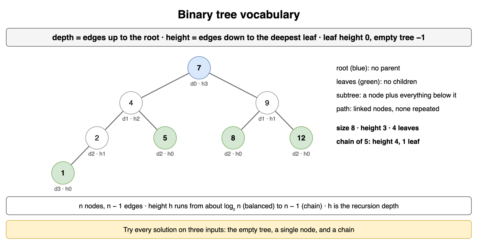

*Source: [`diagrams/trees.drawio`](/content/11_Coding_Problems/19_Trees/diagrams/trees.drawio), page 1.*

## Return up or carry down

Every recursive tree solution starts with one decision: what does a call receive, and what does it return? Bottom-up recursion returns a summary of the subtree, such as its height, its sum, or whether a target was found, and the parent combines the two child results. That is postorder. Top-down recursion passes state into the call as arguments, such as the depth, the allowed value range, or the sum so far, and the leaves use it. That is preorder. Many solutions do both: carry bounds down and return a flag up. Write the contract as one sentence before coding, for example "returns the height of this subtree, or -1 if any part of it is unbalanced". The general treatment is [Top-down vs. bottom-up recursion](#07_Data_Structures_and_Algorithms/05_Trees/concepts/top-down-vs-bottom-up-recursion).

A call that must report two things can return a tuple, or fold the failure into a value that cannot occur, such as -1 for a height counted in nodes. The sentinel lets the parent stop without a second pass. A third shape keeps the answer in an outer variable and returns something else: the return value feeds the parent, and the outer variable records the best answer seen anywhere. Maximum path sum uses that shape. Every solution then faces the same checklist: an empty root, a single node, a chain deep enough to hit Python's recursion limit of 1000, duplicate values, and negative values, which rule out starting a best answer at 0.

```python
from dataclasses import dataclass


@dataclass
class Node:
    val: int
    left: "Node | None" = None
    right: "Node | None" = None


def subtree_sum(node: Node | None) -> int:
    if node is None:
        return 0
    return node.val + subtree_sum(node.left) + subtree_sum(node.right)


def leaf_sums(node: Node | None, so_far: int, out: list[int]) -> list[int]:
    if node is None:
        return out
    so_far += node.val
    if node.left is None and node.right is None:
        out.append(so_far)
    leaf_sums(node.left, so_far, out)
    leaf_sums(node.right, so_far, out)
    return out


root = Node(5, Node(-3, Node(2), Node(4)), Node(8, None, Node(-1)))
print(subtree_sum(root), leaf_sums(root, 0, []))
print(subtree_sum(None), leaf_sums(None, 0, []))
# 15 [4, 6, 12]
# 0 []
```

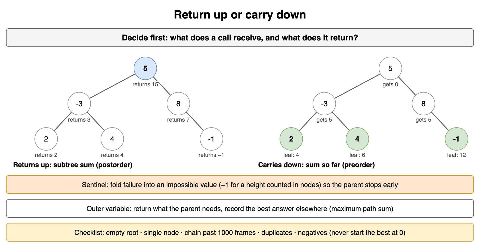

*Source: [`diagrams/trees.drawio`](/content/11_Coding_Problems/19_Trees/diagrams/trees.drawio), page 2.*

## Choose a traversal

Preorder (node, left, right) fits when a parent must hand something to its children before they run: copying, serializing, or carrying depth and bounds. Inorder (left, node, right) fits when the sorted order of a binary search tree matters: validation, the k-th smallest value, or listing a range. Postorder (left, right, node) fits when a node needs its children's answers first: heights, sizes, freeing memory, or the folder totals that `du` prints. Breadth-first search fits when the question says level, row, nearest to the root, minimum depth, or seen from one side. Many problems can be solved either way. Pick the order that produces the answer in the order the question wants it. The mechanics are [In-order traversal](#07_Data_Structures_and_Algorithms/05_Trees/concepts/in-order-traversal), [Pre-order traversal](#07_Data_Structures_and_Algorithms/05_Trees/concepts/pre-order-traversal), [Post-order traversal](#07_Data_Structures_and_Algorithms/05_Trees/concepts/post-order-traversal), and [Level-order traversal (BFS)](#07_Data_Structures_and_Algorithms/05_Trees/concepts/level-order-traversal-bfs).

Every traversal visits each node once, so time is O(n). Memory differs. Depth-first search holds one frame per level of the current path, O(h): about log₂ n on a balanced tree and n on a chain. Breadth-first search holds one level at a time, O(w) for the widest level: about n / 2 on the bottom row of a perfect tree and 1 on a chain. A chain is cheap for the queue and costly for the stack. A full, bushy tree is the reverse. The general graph versions of both searches are [Depth-first search (DFS)](#07_Data_Structures_and_Algorithms/07_Graphs/concepts/depth-first-search-dfs) and [Breadth-first search (BFS)](#07_Data_Structures_and_Algorithms/07_Graphs/concepts/breadth-first-search-bfs).

```python
from collections import deque
from dataclasses import dataclass


@dataclass
class Node:
    val: int
    left: "Node | None" = None
    right: "Node | None" = None


def pre(n): return [] if n is None else [n.val] + pre(n.left) + pre(n.right)
def ino(n): return [] if n is None else ino(n.left) + [n.val] + ino(n.right)
def post(n): return [] if n is None else post(n.left) + post(n.right) + [n.val]


def bfs(root: Node | None) -> list[int]:
    out, queue = [], deque([root] if root else [])
    while queue:
        node = queue.popleft()
        out.append(node.val)
        queue.extend(child for child in (node.left, node.right) if child)
    return out


root = Node(6, Node(2, Node(1), Node(4)), Node(9, None, Node(11)))
print(pre(root), ino(root))
print(post(root), bfs(root))
# [6, 2, 1, 4, 9, 11] [1, 2, 4, 6, 9, 11]
# [1, 4, 2, 11, 9, 6] [6, 2, 9, 1, 4, 11]
```

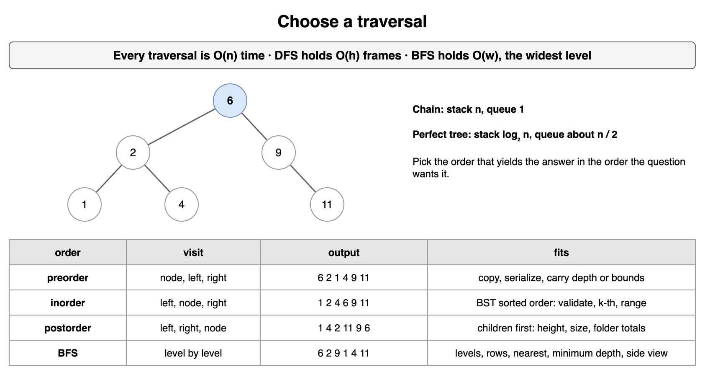

*Source: [`diagrams/trees.drawio`](/content/11_Coding_Problems/19_Trees/diagrams/trees.drawio), page 3.*

## Level-order with the level-size loop

Breadth-first search uses a `collections.deque`, because `popleft` is O(1) and `list.pop(0)` shifts every element. The per-level answers come from one extra line: read `len(queue)` at the top of the outer loop, then pop exactly that many nodes. Children appended during the inner loop wait for the next pass, so each pass is exactly one level. Per-level lists, averages, maximums, the rightmost node, and zigzag order are all this loop with a different body. Without the snapshot, the loop still visits every node but cannot tell where one level ends. Carrying `(node, depth)` pairs is the alternative, at the cost of a lookup per node.

Breadth-first search reaches nodes in order of depth, so it can stop at the first match. Minimum depth returns at the first leaf it pops, without touching the deeper part of the tree. A depth-first search must visit every leaf to be sure. The cost is O(n) time and O(w) memory for the widest level. An empty root returns an empty list. Check that before the queue is built, or `deque([None])` pops a `None` and the first `.left` fails.

```python
from collections import deque
from dataclasses import dataclass


@dataclass
class Node:
    val: int
    left: "Node | None" = None
    right: "Node | None" = None


def levels(root: Node | None) -> list[list[int]]:
    out, queue = [], deque([root] if root else [])
    while queue:
        row = []
        for _ in range(len(queue)):
            node = queue.popleft()
            row.append(node.val)
            queue.extend(child for child in (node.left, node.right) if child)
        out.append(row)
    return out


def min_depth(root: Node | None) -> int:
    queue = deque([(root, 1)] if root else [])
    while queue:
        node, depth = queue.popleft()
        if node.left is None and node.right is None:
            return depth
        queue.extend((child, depth + 1) for child in (node.left, node.right) if child)
    return 0


root = Node(10, Node(4, Node(2)), Node(15, Node(12, None, Node(13)), Node(20)))
print(levels(root))
print(min_depth(root), levels(None), min_depth(None))
# [[10], [4, 15], [2, 12, 20], [13]]
# 3 [] 0
```

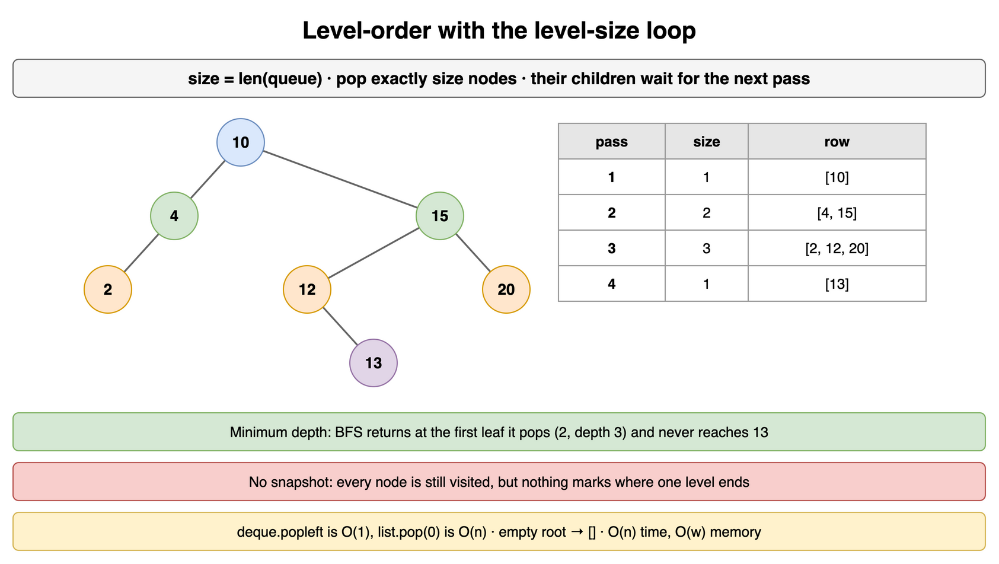

*Source: [`diagrams/trees.drawio`](/content/11_Coding_Problems/19_Trees/diagrams/trees.drawio), page 4.*

## Recursion to an explicit stack

Any recursive depth-first search can become a loop over a list used as a stack. Push the root. Pop a node, process it, and push its children. Push the right child before the left so the left pops first and the order stays preorder. Whatever the recursive call kept in local variables goes into the stack entry, so a call that took a depth becomes a `(node, depth)` tuple and a call that took bounds becomes `(node, low, high)`. Inorder walks left pushing every node, pops one, visits it, and moves to its right child. The stack holds what the call stack held, so memory stays O(h). The worked comparison is [Recursive vs. iterative DFS](#07_Data_Structures_and_Algorithms/05_Trees/concepts/recursive-vs-iterative-dfs), and the stack itself is [When a stack fits](#11_Coding_Problems/15_Stacks/concepts/when-a-stack-fits).

The reason to know the loop is depth. CPython stops at 1000 frames by default and raises `RecursionError`, so a recursive solution fails on a chain of a few thousand nodes that a loop handles. Raising the limit with `sys.setrecursionlimit` only moves the failure, and a high enough limit can crash the interpreter when the C stack runs out. Recursion still reads better for small, balanced inputs, and most interviewers accept it once you name the depth limit. Offer the loop when the input can be a chain or when the interviewer asks.

```python
import sys
from dataclasses import dataclass


@dataclass
class Node:
    val: int
    left: "Node | None" = None
    right: "Node | None" = None


def depth_recursive(node: Node | None) -> int:
    return 0 if node is None else 1 + max(depth_recursive(node.left), depth_recursive(node.right))


def depth_loop(root: Node | None) -> int:
    best, stack = 0, [(root, 1)] if root else []
    while stack:
        node, depth = stack.pop()
        best = max(best, depth)
        for child in (node.right, node.left):
            if child:
                stack.append((child, depth + 1))
    return best


def inorder_loop(root: Node | None) -> list[int]:
    out, stack, node = [], [], root
    while stack or node:
        while node:
            stack.append(node)
            node = node.left
        node = stack.pop()
        out.append(node.val)
        node = node.right
    return out


chain = None
for value in range(5000):
    chain = Node(value, chain)
print(sys.getrecursionlimit(), depth_loop(chain))
try:
    depth_recursive(chain)
except RecursionError:
    print("RecursionError")
print(inorder_loop(Node(6, Node(2, Node(1), Node(4)), Node(9))))
# 1000 5000
# RecursionError
# [1, 2, 4, 6, 9]
```

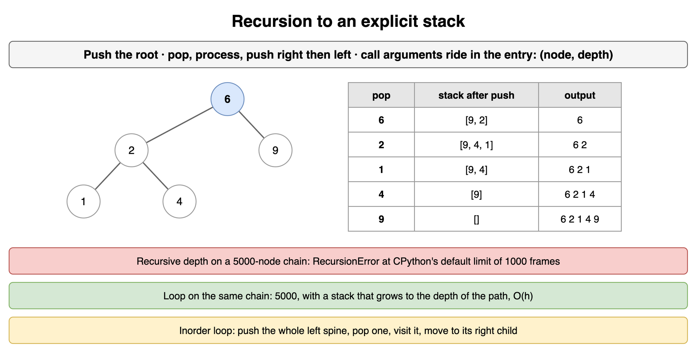

*Source: [`diagrams/trees.drawio`](/content/11_Coding_Problems/19_Trees/diagrams/trees.drawio), page 5.*

## Invert a tree and check symmetry

Inverting a tree mirrors it: every node swaps its left and right child. Each swap is independent of the others, so any traversal works. The recursive form is one tuple assignment, `node.left, node.right = invert(node.right), invert(node.left)`, which evaluates both calls before either field changes. Splitting it into two lines is the classic bug: the first line overwrites `node.left`, and the second line inverts the new left, which is the already-inverted right subtree, so the original left subtree is lost. The loop form pops a node, swaps its children, and pushes both. Either way it is O(n) time and O(h) memory. Return the root so callers can chain the call.

A symmetry check asks whether the left subtree is the mirror of the right without changing anything. Compare pairs. `mirror(a, b)` is true when both are `None`, false when exactly one is `None` or the values differ, and otherwise needs `mirror(a.left, b.right)` and `mirror(a.right, b.left)`. Handle the two null cases first, because they are where most wrong answers come from. A queue of pairs gives the loop form. Equal values with different shapes are not symmetric, and the null checks are what catch that. O(n) time and O(h) memory.

```python
from dataclasses import dataclass


@dataclass
class Node:
    val: int
    left: "Node | None" = None
    right: "Node | None" = None


def invert(node: Node | None) -> Node | None:
    if node:
        node.left, node.right = invert(node.right), invert(node.left)
    return node


def mirror(a: Node | None, b: Node | None) -> bool:
    if a is None and b is None:
        return True
    if a is None or b is None or a.val != b.val:
        return False
    return mirror(a.left, b.right) and mirror(a.right, b.left)


def pre(n): return [] if n is None else [n.val] + pre(n.left) + pre(n.right)


root = Node(4, Node(2, Node(1), Node(3)), Node(7, Node(6)))
print(pre(root), pre(invert(root)))
same_values = Node(1, Node(2, None, Node(3)), Node(2, None, Node(3)))
print(mirror(same_values.left, same_values.right))
print(mirror(Node(2, Node(3)), Node(2, None, Node(3))))
# [4, 2, 1, 3, 7, 6] [4, 7, 6, 2, 3, 1]
# False
# True
```

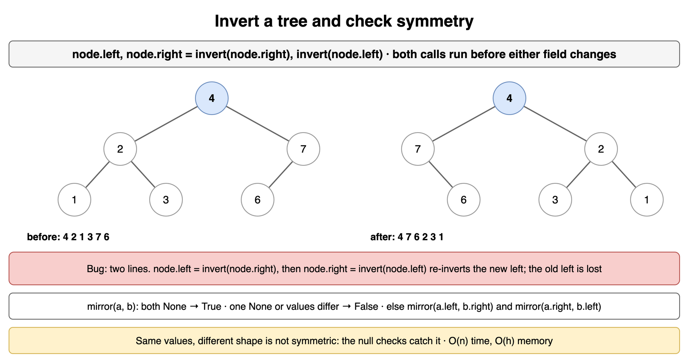

*Source: [`diagrams/trees.drawio`](/content/11_Coding_Problems/19_Trees/diagrams/trees.drawio), page 6.*

## Balanced tree check

A tree is height-balanced when, at every node, the heights of the two subtrees differ by at most 1. Checking only the root misses trees that are lopsided lower down: two long chains, one hanging left and one hanging right, have equal heights at the root and are unbalanced at every node below it. The top-down version calls a height function at each node, which recomputes the same heights again and again: O(n log n) on a balanced tree and O(n²) on a chain. The [Balanced trees](#07_Data_Structures_and_Algorithms/05_Trees/concepts/balanced-trees) card covers the trees that keep this property on every insert.

The bottom-up version is one postorder pass. Each call returns the height of its subtree, or -1 when anything inside it is unbalanced. The parent returns -1 when either child returned -1 or their heights differ by more than 1, and `1 + max(left, right)` otherwise. The sentinel only works if no real height can be -1, so count heights in nodes here, where the empty tree is 0. Return as soon as the left side reports -1 to skip the right side. O(n) time and O(h) memory.

```python
from dataclasses import dataclass


@dataclass
class Node:
    val: int
    left: "Node | None" = None
    right: "Node | None" = None


def checked_height(node: Node | None) -> int:
    if node is None:
        return 0
    left = checked_height(node.left)
    if left == -1:
        return -1
    right = checked_height(node.right)
    if right == -1 or abs(left - right) > 1:
        return -1
    return 1 + max(left, right)


def height(node: Node | None) -> int:
    return 0 if node is None else 1 + max(height(node.left), height(node.right))


def root_only(root: Node) -> bool:
    return abs(height(root.left) - height(root.right)) <= 1


arms = Node(1, Node(2, Node(4, Node(6))), Node(3, None, Node(5, None, Node(7))))
bushy = Node(1, Node(2, Node(4), Node(5)), Node(3, Node(6)))
print(root_only(arms), checked_height(arms) != -1)
print(checked_height(bushy), checked_height(None))
# True False
# 3 0
```

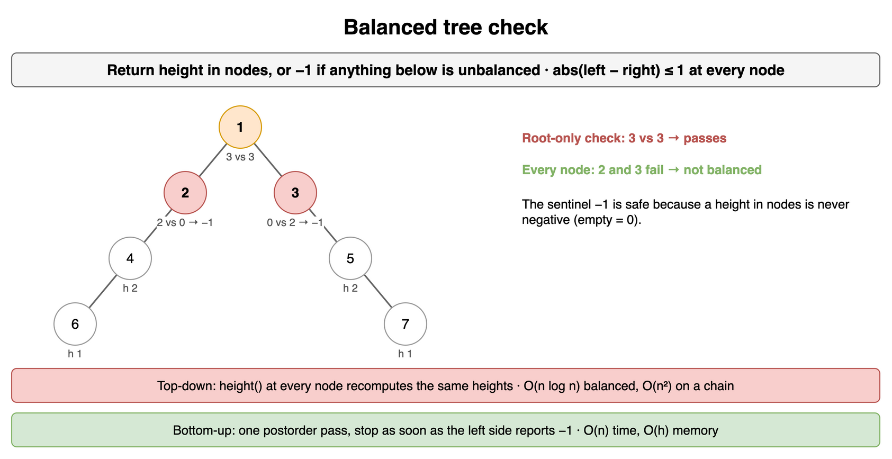

*Source: [`diagrams/trees.drawio`](/content/11_Coding_Problems/19_Trees/diagrams/trees.drawio), page 7.*

## Rightmost node of each level

The view from the right side shows one node per level: the last node that breadth-first search meets on that level. Inside the level-size loop, record the node when its position in the level is `size - 1`. The visible node is not always a right child. When the right subtree is shorter than the left, the deeper levels are seen through the gap, so a left-subtree node shows. O(n) time and O(w) memory. Mixing levels, by dropping the size snapshot, is the bug that turns this into "the last node in BFS order", which is one node, not one per level.

Depth-first search solves it too. Visit the right child before the left and carry the depth. The first node reached at a new depth, when `depth == len(result)`, is the one seen from the right. That form uses O(h) memory plus the output. The left view is the same code with the children visited in the other order, or the first node of each BFS level. Ask which side the question means before writing either.

```python
from collections import deque
from dataclasses import dataclass


@dataclass
class Node:
    val: int
    left: "Node | None" = None
    right: "Node | None" = None


def right_view(root: Node | None) -> list[int]:
    out, queue = [], deque([root] if root else [])
    while queue:
        size = len(queue)
        for index in range(size):
            node = queue.popleft()
            if index == size - 1:
                out.append(node.val)
            queue.extend(child for child in (node.left, node.right) if child)
    return out


def right_view_dfs(node: Node | None, depth: int = 0, out: list[int] | None = None) -> list[int]:
    out = [] if out is None else out
    if node:
        if depth == len(out):
            out.append(node.val)
        right_view_dfs(node.right, depth + 1, out)
        right_view_dfs(node.left, depth + 1, out)
    return out


root = Node(1, Node(2, Node(4, Node(6)), Node(5)), Node(3))
print(right_view(root), right_view_dfs(root), right_view(None))
# [1, 3, 5, 6] [1, 3, 5, 6] []
```

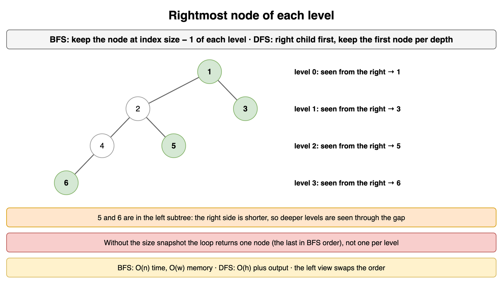

*Source: [`diagrams/trees.drawio`](/content/11_Coding_Problems/19_Trees/diagrams/trees.drawio), page 8.*

## Widest level

Level width here means the distance from the leftmost to the rightmost non-null node on a level, counting the empty slots between them as if the level were full. Number the slots the way an array-backed heap does: the root is 0, the left child of slot i is `2i + 1`, and the right child is `2i + 2`. Carry `(node, slot)` pairs through the level-size loop. The width of a level is `last - first + 1`, and the answer is the largest one. O(n) time and O(w) memory.

Counting nodes instead of slots undercounts every level with a gap. Slots double on each level, so a sparse tree 70 levels deep produces slot numbers past 2⁶⁴. Python's integers grow without overflow, but in Java or C++ the same code overflows. The fix is to subtract the first slot of the level from every slot on it before computing the children, which keeps the numbers no larger than the real width. Clarify whether the problem means this slot width or a plain node count, because both are called width.

```python
from collections import deque
from dataclasses import dataclass


@dataclass
class Node:
    val: int
    left: "Node | None" = None
    right: "Node | None" = None


def widest(root: Node | None) -> tuple[int, int]:
    best_slots = best_nodes = 0
    queue = deque([(root, 0)] if root else [])
    while queue:
        first, size = queue[0][1], len(queue)
        best_slots = max(best_slots, queue[-1][1] - first + 1)
        best_nodes = max(best_nodes, size)
        for _ in range(size):
            node, slot = queue.popleft()
            slot -= first
            if node.left:
                queue.append((node.left, 2 * slot + 1))
            if node.right:
                queue.append((node.right, 2 * slot + 2))
    return best_slots, best_nodes


arms = Node(1, Node(2, Node(4, Node(6))), Node(3, None, Node(5, None, Node(7))))
print(widest(arms))
print(widest(Node(1, Node(2), Node(3))), widest(None))
# (8, 2)
# (2, 2) (0, 0)
```

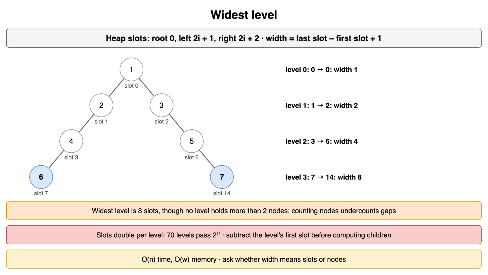

*Source: [`diagrams/trees.drawio`](/content/11_Coding_Problems/19_Trees/diagrams/trees.drawio), page 9.*

## Validate a BST

In a binary search tree, every value in a node's left subtree is smaller than the node and every value in its right subtree is larger. The rule covers whole subtrees, not just children. A root of 10 with a left child of 5 that has a right child of 12 passes every parent-child check, yet 12 sits in the root's left subtree. Carry an open range down: the root gets `(-inf, inf)`, a left child gets `(low, node.val)`, and a right child gets `(node.val, high)`. Each node must satisfy `low < val < high`. O(n) time and O(h) memory. The range rule is [BST range property](#07_Data_Structures_and_Algorithms/05_Trees/concepts/bst-range-property).

The inorder alternative uses the fact that a valid tree lists its values in strictly increasing order. Keep only the previous value and stop at the first value that is not larger. Ask about duplicates first. With strict bounds a duplicate is invalid. If duplicates are allowed on one side, the bound on that side becomes inclusive. Use `float("-inf")` and `float("inf")`, or `None`, for the open ends. A sentinel like the smallest 32-bit integer fails on a tree that contains that value.

```python
from dataclasses import dataclass


@dataclass
class Node:
    val: int
    left: "Node | None" = None
    right: "Node | None" = None


def valid(node: Node | None, low: float = float("-inf"), high: float = float("inf")) -> bool:
    if node is None:
        return True
    if not low < node.val < high:
        return False
    return valid(node.left, low, node.val) and valid(node.right, node.val, high)


def valid_inorder(root: Node | None) -> bool:
    previous, stack, node = float("-inf"), [], root
    while stack or node:
        while node:
            stack.append(node)
            node = node.left
        node = stack.pop()
        if node.val <= previous:
            return False
        previous, node = node.val, node.right
    return True


good = Node(10, Node(5, Node(2), Node(8)), Node(15, Node(12)))
bad = Node(10, Node(5, Node(2), Node(12)), Node(15))
print(valid(good), valid(bad), valid(Node(5, Node(5))))
print(valid_inorder(good), valid_inorder(bad), valid(None))
# True False False
# True False True
```

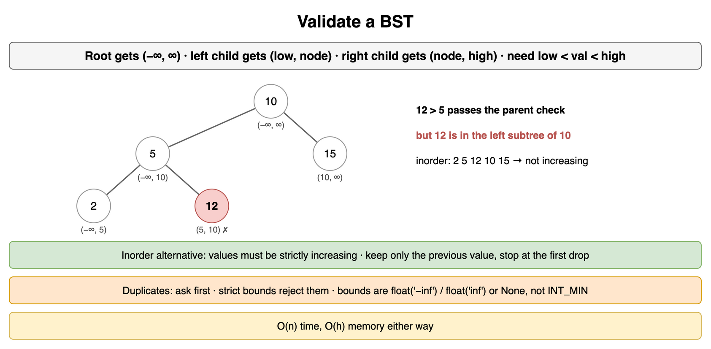

*Source: [`diagrams/trees.drawio`](/content/11_Coding_Problems/19_Trees/diagrams/trees.drawio), page 10.*

## K-th smallest in a BST

Inorder lists a binary search tree in sorted order, so the k-th smallest value is the k-th node that inorder visits. Collecting the whole list and indexing it costs O(n) time and O(n) memory. The iterative inorder loop can stop at the k-th pop instead: it pushes one left spine of up to h nodes and then pops k, so the cost is O(h + k) time and O(h) memory. Return `None` or raise when k is larger than the tree. The k-th largest is the same loop run right-to-left. The Data Structures [Trees](#07_Data_Structures_and_Algorithms/05_Trees) topic works the early stop as a drill.

When the same tree is asked many times and changes between queries, store each node's subtree size and update it on insert and delete. A query then descends once. If k is at most the size of the left subtree, go left. If it is one more, the current node is the answer. Otherwise go right with `k - left_size - 1`. That is O(h) per query, which is O(log n) on a balanced tree. A tree that stores sizes this way is called an order-statistic tree, and it also answers "how many values are below x" in O(h).

```python
from dataclasses import dataclass


@dataclass
class Node:
    val: int
    left: "Node | None" = None
    right: "Node | None" = None
    size: int = 1


def kth_smallest(root: Node | None, k: int) -> tuple[int | None, int]:
    stack, node, popped = [], root, 0
    while stack or node:
        while node:
            stack.append(node)
            node = node.left
        node = stack.pop()
        popped += 1
        if popped == k:
            return node.val, popped
        node = node.right
    return None, popped


def kth_by_size(node: Node | None, k: int) -> int | None:
    while node:
        left_size = node.left.size if node.left else 0
        if k <= left_size:
            node = node.left
        elif k == left_size + 1:
            return node.val
        else:
            k, node = k - left_size - 1, node.right
    return None


root = Node(20, Node(8, Node(4), Node(12, Node(10), Node(14), size=3), size=5), Node(22), size=7)
print(kth_smallest(root, 3), kth_smallest(root, 9))
print(kth_by_size(root, 3), kth_by_size(root, 6), kth_by_size(root, 8))
# (10, 3) (None, 7)
# 10 20 None
```

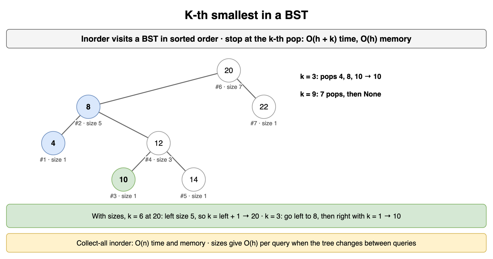

*Source: [`diagrams/trees.drawio`](/content/11_Coding_Problems/19_Trees/diagrams/trees.drawio), page 11.*

## Lowest common ancestor

The lowest common ancestor of two nodes p and q is the deepest node that has both of them in its subtree, where a node counts as part of its own subtree. In a general binary tree the values carry no order, so the search is a postorder pass. A call returns the node itself if it is p or q. Otherwise it searches both children. If both sides report a node, this node is where the two paths split, and it is the answer. If one side reports, pass that report up unchanged. O(n) time and O(h) memory.

When p is an ancestor of q, the search returns p as soon as it reaches p and never looks below. That is correct, because p contains q in its subtree. The short-cut assumes both nodes are in the tree. If that is not promised, count how many were actually found and return `None` unless it is two. A binary search tree makes the problem easier, because values say which side each node is on, and the Drills tab works that version. `git merge-base` answers a similar question for two commits, but the commit history is a directed acyclic graph, not a tree, so two branches can have more than one best common ancestor.

```python
from dataclasses import dataclass


@dataclass
class Node:
    val: int
    left: "Node | None" = None
    right: "Node | None" = None


def lca(node: Node | None, p: Node, q: Node) -> Node | None:
    if node is None or node is p or node is q:
        return node
    left, right = lca(node.left, p, q), lca(node.right, p, q)
    if left and right:
        return node
    return left or right


def find(node: Node | None, val: int) -> Node | None:
    if node is None or node.val == val:
        return node
    return find(node.left, val) or find(node.right, val)


root = Node(1, Node(2, Node(4), Node(5, Node(7), Node(8))), Node(3, None, Node(6)))
for a, b in [(7, 8), (4, 8), (5, 7), (8, 6)]:
    print(a, b, lca(root, find(root, a), find(root, b)).val)
# 7 8 5
# 4 8 2
# 5 7 5
# 8 6 1
```

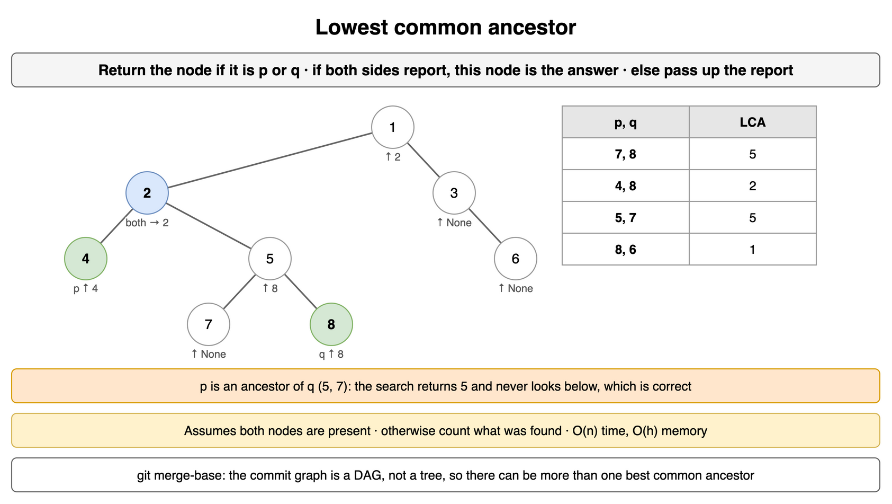

*Source: [`diagrams/trees.drawio`](/content/11_Coding_Problems/19_Trees/diagrams/trees.drawio), page 12.*

## Rebuild a tree from traversals

Preorder lists every subtree's root before the rest of that subtree. Inorder places each root between its left and right subtrees. Together they fix the tree when values are unique. Take the next preorder value as the root, find its position in inorder, and everything to its left in the current inorder range is the left subtree. A dictionary from value to inorder index makes each lookup O(1). Recurse on index ranges with one shared preorder pointer, and build the left subtree before the right, because preorder lists the whole left subtree first. O(n) time and memory. Slicing lists at each call copies O(n) values per level, which is O(n²) on a chain. Duplicate values make the split ambiguous.

One preorder list is enough if it records the empty children. Write a marker such as `#` for every `None`, and the markers pin down the shape. Rebuilding reads tokens from an iterator: a marker returns `None`, and any other token makes a node whose left and right are the next two rebuilt subtrees. Separate tokens with a comma so `-12` and multi-digit values stay whole. Both directions are O(n) time and memory. Without the markers, `1, 2` could be a left child or a right child. The format notes are [Tree serialization](#07_Data_Structures_and_Algorithms/05_Trees/concepts/tree-serialization).

```python
from dataclasses import dataclass


@dataclass
class Node:
    val: int
    left: "Node | None" = None
    right: "Node | None" = None


def build(preorder: list[int], inorder: list[int]) -> Node | None:
    where = {value: index for index, value in enumerate(inorder)}
    next_root = iter(preorder)

    def make(lo: int, hi: int) -> Node | None:
        if lo > hi:
            return None
        node = Node(next(next_root))
        mid = where[node.val]
        node.left = make(lo, mid - 1)
        node.right = make(mid + 1, hi)
        return node

    return make(0, len(inorder) - 1)


def serialize(node: Node | None) -> str:
    return "#" if node is None else f"{node.val},{serialize(node.left)},{serialize(node.right)}"


def deserialize(text: str) -> Node | None:
    tokens = iter(text.split(","))

    def read() -> Node | None:
        token = next(tokens)
        if token == "#":
            return None
        return Node(int(token), read(), read())

    return read()


root = build([6, 1, 8, 4, 2, 7], [8, 1, 4, 6, 2, 7])
text = serialize(root)
print(text)
print(serialize(deserialize(text)) == text, serialize(deserialize("-12,#,30,#,#")))
# 6,1,8,#,#,4,#,#,2,#,7,#,#
# True -12,#,30,#,#
```

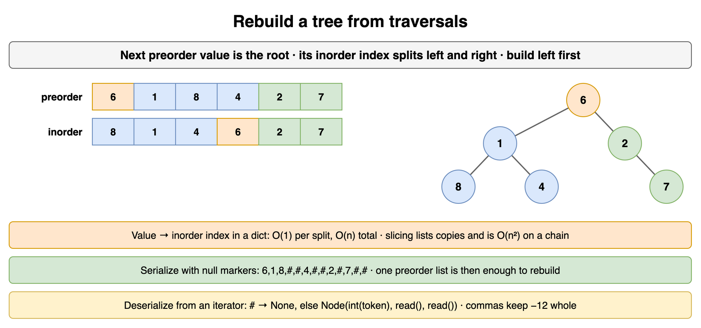

*Source: [`diagrams/trees.drawio`](/content/11_Coding_Problems/19_Trees/diagrams/trees.drawio), page 13.*

## Maximum path sum

A path here is any chain of connected nodes, each used once, with no branching. It can start and end anywhere and holds at least one node. The answer is a postorder pass with two quantities per node. The gain is the best sum of a path that starts at this node and goes down one side: `node.val + max(0, left_gain, right_gain)`. That gain is what the call returns, because a path coming up from the parent can continue into only one child. The peak is the best path that turns at this node: `node.val + max(0, left_gain) + max(0, right_gain)`. The peak updates an outer best and is never returned. O(n) time and O(h) memory.

Clamping a child's gain at 0 means "do not extend into that child". Two mistakes are common. Returning the peak to the parent builds a path with a fork. Starting the best at 0 returns 0 for a tree of all negative values, where the right answer is the largest single value, so start at negative infinity. The same return-one-side, record-both-sides shape gives the tree diameter, which the Data Structures [Trees](#07_Data_Structures_and_Algorithms/05_Trees) topic covers as a drill.

```python
from dataclasses import dataclass


@dataclass
class Node:
    val: int
    left: "Node | None" = None
    right: "Node | None" = None


def max_path(root: Node | None) -> float:
    best = float("-inf")

    def gain(node: Node | None) -> int:
        nonlocal best
        if node is None:
            return 0
        left, right = max(0, gain(node.left)), max(0, gain(node.right))
        best = max(best, node.val + left + right)
        return node.val + max(left, right)

    gain(root)
    return best


root = Node(-4, Node(9), Node(6, Node(-2, Node(5)), Node(8)))
print(max_path(root))
print(max_path(Node(-3, Node(-7), Node(-1))), max_path(Node(2)))
# 19
# -1 2
```

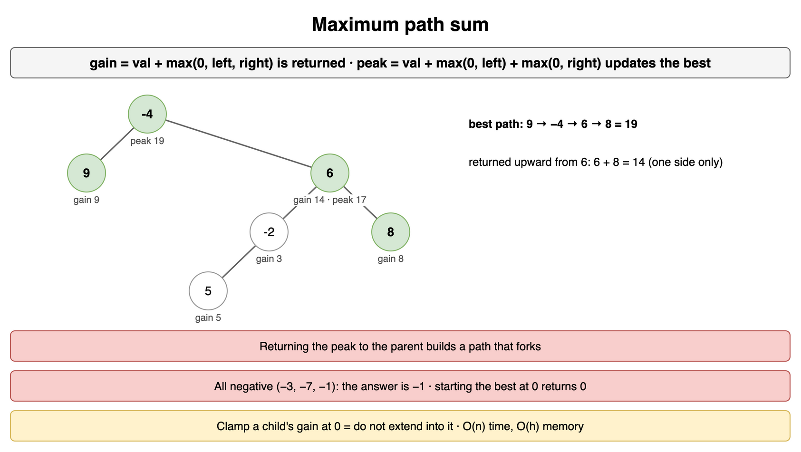

*Source: [`diagrams/trees.drawio`](/content/11_Coding_Problems/19_Trees/diagrams/trees.drawio), page 14.*

## Vertical columns

Give the root column 0. A left child is one column to the left of its parent, and a right child is one column to the right. The usual output lists the columns from left to right, each one top to bottom, and two nodes in the same row and column appear left to right. Breadth-first search visits rows top to bottom and each row left to right, so appending each node to its column's list in BFS order already produces that order. Track the smallest and largest column while scanning, then read the columns from min to max with no sort. O(n) time and memory.

Depth-first search visits a deep node in the left subtree before a shallow node in the right subtree, so it can put them in the wrong order within a column. To use it, store `(row, column)` with each value and sort, which costs O(n log n). Sorting the dictionary's column keys alone costs O(k log k) for k columns, and the min-max range avoids even that. Some versions sort ties in the same row and column by value instead of by position. Ask which rule applies.

```python
from collections import defaultdict, deque
from dataclasses import dataclass


@dataclass
class Node:
    val: int
    left: "Node | None" = None
    right: "Node | None" = None


def columns(root: Node | None) -> list[list[int]]:
    found, queue = defaultdict(list), deque([(root, 0)] if root else [])
    low = high = 0
    while queue:
        node, col = queue.popleft()
        found[col].append(node.val)
        low, high = min(low, col), max(high, col)
        if node.left:
            queue.append((node.left, col - 1))
        if node.right:
            queue.append((node.right, col + 1))
    return [found[col] for col in range(low, high + 1)] if found else []


def columns_dfs(node: Node | None, col: int = 0, found=None) -> dict[int, list[int]]:
    found = defaultdict(list) if found is None else found
    if node:
        found[col].append(node.val)
        columns_dfs(node.left, col - 1, found)
        columns_dfs(node.right, col + 1, found)
    return found


root = Node(5, Node(2, Node(1), Node(4, None, Node(6))), Node(7, None, Node(9)))
print(columns(root))
print(columns_dfs(root)[1], columns(None))
# [[1], [2], [5, 4], [7, 6], [9]]
# [6, 7] []
```

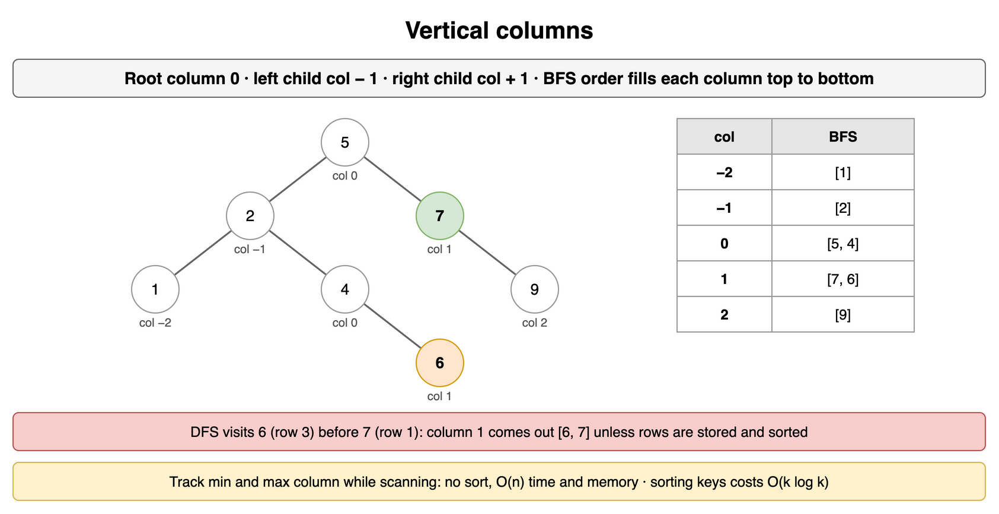

*Source: [`diagrams/trees.drawio`](/content/11_Coding_Problems/19_Trees/diagrams/trees.drawio), page 15.*
