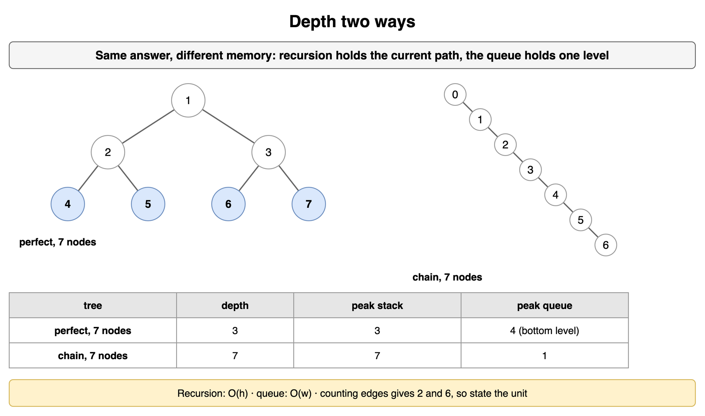
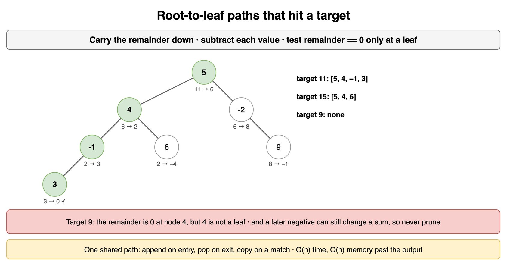
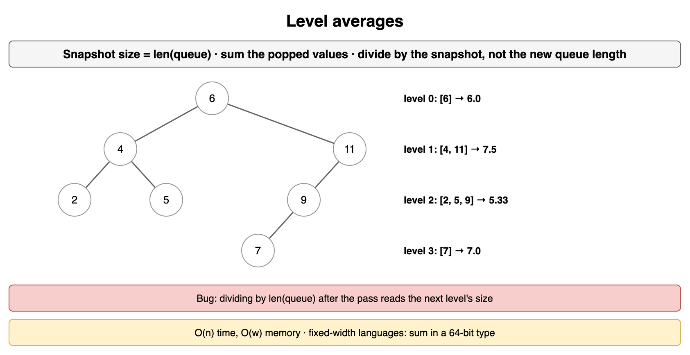
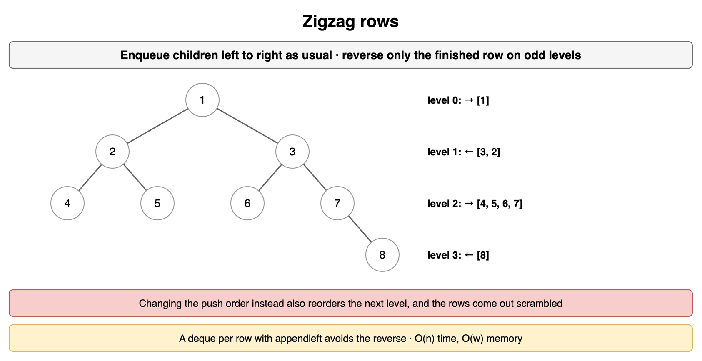
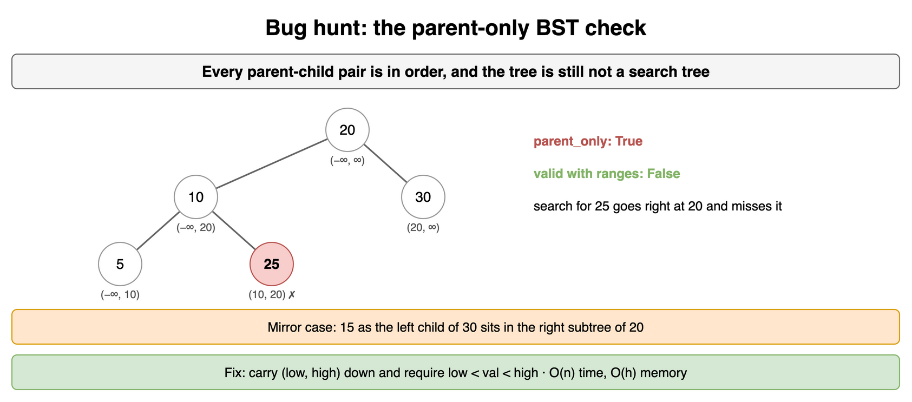
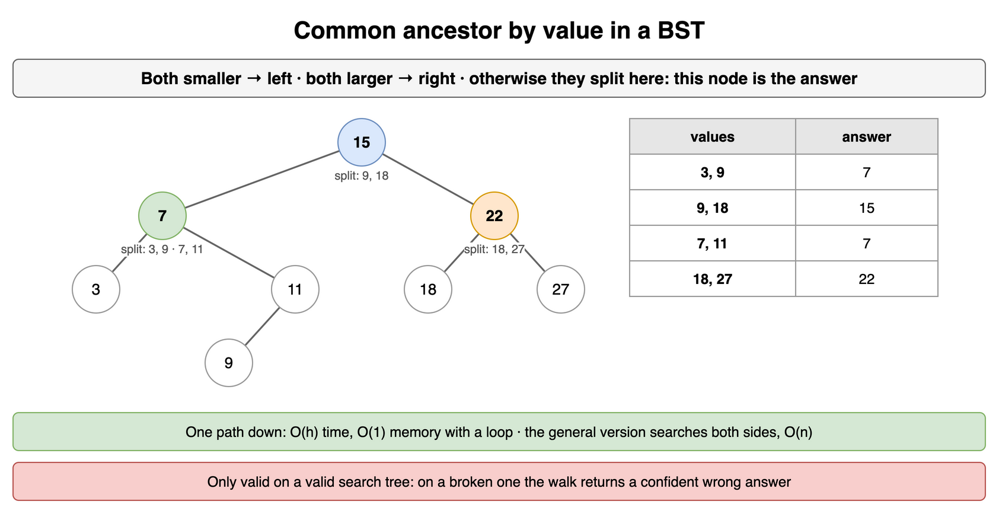
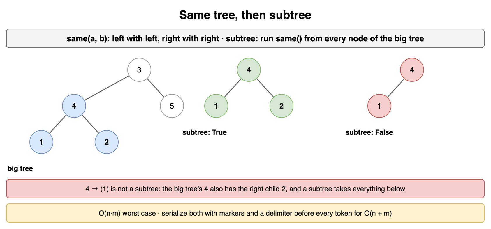
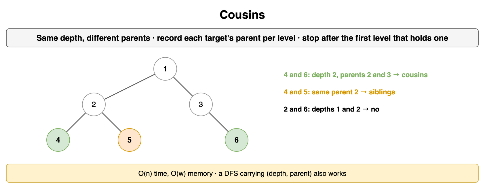
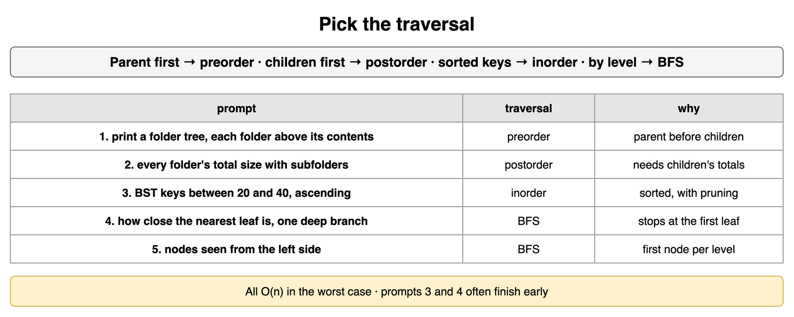

# Trees — Drills

Original drills for depth two ways, a root-to-leaf target, level averages, zigzag rows, a parent-only BST check, a common ancestor by value, same tree and subtree, cousins, and a traversal choice. Each answer has an approach, a cost, and Python. The values are exercise values.

## Depth two ways

Find the maximum depth, counted in nodes, of a perfect tree with 7 nodes and of a chain with 7 nodes. Solve each once with recursion and once level by level. For each tree, how many entries does the call stack hold at its peak, and how many does the queue hold at its peak?

**Answer:** Both methods give 3 for the perfect tree and 7 for the chain. The recursion peaks at 3 frames on the perfect tree and 7 on the chain, one per node on the current path. The queue peaks at 4 on the perfect tree, the whole bottom level, and at 1 on the chain. Both methods are O(n) time. Memory is O(h) for recursion and O(w) for the queue, so the chain favors the queue and a wide tree favors recursion. Counting edges instead of nodes gives 2 and 6, so state the unit. The trade is [Choose a traversal](#11_Coding_Problems/19_Trees/concepts/choose-a-traversal).

```python
from collections import deque
from dataclasses import dataclass


@dataclass
class Node:
    val: int
    left: "Node | None" = None
    right: "Node | None" = None


def depth_recursive(node: Node | None, level: int = 1, peak: list[int] | None = None) -> tuple[int, int]:
    peak = [0] if peak is None else peak
    if node is None:
        return 0, peak[0]
    peak[0] = max(peak[0], level)
    left = depth_recursive(node.left, level + 1, peak)[0]
    right = depth_recursive(node.right, level + 1, peak)[0]
    return 1 + max(left, right), peak[0]


def depth_levels(root: Node | None) -> tuple[int, int]:
    depth, peak, queue = 0, 0, deque([root] if root else [])
    while queue:
        peak = max(peak, len(queue))
        depth += 1
        for _ in range(len(queue)):
            node = queue.popleft()
            queue.extend(child for child in (node.left, node.right) if child)
    return depth, peak


perfect = Node(1, Node(2, Node(4), Node(5)), Node(3, Node(6), Node(7)))
chain = None
for value in range(7):
    chain = Node(value, chain)
print(depth_recursive(perfect), depth_levels(perfect))
print(depth_recursive(chain), depth_levels(chain))
# (3, 3) (3, 4)
# (7, 7) (7, 1)
```



*Source: [`diagrams/trees-drills.drawio`](/content/11_Coding_Problems/19_Trees/diagrams/trees-drills.drawio), page 1.*

## Root-to-leaf paths that hit a target

The tree has root 5. Its left child 4 has children -1 and 6, and -1 has a left child 3. Its right child -2 has a right child 9. List every root-to-leaf path whose values sum to 11. Then answer the same for 9.

**Answer:** For 11, one path: `[5, 4, -1, 3]`. The other leaves give 15 and 12. For 9, none. The partial path `5, 4` sums to 9, but 4 is not a leaf, so it does not count. Stopping as soon as the remainder hits 0 is the bug, and a negative value further down can still change the total, so never prune on a partial sum either. Carry the remaining target down, subtract each value, and test only at leaves. Keep one shared path list, append on entry and pop on exit, and copy it when it matches. O(n) time and O(h) memory past the output. The shape is [Return up or carry down](#11_Coding_Problems/19_Trees/concepts/return-up-or-carry-down).

```python
from dataclasses import dataclass


@dataclass
class Node:
    val: int
    left: "Node | None" = None
    right: "Node | None" = None


def target_paths(root: Node | None, target: int) -> list[list[int]]:
    found, path = [], []

    def walk(node: Node | None, remaining: int) -> None:
        if node is None:
            return
        path.append(node.val)
        remaining -= node.val
        if node.left is None and node.right is None and remaining == 0:
            found.append(path.copy())
        walk(node.left, remaining)
        walk(node.right, remaining)
        path.pop()

    walk(root, target)
    return found


root = Node(5, Node(4, Node(-1, Node(3)), Node(6)), Node(-2, None, Node(9)))
print(target_paths(root, 11), target_paths(root, 9))
print(target_paths(root, 15), target_paths(None, 0))
# [[5, 4, -1, 3]] []
# [[5, 4, 6]] []
```



*Source: [`diagrams/trees-drills.drawio`](/content/11_Coding_Problems/19_Trees/diagrams/trees-drills.drawio), page 2.*

## Level averages

The tree has root 6, children 4 and 11, then 2 and 5 under 4, then 9 under 11, and 7 under 9. Return the average of each level, rounded to two places.

**Answer:** `[6.0, 7.5, 5.33, 7.0]`. The levels are `[6]`, `[4, 11]`, `[2, 5, 9]`, and `[7]`. Use the level-size loop, sum the values popped in one pass, and divide by the snapshot of the level size. Dividing by `len(queue)` after the pass reads the size of the next level, which is the usual bug. In languages with fixed-width integers, add in a 64-bit type before dividing. O(n) time and O(w) memory. The loop is [Level-order with the level-size loop](#11_Coding_Problems/19_Trees/concepts/level-order-with-the-level-size-loop).

```python
from collections import deque
from dataclasses import dataclass


@dataclass
class Node:
    val: int
    left: "Node | None" = None
    right: "Node | None" = None


def level_averages(root: Node | None) -> list[float]:
    out, queue = [], deque([root] if root else [])
    while queue:
        size, total = len(queue), 0
        for _ in range(size):
            node = queue.popleft()
            total += node.val
            queue.extend(child for child in (node.left, node.right) if child)
        out.append(round(total / size, 2))
    return out


root = Node(6, Node(4, Node(2), Node(5)), Node(11, Node(9, Node(7))))
print(level_averages(root), level_averages(None))
# [6.0, 7.5, 5.33, 7.0] []
```



*Source: [`diagrams/trees-drills.drawio`](/content/11_Coding_Problems/19_Trees/diagrams/trees-drills.drawio), page 3.*

## Zigzag rows

Return the levels of a tree with every second level reversed: the first left to right, the second right to left, and so on. The tree has root 1, children 2 and 3, then 4 and 5 under 2, then 6 and 7 under 3, and 8 as the right child of 7.

**Answer:** `[[1], [3, 2], [4, 5, 6, 7], [8]]`. Keep the normal level-size loop, which always enqueues children left to right, and reverse only the finished row on odd levels. Changing the order in which children are pushed instead also changes the order of the next level, and the rows come out scrambled. A `deque` per row with `appendleft` avoids the reverse call, at the same O(w) cost. O(n) time and O(w) memory. The loop is [Level-order with the level-size loop](#11_Coding_Problems/19_Trees/concepts/level-order-with-the-level-size-loop).

```python
from collections import deque
from dataclasses import dataclass


@dataclass
class Node:
    val: int
    left: "Node | None" = None
    right: "Node | None" = None


def zigzag(root: Node | None) -> list[list[int]]:
    out, queue = [], deque([root] if root else [])
    while queue:
        row = []
        for _ in range(len(queue)):
            node = queue.popleft()
            row.append(node.val)
            queue.extend(child for child in (node.left, node.right) if child)
        out.append(row[::-1] if len(out) % 2 else row)
    return out


root = Node(1, Node(2, Node(4), Node(5)), Node(3, Node(6), Node(7, None, Node(8))))
print(zigzag(root))
print(zigzag(Node(1, None, Node(2, Node(3)))))
# [[1], [3, 2], [4, 5, 6, 7], [8]]
# [[1], [2], [3]]
```



*Source: [`diagrams/trees-drills.drawio`](/content/11_Coding_Problems/19_Trees/diagrams/trees-drills.drawio), page 4.*

## Bug hunt: the parent-only BST check

A teammate checks a binary search tree by testing, at every node, that the left child is smaller and the right child is larger, then recursing. Find a tree that passes their check and is not a valid search tree. What is the fix?

**Answer:** Root 20 with left child 10, whose children are 5 and 25, and right child 30. Every parent-child pair is in order, so the check passes. But 25 sits in the left subtree of 20, so a search for 25 goes right at the root and never finds it. The mirror case is a 15 under the left of 30. The fix carries an open range down: a left child inherits `(low, parent)` and a right child `(parent, high)`, and every node must fall strictly inside its range. Still O(n) time and O(h) memory. The rule is [Validate a BST](#11_Coding_Problems/19_Trees/concepts/validate-a-bst).

```python
from dataclasses import dataclass


@dataclass
class Node:
    val: int
    left: "Node | None" = None
    right: "Node | None" = None


def parent_only(node: Node | None) -> bool:
    if node is None:
        return True
    if node.left and node.left.val >= node.val:
        return False
    if node.right and node.right.val <= node.val:
        return False
    return parent_only(node.left) and parent_only(node.right)


def valid(node: Node | None, low: float = float("-inf"), high: float = float("inf")) -> bool:
    if node is None:
        return True
    return low < node.val < high and valid(node.left, low, node.val) and valid(node.right, node.val, high)


left_leak = Node(20, Node(10, Node(5), Node(25)), Node(30))
right_leak = Node(20, Node(10), Node(30, Node(15)))
print(parent_only(left_leak), valid(left_leak))
print(parent_only(right_leak), valid(right_leak))
# True False
# True False
```



*Source: [`diagrams/trees-drills.drawio`](/content/11_Coding_Problems/19_Trees/diagrams/trees-drills.drawio), page 5.*

## Common ancestor by value in a BST

The search tree has root 15, children 7 and 22, then 3 and 11 under 7, then 18 and 27 under 22, and 9 as the left child of 11. Find the lowest common ancestor of 3 and 9, of 9 and 18, of 7 and 11, and of 18 and 27. How does this differ from the general version?

**Answer:** 7, 15, 7, and 22. Start at the root. If both values are smaller, go left. If both are larger, go right. Otherwise the two values split here, or one of them is this node, and this node is the answer. The walk is one path down, so it is O(h) time and O(1) memory with a loop. The general version has no ordering to steer by and searches both subtrees, O(n). The order rule only holds in a valid search tree. Run on a tree that breaks it, the walk returns a confident wrong answer. The general search is [Lowest common ancestor](#11_Coding_Problems/19_Trees/concepts/lowest-common-ancestor).

```python
from dataclasses import dataclass


@dataclass
class Node:
    val: int
    left: "Node | None" = None
    right: "Node | None" = None


def bst_lca(node: Node | None, a: int, b: int) -> int | None:
    while node:
        if a < node.val and b < node.val:
            node = node.left
        elif a > node.val and b > node.val:
            node = node.right
        else:
            return node.val
    return None


root = Node(15, Node(7, Node(3), Node(11, Node(9))), Node(22, Node(18), Node(27)))
print([bst_lca(root, a, b) for a, b in [(3, 9), (9, 18), (7, 11), (18, 27)]])
# [7, 15, 7, 22]
```



*Source: [`diagrams/trees-drills.drawio`](/content/11_Coding_Problems/19_Trees/diagrams/trees-drills.drawio), page 6.*

## Same tree, then subtree

Write `same(a, b)` for two trees with identical shape and values. Then use it to decide whether a small tree appears as a complete subtree of a big one. The big tree has root 3, left child 4 with children 1 and 2, and right child 5. Test the small trees 4 → (1, 2) and 4 → (1).

**Answer:** The first is a subtree and the second is not. The big tree's 4 also has the right child 2, and a subtree must take everything below its root. `same` is the pair comparison from the symmetry check with the sides not crossed: both `None` is true, one `None` or different values is false, otherwise compare left with left and right with right. The subtree check runs `same` from every node of the big tree, O(n·m) in the worst case for sizes n and m. Serializing both with null markers and searching for the small string inside the big one brings it to O(n + m) with a linear string search. Put a delimiter before every token so 4 does not match inside 14. The pair shape is [Invert a tree and check symmetry](#11_Coding_Problems/19_Trees/concepts/invert-a-tree-and-check-symmetry).

```python
from dataclasses import dataclass


@dataclass
class Node:
    val: int
    left: "Node | None" = None
    right: "Node | None" = None


def same(a: Node | None, b: Node | None) -> bool:
    if a is None and b is None:
        return True
    if a is None or b is None or a.val != b.val:
        return False
    return same(a.left, b.left) and same(a.right, b.right)


def has_subtree(big: Node | None, small: Node | None) -> bool:
    if big is None:
        return small is None
    return same(big, small) or has_subtree(big.left, small) or has_subtree(big.right, small)


big = Node(3, Node(4, Node(1), Node(2)), Node(5))
print(has_subtree(big, Node(4, Node(1), Node(2))), has_subtree(big, Node(4, Node(1))))
print(same(Node(1, Node(2)), Node(1, None, Node(2))), has_subtree(big, Node(5)))
# True False
# False True
```



*Source: [`diagrams/trees-drills.drawio`](/content/11_Coding_Problems/19_Trees/diagrams/trees-drills.drawio), page 7.*

## Cousins

Two nodes are cousins when they sit at the same depth and have different parents. The tree has root 1, children 2 and 3, then 4 and 5 under 2, and 6 as the right child of 3. Are 4 and 6 cousins? 4 and 5? 2 and 6?

**Answer:** Yes, no, and no. 4 and 6 are both at depth 2 with parents 2 and 3. 4 and 5 share the parent 2, so they are siblings. 2 and 6 are on different levels. Run the level-size loop and record the parent of each target value seen in the current level. After each level, if both were found they are cousins exactly when the parents differ, and if only one was found the answer is no, so stop early. O(n) time and O(w) memory. Carrying `(depth, parent)` down a depth-first search also works. The loop is [Level-order with the level-size loop](#11_Coding_Problems/19_Trees/concepts/level-order-with-the-level-size-loop).

```python
from collections import deque
from dataclasses import dataclass


@dataclass
class Node:
    val: int
    left: "Node | None" = None
    right: "Node | None" = None


def cousins(root: Node | None, a: int, b: int) -> bool:
    queue = deque([(root, None)] if root else [])
    while queue:
        parents = {}
        for _ in range(len(queue)):
            node, parent = queue.popleft()
            if node.val in (a, b):
                parents[node.val] = parent
            queue.extend((child, node.val) for child in (node.left, node.right) if child)
        if len(parents) == 2:
            return parents[a] != parents[b]
        if parents:
            return False
    return False


root = Node(1, Node(2, Node(4), Node(5)), Node(3, None, Node(6)))
print(cousins(root, 4, 6), cousins(root, 4, 5), cousins(root, 2, 6))
# True False False
```



*Source: [`diagrams/trees-drills.drawio`](/content/11_Coding_Problems/19_Trees/diagrams/trees-drills.drawio), page 8.*

## Pick the traversal

Name the traversal for each prompt. One: print a folder tree with indentation, each folder above its contents. Two: compute every folder's total size, including its subfolders. Three: list a search tree's keys between 20 and 40 in ascending order. Four: find how close to the root the nearest leaf is, in a tree with one very deep branch. Five: list the nodes seen from the left side.

**Answer:** One is preorder: a folder prints before its children. Two is postorder: a folder's total needs its children's totals first. Three is inorder, which yields keys in sorted order, with pruning that skips left subtrees below 20 and right subtrees above 40. Four is breadth-first search, which stops at the first leaf instead of exploring the deep branch. Five is breadth-first search taking the first node of each level, or a depth-first search that visits left first. All are O(n) in the worst case. Three and Four often finish early. The signals are [Choose a traversal](#11_Coding_Problems/19_Trees/concepts/choose-a-traversal).

```python
def pick(parent_first: bool, children_first: bool, sorted_keys: bool, by_level: bool) -> str:
    if by_level:
        return "bfs"
    if sorted_keys:
        return "inorder"
    if children_first:
        return "postorder"
    return "preorder" if parent_first else "any"


prompts = [
    (True, False, False, False),
    (False, True, False, False),
    (False, False, True, False),
    (False, False, False, True),
    (False, False, False, True),
]
print([pick(*prompt) for prompt in prompts])
# ['preorder', 'postorder', 'inorder', 'bfs', 'bfs']
```



*Source: [`diagrams/trees-drills.drawio`](/content/11_Coding_Problems/19_Trees/diagrams/trees-drills.drawio), page 9.*
