## Tries as a pattern

A trie, or prefix tree, stores a set of strings one character per edge, so words that start the same way share the same path from the root. A node stands for the prefix spelled on the way down to it, and a flag on the node says whether that prefix is also a whole stored word. The node structure and the basic walk are [Trie (prefix tree)](#07_Data_Structures_and_Algorithms/06_Heaps_and_Tries/concepts/trie-prefix-tree) on the Data Structures topic. This topic is the problem set: designing the class, searching with wildcards, steering a grid search, and the variants that store extra data in each node.

Reach for a trie when the question is about prefixes across many strings: autocomplete, "does any stored word start with this", "which dictionary words appear in this grid", the shortest root that replaces a word, or many patterns tested against one text, which is [A trie for many patterns](#11_Coding_Problems/07_Hard_Problems/concepts/a-trie-for-many-patterns). Insert, exact search, prefix search, and delete each cost O(k) for a key of length k, independent of how many words are stored. Building from N words of total length T costs O(T) time and at most T + 1 nodes. If the question only asks "is this exact word present", a hash set does the same job with less code. Search-box suggestions are the everyday example.

```python
class TrieNode:
    def __init__(self) -> None:
        self.children: dict[str, "TrieNode"] = {}
        self.is_word = False


def build(words: list[str]) -> tuple[TrieNode, int]:
    root, nodes = TrieNode(), 1
    for word in words:
        node = root
        for ch in word:
            if ch not in node.children:
                node.children[ch] = TrieNode()
                nodes += 1
            node = node.children[ch]
        node.is_word = True
    return root, nodes


words = ["tea", "team", "tease", "ten", "to", "toast"]
root, nodes = build(words)
print(sum(map(len, words)), nodes)
print(sorted(root.children), sorted(root.children["t"].children))
# 22 12
# ['t'] ['e', 'o']
```

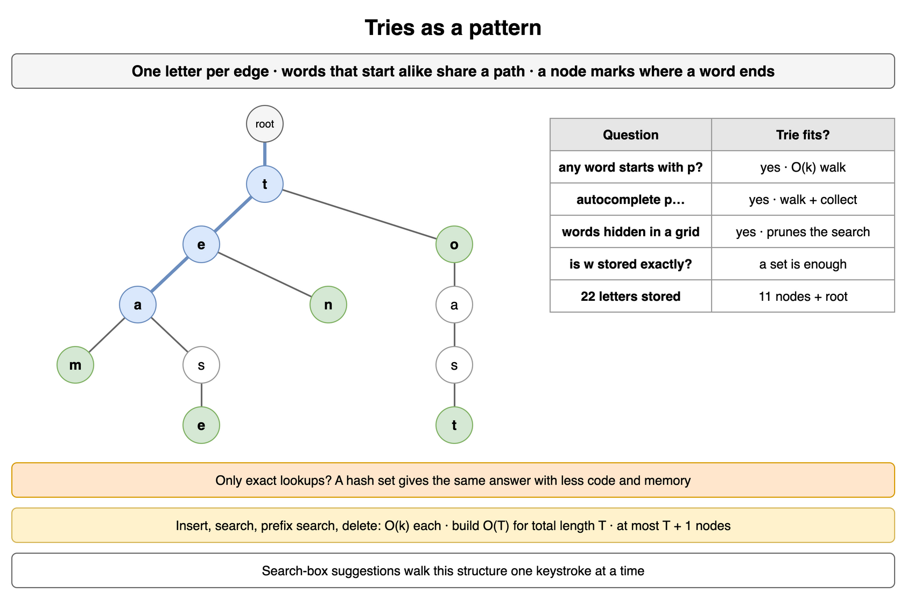

*Source: [`diagrams/tries.drawio`](/content/11_Coding_Problems/20_Tries/diagrams/tries.drawio), page 1.*

## Node design

A node needs two things: a way to reach its children and a way to mark the end of a word. Children can live in a dict keyed by character, which stores only the edges that exist and accepts any alphabet, or in a fixed list of 26 slots indexed by `ord(ch) - ord("a")`, which gives direct indexing but reserves every slot in every node. In Python the dict is usually the better default, because the list does not save time and sparse lower levels waste most of their slots. The fixed array pays off in languages where it is a flat block of pointers and the alphabet is small and dense, such as DNA (4 letters) or bits (2). The full trade is [Dict vs. array children](#07_Data_Structures_and_Algorithms/06_Heaps_and_Tries/concepts/dict-vs-array-children).

The end marker can be a boolean or the word itself. Storing the word (`node.word = "team"`, else `None`) costs one reference per word and saves rebuilding the path during a depth-first search, which is why grid-search and autocomplete solutions favor it. Counters are a third option: how many words pass through or end at the node. Whatever you pick, keep it per node, never on the trie object, and add `__slots__` when a trie holds hundreds of thousands of nodes. A mutable default argument such as `children={}` would share one dict across every node, which breaks the trie silently.

```python
class DictNode:
    __slots__ = ("children", "word")

    def __init__(self) -> None:
        self.children: dict[str, "DictNode"] = {}
        self.word: str | None = None


class ArrayNode:
    __slots__ = ("children", "word")

    def __init__(self) -> None:
        self.children: list["ArrayNode | None"] = [None] * 26
        self.word: str | None = None


def build(words: list[str], use_array: bool) -> list:
    root, nodes = (ArrayNode() if use_array else DictNode()), []
    nodes.append(root)
    for word in words:
        node = root
        for ch in word:
            key = ord(ch) - ord("a") if use_array else ch
            child = node.children[key] if use_array else node.children.get(key)
            if child is None:
                child = ArrayNode() if use_array else DictNode()
                node.children[key] = child
                nodes.append(child)
            node = child
        node.word = word
    return nodes


words = ["tea", "team", "tease", "ten", "to", "toast"]
dict_nodes, array_nodes = build(words, False), build(words, True)
print(len(dict_nodes), sum(len(n.children) for n in dict_nodes))
print(len(array_nodes), 26 * len(array_nodes))
print(sorted(n.word for n in dict_nodes if n.word))
# 12 11
# 12 312
# ['tea', 'team', 'tease', 'ten', 'to', 'toast']
```

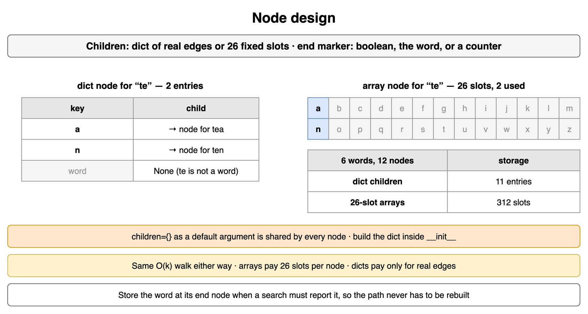

*Source: [`diagrams/tries.drawio`](/content/11_Coding_Problems/20_Tries/diagrams/tries.drawio), page 2.*

## Design a trie

The standard design question asks for `insert(word)`, `search(word)`, and `has_prefix(prefix)`. All three walk from the root one character at a time. Insert creates a missing child and then sets the end marker on the last node. Search and prefix search share one helper that returns the node for a string, or `None` as soon as a character has no edge. Search then also requires the end marker, and prefix search does not. Forgetting that check makes `search("plan")` true after inserting only `"planet"`. Inserting a word twice is harmless, and inserting the empty string marks the root itself.

Each operation costs O(k) time for a string of length k. Insert adds at most k nodes, so its extra space is O(k). Search and prefix search use O(1) extra space. Over N words of total length T, the trie holds at most T + 1 nodes. The insert and search mechanics are covered in [Trie insert and search](#07_Data_Structures_and_Algorithms/06_Heaps_and_Tries/concepts/trie-insert-and-search), so in an interview spend the time on the contract: what counts as a word, lowercase only or not, and whether `has_prefix("")` is true. It is true here, because every stored word starts with the empty prefix.

```python
class TrieNode:
    __slots__ = ("children", "is_word")

    def __init__(self) -> None:
        self.children: dict[str, "TrieNode"] = {}
        self.is_word = False


class Trie:
    def __init__(self) -> None:
        self.root = TrieNode()

    def insert(self, word: str) -> None:
        node = self.root
        for ch in word:
            node = node.children.setdefault(ch, TrieNode())
        node.is_word = True

    def _walk(self, text: str) -> TrieNode | None:
        node = self.root
        for ch in text:
            node = node.children.get(ch)
            if node is None:
                return None
        return node

    def search(self, word: str) -> bool:
        node = self._walk(word)
        return node is not None and node.is_word

    def has_prefix(self, prefix: str) -> bool:
        return self._walk(prefix) is not None


trie = Trie()
for word in ["planet", "plant", "play"]:
    trie.insert(word)
print(trie.search("plan"), trie.has_prefix("plan"), trie.search("plant"))
trie.insert("plan")
print(trie.search("plan"), trie.search("plans"), trie.has_prefix(""))
# False True True
# True False True
```

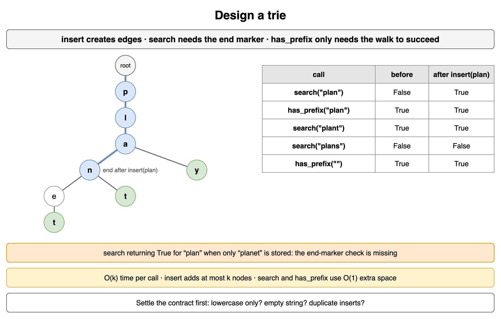

*Source: [`diagrams/tries.drawio`](/content/11_Coding_Problems/20_Tries/diagrams/tries.drawio), page 3.*

## Store answers in the nodes

A node can carry more than an end marker. Any total over "all words below this node" can be kept on the node and updated during insert, so a prefix query becomes a walk of length k plus one read. A pass-through count answers "how many words start with p". A running sum of values answers "total score of keys starting with p". A cached list of the best few completions answers autocomplete without a subtree search. The cost is memory per node and an update on every node of the inserted path.

Updates need care when a key can arrive twice. If `insert("cart", 3)` is followed by `insert("cart", 5)`, the second call must add the difference, 2, along the path, not 5, so keep the current value per key in a plain dict next to the trie. Deletes subtract along the path in the same way. The query is O(k), and each insert or update is O(k). Collecting the words themselves still needs a subtree walk, as in [Prefix collection (autocomplete)](#07_Data_Structures_and_Algorithms/06_Heaps_and_Tries/concepts/prefix-collection-autocomplete).

```python
class Node:
    __slots__ = ("children", "total")

    def __init__(self) -> None:
        self.children: dict[str, "Node"] = {}
        self.total = 0


class PrefixScores:
    def __init__(self) -> None:
        self.root, self.values = Node(), {}

    def put(self, key: str, value: int) -> None:
        delta = value - self.values.get(key, 0)
        self.values[key] = value
        node = self.root
        node.total += delta
        for ch in key:
            node = node.children.setdefault(ch, Node())
            node.total += delta

    def score(self, prefix: str) -> int:
        node = self.root
        for ch in prefix:
            node = node.children.get(ch)
            if node is None:
                return 0
        return node.total


scores = PrefixScores()
scores.put("cart", 3)
scores.put("car", 4)
scores.put("cat", 1)
print(scores.score("ca"), scores.score("car"), scores.score("dog"))
scores.put("cart", 5)
print(scores.score("ca"), scores.score("cart"), scores.score(""))
# 8 7 0
# 10 5 10
```

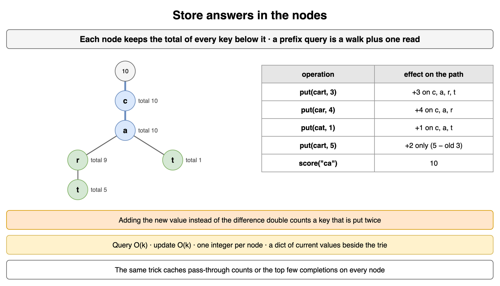

*Source: [`diagrams/tries.drawio`](/content/11_Coding_Problems/20_Tries/diagrams/tries.drawio), page 4.*

## Wildcard search

When a pattern may contain `.` to mean "any one letter", search becomes a depth-first search over the trie. A plain letter follows one edge, exactly as before. A `.` tries every child of the current node and succeeds if any branch succeeds. The base case is the end of the pattern, and it must check the end marker, not just that a node was reached. Return as soon as one branch matches, so `any(...)` over the children is the natural form: it stops at the first `True`.

Insert stays O(k). Search without wildcards is O(k). With wildcards the branching multiplies: a pattern of k dots can visit every node down to depth k, which is bounded by the trie size and by 26^k. The recursion depth is k, so the extra space is O(k). When a pattern has many leading dots, the early levels fan out widest. Grouping words by length first, or adding a per-length trie, cuts the work when all words have different lengths. Crossword helpers and simple glob matchers work this way.

```python
class Node:
    __slots__ = ("children", "is_word")

    def __init__(self) -> None:
        self.children: dict[str, "Node"] = {}
        self.is_word = False


def insert(root: Node, word: str) -> None:
    node = root
    for ch in word:
        node = node.children.setdefault(ch, Node())
    node.is_word = True


def matches(node: Node, pattern: str, i: int = 0) -> bool:
    if i == len(pattern):
        return node.is_word
    ch = pattern[i]
    if ch == ".":
        return any(matches(child, pattern, i + 1) for child in node.children.values())
    child = node.children.get(ch)
    return child is not None and matches(child, pattern, i + 1)


root = Node()
for word in ["bat", "bet", "bit", "bold", "cot"]:
    insert(root, word)
print(matches(root, "b.t"), matches(root, ".o."), matches(root, "..."))
print(matches(root, "b.."), matches(root, "b."), matches(root, "...."))
# True True True
# True False True
```

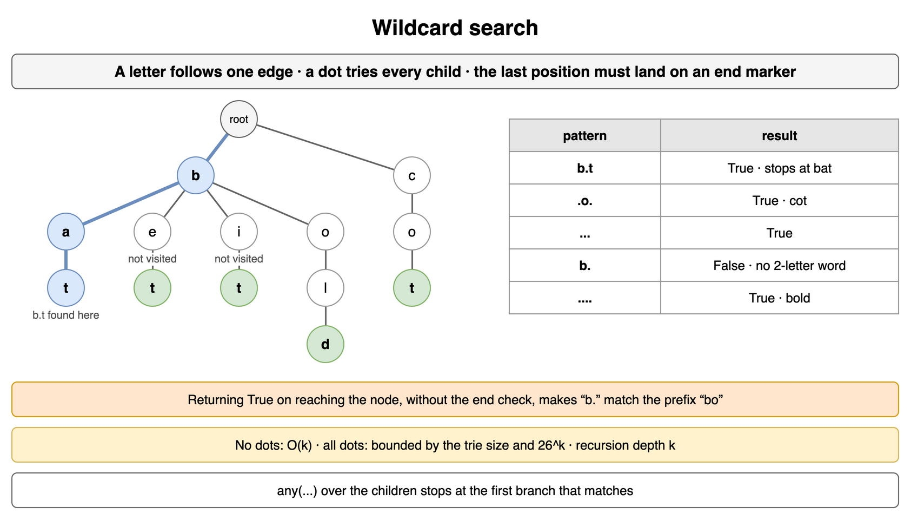

*Source: [`diagrams/tries.drawio`](/content/11_Coding_Problems/20_Tries/diagrams/tries.drawio), page 5.*

## Trie-guided grid backtracking

A word search on a grid is a depth-first search over cells: start at a cell, step to one of four neighbors, never reuse a cell on the current path, and undo the mark when backing out. That part is ordinary [Backtracking](#07_Data_Structures_and_Algorithms/11_Problem_Solving_Patterns/concepts/backtracking) over an implicit graph, the shape in [Edge lists and implicit graphs](#07_Data_Structures_and_Algorithms/07_Graphs/concepts/edge-lists-and-implicit-graphs). Searching for one word at a time repeats that whole search per word. A trie of all the words lets one search serve every word at once.

The trie becomes the pruning rule. Carry the trie node along with the cell. Step into a neighbor only if its letter is a child of the current node. A path whose letters are not a prefix of any word stops right away, instead of growing to the full word length. In a grid where few letter sequences match, most starts die after one or two steps. Mark a visited cell by overwriting its letter with a sentinel such as `"#"`, which also fails the child lookup, and restore the letter on the way out.

```python
def count_live_paths(grid: list[str], words: list[str]) -> tuple[int, int]:
    prefixes = {w[:i] for w in words for i in range(1, len(w) + 1)}
    board = [list(row) for row in grid]
    rows, cols = len(board), len(board[0])
    stats = [0, 0]

    def dfs(r: int, c: int, path: str) -> None:
        stats[0] += 1
        path += board[r][c]
        if path not in prefixes:
            return
        stats[1] += 1
        ch, board[r][c] = board[r][c], "#"
        for nr, nc in ((r + 1, c), (r - 1, c), (r, c + 1), (r, c - 1)):
            if 0 <= nr < rows and 0 <= nc < cols and board[nr][nc] != "#":
                dfs(nr, nc, path)
        board[r][c] = ch

    for r in range(rows):
        for c in range(cols):
            dfs(r, c, "")
    return stats[0], stats[1]


calls, live = count_live_paths(["cat", "ore", "dog"], ["cot", "dog", "rod"])
print(f"{calls} cells entered, {live} still a prefix")
# 30 cells entered, 11 still a prefix
```

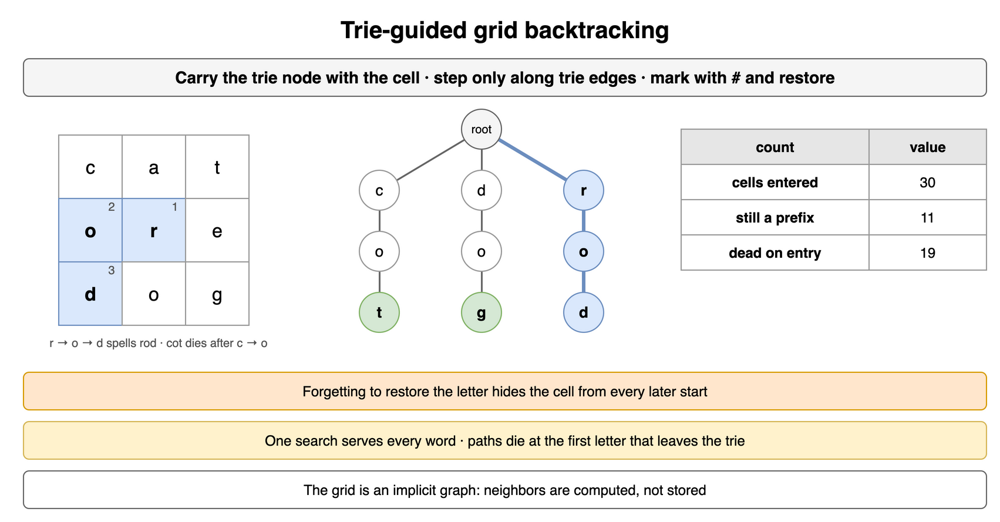

*Source: [`diagrams/tries.drawio`](/content/11_Coding_Problems/20_Tries/diagrams/tries.drawio), page 6.*

## Find all words on a board

Given a grid of letters and a word list, return every word that can be traced through four-way adjacent cells without reusing a cell. Build a trie of the words and store each word at its end node. Then start the search from every cell, carrying the trie node. When the node reached has a stored word, add it to the result. Keep going after a hit, because a longer word may continue from the same node, such as `"tea"` and `"team"`.

With N words of maximum length L on an m × n grid, building the trie is O(N L). The search starts at m n cells. The first step has up to 4 neighbors and later steps up to 3, because the cell just left is marked, and no path runs past depth L, so the search is O(m n 3^L) in the worst case and much less when the trie prunes early. Space is O(N L) for the trie plus O(L) recursion. Two pitfalls dominate: forgetting to restore the cell, which hides paths from later starts, and reporting a word twice when two paths spell it, which [Remove found words and dead branches](#11_Coding_Problems/20_Tries/concepts/remove-found-words-and-dead-branches) fixes.

```python
class Node:
    __slots__ = ("children", "word")

    def __init__(self) -> None:
        self.children: dict[str, "Node"] = {}
        self.word: str | None = None


def find_words(grid: list[str], words: list[str]) -> list[str]:
    root = Node()
    for word in words:
        node = root
        for ch in word:
            node = node.children.setdefault(ch, Node())
        node.word = word
    board = [list(row) for row in grid]
    rows, cols, found = len(board), len(board[0]), []

    def dfs(r: int, c: int, parent: Node) -> None:
        node = parent.children.get(board[r][c])
        if node is None:
            return
        if node.word is not None:
            found.append(node.word)
            node.word = None
        ch, board[r][c] = board[r][c], "#"
        for nr, nc in ((r + 1, c), (r - 1, c), (r, c + 1), (r, c - 1)):
            if 0 <= nr < rows and 0 <= nc < cols:
                dfs(nr, nc, node)
        board[r][c] = ch

    for r in range(rows):
        for c in range(cols):
            dfs(r, c, root)
    return sorted(found)


grid = ["seat", "mlrn", "pane"]
print(find_words(grid, ["sea", "seat", "earn", "plane", "lap", "mess"]))
print(find_words(["a"], ["a", "aa"]))
# ['earn', 'lap', 'sea', 'seat']
# ['a']
```

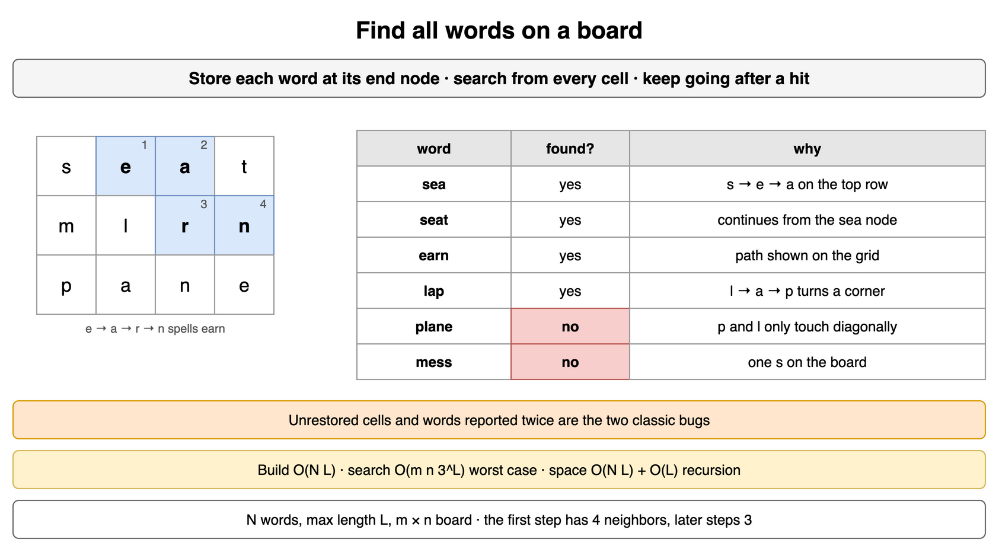

*Source: [`diagrams/tries.drawio`](/content/11_Coding_Problems/20_Tries/diagrams/tries.drawio), page 7.*

## Remove found words and dead branches

A board can spell the same word along two different paths, such as `"aba"` on a row `a b a` read from either end. If the search only appends the word, it appears twice. Clearing the stored word at its node the first time it is found fixes that with no extra set, and it also stops later paths from counting it again. A result set works too, but it does not save any search time.

The second refinement removes trie nodes that can no longer lead anywhere. After the search returns from a child, check whether that child now has no children and no stored word. If so, delete it from the parent's dict. As words are found, their branches shrink, and later starts stop sooner. On a large board with a small word list this cuts most of the running time. It changes nothing in the worst case, so the bound stays O(m n 3^L). The deletion rule is the bottom-up pruning from [Trie deletion](#07_Data_Structures_and_Algorithms/06_Heaps_and_Tries/concepts/trie-deletion), applied during the search.

```python
class Node:
    __slots__ = ("children", "word")

    def __init__(self) -> None:
        self.children: dict[str, "Node"] = {}
        self.word: str | None = None


def find_words(grid: list[str], words: list[str], prune: bool) -> tuple[list[str], int]:
    root = Node()
    for word in words:
        node = root
        for ch in word:
            node = node.children.setdefault(ch, Node())
        node.word = word
    board = [list(row) for row in grid]
    rows, cols, found, calls = len(board), len(board[0]), [], [0]

    def dfs(r: int, c: int, parent: Node) -> None:
        calls[0] += 1
        letter = board[r][c]
        node = parent.children.get(letter)
        if node is None:
            return
        if node.word is not None:
            found.append(node.word)
            node.word = None
        board[r][c] = "#"
        for nr, nc in ((r + 1, c), (r - 1, c), (r, c + 1), (r, c - 1)):
            if 0 <= nr < rows and 0 <= nc < cols:
                dfs(nr, nc, node)
        board[r][c] = letter
        if prune and not node.children and node.word is None:
            del parent.children[letter]

    for r in range(rows):
        for c in range(cols):
            dfs(r, c, root)
    return found, calls[0]


grid = ["aba", "aba", "aba"]
print(find_words(grid, ["aba", "aaa"], prune=False))
print(find_words(grid, ["aba", "aaa"], prune=True))
# (['aaa', 'aba'], 85)
# (['aaa', 'aba'], 21)
```

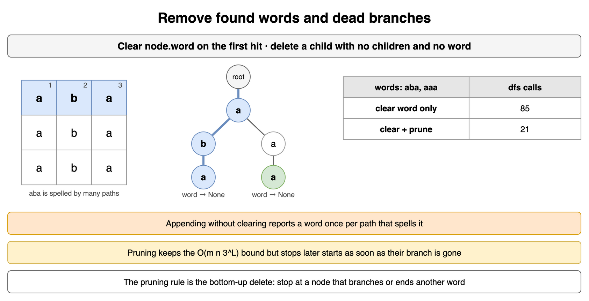

*Source: [`diagrams/tries.drawio`](/content/11_Coding_Problems/20_Tries/diagrams/tries.drawio), page 8.*

## Suffix trie for substring queries

A trie answers prefix questions, and every substring of a text is a prefix of one of its suffixes. Inserting all suffixes of a text therefore turns "is p a substring" into a prefix walk of length |p|. The same structure counts occurrences, if each node keeps a pass-through count, and counts distinct substrings, which equals the number of nodes other than the root.

The cost is the catch. A text of length n has n suffixes of average length n / 2, so building takes O(n²) time and up to O(n²) nodes. That is fine for a few thousand characters and useless for a genome. Suffix trees compress the chains to reach O(n) nodes, and suffix arrays store only the sorted suffix start positions. In an interview, the suffix trie is the clear first answer for small inputs, and naming the suffix array is the follow-up for large ones.

```python
class Node:
    __slots__ = ("children", "passes")

    def __init__(self) -> None:
        self.children: dict[str, "Node"] = {}
        self.passes = 0


def suffix_trie(text: str) -> tuple[Node, int]:
    root, nodes = Node(), 0
    for start in range(len(text)):
        node = root
        for ch in text[start:]:
            if ch not in node.children:
                node.children[ch] = Node()
                nodes += 1
            node = node.children[ch]
            node.passes += 1
    return root, nodes


def occurrences(root: Node, pattern: str) -> int:
    node = root
    for ch in pattern:
        node = node.children.get(ch)
        if node is None:
            return 0
    return node.passes


root, distinct = suffix_trie("banana")
print(distinct, occurrences(root, "ana"), occurrences(root, "na"), occurrences(root, "nab"))
# 15 2 2 0
```

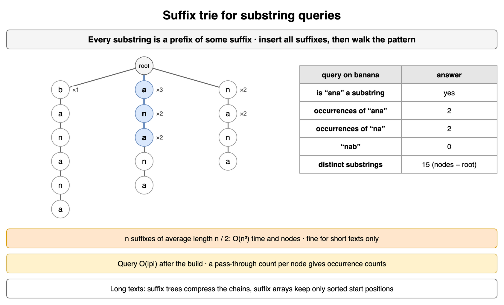

*Source: [`diagrams/tries.drawio`](/content/11_Coding_Problems/20_Tries/diagrams/tries.drawio), page 9.*

## Binary trie for maximum XOR

A trie works on any sequence of symbols, including the bits of an integer. Insert each number as its bits from the most significant down, padded to a fixed width, so every path has the same length. To find the stored number that gives the largest XOR with x, walk down and at each bit prefer the child with the opposite bit, because a 1 in a higher position outweighs every lower bit combined. Take the same bit only when the opposite child is missing.

The maximum XOR of any pair in a list follows: insert the numbers one by one and query each against those already inserted, or insert all of them first and query each. With b bits per number, each insert and query is O(b), so n numbers cost O(n b), compared with O(n²) for trying every pair. The node count is at most n b + 1. The same walk answers "largest XOR with x among numbers up to a limit" if the queries are sorted by limit and numbers are inserted as the limit grows. The bit tricks behind it are on [Bit Manipulation](#07_Data_Structures_and_Algorithms/10_Bit_Manipulation).

```python
def max_xor_pair(nums: list[int], bits: int = 5) -> int:
    root: dict[int, dict] = {}
    best = 0
    for x in nums:
        node = root
        for b in range(bits - 1, -1, -1):
            node = node.setdefault((x >> b) & 1, {})
        node, value = root, 0
        for b in range(bits - 1, -1, -1):
            bit = (x >> b) & 1
            if 1 - bit in node:
                value |= 1 << b
                node = node[1 - bit]
            else:
                node = node[bit]
        best = max(best, value)
    return best


nums = [3, 10, 5, 25, 2, 8]
print(max_xor_pair(nums), max(a ^ b for a in nums for b in nums))
print(max_xor_pair([7]), max_xor_pair([4, 4]))
# 28 28
# 0 0
```

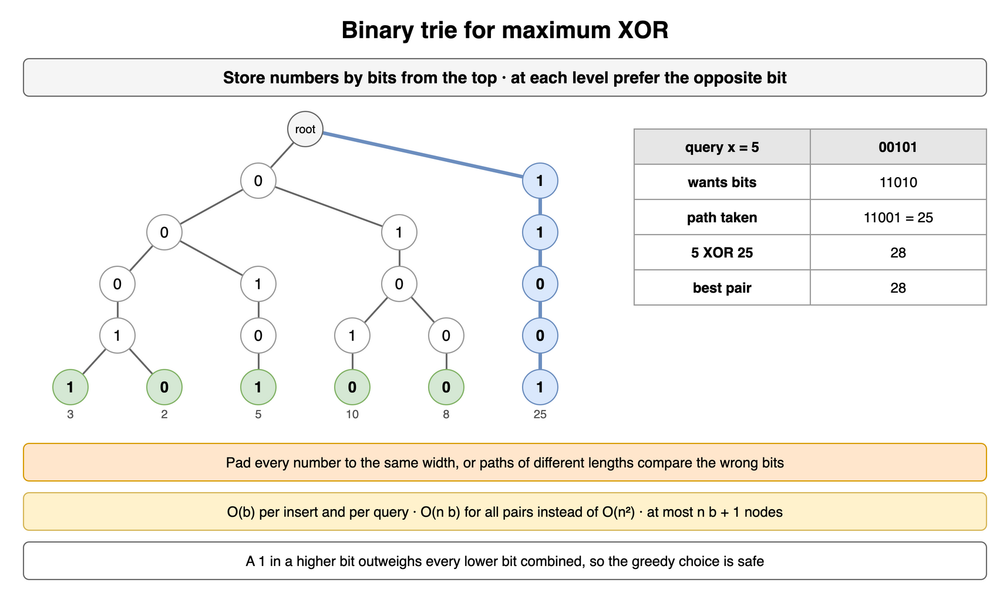

*Source: [`diagrams/tries.drawio`](/content/11_Coding_Problems/20_Tries/diagrams/tries.drawio), page 10.*

## Compressed tries

A plain trie wastes nodes on chains: a node with one child and no end marker carries no decision. A compressed trie, also called a radix tree or Patricia trie, merges each such chain into one edge labeled with a string. The words `"interview"` and `"internet"` then share an edge `"inter"` and split into `"view"` and `"net"`. With N words the node count drops to about 2N at most, because every remaining internal node either branches or ends a word.

Insert has to split an edge when a new word diverges halfway along it: `"interval"` splits `"view"` into `"v"` with children `"iew"` and `"al"`. Lookups compare edge labels instead of single characters, so the time is still O(k). Real systems use this layout. The Linux kernel stores IPv4 routes in an LC-trie for longest-prefix match, and Redis keeps stream entries in a radix tree it calls rax. In an interview, build the plain trie first and mention compression when memory comes up.

```python
def build(words: list[str]) -> dict:
    root: dict = {}
    for word in words:
        node = root
        while True:
            if not word:
                node["$"] = True
                break
            label = next((key for key in node if key[0] == word[0]), None)
            if label is None:
                node[word] = {"$": True}
                break
            common = 0
            while common < min(len(label), len(word)) and label[common] == word[common]:
                common += 1
            if common < len(label):
                node[label[:common]] = {label[common:]: node.pop(label)}
                label = label[:common]
            node, word = node[label], word[common:]
    return root


def edges(node: dict, depth: int = 0) -> list[str]:
    out = []
    for key in sorted(k for k in node if k != "$"):
        out.append("  " * depth + key + (" *" if "$" in node[key] else ""))
        out.extend(edges(node[key], depth + 1))
    return out


print("\n".join(edges(build(["interview", "internet", "interval", "in"]))))
# in *
#   ter
#     net *
#     v
#       al *
#       iew *
```

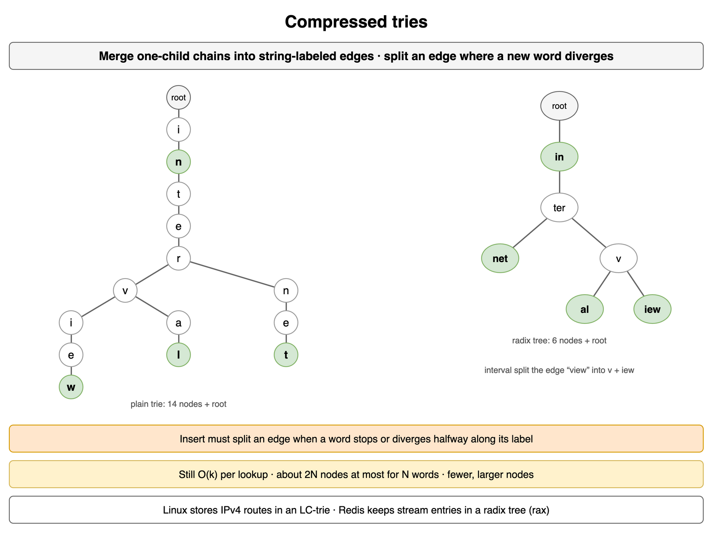

*Source: [`diagrams/tries.drawio`](/content/11_Coding_Problems/20_Tries/diagrams/tries.drawio), page 11.*

## Trie, set, or sorted list

A hash set answers "is this exact word present" in expected O(k) for hashing and uses the least code, but it cannot answer prefix questions without scanning every word. A sorted list with `bisect` answers prefix questions in O(k log N): find the first word not less than the prefix, then read forward while words still start with it. It uses one string per word and no node objects, and it is often the smallest working solution in Python. It is the wrong choice when words arrive one at a time, because each insert into a list is O(N). The comparison with hashing is [Trie vs. hash table](#07_Data_Structures_and_Algorithms/06_Heaps_and_Tries/concepts/trie-vs-hash-table).

A trie wins when prefix queries are frequent and the word set changes, when a search walks character by character (wildcards, a grid, a stream of keystrokes), or when the node itself stores an answer such as a count. It costs the most memory, since each node is a Python object with a dict. A useful interview move is to name all three, pick one from the operations the question needs, and say what would make you switch. The same reasoning on the system design side is [Trie (Prefix Tree)](#09_System_Design_Interview/18_Search_Autocomplete_and_Information_Retrieval/concepts/trie-prefix-tree).

```python
from bisect import bisect_left


def with_prefix(sorted_words: list[str], prefix: str) -> list[str]:
    out = []
    i = bisect_left(sorted_words, prefix)
    while i < len(sorted_words) and sorted_words[i].startswith(prefix):
        out.append(sorted_words[i])
        i += 1
    return out


words = sorted(["rust", "ruby", "rails", "react", "redis", "ruby"])
lookup = set(words)
print("ruby" in lookup, "rub" in lookup)
print(with_prefix(words, "ru"), with_prefix(words, "re"), with_prefix(words, "x"))
# True False
# ['ruby', 'ruby', 'rust'] ['react', 'redis'] []
```

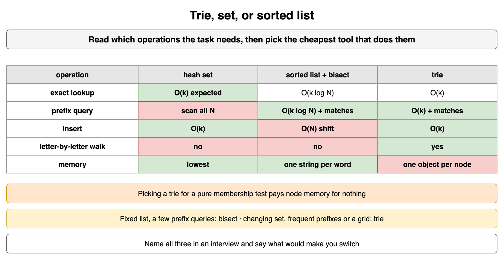

*Source: [`diagrams/tries.drawio`](/content/11_Coding_Problems/20_Tries/diagrams/tries.drawio), page 12.*
