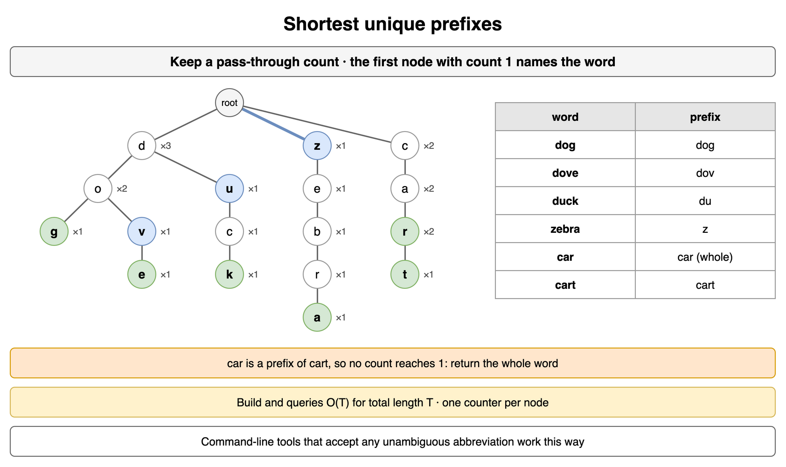
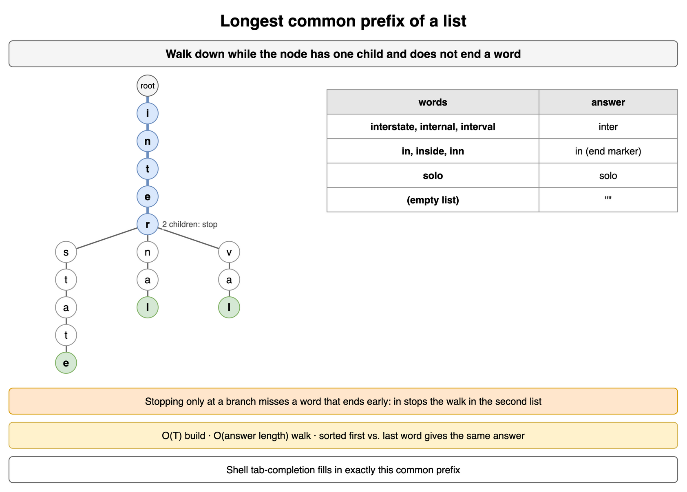
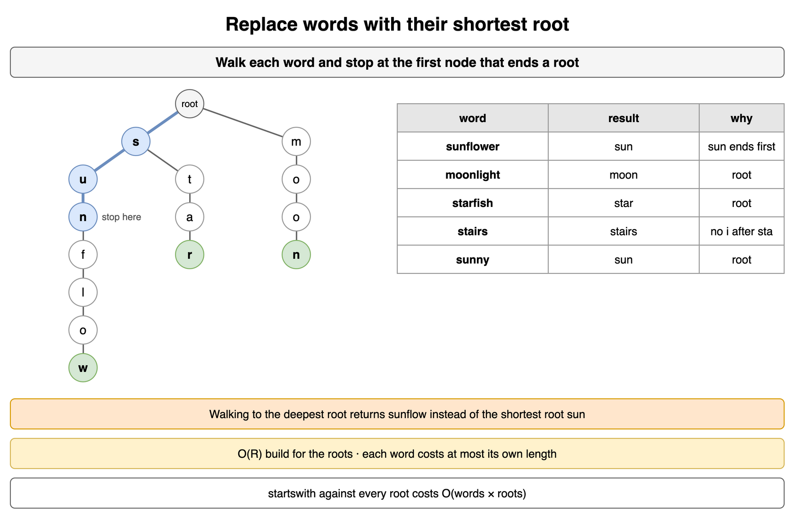
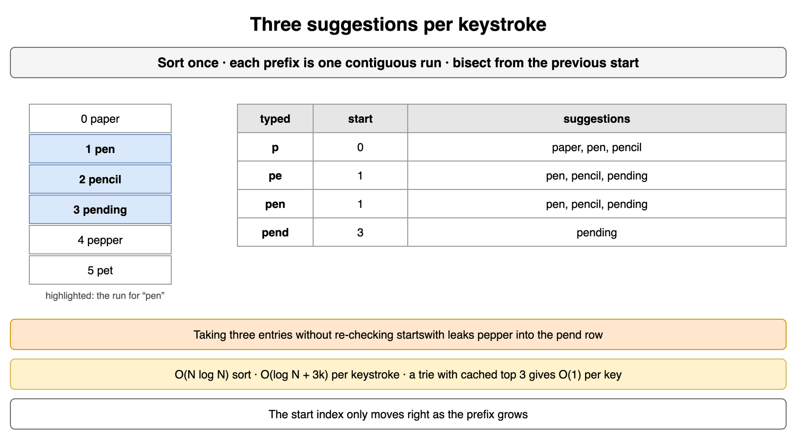
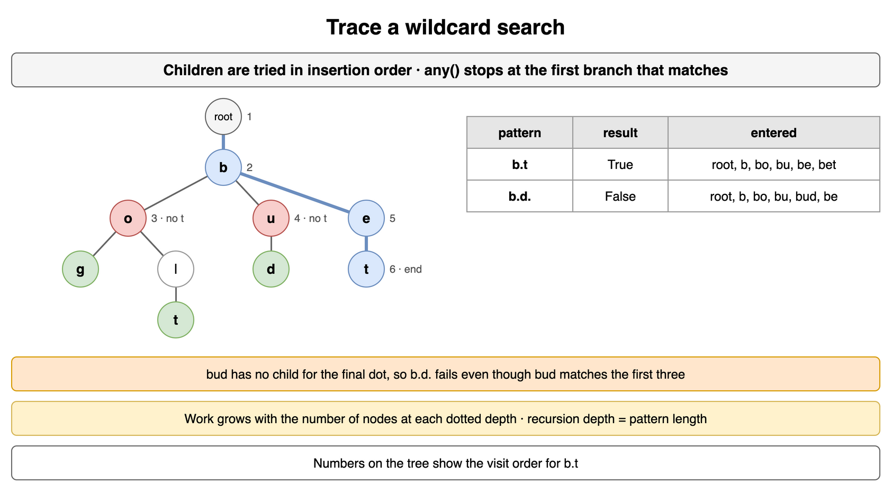
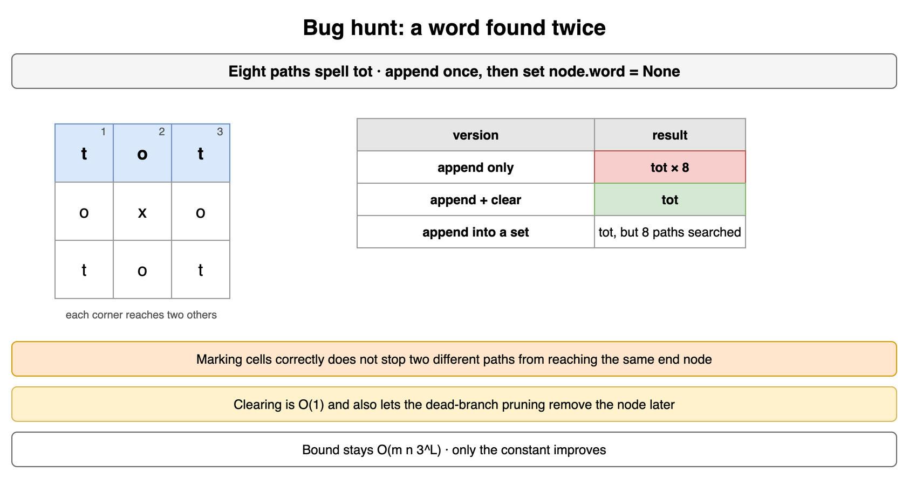
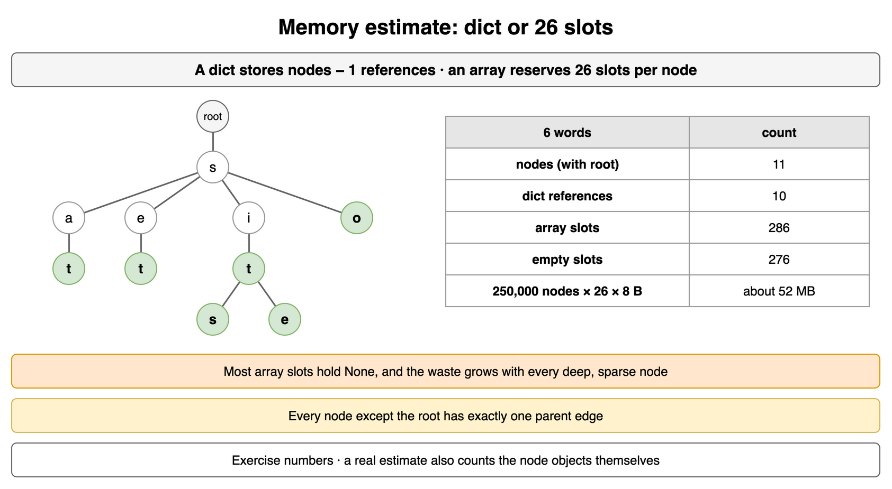
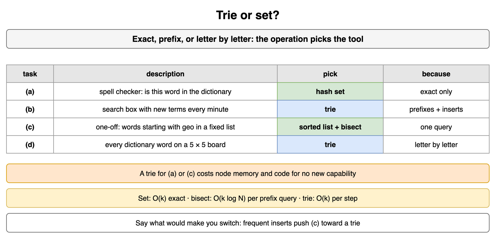
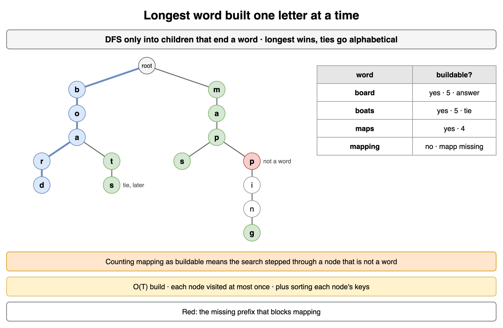

# Tries — Drills

Original drills for shortest unique prefixes, a common prefix, root replacement, keystroke suggestions, a wildcard trace, a duplicate board result, a memory estimate, a tool choice, and a word built letter by letter. Each answer has an approach, a cost, and Python. The words and numbers are exercise values.

## Shortest unique prefixes

A command-line tool accepts any prefix that names exactly one command. The commands are `dog`, `dove`, `duck`, `zebra`, `car`, and `cart`. For each command, what is the shortest prefix that no other command shares?

**Answer:** `dog` → `dog`, `dove` → `dov`, `duck` → `du`, `zebra` → `z`, `car` → `car`, `cart` → `cart`. Insert every word and keep a pass-through count on each node. For each word, walk down and stop at the first node whose count is 1: only that word passes through it. If the walk ends without such a node, the word is a prefix of another word (`car` of `cart`), and the whole word is the best you can do. Build and queries are O(T) for total length T. The counter is the idea in [Store answers in the nodes](#11_Coding_Problems/20_Tries/concepts/store-answers-in-the-nodes).

```python
class Node:
    __slots__ = ("children", "passes")

    def __init__(self) -> None:
        self.children: dict[str, "Node"] = {}
        self.passes = 0


def unique_prefixes(words: list[str]) -> dict[str, str]:
    root = Node()
    for word in words:
        node = root
        for ch in word:
            node = node.children.setdefault(ch, Node())
            node.passes += 1
    out = {}
    for word in words:
        node = root
        for i, ch in enumerate(word, 1):
            node = node.children[ch]
            if node.passes == 1:
                out[word] = word[:i]
                break
        else:
            out[word] = word
    return out


print(unique_prefixes(["dog", "dove", "duck", "zebra", "car", "cart"]))
# {'dog': 'dog', 'dove': 'dov', 'duck': 'du', 'zebra': 'z', 'car': 'car', 'cart': 'cart'}
```



*Source: [`diagrams/tries-drills.drawio`](/content/11_Coding_Problems/20_Tries/diagrams/tries-drills.drawio), page 1.*

## Longest common prefix of a list

Find the longest prefix shared by every word in `["interstate", "internal", "interval"]`. Then answer for `["in", "inside", "inn"]`, for `["solo"]`, and for an empty list.

**Answer:** `"inter"`, `"in"`, `"solo"`, and `""`. Insert the words, then walk from the root while the current node has exactly one child and is not the end of a word. A second child means the words disagree on the next letter, and an end marker means one word stops there, as `in` does in the second list. The walk is O(length of the answer) after an O(T) build. Comparing the first and last word of the sorted list gives the same result in O(T log N) without a trie, so mention it. The node rules are in [Design a trie](#11_Coding_Problems/20_Tries/concepts/design-a-trie).

```python
class Node:
    __slots__ = ("children", "is_word")

    def __init__(self) -> None:
        self.children: dict[str, "Node"] = {}
        self.is_word = False


def common_prefix(words: list[str]) -> str:
    if not words:
        return ""
    root = Node()
    for word in words:
        node = root
        for ch in word:
            node = node.children.setdefault(ch, Node())
        node.is_word = True
    out, node = [], root
    while len(node.children) == 1 and not node.is_word:
        ch, node = next(iter(node.children.items()))
        out.append(ch)
    return "".join(out)


for words in (["interstate", "internal", "interval"], ["in", "inside", "inn"], ["solo"], []):
    print(repr(common_prefix(words)))
# 'inter'
# 'in'
# 'solo'
# ''
```



*Source: [`diagrams/tries-drills.drawio`](/content/11_Coding_Problems/20_Tries/diagrams/tries-drills.drawio), page 2.*

## Replace words with their shortest root

The roots are `sun`, `sunflow`, `moon`, and `star`. Replace every word in `"sunflower moonlight starfish stairs sunny"` with the shortest root it starts with, and leave words with no root alone.

**Answer:** `"sun moon star stairs sun"`. Put the roots in a trie. For each word, walk character by character and stop at the first node that ends a root: that is the shortest one, so `sunflower` becomes `sun` and never reaches `sunflow`. If a letter has no edge first, keep the word, as with `stairs`, which leaves the trie after `sta`. Each word costs at most its own length, so the sentence is O(total length) after an O(R) build of the roots. Checking every root against every word with `startswith` would be O(words × roots). The walk is [Design a trie](#11_Coding_Problems/20_Tries/concepts/design-a-trie) with an early return.

```python
def replace_roots(roots: list[str], sentence: str) -> str:
    trie: dict = {}
    for root in roots:
        node = trie
        for ch in root:
            node = node.setdefault(ch, {})
        node["$"] = root

    def shortest(word: str) -> str:
        node = trie
        for ch in word:
            node = node.get(ch)
            if node is None:
                return word
            if "$" in node:
                return node["$"]
        return word

    return " ".join(shortest(word) for word in sentence.split())


print(replace_roots(["sun", "sunflow", "moon", "star"], "sunflower moonlight starfish stairs sunny"))
print(replace_roots([], "nothing changes"))
# sun moon star stairs sun
# nothing changes
```



*Source: [`diagrams/tries-drills.drawio`](/content/11_Coding_Problems/20_Tries/diagrams/tries-drills.drawio), page 3.*

## Three suggestions per keystroke

A stationery shop sells `pet`, `pencil`, `paper`, `pending`, `pen`, and `pepper`. A user types `pend` one letter at a time. After each letter, show up to three product names that start with the text so far, in alphabetical order.

**Answer:** `p` → `paper, pen, pencil`; `pe` → `pen, pencil, pending`; `pen` → `pen, pencil, pending`; `pend` → `pending`. Sort the products once. Each prefix's matches form one contiguous run in the sorted list, and that run only moves right as the prefix grows, so `bisect_left` from the previous start finds it, and the first three entries that still match are the answer. That is O(N log N) to sort plus O(log N + 3k) per keystroke. A trie that caches the three smallest words on every node answers each keystroke in O(1) by moving a node cursor, at the cost of a stored list per node. Both are weighed in [Trie, set, or sorted list](#11_Coding_Problems/20_Tries/concepts/trie-set-or-sorted-list).

```python
from bisect import bisect_left


def suggestions(products: list[str], typed: str) -> list[list[str]]:
    products = sorted(products)
    out, start = [], 0
    for i in range(1, len(typed) + 1):
        prefix = typed[:i]
        start = bisect_left(products, prefix, start)
        out.append([p for p in products[start:start + 3] if p.startswith(prefix)])
    return out


for row in suggestions(["pet", "pencil", "paper", "pending", "pen", "pepper"], "pend"):
    print(row)
# ['paper', 'pen', 'pencil']
# ['pen', 'pencil', 'pending']
# ['pen', 'pencil', 'pending']
# ['pending']
```



*Source: [`diagrams/tries-drills.drawio`](/content/11_Coding_Problems/20_Tries/diagrams/tries-drills.drawio), page 4.*

## Trace a wildcard search

A trie holds `bog`, `bolt`, `bud`, and `bet`, inserted in that order, and children are tried in insertion order. Trace the search for `b.t`. Which nodes does it enter, and what does it return? Then do the same for `b.d.`.

**Answer:** `b.t` returns True. It enters the root, `b`, then `bo`, where `t` is not a child, then `bu`, which also fails, then `be`, and finally `bet`, which ends a word. That is 6 nodes, counting the root. `b.d.` returns False after entering the root, `b`, `bo`, `bu`, `bud`, and `be`: `bud` has no children for the final dot, and `bo` and `be` have no `d`. The dot fans out over the children of `b`, and `any()` stops at the first branch that succeeds. Worst-case time grows with the number of nodes at each dotted depth. The search shape is [Wildcard search](#11_Coding_Problems/20_Tries/concepts/wildcard-search).

```python
def build(words: list[str]) -> dict:
    root: dict = {}
    for word in words:
        node = root
        for ch in word:
            node = node.setdefault(ch, {})
        node["$"] = True
    return root


def trace(root: dict, pattern: str) -> tuple[bool, list[str]]:
    seen: list[str] = []

    def walk(node: dict, i: int, path: str) -> bool:
        seen.append(path or "root")
        if i == len(pattern):
            return "$" in node
        keys = [k for k in node if k != "$"] if pattern[i] == "." else [pattern[i]]
        return any(walk(node[k], i + 1, path + k) for k in keys if k in node)

    return walk(root, 0, ""), seen


root = build(["bog", "bolt", "bud", "bet"])
print(trace(root, "b.t"))
print(trace(root, "b.d."))
# (True, ['root', 'b', 'bo', 'bu', 'be', 'bet'])
# (False, ['root', 'b', 'bo', 'bu', 'bud', 'be'])
```



*Source: [`diagrams/tries-drills.drawio`](/content/11_Coding_Problems/20_Tries/diagrams/tries-drills.drawio), page 5.*

## Bug hunt: a word found twice

This board search returns `['tot', 'tot', 'tot', 'tot', 'tot', 'tot', 'tot', 'tot']` for the grid `["tot", "oxo", "tot"]` and the word list `["tot"]`. The marking and unmarking of cells is correct. What is wrong, and what is the smallest fix?

```python
def dfs(r, c, parent):
    node = parent.children.get(board[r][c])
    if node is None:
        return
    if node.word is not None:
        found.append(node.word)
    ...
```

**Answer:** Each corner `t` reaches two other corners through an `o`, so eight paths spell `tot`, and the search appends on every one. Clear the stored word the first time it is found: `found.append(node.word)` followed by `node.word = None`. The result becomes `['tot']`, and later paths no longer pay for the append. A result set also removes duplicates, but keeps exploring paths that can only find words already found. Pruning the emptied branch, from [Remove found words and dead branches](#11_Coding_Problems/20_Tries/concepts/remove-found-words-and-dead-branches), goes one step further. The bound stays O(m n 3^L).

```python
class Node:
    __slots__ = ("children", "word")

    def __init__(self) -> None:
        self.children: dict[str, "Node"] = {}
        self.word: str | None = None


def find_words(grid: list[str], words: list[str], clear: bool) -> list[str]:
    root = Node()
    for word in words:
        node = root
        for ch in word:
            node = node.children.setdefault(ch, Node())
        node.word = word
    board = [list(row) for row in grid]
    rows, cols, found = len(board), len(board[0]), []

    def dfs(r: int, c: int, parent: Node) -> None:
        node = parent.children.get(board[r][c])
        if node is None:
            return
        if node.word is not None:
            found.append(node.word)
            if clear:
                node.word = None
        ch, board[r][c] = board[r][c], "#"
        for nr, nc in ((r + 1, c), (r - 1, c), (r, c + 1), (r, c - 1)):
            if 0 <= nr < rows and 0 <= nc < cols:
                dfs(nr, nc, node)
        board[r][c] = ch

    for r in range(rows):
        for c in range(cols):
            dfs(r, c, root)
    return found


print(len(find_words(["tot", "oxo", "tot"], ["tot"], clear=False)))
print(find_words(["tot", "oxo", "tot"], ["tot"], clear=True))
# 8
# ['tot']
```



*Source: [`diagrams/tries-drills.drawio`](/content/11_Coding_Problems/20_Tries/diagrams/tries-drills.drawio), page 6.*

## Memory estimate: dict or 26 slots

A trie holds `sat`, `set`, `sit`, `sits`, `site`, and `so`. How many nodes does it have, how many child references does a dict-based trie store, and how many slots does a 26-slot array trie reserve? Then scale up: a dictionary builds 250,000 nodes. How much memory do the array slots alone take at 8 bytes per pointer?

**Answer:** 11 nodes including the root, 10 child references, and 286 slots, so 276 of the 286 slots are empty. Every node except the root has exactly one parent edge, so a dict trie always stores nodes − 1 references, while the array trie always reserves 26 per node. At 250,000 nodes the slots take 250,000 × 26 × 8 = 52,000,000 bytes, about 52 MB, before counting the node objects, and most of it holds `None`. A dict costs more per entry, but there are only 249,999 entries. The trade is [Node design](#11_Coding_Problems/20_Tries/concepts/node-design).

```python
def count(words: list[str]) -> tuple[int, int, int]:
    root: dict = {}
    nodes = 1
    for word in words:
        node = root
        for ch in word:
            if ch not in node:
                node[ch] = {}
                nodes += 1
            node = node[ch]
    return nodes, nodes - 1, 26 * nodes


nodes, refs, slots = count(["sat", "set", "sit", "sits", "site", "so"])
print(nodes, refs, slots, slots - refs)
print(250_000 * 26 * 8 / 1_000_000, "MB")
# 11 10 286 276
# 52.0 MB
```



*Source: [`diagrams/tries-drills.drawio`](/content/11_Coding_Problems/20_Tries/diagrams/tries-drills.drawio), page 7.*

## Trie or set?

Pick a trie, a hash set, or a sorted list for each task, and say why. (a) A spell checker that only answers "is this word in the dictionary". (b) A search box that suggests completions as the user types, with new terms added every minute. (c) A one-off script that lists the 40 words starting with `geo` from a fixed list of 10,000. (d) A grid game that finds every dictionary word on a 5 × 5 board.

**Answer:** (a) Hash set: exact membership only, O(k) per lookup, least memory and code. (b) Trie: prefix queries on every keystroke, a node cursor that advances one letter at a time, and inserts that do not shift a list. (c) Sorted list with `bisect`: one sort, one binary search, read 40 entries, no node objects. (d) Trie: the search walks letter by letter and needs to know after each letter whether any word can still continue. The rule is to read which operations the task needs, exact, prefix, or letter-by-letter, before choosing. Each choice is argued in [Trie, set, or sorted list](#11_Coding_Problems/20_Tries/concepts/trie-set-or-sorted-list).

```python
choices = {
    "exact lookups only": "hash set",
    "prefix queries, frequent inserts": "trie",
    "one prefix query, fixed list": "sorted list + bisect",
    "letter-by-letter search": "trie",
}
for need, tool in choices.items():
    print(f"{need}: {tool}")
# exact lookups only: hash set
# prefix queries, frequent inserts: trie
# one prefix query, fixed list: sorted list + bisect
# letter-by-letter search: trie
```



*Source: [`diagrams/tries-drills.drawio`](/content/11_Coding_Problems/20_Tries/diagrams/tries-drills.drawio), page 8.*

## Longest word built one letter at a time

From `b, bo, boa, boar, board, boat, boats, m, ma, map, maps, mapping`, find the longest word whose every prefix is also in the list. Break ties by alphabetical order.

**Answer:** `board`. Both `board` and `boats` have length 5 and every prefix present, and `board` comes first alphabetically. `mapping` fails because `mapp` is missing, and `maps` is only 4 letters. Insert every word, then run a depth-first search from the root that only steps into children marked as words. Every node it reaches is buildable by construction. Keeping a word when it is longer than the best so far, or the same length and alphabetically earlier, handles the tie. Build is O(T), and the search touches each node at most once, so it is O(T) too, plus the sort of each node's keys. The marker check is the one in [Design a trie](#11_Coding_Problems/20_Tries/concepts/design-a-trie).

```python
def longest_buildable(words: list[str]) -> str:
    root: dict = {}
    for word in words:
        node = root
        for ch in word:
            node = node.setdefault(ch, {})
        node["$"] = word
    best = ""
    stack = [root]
    while stack:
        node = stack.pop()
        word = node.get("$", "")
        if len(word) > len(best) or (len(word) == len(best) and word < best):
            best = word
        for ch in sorted((k for k in node if k != "$"), reverse=True):
            if "$" in node[ch]:
                stack.append(node[ch])
    return best


words = ["b", "bo", "boa", "boar", "board", "boat", "boats", "m", "ma", "map", "maps", "mapping"]
print(repr(longest_buildable(words)), repr(longest_buildable(["xyz"])), repr(longest_buildable([])))
# 'board' '' ''
```



*Source: [`diagrams/tries-drills.drawio`](/content/11_Coding_Problems/20_Tries/diagrams/tries-drills.drawio), page 9.*
