## Spotting a graph

A graph is a set of nodes joined by edges. Edges can be directed (a one-way dependency) or undirected (a two-way road), weighted (a cost per edge) or unweighted, and the graph may or may not contain cycles. The vocabulary is on the Data Structures topic in [Graph basics](#07_Data_Structures_and_Algorithms/07_Graphs/concepts/graph-basics), [Directed vs. undirected](#07_Data_Structures_and_Algorithms/07_Graphs/concepts/directed-vs-undirected), and [Weighted vs. unweighted](#07_Data_Structures_and_Algorithms/07_Graphs/concepts/weighted-vs-unweighted). This topic is the problem set: how to see the graph in a question that never says "graph", and which of five tools to reach for: depth-first search, breadth-first search, topological sort, union-find, and Dijkstra.

Most interview graphs are implicit. A grid is a graph whose nodes are cells and whose edges join each cell to its four neighbours. A word puzzle is a graph whose nodes are words and whose edges join words one letter apart. A lock with four dials is a graph of 10,000 states. Course prerequisites, build targets, and package dependencies are directed graphs. Ask three questions before coding: what is a node, what is an edge, and does the question ask about reachability, fewest steps, cheapest cost, an order, or group membership. Both basic traversals cost O(n + e) for n nodes and e edges, and a grid of m × n cells has about 4mn edges, so it is O(mn).

```python
def lock_neighbours(state: str) -> list[str]:
    out = []
    for i, ch in enumerate(state):
        for step in (1, -1):
            digit = str((int(ch) + step) % 10)
            out.append(state[:i] + digit + state[i + 1:])
    return out


def grid_neighbours(r: int, c: int, rows: int, cols: int) -> list[tuple[int, int]]:
    steps = ((1, 0), (-1, 0), (0, 1), (0, -1))
    return [(r + dr, c + dc) for dr, dc in steps if 0 <= r + dr < rows and 0 <= c + dc < cols]


print(lock_neighbours("0900"))
print(grid_neighbours(0, 0, 3, 4), grid_neighbours(1, 2, 3, 4))
# ['1900', '9900', '0000', '0800', '0910', '0990', '0901', '0909']
# [(1, 0), (0, 1)] [(2, 2), (0, 2), (1, 3), (1, 1)]
```

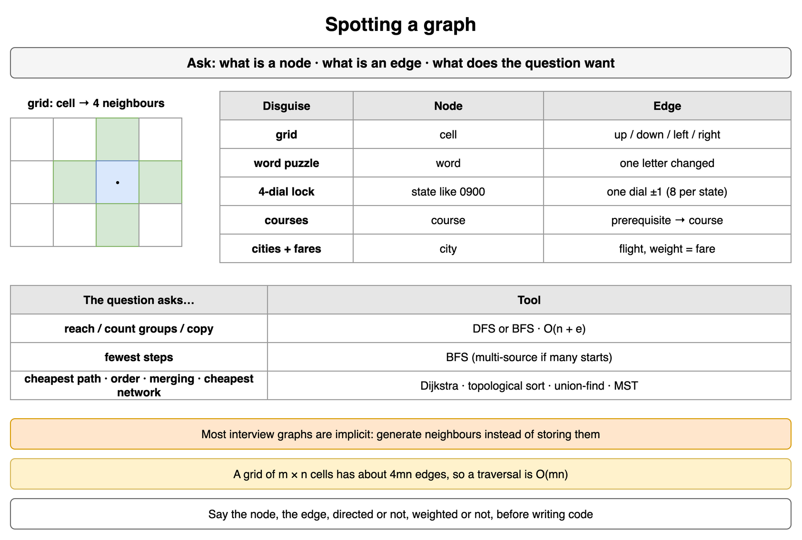

*Source: [`diagrams/graphs.drawio`](/content/11_Coding_Problems/21_Graphs/diagrams/graphs.drawio), page 1.*

## Building an adjacency list

Inputs usually arrive as an edge list, pairs such as `[("a", "b"), ("b", "c")]`, and the first job is to turn them into an adjacency list: a dict from each node to the list of its neighbours. Build it in one O(n + e) pass. For an undirected edge, append in both directions. For a directed edge, append only from source to target, and pick the direction from the question: "b requires a" usually becomes the edge a → b, so that following edges moves forward in time. Seed every node, even isolated ones, with an empty list, or a later loop over the dict will skip them.

An adjacency list uses O(n + e) memory and lists a node's neighbours in O(degree), which suits the sparse graphs interviews use. An adjacency matrix uses O(n²) memory and answers "is there an edge from u to v" in O(1), which pays off only for dense graphs or when the input is already a matrix. The trade is in [Adjacency list](#07_Data_Structures_and_Algorithms/07_Graphs/concepts/adjacency-list) and [Adjacency matrix](#07_Data_Structures_and_Algorithms/07_Graphs/concepts/adjacency-matrix). For a weighted graph, store `(neighbour, weight)` pairs. For a grid, skip the build altogether and generate neighbours on the fly, as in [Edge lists and implicit graphs](#07_Data_Structures_and_Algorithms/07_Graphs/concepts/edge-lists-and-implicit-graphs).

```python
from collections import defaultdict


def build(nodes: list[str], edges: list[tuple[str, str]], directed: bool) -> dict[str, list[str]]:
    graph: dict[str, list[str]] = {node: [] for node in nodes}
    for u, v in edges:
        graph[u].append(v)
        if not directed:
            graph[v].append(u)
    return graph


nodes = ["a", "b", "c", "d"]
edges = [("a", "b"), ("b", "c"), ("a", "c")]
print(build(nodes, edges, directed=False))
print(build(nodes, edges, directed=True))

lazy = defaultdict(list)
for u, v in edges:
    lazy[u].append(v)
print("d" in lazy)
# {'a': ['b', 'c'], 'b': ['a', 'c'], 'c': ['b', 'a'], 'd': []}
# {'a': ['b', 'c'], 'b': ['c'], 'c': [], 'd': []}
# False
```

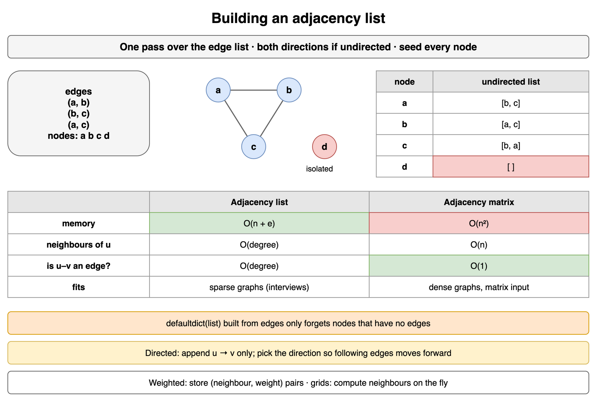

*Source: [`diagrams/graphs.drawio`](/content/11_Coding_Problems/21_Graphs/diagrams/graphs.drawio), page 2.*

## Clone a graph

Given one node of a connected undirected graph, where each node holds a value and a list of neighbours, return a deep copy: new node objects wired the same way, sharing nothing with the original. Walk the graph with depth-first search and keep a dict from each original node to its copy. The dict does two jobs. It is the [Visited set](#07_Data_Structures_and_Algorithms/07_Graphs/concepts/visited-set), so a cycle sends the walk back to a node it has already copied instead of looping forever, and it hands back the one copy of each node, so a node reached along two paths is not duplicated.

The order matters: create the copy and put it in the dict before visiting the neighbours. If the neighbours are visited first, a cycle reaches the same original again before its copy is registered, and the recursion never ends. Each node is copied once and each edge is followed twice (once from each end), so the cost is O(n + e) time and O(n) space for the dict and the recursion stack. Breadth-first search with the same dict works too, and avoids deep recursion on long chains. Check the result by confirming that no copy `is` an original.

```python
class Node:
    def __init__(self, val: int) -> None:
        self.val = val
        self.neighbours: list["Node"] = []


def clone(node: Node, copies: dict[Node, Node] | None = None) -> Node:
    copies = {} if copies is None else copies
    if node in copies:
        return copies[node]
    copy = Node(node.val)
    copies[node] = copy
    for nb in node.neighbours:
        copy.neighbours.append(clone(nb, copies))
    return copy


a, b, c = Node(1), Node(2), Node(3)
a.neighbours, b.neighbours, c.neighbours = [b, c], [a, c], [a, b]
a2 = clone(a)
b2, c2 = a2.neighbours
print(a2.val, [n.val for n in a2.neighbours], [n.val for n in b2.neighbours])
print(a2 is a, b2.neighbours[0] is a2, c2.neighbours[1] is b2)
# 1 [2, 3] [1, 3]
# False True True
```

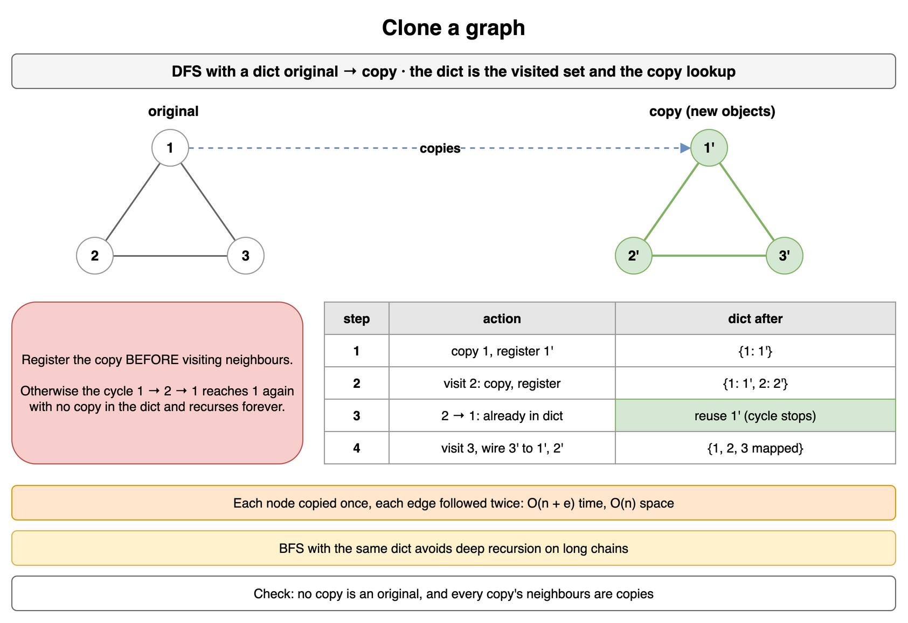

*Source: [`diagrams/graphs.drawio`](/content/11_Coding_Problems/21_Graphs/diagrams/graphs.drawio), page 3.*

## Count islands

A grid of `1` (land) and `0` (water) contains islands: groups of land cells joined up, down, left, or right. Count them by scanning every cell. When the scan reaches land that no earlier fill has claimed, add one to the count and flood-fill from that cell, marking every connected land cell as seen. Each later cell of the same island is already marked, so it never starts a second count. This is [Connected components](#07_Data_Structures_and_Algorithms/07_Graphs/concepts/connected-components) on an implicit grid graph, and the grid mechanics are in [Grid BFS and DFS](#07_Data_Structures_and_Algorithms/11_Problem_Solving_Patterns/concepts/grid-bfs-and-dfs).

Every cell is scanned once and filled at most once, so the cost is O(m × n) time. Space is O(m × n) in the worst case for the seen set and the stack or queue, as in a grid that is all land. Two choices are worth saying out loud. Overwriting land with `0` saves the seen set but destroys the caller's input, so ask before doing it. Recursive DFS on a 1,000 × 1,000 grid of land goes a million calls deep and overflows Python's default limit of about 1,000, so use an explicit stack or a queue, as below. Diagonal neighbours turn this into 8-connectivity and can merge islands.

```python
def count_islands(grid: list[list[int]]) -> int:
    rows, cols = len(grid), len(grid[0])
    seen: set[tuple[int, int]] = set()
    count = 0
    for r in range(rows):
        for c in range(cols):
            if grid[r][c] == 1 and (r, c) not in seen:
                count += 1
                seen.add((r, c))
                stack = [(r, c)]
                while stack:
                    cr, cc = stack.pop()
                    for nr, nc in ((cr + 1, cc), (cr - 1, cc), (cr, cc + 1), (cr, cc - 1)):
                        if 0 <= nr < rows and 0 <= nc < cols and grid[nr][nc] == 1 and (nr, nc) not in seen:
                            seen.add((nr, nc))
                            stack.append((nr, nc))
    return count


grid = [
    [1, 1, 0, 0, 1],
    [0, 1, 0, 1, 1],
    [0, 0, 0, 0, 0],
    [1, 0, 1, 0, 1],
]
print(count_islands(grid), count_islands([[0, 0]]), count_islands([[1]]))
# 5 0 1
```

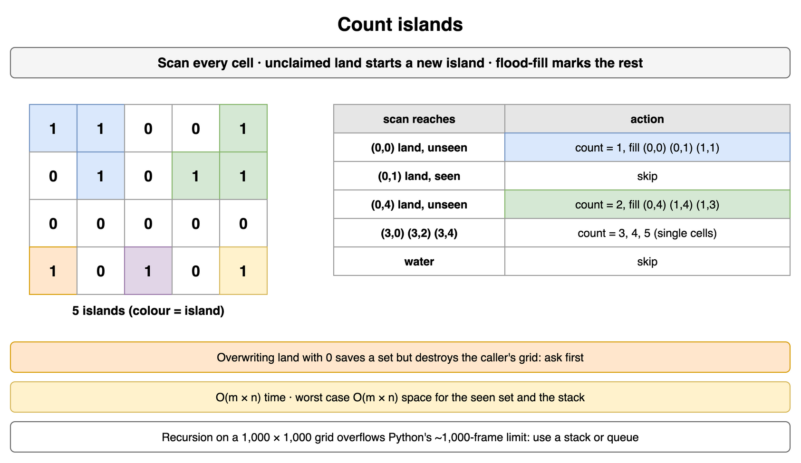

*Source: [`diagrams/graphs.drawio`](/content/11_Coding_Problems/21_Graphs/diagrams/graphs.drawio), page 4.*

## Spread from many sources

A grid holds empty cells (`0`), healthy cells (`1`), and infected cells (`2`). Each minute, every infected cell infects its healthy neighbours up, down, left, and right. Return the minutes until no healthy cell remains, or `-1` if some healthy cell can never be reached. Running a separate search from each infected cell would count the wrong thing and repeat work. Instead, put every infected cell in the queue at minute 0 and run one breadth-first search. The queue then processes cells in order of distance from the nearest source, so level k of the search is exactly minute k. This is [Multi-source BFS](#07_Data_Structures_and_Algorithms/07_Graphs/concepts/multi-source-bfs).

Count the healthy cells up front and decrement as each one is infected. Process the queue one level at a time and add a minute only when a level actually infected something; otherwise the last empty round adds one too many. At the end, a non-zero healthy count means `-1`. A grid with no healthy cells returns `0`, even with no infected cells. Each cell enters the queue at most once, so the cost is O(m × n) time and space. Mark a cell infected when it is enqueued, not when it is dequeued, or the same cell can enter the queue from two neighbours.

```python
from collections import deque


def minutes_to_infect(grid: list[list[int]]) -> int:
    rows, cols = len(grid), len(grid[0])
    grid = [row[:] for row in grid]
    queue = deque((r, c) for r in range(rows) for c in range(cols) if grid[r][c] == 2)
    healthy = sum(row.count(1) for row in grid)
    minutes = 0
    while queue and healthy:
        for _ in range(len(queue)):
            r, c = queue.popleft()
            for nr, nc in ((r + 1, c), (r - 1, c), (r, c + 1), (r, c - 1)):
                if 0 <= nr < rows and 0 <= nc < cols and grid[nr][nc] == 1:
                    grid[nr][nc] = 2
                    healthy -= 1
                    queue.append((nr, nc))
        minutes += 1
    return minutes if healthy == 0 else -1


print(minutes_to_infect([[2, 1, 1], [1, 1, 0], [0, 1, 2]]))
print(minutes_to_infect([[2, 1, 0], [0, 0, 1]]))
print(minutes_to_infect([[0, 0], [0, 2]]))
# 2
# -1
# 0
```

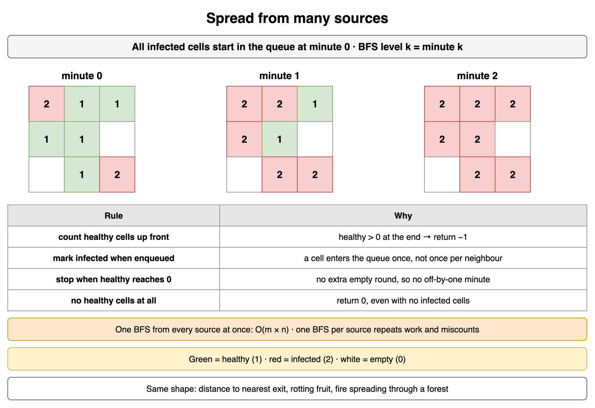

*Source: [`diagrams/graphs.drawio`](/content/11_Coding_Problems/21_Graphs/diagrams/graphs.drawio), page 5.*

## Two-colour check

A graph is bipartite when its nodes can be split into two groups so that every edge joins one group to the other. Test it by colouring: give a start node colour 0, give each neighbour the opposite colour, and keep going. If an edge ever joins two nodes of the same colour, the split is impossible. That happens exactly when the graph has a cycle of odd length, such as a triangle. The mechanics are in [Bipartite check](#07_Data_Structures_and_Algorithms/07_Graphs/concepts/bipartite-check).

The trap is a disconnected graph. Starting only from node 0 colours only node 0's component, and an odd cycle in another component goes unseen. Loop over every node and start a new colouring from each one that has no colour yet. A node with no edges is trivially fine. The colour dict doubles as the visited set, so every node is coloured once and every edge is checked from both ends: O(n + e) time and O(n) space. Matching problems (workers to shifts, students to projects) and "split into two teams with no rivals together" are the usual disguises.

```python
from collections import deque


def is_bipartite(graph: list[list[int]]) -> bool:
    colour: dict[int, int] = {}
    for start in range(len(graph)):
        if start in colour:
            continue
        colour[start] = 0
        queue = deque([start])
        while queue:
            node = queue.popleft()
            for nb in graph[node]:
                if nb not in colour:
                    colour[nb] = 1 - colour[node]
                    queue.append(nb)
                elif colour[nb] == colour[node]:
                    return False
    return True


square = [[1, 3], [0, 2], [1, 3], [0, 2]]
split = [[1], [0], [3, 4], [2, 4], [2, 3]]
print(is_bipartite(square), is_bipartite(split), is_bipartite([[], []]))
# True False True
```

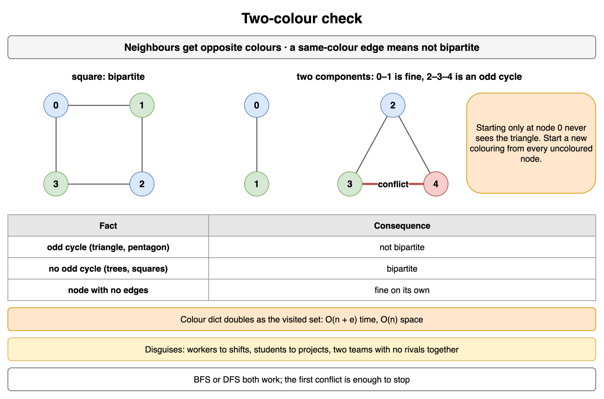

*Source: [`diagrams/graphs.drawio`](/content/11_Coding_Problems/21_Graphs/diagrams/graphs.drawio), page 6.*

## Longest increasing path in a grid

Find the length of the longest path in a grid of numbers where each step moves up, down, left, or right to a strictly larger value. Picture an edge from each cell to every neighbour with a larger value. Because values only go up along an edge, a path can never return to a cell, so this graph is a directed acyclic graph (DAG). That has two consequences. No visited set is needed, since the strict increase already rules out cycles. And the longest path from a cell never changes, no matter how the search got there, so it can be cached.

Define `longest(r, c)` as 1 plus the largest `longest` over the larger neighbours, memoise it, and take the maximum over all cells. Each cell is computed once and looks at four neighbours, so the cost is O(m × n) time and space. Without the cache, the same cells are re-explored from every path that reaches them, and the time grows exponentially on grids with many crossing paths. Processing cells in increasing value order, which is a topological order of this DAG, gives the same answer without recursion. Equal neighbours have no edge, so a flat grid returns 1.

```python
from functools import lru_cache


def longest_increasing_path(grid: list[list[int]]) -> int:
    rows, cols = len(grid), len(grid[0])

    @lru_cache(maxsize=None)
    def longest(r: int, c: int) -> int:
        best = 1
        for nr, nc in ((r + 1, c), (r - 1, c), (r, c + 1), (r, c - 1)):
            if 0 <= nr < rows and 0 <= nc < cols and grid[nr][nc] > grid[r][c]:
                best = max(best, 1 + longest(nr, nc))
        return best

    return max(longest(r, c) for r in range(rows) for c in range(cols))


grid = [
    [3, 4, 5],
    [2, 9, 6],
    [1, 8, 7],
]
print(longest_increasing_path(grid), longest_increasing_path([[5, 5], [5, 5]]))
# 9 1
```

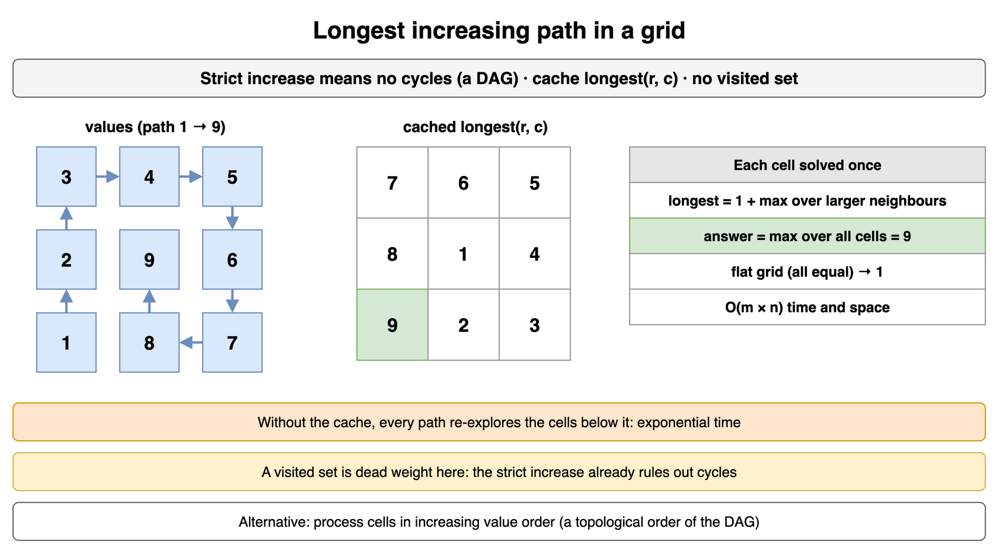

*Source: [`diagrams/graphs.drawio`](/content/11_Coding_Problems/21_Graphs/diagrams/graphs.drawio), page 7.*

## Word ladder with bidirectional BFS

Given a start word, an end word, and a dictionary, return the number of words in the shortest chain from start to end where each step changes one letter and every word after the start is in the dictionary; return 0 if there is none. The nodes are words and the edges join words one letter apart, so this is a fewest-steps question and [BFS shortest path](#07_Data_Structures_and_Algorithms/07_Graphs/concepts/bfs-shortest-path) answers it. Never build all pairs of edges, which costs O(n² L) for n words of length L. Generate neighbours on demand instead: try all 26 letters at each position and keep the ones in a set, O(26 L) candidates per word. The one-search version is [Search on a one-change graph](#11_Coding_Problems/07_Hard_Problems/concepts/search-on-a-one-change-graph).

The faster version searches from both ends at once and always expands the smaller frontier. When a generated word is already in the other side's frontier, the two searches have met. A search of depth d with branching factor b visits about b^d words from one side and about 2 × b^(d/2) from two, which is the idea in [Bidirectional search](#07_Data_Structures_and_Algorithms/07_Graphs/concepts/bidirectional-search). The worst case is still O(n × L²) time, since each of n words generates 26 L strings of length L, and O(n × L) space. Check that the end word is in the dictionary first, and say whether you count words or steps: the answer below counts words, one more than the number of edges.

```python
def ladder_length(start: str, end: str, words: list[str]) -> int:
    dictionary = set(words)
    if end not in dictionary:
        return 0
    front, back, seen, length = {start}, {end}, {start, end}, 1
    while front and back:
        if len(front) > len(back):
            front, back = back, front
        length += 1
        nxt = set()
        for word in front:
            for i in range(len(word)):
                for ch in "abcdefghijklmnopqrstuvwxyz":
                    cand = word[:i] + ch + word[i + 1:]
                    if cand in back:
                        return length
                    if cand in dictionary and cand not in seen:
                        seen.add(cand)
                        nxt.add(cand)
        front = nxt
    return 0


words = ["warm", "ward", "word", "worm", "wore", "core", "card", "cord", "cold"]
print(ladder_length("warm", "cold", words))
print(ladder_length("warm", "cool", words), ladder_length("card", "cord", words))
# 5
# 0 2
```

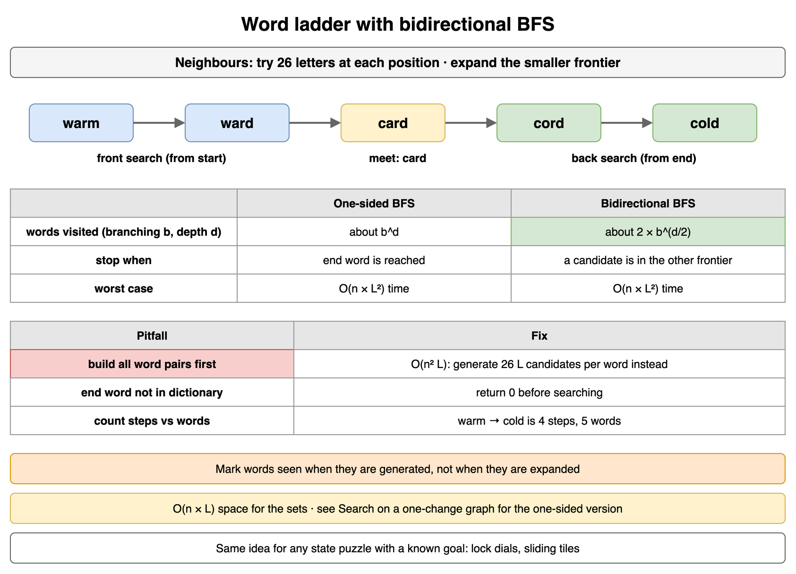

*Source: [`diagrams/graphs.drawio`](/content/11_Coding_Problems/21_Graphs/diagrams/graphs.drawio), page 8.*

## Union-find for merging groups

A class supports `connect(x, y)`, which merges the groups containing x and y, and `group_size(x)`. Re-running a traversal after every merge would cost O(n + e) per query. Union-find (a disjoint-set union) keeps a `parent` array where each group is a tree and its root names the group. `find(x)` follows parents to the root. `connect` finds both roots and, if they differ, points one root at the other. Store the size only at roots and add the smaller size into the larger root. The structure is [Union-find](#07_Data_Structures_and_Algorithms/07_Graphs/concepts/union-find), and [Union-find](#11_Coding_Problems/07_Hard_Problems/concepts/union-find) on Hard Problems uses it for grouping synonyms.

Two tricks keep the trees flat. Union by size hangs the smaller tree under the larger, so depth grows only logarithmically. Path compression points every node on a `find` path straight at the root. Together they make each operation amortised O(α(n)), the inverse Ackermann function, which is at most 4 for any input that fits in memory. Space is O(n). The bugs to avoid: updating the size on a non-root node, adding sizes when both nodes already share a root (which double-counts), and recursive `find` on a long chain before compression, which the iterative version below avoids. Union-find only merges; it cannot split a group again.

```python
class Groups:
    def __init__(self, n: int) -> None:
        self.parent = list(range(n))
        self.size = [1] * n

    def find(self, x: int) -> int:
        root = x
        while self.parent[root] != root:
            root = self.parent[root]
        while self.parent[x] != root:
            self.parent[x], x = root, self.parent[x]
        return root

    def connect(self, x: int, y: int) -> None:
        rx, ry = self.find(x), self.find(y)
        if rx == ry:
            return
        if self.size[rx] < self.size[ry]:
            rx, ry = ry, rx
        self.parent[ry] = rx
        self.size[rx] += self.size[ry]

    def group_size(self, x: int) -> int:
        return self.size[self.find(x)]


g = Groups(6)
g.connect(0, 1)
g.connect(2, 3)
g.connect(1, 3)
g.connect(0, 2)
print(g.group_size(3), g.group_size(4), g.find(0) == g.find(2))
# 4 1 True
```

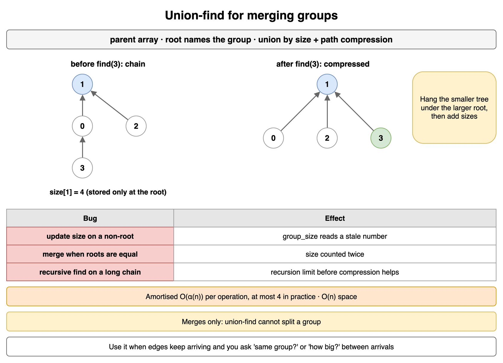

*Source: [`diagrams/graphs.drawio`](/content/11_Coding_Problems/21_Graphs/diagrams/graphs.drawio), page 9.*

## Prerequisites and topological order

Given n courses numbered 0 to n − 1 and pairs `(course, prerequisite)`, can every course be finished? Draw an edge prerequisite → course. The courses can all be finished exactly when this directed graph has no cycle, and Kahn's algorithm checks that while producing an order. Count each node's in-degree (its number of unmet prerequisites), queue every node with in-degree 0, and repeatedly take one, record it, and decrement its successors, queueing any that reach 0. If all n nodes come out, the recorded list is a valid order; if fewer do, the rest sit on or behind a cycle. The details are in [Topological sort](#07_Data_Structures_and_Algorithms/07_Graphs/concepts/topological-sort).

The cost is O(n + e) time and space. Three mistakes are common. Reversing the edge direction still detects cycles but returns the order backwards. Building the graph only from the pairs loses courses that have no prerequisites and no dependants, so seed all n nodes. And the depth-first alternative needs three states per node (unvisited, on the current path, done), because reaching a "done" node is fine while reaching an "on path" node is a cycle, as in [Cycle detection](#07_Data_Structures_and_Algorithms/07_Graphs/concepts/cycle-detection). Build tools such as `make` and package installers order work this way, and Python ships it as `graphlib.TopologicalSorter`.

```python
from collections import deque


def course_order(n: int, pairs: list[tuple[int, int]]) -> list[int] | None:
    after: list[list[int]] = [[] for _ in range(n)]
    indegree = [0] * n
    for course, prereq in pairs:
        after[prereq].append(course)
        indegree[course] += 1
    queue = deque(i for i in range(n) if indegree[i] == 0)
    order = []
    while queue:
        node = queue.popleft()
        order.append(node)
        for nxt in after[node]:
            indegree[nxt] -= 1
            if indegree[nxt] == 0:
                queue.append(nxt)
    return order if len(order) == n else None


print(course_order(5, [(1, 0), (2, 0), (3, 1), (3, 2)]))
print(course_order(3, [(1, 0), (2, 1), (0, 2)]))
# [0, 4, 1, 2, 3]
# None
```

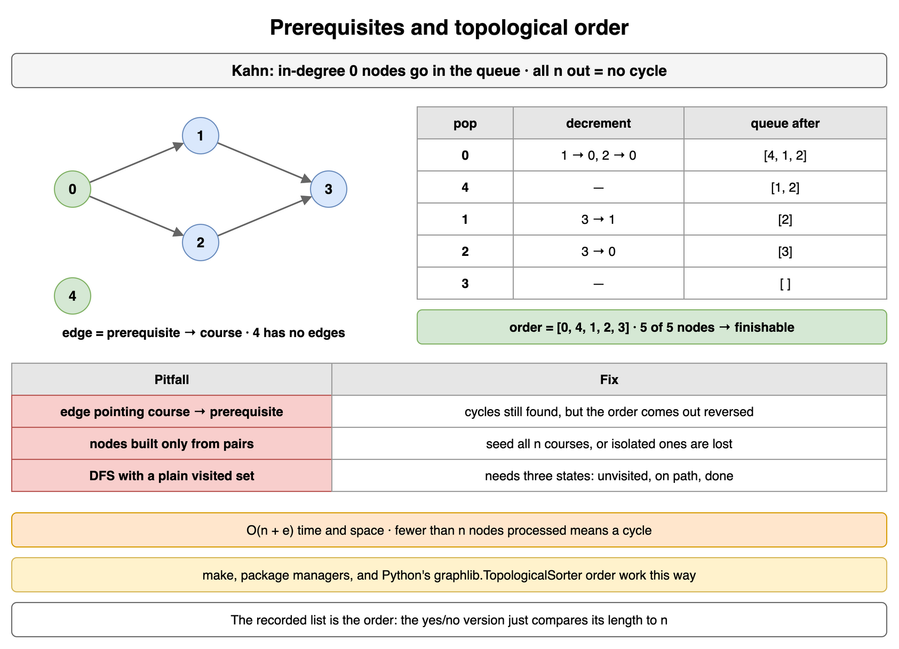

*Source: [`diagrams/graphs.drawio`](/content/11_Coding_Problems/21_Graphs/diagrams/graphs.drawio), page 10.*

## Dijkstra for weighted distances

Given an undirected graph with non-negative edge weights and a start node, return the shortest distance to every node, or −1 where a node cannot be reached. BFS fails here because it counts edges, not cost: two cheap hops can beat one expensive edge. Dijkstra's algorithm keeps a min-heap of `(distance, node)` pairs. It pops the closest unsettled node, settles it, and relaxes each edge: if going through this node gives a neighbour a shorter distance, record it and push the new pair. The full treatment is [Dijkstra's algorithm](#07_Data_Structures_and_Algorithms/07_Graphs/concepts/dijkstra-s-algorithm).

Python's `heapq` has no decrease-key, so a node can sit in the heap several times. When a popped distance is larger than the best known one, the entry is stale; skip it, or the algorithm relaxes edges from out-of-date distances and wastes time. With a binary heap the cost is O((n + e) log n) time and O(n + e) space. Dijkstra is wrong when any edge weight is negative, because a settled node could later be improved; use Bellman–Ford there, as [Choosing a shortest-path algorithm](#07_Data_Structures_and_Algorithms/07_Graphs/concepts/choosing-a-shortest-path-algorithm) explains. When every weight is equal, plain BFS gives the same answer faster. Link-state routing protocols such as OSPF run this algorithm (shortest path first) on each router.

```python
import heapq


def shortest_distances(n: int, edges: list[tuple[int, int, int]], start: int) -> list[int]:
    graph: list[list[tuple[int, int]]] = [[] for _ in range(n)]
    for u, v, w in edges:
        graph[u].append((v, w))
        graph[v].append((u, w))
    dist = [float("inf")] * n
    dist[start] = 0
    heap = [(0, start)]
    while heap:
        d, node = heapq.heappop(heap)
        if d > dist[node]:
            continue
        for nb, w in graph[node]:
            if d + w < dist[nb]:
                dist[nb] = d + w
                heapq.heappush(heap, (d + w, nb))
    return [d if d != float("inf") else -1 for d in dist]


edges = [(0, 1, 7), (0, 2, 2), (2, 1, 3), (1, 3, 1), (2, 3, 8)]
print(shortest_distances(5, edges, 0))
# [0, 5, 2, 6, -1]
```

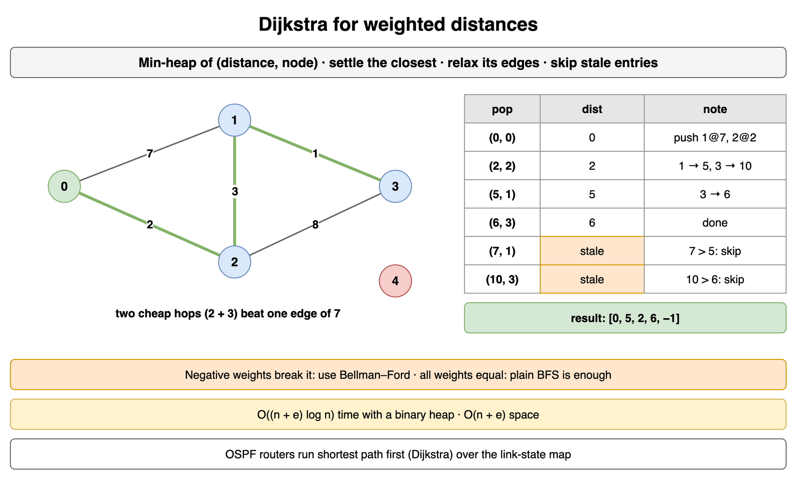

*Source: [`diagrams/graphs.drawio`](/content/11_Coding_Problems/21_Graphs/diagrams/graphs.drawio), page 11.*

## Minimum spanning tree

Given points on a plane, connect all of them so that every point can reach every other, at minimum total cost, where joining two points costs their Manhattan distance `|x1 − x2| + |y1 − y2|`. The cheapest connected network on n nodes is a tree with n − 1 edges, a minimum spanning tree (MST). Kruskal's algorithm sorts every candidate edge by cost and takes each edge whose ends are not yet connected, checked with union-find; an edge between two already-connected points would only close a cycle. Stop as soon as n − 1 edges are taken.

Here every pair of points is a candidate, so there are about n²/2 edges, and Kruskal costs O(n² log n) time and O(n²) space for the sorted edge list. Prim's algorithm grows one tree from a start point and repeatedly adds the cheapest point outside it; with a plain array of best-known costs instead of a heap, it runs in O(n²) time and O(n) space, which is the better fit for a complete graph. An MST is not a shortest-path tree: it minimises the total cost of all edges, while Dijkstra minimises the cost from one start to each node, and the two trees can differ. Laying cable, pipes, or roads at minimum total length is the classic use.

```python
def mst_cost(points: list[tuple[int, int]]) -> int:
    n = len(points)
    edges = sorted(
        (abs(x1 - x2) + abs(y1 - y2), i, j)
        for i, (x1, y1) in enumerate(points)
        for j, (x2, y2) in enumerate(points)
        if i < j
    )
    parent = list(range(n))

    def find(x: int) -> int:
        while parent[x] != x:
            parent[x] = parent[parent[x]]
            x = parent[x]
        return x

    total, used = 0, 0
    for cost, i, j in edges:
        ri, rj = find(i), find(j)
        if ri != rj:
            parent[ri] = rj
            total += cost
            used += 1
            if used == n - 1:
                break
    return total


print(mst_cost([(0, 0), (2, 2), (3, 10), (5, 2), (7, 0)]))
print(mst_cost([(1, 1)]), mst_cost([(0, 0), (1, 1), (1, 0)]))
# 20
# 0 2
```

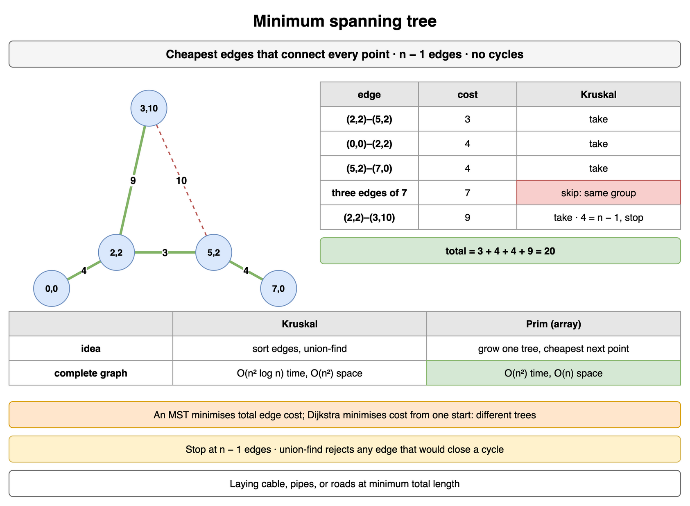

*Source: [`diagrams/graphs.drawio`](/content/11_Coding_Problems/21_Graphs/diagrams/graphs.drawio), page 12.*

## Choosing a graph algorithm

Once the graph is drawn, the question names the tool. "Can I reach it", "how many groups", or "copy or explore everything" is DFS or BFS, whichever is easier to write. "Fewest steps" or "minutes until" on unweighted edges is BFS, multi-source when there are several starts. "Cheapest cost" with non-negative weights is Dijkstra; with negative weights it is Bellman–Ford. "In what order" or "is there a cycle" on a directed graph is topological sort. "Are these two connected" while edges keep arriving is union-find. "Connect everything as cheaply as possible" is a minimum spanning tree. And a path that can only move one way, such as strictly increasing values, is a DAG where memoised DFS replaces a visited set.

Then check the costs against the input size: traversals are O(n + e), Dijkstra adds a log factor, union-find is near O(1) per operation, and a complete graph has O(n²) edges, which decides between Kruskal and array-based Prim. Before coding, say what the node and edge are, whether edges are directed or weighted, whether the graph may be disconnected, and whether a recursion limit could bite. A tree is a connected graph with no cycle, so the traversal choices from [Choose a traversal](#11_Coding_Problems/19_Trees/concepts/choose-a-traversal) carry over once a visited set is added.

```python
def choose(question: str) -> str:
    rules = [
        ("cheapest total", "minimum spanning tree"),
        ("negative", "Bellman-Ford"),
        ("cheapest", "Dijkstra"),
        ("fewest", "BFS"),
        ("order", "topological sort"),
        ("connected while", "union-find"),
        ("count groups", "DFS or BFS"),
    ]
    return next(tool for key, tool in rules if key in question)


for q in (
    "fewest moves for a knight",
    "cheapest flight with fares",
    "build order for modules",
    "connected while links arrive",
    "cheapest total cable to join offices",
    "count groups of friends",
):
    print(f"{q} -> {choose(q)}")
# fewest moves for a knight -> BFS
# cheapest flight with fares -> Dijkstra
# build order for modules -> topological sort
# connected while links arrive -> union-find
# cheapest total cable to join offices -> minimum spanning tree
# count groups of friends -> DFS or BFS
```

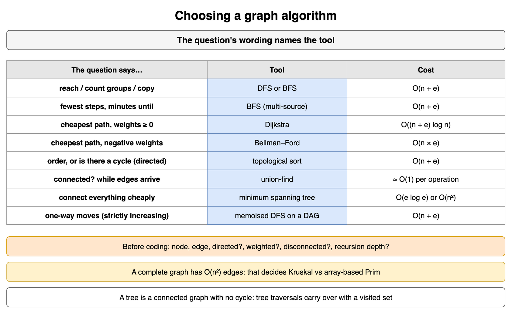

*Source: [`diagrams/graphs.drawio`](/content/11_Coding_Problems/21_Graphs/diagrams/graphs.drawio), page 13.*
