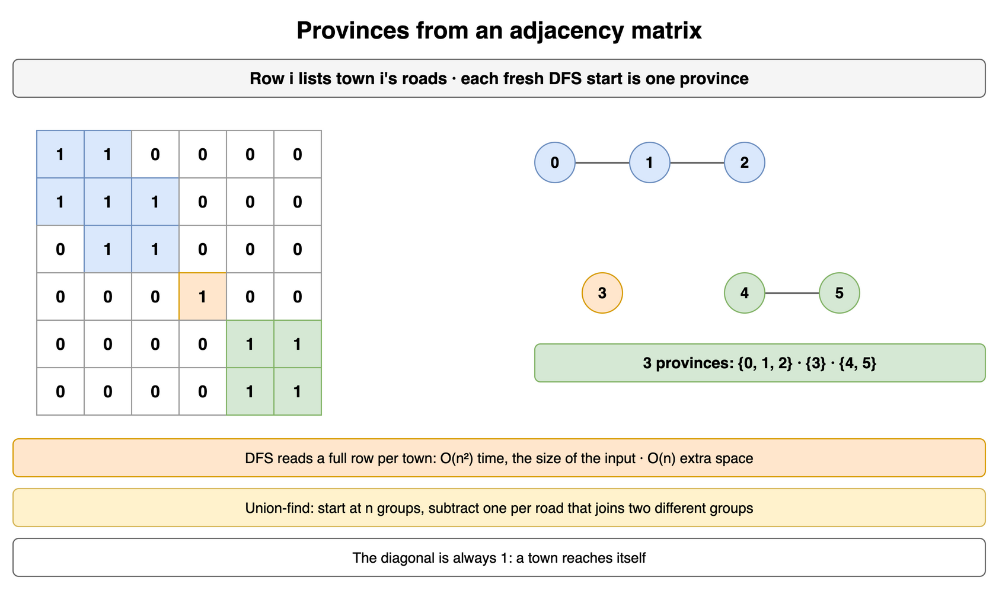
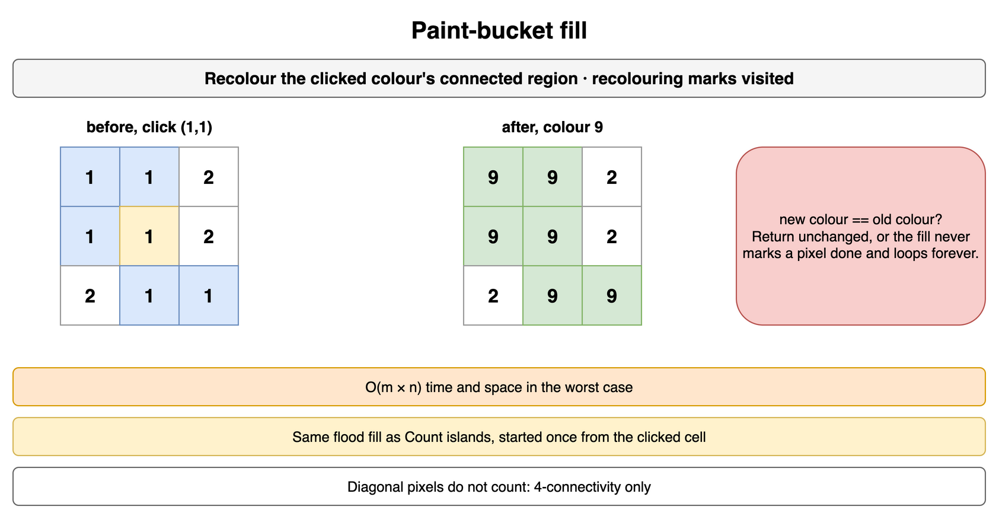
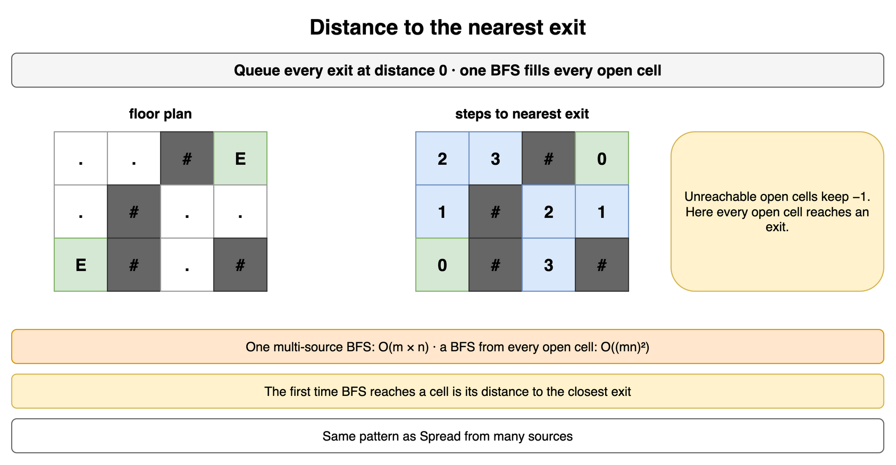
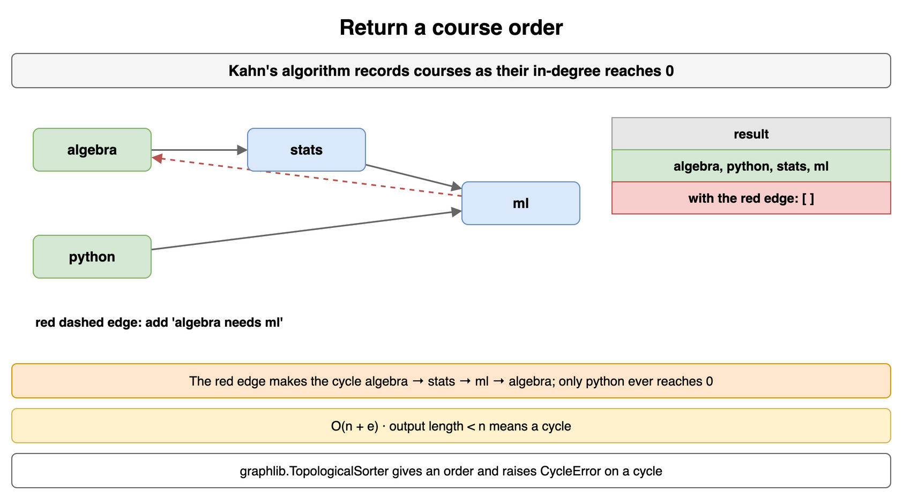
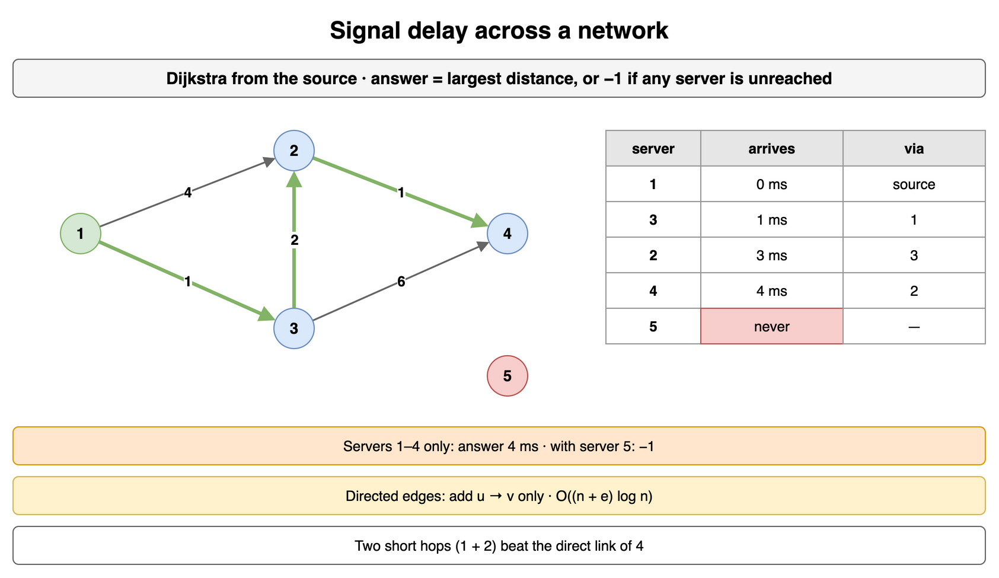
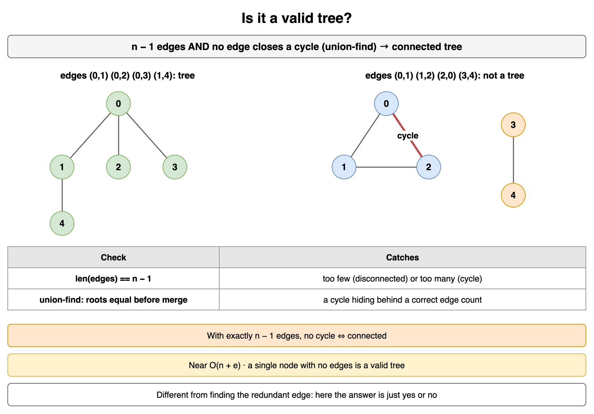
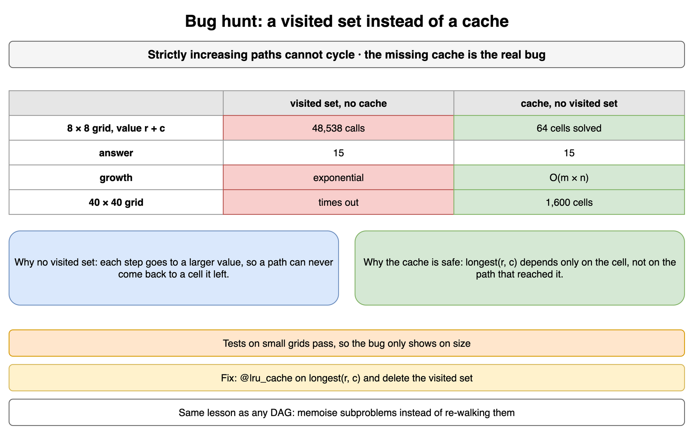
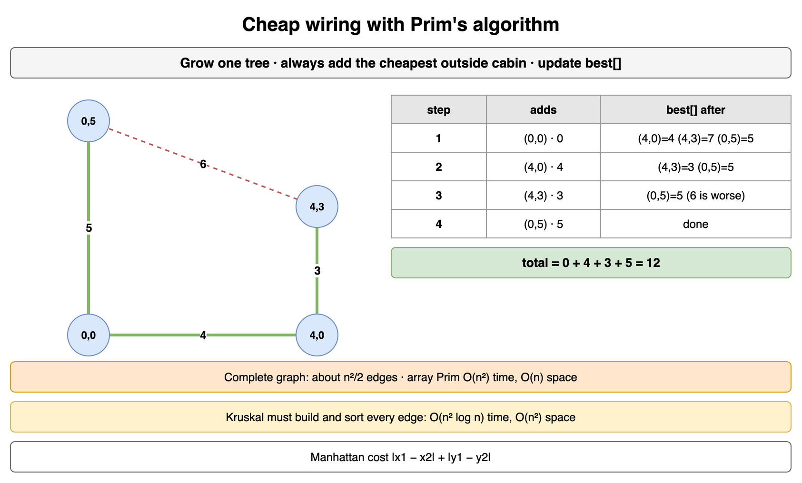
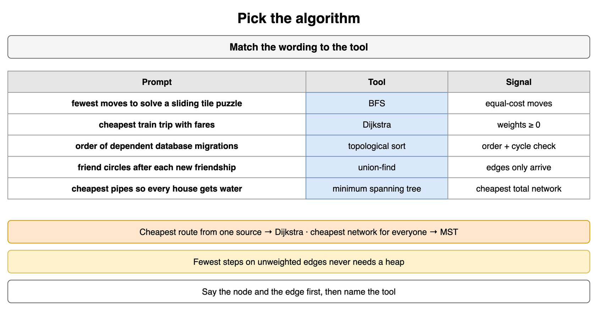

# Graphs — Drills

Original drills for provinces in a matrix, a paint-bucket fill, distances to the nearest exit, a course order, a signal delay, a tree check, a slow longest-path search, cheap wiring with Prim's algorithm, and picking the algorithm. Each answer has an approach, a cost, and Python. The grids, names, and numbers are exercise values.

## Provinces from an adjacency matrix

Six towns are described by a matrix where `m[i][j] == 1` means towns i and j have a direct road. Roads are two-way and every town has a road to itself. A province is a group of towns that can reach each other. How many provinces are there for the matrix below?

```text
    0 1 2 3 4 5
0 [ 1 1 0 0 0 0 ]
1 [ 1 1 1 0 0 0 ]
2 [ 0 1 1 0 0 0 ]
3 [ 0 0 0 1 0 0 ]
4 [ 0 0 0 0 1 1 ]
5 [ 0 0 0 0 1 1 ]
```

**Answer:** 3 provinces: {0, 1, 2}, {3}, and {4, 5}. Loop over the towns, and from each unseen town run a DFS that reads its row of the matrix to find neighbours; each start is one province. Reading a full row per town costs O(n²) time, which is the size of the input anyway, and O(n) extra space. Union-find gives the same count: start at n groups and subtract one for every road that merges two different groups. The scan-and-fill idea is [Count islands](#11_Coding_Problems/21_Graphs/concepts/count-islands), and the merge version is [Union-find for merging groups](#11_Coding_Problems/21_Graphs/concepts/union-find-for-merging-groups).

```python
def provinces(m: list[list[int]]) -> int:
    n, seen, count = len(m), set(), 0
    for start in range(n):
        if start in seen:
            continue
        count += 1
        seen.add(start)
        stack = [start]
        while stack:
            town = stack.pop()
            for other in range(n):
                if m[town][other] and other not in seen:
                    seen.add(other)
                    stack.append(other)
    return count


m = [
    [1, 1, 0, 0, 0, 0],
    [1, 1, 1, 0, 0, 0],
    [0, 1, 1, 0, 0, 0],
    [0, 0, 0, 1, 0, 0],
    [0, 0, 0, 0, 1, 1],
    [0, 0, 0, 0, 1, 1],
]
print(provinces(m))
# 3
```



*Source: [`diagrams/graphs-drills.drawio`](/content/11_Coding_Problems/21_Graphs/diagrams/graphs-drills.drawio), page 1.*

## Paint-bucket fill

An image is a grid of colour numbers. A paint-bucket click at `(1, 1)` with new colour `9` recolours the clicked pixel and every pixel of the same colour connected to it up, down, left, or right. What is the image after the click? What happens if the new colour equals the old one?

```text
1 1 2
1 1 2
2 1 1
```

**Answer:** The result is `9 9 2 / 9 9 2 / 2 9 9`. The clicked colour is 1, and every 1 is connected to (1, 1). If the new colour equals the old one, return the image unchanged: otherwise a fill that uses "has the old colour" as its visited test never marks anything as done and loops forever. Recolouring a pixel when it is pushed doubles as marking it visited, so no separate set is needed. The cost is O(m × n) time and space in the worst case. It is the flood fill inside [Count islands](#11_Coding_Problems/21_Graphs/concepts/count-islands), run once from a given cell.

```python
def paint(image: list[list[int]], r: int, c: int, new: int) -> list[list[int]]:
    image = [row[:] for row in image]
    old = image[r][c]
    if old == new:
        return image
    rows, cols = len(image), len(image[0])
    image[r][c] = new
    stack = [(r, c)]
    while stack:
        cr, cc = stack.pop()
        for nr, nc in ((cr + 1, cc), (cr - 1, cc), (cr, cc + 1), (cr, cc - 1)):
            if 0 <= nr < rows and 0 <= nc < cols and image[nr][nc] == old:
                image[nr][nc] = new
                stack.append((nr, nc))
    return image


image = [[1, 1, 2], [1, 1, 2], [2, 1, 1]]
for row in paint(image, 1, 1, 9):
    print(row)
print(paint(image, 0, 2, 2) == image)
# [9, 9, 2]
# [9, 9, 2]
# [2, 9, 9]
# True
```



*Source: [`diagrams/graphs-drills.drawio`](/content/11_Coding_Problems/21_Graphs/diagrams/graphs-drills.drawio), page 2.*

## Distance to the nearest exit

A floor plan has walls `#`, exits `E`, and open floor `.`. Fill every open cell with the number of steps to its nearest exit, moving up, down, left, or right, and leave `-1` on open cells that cannot reach any exit.

```text
. . # E
. # . .
E # . #
```

**Answer:** The distances are `2 3 # 0 / 1 # 2 1 / 0 # 3 #`, with no `-1` cells. The top-left corner is 2 steps from the bottom-left exit, and the cell beside it is 3. Put every exit in the queue at distance 0 and run one BFS outward; the first time the search reaches an open cell is its shortest distance to any exit. Searching from each open cell separately would cost O((mn)²). One multi-source search costs O(m × n) time and space. The pattern is [Spread from many sources](#11_Coding_Problems/21_Graphs/concepts/spread-from-many-sources).

```python
from collections import deque


def exit_distances(plan: list[str]) -> list[list[object]]:
    rows, cols = len(plan), len(plan[0])
    out: list[list[object]] = [["#" if ch == "#" else -1 for ch in row] for row in plan]
    queue = deque()
    for r in range(rows):
        for c in range(cols):
            if plan[r][c] == "E":
                out[r][c] = 0
                queue.append((r, c))
    while queue:
        r, c = queue.popleft()
        for nr, nc in ((r + 1, c), (r - 1, c), (r, c + 1), (r, c - 1)):
            if 0 <= nr < rows and 0 <= nc < cols and out[nr][nc] == -1:
                out[nr][nc] = out[r][c] + 1
                queue.append((nr, nc))
    return out


for row in exit_distances(["..#E", ".#..", "E#.#"]):
    print(*row)
# 2 3 # 0
# 1 # 2 1
# 0 # 3 #
```



*Source: [`diagrams/graphs-drills.drawio`](/content/11_Coding_Problems/21_Graphs/diagrams/graphs-drills.drawio), page 3.*

## Return a course order

Four courses: `stats` needs `algebra`, `ml` needs `stats` and `python`, and `algebra` and `python` need nothing. Return one order in which a student can take all four, or an empty list if none exists. What changes if `algebra` also needs `ml`?

**Answer:** One valid order is `algebra, python, stats, ml`. Kahn's algorithm records each course as its in-degree reaches 0, so the recorded list is the order; the yes/no version only compares its length to n. Adding `algebra` needs `ml` creates the cycle algebra → stats → ml → algebra, only `python` ever reaches in-degree 0, and the answer is an empty list. The cost is O(n + e). See [Prerequisites and topological order](#11_Coding_Problems/21_Graphs/concepts/prerequisites-and-topological-order). Python's `graphlib.TopologicalSorter` returns the same kind of order and raises `CycleError` on a cycle.

```python
from collections import deque


def order(courses: list[str], needs: dict[str, list[str]]) -> list[str]:
    after = {c: [] for c in courses}
    indegree = {c: 0 for c in courses}
    for course, prereqs in needs.items():
        for p in prereqs:
            after[p].append(course)
            indegree[course] += 1
    queue = deque(c for c in courses if indegree[c] == 0)
    out = []
    while queue:
        course = queue.popleft()
        out.append(course)
        for nxt in after[course]:
            indegree[nxt] -= 1
            if indegree[nxt] == 0:
                queue.append(nxt)
    return out if len(out) == len(courses) else []


courses = ["algebra", "python", "stats", "ml"]
needs = {"stats": ["algebra"], "ml": ["stats", "python"]}
print(order(courses, needs))
print(order(courses, {**needs, "algebra": ["ml"]}))
# ['algebra', 'python', 'stats', 'ml']
# []
```



*Source: [`diagrams/graphs-drills.drawio`](/content/11_Coding_Problems/21_Graphs/diagrams/graphs-drills.drawio), page 4.*

## Signal delay across a network

Servers 1 to 5 pass a signal along one-way links with delays in milliseconds: 1→2 (4), 1→3 (1), 3→2 (2), 2→4 (1), 3→4 (6). Server 1 sends at time 0. When has every server received it? What if server 5 has no incoming link?

**Answer:** Servers 1 to 4 receive at 0, 3, 1, and 4 ms, so with only those four the answer is 4 ms (2 is reached via 3 at 1 + 2 = 3, and 4 via 2 at 3 + 1 = 4). Server 5 is never reached, so for all five the answer is −1. Run Dijkstra from server 1 on the directed graph; the answer is the largest distance, or −1 if any distance is still infinite. The cost is O((n + e) log n). See [Dijkstra for weighted distances](#11_Coding_Problems/21_Graphs/concepts/dijkstra-for-weighted-distances).

```python
import heapq


def signal_time(n: int, links: list[tuple[int, int, int]], source: int) -> int:
    graph = {i: [] for i in range(1, n + 1)}
    for u, v, w in links:
        graph[u].append((v, w))
    dist = {source: 0}
    heap = [(0, source)]
    while heap:
        d, node = heapq.heappop(heap)
        if d > dist[node]:
            continue
        for nb, w in graph[node]:
            if d + w < dist.get(nb, float("inf")):
                dist[nb] = d + w
                heapq.heappush(heap, (d + w, nb))
    return max(dist.values()) if len(dist) == n else -1


links = [(1, 2, 4), (1, 3, 1), (3, 2, 2), (2, 4, 1), (3, 4, 6)]
print(signal_time(4, links, 1), signal_time(5, links, 1))
# 4 -1
```



*Source: [`diagrams/graphs-drills.drawio`](/content/11_Coding_Problems/21_Graphs/diagrams/graphs-drills.drawio), page 5.*

## Is it a valid tree?

Nodes 0 to 4 with undirected edges `(0, 1), (0, 2), (0, 3), (1, 4)`. Is this a tree? Then answer for `(0, 1), (1, 2), (2, 0), (3, 4)`, which also has four edges.

**Answer:** Yes for the first, no for the second. A tree on n nodes is connected and has no cycle, and with exactly n − 1 edges either property implies the other. So check the edge count first, then use union-find: an edge whose ends already share a root closes a cycle. The second graph has the right edge count, but `(2, 0)` closes the cycle 0–1–2, which leaves {3, 4} cut off. The cost is near O(n + e). Union-find is in [Union-find for merging groups](#11_Coding_Problems/21_Graphs/concepts/union-find-for-merging-groups).

```python
def valid_tree(n: int, edges: list[tuple[int, int]]) -> bool:
    if len(edges) != n - 1:
        return False
    parent = list(range(n))

    def find(x: int) -> int:
        while parent[x] != x:
            parent[x] = parent[parent[x]]
            x = parent[x]
        return x

    for u, v in edges:
        ru, rv = find(u), find(v)
        if ru == rv:
            return False
        parent[ru] = rv
    return True


print(valid_tree(5, [(0, 1), (0, 2), (0, 3), (1, 4)]))
print(valid_tree(5, [(0, 1), (1, 2), (2, 0), (3, 4)]))
print(valid_tree(5, [(0, 1), (1, 2)]), valid_tree(1, []))
# True
# False
# False True
```



*Source: [`diagrams/graphs-drills.drawio`](/content/11_Coding_Problems/21_Graphs/diagrams/graphs-drills.drawio), page 6.*

## Bug hunt: a visited set instead of a cache

A candidate solves the longest strictly increasing path in a grid with a DFS that adds each cell to a `visited` set on the way in and removes it on the way out, and caches nothing. It returns the right answers in tests but times out on a 40 × 40 grid. What is wrong?

**Answer:** The visited set is unnecessary and the missing cache is the bug. A strictly increasing step can never return to a cell, so the edges form a DAG and no path can cycle; the set only adds work. Without a cache, the search from each cell re-explores every path below it, and those paths overlap heavily, so the time grows exponentially. With `longest(r, c)` cached, each cell is solved once: O(m × n). On an 8 × 8 grid whose values rise toward one corner, the slow version makes 48,538 calls and the cached one solves 64 cells, and the gap widens exponentially with the grid size. See [Longest increasing path in a grid](#11_Coding_Problems/21_Graphs/concepts/longest-increasing-path-in-a-grid).

```python
from functools import lru_cache

grid = [[r + c for c in range(8)] for r in range(8)]
rows = cols = 8
calls = 0


def slow(r: int, c: int, visited: set) -> int:
    global calls
    calls += 1
    visited.add((r, c))
    best = 1
    for nr, nc in ((r + 1, c), (r - 1, c), (r, c + 1), (r, c - 1)):
        if 0 <= nr < rows and 0 <= nc < cols and (nr, nc) not in visited and grid[nr][nc] > grid[r][c]:
            best = max(best, 1 + slow(nr, nc, visited))
    visited.remove((r, c))
    return best


@lru_cache(maxsize=None)
def fast(r: int, c: int) -> int:
    best = 1
    for nr, nc in ((r + 1, c), (r - 1, c), (r, c + 1), (r, c - 1)):
        if 0 <= nr < rows and 0 <= nc < cols and grid[nr][nc] > grid[r][c]:
            best = max(best, 1 + fast(nr, nc))
    return best


print(max(slow(r, c, set()) for r in range(rows) for c in range(cols)), calls)
print(max(fast(r, c) for r in range(rows) for c in range(cols)), fast.cache_info().misses)
# 15 48538
# 15 64
```



*Source: [`diagrams/graphs-drills.drawio`](/content/11_Coding_Problems/21_Graphs/diagrams/graphs-drills.drawio), page 7.*

## Cheap wiring with Prim's algorithm

Four cabins sit at `(0, 0)`, `(4, 0)`, `(4, 3)`, and `(0, 5)`. Cable between two cabins costs their Manhattan distance. What is the cheapest total cable that connects every cabin, and why does Prim's algorithm with a plain array fit this input better than Kruskal's?

**Answer:** 12: (0,0)–(4,0) costs 4, (4,0)–(4,3) costs 3, and (0,0)–(0,5) costs 5. The cheapest link for `(0, 5)` is 5 to `(0, 0)`, not 6 to `(4, 3)`, so the total is 4 + 3 + 5 = 12. Prim's grows one tree: keep `best[i]`, the cheapest link from each outside cabin to the tree, pick the smallest, add it, and update the others. Every pair of cabins is a possible edge, so the graph is complete with about n²/2 edges; array-based Prim's runs in O(n²) time and O(n) space, while Kruskal's must build and sort all those edges in O(n² log n) time and O(n²) space. See [Minimum spanning tree](#11_Coding_Problems/21_Graphs/concepts/minimum-spanning-tree).

```python
def prim(points: list[tuple[int, int]]) -> int:
    n = len(points)
    in_tree = [False] * n
    best = [float("inf")] * n
    best[0] = 0
    total = 0
    for _ in range(n):
        i = min((j for j in range(n) if not in_tree[j]), key=lambda j: best[j])
        in_tree[i] = True
        total += best[i]
        xi, yi = points[i]
        for j in range(n):
            if not in_tree[j]:
                best[j] = min(best[j], abs(xi - points[j][0]) + abs(yi - points[j][1]))
    return total


print(prim([(0, 0), (4, 0), (4, 3), (0, 5)]))
# 12
```



*Source: [`diagrams/graphs-drills.drawio`](/content/11_Coding_Problems/21_Graphs/diagrams/graphs-drills.drawio), page 8.*

## Pick the algorithm

Name the tool for each prompt: (a) fewest moves to solve a sliding tile puzzle; (b) cheapest train trip when every leg has a fare; (c) order in which to apply database migrations that depend on each other; (d) after each new friendship, report how many friend circles exist; (e) cheapest set of pipes so every house gets water.

**Answer:** (a) BFS, since each move costs the same and the puzzle states form an implicit graph. (b) Dijkstra, since fares are non-negative weights. (c) Topological sort, which also reports a dependency cycle. (d) Union-find, since edges only arrive and each merge reduces the count by one. (e) A minimum spanning tree, since the goal is the cheapest total network, not the cheapest route from one source. The decision list is [Choosing a graph algorithm](#11_Coding_Problems/21_Graphs/concepts/choosing-a-graph-algorithm).

```python
answers = {
    "sliding tile puzzle, fewest moves": "BFS",
    "train trip with fares": "Dijkstra",
    "migration order": "topological sort",
    "friend circles as friendships arrive": "union-find",
    "cheapest pipes to every house": "minimum spanning tree",
}
for prompt, tool in answers.items():
    print(f"{prompt}: {tool}")
# sliding tile puzzle, fewest moves: BFS
# train trip with fares: Dijkstra
# migration order: topological sort
# friend circles as friendships arrive: union-find
# cheapest pipes to every house: minimum spanning tree
```



*Source: [`diagrams/graphs-drills.drawio`](/content/11_Coding_Problems/21_Graphs/diagrams/graphs-drills.drawio), page 9.*
