## Spotting a backtracking problem

Backtracking builds an answer one decision at a time, and as soon as a partial answer breaks a rule or is complete, it steps back to the last decision and tries the next option there. The general idea and its skeleton are on the Data Structures topic in [Backtracking](#07_Data_Structures_and_Algorithms/11_Problem_Solving_Patterns/concepts/backtracking). This topic is the problem set: permutations, subsets, combinations, placements on a board, and the bookkeeping that keeps each search honest.

The wording gives it away. "List all", "every arrangement", "generate each", "find a placement such that", and "does any assignment satisfy" ask for whole solutions, not a single number, and the input is small: n around 10 for orderings, around 20 for subsets. If the question asks only how many, or the best value, check for dynamic programming first. Real systems use the same search: Sudoku solvers, the regular-expression engines in Python, Perl, and Java (which is why a badly written pattern can backtrack for minutes on a short string), and constraint solvers that build timetables.

```python
def no_adjacent_ones(n: int) -> list[str]:
    out: list[str] = []
    path: list[str] = []

    def go() -> None:
        if len(path) == n:
            out.append("".join(path))
            return
        for bit in "01":
            if bit == "1" and path and path[-1] == "1":
                continue
            path.append(bit)
            go()
            path.pop()

    go()
    return out


print(no_adjacent_ones(3))
print(len(no_adjacent_ones(10)))
# ['000', '001', '010', '100', '101']
# 144
```

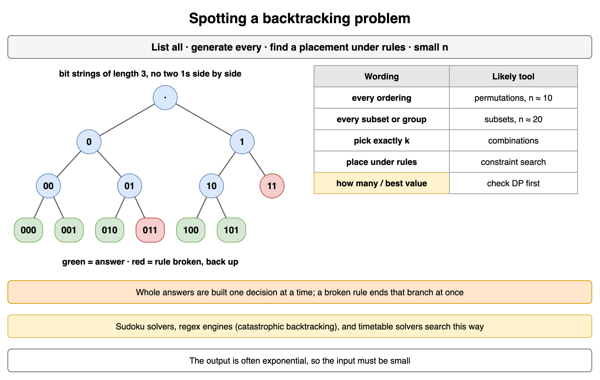

*Source: [`diagrams/backtracking.drawio`](/content/11_Coding_Problems/22_Backtracking/diagrams/backtracking.drawio), page 1.*

## The state space tree

Before writing code, draw the search as a tree. The root is the empty partial answer, before any decision. Each edge is one decision, such as "put 2 next" or "leave out 7". Each node is the partial answer reached by the decisions on its path. Leaves are either complete answers or dead ends where a rule failed. The recursion walks this tree depth first, and the call stack holds exactly one root-to-node path at a time, which is why the extra space is only the depth.

The tree answers three design questions at once: what one level decides (a position, an index, a row), what the choices at a node are, and when a node is a leaf. It also gives the cost. Orderings of three items have 1 + 3 + 6 + 6 = 16 nodes and 6 leaves. The include-or-skip tree for three items has 15 nodes and 8 leaves. Sketch the first two levels on the whiteboard and the interviewer can see the plan before any code exists. The same picture is the [Recursion tree](#07_Data_Structures_and_Algorithms/08_Recursion_and_Dynamic_Programming/concepts/recursion-tree) on the Data Structures topic.

```python
def nodes_per_level(n: int) -> list[int]:
    levels = [0] * (n + 1)

    def go(depth: int, left: int) -> None:
        levels[depth] += 1
        for _ in range(left):
            go(depth + 1, left - 1)

    go(0, n)
    return levels


print(nodes_per_level(3), sum(nodes_per_level(3)))
print(nodes_per_level(4), sum(nodes_per_level(4)))
# [1, 3, 6, 6] 16
# [1, 4, 12, 24, 24] 65
```

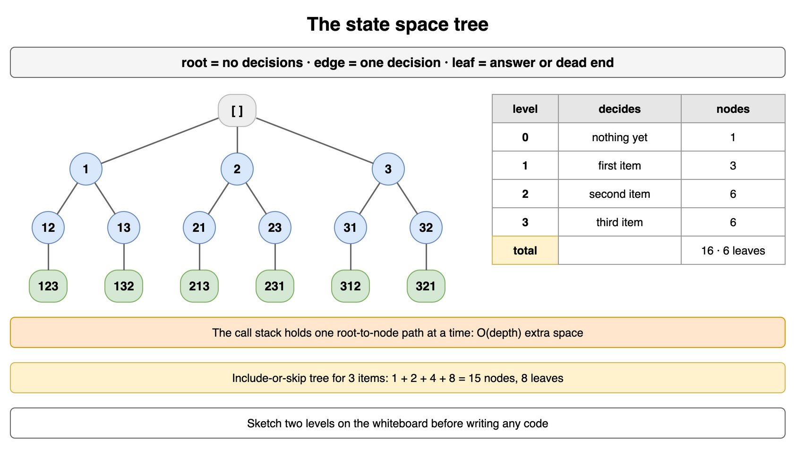

*Source: [`diagrams/backtracking.drawio`](/content/11_Coding_Problems/22_Backtracking/diagrams/backtracking.drawio), page 2.*

## Choose, explore, undo

Every solution in this topic has the same three parts. A stop check at the top records a copy of the partial answer when it is complete, or returns when it cannot succeed. A loop runs over the choices allowed at this node. The loop body chooses (changes the shared state), explores (recurses), and undoes (restores the state exactly). The undo is what lets one list and one set serve the whole search instead of copying them at every call.

Undo everything the choose step changed, in reverse order. The example finds every simple route through a small directed graph: it changes both the path list and an on-path set, so both are restored after the call returns. Forget the set removal and later routes cannot reuse a node a sibling branch visited, so answers silently go missing. Record `path[:]`, not `path`, since the list keeps changing after it is recorded.

```python
def all_routes(graph: dict[str, list[str]], start: str, goal: str) -> list[list[str]]:
    out: list[list[str]] = []
    path, on_path = [start], {start}

    def go(node: str) -> None:
        if node == goal:
            out.append(path[:])
            return
        for nxt in graph[node]:
            if nxt in on_path:
                continue
            path.append(nxt)
            on_path.add(nxt)
            go(nxt)
            on_path.remove(nxt)
            path.pop()

    go(start)
    return out


graph = {"A": ["B", "C"], "B": ["C", "D"], "C": ["B", "D"], "D": []}
for route in all_routes(graph, "A", "D"):
    print("".join(route))
# ABCD
# ABD
# ACBD
# ACD
```

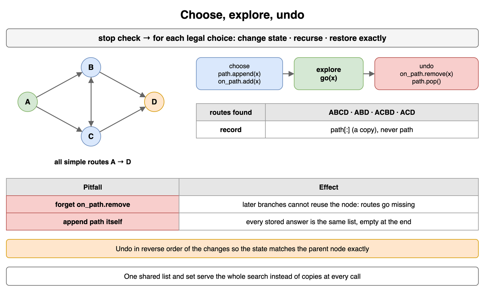

*Source: [`diagrams/backtracking.drawio`](/content/11_Coding_Problems/22_Backtracking/diagrams/backtracking.drawio), page 3.*

## Permutations, subsets, and combinations

Most list-them-all questions are one of three shapes, and the difference is only in the loop. Permutations care about order, so every level may pick any element not yet used, and a `used` set tracks what is taken; a leaf is a full-length path. Subsets do not care about order, so each level loops from a start index forward and recurses with `i + 1`; every node, not just every leaf, is an answer. Combinations of size k are subsets that stop at length k.

Two small changes cover most variants. Recursing with `i` instead of `i + 1` lets the same element be picked again (unlimited reuse). Adding a target sum, a length, or a validity check to the stop test turns a shape into a constrained search. Picking the right shape up front prevents the most common bug: looping from 0 in a subset or combination search, which produces the same group in several orders.

```python
def three_shapes(items: list[int], k: int) -> tuple[int, list[list[int]], list[list[int]]]:
    perms: list[list[int]] = []
    subsets: list[list[int]] = []
    combos: list[list[int]] = []
    path: list[int] = []

    def perm(used: set[int]) -> None:
        if len(path) == len(items):
            perms.append(path[:])
            return
        for i, x in enumerate(items):
            if i not in used:
                used.add(i)
                path.append(x)
                perm(used)
                path.pop()
                used.remove(i)

    def sub(start: int) -> None:
        subsets.append(path[:])
        for i in range(start, len(items)):
            path.append(items[i])
            sub(i + 1)
            path.pop()

    def comb(start: int) -> None:
        if len(path) == k:
            combos.append(path[:])
            return
        for i in range(start, len(items)):
            path.append(items[i])
            comb(i + 1)
            path.pop()

    perm(set())
    sub(0)
    comb(0)
    return len(perms), subsets, combos


count, subsets, combos = three_shapes([1, 2, 3], 2)
print(count)
print(subsets)
print(combos)
# 6
# [[], [1], [1, 2], [1, 2, 3], [1, 3], [2], [2, 3], [3]]
# [[1, 2], [1, 3], [2, 3]]
```

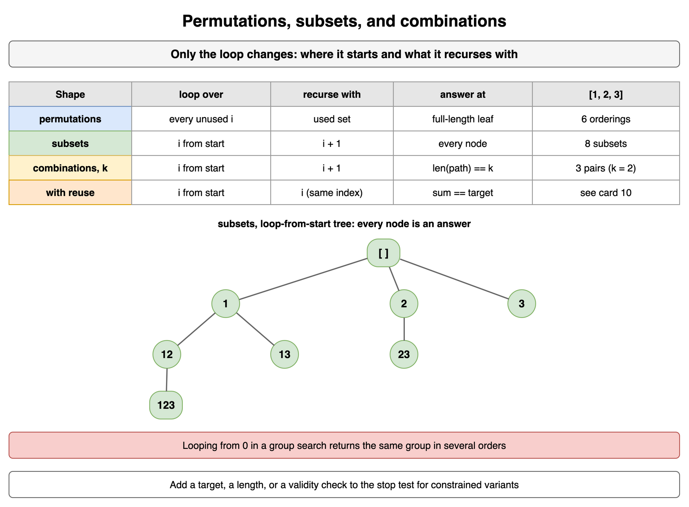

*Source: [`diagrams/backtracking.drawio`](/content/11_Coding_Problems/22_Backtracking/diagrams/backtracking.drawio), page 4.*

## Pruning and constraint bookkeeping

Pruning means returning from a node as soon as no leaf below it can be valid, so the whole subtree is never visited. The best prunes come from a bound: if the items are sorted and the next one already overshoots the remaining budget, every later one does too, so `break` out of the loop rather than `continue`. Other common prunes are "too many open brackets", "more letters needed than remain", and "this cell is already used".

Bookkeeping makes each check O(1). Keep a set of used columns, a running sum, or a count of open brackets, and update it in the choose and undo steps, instead of rescanning the partial answer at every node. The example counts the nodes visited while looking for groups of weights that total exactly 10: the bounded search visits a third as many nodes (19 against 57) and finds the same three groups. The unbounded version only notices an overshoot after it has already made the call.

```python
def groups(weights: list[int], target: int, prune: bool) -> tuple[list[list[int]], int]:
    weights = sorted(weights)
    out: list[list[int]] = []
    path: list[int] = []
    visited = 0

    def go(start: int, left: int) -> None:
        nonlocal visited
        visited += 1
        if left < 0:
            return
        if left == 0:
            out.append(path[:])
            return
        for i in range(start, len(weights)):
            if prune and weights[i] > left:
                break
            path.append(weights[i])
            go(i + 1, left - weights[i])
            path.pop()

    go(0, target)
    return out, visited


weights = [5, 8, 2, 9, 4, 7, 3]
print(groups(weights, 10, prune=True))
print(groups(weights, 10, prune=False))
# ([[2, 3, 5], [2, 8], [3, 7]], 19)
# ([[2, 3, 5], [2, 8], [3, 7]], 57)
```

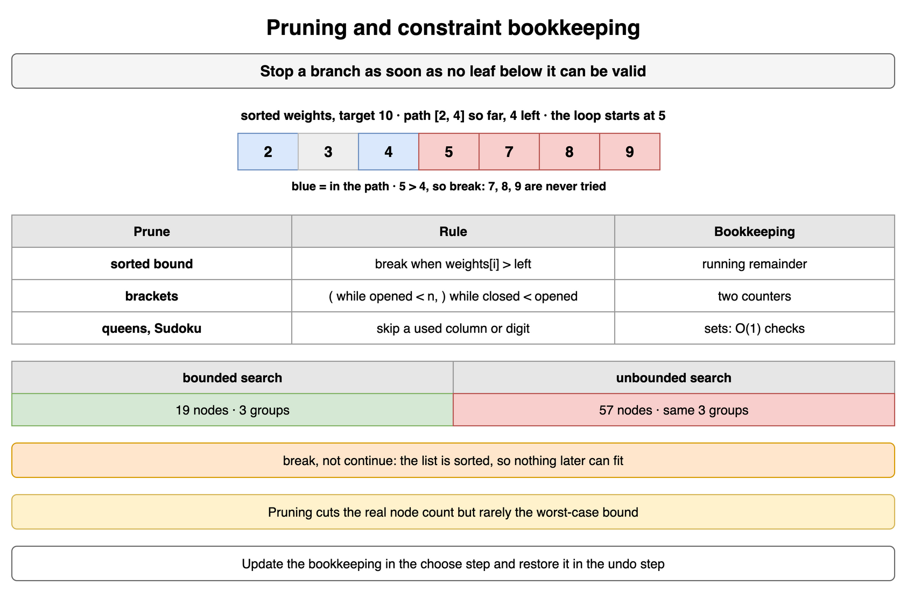

*Source: [`diagrams/backtracking.drawio`](/content/11_Coding_Problems/22_Backtracking/diagrams/backtracking.drawio), page 5.*

## Estimating the cost

The cost is roughly the number of nodes in the tree times the work per node. With branching factor b and depth d, the tree has at most about b^d leaves, so the bound is O(b^d), and every complete answer that is copied into the output adds O(d). That gives the standard figures: permutations O(n · n!), subsets O(n · 2^n), combinations of size k O(k · C(n, k)), keypad strings O(n · 4^n). Extra space beyond the output is O(d) for the path and the call stack.

These algorithms are output-sensitive: when every leaf is an answer, no algorithm can beat the size of the output, so the exponential cost is the problem, not the solution. Use the numbers to sanity-check the input size: 10! is about 3.6 million, which Python lists in a few seconds, and 2^20 is about a million. Pruning lowers the real count but rarely the worst-case bound, so state the bound and then say what the prune saves. The counting arguments behind n!, 2^n, and C(n, k) are on the [Math and Logic Puzzles](#11_Coding_Problems/01_Math_and_Logic_Puzzles) topic.

```python
from math import comb, factorial

n = 10
print(f"orderings {factorial(n):,}  subsets {2 ** n:,}  3-of-10 {comb(n, 3)}  keypad 4^n {4 ** n:,}")
print(f"output cells for n! orderings: {n * factorial(n):,}")
# orderings 3,628,800  subsets 1,024  3-of-10 120  keypad 4^n 1,048,576
# output cells for n! orderings: 36,288,000
```

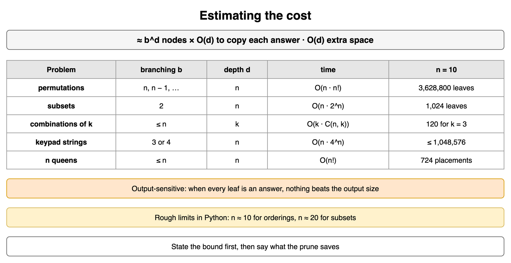

*Source: [`diagrams/backtracking.drawio`](/content/11_Coding_Problems/22_Backtracking/diagrams/backtracking.drawio), page 6.*

## All permutations

Given distinct integers, return every ordering. Each level of the tree fills the next position, and the choices are the elements not yet used. Keep a `used` set (or a list of booleans) and a `path` list. At a full-length path, append a copy. The first level has n choices, the next n − 1, and so on, so there are n! leaves, each copied in O(n): O(n · n!) time and O(n) extra space.

Three mistakes show up again and again. Appending `path` itself fills the result with references to one list that ends up empty. Forgetting to clear `used` means only the first ordering is found. And repeated input values produce repeated orderings, which needs the sort-and-skip rule from [Repeated values: sort and skip](#11_Coding_Problems/22_Backtracking/concepts/repeated-values-sort-and-skip). An in-place alternative swaps each candidate into position `i` and swaps it back after the call, which saves the set. Compare with `itertools.permutations` in tests.

```python
from itertools import permutations


def all_orders(nums: list[int]) -> list[list[int]]:
    out: list[list[int]] = []
    path: list[int] = []
    used = [False] * len(nums)

    def go() -> None:
        if len(path) == len(nums):
            out.append(path[:])
            return
        for i, x in enumerate(nums):
            if used[i]:
                continue
            used[i] = True
            path.append(x)
            go()
            path.pop()
            used[i] = False

    go()
    return out


orders = all_orders([4, 7, 9])
print(orders)
print(orders == [list(p) for p in permutations([4, 7, 9])])
# [[4, 7, 9], [4, 9, 7], [7, 4, 9], [7, 9, 4], [9, 4, 7], [9, 7, 4]]
# True
```

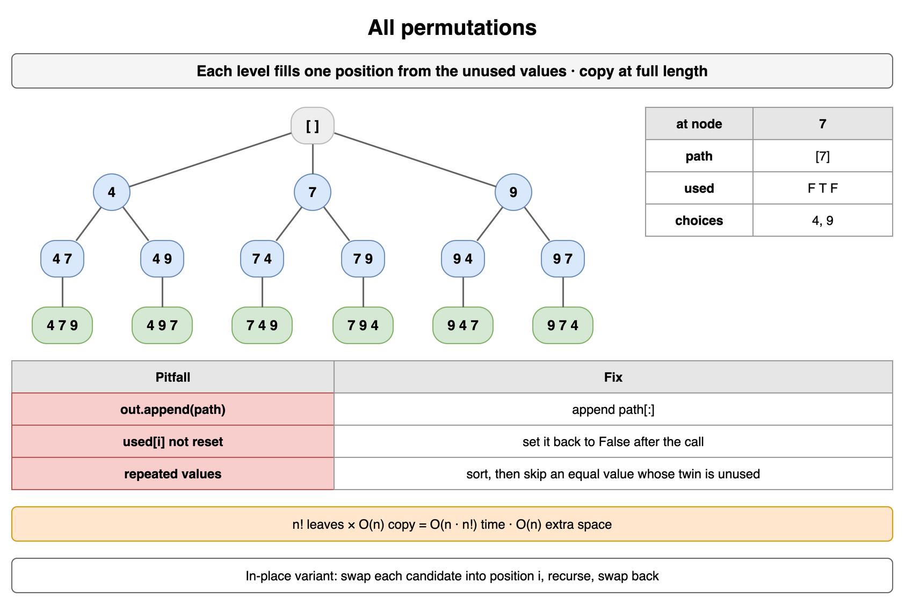

*Source: [`diagrams/backtracking.drawio`](/content/11_Coding_Problems/22_Backtracking/diagrams/backtracking.drawio), page 7.*

## All subsets

Given distinct integers, return every subset. The cleanest tree makes one binary decision per index: include `nums[i]` or skip it. The tree has depth n and 2^n leaves, and every leaf is an answer, so the cost is O(n · 2^n) time for the copies and O(n) extra space. The loop-from-start shape in [Permutations, subsets, and combinations](#11_Coding_Problems/22_Backtracking/concepts/permutations-subsets-and-combinations) gives the same 2^n subsets in a different order and records one at every node.

Two alternatives are worth naming. An iterative build starts from `[[]]` and, for each number, adds a copy of every existing subset with that number appended. A bitmask loop counts from 0 to 2^n − 1 and reads bit i as "include item i", which is the method in [Flags and bitmask subsets](#07_Data_Structures_and_Algorithms/10_Bit_Manipulation/concepts/flags-and-bitmask-subsets). Both avoid recursion and both still pay O(n · 2^n). Ask whether the empty set counts; by convention it does.

```python
def all_subsets(nums: list[int]) -> list[list[int]]:
    out: list[list[int]] = []
    path: list[int] = []

    def go(i: int) -> None:
        if i == len(nums):
            out.append(path[:])
            return
        path.append(nums[i])
        go(i + 1)
        path.pop()
        go(i + 1)

    go(0)
    return out


print(all_subsets([4, 7, 9]))
masks = [[x for b, x in enumerate([4, 7, 9]) if m >> b & 1] for m in range(8)]
print(sorted(masks) == sorted(all_subsets([4, 7, 9])))
# [[4, 7, 9], [4, 7], [4, 9], [4], [7, 9], [7], [9], []]
# True
```

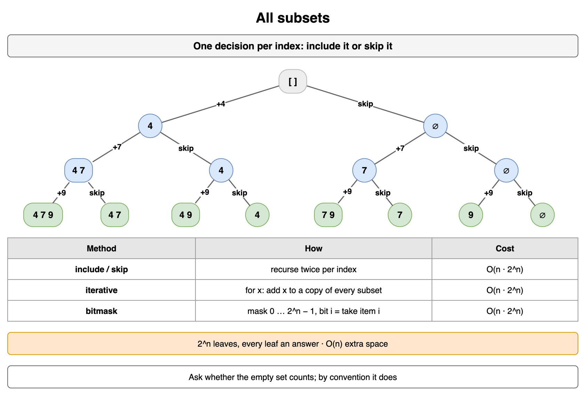

*Source: [`diagrams/backtracking.drawio`](/content/11_Coding_Problems/22_Backtracking/diagrams/backtracking.drawio), page 8.*

## Placing n queens

Count the ways to put n queens on an n × n board so that no two share a row, a column, or a diagonal. Two queens in one row always clash, so each level of the tree places the queen for one row, and the choices are the columns. A queen at `(r, c)` blocks column `c`, the diagonal with constant `r - c`, and the anti-diagonal with constant `r + c`. Keep three sets and a placement is legal in O(1) when its three keys are all absent; add them before recursing and remove them after.

The first row has n choices, the next at most n − 1 safe columns, and so on, so O(n!) bounds the time; the sets and the stack take O(n) space. Scanning the board for attacks at every node works but adds an O(n) or O(n²) factor. Mixing up the two diagonal keys is the usual bug: test with n = 4 (2 answers) and n = 8 (92). If the question wants the boards rather than the count, keep a list of the chosen column per row and build the strings only at the leaves.

```python
def queens(n: int) -> int:
    cols: set[int] = set()
    diag: set[int] = set()
    anti: set[int] = set()

    def place(r: int) -> int:
        if r == n:
            return 1
        found = 0
        for c in range(n):
            if c in cols or r - c in diag or r + c in anti:
                continue
            cols.add(c)
            diag.add(r - c)
            anti.add(r + c)
            found += place(r + 1)
            cols.remove(c)
            diag.remove(r - c)
            anti.remove(r + c)
        return found

    return place(0)


print([queens(n) for n in range(1, 9)])
# [1, 0, 0, 2, 10, 4, 40, 92]
```

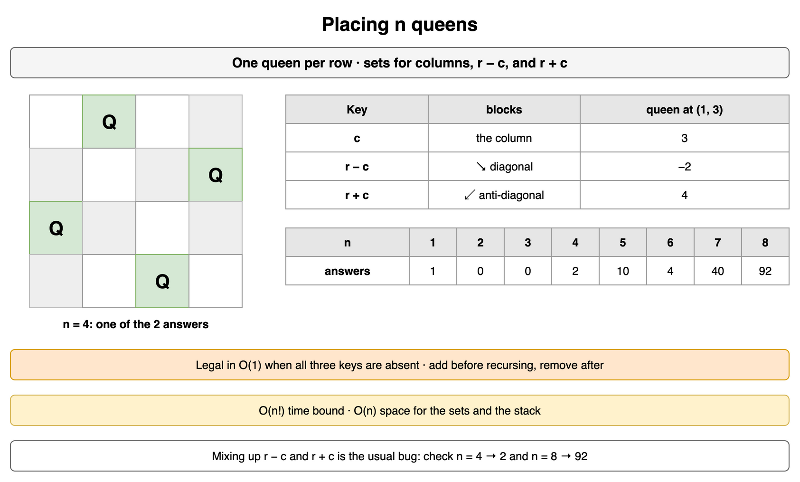

*Source: [`diagrams/backtracking.drawio`](/content/11_Coding_Problems/22_Backtracking/diagrams/backtracking.drawio), page 9.*

## Combinations that reach a target

Given distinct positive numbers and a target, list every group (each number usable any number of times) that sums to the target, with no group repeated in another order. Loop from a start index so each group is built in non-decreasing index order, which makes every group appear once. Recurse with the same `i` to allow reuse of the current number. Sort first and `break` as soon as a number exceeds what is left.

The depth is at most target / m, where m is the smallest number, so the tree has at most about n^(target/m) nodes, and the stack is O(target / m). Restarting the loop at 0 gives `[2, 3, 3]`, `[3, 2, 3]`, and `[3, 3, 2]` as three answers. Ask about zeros and negatives: a zero can be reused forever without changing the sum, so the recursion never ends, and negatives break the "overshoot means stop" prune. If the question asks only how many groups exist, count with dynamic programming instead, as in [Backtracking or dynamic programming](#11_Coding_Problems/22_Backtracking/concepts/backtracking-or-dynamic-programming).

```python
def reach(nums: list[int], target: int) -> list[list[int]]:
    nums = sorted(nums)
    out: list[list[int]] = []
    path: list[int] = []

    def go(start: int, left: int) -> None:
        if left == 0:
            out.append(path[:])
            return
        for i in range(start, len(nums)):
            if nums[i] > left:
                break
            path.append(nums[i])
            go(i, left - nums[i])
            path.pop()

    go(0, target)
    return out


print(reach([5, 2, 3], 8))
print(reach([4, 6], 7))
# [[2, 2, 2, 2], [2, 3, 3], [3, 5]]
# []
```

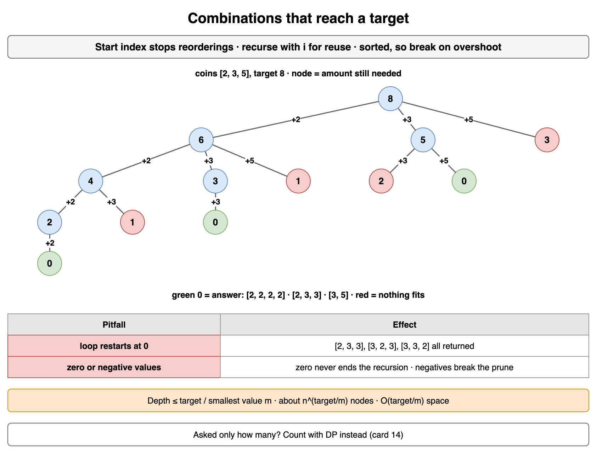

*Source: [`diagrams/backtracking.drawio`](/content/11_Coding_Problems/22_Backtracking/diagrams/backtracking.drawio), page 10.*

## Phone keypad letter strings

Given a string of digits 2 to 9, return every letter string a phone keypad could type, where 2 is `abc`, 7 is `pqrs`, 9 is `wxyz`, and so on. Each level of the tree handles one digit and branches over its three or four letters. A digit string of length n has at most 4^n leaves, each joined in O(n), so the cost is O(n · 4^n) time and O(n) extra space. Old feature phones used the same mapping for multi-tap and predictive text.

Ask what an empty input should return: an empty list is the usual answer, and the code must say so explicitly, or the recursion records one empty string. Build the string in a list and `"".join` it at the leaf; concatenating strings at every level copies them over and over. It is fine to ask whether you may hard-code the keypad table, since it is fixed data and not the point of the question.

```python
KEYS = {"2": "abc", "3": "def", "4": "ghi", "5": "jkl", "6": "mno", "7": "pqrs", "8": "tuv", "9": "wxyz"}


def keypad(digits: str) -> list[str]:
    if not digits:
        return []
    out: list[str] = []
    path: list[str] = []

    def go(i: int) -> None:
        if i == len(digits):
            out.append("".join(path))
            return
        for ch in KEYS[digits[i]]:
            path.append(ch)
            go(i + 1)
            path.pop()

    go(0)
    return out


print(keypad("47"))
print(len(keypad("79")), keypad(""))
# ['gp', 'gq', 'gr', 'gs', 'hp', 'hq', 'hr', 'hs', 'ip', 'iq', 'ir', 'is']
# 16 []
```

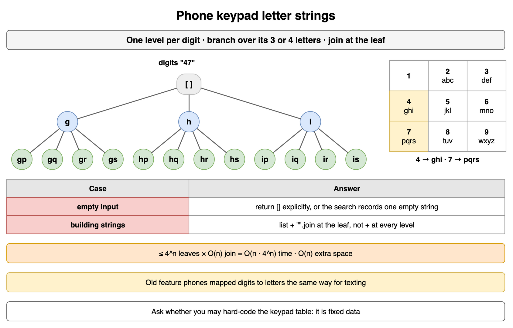

*Source: [`diagrams/backtracking.drawio`](/content/11_Coding_Problems/22_Backtracking/diagrams/backtracking.drawio), page 11.*

## Repeated values: sort and skip

When the input holds repeated values, the plain searches return repeated answers: the two 2s in `[2, 5, 2, 1, 2]` are different positions but the same value, so "first 2 then 1" and "second 2 then 1" are the same group. Sort the input so equal values sit together, then, inside the loop, skip a value that equals the previous one at the same level: `if i > start and nums[i] == nums[i - 1]: continue`. The `i > start` part matters: it skips equal siblings, not an equal value deeper in the path, so `[1, 2, 2]` is still found.

Permutations need a different form of the rule because they have no start index: skip `nums[i]` if it equals `nums[i - 1]` and `nums[i - 1]` is not currently used, which forces equal values to be placed in their sorted order. Deduplicating afterwards with a set of tuples also works, but it still walks every duplicate branch, so the cost is the full tree plus the set. The example lists groups of values from a list with repeats, each value used at most once per position, that total 5.

```python
def unique_groups(nums: list[int], target: int) -> list[list[int]]:
    nums = sorted(nums)
    out: list[list[int]] = []
    path: list[int] = []

    def go(start: int, left: int) -> None:
        if left == 0:
            out.append(path[:])
            return
        for i in range(start, len(nums)):
            if i > start and nums[i] == nums[i - 1]:
                continue
            if nums[i] > left:
                break
            path.append(nums[i])
            go(i + 1, left - nums[i])
            path.pop()

    go(0, target)
    return out


print(unique_groups([2, 5, 2, 1, 2], 5))
# [[1, 2, 2], [5]]
```

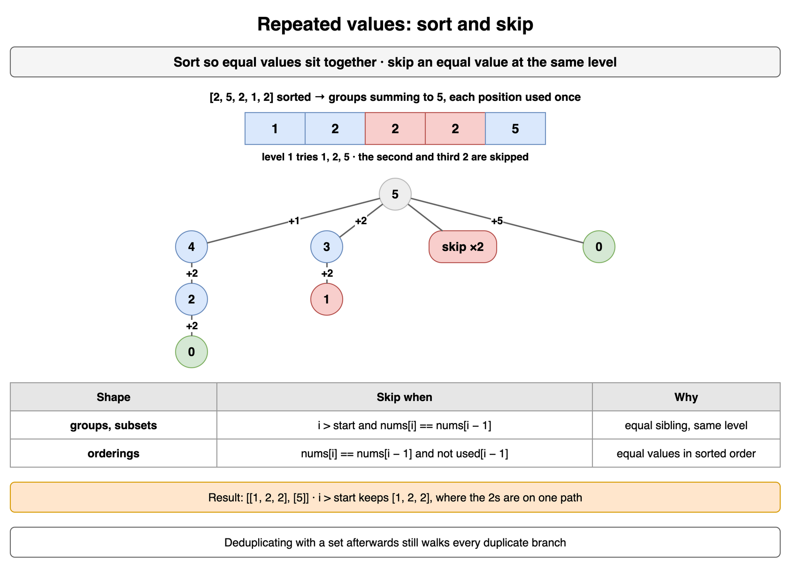

*Source: [`diagrams/backtracking.drawio`](/content/11_Coding_Problems/22_Backtracking/diagrams/backtracking.drawio), page 12.*

## Filling a small Sudoku

Constraint puzzles are backtracking with a fixed grid. Find the next empty cell, try each digit that does not already appear in its row, column, or box, recurse, and clear the cell if the recursion fails. Return `True` up the stack on the first full grid, so the search stops at one solution instead of listing all of them. Sets per row, column, and box make each legality check O(1), the same bookkeeping as the queen sets.

The worst case is exponential in the number of blanks, but real puzzles fall quickly because each placement removes options elsewhere. The biggest practical speedup is to fill the empty cell with the fewest legal digits first, which finds forced moves early and fails fast on contradictions. A 4 × 4 grid with 2 × 2 boxes keeps the example small; a 9 × 9 grid uses the same code with 3 × 3 boxes. Scheduling, register allocation, and timetable tools run the same search with smarter variable ordering.

```python
def solve(grid: list[list[int]]) -> bool:
    n, box = len(grid), int(len(grid) ** 0.5)
    rows = [set(r) - {0} for r in grid]
    cols = [{grid[r][c] for r in range(n)} - {0} for c in range(n)]
    boxes = [set() for _ in range(n)]
    for r in range(n):
        for c in range(n):
            if grid[r][c]:
                boxes[r // box * box + c // box].add(grid[r][c])
    blanks = [(r, c) for r in range(n) for c in range(n) if grid[r][c] == 0]

    def go(k: int) -> bool:
        if k == len(blanks):
            return True
        r, c = blanks[k]
        b = r // box * box + c // box
        for d in range(1, n + 1):
            if d in rows[r] or d in cols[c] or d in boxes[b]:
                continue
            grid[r][c] = d
            rows[r].add(d), cols[c].add(d), boxes[b].add(d)
            if go(k + 1):
                return True
            rows[r].remove(d), cols[c].remove(d), boxes[b].remove(d)
            grid[r][c] = 0
        return False

    return go(0)


puzzle = [
    [1, 0, 0, 4],
    [0, 4, 1, 0],
    [0, 1, 4, 0],
    [4, 0, 0, 1],
]
print(solve(puzzle))
for row in puzzle:
    print(row)
# True
# [1, 2, 3, 4]
# [3, 4, 1, 2]
# [2, 1, 4, 3]
# [4, 3, 2, 1]
```

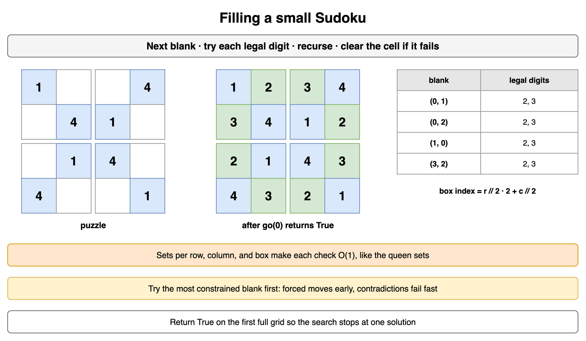

*Source: [`diagrams/backtracking.drawio`](/content/11_Coding_Problems/22_Backtracking/diagrams/backtracking.drawio), page 13.*

## Backtracking or dynamic programming

The same choices can support two different questions. "List every group of coins that makes 8" needs backtracking, because the output itself can be exponential and every answer must be built. "How many groups make 300" needs only a number, and the sub-question "how many ways to make amount a using the first i coins" repeats across branches, so a table answers it in O(n · target). The comparison is in [Backtracking vs. DP](#07_Data_Structures_and_Algorithms/08_Recursion_and_Dynamic_Programming/concepts/backtracking-vs-dp).

Read the verbs: list, generate, print, and "return all" point to backtracking; count, minimum, maximum, and "is it possible" point to DP, unless the state cannot be captured in a few small parameters. Existence questions with strong pruning, such as a Sudoku, often stay backtracking because the state is the whole grid. A useful check in an interview: write the counting DP and confirm it agrees with `len()` of the backtracking output on a small case.

```python
def count_groups(coins: list[int], target: int) -> int:
    ways = [1] + [0] * target
    for coin in coins:
        for amount in range(coin, target + 1):
            ways[amount] += ways[amount - coin]
    return ways[target]


def list_groups(coins: list[int], target: int) -> list[list[int]]:
    coins = sorted(coins)
    out: list[list[int]] = []
    path: list[int] = []

    def go(start: int, left: int) -> None:
        if left == 0:
            out.append(path[:])
            return
        for i in range(start, len(coins)):
            if coins[i] > left:
                break
            path.append(coins[i])
            go(i, left - coins[i])
            path.pop()

    go(0, target)
    return out


print(count_groups([2, 3, 5], 8), len(list_groups([2, 3, 5], 8)))
print(count_groups([2, 3, 5], 300))
# 3 3
# 1551
```

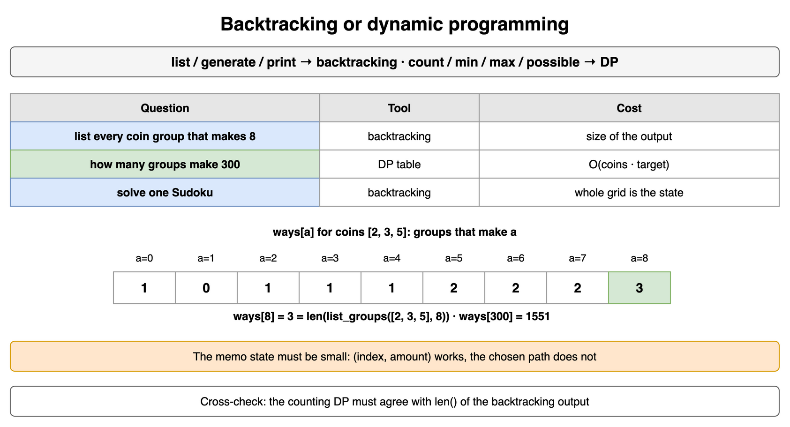

*Source: [`diagrams/backtracking.drawio`](/content/11_Coding_Problems/22_Backtracking/diagrams/backtracking.drawio), page 14.*
