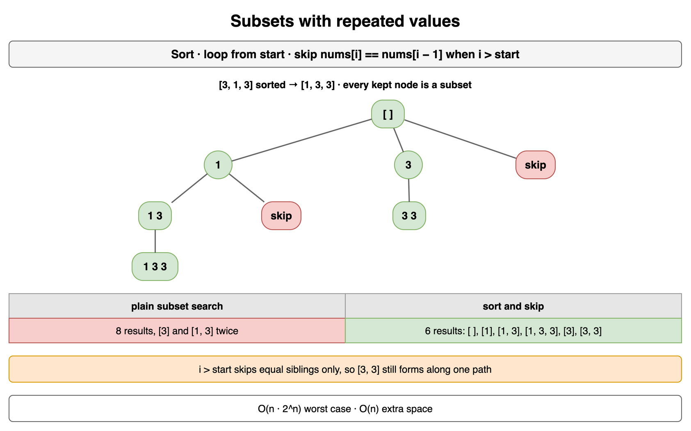
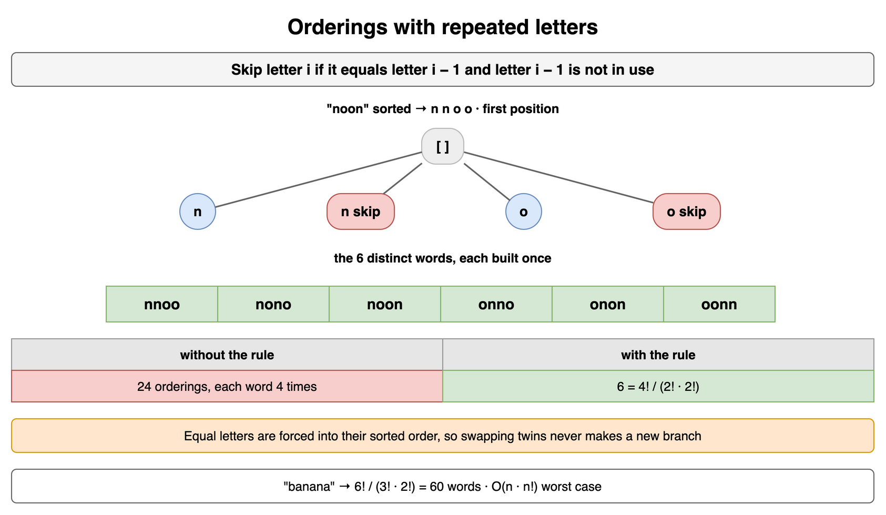
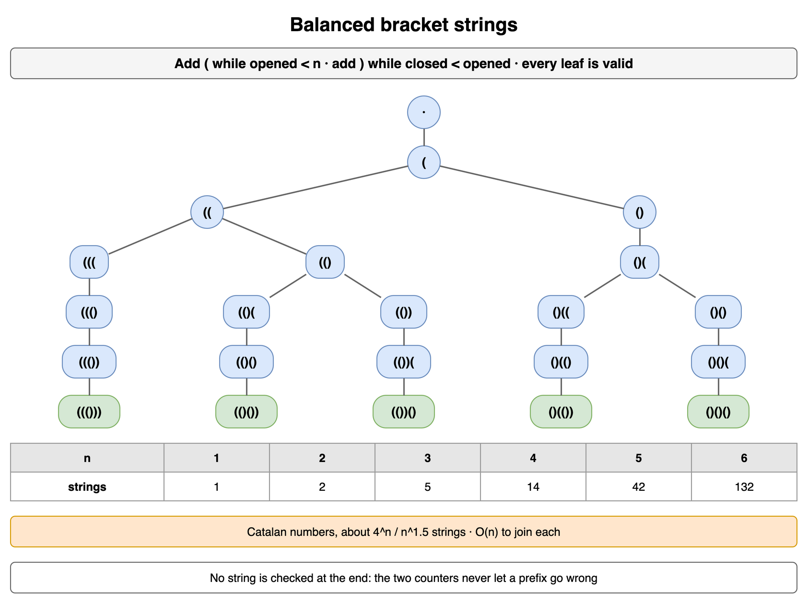
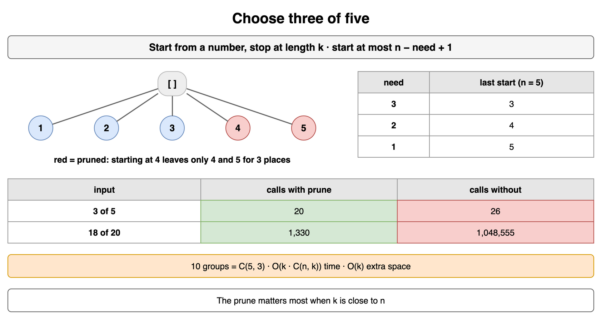
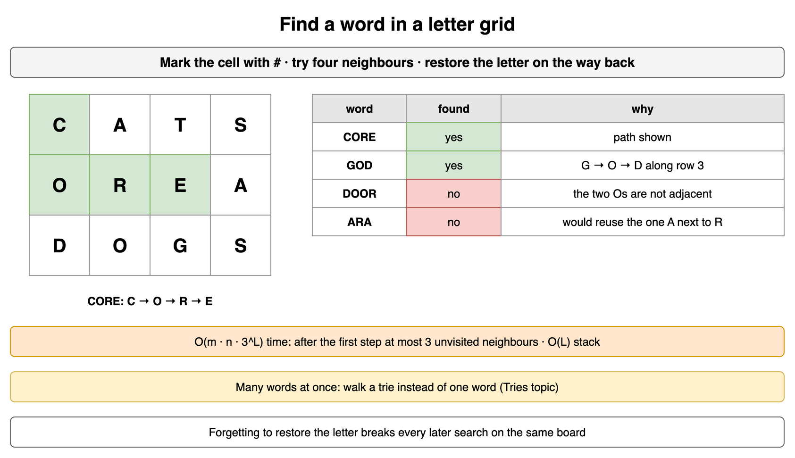
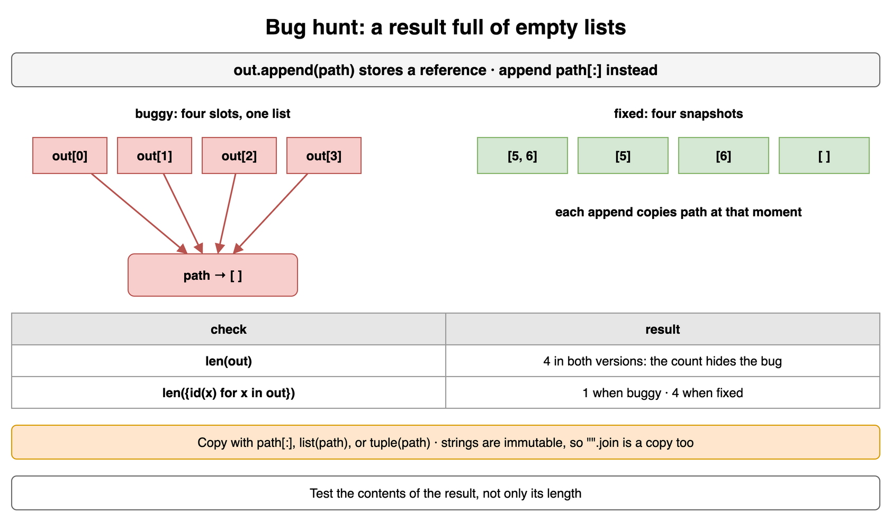
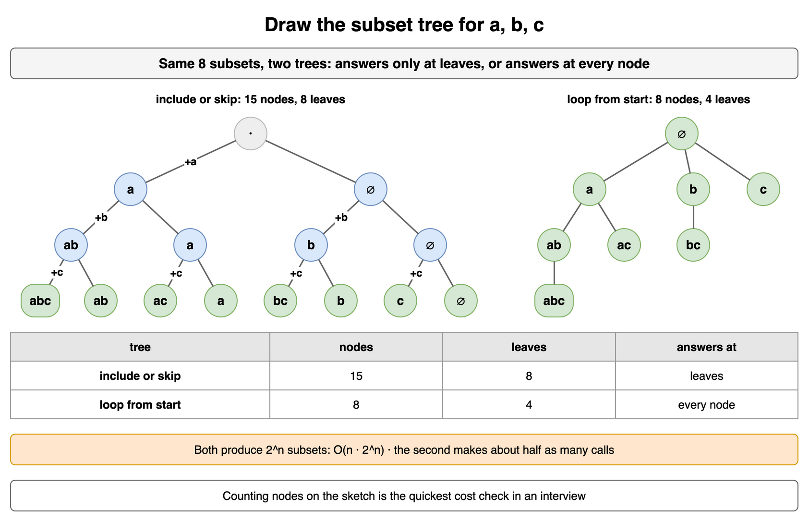
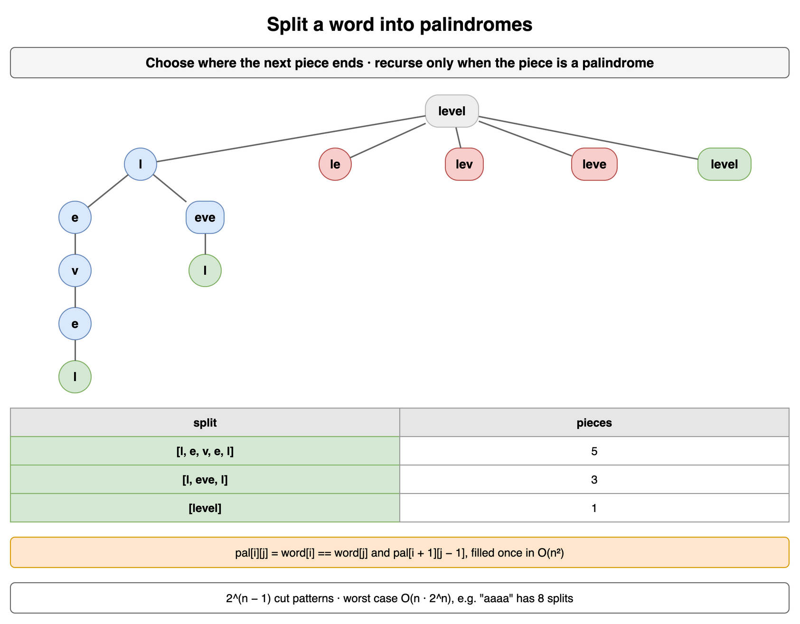
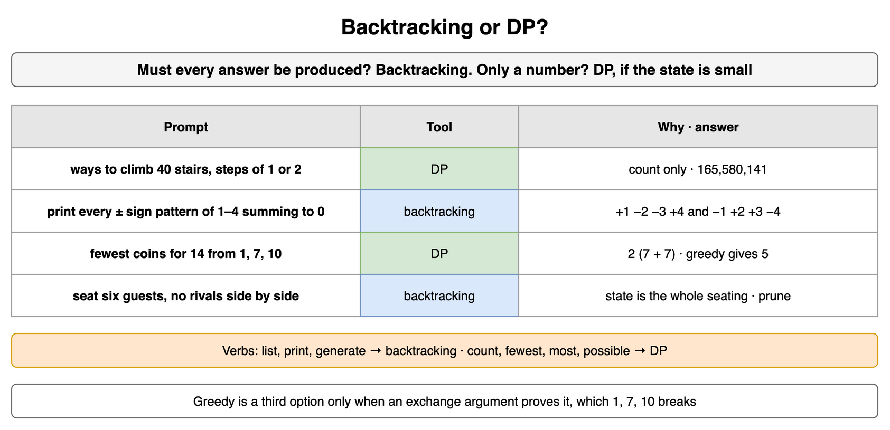

# Backtracking — Drills

Original drills for subsets and orderings with repeated values, balanced brackets, choosing k numbers, a word in a letter grid, an aliasing bug, drawing a search tree, palindrome splits, and choosing between backtracking and DP. Each answer has an approach, a cost, and Python. The values, words, and grids are exercise values.

## Subsets with repeated values

A bag holds the number tiles `[3, 1, 3]`. List every different subset of tiles, counting the two 3s as the same value. How many are there, and how many would the plain subset search return?

**Answer:** 6 different subsets: `[]`, `[1]`, `[1, 3]`, `[1, 3, 3]`, `[3]`, `[3, 3]`. The plain search treats the tiles as distinct and returns 2^3 = 8, with `[3]` and `[1, 3]` each appearing twice. Sort to `[1, 3, 3]`, use the loop-from-start shape, and skip an index whose value equals the previous one at the same level (`i > start`). Equal values can still be taken together along one path, which is how `[3, 3]` survives. The cost is O(n · 2^n) in the worst case and O(n) extra space. The rule is [Repeated values: sort and skip](#11_Coding_Problems/22_Backtracking/concepts/repeated-values-sort-and-skip).

```python
def distinct_subsets(nums: list[int]) -> list[list[int]]:
    nums = sorted(nums)
    out: list[list[int]] = []
    path: list[int] = []

    def go(start: int) -> None:
        out.append(path[:])
        for i in range(start, len(nums)):
            if i > start and nums[i] == nums[i - 1]:
                continue
            path.append(nums[i])
            go(i + 1)
            path.pop()

    go(0)
    return out


print(distinct_subsets([3, 1, 3]))
print(len(distinct_subsets([2, 2, 2, 2])))
# [[], [1], [1, 3], [1, 3, 3], [3], [3, 3]]
# 5
```



*Source: [`diagrams/backtracking-drills.drawio`](/content/11_Coding_Problems/22_Backtracking/diagrams/backtracking-drills.drawio), page 1.*

## Orderings with repeated letters

List every different arrangement of the letters in `"noon"`. How many are there, and what rule stops the search from producing the same word twice?

**Answer:** 6 arrangements: `nnoo`, `nono`, `noon`, `onno`, `onon`, `oonn`, which is 4! / (2! · 2!). Sort the letters, keep a `used` array, and at each position skip letter i when it equals letter i − 1 and letter i − 1 is not in use. That forces equal letters to be placed left to right, so each word is built exactly once. Without the rule the search builds all 24 orderings. The cost is O(n · n!) in the worst case and O(n) extra space. It extends [All permutations](#11_Coding_Problems/22_Backtracking/concepts/all-permutations).

```python
def distinct_orders(word: str) -> list[str]:
    letters = sorted(word)
    used = [False] * len(letters)
    out: list[str] = []
    path: list[str] = []

    def go() -> None:
        if len(path) == len(letters):
            out.append("".join(path))
            return
        for i, ch in enumerate(letters):
            if used[i] or (i > 0 and ch == letters[i - 1] and not used[i - 1]):
                continue
            used[i] = True
            path.append(ch)
            go()
            path.pop()
            used[i] = False

    go()
    return out


print(distinct_orders("noon"))
print(len(distinct_orders("banana")))
# ['nnoo', 'nono', 'noon', 'onno', 'onon', 'oonn']
# 60
```



*Source: [`diagrams/backtracking-drills.drawio`](/content/11_Coding_Problems/22_Backtracking/diagrams/backtracking-drills.drawio), page 2.*

## Balanced bracket strings

List every string of three `(` and three `)` in which the brackets are balanced. Which two counters make the search skip every invalid string without checking it at the end?

**Answer:** 5 strings: `((()))`, `(()())`, `(())()`, `()(())`, `()()()`. Track `opened` and `closed`. Add `(` only while `opened < n`, and add `)` only while `closed < opened`, so a prefix can never close more than it opened. Every leaf of length 2n is then valid, and no string has to be checked afterwards. The answer count is the Catalan number, about 4^n / n^1.5, and each costs O(n) to join. This is the bounded pruning in [Pruning and constraint bookkeeping](#11_Coding_Problems/22_Backtracking/concepts/pruning-and-constraint-bookkeeping).

```python
def brackets(n: int) -> list[str]:
    out: list[str] = []
    path: list[str] = []

    def go(opened: int, closed: int) -> None:
        if closed == n:
            out.append("".join(path))
            return
        if opened < n:
            path.append("(")
            go(opened + 1, closed)
            path.pop()
        if closed < opened:
            path.append(")")
            go(opened, closed + 1)
            path.pop()

    go(0, 0)
    return out


print(brackets(3))
print([len(brackets(n)) for n in range(1, 7)])
# ['((()))', '(()())', '(())()', '()(())', '()()()']
# [1, 2, 5, 14, 42, 132]
```



*Source: [`diagrams/backtracking-drills.drawio`](/content/11_Coding_Problems/22_Backtracking/diagrams/backtracking-drills.drawio), page 3.*

## Choose three of five

A judge picks 3 finalists from contestants numbered 1 to 5. List every possible group. Then add a prune that stops a branch which cannot reach 3 people, and say how many calls it saves.

**Answer:** 10 groups, which is C(5, 3): `[1, 2, 3]`, `[1, 2, 4]`, `[1, 2, 5]`, `[1, 3, 4]`, `[1, 3, 5]`, `[1, 4, 5]`, `[2, 3, 4]`, `[2, 3, 5]`, `[2, 4, 5]`, `[3, 4, 5]`. Loop from a start number and stop at length k. If the path still needs `need` people, the loop may only start numbers up to `n - need + 1`, because a later start leaves too few contestants. On this input the prune cuts the calls from 26 to 20; on 18 of 20 it cuts about 1,048,555 calls to 1,330. The cost is O(k · C(n, k)) time and O(k) extra space. The shape is in [Permutations, subsets, and combinations](#11_Coding_Problems/22_Backtracking/concepts/permutations-subsets-and-combinations).

```python
def choose(n: int, k: int, prune: bool) -> tuple[list[list[int]], int]:
    out: list[list[int]] = []
    path: list[int] = []
    calls = 0

    def go(start: int) -> None:
        nonlocal calls
        calls += 1
        if len(path) == k:
            out.append(path[:])
            return
        last = n - (k - len(path)) + 1 if prune else n
        for x in range(start, last + 1):
            path.append(x)
            go(x + 1)
            path.pop()

    go(1)
    return out, calls


groups, calls = choose(5, 3, prune=True)
print(len(groups), groups[:3], calls, choose(5, 3, prune=False)[1])
print(choose(20, 18, prune=True)[1], choose(20, 18, prune=False)[1])
# 10 [[1, 2, 3], [1, 2, 4], [1, 2, 5]] 20 26
# 1330 1048555
```



*Source: [`diagrams/backtracking-drills.drawio`](/content/11_Coding_Problems/22_Backtracking/diagrams/backtracking-drills.drawio), page 4.*

## Find a word in a letter grid

A word can be traced in the grid below by moving up, down, left, or right, using each cell at most once per word. Which of `CORE`, `GOD`, `DOOR`, and `ARA` can be traced?

```text
C A T S
O R E A
D O G S
```

**Answer:** `CORE` and `GOD` can; `DOOR` and `ARA` cannot. `DOOR` has two Os, but they are not next to each other. `ARA` would need the one `A` next to `R` twice, which the one-use rule forbids. Start a search from every cell that matches the first letter. At each step, mark the cell (overwrite it with `#`), try the four neighbours for the next letter, and restore the letter on the way back. For an m × n grid and a word of length L, the cost is O(m · n · 3^L), since after the first step each cell has at most three unvisited neighbours, with O(L) stack space. Searching for many words at once uses a trie, as in [Trie-guided grid backtracking](#11_Coding_Problems/20_Tries/concepts/trie-guided-grid-backtracking); the undo step is [Choose, explore, undo](#11_Coding_Problems/22_Backtracking/concepts/choose-explore-undo).

```python
def traceable(board: list[list[str]], word: str) -> bool:
    rows, cols = len(board), len(board[0])

    def go(r: int, c: int, i: int) -> bool:
        if i == len(word):
            return True
        if not (0 <= r < rows and 0 <= c < cols) or board[r][c] != word[i]:
            return False
        board[r][c] = "#"
        found = any(go(r + dr, c + dc, i + 1) for dr, dc in ((1, 0), (-1, 0), (0, 1), (0, -1)))
        board[r][c] = word[i]
        return found

    return any(go(r, c, 0) for r in range(rows) for c in range(cols))


board = [list("CATS"), list("OREA"), list("DOGS")]
print({w: traceable(board, w) for w in ("CORE", "GOD", "DOOR", "ARA")})
print("".join("".join(row) for row in board))
# {'CORE': True, 'GOD': True, 'DOOR': False, 'ARA': False}
# CATSOREADOGS
```



*Source: [`diagrams/backtracking-drills.drawio`](/content/11_Coding_Problems/22_Backtracking/diagrams/backtracking-drills.drawio), page 5.*

## Bug hunt: a result full of empty lists

This function should list the subsets of `[5, 6]` but prints `[[], [], [], []]`. Find the bug and fix it.

```text
def subsets(nums):
    out, path = [], []
    def go(i):
        if i == len(nums):
            out.append(path)
            return
        path.append(nums[i]); go(i + 1); path.pop()
        go(i + 1)
    go(0)
    return out
```

**Answer:** `out.append(path)` stores a reference to the one shared `path` list, four times over. Every later `append` and `pop` changes that one list, and when the search ends it is empty, so all four entries print as `[]`. Append a snapshot instead: `path[:]`, `list(path)`, or `tuple(path)`. The count of four was right all along, which is what makes the bug easy to miss when a test only checks `len`. A quick check: `len({id(x) for x in out})` is 1 for the buggy version. The rule is in [Choose, explore, undo](#11_Coding_Problems/22_Backtracking/concepts/choose-explore-undo).

```python
def subsets(nums: list[int], copy: bool) -> list[list[int]]:
    out: list[list[int]] = []
    path: list[int] = []

    def go(i: int) -> None:
        if i == len(nums):
            out.append(path[:] if copy else path)
            return
        path.append(nums[i])
        go(i + 1)
        path.pop()
        go(i + 1)

    go(0)
    return out


broken = subsets([5, 6], copy=False)
print(broken, len({id(x) for x in broken}))
print(subsets([5, 6], copy=True))
# [[], [], [], []] 1
# [[5, 6], [5], [6], []]
```



*Source: [`diagrams/backtracking-drills.drawio`](/content/11_Coding_Problems/22_Backtracking/diagrams/backtracking-drills.drawio), page 6.*

## Draw the subset tree for a, b, c

Draw the include-or-skip search tree for the subsets of `[a, b, c]`. How many nodes and leaves does it have? Then draw the loop-from-start tree for the same input and count again.

**Answer:** The include-or-skip tree has 1 + 2 + 4 + 8 = 15 nodes and 8 leaves, one per subset. Each level decides one letter, so the depth is 3 and the internal nodes are only on the way to an answer. The loop-from-start tree has 8 nodes and every node is a subset: the root is `[]`, its children are `[a]`, `[b]`, `[c]`, then `[a, b]`, `[a, c]`, `[b, c]`, and finally `[a, b, c]`; it has 4 leaves (`[c]`, `[b, c]`, `[a, c]`, `[a, b, c]`). Both trees produce 2^n subsets, so both cost O(n · 2^n), but the second does about half as many calls. The picture is [The state space tree](#11_Coding_Problems/22_Backtracking/concepts/the-state-space-tree).

```python
def binary_tree(n: int) -> tuple[int, int]:
    if n == 0:
        return 1, 1
    nodes, leaves = binary_tree(n - 1)
    return 1 + 2 * nodes, 2 * leaves


def start_tree(items: list[str], start: int = 0) -> tuple[int, int]:
    nodes, leaves = 1, 0
    for i in range(start, len(items)):
        sub_nodes, sub_leaves = start_tree(items, i + 1)
        nodes += sub_nodes
        leaves += sub_leaves
    return nodes, max(leaves, 1)


print(binary_tree(3), start_tree(["a", "b", "c"]))
# (15, 8) (8, 4)
```



*Source: [`diagrams/backtracking-drills.drawio`](/content/11_Coding_Problems/22_Backtracking/diagrams/backtracking-drills.drawio), page 7.*

## Split a word into palindromes

List every way to cut `"level"` into pieces that each read the same forwards and backwards. Then say how to stop the search from checking the same piece twice.

**Answer:** 3 ways: `l | e | v | e | l`, `l | eve | l`, and `level`. Each level of the tree chooses where the next piece ends, from the current start to the end of the word, and only recurses when the piece is a palindrome. A word of length n has 2^(n − 1) cut patterns, so the worst case is O(n · 2^n), reached by a word of one repeated letter. A table `pal[i][j]`, filled once in O(n²), answers each "is this piece a palindrome" check in O(1) instead of O(n). The prune is the one in [Pruning and constraint bookkeeping](#11_Coding_Problems/22_Backtracking/concepts/pruning-and-constraint-bookkeeping).

```python
def palindrome_splits(word: str) -> list[list[str]]:
    n = len(word)
    pal = [[False] * n for _ in range(n)]
    for i in range(n - 1, -1, -1):
        for j in range(i, n):
            pal[i][j] = word[i] == word[j] and (j - i < 2 or pal[i + 1][j - 1])
    out: list[list[str]] = []
    path: list[str] = []

    def go(start: int) -> None:
        if start == n:
            out.append(path[:])
            return
        for end in range(start, n):
            if pal[start][end]:
                path.append(word[start:end + 1])
                go(end + 1)
                path.pop()

    go(0)
    return out


print(palindrome_splits("level"))
print(len(palindrome_splits("aaaa")))
# [['l', 'e', 'v', 'e', 'l'], ['l', 'eve', 'l'], ['level']]
# 8
```



*Source: [`diagrams/backtracking-drills.drawio`](/content/11_Coding_Problems/22_Backtracking/diagrams/backtracking-drills.drawio), page 8.*

## Backtracking or DP?

Pick backtracking or dynamic programming for each prompt, and say why.

1. How many ways can you climb 40 stairs taking 1 or 2 steps at a time?
2. Print every way to put `+` or `-` in front of each of 1, 2, 3, 4 so the total is 0.
3. What is the fewest coins that make 14 from coins worth 1, 7, and 10?
4. Seat six guests around a table so that no two rivals sit side by side; show one seating or say none exists.

**Answer:** 1 is DP: only a count is asked, and `ways(k) = ways(k - 1) + ways(k - 2)` repeats the same sub-question, giving 165,580,141 in O(n). 2 is backtracking: every answer must be printed, and there are two, `+1 -2 -3 +4` and `-1 +2 +3 -4`. 3 is DP over amounts, O(amount · coins): the answer is 2 (7 + 7), and greedy picks 10 first and needs 5 coins. 4 is backtracking with pruning: the state is the whole partial seating, so there is no small table to fill, and a branch stops as soon as two rivals are adjacent. The rule is in [Backtracking or dynamic programming](#11_Coding_Problems/22_Backtracking/concepts/backtracking-or-dynamic-programming).

```python
def stairs(n: int) -> int:
    a, b = 1, 1
    for _ in range(n):
        a, b = b, a + b
    return a


def signs(nums: list[int], target: int) -> list[str]:
    out: list[str] = []
    path: list[str] = []

    def go(i: int, total: int) -> None:
        if i == len(nums):
            if total == target:
                out.append(" ".join(path))
            return
        for sign, value in (("+", nums[i]), ("-", -nums[i])):
            path.append(f"{sign}{nums[i]}")
            go(i + 1, total + value)
            path.pop()

    go(0, 0)
    return out


def fewest(coins: list[int], amount: int) -> int:
    best = [0] + [amount + 1] * amount
    for a in range(1, amount + 1):
        best[a] = min([best[a - c] + 1 for c in coins if c <= a] + [best[a]])
    return best[amount]


print(stairs(40), signs([1, 2, 3, 4], 0), fewest([1, 7, 10], 14))
# 165580141 ['+1 -2 -3 +4', '-1 +2 +3 -4'] 2
```



*Source: [`diagrams/backtracking-drills.drawio`](/content/11_Coding_Problems/22_Backtracking/diagrams/backtracking-drills.drawio), page 9.*
