## Spotting a dynamic programming problem

Dynamic programming (DP) solves a problem by answering smaller versions of it, storing each answer, and reusing the stored value whenever the same smaller version comes up again. It pays off when two things hold. The best or total answer can be assembled from answers to sub-questions ([Optimal substructure](#07_Data_Structures_and_Algorithms/08_Recursion_and_Dynamic_Programming/concepts/optimal-substructure)), and a plain recursion asks the same sub-question many times ([Overlapping subproblems](#07_Data_Structures_and_Algorithms/08_Recursion_and_Dynamic_Programming/concepts/overlapping-subproblems)). The theory lives on the Data Structures topic; this topic is the problem set.

The wording is the first signal: "how many ways", "minimum cost", "maximum value", "longest", or "is it possible", combined with a sequence of choices (take or skip, step 1 or 2, move right or down). Draw two levels of the recursion tree: if the same argument shows up on two branches, a cache turns exponential work into one call per distinct state. The example counts ways to fill a strip of length n with tiles of length 1 and 3. The plain recursion makes over 37,000 calls for n = 25; the cached one computes each of its 28 distinct arguments once.

```python
from functools import lru_cache

calls = 0


def strips_plain(n: int) -> int:
    global calls
    calls += 1
    if n < 0:
        return 0
    if n == 0:
        return 1
    return strips_plain(n - 1) + strips_plain(n - 3)


@lru_cache(maxsize=None)
def strips(n: int) -> int:
    if n < 0:
        return 0
    if n == 0:
        return 1
    return strips(n - 1) + strips(n - 3)


print(strips_plain(25), calls)
print(strips(25), strips.cache_info().misses)
# 8641 37119
# 8641 28
```

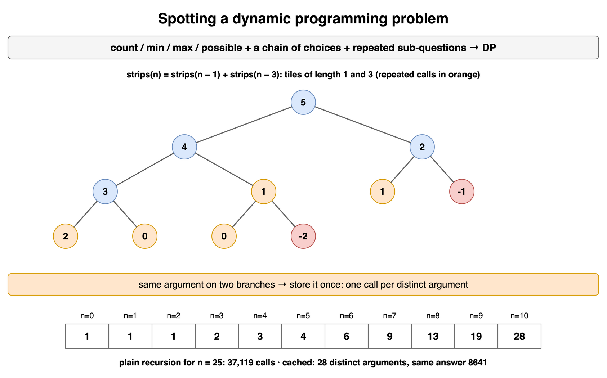

*Source: [`diagrams/dynamic-programming.drawio`](/content/11_Coding_Problems/23_Dynamic_Programming/diagrams/dynamic-programming.drawio), page 1.*

## State, recurrence, and base cases

Every DP answer is written in four steps. First, define the state in one sentence, such as "`best[n]` is the fewest perfect squares that add up to n". Second, write the recurrence by asking what the last decision could have been: the last square used was some k², so `best[n] = 1 + min(best[n - k*k])` over every k with k² ≤ n. Third, set the base cases that stop the recursion: `best[0] = 0`. Fourth, say where the answer sits (`best[n]`) and in which order the table can be filled (increasing n, because every entry reads smaller indices).

Say the state and recurrence aloud before writing code; most wrong DP solutions come from a vague state, not from a typo in the loop. A state needs exactly the information the remaining decisions depend on and nothing more, which is the point of [State definition](#07_Data_Structures_and_Algorithms/08_Recursion_and_Dynamic_Programming/concepts/state-definition). The cost is the number of states times the work per state: here n states with up to √n choices each, O(n√n) time and O(n) space.

```python
from math import isqrt


def fewest_squares(n: int) -> int:
    best = [0] + [n] * n
    for m in range(1, n + 1):
        for k in range(1, isqrt(m) + 1):
            best[m] = min(best[m], 1 + best[m - k * k])
    return best[n]


print([fewest_squares(n) for n in (1, 7, 12, 13, 100)])
# [1, 4, 3, 2, 1]
```

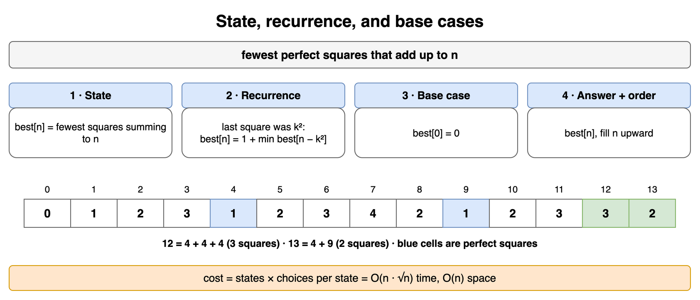

*Source: [`diagrams/dynamic-programming.drawio`](/content/11_Coding_Problems/23_Dynamic_Programming/diagrams/dynamic-programming.drawio), page 2.*

## Top-down and bottom-up

Top-down means writing the recursion and caching each result ([Memoization](#07_Data_Structures_and_Algorithms/08_Recursion_and_Dynamic_Programming/concepts/memoization)). It is the fastest to write because it is the recurrence with a cache attached, and it only visits states the answer actually needs. Bottom-up means filling a table in an order where every entry's inputs are already filled ([Tabulation](#07_Data_Structures_and_Algorithms/08_Recursion_and_Dynamic_Programming/concepts/tabulation)). It has no recursion-depth limit (Python stops at about 1,000 frames by default) and no per-call overhead, and it makes space savings visible.

The conversion is mechanical. The memo key becomes the table index, the base cases become the first filled cells, and the fill order follows the arrows of the recurrence: if `ways(n, k)` reads `ways(n - 1, k - 1)` and `ways(n - 1, k)`, fill row n - 1 before row n. In an interview, if the table order is not obvious, write top-down first, check it on a small case, then convert. Both versions below count k-item groups from n items with the rule "the last item is in the group or it is not", and both cost O(n · k).

```python
from functools import lru_cache


@lru_cache(maxsize=None)
def groups_top_down(n: int, k: int) -> int:
    if k == 0 or k == n:
        return 1
    return groups_top_down(n - 1, k - 1) + groups_top_down(n - 1, k)


def groups_bottom_up(n: int, k: int) -> int:
    table = [[0] * (k + 1) for _ in range(n + 1)]
    for i in range(n + 1):
        for j in range(min(i, k) + 1):
            table[i][j] = 1 if j in (0, i) else table[i - 1][j - 1] + table[i - 1][j]
    return table[n][k]


print(groups_top_down(10, 4), groups_bottom_up(10, 4))
print(groups_bottom_up(40, 20))
# 210 210
# 137846528820
```

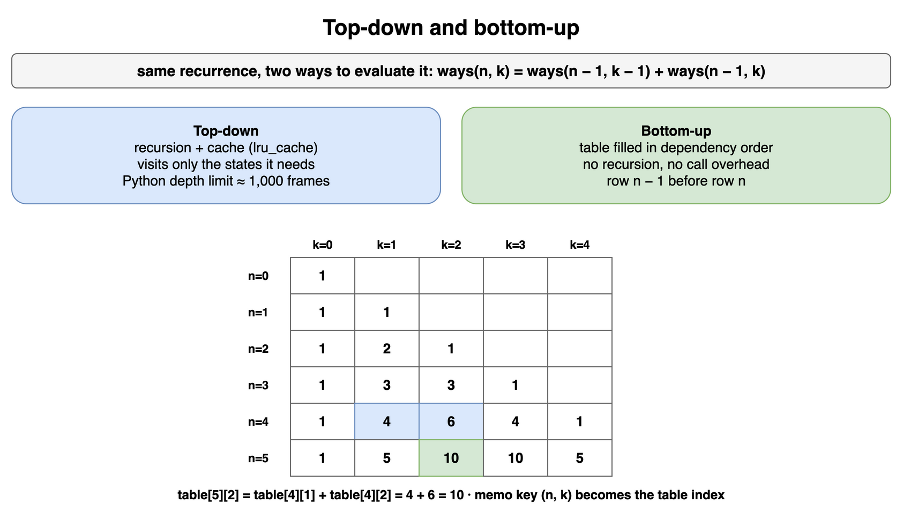

*Source: [`diagrams/dynamic-programming.drawio`](/content/11_Coding_Problems/23_Dynamic_Programming/diagrams/dynamic-programming.drawio), page 3.*

## Keeping only the rows you read

Once a table is filled bottom-up, look at which earlier cells each entry reads. If row i reads only row i - 1, keep one or two rows instead of the whole table; if `dp[i]` reads only `dp[i - 1]` and `dp[i - 2]`, keep two variables. That turns O(n · k) space into O(k), or O(n) into O(1). The general pattern is [Space optimization](#07_Data_Structures_and_Algorithms/08_Recursion_and_Dynamic_Programming/concepts/space-optimization).

With a single row updated in place, the loop direction decides whether a cell reads the old value or one already overwritten in this pass. In the group-count table, `row[j]` needs the previous row's `row[j - 1]`, so j must run from high to low; running low to high reads the new `row[j - 1]` and the counts come out wrong. The same rule separates 0/1 knapsack from the unbounded version. The price of keeping one row is that the full table is gone, so the choices behind the answer cannot be traced back without it.

```python
def groups_one_row(n: int, k: int, downward: bool = True) -> int:
    row = [1] + [0] * k
    for _ in range(n):
        order = range(k, 0, -1) if downward else range(1, k + 1)
        for j in order:
            row[j] += row[j - 1]
    return row[k]


print(groups_one_row(10, 4), groups_one_row(10, 4, downward=False))
# 210 715
```

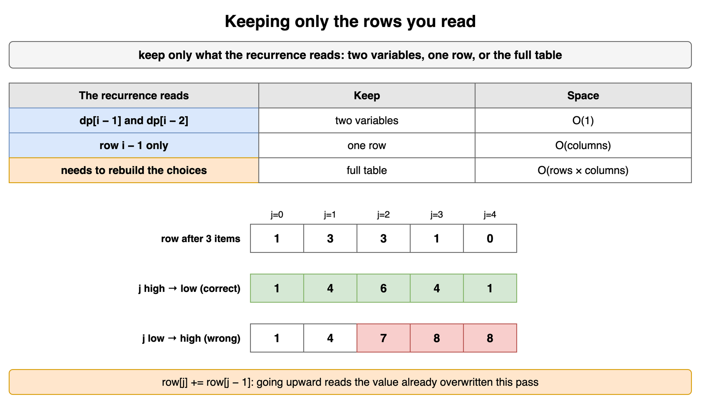

*Source: [`diagrams/dynamic-programming.drawio`](/content/11_Coding_Problems/23_Dynamic_Programming/diagrams/dynamic-programming.drawio), page 4.*

## Table shapes: one and two dimensions

Most interview DP falls into a handful of table shapes, listed on [Common DP patterns](#07_Data_Structures_and_Algorithms/08_Recursion_and_Dynamic_Programming/concepts/common-dp-patterns). One-dimensional: `dp[i]` over a sequence prefix (stairs, houses, decodings) or "best ending at i" (maximum subarray). Two-dimensional: a grid where `dp[r][c]` reads its top and left neighbours; two strings where `dp[i][j]` describes the first i characters of one and the first j of the other; items by capacity (knapsack); and a substring range `dp[i][j]` filled by increasing length (palindromes).

Naming the shape gives the size of the table, the base row and column, and the fill order straight away. For two strings, row 0 and column 0 stand for an empty prefix, which is why the table is (m + 1) × (n + 1). The example counts how many times `t` appears as a subsequence of `s`. If the last characters match, either use the match or skip `s[i - 1]`; otherwise skip it. An empty `t` appears once in anything. The cost is O(m · n) time and space.

```python
def times_as_subsequence(s: str, t: str) -> int:
    m, n = len(s), len(t)
    dp = [[1] + [0] * n for _ in range(m + 1)]
    for i in range(1, m + 1):
        for j in range(1, n + 1):
            dp[i][j] = dp[i - 1][j]
            if s[i - 1] == t[j - 1]:
                dp[i][j] += dp[i - 1][j - 1]
    return dp[m][n]


print(times_as_subsequence("banana", "ban"), times_as_subsequence("banana", "ana"))
print(times_as_subsequence("abc", ""), times_as_subsequence("ab", "abc"))
# 3 4
# 1 0
```

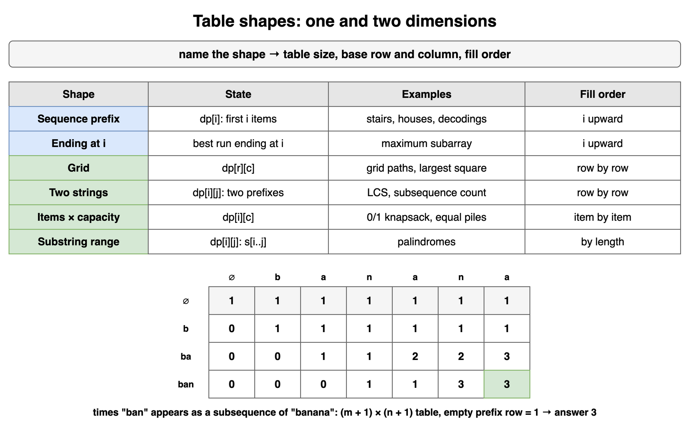

*Source: [`diagrams/dynamic-programming.drawio`](/content/11_Coding_Problems/23_Dynamic_Programming/diagrams/dynamic-programming.drawio), page 5.*

## Climbing stairs

Count the ways to climb n steps when each move goes up one or two steps. The last move was either a single step from n - 1 or a double step from n - 2, so `ways(n) = ways(n - 1) + ways(n - 2)`, with `ways(1) = 1` and `ways(2) = 2` (or, equivalently, `ways(0) = 1`). The plain recursion repeats the same calls and takes O(2^n) time; caching it or filling an array gives O(n) time and O(n) space.

Each entry reads only the two before it, so two variables are enough: O(n) time and O(1) space. This problem is the template for the whole topic: write the recurrence, check it on n = 3 (three ways: 1+1+1, 1+2, 2+1), then shrink the storage. Clarify n = 0 (one way, by doing nothing, or invalid input) before coding. Adding a third step size only adds a third term, and a forbidden step only zeroes its entry.

```python
def climb(n: int) -> int:
    if n <= 2:
        return max(n, 1)
    two_back, one_back = 1, 2
    for _ in range(3, n + 1):
        two_back, one_back = one_back, two_back + one_back
    return one_back


print([climb(n) for n in range(1, 9)])
print(climb(45))
# [1, 2, 3, 5, 8, 13, 21, 34]
# 1836311903
```

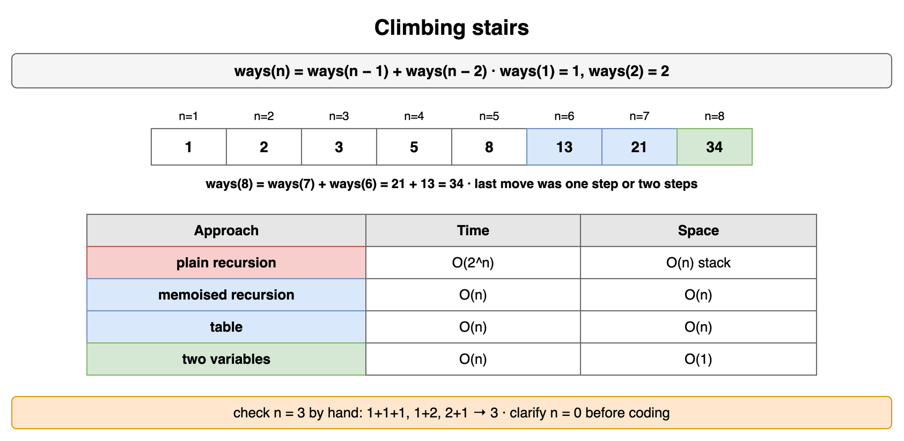

*Source: [`diagrams/dynamic-programming.drawio`](/content/11_Coding_Problems/23_Dynamic_Programming/diagrams/dynamic-programming.drawio), page 6.*

## Fewest coins for a target

Given coin values with unlimited supply, find the fewest coins that add up to a target, or -1 if none do. The last coin used was some c, so `best[t] = 1 + min(best[t - c])` over every coin c ≤ t, with `best[0] = 0` and every other entry starting at infinity to mean "not reachable yet". Fill t from 1 upward. The cost is O(target · coins) time and O(target) space, which is pseudo-polynomial: it grows with the value of the target, not with the number of digits needed to write it.

Greedy (always take the largest coin that fits) is right for some coin systems, such as 1, 5, 10, 25, and wrong in general. With coins 1, 5, 6, and 9, greedy makes 11 as 9 + 1 + 1, three coins, while 5 + 6 uses two. The two usual bugs are returning infinity instead of -1 when the target cannot be reached, and starting entries at 0, which makes every amount look free. "Fewest" or "most" over a sequence of choices is a strong DP signal.

```python
def fewest_coins(coins: list[int], target: int) -> int:
    inf = float("inf")
    best = [0] + [inf] * target
    for t in range(1, target + 1):
        for c in coins:
            if c <= t and best[t - c] + 1 < best[t]:
                best[t] = best[t - c] + 1
    return -1 if best[target] == inf else int(best[target])


def greedy_coins(coins: list[int], target: int) -> int:
    used = 0
    for c in sorted(coins, reverse=True):
        used, target = used + target // c, target % c
    return used if target == 0 else -1


print(fewest_coins([1, 5, 6, 9], 11), greedy_coins([1, 5, 6, 9], 11))
print(fewest_coins([4, 6], 7), fewest_coins([4, 6], 0))
# 2 3
# -1 0
```

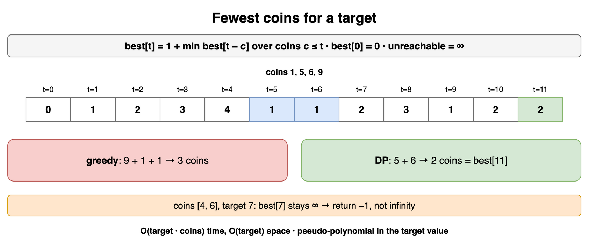

*Source: [`diagrams/dynamic-programming.drawio`](/content/11_Coding_Problems/23_Dynamic_Programming/diagrams/dynamic-programming.drawio), page 7.*

## Counting grid paths

Count the routes from the top-left to the bottom-right of an m × n grid when each move goes one cell right or one cell down. A cell is entered either from above or from the left, so `paths[r][c] = paths[r - 1][c] + paths[r][c - 1]`. Every cell in the first row and the first column has exactly one route (a straight line). The full table costs O(m · n) time and space.

Each row reads only the row above and the cell to its left, so one row updated left to right is enough: `row[c] += row[c - 1]`, where `row[c]` still holds the value from above when it is read. That is O(n) space, and choosing n as the shorter side gives O(min(m, n)). As an aside, every route is a sequence of m - 1 downs and n - 1 rights, so the count is the binomial coefficient C(m + n - 2, m - 1), but the table version extends to blocked cells and cell costs while the formula does not.

```python
from math import comb


def grid_paths(m: int, n: int) -> int:
    row = [1] * n
    for _ in range(1, m):
        for c in range(1, n):
            row[c] += row[c - 1]
    return row[-1]


print(grid_paths(3, 7), comb(3 + 7 - 2, 3 - 1))
print(grid_paths(1, 5), grid_paths(12, 12))
# 28 28
# 1 705432
```

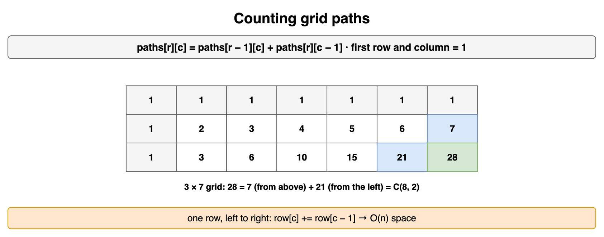

*Source: [`diagrams/dynamic-programming.drawio`](/content/11_Coding_Problems/23_Dynamic_Programming/diagrams/dynamic-programming.drawio), page 8.*

## Robbing houses that are not neighbours

Houses on a street hold some amount of money each, and taking from two neighbouring houses is not allowed. For each house, either skip it and keep the best total up to the previous house, or take it and add its money to the best total up to two houses back: `best[i] = max(best[i - 1], best[i - 2] + money[i])`. The answer is the last entry. Only the two previous values are read, so two variables give O(n) time and O(1) space.

Handle an empty street (0) and a single house (its value) explicitly or make the variables start at 0 so they fall out naturally. The common follow-up puts the houses in a circle, where the first and last are neighbours. Any valid choice leaves out the first house or leaves out the last, so run the straight-street version twice, once without each end, and take the larger result. On `[9, 1, 1, 9]` the straight street gives 18, but in a circle the two 9s touch and the answer drops to 10.

```python
def best_haul(money: list[int]) -> int:
    two_back, one_back = 0, 0
    for amount in money:
        two_back, one_back = one_back, max(one_back, two_back + amount)
    return one_back


def best_haul_circle(money: list[int]) -> int:
    if len(money) == 1:
        return money[0]
    return max(best_haul(money[1:]), best_haul(money[:-1]))


print(best_haul([6, 1, 2, 9, 4]), best_haul([]), best_haul([7]))
print(best_haul([9, 1, 1, 9]), best_haul_circle([9, 1, 1, 9]))
# 15 0 7
# 18 10
```

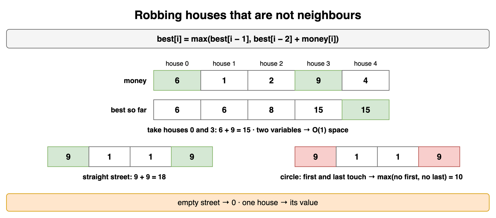

*Source: [`diagrams/dynamic-programming.drawio`](/content/11_Coding_Problems/23_Dynamic_Programming/diagrams/dynamic-programming.drawio), page 9.*

## Longest common subsequence

A subsequence keeps characters in order but may skip some; a substring may not skip. For strings a and b, let `lcs[i][j]` be the answer for the first i characters of a and the first j of b. If `a[i - 1] == b[j - 1]`, that character extends the answer for both shorter prefixes: `lcs[i][j] = 1 + lcs[i - 1][j - 1]`. Otherwise one of the two last characters is not used: `lcs[i][j] = max(lcs[i - 1][j], lcs[i][j - 1])`. Row 0 and column 0 are 0 (an empty prefix shares nothing). The cost is O(m · n) time and space.

Each row reads only the previous row, so the length alone needs O(min(m, n)) space. Recovering the actual subsequence needs the full table: start at the bottom-right corner and step diagonally on a match, otherwise toward the larger neighbour, as in [Reconstructing the solution](#07_Data_Structures_and_Algorithms/08_Recursion_and_Dynamic_Programming/concepts/reconstructing-the-solution). Line-based `diff` tools solve a closely related problem: the lines kept unchanged between two versions of a file form a common subsequence, and everything else is shown as removed or added. More string tables are on [DP on strings](#11_Coding_Problems/07_Hard_Problems/concepts/dp-on-strings).

```python
def lcs(a: str, b: str) -> str:
    m, n = len(a), len(b)
    table = [[0] * (n + 1) for _ in range(m + 1)]
    for i in range(1, m + 1):
        for j in range(1, n + 1):
            if a[i - 1] == b[j - 1]:
                table[i][j] = 1 + table[i - 1][j - 1]
            else:
                table[i][j] = max(table[i - 1][j], table[i][j - 1])
    out: list[str] = []
    i, j = m, n
    while i and j:
        if a[i - 1] == b[j - 1]:
            out.append(a[i - 1])
            i, j = i - 1, j - 1
        elif table[i - 1][j] >= table[i][j - 1]:
            i -= 1
        else:
            j -= 1
    return "".join(reversed(out))


print(lcs("planet", "plants"), len(lcs("planet", "plants")))
print(repr(lcs("abc", "xyz")), lcs("garden", "danger"))
# plant 5
# '' gr
```

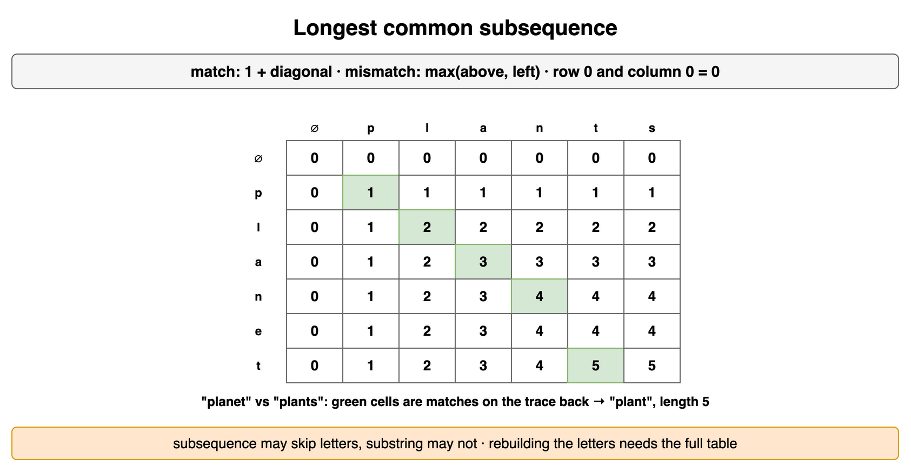

*Source: [`diagrams/dynamic-programming.drawio`](/content/11_Coding_Problems/23_Dynamic_Programming/diagrams/dynamic-programming.drawio), page 10.*

## Longest palindromic substring

The table version sets `pal[i][j]` to true when `s[i..j]` reads the same both ways: the end characters match and the inside `s[i + 1..j - 1]` is a palindrome. Every single character is a palindrome and a pair is one when its two characters match. Because each entry reads a shorter range, fill by increasing length, not by increasing i. That costs O(n²) time and O(n²) space.

Expanding around centres costs the same time with O(1) extra space and is easier to get right on a whiteboard. Every palindrome has a centre: either one character (odd length) or the gap between two (even length), so there are 2n - 1 centres. From each, widen while the two ends match and keep the longest. Forgetting the even centres misses answers like `"abba"`. A linear-time method exists (Manacher's algorithm), but interviews rarely expect it.

```python
def longest_palindrome(s: str) -> str:
    best_lo, best_hi = 0, 0
    for centre in range(2 * len(s) - 1):
        lo, hi = centre // 2, (centre + 1) // 2
        while lo >= 0 and hi < len(s) and s[lo] == s[hi]:
            lo, hi = lo - 1, hi + 1
        if hi - lo - 1 > best_hi - best_lo:
            best_lo, best_hi = lo + 1, hi
    return s[best_lo:best_hi]


print(longest_palindrome("xracecarz"), longest_palindrome("cabbad"))
print(repr(longest_palindrome("")), longest_palindrome("qz"))
# racecar abba
# '' q
```

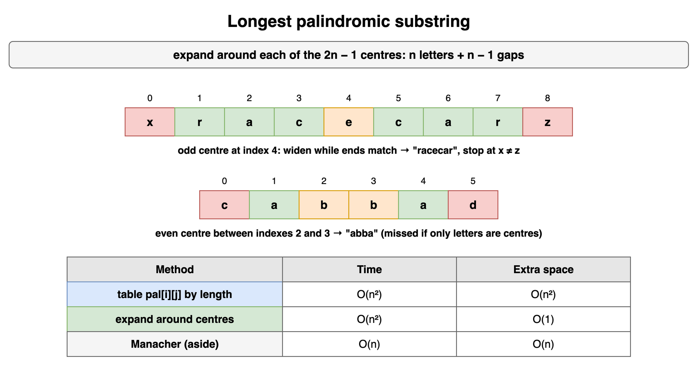

*Source: [`diagrams/dynamic-programming.drawio`](/content/11_Coding_Problems/23_Dynamic_Programming/diagrams/dynamic-programming.drawio), page 11.*

## Maximum subarray sum

Find the largest sum of a non-empty run of consecutive values. Let `here[i]` be the best sum of a run that ends exactly at index i. That run either starts fresh at i or extends the best run ending at i - 1, so `here[i] = max(x, here[i - 1] + x)`. The answer is the largest `here[i]` seen. Keeping only the previous value gives Kadane's algorithm: one pass, O(n) time, O(1) space.

Start both the running value and the best from the first element, not from 0: with all values negative, the answer is the largest single value, and a 0 start would report an empty run that the problem does not allow. Ask what to return for an empty array. A sliding window does not work here, because a negative value may be worth keeping when a large positive value follows it. To report where the run lies, remember the start index whenever the run restarts.

```python
def max_run(nums: list[int]) -> tuple[int, int, int]:
    here = best = nums[0]
    start = best_lo = best_hi = 0
    for i in range(1, len(nums)):
        if here + nums[i] < nums[i]:
            here, start = nums[i], i
        else:
            here += nums[i]
        if here > best:
            best, best_lo, best_hi = here, start, i
    return best, best_lo, best_hi


print(max_run([-3, 4, -1, 3, -6, 5, -2]))
print(max_run([-4, -2, -7]))
# (6, 1, 3)
# (-2, 1, 1)
```

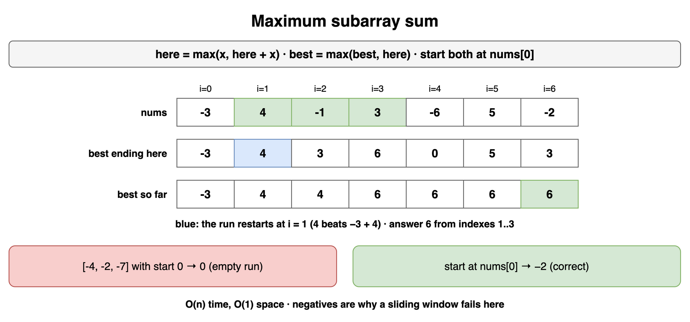

*Source: [`diagrams/dynamic-programming.drawio`](/content/11_Coding_Problems/23_Dynamic_Programming/diagrams/dynamic-programming.drawio), page 12.*

## 0/1 knapsack

Each item has a weight and a value and can be packed at most once; find the largest total value whose weight fits a capacity. Let `best[i][c]` be the best value using the first i items with capacity c. Item i is either left out, giving `best[i - 1][c]`, or packed when it fits, giving `value + best[i - 1][c - weight]`. Row 0 and column 0 are 0. The cost is O(n · capacity) time and space, pseudo-polynomial in the capacity. The general choice pattern is [Knapsack-style choices](#07_Data_Structures_and_Algorithms/08_Recursion_and_Dynamic_Programming/concepts/knapsack-style-choices).

Each row reads only the previous row, so one array of size capacity + 1 is enough, but the capacity loop must run from high to low. Running upward lets the cell for c - weight already include the same item, which packs it twice: that is the unbounded knapsack, a different problem. With weights 2, 3, 4, values 3, 5, 6 and capacity 6, the 0/1 answer is 9 (weights 2 and 4) and the upward loop reports 10 (two copies of weight 3).

```python
def knapsack(weights: list[int], values: list[int], cap: int, downward: bool = True) -> int:
    best = [0] * (cap + 1)
    for w, v in zip(weights, values):
        order = range(cap, w - 1, -1) if downward else range(w, cap + 1)
        for c in order:
            best[c] = max(best[c], v + best[c - w])
    return best[cap]


print(knapsack([2, 3, 4], [3, 5, 6], 6), knapsack([2, 3, 4], [3, 5, 6], 6, downward=False))
print(knapsack([5], [10], 4), knapsack([1, 3, 4, 5], [1, 4, 5, 7], 7))
# 9 10
# 0 9
```

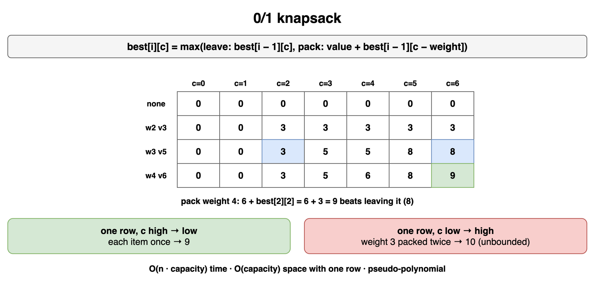

*Source: [`diagrams/dynamic-programming.drawio`](/content/11_Coding_Problems/23_Dynamic_Programming/diagrams/dynamic-programming.drawio), page 13.*

## Largest square of ones

In a grid of 0s and 1s, find the area of the largest square made only of 1s. Let `side[r][c]` be the side of the largest all-1 square whose bottom-right corner is (r, c). A 0 cell gives 0. A 1 cell gives `1 + min(top, left, top-left)`, because the square can grow only as far as the smallest of the three squares it overlaps. Cells in the first row or column can only be 1 or 0. Track the largest side and return its square: the question asks for area, not side length.

The full table is O(m · n) time and space. Each row reads only the previous row, so one row of size n + 1 is enough, but the top-left value lives in the cell about to be overwritten at the previous column, so save it in a variable before writing. A padding cell at index 0 removes the special case for the first column.

```python
def largest_square(grid: list[list[int]]) -> int:
    cols = len(grid[0]) if grid else 0
    row = [0] * (cols + 1)
    best = 0
    for cells in grid:
        top_left = 0
        for c in range(1, cols + 1):
            above = row[c]
            row[c] = 1 + min(row[c], row[c - 1], top_left) if cells[c - 1] else 0
            top_left = above
            best = max(best, row[c])
    return best * best


grid = [
    [1, 0, 1, 1, 0],
    [1, 1, 1, 1, 1],
    [0, 1, 1, 1, 1],
    [1, 1, 1, 1, 0],
]
print(largest_square(grid), largest_square([[0, 0]]), largest_square([[1]]))
# 9 0 1
```

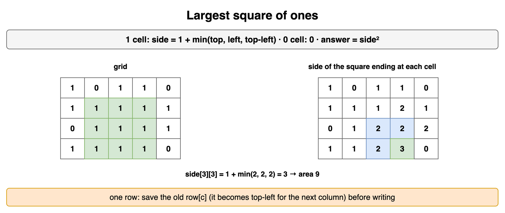

*Source: [`diagrams/dynamic-programming.drawio`](/content/11_Coding_Problems/23_Dynamic_Programming/diagrams/dynamic-programming.drawio), page 14.*

## DP, greedy, or backtracking

All three tools make a sequence of choices. Greedy commits to the locally best choice and never revisits it; it is the fastest and needs a proof (or a known result) that the local choice is always safe. DP tries every choice at each step but shares answers between states, so it fits counts and best values when the state is a few small numbers. Backtracking also tries every choice but shares nothing; it fits "list them all" questions and states too large to tabulate, as covered in [Backtracking or dynamic programming](#11_Coding_Problems/22_Backtracking/concepts/backtracking-or-dynamic-programming) and [Backtracking vs. DP](#07_Data_Structures_and_Algorithms/08_Recursion_and_Dynamic_Programming/concepts/backtracking-vs-dp).

The same input can need different tools for different questions. On a row of jump lengths, "can the end be reached" is greedy in O(n): track the furthest index reachable so far. "How many jump sequences reach the end" needs DP, because each index adds its count to every index it can reach. In an interview, state which tool fits and why, try to break greedy with a small counterexample, and say the DP recurrence aloud before coding, as [Is this a DP problem?](#07_Data_Structures_and_Algorithms/08_Recursion_and_Dynamic_Programming/concepts/is-this-a-dp-problem) suggests.

```python
def can_reach_end(jumps: list[int]) -> bool:
    furthest = 0
    for i, j in enumerate(jumps):
        if i > furthest:
            return False
        furthest = max(furthest, i + j)
    return True


def count_routes(jumps: list[int]) -> int:
    ways = [1] + [0] * (len(jumps) - 1)
    for i, j in enumerate(jumps):
        for k in range(i + 1, min(i + j, len(jumps) - 1) + 1):
            ways[k] += ways[i]
    return ways[-1]


print(can_reach_end([2, 3, 1, 1, 4]), count_routes([2, 3, 1, 1, 4]))
print(can_reach_end([3, 2, 1, 0, 4]), count_routes([3, 2, 1, 0, 4]))
# True 4
# False 0
```

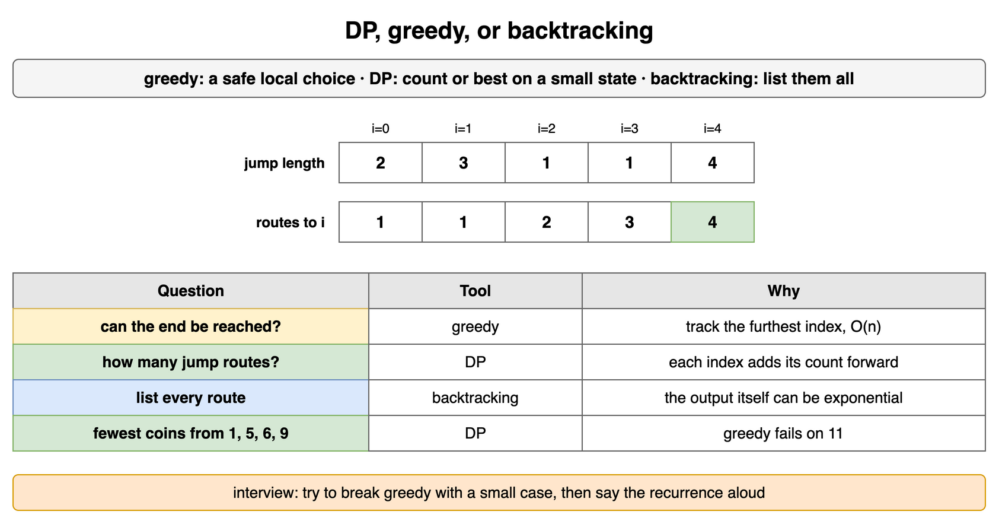

*Source: [`diagrams/dynamic-programming.drawio`](/content/11_Coding_Problems/23_Dynamic_Programming/diagrams/dynamic-programming.drawio), page 15.*
